Source: "Osce Sub specialty SURGERY MDCU76 rotate C" (the first part of "OSCE MEQ SUBSPE SURGERY rotate C MDCU76", dated August 2023 in the paper), stations recalled by students, mixed Thai and English. The paper was sat at the end of the whole surgery rotation, so it combines General Surgery and subspecialty content and is filed whole. It is a low-priority set (see CLAUDE.md). The MEQ part of the same exam is in `mdcu76-sx-c-meq`.
Numbers Q1-Q12 are the paper's own.
Answers: the key is "Solution for OSCE, MEQ sub specialty MDCU76 rotate C by KP, Tae, Tan, Gift, Lilly, and academic team MDCU76" (file "solution OSCE MEQ SUBSPE SURGERY rotate C MDCU76 by rotate D", 23 pages, with a link for corrections). It is a copy of the paper with short typed and handwritten answers, pasted slides, screenshots of a teaching video and the students' own study notes. It is a key written by students and the academic team, NOT an official key, and may contain mistakes. Its answers are put in the Checklist line (what the examiner would look for) and its extra notes in the Explanation line; handwriting that is hard to read is summarised or marked as unclear. Q7 has no answer in the key.
Pictures: pictures with no name, label or ID band are kept in images/ under their station. The Q3 picture is left out because it carries a website watermark. The credit line on the Q10 picture is cropped out. The pictures in Q8 and Q9 are listed in the paper's order; the letters A-E in Q9 are drawn on the paper's page and are not inside the image files.
exam_year 2023 is given in the paper (August 2023); the exact day is not kept.
The rotation letter (C) is not mapped to a G.

## Q1 (original no. 1)
ให้แสดงการล้างมือด้วยเจลแอลกอฮอล์ และทำแผล Dry dressing

**Station type:** hand hygiene and wound dressing
**Checklist:** hand rubbing with alcohol gel (the key pastes the WHO hand-rub chart); dry dressing: open the dressing set, use two forceps, antiseptic (Betadine / chlorhexidine) and normal saline, clean the wound from the inside outwards, change the gauze for the outer circle, wipe in one direction only so that germs are not carried back to the wound, do not go back and forth, then apply the dressing along the skin crease (student key; not official)
**Explanation:** the key is a set of screenshots from a teaching video of the dressing steps with the student's handwritten notes (partly unclear in the scan); the note about wiping and the skin crease is marked with stars as important
**Guideline / source:** not stated

## Q2 (original no. 2)
Please describe the lesion, and diagnosis.

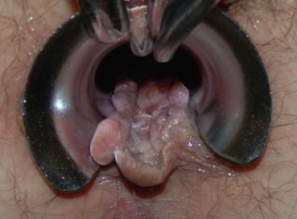

**Station type:** picture description and diagnosis
**Checklist:** describe: hypertrophic anal papilla, fibrotic edge, internal sphincter (visible), sentinel pile; diagnosis: chronic anal fissure; treatment: LIS (lateral internal sphincterotomy) plus advice on lifestyle modification (dietary change: more fibre; bulk-forming agent(?); exercise); a note says not to forget something about acute anal fissure (unclear) (student key; not official)
**Explanation:** the key marks the same picture with arrows to each finding and adds a second photograph of the lesion through a speculum; the key's notes are handwritten and partly unclear
**Guideline / source:** not stated

## Q3 (original no. 3)
What are these 2 medical devices? Please name 2 diseases and its surgical procedure which require the given instrument.
[picture in the paper: a colostomy base plate and a colostomy pouch; left out because the image carries a website watermark]

**Station type:** instrument identification
**Checklist:** colostomy base plate and colostomy pouch; diseases: carcinoma of the rectum (surgical procedure APR, abdominoperineal resection) and carcinoma of the anal canal; a pasted slide lists the indications for APR (carcinoma rectum with involvement of the external sphincter or levators; carcinoma rectum with poor sphincter function; carcinoma anal canal after failed neo-adjuvant chemoradiotherapy) (student key; not official)
**Explanation:** not stated
**Guideline / source:** not stated

## Q4 (original no. 4)
ผู้ป่วยอายุ 44 ปี แสดงการตรวจเต้านมและต่อมน้ำเหลือง + กรณีไม่พบความผิดปกติ ให้การแนะนำแก่ผู้ป่วย

**Station type:** examination (breast and lymph nodes) and counselling
**Checklist:** counselling when nothing is found: screening - over 40 years, mammogram every 1 year; self breast examination every 1 month (student key; not official)
**Explanation:** the key adds a pasted breast-examination checklist and a figure of a breast examination on a model; the checklist text is too small to read in the scan
**Guideline / source:** not stated

## Q5 (original no. 5)
ผู้ป่วยอายุ 60 ปี เดินแล้วปวดขามา 3 วัน แสดงการซักประวัติผู้ป่วย และการตรวจเพิ่มเติม

**Station type:** history taking and further investigation
**Checklist:** DDx: chronic venous insufficiency (CVI) - varicose veins, duplex ultrasound; peripheral arterial disease (PAD) - Brodie-Trendelenburg test, ABI, pulses of the extremities, duplex ultrasound (student key; not official)
**Explanation:** pages 18-21 of the key are handwritten study notes on this station: CVI (eczema, causes by valve reflux and obstruction, specific signs, Brodie-Trendelenburg test, duplex ultrasound, CEAP classification C0-C6, aetiology including post-thrombotic syndrome and May-Thurner syndrome, drugs such as MPFF and sulodexide, sclerosing agent and endovenous ablation, compression stockings) and PAD (history of intermittent claudication, how to tell it from CVI, sciatica and spinal causes, pulse and bruit examination, ABI, risk factor control with LDL, HbA1c and blood pressure, antiplatelet, exercise 3-4 sessions per week of 30 minutes, revascularisation for chronic limb-threatening ischaemia); the handwriting is mostly too small or unclear to copy line by line
**Guideline / source:** not stated

## Q6 (original no. 6)
แสดงการใส่ถุงมือ disposable glove และเย็บแผล Vertical mattress 2 คำ

**Station type:** gloving and suturing
**Checklist:** gloving steps shown as screenshots of a teaching video with the student's notes (the notes are too unclear to copy; they mention picking up the glove at the inner side and turning it back to the same hand); vertical mattress: the key gives only the label "vertical mattress" and a link to a video (student key; not official)
**Explanation:** the notes are partly unclear in the scan; the video link is not copied
**Guideline / source:** not stated

## Q7 (original no. 7)
ให้หุ่น prostate exam มา ให้ล้วงตรวจเอง ให้บรรยาย lesion และแสดงการวินิจฉัย

**Station type:** examination (rectal examination on a model) and diagnosis
**Checklist:** not given in the source
**Explanation:** not stated
**Guideline / source:** not stated

## Q8 (original no. 8)
มีอุปกรณ์มาให้ ถามว่าคืออะไรและใช้ทำอะไร

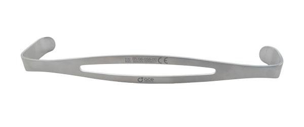
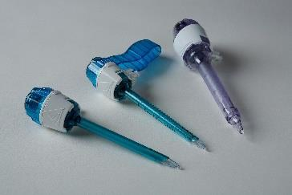
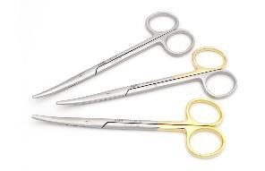
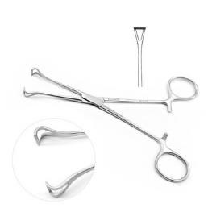
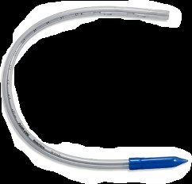

**Station type:** instrument identification
**Checklist:** Army Navy retractor - tissue retraction in a minor surgical site; trocar - working port through which instruments are inserted for laparoscopic surgery; curved Mayo scissors - cut large or thick tissue, cut deeper tissue from the surface; Babcock clamp - hold tubular structures of the viscera atraumatically, for example the appendix; chest tube - drainage from the pleural space (student key; not official)
**Explanation:** the key writes each name beside its picture; the five pictures are listed here in the paper's order (retractor, ports, scissors, clamp, tube)
**Guideline / source:** not stated

## Q9 (original no. 9)
คนไข้ผ่าตัดไส้เลื่อน ทำ herniorrhaphy เย็บซ่อม hernia ด้วย___ เย็บปิด external oblique aponeurosis ด้วย___ ระหว่างเย็บชั้นไขมันเลือดออก ต้องผูก artery ด้วย___ จากนั้นจึงปิด skin ด้วย___, และ ใช้เทคนิคเย็บคือ _____
1. เติมอักษรในช่องว่าง
2. บอกชื่อไหมทั้ง5
3. บอกชื่อวัสดุ ของไหมทั้ง 5
4. บอกคุณสมบัติของไหมทั้ง5

A 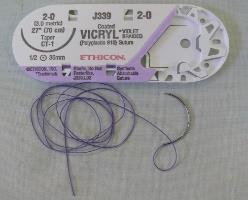
B 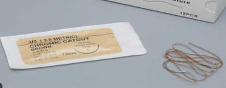
C 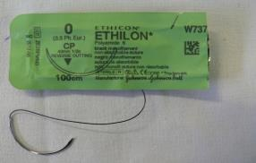
D 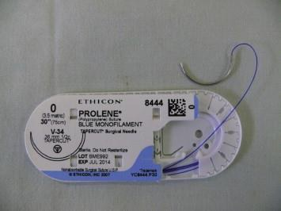
E 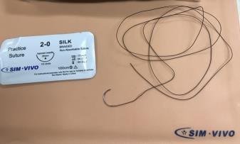

**Station type:** suture identification
**Checklist:** A Vicryl - polyglactin, absorbable synthetic, multifilament; B catgut - cattle gut, absorbable natural, monofilament; C nylon - polyamide, non-absorbable synthetic, monofilament; D Prolene - polypropylene, non-absorbable synthetic, monofilament; E silk - product of the silk worm, non-absorbable natural, multifilament (student key; not official)
**Explanation:** the key does not fill in the blanks of the first part and does not say which suture goes with which step; it draws a blue slash across A, C and D without saying why; the letter of each name is taken from where the key places the name beside the picture
**Guideline / source:** not stated

## Q10 (original no. 10)
ผู้ป่วยชาย 20 ปี มาด้วยเจ็บนิ้วโป้งเท้าและเล็บบวม ถามว่าคืออะไร สาเหตุสำคัญ 2 ข้อ และวิธีการรักษา

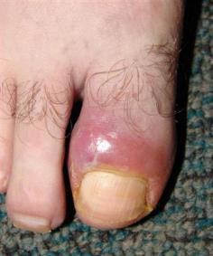

**Station type:** picture diagnosis and management
**Checklist:** paronychia; causes: cutting the nail wrongly, wearing wrong shoes; treatment: warm soak 3-4 times a day, oral antibiotics, I&D, remove the nail (student key; not official)
**Explanation:** the credit line printed at the foot of the picture is cropped out
**Guideline / source:** not stated

## Q11 (original no. 11)
ผู้ป่วยชาย 30 กว่าปี มีไข้ขึ้นและมีแผลที่ถุงอัณฑะ ถามว่าเป็นโรคอะไร รักษายังไง

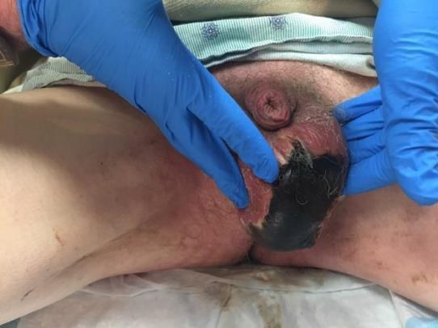

**Station type:** picture diagnosis and management
**Checklist:** Fournier gangrene; emergency radical debridement plus antibiotics (student key; not official)
**Explanation:** not stated
**Guideline / source:** not stated

## Q12 (original no. 12)
วินิจฉัยและ surgical management

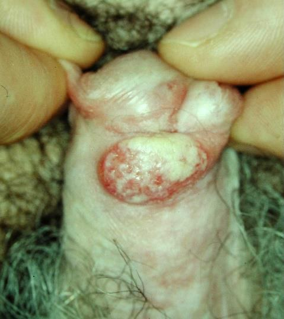

**Station type:** picture diagnosis and management
**Checklist:** diagnosis: penile tumour; treatment: incisional biopsy (student key; not official)
**Explanation:** not stated
**Guideline / source:** not stated

## Flagged for checking
- The key is written by students and the academic team, not an official key. Worth checking: Q9 (which suture goes with which step of the operation; the blue slashes across A, C and D are unexplained), Q4 (screening advice) and the Q5 study notes.
- Q7 has no answer in the key.
- The Q3 picture is not included (watermark).
