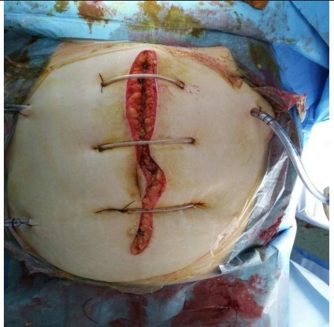

Source: "OSCE SURGERY SUB SPE rotate D MDCU76" (page 2 of "Osce meq subspe MDCU76 rotate D", dated October 2023 in the paper), stations recalled by students, mixed Thai and English. The paper says: 12 stations, 1 rest station, 4 minutes per station. The paper was sat at the end of the whole surgery rotation, so it combines General Surgery and subspecialty content and is filed whole. It is a low-priority set (see CLAUDE.md). The MEQ part of the same exam is in `mdcu76-sx-d-meq`. The paper says the whole exam has 26 questions of 100 points each, equal for every question.
Numbers Q1-Q12 are the paper's own. Answers: the key file "Key OSCE MEQ 76 rotate D" (a copy of the paper with a student's handwritten answers) is used; its answers are copied in the Checklist lines marked as a student key, NOT an official key, and may be wrong; a station the key does not answer says "not given in the source". The names written inside some stems (for example "A = Penrose drain", "B = one-way catheter" in Q5 and the five instruments in Q12) are the students' own recall of what was on the table; they are part of the stem as written and are not treated as a key.
Pictures: only the Q5 picture (an open abdominal wound with drains and retention sutures, no face, name or label) is in the paper and is kept in images/. The other stations mention pictures that are not in the paper.
exam_year 2023 is given in the paper (October 2023); the exact day is not kept.
The rotation letter (D) is not mapped to a G.

## Q1 (original no. 1)
กิน Vixol 30 min PTA (ให้รูป + สารประกอบมาด้วย), อาการ และ ตรวจร่างกาย stable ทุกอย่าง, management อะไรดี (the picture is not included in the paper)

**Station type:** history and management (toxic ingestion)
**Checklist:** corrosive ingestion, very early; ABC / primary survey; airway: endotracheal tube (if stridor or airway compromise); NPO, no NG lavage; endoscopy (within 12-24 hours) for severity grading; chest and abdominal film for signs of oesophageal perforation or necrosis; IV fluid and antibiotics; stricture surveillance; the key notes that an eschar of the oesophagus and stomach necrosis can occur (from the key's handwritten notes; student key, not official)
**Explanation:** not stated
**Guideline / source:** not stated

## Q2 (original no. 2)
(อาจารย์คุม) ซักประวัติ วินิจฉัย คนไข้มาด้วยปวดท้อง 6 ชม.ก่อน acute appendicitis

**Station type:** history taking and diagnosis
**Checklist:** history by LODCRAFT plus specific signs: psoas sign, obturator sign, Rovsing's sign (the key pastes a picture of rebound tenderness, Rovsing, psoas and obturator signs) (from the key's handwritten notes; student key, not official)
**Explanation:** not stated
**Guideline / source:** not stated

## Q3 (original no. 3)
(อาจารย์คุม) ใส่ถุงมือ sterile + แสดงการฉีดยาชา

**Station type:** sterile gloving and local anaesthetic injection
**Checklist:** not given in the source
**Explanation:** not stated
**Guideline / source:** not stated

## Q4 (original no. 4)
ให้ดู 3 way catheterของจริง ถามว่าคือะไร+ถามขนาด (ดูที่สาย), จงบอกวิธีการใช้, ยกตัวอย่างว่าใช้กรณีไหน

**Station type:** instrument identification
**Checklist:** 3-way catheter; indication: continuous bladder irrigation, for example to prevent urinary tract obstruction by blood clot in a patient presenting with haematuria; it is not for stopping bleeding; if there is a lot of clot when the patient first presents, use a 2-way catheter (from the key's handwritten notes; student key, not official)
**Explanation:** not stated
**Guideline / source:** not stated

## Q5 (original no. 5)
ให้รูปคนไข้ท้องปริ มี drain (A) + มี retention suture (ใช้ยางสีแดง) ปิดหน้าท้องไว้ และมีA,B ของจริงวางไว้
ถามว่า A คืออะไร,ทำงานยังไง,ยกตัวอย่างการใช้ B ทำมาจากอะไร A = Penrose drain, หลักการเป็นยังไง, ยกตัวอย่างสถานการณ์ที่ใช้, นี่คือการเย็บอะไร, B = one-way catheter
คล้ายๆงี้

**Station type:** instrument identification and picture interpretation
**Checklist:** A = Jackson-Pratt drain: a closed active drain (suction), used for post-operative fluid collection after abdominal or thoracic surgery; Penrose drain: an open passive drain (no negative pressure) placed at the surgical site; the key's notes on B (the one-way catheter) are too unclear to read (from the key's handwritten notes; student key, not official)
**Explanation:** not stated
**Guideline / source:** not stated

## Q6 (original no. 6)
รูปรูก้น มีก้อนนูนแดงเจ็บอะไรบางอย่างอยู่ dx และ management (the picture is not included in the paper)

**Station type:** picture diagnosis and management
**Checklist:** excision of the blood clot; haemorrhoidectomy, not rubber band ligation (the key writes "thrombosed? external? haemorrhoid?"); plus lifestyle modification (fibre, water, exercise, toilet habit), stool softener and analgesics (from the key's handwritten notes; student key, not official)
**Explanation:** not stated
**Guideline / source:** not stated

## Q7 (original no. 7)
ให้รูป ฟีลด์ผ่าตัดมา มี Babcock clamp คีบอะไรบางอย่างอยู่, วินิจฉัย, นี่คือการผ่าอะไร, post-op order (รูป appendix) (the picture is not included in the paper)

**Station type:** picture diagnosis and post-operative orders
**Checklist:** open appendectomy; Babcock clamp = an atraumatic clamp for holding viscera; post-operative order: if uncomplicated - no antibiotics or antibiotics for up to 24 hours (the handwriting is partly unclear); if complicated - IV ceftriaxone 1-2 g every 12-24 hours plus IV metronidazole 500 mg every 8 hours (from the key's handwritten notes; student key, not official)
**Explanation:** not stated
**Guideline / source:** not stated

## Q8 (original no. 8)
(อาจารย์คุม) One handed technique+simple interrupted suture 2 เข็ม ถ้าผูกแล้วเชือกไม่ติดกันจะโดนให้ผูกใหม่

**Station type:** suturing and knot tying
**Checklist:** not given in the source
**Explanation:** not stated
**Guideline / source:** not stated

## Q9 (original no. 9)
NF เท้าซ้าย ให้ dx กับ management (the picture is not included in the paper)

**Station type:** picture diagnosis and management
**Checklist:** necrotizing fasciitis: wound debridement, then wet dressing while waiting for granulation tissue, then skin graft or flap; IV fluid, monitor intake and output and signs of sepsis; IV antibiotics covering anaerobes, Gram-positive and Gram-negative organisms (mostly type I, polymicrobial): the key writes piperacillin-tazobactam IV 4 g + 500 mg every 6 hours with clindamycin 900 mg every 8 hours, plus vancomycin 15-20 mg/kg every 12 hours if MRSA is suspected (the heading before the regimen reads "ตามสูตร WHO"; handwriting partly unclear); tissue culture and Gram stain (from the key's handwritten notes; student key, not official)
**Explanation:** not stated
**Guideline / source:** not stated

## Q10 (original no. 10)
(อาจารย์คุม) แสดงวิธีการตรวจร่างกาย PR และดูรูปแล้วบอกว่า diag อะไร, คนไข้เป็น thrombosed prolapsed hemorrhoid?? Circumferential??? (มีคนไข้จำลองมาให้ซักก่อนด้วย)

**Station type:** examination (rectal examination), history and diagnosis
**Checklist:** not given in the source
**Explanation:** not stated
**Guideline / source:** not stated

## Q11 (original no. 11)
อุบัติเหตุของมีคมบาดลงกล้ามเนื้อ เย็บกล้ามเนื้อใช้….. เย็บชั้นไขมันใช้…. เลือดซึมออกเลยเย็บเส้นเลือดดำใช้…. เย็บผิวหนังใช้….. เย็บแบบอะไร (ให้รูป vertical mattress suture) ไหมแต่ละชนิดบอกชื่อการค้า ชื่อสามัญ จำนวนเส้นใยและการละลายด้วย //มีซองสีม่วง ซองสีเทา ซองสีเขียว ซองสี… ไหมเปล่าๆสีดำ(ไม่มีซองให้ ต้องดูดีๆ บางคนวางกระดาษทับอันนี้ ชั้นวางทับเอง หานานมากกว่าจะเจอ)

**Station type:** suture identification
**Checklist:** the key's table: Ethilon (nylon) - not absorbable - monofilament; Vicryl (polyglactin) - absorbable - multifilament; silk (for ligating) - not absorbable - multifilament; Prolene (polypropylene) (for anastomosis) - not absorbable - monofilament; Vicryl (polyglactin) - absorbable - multifilament; the Thai labels beside the rows (muscle, fat, vein, skin) are written at the left margin and it is not clear which row each label belongs to (from the key's handwritten notes; student key, not official)
**Explanation:** not stated
**Guideline / source:** not stated

## Q12 (original no. 12)
อุปกรณ์วางเรียงกัน 5 อย่าง ให้บอกชื่อ กับประโยชน์แต่ละอย่างมา 1 ข้อ A = army navy retractor, B = curved mayo scissors, NG tube, Babcock clamp, chest tube

**Station type:** instrument identification
**Checklist:** A army navy retractor - retract skin for better visualisation of the operative field; B curved Mayo scissors - cut thick tissue such as muscle or breast; C NG tube - decompress, deliver nutrients and medication, diagnostic (gastric content, blood), lavage; D Babcock clamp - atraumatic clamp for tubular structures such as the appendix, viscera, bowel, fallopian tube; E chest drain (thoracic catheter) - drain pleural fluid (from the key's handwritten notes; student key, not official)
**Explanation:** not stated
**Guideline / source:** not stated

## Flagged for checking
- The answers come from a student's handwritten key, not an official key; some handwriting is unclear.
- Q1, Q6, Q7 and Q9 refer to pictures that are not in the paper.
