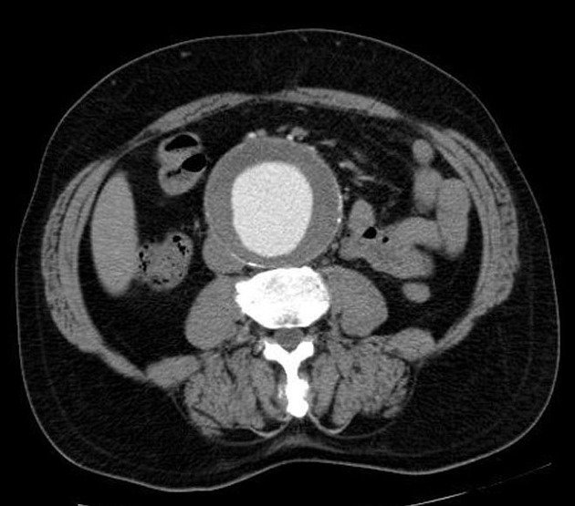
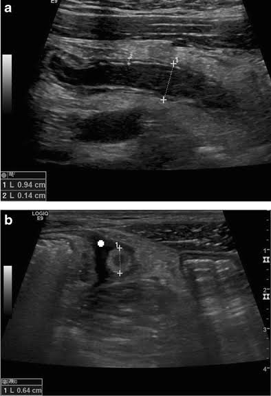
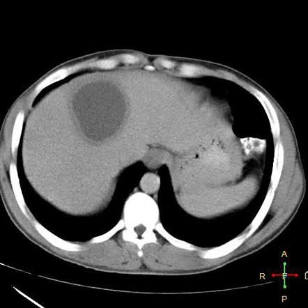
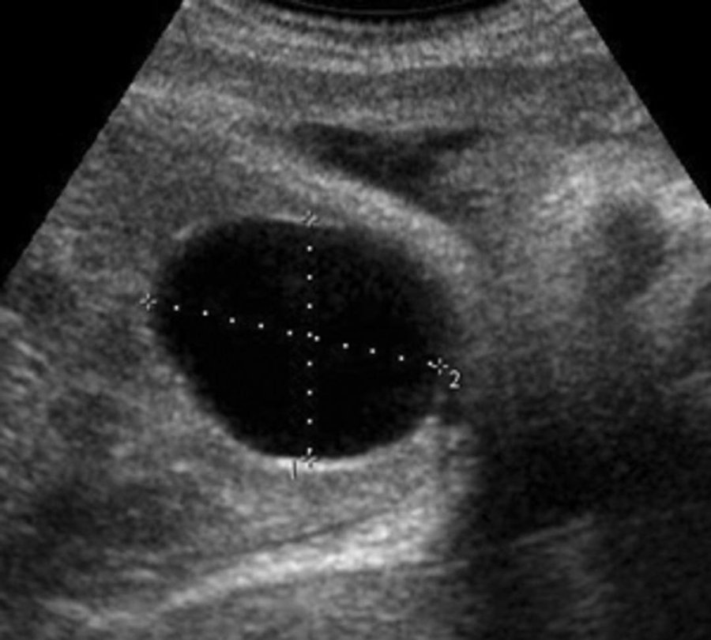
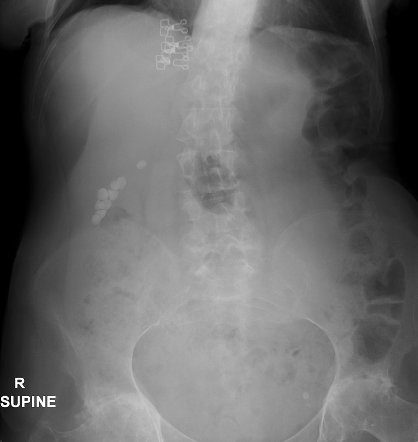
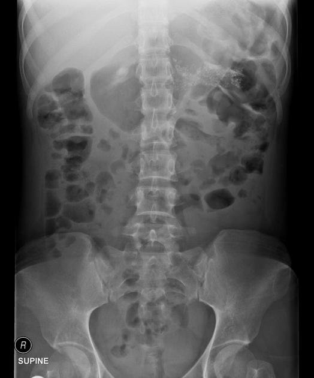
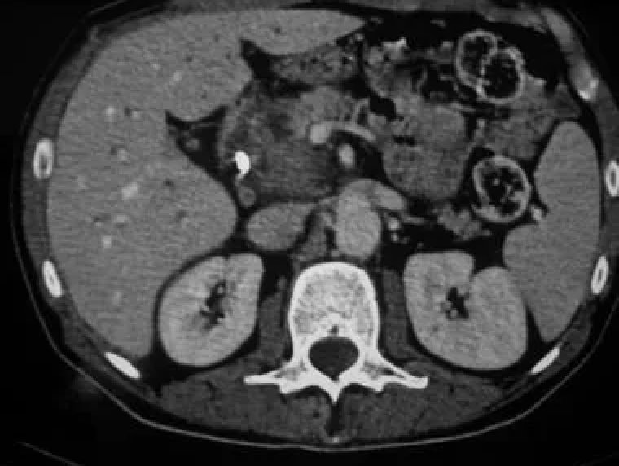
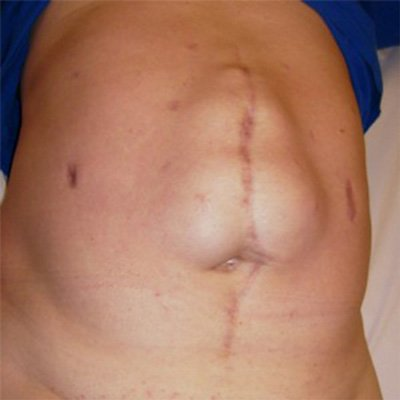
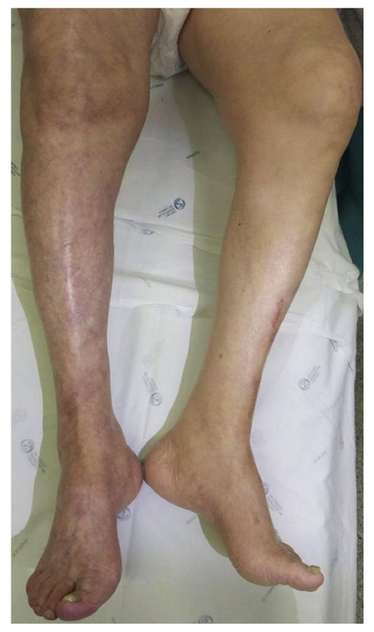

Source: "AC77 General Surgery Rotate A" (file "AC 77A Gen Sx MCQ"), questions recalled by students; the numbers are the
paper's own, so the gap (no Q67) is kept. 72 of the 73 numbers are present.
Stems and choices are as students recalled them, in their own words and languages (Thai and English). Choices the paper
numbers or letters in lower case are written A-E; choices the paper does not list are not added, so some questions have fewer
than five choices.
Answers: "Key MCQ 77 RoA" by MDCU 78 students (file "Key AC77 RoA MCQ Gen Sx"), a key written by students. It is NOT an official key and
may contain mistakes. The key's explanations are copied as written (mostly Thai). Where the key is unsure it says so (a "?", two
letters, or an empty cell) and this file shows that exactly. The key's Q67 row says "ไม่มี" (none), because the paper has no Q67.
exam_year 2025 is the PDF's own creation date (January 2025); the paper does not state the year.
The rotation letter (A) is not mapped to a G.
In Q14 the paper itself carries a note, kept as written: it names a lecturer as the source of the answer under choice A.
Pictures with no name, label or ID band were checked by eye and are kept in images/ under their question; the others are described in words only. Left out: the photo of aspirated pus in Q8, which is a pasted slide whose caption prints the diagnosis; the hands photo in Q35, which shows a wristband; the neck photo in Q66, which has a handwritten label; a copyright credit and measurement text at the bottom of the Q26 ultrasound were cropped off.

## Q1 (original no. 1)
อะไรไม่อยู่ใน spermatic cord

A. Genital branch of genitofemoral nerve
B. Ilioinguinal nerve
C. Pampiniform plexus
D. Testicular artery
E. Vas deferens

**Answer:** B
**Explanation:** key: Spermatic cord มี testicular a, ductus deferens a., cremasteric a., pampiniform venous plexus, cremasteric n., genital branch of genitofemoral n., vas deferens, cremasteric muscle, lymphatic, sympathetic n. ส่วน ilioinguinal n. อยู่ใน inguinal canal แต่อยู่นอก spermatic cord
**Guideline / source:** not stated

## Q2 (original no. 2)
What is the most common cause of the disease in the figure?
[picture in the paper: an axial CT scan of the abdomen]

A. Atherosclerosis
B. Fungal infection
C. Medial cystic necrosis
D. Chronic vasculitis

**Answer:** A
**Explanation:** key: รูปนี้คือ abdominal อะไรืิ aortic aneurysm พอง ๆ สาเหตุหลักมาจาก atherosclerosis
**Guideline / source:** not stated

## Q3 (original no. 3)
A patient underwent total thyroidectomy. After the surgery, the patient developed hoarseness. Which nerve is injured during the procedure?

A. Deep cervical plexus
B. Superficial cervical plexus
C. External branch of superior laryngeal nerve
D. Internal branch of superior laryngeal nerve
E. Hypoglossal nerve

**Answer:** C
**Explanation:** key: Injury ต่อ nerve มักเกิดที่ external branch of superior laryngeal n. แต่ไม่ค่อยมีอาการ หรือถ้ามีคือเสียงแหบถ้าขึ้นเสียงสูง รองลงมาคือ recurrent laryngeal nerve ที่ทำให้เห็นเสียงแหบชัด แต่ไม่มีในช้อย Superficial, deep cervical plexus เลี้ยงพวก neck muscle อื่นๆ อันอื่นก็ไม่เกี่ยว
**Guideline / source:** not stated

## Q4 (original no. 4)
A patient underwent total thyroidectomy. Soon after the surgery, the patient developed an audible stridor. Osat was 92% on cannula 3 LPM. You were a first year surgical resident, which shouldn't be done?

A. Increase O2 cannula to 15 LPM
B. Clot evacuation bedside
C. Notify senior surgeon
D. Set OR emer
E. CT lateral neck emer

**Answer:** E
**Explanation:** key: cause of post thyroidectomy airway obstruction ได้แก่ 1. vocal cord edema (Tx = epinephrine, steroid) 2. Hematoma (Tx = surgical clot evacuation ผู้รู้บอกว่าให้รีบ resuscitate ก่อน มันชอบเกิดหลังจากทำไม่นาน ถ้าใกล้ OR ก็เข้า OR ถ้าไม่ก็ evacuate ตรงนั้นเลย แต่ CT มันช้า เลยไม่ทำ
**Guideline / source:** not stated

## Q5 (original no. 5)
An 18-year-old woman presented to the emergency department with nausea, fever and periumbilical pain for 4 hours. PE: Soft, RLQ tenderness, USG shown non compressible tubular structure as shown below. What is the most likely diagnosis?
[picture in the paper: two ultrasound images (a and b) of a tubular structure in the right lower abdomen with measurements marked]

A. Acute appendicitis
B. Pelvic inflammatory disease
C. Acute cholangitis
D. Small bowel obstruction

**Answer:** A
**Explanation:** key: อาการใช่ + KW: non compressible appendix, size > 6 mm
**Guideline / source:** not stated

## Q6 (original no. 6)
Breast ทำ guidewire needle excision patho เป็น LCIS แต่ positive margin ER3+ PR3+ ทำไรดีจ๊ะ

A. Mastectomy
B. Wide excision + SLNB
C. RE wide excision + radiotherapy
D. Postop radiation + hormonal therapy
E. Follow up in 6 months

**Answer:** E
**Explanation:** key: ER+, PR+ = classic LCIS → ถึงตัดแล้ว positive margin ก็ไม่เป็นไร ไม่ต้อง reexcision ใช้ closed F/U เอา ทุก 6 เดือน
**Guideline / source:** not stated

## Q7 (original no. 7)
Transfusion แล้วไข้ขึ้นหนาวสั่น อะไรไม่ควรทำ

A. Reduce rate of transfusion
B. Administer intravenous crystalloid
C. Administer intravenous steroid
D. Notify blood bank
E. Prepare epinephrine and CPR

**Answer:** A
**Explanation:** key: ไข้ขึ้นหนาวสั่น = category 2 → ควรหยุด transfusion (not slow) + notify blood bank, เตรียมให้ IV fluid และ epinephrine ถ้า BP drop, เตรียมให้ IV steroid ถ้า airway obstruction
**Guideline / source:** not stated

## Q8 (original no. 8)
A 32-year-old man presented with RUQ pain. He has a history of diarrhea 1 week ago which spontaneously resolved. CT abdomen was shown in the figure. The aspirated content is as shown below. What is the most likely diagnosis?
[picture in the paper: an axial CT scan of the upper abdomen with a low-density lesion in the liver]

[picture in the paper: a photo of three bottles of aspirated pus (left out of this file)]

A. Amoebic liver abscess
B. Pyogenic liver abscess
C. Necrosis
D. Liver cyst

**Answer:** A
**Explanation:** key: ประวัติท้องเสีย น่าจะ E. histolytica colitis + anchovy paste colored pus
**Guideline / source:** not stated

## Q9 (original no. 9)
Which organ transplantation from a dead donor has the highest successful rate? (lowest rejection rate)

A. Liver
B. Kidney
C. Cornea
D. Pancreas
E. Heart

**Answer:** C
**Explanation:** key: Cornea เป็น immune privileged site? ตามรูปนี้
**Guideline / source:** not stated

## Q10 (original no. 10)
ข้อไหนไม่ใช่ hypotonic loss

A. Sweat
B. Vomit
C. Insensible water loss from respiration
D. Vaporization from skin
E. Urine in diabetes insipidus

**Answer:** B
**Explanation:** key: Vomit = isotonic loss
**Guideline / source:** not stated

## Q11 (original no. 11)
A patient presented with fever with abdominal pain at epigastrium. Work up: total bilirubin 4.2, common bile duct dilate 12 mm without CBD stone, multiple gallstones in gallbladder. What is the most appropriate next step management?

A. ERCP with stent
B. MRCP
C. Cholecystectomy
D. EUS

**Answer:** A
**Explanation:** key: อาการเข้าว่าเป็น acute cholangitis ตาม AGSE criteria เลยไปทำ ERCP
**Guideline / source:** not stated

## Q12 (original no. 12)
ผู้ป่วย portal vein thrombosis with portal HT อาการใดไม่ได้เกิดจาก portal HT ในเคสนี้

A. Varice
B. Splenomegaly
C. Palmar erythema
D. Ascites
E. Thrombocytopenia

**Answer:** C
**Explanation:** key: Palmar erythema เป็นอาการจาก estrogen imbalance ที่เกิดเฉพาะในคนไข้ cirrhosis
**Guideline / source:** not stated

## Q13 (original no. 13)
A woman presented with RUQ pain and fever. Ultrasonography revealed pericholecystic fluid. The patient opted for conservative management with antibiotics and intravenous fluids. However, after one day, her condition deteriorated. What should be the next step?

A. ERCP
B. Cholecystectomy

**Answer:** B? (as written in the key)
**Explanation:** not stated in the key
**Guideline / source:** not stated

## Q14 (original no. 14)
A patient with underlying cirrhosis child-pugh B found to have 4 cm live mass in segment VIII. Further investigation revealed that the mass is HCC. What is the most appropriate treatment?
ใครตัดค่าแลปผม -อ.บัณฑูร

A. Liver transplant อ.บัณฑูรบอกตอบข้อนี้ เพราะ child B ตัดตับได้ 25% ถ้า resection จะเหลือไม่ พอ จะ postop liver failure
B. Liver resection
C. TACE
D. Chemotherapy

**Answer:** A (the key says "ตามอาจารย์", following the lecturer; the paper's own note under choice A gives the same)
**Explanation:** key: ตามอาจารย์
**Guideline / source:** not stated

## Q15 (original no. 15)
ผู้ชายหนัก 70 kg เพิ่งผ่าตัดมา ต้องการพลังงานเท่าไร

A. 1750-2100 kcal/day
B. 2100-2800 kcal/day
C. 3000-4000 kcal/day

**Answer:** A? (as written in the key)
**Explanation:** key: BMR ผู้ชาย = 25-30 kcal/kg/day ผ่าตัด minor surgery คือคูณ 1-1.2 ผ่า major surgery คือคูณ 1.3-1.55 คิดเลขแล้วตรงสุดคือ 1750-2100 คือคิดว่าเป็น minor surgery จะได้  25*70*1 = 1750 ถึง 25*70*1.2 = 2100 If ผ่า major surgery = 25*70*1.3 = 2275 ถึง 30*70*1.55 = 3255 ไม่มีช้อย
**Guideline / source:** not stated

## Q16 (original no. 16)
A patient with colorectal cancer and liver metastases is scheduled for liver resection. However, the remaining liver volume after resection is insufficient to sustain survival. What steps should be taken before surgery?

A. RFA
B. External radiation
C. Arterial embolization
D. Portal vein embolization

**Answer:** D
**Explanation:** key: Portal vein embolization ใช้เพื่อลดขนาด liver metastasis
**Guideline / source:** not stated

## Q17 (original no. 17)
A 65-year-old woman presented with right flank pain radiating to right groin. GA: female writhing on floor, PE within normal limits. What is the most likely diagnosis?

A. Right ureteric stone
B. Acute cholecystitis
C. Acute appendicitis
D. Peptic ulcer perforation
E. Acute cholangitis

**Answer:** A
**Explanation:** key: ปวดร้าวลง groin คือ ureter, aorta แต่เริ่มปวด flank pain เลยนึกถึง KUB ที่สุด → ureteric  stone
**Guideline / source:** not stated

## Q18 (original no. 18)
A patient has pulsatile expansile mass with Grey-Turner sign (hematoma over left flank). What is the most likely diagnosis?

A. Ruptured aortic abdominal aneurysm
B. Ruptured renal cell carcinoma
C. Pancreatic hemorrhage

**Answer:** A
**Explanation:** key: KW: pulsatile expansile mass = AAA → มี grey turner sign ได้จากเลือดไหลเซาะ retroperitoneal fascia มา
**Guideline / source:** not stated

## Q19 (original no. 19)
ผู้ป่วยหนัก 60 kg ทำ local anesthesia for lipoma excision at back ด้วย 1% lidocaine without adrenaline ต้องฉีดกี่ ml

A. 10 ml
B. 17 ml
C. 27 ml
D. 60 ml

**Answer:** C
**Explanation:** key: Dose lidocaine without epi = 0.5 ml/kg → 0.5 * 60 = 30 ก็ประมาณๆ ตอบ 27 ได้อยู่ (Dose lidocaine with epi = 0.7 ml/kg)
**Guideline / source:** not stated

## Q20 (original no. 20)
Which is not included in “time out” process

A. Recheck the patient’s name, diagnosis and procedure
B. Recheck the complicated process that may be happened
C. Recheck the estimated blood loss
D. Recheck that the incision site is the same as marked site
E. Recheck pain at the incision site

**Answer:** E (the key's cell reads "bu E", as written)
**Explanation:** not stated in the key
**Guideline / source:** not stated

## Q21 (original no. 21)
A 85-year-old woman ยม ๆ with 8 cm hemangioma presenting with epigastric discomfort. What is the most appropriate treatment?

A. Follow-up and observation
B. Ethanol injection
C. Right hepatectomy
D. Segmentectomy
E. Arterial embolization

**Answer:** not given in the key (the key's answer cell is empty)
**Explanation:** not stated in the key
**Guideline / source:** not stated

## Q22 (original no. 22)
A known case of HCC with metastases was receiving palliative care. The patient later developed symptoms of spinal cord compression, and MRI revealed tumor invasion of the conus medullaris. What is the most appropriate treatment?

A. Radiotherapy
B. Chemotherapy
C. Set OR
D. Best supportive care

**Answer:** A
**Explanation:** key: กด cord ควร RT emer
**Guideline / source:** not stated

## Q23 (original no. 23)
A 28-year-old woman USG found hypoechoic mass and cystic BIRADs 3. What is next step management?

A. F/U q 6 months by USG
B. CNB
C. Excision
D. ทำ MRI เพิ่ม
E. ทำ mammogram เพิ่ม

**Answer:** A
**Explanation:** key: BIRADs 3 = F/U q 6 m ใน modality ที่เจอก้อน
**Guideline / source:** not stated

## Q24 (original no. 24)
คนไข้ open cholecystectomy จาก gangrenous cholecystitis มีไข้ขึ้น post-op day 5 ไม่เจ็บแผล เดิน ได้ ถอด foley NG ตั้งแต่ POD2 What is the most likely source of infection that need to be carefully ruled out?

A. Intra-abdominal collection
B. Wound infection
C. UTI
D. Postoperative atelectasis
E. Hospital acquired pneumonia

**Answer:** A? / E (as written in the key)
**Explanation:** not stated in the key
**Guideline / source:** not stated

## Q25 (original no. 25)
MRI found hyperechoic lesion both in T1,T2. CT with contrast found peripheral nodular enhancement in arterial phase, centripetal fill-in in portovenous phase. ไม่มีอาการ What is the most appropriate management?

A. Follow up
B. Liver resection

**Answer:** A
**Explanation:** key: Peripheral nodular enhancement = hemangioma → F/U
**Guideline / source:** not stated

## Q26 (original no. 26)
USG ตับ เจอ accidental finding คนไข้ไม่มีอาการ อะไรไม่ต้องทำ
[picture in the paper: an ultrasound image of a round anechoic lesion with measurement marks]

A. Unroof cyst Sx
B. Observe for clinical

**Answer:** A
**Explanation:** key: U/S = cyst → Tx = unroof ถ้ามีอาการ อันนี้ไม่มีก็ observe ไป
**Guideline / source:** not stated

## Q27 (original no. 27)
คนไข้ BMI 30 U/D HT, T2DM ทำ elective arthroplasty ตอนนี้แทบไม่ขยับเพราะขยับแล้วเจ็บ ให้อะไร เป็น prophylaxis for DVT

A. Low-molecular weight heparin night before operation
B. Aspirin day before operation
C. Sequential compression device
D. Early ambulation

**Answer:** C
**Explanation:** key: Arthroplasty = high risk → IPC and LMWH เลยงง ๆ ไม่รู้จะตอบ A/C แต่น่าจะให้ LMWH หลังจากผ่าเสร็จมั้งนะ
**Guideline / source:** not stated

## Q28 (original no. 28)
vWB factor ใช้ทำอะไร

A. Adhesion of platelets to subendothelial cell
B. Adhesion of platelets to platelet
C. Carrier of factor VII
D. Activate factor V
E. Adhesion of platelets to phospholipid bilayer

**Answer:** A
**Explanation:** not stated in the key
**Guideline / source:** not stated

## Q29 (original no. 29)
hyper K EKG ไม่เจออะไร

A. Tall peak T wave
B. Wide QRS complex
C. Prolong PR interval
D. Flattened T wave
E. Prominent U wave

**Answer:** D, E (as written in the key)
**Explanation:** key: เจอทั้งคู่ใน hypoK
**Guideline / source:** not stated

## Q30 (original no. 30)
A 56-year-old business man is scheduled for elective hernia repair. Social history: ดูดบุหรี่วันละ 5 มวน socially drink ทำอะไรสำคัญที่สุดเพื่อลด pulmonary complication

A. เลิกเหล้า 1 wk
B. เลิกบุหรี่ 2 wk
C. CXR with pulmonary function test

**Answer:** not given in the key (the key's answer cell is empty)
**Explanation:** key: น่าจะ B นะ ปกติ PFT ไม่ทำใน non-thoracic sx แต่บุหรี่ควรหยุดอย่างน้อย 30 วัน??
**Guideline / source:** not stated

## Q31 (original no. 31)
นิสิตปีสี่เข้าฟิวเคส open ไรซักอย่าง HBV positive patient ทำยังไงดี

A. บอกอจว่าปีสี่ไม่เข้าฟิวค่า
B. โยนให้เพื่อนเข้าแทน
C. ไปฉีดวัคซีน hepatitis B
D. ใส่ disposable gown, long glove with boots
E. ใส่ double glove with goggle

**Answer:** E
**Explanation:** key: Contact precaution
**Guideline / source:** not stated

## Q32 (original no. 32)
คนไข้ open hernioplasty ฉี่ไม่ออก ให้อะไรช่วย

A. Analgesia
B. Diuretics
C. Antibiotic

**Answer:** A
**Explanation:** key: ฉี่ไม่ออก (AUR) เพราะปวด
**Guideline / source:** not stated

## Q33 (original no. 33)
A 28-year-old woman presented with hand tremor, palpitation and neck mass. PE: diffuse enlarged thyroid gland. What are the expected results of TFT?

A. Increase T3, increase T4, decrease TSH
B. Increase T3, increase T4, normal TSH
C. Decrease T3, increase T4, decrease TSH

**Answer:** A
**Explanation:** key: Sx of hyperthyroid
**Guideline / source:** not stated

## Q34 (original no. 34)
ชาย BMI ~36 ลองลดน้้ำหนักแล้วไม่ลง อยาก bariatric surgery ข้อใดที่จะ exclude เค้าจากการผ่าตัด

A. OSA
B. T2DM
C. MDD
D. NASH
E. GERD

**Answer:** C
**Explanation:** key: ต้องไม่มีโรค psychi (MDD, schiz) + ไม่ติดเหล้าติดยา
**Guideline / source:** not stated

## Q35 (original no. 35)
มีปัญหาคลำ pulse ไม่ได้ ถามว่า vessel ไหนมีปัญหาบ้าง
1. Ulnar, radial artery
2. Digital artery
3. Digital vein
4. ??? vein
5. Subclavian artery
6. ??? vein (จำไม่ได้ค้าบ ซอรี่)
[picture in the paper: a photo of both palms with blackened fingertips on the right hand (left out of this file)]

A. 2
B. 1,2
C. 1,2,5
D. 1,2,3,4,5,6

**Answer:** B? (as written in the key)
**Explanation:** key: A ป่าว
**Guideline / source:** not stated

## Q36 (original no. 36)
อะไรไม่ใช่ complication ที่เกิดได้
[picture in the paper: a supine plain film of the abdomen]

A. Acute pancreatitis
B. Acute cholecystitis
C. Toxic cholangitis
D. Acute pyelonephritis
E. Small bowel obstruction

**Answer:** D
**Explanation:** key: GB stone
**Guideline / source:** not stated

## Q37 (original no. 37)
เด็กผชอายุ 8 ปี แม่สังเกตว่ามี groin mass ตอนวิ่งหรือเดิน ถามว่าจะตรวจเจออะไร

A. Occlusion test: ไม่มี protrusion ตอน apply pressure
B. Occlusion test: มี protrusion ด้าน medial
C. Occlusion test : มี protrusion ด้านใต้
D. Invagination test: ก้อนกระทบ lateral นิ้ว
E. Invagination test: เจอก้อนใน inguinal canal

**Answer:** A? / E? (as written in the key)
**Explanation:** key: เด็กน่าจะเป็น indirect ก็ได้ทั้ง 2 test
**Guideline / source:** not stated

## Q38 (original no. 38)
คนไข้ผ่า intussusception post-op day 5 อ้วก bilious vomiting ถ่ายไม่ออก PE: hyperactive bowel sound plain film เจอ step ladder pattern เกิดจาก

A. Adhesive small bowel obstruction
B. Pseudo colonic obstruction
C. Paralytic ileus
D. Recurrent intussusception

**Answer:** A
**Explanation:** key: Hx of Sx + sign of gut ob → adhesion band
**Guideline / source:** not stated

## Q39 (original no. 39)
ข้อไหนให้ appropriate antibiotic prophylaxis

A. Hernioplasty → Cefazolin
B. Lipoma excision → Cloxacillin
C. Laparoscopic cholecystectomy → Clindamycin
D. Colonoscopy → Ciprofloxacin + metronidazole

**Answer:** A
**Explanation:** key: Hernia = Clean wound + foreign body ให้ ATB เป็น cefazolin พอแล้ว Lipoma ไม่ต้องให้, LC ให้ ceftriaxone พอ, Colono ไม่ต้องให้
**Guideline / source:** not stated

## Q40 (original no. 40)
Severe pancreatitis admit ICU ตอนนี้ stable vital sign, off inotrope ได้ improve abdominal sign แต่ยัง partially depends on ventilator ให้ nutrition support ยังไง

A. NG
B. total parenteral nutrition
C. partial parenteral nutrition
D. 5% glucose solution with oral supplement เมื่อเริ่มกินได้
E. Jejunostomy

**Answer:** not given in the key (the key's answer cell is empty)
**Explanation:** not stated in the key
**Guideline / source:** not stated

## Q41 (original no. 41)
คนไข้มอไซล้มม้ามระเบิด ต้องตัดม้ามข้อไหนไม่ใช่ specific vaccine

A. Hib vaccine
B. Pneumococcal vaccine
C. Meningococcal vaccine
D. Influenza vaccine
E. Tetanus toxoid

**Answer:** E
**Explanation:** key: แนะนำ HiB, pneumococcal, meningococcal ก่อนตัดม้าม + influ ทุกปี
**Guideline / source:** not stated

## Q42 (original no. 42)
อะไรเป็น most common cause
[picture in the paper: a supine plain abdominal X-ray]

A. Alcohol
B. Hypertriglyceridemia
C. Drug induced
D. Hypercalcemia
E. Gallstone

**Answer:** A
**Explanation:** key: Film = chronic pancreatitis
**Guideline / source:** not stated

## Q43 (original no. 43)
เป็น DM type 1 + มี ESRD แน้ะ ทำไงดี

A. Simultaneous Pancreas + Kidney transplant
B. Kidney transplant
C. Pancreas transplant ก่อน ค่อย kidney transplant
D. ให้ insulin ไปเรื่อย ๆ

**Answer:** A
**Explanation:** not stated in the key
**Guideline / source:** not stated

## Q44 (original no. 44)
คนไข้หญิงแก่ อ้วกมา 2 วัน + dark yellow urine จะเจออะไร

A. Hypochloremic hypokalemic metabolic alkalosis
B. Hypochloremic hypokalemic metabolic acidosis
C. Hypochloremic hypokalemic respiratory alkalosis
D. Hypochloremic hypokalemic respiratory alkalosis
E. Normochloremic normokalemic metabolic alkalosis

**Answer:** A
**Explanation:** key: อ้วกเยอะ → hypoK hypoCl met alkalo
**Guideline / source:** not stated

## Q45 (original no. 45)
ผู้ชายอายุ 57 ปี อ้วกออกมาเป็น undigested food และ sour content partially response to ยาลดกรด น้้ำหนักลด a few kilograms in 2 months Urine: dark yellow color ถามว่าเป็น CA stomach อะไร

A. Pyloric antral CA
B. Intestinal type gastric cancer
C. GIST at esophagogastric junction
D. Linitis plastica
E. MALT lymphoma

**Answer:** A
**Explanation:** not stated in the key
**Guideline / source:** not stated

## Q46 (original no. 46)
ข้อใดถูกต้องเกี่ยวกับ spleen

A. Splenectomy with distal pancreatectomy is commonly done for cancer treatment
B. Splenic artery is the only blood supply of the spleen
C. Splenic vein thrombosis causes splenic atrophy
D. spleen กับ stomach ตัดจากกันด้วย avascular plane ได้

**Answer:** A
**Explanation:** key: เพราะ LN at tail อยู่ที่ spleen
**Guideline / source:** not stated

## Q47 (original no. 47)
ทำอะไรต่อ
[picture in the paper: an axial CT scan of the upper abdomen]

A. F/U
B. EUS + FNA
C. Splenectomy
D. Cholecystectomy
E. PET scan

**Answer:** D
**Explanation:** key: CT = CBD stone
**Guideline / source:** not stated

## Q48 (original no. 48)
พนักงานแคชเชียร์ทำงานทั้งวัน ขาบวม ส่งตรวจอะไร

A. Venous reflux test
B. Duplex ultrasound
C. Brodie-Trendelenberg test

**Answer:** B
**Explanation:** key: น่าจะ chronic venous insufficiency → 1st line = duplex u/s
**Guideline / source:** not stated

## Q49 (original no. 49)
ผู้ป่วยหญิง กินไม่ได้ทั้งของแข็งของเหลวมา 2 ปี แบบ intermittent น้้ำหนักลด 3 kg Esophagogram ให้ bird beak appearance What is the most appropriate definitive diagnosis?

A. Esophageal manometry
B. EGD
C. CT

**Answer:** A
**Explanation:** key: Sx = achalasia → Ix = barium swallowing & Esophageal manometry
**Guideline / source:** not stated

## Q50 (original no. 50)
คนไข้ epigastric pain after meal, กินยา OTC ดีขึ้น, related with stress, definite dx by

A. 24-hr pH monitoring
B. EGD

**Answer:** B
**Explanation:** key: Relate with stress = PU → Ix = EGD
**Guideline / source:** not stated

## Q51 (original no. 51)
คนไข้นั่งเครื่องบิน ขาบวมแดงร้อนข้างเดียว What is the most severe complication of the patient’s condition?

A. PE

**Answer:** A
**Explanation:** not stated in the key
**Guideline / source:** not stated

## Q52 (original no. 52)
Distal esophagus CA and biopsy shows SCC. T2N0M0 no lymph node involvement. What is the next management?

A. Esophagectomy
B. Definitive chemoradiotherapy
C. Neoadjuvant chemotherapy
D. Endoscopic submucosal resection

**Answer:** A
**Explanation:** key: อาจารย์บอกว่า T1N0, T2N0 = stage 1 → Tx = esophagectomy
**Guideline / source:** not stated

## Q53 (original no. 53)
Bloody nipple discharge กดที่ L2 แล้วไหลเพิ่ม What is the most likely diagnosis?

A. Intraductal papilloma
B. Intraductal carcinoma
C. Paget’s disease
D. Mastitis

**Answer:** A
**Explanation:** key: m/c cause of bloody nipple discharge = intraductal papilloma
**Guideline / source:** not stated

## Q54 (original no. 54)
Graft rejection after 2 weeks. Tacrolimus in therapeutic level ถามว่า reject จากอะไร

A. T-cell
B. B-cell
C. Macrophage
D. NK cell

**Answer:** not given in the key (the key's answer cell is empty)
**Explanation:** not stated in the key
**Guideline / source:** not stated

## Q55 (original no. 55)
ภรรยาบริจาคไตสามี 2 wk ฉี่แตก 400 cc/hr USG ดูแล้ว vessel ปกติดี สามี O ภรรยา A ทำอะไร

A. Stop fluid resuscitation
B. 0.45 saline ตามฉี่แตก
C. 0.45 saline with DDAVP
D. Colloid solution
E. 20% Albumin

**Answer:** B? (as written in the key)
**Explanation:** key: Polyuria เกิดได้ เดี๋ยวมันหายเอง ก็ให้น้ำ replace ไป
**Guideline / source:** not stated

## Q56 (original no. 56)
คนไข้ postprandial discomfort + N/V หลังอาหาร อ้วกเป็น acid + เศษอาหาร ไม่มี bile ปน EGD, colono normal ทำอะไรต่อ

A. Abdominal ultrasound
B. Barium swallowing
C. ERCP

**Answer:** not given in the key (the key's answer cell is empty)
**Explanation:** not stated in the key
**Guideline / source:** not stated

## Q57 (original no. 57)
อะไรเป็น functional obstruction

A. Gallstone ileus
B. Ogilvie syndrome
C. SMA syndrome
D. Volvulus
E. Intussusception

**Answer:** B
**Explanation:** not stated in the key
**Guideline / source:** not stated

## Q58 (original no. 58)
อายุ 18 ปวด RLQ WBC ขึ้น ผ่าไปไส้ติ่งปกติ ต้องหาอะไรอีก

A. Meckel’s diverticulitis
B. Ileocecal diverticulitis
C. Colonic diverticulitis

**Answer:** A
**Explanation:** not stated in the key
**Guideline / source:** not stated

## Q59 (original no. 59)
อายุ 18 เป็น complicated appendicitis แต่ขอ conservative treatment ท่านที่เป็นแพทย์ทราบว่าถ้า ไม่ผ่าตอนนี้ อนาคตจะผ่ายาก senoir surgeon บอกว่าดีแล้วที่เด็กตัดสินใจเองได้ ผิด ethics อะไร

A. No problem, respect to autonomy of patient
B. Non-maleficence, this may cause harm to the patient
C. Justice, all patient should receive free laparoscopic surgery
D. Confidentiality, his parents should make decision for him

**Answer:** B
**Explanation:** not stated in the key
**Guideline / source:** not stated

## Q60 (original no. 60)
ผู้ป่วยชาย ปวดท้องร้าวไปหลัง 6 hr lab อะไรช่วย confirm dx

A. Amylase 1,200 lipase 1,800
B. AST 400 ALT 500
C. Imaging findings: pseudocyst

**Answer:** A
**Explanation:** key: pancreatitisq21
**Guideline / source:** not stated

## Q61 (original no. 61)
A patient presented with sudden severe abdominal pain for 6 hours. PE: no liver dullness. What is the next proper investigation?

A. CXR
B. CT abdomen with contrast
C. X-ray supine abdomen

**Answer:** A
**Explanation:** key: No liver dullness = sign of free air → ควรทำ acute abdomen series แต่ดู air ดีสุดที่ CXR upright
**Guideline / source:** not stated

## Q62 (original no. 62)
A patient presented with a single thyroid nodule. TFT: euthyroid, FNA: papillary carcinoma ตรวจร่างกาย, imaging LN negative ทำอะไร

A. Total thyroidectomy +/- radioisotope iodine ablation
B. Total thyroidectomy + bilateral cervical LN dissection
C. Lobectomy

**Answer:** A
**Explanation:** key: Papillary CA = total thyroidectomy + radio I ablation + thyroid supplement in suppression dose
**Guideline / source:** not stated

## Q63 (original no. 63)
Post-gastrectomy, 2 hr postprandial มีใจสั่น มึน tachycardia เป็นอะไร

A. Late dumping syndrome
B. Early dumping syndrome
C. Afferent loop syndrome
D. Efferent loop syndrome

**Answer:** A
**Explanation:** key: อาการ hypoglycemia + เวลา หลักชั่วโมง = late dumpinga
**Guideline / source:** not stated

## Q64 (original no. 64)
Female patient presents with breast mass 5 cm fixed to chest wall, มี peau d’orange, ตรวจ ร่างกายเจอ matted, fixed ipsilateral axillary LN, ถาม management

A. Start neoadjuvant
B. Mastectomy + SLNB
C. Mastectomy + ALND

**Answer:** A
**Explanation:** key: T4c (fix to chest wall + peau d orange) + N2 (matted node) = locally advance → neoadjuvant +Sx
**Guideline / source:** not stated

## Q65 (original no. 65)
Hx Sx explore laparotomy, ต่อมามี mass โผล่ What is the most likely diagnosis?
[picture in the paper: a photo of the abdomen showing a midline scar and a bulge]

A. Incisional hernia
B. Umbilical hernia
C. Spigelian hernia

**Answer:** A
**Explanation:** key: Hx of Sx + อยู่ตรงรอยผ่าพอดี
**Guideline / source:** not stated

## Q66 (original no. 66)
ข้อไหนไม่ใช่ indication
[picture in the paper: a photo of a neck with a catheter dressing (left out of this file)]

A. Parenteral nutrition
B. Initial access for IV resuscitation
C. IV hyperosmolar alimentation
D. วัด central venous pressure
E. Peripheral vein หายาก

**Answer:** B
**Explanation:** key: เจาะ peripheral ก่อนก็ได้มั้ง
**Guideline / source:** not stated

## Q68 (original no. 68)
ผ่า laparoscopic, อัด gas ให้ pneumoperitoneum ทำไมถึง decrease cardiac output

A. Decrease venous return
B. Increased systemic vascular resistance

**Answer:** A
**Explanation:** not stated in the key
**Guideline / source:** not stated

## Q69 (original no. 69)
คลำ pulse ได้ 1+ ตั้งแต่ femoral, popliteal, posterior tibial ลงมา เป็นอะไร
[picture in the paper: a photo of both legs]

A. Aortoiliac occlusion
B. Femoral occlusion

**Answer:** A
**Explanation:** key: = acute arterial occlusion
**Guideline / source:** not stated

## Q70 (original no. 70)
ข้อไหนไม่ใช่ประโยชน์ของ MIS

A. Less time
B. Good cosmetic
C. Less recovery time
D. Less pain
E. Less blood loss

**Answer:** A
**Explanation:** key: ทำนาน
**Guideline / source:** not stated

## Q71 (original no. 71)
ข้อใดถูกต้อง (each choice is a table; columns: basal metabolic rate / ketone body production / hepatic ureagenesis / gluconeogenesis / muscle proteolysis)

A. Starvation: – / +++ / + / + / +; Stress: ++ / +- / +++ / +++ / +++
B. Starvation: – / +++ / +++ / + / +; Stress: ++ / +- / + / +++ / +++
C. Starvation: ++ / +++ / + / + / +; Stress: – / +- / +++ / +++ / +++
D. Starvation: – / +- / + / + / +; Stress: ++ / +++ / +++ / +++ / +++
E. Starvation: +++ / +++ / + / +++ / +; Stress: ++ / +- / +++ / + / +++

**Answer:** A
**Explanation:** not stated in the key
**Guideline / source:** not stated

## Q72 (original no. 72)
อะไรไม่ใช้ในการคำนวณค่า total energy expenditure

A. Basal metabolic rate
B. Ideal body weight
C. Infection
D. Injury
E. Fasting blood glucose

**Answer:** E
**Explanation:** not stated in the key
**Guideline / source:** not stated

## Q73 (original no. 73)
เด็ก 20 ปี กิน HCl เพื่อฆ่าตัวตาย มารพ. PE: lip swelling แอบมี stridor อะไรห้ามทำ

A. NG lavage
B. X-ray abdomen upright
C. Consult psychi
D. Prepare for intubation

**Answer:** A
**Explanation:** key: เดี๋ยวทะลุ
**Guideline / source:** not stated

## Flagged for checking
- Q9: the key answers C (cornea) with a "?" and the note "ตามรูปนี้" (as in this picture). Is this the expected answer?
- Q13, Q15, Q24, Q35, Q55: the key marks its answer with a "?" (Q24 gives "A? / E", Q35 "B?" with "A ป่าว"). What is the expected answer?
- Q20: the key's answer reads "bu E" (as written). Is it "but E"?
- Q21, Q40, Q54, Q56: the key gives no answer. What is expected?
- Q27: the key answers C but says it is unsure between A and C. Which is expected?
- Q29: the key gives two letters (D, E). Only one is asked for.
- Q30: the key gives no letter and says "น่าจะ B" (probably B) and doubts it. What is expected?
- Q37: the key gives "A? / E?". What is expected?
- Q60: the key's note ends in "pancreatitisq21", probably a typing slip.
- The key has a second small table (13 rows, headed "COLORECTAL SX") that is not part of this paper; it was not used.
