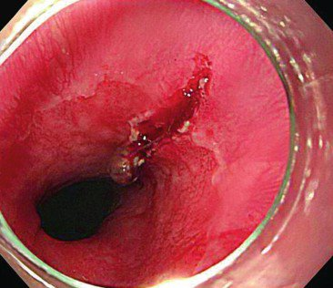
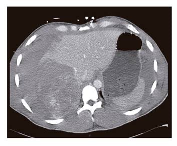
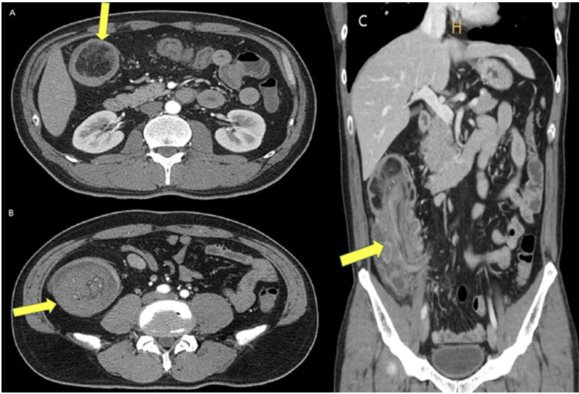
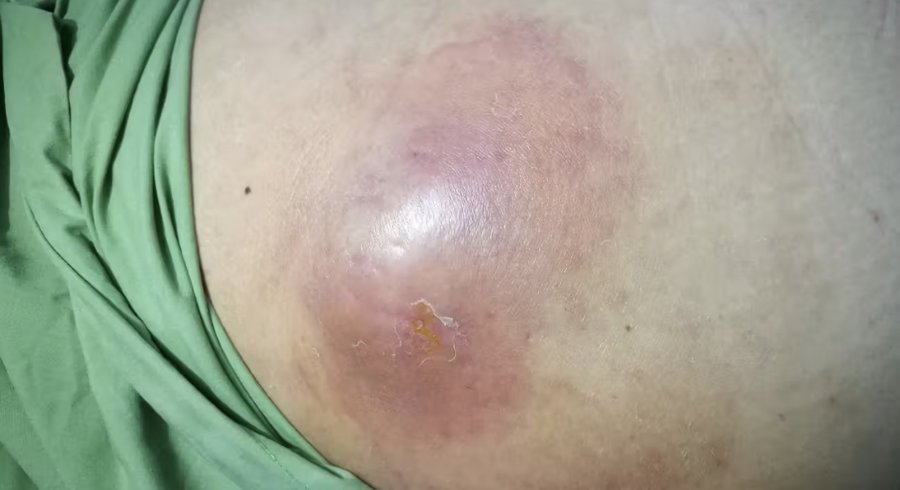
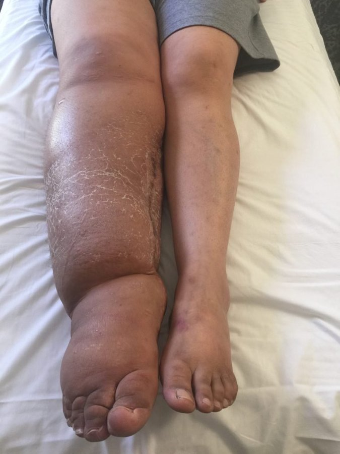
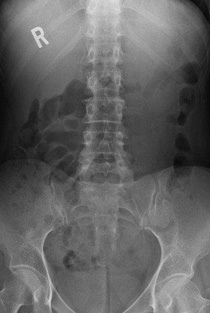
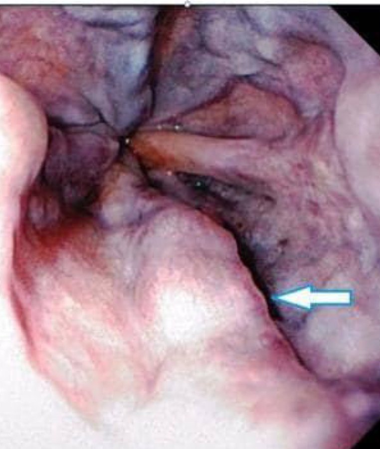
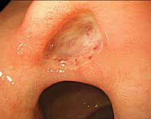

Source: "MCQ General Surgery (MDCU 77 rotate B)" (file "AC 77B Gen Sx MCQ"), questions recalled by students in a table
(No. / Questions / Choices); 73 questions. The numbers are the paper's own and are kept: Q15 comes after Q21, Q16, Q18, Q19, Q20 and Q21
appear twice, and there is no second Q17. The first copy of each number is in the main list; the second copies are under
"Repeated question numbers".
Stems and choices are as students recalled them, in their own words and languages (Thai and English). Questions recalled with
fewer choices keep only the choices given. Some stems say only "the picture" or "the clinical picture"; the paper does not give more.
Answers: "Key MCQ 77 RoB" by MDCU 78 students (file "Key AC77 RoB MCQ Gen Sx"), a key written by students. It is NOT an official
key and may contain mistakes. The key repeats the paper's numbering (it has two rows for each repeated number, plus rows saying "ไม่มี"
for numbers the paper lacks), so each answer is matched to its question by position. Its explanations are copied as written (mostly
Thai); where it is unsure it says so (a "?", two letters or an empty cell) and this file shows that exactly. The key also has four
explanatory pictures (Budd-Chiari, medullary carcinoma, antiplatelet and anticoagulant stopping tables); they are not copied here.
exam_year 2025 is the PDF's own creation date (March 2025); the paper does not state the year.
The rotation letter (B) is not mapped to a G.
In Q9 the paper itself marks choice A with "(อ.เฉลย)" (the lecturer's answer), and the key agrees; this is kept as written.
All eight pictures were checked by eye (no name, label or ID band) and are kept in images/ under their question.

## Q1 (original no. 1)
ผู้หญิงทำ Gastrectomy ไปแล้วมี anemia + anemic symptoms ถามว่าลักษณะ RBC ใน Blood smear จะเห็นเป็นอย่างไร

A. Nucleated RBC
B. Microcytosis
C. Spherocytosis
D. Ovalocyte
E. Schistocytes

**Answer:** D
**Explanation:** key: Macroovalocyte  = character of megaloblastic anemia
**Guideline / source:** not stated

## Q2 (original no. 2)
คนไข้ผู้ชาย 40 กว่า ๆ มี pulsatile mass ถามว่าจะผ่า Abdominal aortic aneurysm เมื่อไหร่ในผู้ป่วยรายนี้

A. AAA ขนาดโตขึ้นในการ F/U 6 month
B. AAA > 5.5 cm
C. AAA > ขนาดเท่าไหร่ก็ได้
D. AAA ขอแค่มีก็ผ่า
E. ไม่มีข้อใดถูก

**Answer:** B
**Explanation:** key: > 5.5 cm, โตเร็ว > 0.5 cm/yr
**Guideline / source:** not stated

## Q3 (original no. 3)
คนไข้เป็น DCIS CLINICAL node negative, U/S ก็ไม่เจอ node ไหนน่า สงสัย ถาม Management ของ Lymph node ในกรณีที่คนไข้จะทำ BCS

A. ALND
B. SLNB
C. U/S guide FNA
D. F/U 6 months

**Answer:** D
**Explanation:** not stated in the key
**Guideline / source:** not stated

## Q4 (original no. 4)
A 44-year-old female was diagnosed with multinodular goiter 3 years ago. Follow-up ultrasound revealed multiple hypoechoic nodules and a 1-cm suspicious nodule in the right lobe. Subsequent fine needle aspiration revealed atypical of undetermined significance. What is the most appropriate further management?

A. Follow up with ultrasound in next 3 months
B. MRI neck and chest
C. Thyroid hormone suppression
D. Radioactive iodine ablation
E. Total thyroidectomy

**Answer:** not given in the key (its answer cell is empty)
**Explanation:** not stated in the key
**Guideline / source:** not stated

## Q5 (original no. 5)
A 38-year-old female is being evaluated in 4-day post-operation for ruptured appendicitis. She has colicky abdominal pain, nausea and vomiting. Her NG content measures 800 ml/4 hr. What is the most fluid choice to replace fluid deficit (loss) in this patient?

A. 3% NaCl
B. Normal saline
C. Ringer lactate solution
D. 5%DNS/2 + KCl 40 mEq/L
E. 5%DNS/2

**Answer:** B
**Explanation:** key: NG gastric fluid ออกมา เสีย Cl → replace with NSS
**Guideline / source:** not stated

## Q6 (original no. 6)
A 18-year-old female was admitted with painless massive lower gastrointestinal hemorrhage. Following resuscitation, upper GI endoscopy and colonoscopy was done which revealed no source of bleeding and only old clots over colonic mucosa were found. On the next day of admission, she experienced another episode of self-limiting hemorrhage with stable vital signs. What is the next appropriate investigation?

A. Small bowel follow through
B. Abdominal ultrasound
C. CT whole abdomen with IV contrast
D. Sequential mesenteric angiography
E. Radionuclide scan with Tc-99m pertechnetate

**Answer:** E
**Explanation:** key: ตามอจ ชัยสิทธิ์
**Guideline / source:** not stated

## Q7 (original no. 7)
A 55-year-old male came to hospital with complaints of epigastric colicky pain, nausea, bilious vomiting, and no flatus for 12 hours. He has a surgical history of perforated peptic ulcer a while ago. Vital signs are as follows: BT 38, BP 140/90 HR 100 RR 22. Physical exams reveal abdominal distension, hypoactive bowel sound, generalized marked tenderness and guarding. What is the most appropriate management?

A. Barium enema, antibiotics and follow up
B. Acute abdominal series and CT whole abdomen
C. Admit for IV fluid and serial abdominal examination
D. Resuscitation and exploratory laparotomy

**Answer:** D
**Explanation:** key: Clinical mechanical gut ob + Hypoactive bowel sound (น่าจะ ischemia ไปแล้ว) + peritonitis (น่าจะ perforate แล้ว) เลยไป explore lap
**Guideline / source:** not stated

## Q8 (original no. 8)
A 52-year-old man is in day 5 after distal pancreatectomy. Abnormal amount of serous fluid is flowing out of his PTBD. Which chemical indicator is used to confirm pancreatic fistula?

A. Amylase
B. Bilirubin
C. Lipase
D. Alkaline phosphatase
E. Insulin

**Answer:** C, A?? (as written in the key)
**Explanation:** key: Pancreas signature = lipase (amylase มีทั่ว GI tract)
**Guideline / source:** not stated

## Q9 (original no. 9)
diffuse large B cell lymphoma received chemotherapy for 2 cycles. After 2 days, he developed unspecific abdominal pain, nausea and vomiting. Abdominal examination found soft, not tender abdomen but with palpable and tender spleen Laboratory results as follows BUN 34, Cr 1.6, K 4.4, Na 139, Ca 16.0, Phosphate 4.2, LDH 800, Cl 104, CO2 25. What is the most likely etiology?

A. tumor lysis syndrome (อ.เฉลย)
B. Pancreatitis
C. Renal failure
D. Hyperparathyroid
E. Pituitary tumor

**Answer:** A
**Explanation:** key: ตามอาจารย์
**Guideline / source:** not stated

## Q10 (original no. 10)
Thyroid mass pathology shows hypercellular Amyloid in eosinophilic stroma. What is the cell origin?

A. Follicular
B. Papillary
C. Parafollicular cell
D. Hurthle
E. Lymphocyte

**Answer:** C
**Explanation:** not stated in the key
**Guideline / source:** not stated

## Q11 (original no. 11)
Thyroid FNA เป็น AUS ทำอะไรต่อ

A. F/U ultrasound 3 months
B. Total thyroidectomy
C. MRI / CT

**Answer:** not given in the key (its answer cell is empty)
**Explanation:** key: ซ้ำข้อ 4
**Guideline / source:** not stated

## Q12 (original no. 12)
Breast pathology that does not increase the risk of developing malignant?

A. Squamoid metaplasia
B. Fibroadenosis
C. Complex fibroadenoma
D. Florid hyperplasia of atypical cell
E. Atypia Hyperplasia

**Answer:** A
**Explanation:** key: A. Squamoid metaplasia - no risk  B. Fibroadenosis - low relative risk  C. Complex fibroadenoma - low relative risk  D. Florid hyperplasia of atypical cell - low relative risk  E. Atypia Hyperplasia - moderate relative risk
**Guideline / source:** not stated

## Q13 (original no. 13)
Which one is not MIS

A. endoscopic….
B. Endovascular for thoracic aorta aneurysm (TEVAR)
C. HIPEC
D. Colonoscope

**Answer:** C
**Explanation:** not stated in the key
**Guideline / source:** not stated

## Q14 (original no. 14)
Clinical gut obs, absent bowel sound ถาม appropriate management?

A. IV fluid and serial abdominal exam
B. IV resuscitation and explore laparotomy

**Answer:** B
**Explanation:** key: ซ้ำข้อ 7
**Guideline / source:** not stated

## Q15 (original no. 15)
Posthepatic cause of portal HT

A. Portal vein thrombosis
B. Budd chiari syndrome
C. Cirrhosis
D. Gastric varices
E. Shistosomiasis

**Answer:** B
**Explanation:** key: A.Portal vein thrombosis - Prehepatic  B. Budd chiari syndrome - Posthepatic   C. Cirrhosis - Intrahepatic (Sinusoid)  D. Gastric varices - Result of portal HT  E. Shistosomiasis - Intrahepatic (Pre-sinusoid)
**Guideline / source:** not stated

## Q16 (original no. 16)
Dr Jo เป็น medical professor ของเรา ซึ่งมี fund จากบริษัทยา ? ถ้ามี งานประชุมวิชาการที่นิสิตกับ dr Jo ต้องไปเข้าร่วม ถามว่า ควรใช้ fund ของ university หรือบริษัทยา?

A. Thier own money
B. Both University
C. Both Medical company
D. นิสิตใช้ของ university, Dr Jo ใช้ ของ medical company

**Answer:** not given in the key (its answer cell is empty)
**Explanation:** not stated in the key
**Guideline / source:** not stated

## Q17 (original no. 17)
ตรวจเจอ Liver mass ใน Ultrasound ถามว่าส่ง biomarker ไหนไม่ช่วยในการวินิจฉัย

A. CA19-9
B. CA15-3
C. Prothrombin
D. AFP
E. CEA

**Answer:** B
**Explanation:** key: CA 19-9 = cholangiocarcinoma PT, AFP = HCC CEA = colorectal cancer liver metas
**Guideline / source:** not stated

## Q18 (original no. 18)
Who is the first line candidate for liver transplant?

A. 60 yo child A, chronic HBV, HCC 8 cm
B. 60 yo child B, active drinking
C. 50 yo child B, hepatorenal syndrome
D. 2 mo, biliary atresia
E. 2 yo, hepatoblastoma

**Answer:** C
**Explanation:** key: A = HCC ต้อง < 5 cm B = ต้องไม่มี risky behavior D = 2 m ไป kasai ก่อน E = เป็นมะเร็งต้องรักษาก่อน 5 ปี แล้วมะเร็งนี้ตัดออกก็หาย ไม่ต้อง LT
**Guideline / source:** not stated

## Q19 (original no. 19)
Bulging mass at incision site. What is an appropriate investigation?

A. Ultrasound
B. CTA
C. Abdominal xray

**Answer:** A? (as written in the key)
**Explanation:** not stated in the key
**Guideline / source:** not stated

## Q20 (original no. 20)
Spigelian hernia ออกมาจากรูไหน

A. Linear semilunaris
B. Umbilical

**Answer:** A
**Explanation:** not stated in the key
**Guideline / source:** not stated

## Q21 (original no. 21)
Clinical appendicitis Which one is contraindications of appendectomy?

A. Illieocecal Crohn
B. History of low midline incision
C. BMI>40

**Answer:** A
**Explanation:** key: ตามอจ ชัยสิทธิ์
**Guideline / source:** not stated

## Q22 (original no. 22)
Yesterday she vomited several times at the party. This morning, she develops a blood content vomiting What is the provisional diagnosis?
[picture in the paper: an endoscopic image of the upper gastrointestinal tract]

A. Mallery weiss syndrome
B. Boerhaave syndrome
C. Esophageal perforation

**Answer:** A
**Explanation:** key: Longitudinal laceration = mallory weise
**Guideline / source:** not stated

## Q23 (original no. 23)
Fever POD 1 What is the most likely associated finding?

A. PE: decreased breath sound both lower lungs
B. CXR: infiltration at right lower lung
C. CT abdomen: intra-abdominal collection

**Answer:** A
**Explanation:** key: POD1 = atelectasis → Sx: decreased breath sound B = pneumonia (POD 3-5)
**Guideline / source:** not stated

## Q24 (original no. 24)
ผู้หญิงกินยาคุม ทำ CT: A phase enhancement, washout in portovenous phase What is the provisional diagnosis?

A. HCC
B. FNH
C. Hepatic adenoma

**Answer:** A? (as written in the key)
**Explanation:** key: Enhance + rapid washout = HCC ยาคุมเป็น RF ของ adenoma ก็จริง แต่มักนจะไม่ washout in CT
**Guideline / source:** not stated

## Q25 (original no. 25)
คนไข้ chronic HBV ปวดท้อง มีความดัน 100/60 mmHg ทำ CT ได้ผลดัง รูป What is the diagnosis ?
[picture in the paper: an axial CT scan of the upper abdomen]

A. rupture AAA
B. rupture HCC

**Answer:** B
**Explanation:** key: สีเทาข้างตับ น่าจะเป็น content ที่แตกออกมา
**Guideline / source:** not stated

## Q26 (original no. 26)
ให้ Clinical กับรูป CT มา What is the diagnosis ?
[picture in the paper: CT scans (axial and coronal) with yellow arrows]

A. Gallstone ileus
B. Acute diverticulitis
C. Ileocolic intussusception
D. Acute mesenteric ischemia

**Answer:** C
**Explanation:** key: รูปนี้คือ intuss
**Guideline / source:** not stated

## Q27 (original no. 27)
ให้ Clinical กับรูปมา ถาม Treatment ?
[picture in the paper: a photo of a red, swollen area of skin]

A. IV antibiotics
B. Incision & Drainage
C. Excision
D. Debridement

**Answer:** A
**Explanation:** key: รูป = mastitis
**Guideline / source:** not stated

## Q28 (original no. 28)
Esophageal cancer ถึงชั้น muscularis mucosa, no lymphadenopathy ถาม Treatment? (ซ้ำ AC)

A. esophagectomy

**Answer:** A
**Explanation:** key: T2 = esophagectomy
**Guideline / source:** not stated

## Q29 (original no. 29)
10 years ago undergoes full staging ovarian cancer with a complete hysterectomy. She develop right leg swelling with ulcer lateral malleolus this 2 year. Diagnosis ?
[picture in the paper: a photo of both legs]

A. Deep vein thrombosis
B. Lymphedema
C. Aorto-iliac occlusion
D. Scleroderma

**Answer:** B
**Explanation:** key: รูปคือ lymphedema
**Guideline / source:** not stated

## Q30 (original no. 30)
Vitamin ที่ใช้สร้าง collagen synthesis + wound healing

A. Vit K
B. Vit C
C. Vit A
D. Vit B1
E. Vit D

**Answer:** B
**Explanation:** not stated in the key
**Guideline / source:** not stated

## Q31 (original no. 31)
มีก้อนที่เเถว stomach, PR เจอ rectal shelf positive ถาม diagnosis

A. Metastatic gastric adenocarcinoma
B. Locally advanced gastric cancer
C. Malignant gastric stromal tumor

**Answer:** A
**Explanation:** not stated in the key
**Guideline / source:** not stated

## Q32 (original no. 32)
Least nutrition measurement

A. Hx of weight loss
B. Hx of diet
C. Measurement weight tool
D. Stress
E. Hx of illness

**Answer:** not given in the key (its answer cell is empty)
**Explanation:** not stated in the key
**Guideline / source:** not stated

## Q33 (original no. 33)
Septic shock นอน ICU มา 7 วัน ใส่ central line มาตั้งเเต่ first day อาการดีขึ้นวันนี้ เเต่กลับมาไข้ 38 c ควรทำอะไรดี

A. ถอด foley catherter
B. Lung rehabilitation
C. Clean central line
D. Step up antibiotics
E. Stop antibiotics

**Answer:** C
**Explanation:** key: POD 7 = SSI, catheter related, DVT
**Guideline / source:** not stated

## Q34 (original no. 34)
Recently undergoes cardiac stent and had Clopidogrel since then, this admission plan to ERCP ถาม Management

A. Stop clopidogrel 7 days
B. Change clopidogrel to enoxaparin 3 days before surgery
C. Don't need to stop clopidogrel

**Answer:** A
**Explanation:** key: Slide Peri-Operative Drug 2025 Aj.Patinut  Perioperative drugs 2025 30 min.pdf
**Guideline / source:** not stated

## Q35 (original no. 35)
Mechanical heart valve on warfarin, this admission plan to cholecystectomy ถาม Management

A. stop for 3day
B. Stop in same day of operation and give FFP

**Answer:** not given as a letter in the key (it writes: interrupt / 5 days pre-op)
**Explanation:** key: 2024 AHA/ACC/ACS/ASNC/HRS/SCA/SCCT/SCMR/SVM Guideline for Perioperative Cardiovascular Management for Noncardiac Surgery:
**Guideline / source:** not stated

## Q36 (original no. 36)
Submucosal tumor 2 cm at EGJ, Spindle cell, c-Kit positive (GIST). What is appropriate management?

A. Tyrosine kinase inhibitor
B. Subtotal gastrectomy + D2 lymph node dissection
C. Proximal gastrectomy without lymph node dissection

**Answer:** C? (as written in the key)
**Explanation:** key: Main Tx = Sx โดย GIST เอา margin น้อย + ไม่ต้องตัด LN เลย proximal gastrectomy น่าจะพอ Imatinib ใช้สำหรับก้อนใหญ่ > 5 cm
**Guideline / source:** not stated

## Q37 (original no. 37)
คนไข้ต้องทำ adjuvant therapy แต่คนไข้ไม่ยอม What reason should tell to the patient

A. Reduce risk recurrence

**Answer:** A
**Explanation:** not stated in the key
**Guideline / source:** not stated

## Q38 (original no. 38)
Time out ก่อนทำการผ่าตัดช่วยเรื่องอะไร

A. Reduce surgical error
B. Reduce surgical time

**Answer:** A
**Explanation:** key: ผู้ชาย + ก้อนใหญ่ > 5 cm ตัดเถอะ
**Guideline / source:** not stated

## Q39 (original no. 39)
HCC male 5×6 cm ถาม Management

A. Liver resection
B. Biopsy
C. Follow up

**Answer:** A
**Explanation:** not stated in the key
**Guideline / source:** not stated

## Q40 (original no. 40)
A male chronic alcohol present with acute abdominal pain radiating to the back never has pain like this. Serum amylase lipase normal ให้ film มา มี calcified pancreas What is the diagnosis?
[picture in the paper: a plain abdominal film]

A. Acute pancreatitis
B. Chronic pancreatitis
C. Ruptured AAA
D. Diverticulitis

**Answer:** A
**Explanation:** not stated in the key
**Guideline / source:** not stated

## Q41 (original no. 41)
ข้อใดเเบ่งชนิดของ ASA classification ผิด

A. Class I : Normal healthy
B. Class II : Mild hypertension well control
C. Class IV : Recent Myocardial infarction < 3 months
D. Class V : Moribund patient
E. Class VI : Multiple organ failure

**Answer:** E
**Explanation:** not stated in the key
**Guideline / source:** not stated

## Q42 (original no. 42)
A 25 year old woman in her 8th week postpartum of her first child. She complains of Rt.breast pain and fever for 3 days.She is breastfeeding her son. She went to her obstetrician and got prescribed some antibiotics. The pain still comes intermittently on and off. Physical examination reveals tenderness at Rt.breast medial to areolar. Rt. Axillary lymphadenopathy is also present. What is the most likely diagnosis?

A. Fibrocystic change
B. Puerperal abscess
C. Granulomatous mastitis
D. Necrotizing fasciitis

**Answer:** B
**Explanation:** key: Peurperal abscess = abscess within 2-3 wk post partum Granulomatous mastitis = chronic breast lesion เป็นจุด ๆ , idiopathic cause
**Guideline / source:** not stated

## Q43 (original no. 43)
What is the meaning of palliative care?

A. Improving quality of remaining time
B. Reducing meaning less time

**Answer:** A
**Explanation:** not stated in the key
**Guideline / source:** not stated

## Q44 (original no. 44)
Locally advanced CA Esophagus. Waiting for neoadjuvant chemotherapy. but he has weight loss 5 kg in 3 months. He only swallowed a few of his saliva. Which is an appropriate management?

A. Feeding jejunostomy before chemotherapy
B. Clear liquid diet with oral supplement
C. Esophageal stent with oral supplement

**Answer:** not given in the key (its answer cell is empty)
**Explanation:** not stated in the key
**Guideline / source:** not stated

## Q45 (original no. 45)
คนไข้ DM type 1 + ค่าไตแย่ลงเรื่อยๆ ตอนนี้ ถามว่าควรทำอะไร

A. evaluate for kidney transplant
B. คุมน้ำตาลดีๆ
C. Start hemodialysis
D. Start peritoneal dialysis

**Answer:** A? (as written in the key)
**Explanation:** not stated in the key
**Guideline / source:** not stated

## Q46 (original no. 46)
Material ของ mesh for hernia repair คืออะไร

A. Polypropylene

**Answer:** A
**Explanation:** not stated in the key
**Guideline / source:** not stated

## Q47 (original no. 47)
Which condition is NOT a contraindication of doing BCT

A. wide excision and have residual left
B. tumor close to Nipple
C. Scleroderma

**Answer:** B? (as written in the key)
**Explanation:** not stated in the key
**Guideline / source:** not stated

## Q48 (original no. 48)
Which is false about kidney transplant ?

A. It is heterotopic transplant
B. ABO incompatible donor is standard test
C. Kidney graft อยู่ข้างนอกได้ 24 ชั่วโมง
D. Positive crossmatch is a contraindication

**Answer:** B
**Explanation:** key: เน้น ABO compatible ก่อน
**Guideline / source:** not stated

## Q49 (original no. 49)
กลืนอาหารได้น้อยลงๆ มา3 เดือน What is the first investigation ?

A. Barium swallow
B. EGD

**Answer:** B
**Explanation:** not stated in the key
**Guideline / source:** not stated

## Q50 (original no. 50)
Which is not an indication for inserting a central vein catheter?

A. Initial insert venous in hypovolemic shock

**Answer:** A
**Explanation:** not stated in the key
**Guideline / source:** not stated

## Q51 (original no. 51)
Which is NOT a complication of laparoscopic pneumoperitoneum?

A. Acidosis
B. Hyperthermia
C. Gas embolism
D. Cardiac arrhythmia
E. Decreased venous return

**Answer:** B
**Explanation:** not stated in the key
**Guideline / source:** not stated

## Q52 (original no. 52)
Which one is mechanical prophylaxis of DVT?

A. Early ambulation
B. Intermittent pneumatic compression
C. Graduated compression stockings
D. Enoxaparin

**Answer:** not given in the key (its answer cell is empty)
**Explanation:** key: A, B, C ดูใช่หมดเลย
**Guideline / source:** not stated

## Q53 (original no. 53)
Which patient should avoid to supplement K+

A. CKD
B. DM with insulin
C. Cardiac arrhythmia

**Answer:** A
**Explanation:** not stated in the key
**Guideline / source:** not stated

## Q54 (original no. 54)
Hemophilia B โดนมีดบาดมา ทำอย่างไรดี?

A. FFP before suture
B. FFP with Plt before suture
C. Factor VII before suture
D. Factor VII  with Plt before suture

**Answer:** not given in the key (its answer cell is empty)
**Explanation:** not stated in the key
**Guideline / source:** not stated

## Q55 (original no. 55)
คนไข้มีมอเตอร์ไซต์ล้มมา พบ Abrasion with history of tetanus toxoid last 2 year What is management?

A. No medication
B. Boost vaccine 1 dose
C. Tetanus toxoid 1 dose

**Answer:** B
**Explanation:** key: Tetanus < 5 year → boost 1 dose
**Guideline / source:** not stated

## Q56 (original no. 56)
58 year old man asymptomatic, ultrasound seen Hypoechoic mass 3 cm at liver ได้ vaccine hepatitis แล้ว ,no family history of cancer ,no alcohol and smoke What is management?

A. follow up with mri
B. EGD and colonography
C. Genetic consult

**Answer:** A
**Explanation:** not stated in the key
**Guideline / source:** not stated

## Q57 (original no. 57)
Burning pain sensation at groin after herniorrhaphy for 2 weeks What is the cause?

A. mesh infection
B. nerve injury

**Answer:** B
**Explanation:** not stated in the key
**Guideline / source:** not stated

## Q58 (original no. 58)
Avoid causing harm to the participants What is this ethical term?

A. Autonomy
B. Beneficence
C. Non-maleficence
D. Justice
E. Confidentiality

**Answer:** C
**Explanation:** not stated in the key
**Guideline / source:** not stated

## Q59 (original no. 59)
Diagnosis? (ให้ภาพ Grey-Turner sign มา)
[picture in the paper: a picture of Grey-Turner sign (the paper says a picture is given; it is not in the file)]

A. Severe acute pancreatitis
B. Ruptured appendicitis

**Answer:** A
**Explanation:** not stated in the key
**Guideline / source:** not stated

## Q60 (original no. 60)
What is the treatment of CA head of pancreas

A. pancreaticoduodenectomy

**Answer:** A
**Explanation:** not stated in the key
**Guideline / source:** not stated

## Q61 (original no. 61)
50-year-old businessman social drinker and smoking no underlying disease presented with hematemesis. Per rectal exam found melena. EGD found as picture What's the diagnosis?
[picture in the paper: an endoscopic image with an arrow]

A. Esophageal varices
B. Duodenal ulcer
C. Gastric ulcer
D. Mallory-Weiss tear

**Answer:** A
**Explanation:** not stated in the key
**Guideline / source:** not stated

## Q62 (original no. 62)
An 8-year-old child drowned in a lake. In the ICU, he was intubated and started on ventilator support. Vital signs showed BT 30°C. Neurological examination revealed absent brainstem reflexes. What is the most appropriate management by the physician?

A. Warm and re-evaluate
B. Declare braindead
C. Approach the family for consideration of organ donation

**Answer:** A
**Explanation:** key: BT ต้อง > 32
**Guideline / source:** not stated

## Q63 (original no. 63)
Your senior asks you to PR an HIV-positive patient with good antiviral compliance. Should you do it?

A. No, it is risky for a medical student
B. Yes, it is the senior’s order
C. Yes, a medical student must be devoted to learning
D. Yes, follow universal precaution, it will be a good experience

**Answer:** not given in the key (its answer cell is empty)
**Explanation:** not stated in the key
**Guideline / source:** not stated

## Q64 (original no. 64)
Which structure is preserved in near-total thyroidectomy to maintain calcium homeostasis?

A. External branch of superior laryngeal nerve
B. Internal branch of superior laryngeal nerve
C. Recurrent laryngeal nerve
D. Parathyroid gland
E. Thyroid cartilage

**Answer:** D
**Explanation:** not stated in the key
**Guideline / source:** not stated

## Q65 (original no. 65)
Which of the following is important for platelet plug formation?

A. Von Willebrand factor
B. Plasmin
C. Fibrin
D. Prothrombin

**Answer:** A
**Explanation:** not stated in the key
**Guideline / source:** not stated

## Q66 (original no. 66)
Fill in the blanks: A patient presented with painless progressive jaundice. A(n) __________ showed dilated intrahepatic and extrahepatic bile ducts. Then, a(n) __________ revealed a mass at the head of the pancreas. Finally, a(n) __________ was done to take a biopsy of the mass.

A. Ultrasound abdomen, CT abdomen, endoscopic ultrasound

**Answer:** A
**Explanation:** not stated in the key
**Guideline / source:** not stated

## Q67 (original no. 67)
Which of the following is NOT the ideal perioperative care?

A. Specific-spectrum prophylactic antibiotic

**Answer:** A
**Explanation:** not stated in the key
**Guideline / source:** not stated

## Q68 (original no. 68)
Metabolic response to injury ARDS in ICU?

A. Hypercortisolism, hyperglycemia, activation of HPA axis Good luck !

**Answer:** A
**Explanation:** not stated in the key
**Guideline / source:** not stated

## Repeated question numbers
(These numbers appear a second time in the paper with a different question; the second copies are kept here, so no number is changed. Each answer is from the key's second row with the same number.)

Second question numbered 16: ข้อใดให้ organ transplant ไม่ได้ตามกฎหมายไทย
A. Father give liver to child
B. Cousin give kidney to aunt
C. Child give liver to mother
D. Wife give kidney to husband
E. Uncle give liver to nephew
Answer (from the key's second row numbered 16): not given in the key (its answer cell is empty)
Explanation: key: ดูให้ได้หมดทุกช้อย
Guideline / source: not stated

Second question numbered 18: R0 resection คืออะไร
A. No residual gross tumor but may have microscopic left
B. The complete surgical removal of a tumor with no microscopic residual cancer cells at the resection margins.
Answer (from the key's second row numbered 18): B
Explanation: not stated in the key
Guideline / source: not stated

Second question numbered 19: History of multinodular goiter for three years. Now has 1cm hypoechoic mass by ultrasound ไปทำ FNA ได้ Bethesda 3 ถาม Management
A. total thyroidectomy
B. Medication
C. RAI
D. Obseve/follw up
Answer (from the key's second row numbered 19): not given in the key (its answer cell is empty)
Explanation: key: ซ้ำข้อ 4
Guideline / source: not stated

Second question numbered 20: หญิง ปวด RLQ for 3 days LMP 3 weeks ago PE tenderness at RLQ and suprapubic area Pregnancy test negative ultrasound shows no abnormality. Most appropriate management
A. follow up 2 weeks
B. Antibiotics analgesic Follow up 1 week
C. Laparoscopic explore
D. MRI
Answer (from the key's second row numbered 20): B
Explanation: not stated in the key
Guideline / source: not stated

Second question numbered 21: History of muscle relaxant use. H. Pylori Test negative. EGD in the picture below. What is the diagnosis? รูปนี้เป๊ะ ๆ
[picture in the paper: an endoscopic image of the stomach]

A. GIST
B. Atropic gastritis
C. Gastric ulcer
Answer (from the key's second row numbered 21): C
Explanation: key: หน้าตา gastric ulcer
Guideline / source: not stated

## Flagged for checking
- Q4 and the second Q19: the key has no answer for Q4 and says the second Q19 repeats Q4 (the same multinodular goiter / AUS question); the second Q19 is Bethesda 3. What is the expected answer?
- Q8: the key answers "C, A??" (pancreas signature = lipase). Which letter is expected?
- Q3, Q11, Q14: the key gives no explanation for Q3; its answer for Q11 is empty ("ซ้ำข้อ 4", repeats Q4); for Q14 it says it repeats Q7.
- First Q16 (Dr Jo and funding), second Q16 (Thai transplant law), Q32, Q44, Q52, Q54, Q63: the key gives no answer. Second Q16 says "ดูให้ได้หมดทุกช้อย" (look at every choice); Q52 says A, B and C all look right.
- Q19 (first copy), Q24, Q36, Q45, Q47: the key marks its answer with a "?".
- Q35: the key gives no letter, writing "interrupt / 5 days pre-op", which is not one of the two choices recalled.
- The key has a second small table (6 rows, headed "COLORECTAL SX") that is not part of this paper; it was not used.
