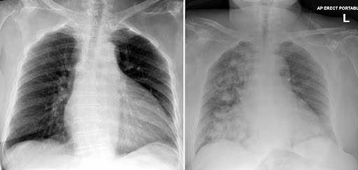

Source: "AC Rotate C Gen Surgery - MCQ - จดAC By MDCU 77" (file "AC 77C Gen Sx MCQ"), questions noted down by students in a
table ("ข้อ / คำถาม / choice (+/- คำตอบ)"); 81 questions. The numbers are the paper's own and are kept: Q16 appears three times
and Q17 twice. The first copy of each number is in the main list; the later copies are under "Repeated question numbers".
Stems and choices are as students noted them, in their own words (Thai and English), so some are short, cut off or half-recalled.
Choices the paper letters in lower case are written A-F; a choice letter the paper leaves empty is "(not recalled)"; questions
noted with only one or two choices keep only those. Notes the students wrote inside choices (for example "จารบอกมัน...") are kept as written.
The paper's third column is headed "choice (+/- answer)", and some questions have text there without a letter (Q75-Q77); it is shown in brackets.
Answers: "AC Sx 77 Rotate C Key Solution" ("Solution By EiEi", by MDCU 77 Rotate D students), a key written by students. It is NOT an
official key and may contain mistakes. The key gives rows 16, 16.1, 16.2, 17 and 17.1 for the repeated numbers (matched in the paper's order),
and no row for Q78. Its explanations are copied as written (mostly Thai).
The PDF has no creation date and the paper does not state the year. exam_year 2024 is taken from the dated PDF of the same
rotation's OSCE + MEQ paper (October 2024), so it is an inference; please check it.
The rotation letter (C) is not mapped to a G.
Pictures with no name, label or ID band were checked by eye and are kept in images/ under their question. A second PDF in Drive,
"เฉลยคร่าวๆ AC Gen Sx Rotate C MDCU77", is the same table with some choices coloured red or green; it has no legend, so it was not used for answers.

## Q1 (original no. 1)
A 44-year-old man presented at ER complaining of epigastric pain, nausea, vomiting, and fever for 3 days. A few weeks ago, he had an episode of acute pancreatitis and received conservative therapy. PE: BT 38°C PR 84 /min RR 20/min BP 120/70 mmHg. Abdomen: soft palpable tender mass at epigastrium. Which of the following is the most likely cause?

A. Pseudocyst in lesser sac
B. Pancreatic collection
C. Emphysematous gallbladder
D. Gastric dilation from gastric outlet obstruction

**Answer:** B
**Explanation:** key: Complication ตัดที่ 4 wk fluid acute peripancreatic fluid collection pseudocyst (>4 wk) necrosis pancreatitis necrosis collection wall of necrosis (> 4 wk)
**Guideline / source:** not stated

## Q2 (original no. 2)
Gangrene small bowel resection. Accidentally make small bowel content spill out. Wound classification?

A. Clean wound
B. Clean-contaminated wound
C. Contaminated wound
D. Dirty wound
E. Infected wound

**Answer:** C
**Explanation:** key: จากกิ๊กตอบ contaminated เพราะแค่ spillage ไม่ได้เน่าจนแตกเอง กษยา ก็ตอบ C Contaminated wound คับ
**Guideline / source:** not stated

## Q3 (original no. 3)
Gangrenous appendicitis with moderate amount of reactive fluid ปิดแผลแบบใด

A. Primary wound closure (จารบอกมัน ยังไม่rupture ละก็content ไม่ใช่หนอง)
B. Secondary wound closure
C. Delayed primary wound closure
D. Skin stapler

**Answer:** C
**Explanation:** key: Gangrenous appendicitis ถ้ามี microperforation ? = contaminated wound  → delayed primary suture ของจริงต้องดู fluid ในท้อง เป็นน้ำหรือเป็นหนอง
**Guideline / source:** not stated

## Q4 (original no. 4)
ป้องกันการติดเชื้อในรพ

A. Wash hand properly and frequently
B. Only touch patients when indicated
C. Teach patients and บุคคลากรabout self-care

**Answer:** A
**Explanation:** not stated in the key
**Guideline / source:** not stated

## Q5 (original no. 5)
ข้อไหนเป็นpre-op ที่ถูก

A. Blood chem all patients
B. CXR all patients (อ.บอกไม่ได้ตอบข้อนี้)
C. EKG คนอายุ15 ขึ้น
D. Coagulogram for >15 year-old
E. (not recalled)

**Answer:** B
**Explanation:** key: น่าจะไม่มีคำตอบที่ถูกต้อง อิงตาม slide พี่กิ๊กบอกถ้าไม่มีข้ออื่นก็เอา CXR ดูว่า GA ได้มั้ย ถ้าทำ GA ทาง Anes จะ require Chest X-ray (อ. พูดในคลิปเก่า)
**Guideline / source:** not stated

## Q6 (original no. 6)
อะไรมีผลกับserum osmolarity มากที่สึด

A. Na

**Answer:** A
**Explanation:** not stated in the key
**Guideline / source:** not stated

## Q7 (original no. 7)
ผช65 มั้งเป็นsevere COPD มีrecent HFด้วย ต้องมาผ่าอะไรสักอย่างของhernia ถามว่าอะไรมี ผลมากสุดกับการเลือกoperation (ว่าจะ Laparoscopic ดีมั้ย)

A. Poor candidate for GA
B. Pulmonary function test result
C. (not recalled)

**Answer:** A
**Explanation:** key: COPD ทำ GA ไม่ได้ เพราะเดี๋ยว off tube ไม่ได้  Heart disease, LC ใส่ลม decrease venous return  จารบอกถุกคู่
**Guideline / source:** not stated

## Q8 (original no. 8)
Metabolic response to injury ผชมีARDS V/S ยับๆถามว่าmetabolic response แบบใด

A. hypermetabolism , hyperglycemia, HPA axis activation

**Answer:** A
**Explanation:** not stated in the key
**Guideline / source:** not stated

## Q9 (original no. 9)
ผ่าhernia แบบใดป้องกันindirect, direct inguinal และfemoral hernia ไปด้วยกันได้

A. Laparoscopic
B. Marcy
C. Lichtenstein

**Answer:** A
**Explanation:** not stated in the key
**Guideline / source:** not stated

## Q10 (original no. 10)
Metabolic response to injury ให้เปรียบเทียบ between starvation and stress/inflam [เทียบ เรื่องcytokine release, gluconeogenesis, Ketogenesis, etc.] (ตารางในสไลด์)

A. (not recalled)

**Answer:** not given as a letter in the key (it writes: -)
**Explanation:** not stated in the key
**Guideline / source:** not stated

## Q11 (original no. 11)
a 60-year-old woman presented with hypercalcemia. Sestamibi shows single nodule ที่สว่างกว่าnodule อื่น. Which is the most likely cause?

A. Parathyroid adenoma (มีอาการ hyperthyroid ซึ่งมะเร็งเป็นeuthyroid)
B. Parathyroid carcinoma
C. Thyroid adenoma

**Answer:** A>B (as written in the key)
**Explanation:** key: ข้อมูลค่อนข้างน้อย อาจจะสรุปไม่ได้ แต่ Parathyroid adenoma much more common than parathyroid cancer. hyperCa ได้ทั้งคู่
**Guideline / source:** not stated

## Q12 (original no. 12)
ในการแข็งตัวของเลือดอะไรเกิดก่อน

A. Vasocon จากautonomic

**Answer:** A
**Explanation:** not stated in the key
**Guideline / source:** not stated

## Q13 (original no. 13)
ผญไปทำCABG มา2 ปีก่อนกินASA โดสเท่า ไหร่ไม่รู้จะมาผ่าbreast mastectomy + sentinel ถามว่าให้ทำยังไงกับยา

A. หยุด7-10 วัน
B. หยุด5 วัน
C. หยุด1 วัน
D. ไม่หยุด

**Answer:** A
**Explanation:** not stated in the key
**Guideline / source:** not stated

## Q14 (original no. 14)
What is primary barrier in organ transplantation ในคนที่ไม่ได้identical twin

A. ABO mismatch
B. HLA mismatch
C. size mismatch
D. Ethnic

**Answer:** B
**Explanation:** key: ตอบ HLA mismatch เพราะ ABO ส่วนใหญ่เราเลือกให้เหมือนกันได้อยู่แล้ว
**Guideline / source:** not stated

## Q15 (original no. 15)
Which cannot be transplanted from living donor

A. Lung
B. Small bowel
C. Pancreas
D. Liver
E. Cornea (ผิดกฎหมายต้องตายแล้วถึง ทำได้)

**Answer:** E
**Explanation:** key: Cornea (ผิดกฎหมาย ต้องตายแล้วถึงทำได)
**Guideline / source:** not stated

## Q16 (original no. 16)
Asthma คุมดีASA-PS grade เท่าไหร่

A. 1
B. 2
C. 3
D. 4
E. 5

**Answer:** B
**Explanation:** key: คุมอาการได้ แสดงว่าไม่ส่งผลต่อชีวิต = class II  Key Healthy = I Disease with good control = II Functional limitation = III Constant threat to life = IV ตายแน่  = V
**Guideline / source:** not stated

## Q17 (original no. 17)
ผชโรคตับแต่มีMassive Bleeding จาก duodenal ulcer ทำการEGD ไปสองรอบแล้วเมื่อ 3 ชมที่แล้วกับ1 ชมที่แล้วตอนนี้มีBleed อีกรอบ มีเลือดออกมาทางNG ที่คาไว้ตอนนี้ไม่มีIR อยู่ที่ รพเลยถามว่าทำไงดี

A. เพิ่มโดสPPI
B. Endoscopic อีกรอบ
C. Ligate Gastroduodenal artery
D. Transfusion and check coagulation
E. Truncal Vagotomy

**Answer:** C
**Explanation:** key: (From bedside) เวลามี upper GI bleeding ให้แยกว่าเป็น variceal/non-variceal Variceal bleed: chronic liver disease Mx: octreotide, blood transfusion Non-variceal bleed: ส่วนใหญ่ก็จาก GU/DU Mx: IV PPI (Pantoprazole) + EGD within 24 hr ถ้ามี rebleeding ให้ทำ EGD 2 nd try  ถ้ายัง bleed อยู่อีก ให้ทำ explore lap เข้าไปเย็บตรงที่ bleed + ตัด ulcer  ออกเลย ข้อนี้เลยตอบ ligate GDA ดีสุด
**Guideline / source:** not stated

## Q18 (original no. 18)
H pylori แต่แพ้amoxy ถามrational drug use

A. PPI bid + metronidazole 400 mg bid + clarithromycin 500 mg bid
B. PPI + clarithromycin + tetracycline

**Answer:** A
**Explanation:** key: Amoxi allergy → switch to metronidazole
**Guideline / source:** not stated

## Q19 (original no. 19)
มีTumor ขนาดก้อนน่าจะประมาน5 cm ทำ MMG/US ก็เจอก้อนจริงๆแล้วก็เจอLN ที่หน้าตา ประหลาดด้วยจากนั้นก็CNB ก้อนที่นมเจอว่าเป็น Invasive carcinoma สักชนิดถามว่าทำไงต่อ

A. NACT + Sx ????
B. FNA axillary LN
C. MRM
D. Wide ex + ALND
E. Wide ex + SLNB

**Answer:** A
**Explanation:** key: ข้อนี้ idea คือมันก้อนใหญ่ 5 cm (T3) ไม่รู้ว่าเป็น Stage IIIA (Early invasive) หรือ IIIB (Locally advanced) **ไม่รู้ว่าไป axillary LN  กี่เม็ด  อย่่างไรก็ตาม ถ้าก้อนมันใหญ่เราให้ Neoadjuvant Chemotherapy (NACT) เพื่อให้ก้อนมันเล็กลงก่อนผ่าเสมอ  (ขี้เกียจหา NCNN แปะ schwartz ละกันนะ)
**Guideline / source:** not stated

## Q20 (original no. 20)
35 yrs old girl breast mass 4 cm, No palpable LN, also normal LN in imaging. CNB found Mucinous carcinoma of breast. ER+ PR+ management?

A. Mastectomy
B. Wide excision + SLNB
C. Bone lung liver MUGA scan

**Answer:** B
**Explanation:** key: LN  ดูปกติ ดังนั้นตัดแค่ tumor แล้วดู SLNB ก่อนได้
**Guideline / source:** not stated

## Q21 (original no. 21)
BCT contraindication

A. SLE ถามจารมาวินมา
B. GA 37 week, elective cesarean
C. Tumor 5 cm.
D. Nearby daughter lesion

**Answer:** A
**Explanation:** key: Contraindication ของ BCT หลัก ๆ คือคนที่เอาไปทำ radiotherapy ไม่ได้ เช่น ท้อง เคยได้รังสีเยอะแล้ว หรือพวก connective tissue disease สาเหตุอื่น ๆ ก็เช่น poor cosmetic outcome, multicentric tumor, ตัด 2 รอบแล้เวแต่ก็ยังไม่ได้ negative margin, high tumor-breast volume ratio, inflammatory breast CA
**Guideline / source:** not stated

## Q22 (original no. 22)
ผญมีpulmonary embolism หลังผ่า investigation ข้อไหนไม่ช่วยdx

A. Aortogram
B. Coagulogram
C. Duplex
D. D-dimer
E. CTA

**Answer:** B
**Explanation:** key: Aortogram ฉีดสีเข้า artery ก็เห็น pulmonary a
**Guideline / source:** not stated

## Q23 (original no. 23)
Variceal UGIB drug management

A. Desmopressin , somatostatin

**Answer:** A
**Explanation:** key: เหมือนที่อธิบายข้อ 17
**Guideline / source:** not stated

## Q24 (original no. 24)
Surin province + obstructive jaundice

A. Hilar CC

**Answer:** A
**Explanation:** key: อีสานบ้านเฮา CCA
**Guideline / source:** not stated

## Q25 (original no. 25)
(not recalled)

A. (not recalled)

**Answer:** not given as a letter in the key (it writes: -)
**Explanation:** not stated in the key
**Guideline / source:** not stated

## Q26 (original no. 26)
ตัดgastrectomy follow up 9 month เจอ Peripheral neuropathy ถามว่าcell อะไรที่ responsible for สิ่งนี้

A. Parietal cell
B. chief cell
C. G cell

**Answer:** A
**Explanation:** key: Peripheral neuropathy = B12 def ตัดกระเพาะ → parietal cell หาย → ขาด intrinsic factor → B12 def
**Guideline / source:** not stated

## Q27 (original no. 27)
ผญepigastric pain เป็นๆหายๆมา2 ปีเจ็บ มากขึ้นหลังกินข้าวมารอบนี้ให้อาการgut ob, bilious vomiting มา2 วันPlain film ไม่เจอ อากาศถามว่าเป็นอะไร

A. Adynamic ileus
B. Duodenal obstruction (เพราะฟิลม์ปกติ อาจจะ2nd part ขึ้นไป)
C. ileal obstruction
D. Colonic obstruction

**Answer:** B
**Explanation:** key: ตามนั้น film not see air ดังนั้นจึงเกิด obstruction ที่ 2nd part duodenum ขึ้นไป เห็น gastric dilate  The duodenum can be obstructed by atresia, stenosis, and pressure due to an extrinsic mass.
**Guideline / source:** not stated

## Q28 (original no. 28)
กลืนติดทั้งของแข็งของเหลวให้รูปbird beak

A. Achalasia cardia
B. CA esophagus
C. Esophageal fistula
D. TEF
E. Stricture

**Answer:** A
**Explanation:** not stated in the key
**Guideline / source:** not stated

## Q29 (original no. 29)
อาการachalasia ทำesophagram แล้วเจอbird beak. What is the other method to diagnose this condition (เข้าใจว่าโจทถามถึงวิธีอื่นที่diag ได้ไม่น่าถามว่าต้องทำอะไรต่อ)

A. Manometry
B. EGD
C. CT
D. MRI

**Answer:** A
**Explanation:** key: Manometry is gold standard diagnosis.
**Guideline / source:** not stated

## Q30 (original no. 30)
Nipple red-yellowish discharge จาก1 รูเป็น ข้างเดียวเมื่อกดlateral ต่อareolar ที่1 o’clock

A. Intraductal papilloma
B. Duct ectasia
C. Invasive ductal cMasitisdistal a

**Answer:** A
**Explanation:** key: Bloody discharge ข้างเดียว, no pain =  common presentation of Intraductal papilloma   Duct ectasia = commonly presents with intermittent nipple discharge of varying colors (ranging from white to green/black to grey), as well as pain and tenderness of the nipple and areola, invert nipple  Invasive ductal carcinoma = Pain, ulcerated, nipple discharge, nipple retraction, peau d'orange, axillary lymph node  ตรงแอคเก่า
**Guideline / source:** not stated

## Q31 (original no. 31)
Female with bilateral galactorrhea said she has good self care and takes some pills. Which drug is LEAST likely the pill

A. Verapamil
B. Estrogen
C. Metoclopramide
D. Bromocriptine

**Answer:** D
**Explanation:** key: Bromocriptine เป็น dopamine agonist -> inhibot prolactin   Bromocriptine เป็นยาที่ทำให้น้ำนมหยุดไหลในคนไข้ prolactinoma จ้า
**Guideline / source:** not stated

## Q32 (original no. 32)
อะไรวัดnutritionได้กากสุด

A. Waist circumference
B. serum prealbumin
C. Serum transferrin
D. BMI
E. Nitrogen balance

**Answer:** A
**Explanation:** key: anthropometric measurement วัดแย่สุด เช่น triceps skin fold waist and hip circumference mid arm circumference, suffest muscle mass
**Guideline / source:** not stated

## Q33 (original no. 33)
Most common cause liver abscess

A. Biliary tract infection

**Answer:** A
**Explanation:** key: ?? ​​biliary tract disease (biliary stone, strictures, malignancy, and congenital anomalies) are the major causes of pyogenic liver abscesses. If the source is an anaerobe, the most common organism is Entamoeba histolytica.
**Guideline / source:** not stated

## Q34 (original no. 34)
เป็นgastric adenocarcinoma แล้วตรวจเจอก้อน bilat. ovaryด้วยเป็นโรคไรที่รังไข่

A. Krukenberg’s
B. Struma ovarii
C. Endometriosis
D. Mucinous cystadenoma

**Answer:** A
**Explanation:** key: Gastric adenocarcinoma spread to ovary
**Guideline / source:** not stated

## Q35 (original no. 35)
อาการฉี่ไม่ค่อยออกฉี่ไม่สุดต้องเบ่ง9 เดือนมาเริ่ม ปวด(มีฉี่เป็นเลือด?) เป็นหนักขึ้นจนวันก่อนเยี่ยว ไม่ออกเลยWhat to expect from DRE

A. BPH
B. prostate CA
C. rectal CA
D. DRE ไม่ช่วย

**Answer:** A
**Explanation:** key: น่าจะอันนี้ เป็นนาน ฉี่ไม่สุด มีฉี่เป็นเลือดได้ BPH (Benign Prostatic Hyperplasia) is a common condition in older men where the prostate gland enlarges, leading to urinary symptoms such as infrequent urination, i (DRE) can help detect an enlarged prostate, which is indicative of BPH. The prostate may feel enlarged, smooth, and firm.
**Guideline / source:** not stated

## Q36 (original no. 36)
ปวดAcute cholecystitis ร้าวไปไหล่ข้างขวาเป็น pain แบบใด

A. radiating pain
B. referred pain

**Answer:** B
**Explanation:** key: A. Radiating pain: This type of pain starts at a specific site and then spreads outwards to other areas. For example, pain from a heart attack can start in the chest and radiate to the arm, neck, or jaw. Radiating pain follows a nerve pathway.  B. Referred pain: This type of pain is felt in a location different from the source of the pain. It occurs because the nerves that supply the injured area and the area where the pain is felt share a common pathway in the spinal cord. In the case of acute cholecystitis, the pain originates from the gallbladder but is felt in the right shoulder due to irritation of the diaphragm, which is innervated by the phrenic nerve. The phrenic nerve shares the same spinal segments (C3-C5) as the nerves that supply the shoulder area, leading to referred pain.
**Guideline / source:** not stated

## Q37 (original no. 37)
CA Distal pancreas. surgery อย่างไร

A. Splenectomy + distal pancreatectomy เนื่องจากระบบdrain lymph
B. Preserve spleen
C. Wedge spleen บางส่วน

**Answer:** A
**Explanation:** key: Tail ตัดส่วน distal pancreas และม้ามออกไปด้วยเลย เนื่องจาก associated with lymph drainage Head -> Wipple = ตัด head, duodenum, gallbladder, bild duct, distal stomach
**Guideline / source:** not stated

## Q38 (original no. 38)
Subside pancreatitis. Ultrasound shows multiple gallstones in gallbladder and probable CBD stone. She is scheduled to do LC. What to do?

A. LC with IOC
B. ERCP followed by LC (จารบอกว่าเข้าไป จะได้แก้ปัญหาไปเลย)
C. LC with CBD exploration

**Answer:** B
**Explanation:** key: Subside pancreatitis หมายถึง รักษาขั้นต้นไปแล้ว แต่ยังไม่ได้เอาตัวต้นเรื่องออก (Gallbladder) จากโจทย์หมายถึง choledocholithiasis = CBD stone วิธีรักษาgold standard  คือ ERCP เพื่อเอานิ่วที่ CBD ออกก่อน เพื่อลด pressure แล้วค่อยทำ LC ตามทีหลัง  เอามาจากตอนเรียน bedside อ.ชัยสิทธิ์
**Guideline / source:** not stated

## Q39 (original no. 39)
ชาวสวนจากภาคใต้รูปขาบวมข้างเดียวแบบ เท้าช้าง

A. Lymphatic obstruction from parasite

**Answer:** A
**Explanation:** key: Lymphatic filariasis ทำให้เกิดโรคเท้าช้าง ซึ่งขาบวมข้างเดียว จาก lymphatic drainage ไม่ดี
**Guideline / source:** not stated

## Q40 (original no. 40)
มีประวัติAchalasia เป็นมาสองปีมั้งมีขย้อน อาหารออกมาเป็นครั้งคราวล่าสุดไปทำMyotomy ละPOD 2 ก็มีไข้หอบเหนื่อยเสียงปอดลดลงหรือ ไรสักอย่างนี่แหละที่Right lower lobe แล้วก็ให้ ภาพCXR มา (ภาพทางขวามือเลยปอดฝ้าข้างเดียวละดูเป็นเม็ด ๆใหญ่ๆงี้ขอบปอดสองข้างยังคมดีไม่คิดว่าเป็น Atelec: อันนี้เสิชว่าAspiration pneumonia มา)
[picture in the paper: two chest X-rays side by side]

A. Aspiration pneumonia
B. ARDS
C. TB
D. Pulmonary edema

**Answer:** A
**Explanation:** key: achalasia เป็น risk factor หนึ่งของการเกิด aspiration pneumonia  Ref: https://www.ncbi.nlm.nih.gov/books/NBK470459
**Guideline / source:** not stated

## Q41 (original no. 41)
Chronic cholecystitis เข้าไปLC มีadhesion ที่ cystic duct เยอะมากถามว่าทำไงต่อ

A. Continue but be careful of bile duct injury
B. Convert to open for better control (ยกเว้นน้องชื่อจารศุภอัฐ)

**Answer:** B
**Explanation:** key: adhesion ในช่องท้องไม่ถึงกับเป็น absolute C/I ในการทำ laparoscopic cholecystectomy แต่หากมีมาก ๆ ก็ควร convert to open cholecystectomy  Ref: Minimally invasive surgery and gallstone อ.โสภาค
**Guideline / source:** not stated

## Q42 (original no. 42)
Variceal esop bleed หนักมากให้สารน้ำไรชดเชย

A. Lactate ringer
B. 5%DNS/2
C. ไม่มีช้อย0.9NSS

**Answer:** A
**Explanation:** key: Ref: Fluid and electrolyte อ.ศุภฤกษ์
**Guideline / source:** not stated

## Q43 (original no. 43)
HyperK แบบมีAKI แล้วด้วยถามว่าทำไรไม่ช่วย

A. Watch EKG for tall peak T for prompt management
B. NaHCO3 IV
C. Insulin IV + glucose
D. Furosemide
E. Dialysis

**Answer:** D
**Explanation:** key: ไตพังอยุ่ loop diuretic ทำงานได้ไม่ดีเท่าที่ควรจะเป็น Ref: Fluid and electrolyte อ.ศุภฤกษ์
**Guideline / source:** not stated

## Q44 (original no. 44)
60 kg male ใช้สูตรHolliday Segar คิดคำตอบ

**Answer:** not given in the key (its answer cell is empty)
**Explanation:** key: BW 60 kg Holliday Segar: (10x100)+(10x50)+((60 - 10 - 10)x20) = 2300 ml (spaces added around the minus signs)
**Guideline / source:** not stated

## Q45 (original no. 45)
ให้ภาw stone สีดำwhat is the U/D

A. Thalassemia
B. Multiparity
C. Dyslipidemia

**Answer:** A
**Explanation:** key: black stone สัมพันธ์กับ hemolytic disorder  Ref: Minimally invasive surgery and gallstone อ.โสภาค
**Guideline / source:** not stated

## Q46 (original no. 46)
(not recalled)

A. (not recalled)

**Answer:** not given as a letter in the key (it writes: -)
**Explanation:** not stated in the key
**Guideline / source:** not stated

## Q47 (original no. 47)
ปลูกถ่ายตับให้เลือดไป5 นาทีเกิดoozing ไข้ขึ้น ความดันตกถามว่าทำไง

A. Stop transfusion and check info of donor, recipient

**Answer:** A
**Explanation:** key: blood transfusion เกิด adverse reaction ให้ stop transfusion และแจ้ง blood bank
**Guideline / source:** not stated

## Q48 (original no. 48)
คนไข้เป็นSevere acute pancreatitis มาสามวัน เข้าCCU ไปตอนนี้V/S stable ทุกอย่างแล้วอาจ จะมีไข้นิดๆdeep palpation ตรงepigastrium ยังคงทำให้คนไข้เจ็บอยู่ถามว่าfeed ยังไงดี

A. 5%DNS/2
B. NSS
C. TPN
D. NG
E. NJ (น่าจะยังมีinflam อยู่ข้างในทำให้มี gastroparesis)

**Answer:** E
**Explanation:** key: severe acute pancreatitis เมื่อมี V/S stable แล้วก็ควรให้ enteral feeding  Ref: Pancreas and spleen อ. กฤษฎิ์
**Guideline / source:** not stated

## Q49 (original no. 49)
Suspected appendicitis (lap) ผ่าเข้าไปไม่เจอไร ถามว่าทำไรต่อ

A. ปิดเลย
B. ทำlap ต่อหาCause อื่นแล้วตัดไส้ติ่ง ออกมาด้วย
C. ทำlap ต่อหาCause อื่นแต่ไม่เอาไส้ติ่ง ออกมา
D. ปิดlap ทำmidline excision with appendectomy
E. ปิดlap ทำmidline excision without appendectomy

**Answer:** B
**Explanation:** key: ทำ appendectomy แล้ว ต่อให้ไส้ติ่งดูปกติก็ต้องผ่าออกแล้วหา cause  Ref: WSES Jerusalem guideline for diagnosis and treatment of acute appendicitis
**Guideline / source:** not stated

## Q50 (original no. 50)
Hernia: ปกติมีก้อนผลุบโผล่เป็นหมาหลายเดือน ละอีก2 weeks มีนัดผ่าวันนี้ดันมีก้อนโผล่ออกมา ละดันกลับไม่ได้4 ชมไม่มีข้อมูลเรื่องไข้หรือผล เลือดอะไรเลยsoft abdomen ตรงmass มี content ข้างในค่อนข้างsoft and has mild tenderness ไม่แดงไม่ร้อนมั้งถามว่าทำไงต่อ

A. Emer herniorrhaphy
B. Manual reduction with มาตามนัด herniorrhaphy
C. Manual reduction with Urgent herniorrhaphy
D. IV น้ำเกลือand reassure and dc???

**Answer:** B
**Explanation:** key: ผู้ป่วยมี incarcerated hernia ที่น่าจะเป็นแบบ uncomplicated รักษาโดยทำ manual reduction แต่ไม่ต้องรีบ urgent hernia repair  Ref: https://www.ncbi.nlm.nih.gov/pmc/articles/PMC8147903/
**Guideline / source:** not stated

## Q51 (original no. 51)
CA esop ตรงmid esop biopsy เห็นเป็นSCC with invasion to submucosa, no LN โต, manage ไงต่อ

A. Palliative
B. Esophagectomy
C. Neoadjuvant chemoradiotherapy

**Answer:** B
**Explanation:** key: CA esophagus: SCC with invasion to submucosa -> T1 ถ้าไม่มี risk อะไรก็ผ่าได้  Ref: esophagus อ.ชฎิล
**Guideline / source:** not stated

## Q52 (original no. 52)
Mass at ampulla, adenocarcinomatous tumor something, how to manage

A. Ampullectomy
B. Pancreaticoduodenectomy

**Answer:** B
**Explanation:** key: Whipple operation criteria
**Guideline / source:** not stated

## Q53 (original no. 53)
CA HOP stage ท้ายๆละถามวิธีแก้เหลืองแบบ palliative

A. ERCP with internal something
B. PTBD
C. Open ผ่าแม่ง

**Answer:** A
**Explanation:** key: ERCP with stent insertion ,prefer than PTBD (more invasive)   Ref: Bedside teaching อ.สุวิทย์
**Guideline / source:** not stated

## Q54 (original no. 54)
CA esop Hoarseness

A. Recurrent laryng n. damage

**Answer:** A
**Explanation:** key: Hoarseness in esophageal cancer: caused by recurrent laryngeal nerve invasion   Esophageal cancer clinical manifestations Dysphagia: progressive, short duration (หลักเดือน), significant weight loss If primary tumor extends into the tracheobronchial tree → stridor, TE fistula, recurrent coughing, choking, aspiration pneumonia  If invade left recurrent laryngeal n. (common) or vocal cord → hoarseness  If erosion into the aorta/pulmonary vs. → severe bleeding [rare] Metastasis → jaundice, bone pain  Ref: Schwartz + สไลด์ อ.ชฎิล
**Guideline / source:** not stated

## Q55 (original no. 55)
42 y/o businessmen play golf, BMI 29, social drinker, smoke 4 cigarette per day, has hx of น้ากับป้าเป็นCA colon ตายตอน65, 75 ขวบล่าลุ ดคนไข้ไปColonoscope มาไม่เจอไรเลยถามว่าทำ ไงต่อ

A. Lifestyle mod งดบุหรี่ก็ดี
B. Re scope
C. Annually scope
D. Colectomy prophylaxis

**Answer:** A
**Explanation:** key: ในคนไข้รายนี้มี risk factors ได้แก่ positive family history (2nd, 3rd degree relative with CRC at any age) ควรเริ่ม CRC screening ตั้งแต่อายุ 45 ปี ถ้าตรวจ colonoscopy ไม่เจออะไรก็ follow up ทุก 10 ปีตามปกติ  Ref: NCCN Guideline
**Guideline / source:** not stated

## Q56 (original no. 56)
Not in a phase of cancer

A. differentiation

**Answer:** A
**Explanation:** key: Cancer cell ไม่มี differentiation เพราะว่า dysregulation of cell cycle  Ref: สไลด์ Cell biology
**Guideline / source:** not stated

## Q57 (original no. 57)
ป้า60 มีdiscomfort ในท้องคลำไม่เจอก้อนแต่ คลำได้ตับ2 cm BRCM เอาป้าไปเจาะHBsAg กับ Anti-HBc positive ทั้งคู่ถามว่าappropriate management

A. Consider antiviral therapy if indicated
B. US annually for HCC screening (จาร บอกต้องหาก้อนก่อน)

**Answer:** B
**Explanation:** key: ในผู้ป่วยรายนี้พบว่า HBsAg positive, anti-HBc positive แสดงว่ามีการติดเชื้อ Hepatitis B  ซึ่ง chronic hepatitis B เป็น risk สำหรับ hepatoma เพราะงั้นหาก้อนก่อน  Ref: สไลด์ Liver disease อ.วิภูษิต
**Guideline / source:** not stated

## Q58 (original no. 58)
เมีย25 ผัว25 มาตรวจเลือดก่อนแต่งงานเจอว่า HBV positive ทั้งคู่Viral load รอผลอยู่ถามว่าทำ ไงต่อถามrecommendations

A. Full course vaccine
B. พาไปทำimaging for HCC
C. Antiviral therapy if indicated
D. แนะนำการคุมกำเนิดเพื่อป้องกัน mother-child transmission

**Answer:** C
**Explanation:** key: เนื่องจาก Hepatitis B สามารถเกิด perinatal transmission ซึ่ง90% จะพัฒนาเป็น chronic hepatitis ได้ แต่สามารถฉีด vaccine ป้องกันลูกหลังคลอดได้   จารบอกอายุน้อยไปหน่อย แต่น่าไปหา HCC    Ref: สไลด์ Viral Hepatitis and labraratory diagnosis อ.ภาวพันธ์ ภัทรโกศล
**Guideline / source:** not stated

## Q59 (original no. 59)
Diag (ให้ภาพGrey-Turner sign มา)

A. Severe acute pancreatitis
B. Ruptured appendicitis

**Answer:** A
**Explanation:** key: Severe acute pancreatitis Cullen sign = blood diffuses from the retroperitoneum along the gastrohepatic and falciform ligaments to the umbilicus Grey Turner sign = blood diffuses from the posterior pararenal space to the lateral edge of the quadratus lumborum muscle.  Ref: https://consultqd.clevelandclinic.org/images-of-note-grey-turner-and-cullen-signs
**Guideline / source:** not stated

## Q60 (original no. 60)
คนไข้ชาย55 ปีมาตรวจสุขภkพประจำปีให้ภาพ US มามีก้อนHypoechoic lesion สองสามอัน ถามว่าทำอะไรช่วยdx ได้มากสุด

A. MRI liver
B. GI endoscopy
C. ไม่มีช้อยCT

**Answer:** A
**Explanation:** key: MRI  ในกรณี MRI with hepatocyte specific agent (primovist/multihance) ช่วย DDx FNH ออกจาก Hepatoadenoma, hepatoma  Ref: สไลด์ Liver Disease อ.วิภูษิต
**Guideline / source:** not stated

## Q61 (original no. 61)
ปวดท้องร้าวไปหลังมา3 วันตรวจamylase lipase ขึ้นเป้น1000 ทั้งคู่ถามว่าทำไงต่อดี

A. AAS
B. IV fluid, analgesic, nutri
C. Ceftriaxone
D. Step up surgery

**Answer:** B
**Explanation:** key: Acute pancreatitis  Diagnosis (at least 2/3) Clinical symptom: constant epigastric/periumbilical pain, radiating to the back Elevated pancreatic enzyme at least 3 times Imaging studies consistent with pancreatitis  Management  Ref: สไลด์ Pancreas and Spleen อ.กฤษณ์
**Guideline / source:** not stated

## Q62 (original no. 62)
Total mastectomy แล้วอยากคาdrain to prevent seroma, which drain good

A. Penrose
B. Jackson Pratt
C. Redivac

**Answer:** C
**Explanation:** key: Redivac drain (vacuum drain) เพราะว่า tube แข็ง ไม่ collapse เหมาะกับการใส่บริเวณ breast tissue เนื่องจาก space เล็ก Penrose = open drainage system composed of a thin rubber hose Jackson Pratt = closed drainage system attached to a suction bulb  Ref: practical use + พี่ extern + Surgical recall
**Guideline / source:** not stated

## Q63 (original no. 63)
ครูสาว35 ปีTelang and edema at thigh and legs that worsen in the evening, what is the manage

A. ถุงน่องcompression
B. Venous stripping
C. sclerotherapy

**Answer:** A
**Explanation:** key: Telangiectasias + edema at thigh & legs → chronic venous disease (C3)  Compressive therapy C0-C4: gradual compressive stocking, Progressive graduated compressive stocking C5-C6: 40 mmHg with a four layer compressive bandage  Surgical treatment: high ligation with stripping (ตั้งแต่ C2 ขึ้นไป)  Ref: สไลด์ Chronic venous disease & management อ.อภินันท์
**Guideline / source:** not stated

## Q64 (original no. 64)
Chronic AF and rheumatic heart disease มี sudden pain ที่ขา+ เริ่มกางนิ้วเท้าไม่ได้ถาม manage

A. Thrombectomy
B. Embolectomy
C. Anti platelet

**Answer:** B
**Explanation:** key: ควรตอบ Surgical thromboembolectomy คนนี้ U/D เป็น AF น่าจะเป็น Emboli  คนนี้เป็น Acute limb ischemia Rutherford grade IIb: sensory loss more than toes + impaired intrinsic muscle + inaudible arterial blood flow, audible venous blood flow Cause: cardiac emboli from chronic AF + RHD Standard treatment: Surgical thromboembolectomy  Ref: สไลด์ อ.ปัณฑิตา
**Guideline / source:** not stated

## Q65 (original no. 65)
Monitor UO of 60 kg male, what range good

A. 30-60 ml/hr

**Answer:** A
**Explanation:** key: Adequate urine output = 0.5 to 1 mL/kg per hour in an adult จากโจทย์ weight 60 kg → adequate urine output = 30-60 ml/hr  Ref: Schwartz
**Guideline / source:** not stated

## Q66 (original no. 66)
Painless progressive jaundice and have palpable cystic lesion subcostal margin(Courvorsier sign) dx?

A. CA HOP
B. Hilar cholangiocarcinoma

**Answer:** A
**Explanation:** key: Ref: สไลด์ Portal Hypertension and Obstructive Jaundice
**Guideline / source:** not stated

## Q67 (original no. 67)
Pantaloon hernia description

A. Bulging at ASIS and Pubic tubercle
B. Bulging at Hesselbach triangle and Mid upper of inguinal ligament

**Answer:** B
**Explanation:** key: Pantaloon hernia = DIH + IIH  DIH = Bulging at Hesselbach’s triangle IIH = Bulging at upper and lateral region of the inguinal ligament  Ref: Schwartz chapter 37 Inguinal Hernia
**Guideline / source:** not stated

## Q68 (original no. 68)
Portal HTN pathophysiology, which false

A. Both resistance and flow are increased in portal system
B. Splanchnic vasodilation cause increasing portal flow
C. Splanchnic vasoconstriction cause increasing flow

**Answer:** C
**Explanation:** key: Ref: Portal Hypertension and Obstructive Jaundice
**Guideline / source:** not stated

## Q69 (original no. 69)
Massive hematemesis, No spider nevi, no parotid enlargement, what is def. diag

A. EGD
B. MRI
C. CXR

**Answer:** A
**Explanation:** key: DDx Variceal bleeding & Non-variceal bleeding ใช้ EGD แยก + Diagnose
**Guideline / source:** not stated

## Q70 (original no. 70)
ผู้หญิง35 ขวบลูกสองไปอนุบาลให้รูปหน้าคนเป็น Graves ตาโปนชัดมาก, how manage

A. กลืนแร่
B. กินยา
C. Thyroid lobectomy
D. Subtotal thyroidectomy

**Answer:** B
**Explanation:** key: Tx Grave’s disease: (Medication) PTU, Methimazole, I-131                                      (Sx) Subtotal thyroidectomy  Ref: 2016 American Thyroid Association Guidelines for Diagnosis and Management of Hyperthyroidism and Other Causes of Thyrotoxicosis
**Guideline / source:** not stated

## Q71 (original no. 71)
มีตุ่มตรงไทรอยที่คอมา2 ปีไม่มีอาการของไทรอย ต่ำหรือสูงถามว่าmanage ไงต่อ

A. Thyroid function test
B. (not recalled)
C. US
D. Thyroid scan
E. FNA
F. Lobectomy

**Answer:** A
**Explanation:** key: Patient presents with thyroid mass 1st: Thyroid function test (± Thyroid scan if low TSH) 2nd: Ultrasound]  Ref: Bedside teaching อ.พสุรเชษฐ์
**Guideline / source:** not stated

## Q72 (original no. 72)
ผู้หญิงวัยป้ามีปวดท้องเป็นๆหายๆมาสักพักเป็นห ohลังกินข้าวล่าสุดเริ่มตัวเหลืองเลยมาหาหมอ อาการมีปวดท้องแถวๆขวาบนทำUS เห็นBile duct dilate (No size)what is the next management – คิดว่าintermediate risk of CBD stone

A. ERCP
B. MRCP
C. EUS
D. Explore lap

**Answer:** B
**Explanation:** key: High risk: ERCP + Delayed LC Intermediate risk: MRCP (± EUS) Low risk: LC ได้เรยย  คนนี้ มี 0 very strong predictor, 1 strong predictor เป็น Intermediate risk  Ref: Bedside อจ.ชัยสิทธิ + Diagnostic yield of endoscopic ultrasonography in patients with intermediate or high likelihood of choledocholithiasis: A retrospective study from one university-based endoscopy center
**Guideline / source:** not stated

## Q73 (original no. 73)
ตอนแรกlap แล้วadhesion เต็มท้องเลยเลย เปลี่ยนเป็นConvert แทนตรงกับ

A. Beneficent

**Answer:** A
**Explanation:** key: น่าจะเปลี่ยนจาก Laparoscopy เป็น Open surgery เนื่องจาก lap มี limitations เรื่อง visualization, limited working space, risk of incomplete resection  Ref: Schwartz’s + Mastery of Surgery
**Guideline / source:** not stated

## Q74 (original no. 74)
Massive UGIB ไม่ต้องทำอะไร

A. IV resuscitated
B. Gastric lavage
C. EGD
D. Barium swallowing

**Answer:** D
**Explanation:** key: Barium swallowing ไม่น่าช่วยอะไรนะ Contraindicate ใน active bleeding ด้วยซ้ำ
**Guideline / source:** not stated

## Q75 (original no. 75)
Aerobilia?

[in the paper's answer column, without a letter: Severe cholangitis?]

**Answer:** not given in the key (its answer cell is empty)
**Explanation:** key: Aerobilia DDX -Gallstone ileus -Endoscopic or surgical interventions: ERCP, biliary stenting, or T-tube placement can introduce air into the biliary tree. -Emphysematous cholecystitis -Choledocho-duodenal fistula	 -Post-traumatic or post-infectious biliary injury
**Guideline / source:** not stated

## Q76 (original no. 76)
ใส่PICC มา6 วัน, off foley มา2 วันละตอนนี้ไม่ เจ็บแผลเลยแต่ไข้ขึ้นไป39 น่าจะเกิดจากอะไร

[in the paper's answer column, without a letter: From central line]

**Answer:** not given in the key (its answer cell is empty)
**Explanation:** key: 5-7 วัน Wire (CRBSI), Wound (SSI) แต่ไม่เจ็บแผล ก็น่าจะจาก Catheter   Ref: Pre-op & post-op care อจ.ปัณฑิตา
**Guideline / source:** not stated

## Q77 (original no. 77)
30% burn แผลมีน้ำสีblue/green มีกลิ่นหวาน

[in the paper's answer column, without a letter: Pseudomonas aeruginosa]

**Answer:** not given in the key (its answer cell is empty)
**Explanation:** key: Wounds infected with Pseudomonas aeruginosa often exhibit a characteristic greenish-blue color. This coloration is primarily due to the production of pigments by the bacteria. Pseudomonas-infected wounds may also have a fruity or grape-like odor  Ref: Mandell, Douglas, and Bennett's Principles and Practice of Infectious Diseases
**Guideline / source:** not stated

## Q78 (original no. 78)
(not recalled)

**Answer:** not given in the key (the key has no row for this question)
**Explanation:** not stated in the key
**Guideline / source:** not stated

## Repeated question numbers
(These numbers appear again in the paper with a different question; the later copies are kept here, so no number is changed.)

Second question numbered 16: Which is the most common organ that get harvested from a deceased donor
A. Heart
B. Liver
C. Kidney
D. Pancreas
Answer (from the key's row 16.1): C
Explanation: key: คุณเห็นเคสไรมา transplant บ่อยสุดที่ OPD ล่ะ
Guideline / source: not stated

Third question numbered 16: ผชHBV cirrhosis child B มีก้อนHCC size 4 cm ถามว่าทำไงต่อappropriate ที่สุด
A. Liver resection
B. Liver transplant
C. TACE
Answer (from the key's row 16.2): A
Explanation: key: (ทำไมมันมี 16 หลายข้อจังวะ) HCC ตัดทิ้งหมด ยกเว้นจะเป็น decompensated cirrhosis คือตับแย่เกินจะรับไหว มีข้อบ่งชี้ไรบ้างก็ตามภาพ ท่องกันโลด จะไปพิจารณาทำ Liver transplant ซึ่งก็ต้องไปดู Milan’s criteria ว่าสมควรจะ transplant มั้ย (หรือถ้าคนไข้ยังกินเหล้าอยู่ไม่มีทีท่าจะเลิก เปลี่ยนตับไปอาจจะไม่คุ้ม)  คนนี้เป็น Child B ยังไม่ต้องเปลี่ยน ก็เริ่มจาก resection ก่อน
Guideline / source: not stated

Second question numbered 17: ปัญหาworldwide ของorgan transplantation
A. Organ trafficking
B. Organ shortage
C. Immunosuppressant สักอย่าง
Answer (from the key's row 17.1): B
Explanation: key: Organ shortage ปัญหาใหญ่
Guideline / source: not stated

## Flagged for checking
- Q5: the key says there is probably no correct answer in the choices; it answers B and notes that, per its slides, CXR is only needed to judge GA. The paper itself notes "อ.บอกไม่ได้ตอบข้อนี้" (the lecturer said not this one).
- Q10, Q25, Q46: the key answers "-" (no answer); Q10 and the empty Q25 and Q46 were not recalled in full.
- Q11: the key writes "A>B" (adenoma more likely than carcinoma, with little data).
- Q16 (first copy): the key cell reads "B /" with ASA explanations. The second and third Q16 and Q17 copies are matched to key rows 16.1, 16.2 and 17.1 by order; the key itself remarks "ทำไมมันมี 16 หลายข้อจังวะ" (why are there several 16s).
- Q30: choice C is printed as "Invasive ductal cMasitisdistal a", probably two choices overwritten; kept as printed.
- Q44: the key gives no letter but works out 2300 ml (Holliday-Segar) for 60 kg.
- Q75, Q76, Q77: the key gives no letter, only explanations; the paper's answer column gives "Severe cholangitis?", "From central line", "Pseudomonas aeruginosa".
- Q78: nothing was recalled and the key has no row.
- The key's Q43 answer is written "d" (lower case); it is shown as D.
- exam_year 2024 is an inference (see above).
