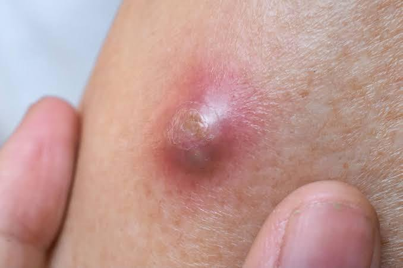
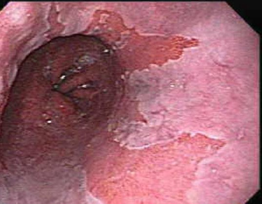
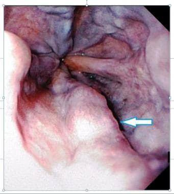
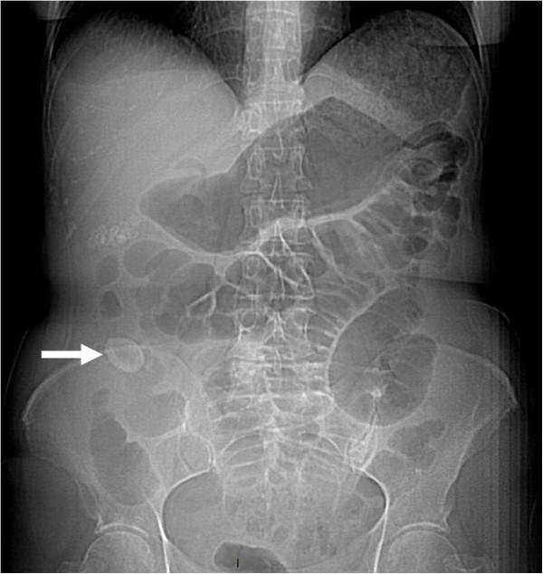
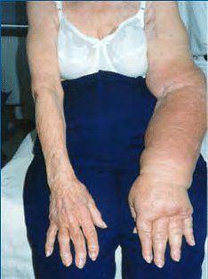
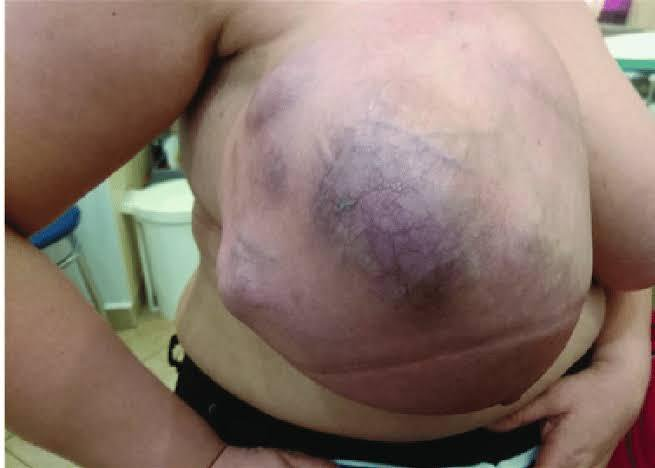

Source: "แอคSx 77 Rotate D" (file "AC 77D Sx MCQ"; the Drive folder is "AC 77 GEN SX"), questions noted down by students in a
table ("No / Problem / Choices") grouped under lecture topic headings (Fluid Elyte, Hernia, Breast, ...); 82 questions.
The paper's No column holds a number only for the first five questions (Q1-Q5, under "Fluid Elyte"); from there on it is empty (one cell reads "c",
beside the platelet adhesion question). Q1-Q5 are the paper's own numbers. Every other question has no number in the paper, so its id is the row number the key gives it (Q6 onward, in the
paper's order; the one occlusion-site question is Q77), and its heading names the topic heading it sits under, e.g. "## Q6 (original no. 6, topic: Metabolic response to injury)".
For Q6 onward "original no." is therefore the key's row number, not a number printed in the paper.
Stems and choices are as students noted them, in their own words (Thai and English), so some are short or cut off. A question that
continues across a page break is joined. Notes the students wrote inside choices are kept as written.
Answers: the key "AC GenSx by Vchakarn77" (MCQ Rotate D), written by MDCU 77 students, which numbers the questions 1-83 in the paper's
order. It is NOT an official key and may contain mistakes. The key counts the occlusion-site question (femoral pulse palpable, popliteal and
posterior tibial not) as two rows (77 and 78 with the same answer), because the paper's table row breaks across pages; here it is one question.
The key's explanations are copied as written (mostly Thai); where it is unsure it says so (a "?", two letters, a "-" or text such as "มั้ง") and this file shows that
exactly. The key's acknowledgement page, which names its student authors and a contact, is not copied.
The PDF has no creation date and the paper does not state the year. exam_year 2025 is a guess from the other MDCU77 papers (dated October 2024 to
March 2025); please check it.
The rotation letter (D) is not mapped to a G.
Pictures with no name, label or ID band were checked by eye and are kept in images/ (file names with q00 are the unnumbered questions, numbered in order of appearance); one ERCP picture with an
annotated drawing is described in words only, and a watermark and a partial label at the edge of the Q31 endoscopy picture were cropped off.

## Q1 (original no. 1)
Which of the following fluid has similar compositions to plasma ?

A. Saliva
B. Stomach
C. Small bowel
D. Pancreatic juice
E. Colon

**Answer:** C
**Explanation:** not stated in the key
**Guideline / source:** not stated

## Q2 (original no. 2)
Na 125 ต้องการให้Correct Na ถามว่าถ้าload Na เร็วไปเกิดcomplication อะไร

A. renal failure
B. weakness
C. central pontine myelinolysis

**Answer:** C
**Explanation:** not stated in the key
**Guideline / source:** not stated

## Q3 (original no. 3)
Maintenance fluid for patient 70 kg. post-appendectomy?

A. 5% DNSS/2 + KCl 20 mEq 80 mL/hr
B. 5% DNSS/2 100 mL/hr
C. 5% DNSS/2 + KCl 10 mEq 80 mL/hr
D. 0.9 NaCl 100 ml/hr
E. TPN

**Answer:** B
**Explanation:** key: volume = maintenance + deficit + insensible loss โจทย์บอกไม่มี Holiday Segar law for a 70 kg man             (100x10)+(50x10)+(20x50) = 2500 mL/d  concentration Na+ ~2-3 mEq/kg/d = ~140-210 mEq/d  compositions K+ ~1-2 mEq/kg/d = ~70-140 mEq/d ไม่ให้ในวันแรก energy อาจให้ dextrose ~100g/d เพื่อลด protein breakdown  type of IV fluids   IV fluid เพื่อให้ได้ volume 2500 mL/d, Na 210 mEq/d, dextrose 100 g/d มักให้ 5%DN/2 1000mL x3  volume 2500mL/24h = ~100mL/1h
**Guideline / source:** not stated

## Q4 (original no. 4)
คนไข้มาด้วยทานอาหารแล้วอาเจียนหลังทาน อาหารมาหาหมอดูdehydrate PE: มีupper abdominal distension splashing sound positive ถามว่าข้อไหนมีโอกาสจะเจอในคนไข้คน นี้น้อยที่สุด

A. Metabolic alkalosis
B. Hypochloremia
C. Hypokalemia
D. Aciduria
E. Respiratory acidosis

**Answer:** E
**Explanation:** key: Gastric outlet obstruction
**Guideline / source:** not stated

## Q5 (original no. 5)
คนไข้Na 135 K 3.5 Cl 90 (ไม่แน่ใจแต่Cl ดูต่ำ) ข้อไหนบอกการให้สารน้ำและเหตุผลได้ถูกต้อง

A. ให้Cl เนื่องจากChloride ต่ำ
B. ให้NSS เนื่องจากช่วยแก้hypovolemia
C. ให้KCl เนื่องจากK ต่ำ
D. ให้HCO3

**Answer:** B มั้ง (as written in the key)
**Explanation:** key: โจทย์ไม่ครบ
**Guideline / source:** not stated

## Q6 (original no. 6, topic: Metabolic response to injury)
ผู้ป่วยAppendicitis NPO 5 วันรอผ่าwhich metabolic process increase

A. Gluconeogenesis,
B. Glycolysis,
C. Proteolysis, Ketogenesis
D. Glycogenolysis,
E. Lipolysis,

**Answer:** not given as a letter in the key (it writes: lipolysis+ketogenesis) (from the key's row 6)
**Explanation:** not stated in the key
**Guideline / source:** not stated

## Q7 (original no. 7, topic: Metabolic response to injury)
คนไข้NPO post-op day 3 เจาะน้ำตาล220 mg/dL จะmanage ยังไง

A. sliding insulin + dextrose
B. ปล่อยไว้เพราะเป็นnormal stress response หลังผ่า

**Answer:** A (from the key's row 7)
**Explanation:** not stated in the key
**Guideline / source:** not stated

## Q8 (original no. 8, topic: Surgical nutrition)
complication of TPN

A. cholestasis, osteoporosis
B. Hypervitamin, refeeding syndrome
C. Nausea, Catheter clogged

**Answer:** A,B (as written in the key) (from the key's row 8)
**Explanation:** not stated in the key
**Guideline / source:** not stated

## Q9 (original no. 9, topic: Preoperative and postoperative care)
ข้อใดลดpost op complication และทำให้ผู้ป่วย ฟื้นตัสเร็วขึ้น

A. ให้ยาแก้ปวดpost op เป็นยาแก้ปสดnsaids, acetaminophen
B. เปลี่ยนจากga เป็นspinal block
C. พูดคุยกับผู้ป่วยเตรียมการดูแลหลังผ่าตัด

**Answer:** A (from the key's row 9)
**Explanation:** key: ลด post op complication → non-opioid oral analgesia e.g. paracetamol, NSAID
**Guideline / source:** not stated

## Q10 (original no. 10, topic: Preoperative and postoperative care)
ต้องงดบุหรี่นานแค่ไหนก่อนผ่าhernia ถึงจะลด ความเสี่ยงหลังผ่าตัดได้

A. 1 wk
B. 3 wk
C. 5 wk
D. 8 wk
E. ไม่ต้องหยุด

**Answer:** D (from the key's row 10)
**Explanation:** not stated in the key
**Guideline / source:** not stated

## Q11 (original no. 11, topic: Preoperative and postoperative care)
S/p splenectomy, pod1, lay in bed, normal urine output, อย่างอื่นปกติผู้ป่วยมีfever น่าจะ เกิดจากสาเหตุใด

A. SSI
B. Atelectasis
C. UTI
D. post-splenectomy fever

**Answer:** B (from the key's row 11)
**Explanation:** key: day 1-2 = wind
**Guideline / source:** not stated

## Q12 (original no. 12, topic: Preoperative and postoperative care)
scrub in เข้าfield ผ่าตัดต้องใช้อะไรในการ ล้างมือ

A. soap
B. Chlorhexidine
C. Tincture iodine
D. ใช้พยาบาล

**Answer:** B (from the key's row 12)
**Explanation:** key: Scrub ใช้ chlorhexidine in alc. หรือ povidone iodine (ไม่ใช่ tincture iodine)
**Guideline / source:** not stated

## Q13 (original no. 13, topic: Surgical infection)
เป็นตุ่มอักเสบที่skin ถามcausative pathogens
[picture in the paper: a photo of a small red, raised skin lesion with a central crust]

A. Gram positive cocci
B. Gram positive bacilli
C. Gram negative bacilli
D. Gram negative coccobacilli
E. Mixed Anaerobe

**Answer:** A (from the key's row 13)
**Explanation:** key: ตุ่มอักเสบที่ skin : มักเกิดจากเชื้อกลุ่ม strep, staph ซึ่งเป็น Gram positive cocci
**Guideline / source:** not stated

## Q14 (original no. 14, topic: Hemostasis)
ให้heparin IV อยากติดตามว่ายาได้ผลดีมั้ยตรวจ อะไร

A. aPTT
B. PT
C. Bleeding time
D. Platelet count
E. D-dimer

**Answer:** A (from the key's row 14)
**Explanation:** key: Heparin ดู aPTT PT : warfarin Bleeding time : Platelet dysfunction Platelet count : Thrombocytopenia D-dimer : ใช้ดูการสลายตัวของ clot โดยค่านี้จะเพิ่มใน e.g.  DVT, DIC
**Guideline / source:** not stated

## Q15 (original no. 15, topic: Hemostasis)
คนไข้Car accident Hypovolemic shock. Need massive blood transfusion. Which of the following complication is LEAST likely to happen ?

A. Air embolism
B. Hyperkalemia
C. Hypothermia
D. Hypercalcemia
E. Dilutional coagulopathy

**Answer:** D (from the key's row 15)
**Explanation:** key: Massive transfusion is also associated with hypocalcemia due to citrate toxicity Air embolism  Hyperkalemia Hypothermia Hypercalcemia -> ต้อง Hypocalcemia Dilutional coagulopathy
**Guideline / source:** not stated

## Q16 (original no. 16, topic: Hemostasis)
What is used for platelet adhesion?

A. Von willebrand factor
B. GP2b3a
C. (not recalled)

**Answer:** A (from the key's row 16)
**Explanation:** key: vWF เชื่อม subendothelial กับ GpIb บน platelets Gp2b3a เกี่ยวกับ platelet aggregation
**Guideline / source:** not stated

## Q17 (original no. 17, topic: Surgical oncology)
ผู้ป่วยnosocomial pneumonia ใส่PPE อะไรดี บ้างcovid19 negative
[in the paper's choice column, without a letter: surgical mask, plastic coat, gloves, hair cover]

**Answer:** not given as a letter: the paper's choices have no letters, and the key writes "A." (as written in the key) (from the key's row 17)
**Explanation:** key: Personal Protective Equipment (PPE) : Surgical mask, plastic coat, gloves, hair cover แบบที่พวกเราใส่เวลาไปทำหัตถการให้คนไข้เชื้อดื้อยาอ่ะ
**Guideline / source:** not stated

## Q18 (original no. 18, topic: Surgical oncology)
ให้ประวัติผญเป็นมะเร็งเต้านมตอนอายุ30 on OCP ประวัติครอบครัวเป็นมะเร็งแม่งทั้งบ้านแต่เป็น ตอน50-60 เป็นพวกมะเร็งที่ไม่ใช่เต้านมกับรังไข่ เอาไปตรวจยีนเจอเป็นp53 mutation ถามว่า ปัจจัยใดทำให้เกิดมะเร็งในคนนี้

A. OCP
B. Sporadic mutation
C. Li-Fraumeni
D. BRCA2
E. …

**Answer:** C (from the key's row 18)
**Explanation:** key: มะเร็งเต้านมตอนอายุ 30 OCP ไม่ใช่ ไม่น่าทำให้เป็นมะเร็งเร็วขนาดนี้ Sporadic mutation : ไม่ใช่ เพราะคนในครอบครัวเป็นมะเร็งกันเยอะ Li-Fraumeni : p53 mutation ทำให้เป็นมะเร็งได้หลายที่ รวมถึงที่เต้านมด้วย จึงเป็นไปได้ที่คนทั้งบ้านจะเป็นมะเร็งได้หลายแบบโดยยังไม่มีใครแจ็คพอตโดน เต้านมเลย BRCA2 : ไม่ใช่ ยีนตัวนี้เด่น นม รังไข่ ตับอ่อน ต่อมลูกหมาก นี่เป็นมะเร็งทั้งบ้านแต่ไม่มีใครเป็นมะเร็งเต้านมกับรังไข่เลย ไม่ใช่ละ
**Guideline / source:** not stated

## Q19 (original no. 19, topic: Surgical oncology)
physical carcinogen

A. atomic bomb
B. Estrogen จากโรค
C. Gene มะเร็ง

**Answer:** A (from the key's row 19)
**Explanation:** key: Physical or environmental carcinogens: These carcinogens come from the environment. UV rays from sunlight and radiation from X-rays or other radioactive materials are examples of physical carcinogens.
**Guideline / source:** not stated

## Q20 (original no. 20, topic: Surgical oncology)
แม่เป็นCA breast BRCA2 ลูกscreeningเป็น DCIS ทำmastectomy

A. Primary prophylaxis
B. Secondary Prophylaxis
C. Tertiary prophylaxis
D. Screening

**Answer:** B (from the key's row 20)
**Explanation:** key: มี premalignant lesion (DCIS) แล้วค่อยตัดออก จัดเป็น secondary prevention
**Guideline / source:** not stated

## Q21 (original no. 21, topic: Transplant and immunology)
Common immunosuppressive drug for prevention of organ rejection

A. Cyclosporin
B. Tacrolimus
C. Sirolimus
D. MMF
E. Azathioprine

**Answer:** A,B,D,E (as written in the key) (from the key's row 21)
**Explanation:** key: ปล. AC76 ถามข้อที่ไม่ใช่
**Guideline / source:** not stated

## Q22 (original no. 22, topic: Transplant and immunology)
Child C, single lesion 5 cm. What is the most appropriate management?

A. liver transplant

**Answer:** A (from the key's row 22)
**Explanation:** not stated in the key
**Guideline / source:** not stated

## Q23 (original no. 23, topic: Transplant and immunology)
cross matching ทำเพื่อcheck อะไร

A. ABO compatibility
B. Preformed antibody
C. T cell

**Answer:** B (from the key's row 23)
**Explanation:** key: Cross matching ทำเพื่อ Check preformed Ab The purpose of the crossmatch is to detect the presence of recipient antibodies against donor Ag
**Guideline / source:** not stated

## Q24 (original no. 24, topic: Transplant and immunology)
Which patient least benefit from liver transplant?

A. Large hemangioma with Kasabach Merritt phenomenon
B. Primary sclerosing cholangitis
C. Child S/P failed kasai
D. Paracetamol overdose

**Answer:** A (from the key's row 24)
**Explanation:** key: Liver transplant เลือกทำในคนไข้ที่อาการหนักสุดก่อน และไม่มีวิธีรักษาอื่น Large hemangioma with Kasabach Merritt phenomenon มีวิธีรักษาอื่น  PSC : Liver transplant เป็นการรักษาเดียวที่ทำได้ Child S/P failed Kasai : Liver transplant เป็นการรักษาเดียวที่ทำได้ Paracetamol overdose : ถ้าเยอะจนตับพังก็ต้อง Liver transplant
**Guideline / source:** not stated

## Q25 (original no. 25, topic: Hernia)
Myopectineal orifice of Fruchaud

A. Femoral canal
B. Hesselbach triangle
C. Triangle of Doom
D. Space of Retzius
E. Bogros space

**Answer:** A,B (as written in the key) (from the key's row 25)
**Explanation:** key: Myopectineal orifice เป็นพื้นที่ที่มี 3 รูที่ทำให้เกิด hernia ได้ Inguinal cancal -> Indirect inguinal hernia Hasselbach triangle -> Direct inguinal hernia Femoral canal -> Femoral hernia เวลาวาง prosthetic mesh ก็จะวางปิด myopectineal orifice ไว้ เป็นการเสริมความแข็งแรงของ inguinal floor
**Guideline / source:** not stated

## Q26 (original no. 26, topic: Hernia)
คนไข้เป็นpantaloon hernia + BPH ได้รับการ รักษาTUR-P ไปแล้วรักษายังไงดี

A. Lichtenstein Polypropylene mesh
B. Lichtenstein Polyglactin mesh
C. Darn
D. Herniotomy with Bassini repair
E. Shouldice four layer repair

**Answer:** A (from the key's row 26)
**Explanation:** key: Pantaloon hernia = มีทั้ง direct & indirect inguinal hernia ในข้างเดียวกัน -> ซ่อมทั้ง 2 hernia Direct: ดัน hernia กลับ + repair inguinal floor Indirect: high ligation herniotomy + repair inguinal floor ทั้ง 2 อันทำทีเดียวด้วย Lichtenstein hernia repair (ปกติใช้ polypropylene mesh; permanent mesh): ดัน Direct IH กลับเข้าไป + ตัด hernia sac ของ Indirect IH + วาง mesh เพื่อเสริมความแข็งแรงของ inguinal floor *polyglactin mesh เป็น absorbable mesh ไม่ใช้ใน inguinal hernia ที่ต้องการ longterm reinforcement
**Guideline / source:** not stated

## Q27 (original no. 27, topic: Hernia)
occlusion test กดที่จุดไหน

A. deep ring of inguinal canal
B. Superficial ring of inguinal canal

**Answer:** A (from the key's row 27)
**Explanation:** key: Occlusion test Concept: อุด deep inguinal ring ซึ่งเป็นทางออกของ indirect inguinal hernia ถ้าเป็น IIH กด deep ring เอาไว้แล้วเบ่ง จะต้องไม่มีก้อนโป่งขึ้นมาที่หน้าท้อง วิธีทำ: กดไปที่ deep inguinal ring: 2 cm above ½ of inguinal ligament จากนั้นให้คนไข้เบ่ง/ไอ ถ้าเห็น bulging mass ที่ medial ต่อจุดกดแสดงว่าเป็น direct IH ถ้าไม่เห็นก้อนยื่นออกมา ให้เอามือออกแล้วลองเบ่งอีกครั้ง คราวนี้ถ้ามีก้อนยื่นออกมาได้แสดงว่าเป็น indirect IH  Invagination/Impingement test Concept: อุด superficial inguinal ring ซึ่งเป็นทางออกของ indirect inguinal hernia ถ้ามีก้อนวิ่งมาชนปลายนิ้ว = เป็น indirect IH, ถ้าก้อนวิ่งมาชนฝ่านิ้วหรืออื่น ๆ ที่ไม่ใช่ปลายนิ้ว = Direct IH
**Guideline / source:** not stated

## Q28 (original no. 28, topic: Hernia)
groin mass lateral and below pubic tubercle

A. femoral incarcerated hernia
B. Obturator obstructed hernia
C. Indirect incarcerated hernia
D. Direct hernia

**Answer:** A (from the key's row 28)
**Explanation:** key: Inguinal ligament ลากจาก ASIS ไป pubic tubercle ถ้า mass อยู่ใต้ pubic tubercle แสดงว่าน่าจะใต้ต่อ inguinal ligament ด้วย -> femoral hernia
**Guideline / source:** not stated

## Q29 (original no. 29, topic: Hernia)
S/p total abdominal hysterectomy, วันนี้groin mass irreducible, pain

A. Emergency Sx
B. Manual reduction and observe

**Answer:** B (from the key's row 29)
**Explanation:** key: *โจทย์น่าจะต้องให้ระยะเวลามาด้วยว่าเป็นมานานแค่ไหนแล้ว* คนไข้มี incarcerated inguinal hernia (มี pain บริเวณก้อน hernia ได้) ถ้ายังไม่มี sign peritonitis, ไม่มี obstruction & strangulation และเป็นมา < 6 hr ให้ลอง manual reduction ได้และ observe อาการ  Incarcerated hernia ถ้ามากกว่า 6 hr ให้ emergency surgery  *Previous history of abdominal wall/pelvic surgery -> อาจไปโดน nerve บริเวณนั้น esp. Iliohypogastric nerve -> supply skin & internal oblique & transversus abdominis -> inguinal floor weakness -> hernia ได้
**Guideline / source:** not stated

## Q30 (original no. 30, topic: Esophagus)
SCC esophagus T1N0M0 เป็นHT คุมดี

A. esophagectomy

**Answer:** A (from the key's row 30)
**Explanation:** key: Esophageal cancer treatment  Early stage Tis: tissue in situ ex high-grade dysplasia Barrett esophagus -> Endoscopic mucosal resection (EMR) T1: esophagectomy Locally advanced: T2-3, N0-1 Neoadjuvant chemoradiation -> Surgery Definite chemoradiation if not fit for surgery Advanced/metastatic disease: T4, M1 Systemic therapy: platinum-based chemo, targeted therapy (if HER2 positive), Immunotherapy (ex PD-1 inhibitors) Palliative treatment: esophageal stenting, radiation for symptom  control
**Guideline / source:** not stated

## Q31 (original no. 31, topic: Esophagus)
ผู้ชายสูบบุหรี่กินเหล้าใช้NSAID เป็นกรดไหล ย้อนทำให้มีrecurrent dyspepsia บ่อยๆให้ภาพ egd มาดังรูปและหลังจากนั้นกลืนไม่ลงเลยมาตรว จซ้ำอีกแล้วเจอDistal CA of esophagus ถามว่า risk factor adenocarcinoma คือ
[picture in the paper: an endoscopic image of the lower esophagus]

A. chronic GERD
B. smoking
C. H pylori
D. NSAID

**Answer:** A (from the key's row 31)
**Explanation:** key: ในรูปคือ Barrett esophagus ประวัติ recurrent dyspepsia, การใช้ NSAIDs -> สนับสนุนว่ามี chronic GERD -> intestinal metaplasia of distal esophagus -> Barrett esophagus -> adenocarcinoma of distal esophagus Smoking, NSAIDs, H pylori เป็น risk factor ของ peptic ulcer disease Smoking เป็น risk factor ของ Squamous cell carcinoma of esophagus (เป็น RF ของ esophageal adenoCA ด้วยแต่ไม่เท่า chronic GERD) H pylori เป็น risk factor ของ CA stomach
**Guideline / source:** not stated

## Q32 (original no. 32, topic: Esophagus)
progressive dysphagia, bird beak appearance, manometry achalasia เจอยังไง

A. incomplete relaxation LES and aperistalsis
B. Complete+vigorous contract
C. Complete+decrease peritalsis

**Answer:** A (from the key's row 32)
**Explanation:** key: Achalasia: manometry findings LES: impaired/no relaxation Aperistalsis: absent movement, incoordinate movement, premature spasm  Impaired relaxation of the lower esophageal sphincter (LES) (residual pressure or integrated relaxation pressure of ≥10 mmHg) and absent peristalsis in a patient without mechanical obstruction near the LES
**Guideline / source:** not stated

## Q33 (original no. 33, topic: Esophagus)
50-year-old businessman social drinker and smoking no underlying disease presented with hematemesis. Per rectal exam found melena. EGD found as picture, what’s the diagnosis?
[picture in the paper: an endoscopic image of the esophagus with an arrow]

A. esophageal varices
B. duodenal ulcer
C. gastric ulcer
D. Mallory-Weiss tear

**Answer:** A (from the key's row 33)
**Explanation:** key: เป็นรูป esophageal varices ประวัติคนไข้เป็น Upper GI bleeding และมี background เป็น drinker น่าจะมี U/D cirrhosis จึงคิดว่า bleed จาก variceal มากกว่า non-variceal
**Guideline / source:** not stated

## Q34 (original no. 34, topic: Esophagus)
ผู้ป่วยชายมาด้วยอาการDysphagia และWeight loss โดยมีอาการมา6 เดือนแล้วโดยตอนแรกทาน ของแข็งๆไม่ได้แต่soft diet ได้ช่วงหลังSoft diet ไม่ได้แล้วได้แต่liquid จงDiagnose

A. Achalasia
B. CA esophagus
C. NMJ disease

**Answer:** B (from the key's row 34)
**Explanation:** key: Chronic progressive dysphagia มีการเปลี่ยนชนิดอาหารจากแข็งไปอ่อน -> mechanical obstruction of esophagus Course หลักเดือน -> malignant มากกว่า benign  Wt loss -> malignant มากกว่า benign (benign ก็น้ำหนักลดได้ถ้า late แล้ว) Dx CA esophagus
**Guideline / source:** not stated

## Q35 (original no. 35, topic: Stomach and duodenum)
gastrectomy flushing, palpitation immediately หลังกินเกิดจาก

A. rapid emptying and hyperosmolarity
B. excess insulin and hypoglycemia

**Answer:** A (from the key's row 35)
**Explanation:** key: เป็นอาการของ early dumping syndrome -> เกิดจากอาหารไหลจาก stomach ลง bowel เร็วเกินไปเนื่องจาก pyloric function ไม่สมบูรณ์หลัง gastrectomy ทำให้อาหารนั้นดึงน้ำเข้า bowel lumen -> dehydrate & vasomotor response & intestinal distention
**Guideline / source:** not stated

## Q36 (original no. 36, topic: Stomach and duodenum)
gastric outlet obstruction with moderate dehydration ไม่พบอะไร

A. metabolic alkalosis
B. hypokalemia
C. hypochloremia
D. respiratory acidosis
E. aciduria

**Answer:** D (from the key's row 36)
**Explanation:** key: Gastric outlet obstruction: epigastric distention & discomfort, vomiting after meals (มักมีเศษอาหารจากมื้อก่อนหน้าออกมาด้วย), ตรวจร่างกายฟังได้ splash sound at epigastrium Etiology (in adult): peptic ulcer (M/C), malignancy Consequences Vomiting -> dehydration, loss H+, Cl- -> hypochloremia, met. alkalosis Activate RAAS: ดูด Na, ขับ K & H+ -> HypoK, Aciduria (Paradoxical aciduria)  อาจมี respiratory compensation ได้แต่ไม่เป็น respiratory acidosis
**Guideline / source:** not stated

## Q37 (original no. 37, topic: Stomach and duodenum)
วิธีที่จะเอาacid producing cell ออก

A. vagotomy
B. Vagotomy with antrectomy
C. Vagotomy with pyloroplasty
D. Fundectomy

**Answer:** A (from the key's row 37)
**Explanation:** not stated in the key
**Guideline / source:** not stated

## Q38 (original no. 38, topic: Stomach and duodenum)
CLO Test positive แล้วรักษาการรักษานี้ไม่ช่วย อะไร

A. GERD
B. Gastric adenoma
C. Gastric lymphoma
D. Gastric MALToma
E. Duodenal ulcer

**Answer:** A (from the key's row 38)
**Explanation:** key: CLO positive = H. pylori infection If treated = prevent complications from H. pylori infection
**Guideline / source:** not stated

## Q39 (original no. 39, topic: Stomach and duodenum)
ผู้ป่วยมีhematemesis + melena ทำการ investigate โดยegd และcolonoscopy แต่ไม่ เจอcause of bleeding ควรทำการinvestigate อย่างไรต่อ

A. RBC scan (ถ้าออกน้อยตอบอันนี้)
B. CTA angiogram (ถ้าเยอะตอบอันนี้ดูv/s และสภาพ คนไข้)
C. Double balloon enteroscopy
D. กลืนแคปซูลกล้อง

**Answer:** A,B (as written in the key) (from the key's row 39)
**Explanation:** not stated in the key
**Guideline / source:** not stated

## Q40 (original no. 40, topic: Pancreas and spleen)
Tail Pancreatic CA in 46 year old female pt. ที่ มีCEA สูง, Amylase ต่ำมีOvarian stroma pattern

A. PDAC
B. SCN
C. MCN
D. IPMN
E. Pseudocyst

**Answer:** C (from the key's row 40)
**Explanation:** not stated in the key
**Guideline / source:** not stated

## Q41 (original no. 41, topic: Pancreas and spleen)
ERCP เห็นdilated chain of lakes
[picture in the paper: an ERCP image with a labelled drawing (left out of this file)]

A. Chronic pancreatitis
B. Duodenal CA
C. Head of pancrease CA
D. Pseudocist

**Answer:** A (from the key's row 41)
**Explanation:** not stated in the key
**Guideline / source:** not stated

## Q42 (original no. 42, topic: Pancreas and spleen)
not complication of acute pancreatitis

A. diarrhea and malabsorption => อ. กฤษณ์บอกว่า มักเจอในchronic pan แต่acute ก็เกิดได้
B. Sma aneurysm => อ. กฤษณ์บอกว่าsplenic a more common มากกว่าถ้าเป็นSMA ควรเป็น branch of SMA
C. Pseudocyst of pancrease
D. Necrotizing pancreas (อ. ดุษฎีบอกว่าถ้าเป็นข้อสอบSingle best answer ควรตอบ A เพราะเป็นcomplication ของchronic ส่วนข้ออื่นชัดเจน ว่าเป็นacute ส่วนถ้าชีวิตจริงก็ตามที่อ. กฤษณ์บอกครับ)

**Answer:** A (from the key's row 42)
**Explanation:** not stated in the key
**Guideline / source:** not stated

## Q43 (original no. 43, topic: Pancreas and spleen)
Esophageal varice ไม่ใช้ไรรักษา

A. octreotide
B. IV fluid
C. EGD
D. Balloon temponade
E. NG?

**Answer:** E (from the key's row 43)
**Explanation:** not stated in the key
**Guideline / source:** not stated

## Q44 (original no. 44, topic: Portal hypertension and obstructive jaundice)
Pt. With Obstructeive Jaundice, อ่านโจทย์สรุป ได้ว่าPalpable gallbladder ตอนหายใจ

A. CA head of pancreas
B. HCC
C. Choleydochal cyst
D. Intrahepatic cholangiocarcinoma

**Answer:** A (from the key's row 44)
**Explanation:** not stated in the key
**Guideline / source:** not stated

## Q45 (original no. 45, topic: Portal hypertension and obstructive jaundice)
ผู้ป่วยchronic liver disease portal hypertension อึแล้วมีเลือดสดออกคิดว่าเกิดจาก shunt ไปเส้นเลือดไหน

**Answer:** not given as a letter in the key (it writes: -) (from the key's row 45)
**Explanation:** key: Ans: Superior rectal vein
**Guideline / source:** not stated

## Q46 (original no. 46, topic: Liver)
Patient present with jaundice and fatigue lab shows low hct with Hyperbilirubinemia, indirect เด่นถามinvestigation

A. Peripheral blood smear
B. Ct triple phase
C. Tumor marker
D. MRCP

**Answer:** A (from the key's row 46)
**Explanation:** key: นึกถึงสาเหตุจาก hemolysis มากที่สุด จึงควรทำ peripheral blood smear ดูความผิดปกติของเม็ดเลือด
**Guideline / source:** not stated

## Q47 (original no. 47, topic: Liver)
Colorectal liver metastasis เจอก้อน2*3

A. liver resection

**Answer:** A (from the key's row 47)
**Explanation:** not stated in the key
**Guideline / source:** not stated

## Q48 (original no. 48, topic: Liver)
U/s anechoic rt. Lobe 6x8 cm. Hypodense T1 Hyperdense T2 central scar ทำไรต่อ

A. Rt. Hepatectomy
B. Wedge segment
C. Embolisation
D. F/U

**Answer:** D (from the key's row 48)
**Explanation:** key: ควรเป็น hypoechoic ใน US?
**Guideline / source:** not stated

## Q49 (original no. 49, topic: Liver)
Liver metastasis III segment ทำไรต่อ

A. TACE
B. PVE
C. Chemo+radio therapy

**Answer:** B,C (as written in the key) (from the key's row 49)
**Explanation:** key: โจทย์จริงน่าจะชัดเจนกว่านี้   ตอบ B เพราะว่า: Liver metastasis จากอวัยวะนอกตับ และมีก้อนที่ liver segment III: ถ้าหากเป็นมะเร็งจาก gynecological / urological organs น่าทำ liver resection อยู่เนื่องจากผลลัพธ์ดี (5-year survival > 30%) สามารถทำเป็น multiple wedge resection ได้เลย ซึ่งอาจจะทำ PVE (portal vein embolization) ก่อนผ่า เพื่อลดขนาดก้อนได้   ตอบ C เพราะว่า: ถ้าหากเป็น HCC ที่กระจายไปนอกตับแล้วไม่สามารถทำ liver resection ได้ (Milan’s criteria) จึงไม่ตอบ Portal vein embolization (PVE)   เนื่องจากมีการกระจายนอกตับแล้ว จะทำเป็น palliative treatment เพื่อ prolong life มากกว่า ซึ่งในกรณีนี้อาจจะทำ TACE, RT, Chemotherapy, Sorafenib, ablative tx ได้
**Guideline / source:** not stated

## Q50 (original no. 50, topic: Approach to liver mass)
ผญ45 yr เจอก้อนในตับrapid enhance in arterial phase, central scar ควรทำไรต่อดี

A. Resection
B. Transplantation
C. Chemotherapy
D. Follow up imaging
E. TACE

**Answer:** D (from the key's row 50)
**Explanation:** key: ทั้ง focal nodular hyperplasia และ hepatic adenoma มี arterial enahcement แต่ FNH 20-30% อาจพบ central scar ซึ่งช่วยในการ dx. เมื่อสงสัย FNH ต้อง confirm using MRI with hepatocyte specific agent เพื่อ r/o hepatic adenoma / HCC ถ้าหากเป็น FNH → follow up using imaging เนื่องจากไม่จำเป็นต้องผ่าตัด ยกเว้นถ้าทำให้เกิดอาการ
**Guideline / source:** not stated

## Q51 (original no. 51, topic: Approach to liver mass)
ขอนแก่นpresent with painless progressive by jaundice wt. loss

A. CCA
B. HCC

**Answer:** A (from the key's row 51)
**Explanation:** key: Painless progressive jaundice → hepatic หรือ post-hepatic ก็ได้ Weight loss → cancer Chronic jaundice + weight loss ก็ต้อง ddx cancer, cirrhosis, chronic dz อื่นๆ   ในช้อยมีแค่ HCC + CCA ซึ่งอาจจะนำ epidemiology มาช่วยจับ: ภาคอีสานมี Opisthorchis viverrini เยอะมาก จึงอาจจะทำให้สงสัย CCA > HCC แต่ถ้าหากโจทย์ให้มาว่ามีประวัติ acholic stools + dark urine + Courvoisier sign (palpable gallbladder) ก็จะทำให้นึกถึง CCA มากยิ่งขึ้น
**Guideline / source:** not stated

## Q52 (original no. 52, topic: Approach to liver mass)
50 year old business man from saudi arabia มีก้อนในตับmultilobulated with floating tissue inside the cyst

A. Cystic ecchinococcosis
B. Amoebic liver abscess
C. Polycystic disease
D. Liver metastasis

**Answer:** A (from the key's row 52)
**Explanation:** key: Cystic ecchinococcosis
**Guideline / source:** not stated

## Q53 (original no. 53, topic: Approach to liver mass)
FNH 6x8 cm. What is the most appropriate management?

A. Observe and follow up
B. Wedge resection
C. Segmental hepatectomy

**Answer:** A (from the key's row 53)
**Explanation:** not stated in the key
**Guideline / source:** not stated

## Q54 (original no. 54, topic: Approach to liver mass)
tumor marker ที่ไม่ช่วยdiag primary liver mass

A. AFP
B. CEA
C. CA19-9
D. PIVKA-II

**Answer:** B (from the key's row 54)
**Explanation:** key: CEA ใช้กับ colorectal cancer
**Guideline / source:** not stated

## Q55 (original no. 55, topic: Small bowel and small bowel obstruction)
อาการObstipation, Nausea vomitting, abdominal distension, Colicky pain มา1 วันมี ก้อนยื่นออกมาจากแผลผ่าตัดที่หน้าท้องทำinitial management ไปแล้วควรทำอะไรต่อ

A. Observe
B. Manual reduction +observe
C. Emer explore lap

**Answer:** C (from the key's row 55)
**Explanation:** key: คนไข้มี signs of gut obstruction (obstipation, n/v, colicky pain, abdominal distention) และถ้าหากมี irreducible hernia ด้วย ก็ diag obstructed hernia ไปเลย (ถ้าหาก reducible → Gut obstruction ไม่ได้เกิดจาก hernia ต้องหาสาเหตุอื่น)
**Guideline / source:** not stated

## Q56 (original no. 56, topic: Small bowel and small bowel obstruction)
ชาย60 yr มีประวัติผ่าmitral valve ไปเมื่อสิบปี ก่อนมาด้วยปวดท้องdisproportionate เจอ small bowel ischemia ควรจะเจอpathology อะไรที่สนับสนุน

A. Thrombus in SMA
B. Emboli in SMA
C. SMA vasospasm
D. Thrombus in SMV

**Answer:** B (from the key's row 56)
**Explanation:** key: Pain out of proportion = ischemia   Mitral valve surgery = risk factor for cardiac emboli → SMA emboli
**Guideline / source:** not stated

## Q57 (original no. 57, topic: Acute abdomen and appendix)
Diag appendicitis, imaging ไหนมีประโยชน์สุด

A. Acute abdomen series
B. Ultrasonography
C. CT
D. MRI
E. angiogram

**Answer:** C (from the key's row 57)
**Explanation:** not stated in the key
**Guideline / source:** not stated

## Q58 (original no. 58, topic: Acute abdomen and appendix)
Appendectomy is prohibited/not recommended in which of the following patient?

A. 20 year old female pregnancy GA 20 wk
B. 25 year old
C. year old ruptured appendicitis
D. year old ileocolic crohn’s disease
E. 70 year old Ca appendix

**Answer:** D (from the key's row 58)
**Explanation:** key: Ileocolitis is an important differential in IBD.   Ref: https://journals.lww.com/ajg/fulltext/2016/10001/appendectomy_for_appendicitis_has_worse_hospital.724.aspx  Patients with IBD have worse clinical outcomes following appendectomy and thus require confirmation of appendicitis. If the cause is not appendicitis but is ileocolitis, an appendectomy would be contraindicated.
**Guideline / source:** not stated

## Q59 (original no. 59, topic: Acute abdomen and appendix)
ผู้หญิง18 ปีอาการsuspect appendicitis ควร ตรวจอะไรก่อน

A. Urine pregnancy test
B. CT
C. Explore lap

**Answer:** A (from the key's row 59)
**Explanation:** key: In women of childbearing age, gynecological disorders are an important differential, i.e. ruptured ectopic pregnancy, ovarian torsion, etc. A urine pregnancy test can help to rule out pregnancy before undergoing further testing such as CT.
**Guideline / source:** not stated

## Q60 (original no. 60, topic: Acute abdomen and appendix)
flank pain radiate to groin, hematuria

A. ureteric stone

**Answer:** A (from the key's row 60)
**Explanation:** key: Classic presentation of ureteric stone.
**Guideline / source:** not stated

## Q61 (original no. 61, topic: Minimally invasive surgery and gallstones)
LC ดีกว่าOpen ทุกอันยกเว้น

A. less time
B. Less pain
C. Good cosmetic
D. Less blood loss
E. Less recovery time

**Answer:** A (from the key's row 61)
**Explanation:** key: B-E เป็นข้อดีของ laparoscopic surgery
**Guideline / source:** not stated

## Q62 (original no. 62, topic: Minimally invasive surgery and gallstones)
Why decreased cardiac output due to pneumoperitoneum

A. decreased venous return

**Answer:** A (from the key's row 62)
**Explanation:** key: การใส่ลมเข้าไปในช่องท้อง อาจทำให้ intraabdominal pressure สูงกว่า venous pressure → venous return ลดลง → cardiac output ลดลง
**Guideline / source:** not stated

## Q63 (original no. 63, topic: Minimally invasive surgery and gallstones)
(the stem is a picture only)
[picture in the paper: a plain abdominal film with an arrow]

A. Impacted feces
B. Gallstone ileus
C. Volvulus
D. Foreign body

**Answer:** B (from the key's row 63)
**Explanation:** key: ในรูป เห็น dilated bowel loop + ectopic gallstone → gallstone ileus Note: Rigler’s triad = small bowel obstruction + pneumobilia + ectopic gallstone
**Guideline / source:** not stated

## Q64 (original no. 64, topic: Minimally invasive surgery and gallstones)
อะไรที่prefer open มากกว่าlap

A. morbid obesity
B. Mass at gallbladder
C. Cirrhosis

**Answer:** B (from the key's row 64)
**Explanation:** key: Suspected GB cancer เป็น contraindication ของ LC
**Guideline / source:** not stated

## Q65 (original no. 65, topic: Breast)
ข้อไหนไม่ต้องpost mastectomy radiation

A. T3
B. T4
C. Multifocal
D. cT3N2
E. Deep margin(หรือinfiltrate นี่แหละ)

**Answer:** C>E (as written in the key) (from the key's row 65)
**Explanation:** key: Multifocal ไม่ใช่ข้อบ่งชี้ของการให้ postmastectomy radiotherapy Deep margin ไม่แน่ใจว่าจดมาถูกไหม คิดว่าโจทย์จริงอาจจะเป็น close margin?
**Guideline / source:** not stated

## Q66 (original no. 66, topic: Breast)
ตัดนมมา5 ปีบ่นกับหมอทุกปีว่ายกแขนซ้ายไม่ขึ้น สภาพตามรุปถามว่าเกิดจากอะไร
[picture in the paper: a photo of both arms, the left arm swollen]

A. Lymphadenopathy
B. Filariasis
C. Thoracodorsal nerve injury
D. Brachial plexus injury
E. Lymphedema

**Answer:** E (from the key's row 66)
**Explanation:** key: Lymphedema เป็น complication จาก axillary LN dissection
**Guideline / source:** not stated

## Q67 (original no. 67, topic: Breast)
ก้อนโตเร็ว8 เดือน
[picture in the paper: a photo of a large breast mass with skin changes]

A. Phyllodes tumor
B. Fibroadenoma
C. Ductal carcinoma in situ

**Answer:** A (from the key's row 67)
**Explanation:** key: ก้อนใหญ่ โตไว
**Guideline / source:** not stated

## Q68 (original no. 68, topic: Breast)
female pt. 27 y/o no mass แต่เจอdiffuse micro calcification ในu/s และตรวจร่างกายพบ axillary lymph node โต3 node ไม่พบ supraclavicularnode ถามmanagement

A. (not recalled)

**Answer:** not given as a letter in the key (it writes: -) (from the key's row 68)
**Explanation:** key: Diffuse microcalcification → สงสัย malignant อ.กิ๊กแนะนำให้ทำ MRI ก่อนเพื่อหาตำแหน่งก้อน เจอ axillary LN โตด้วย → ทำ FNA Ans: MRI + LN FNA
**Guideline / source:** not stated

## Q69 (original no. 69, topic: Breast)
ผ่านมใช้drain อะไร

A. Radivac
B. Jackson
C. Penrose

**Answer:** A (from the key's row 69)
**Explanation:** key: Radivac drain เป็น closed drain นิยมใช้ตอนผ่านม เพราะเส้นเล็ก (Cr. อ.เมธี)
**Guideline / source:** not stated

## Q70 (original no. 70, topic: Breast)
คนไข้มาด้วยก้อนที่นมตรวจร่างกายเจอนมเป็น ก้อนทั้งเต้าตรวจเจอaxillary lymph node ผิด ปกติทำbiopsy พบว่าเป็นinvasive ductal carcinoma with lymph node invasion What is the most appropriate managment?

A. Noeadjuvant chemotherapy + surgery
B. Neoadjuvant chemoradiotherapy + surgery
C. Mastectomy + SLNB
D. Mastectomy + ALND
E. ?

**Answer:** D (from the key's row 70)
**Explanation:** key: โจทย์บอกว่าก้อนใหญ่ทั้งเต้า มีวิธีรักษาคือ mastectomy (หรือ neoadjuvant + BCS ก็พอได้) ตรวจเจอ axillary LN ผิดปกติ โจทย์ไม่ได้บอกว่าเจอผิดปกติกี่ node แต่ก็เจอที่ axillary แล้ว ก็ทำ ALND ไปเลย Note: ถ้าตีว่าก้อนในโจทย์เป็น locally advanced เอาไปทำ neoadjuvant ก่อนได้ ข้อ A ก็ไม่ผิดนะ
**Guideline / source:** not stated

## Q71 (original no. 71, topic: Thyroid and parathyroid)
Post thyroidectomy, Chvostek sign, Trousseau's sign ถามว่าเกิดจากอะไร

A. Hypothyroid
B. Thyroid cancer
C. too much thyroid tissue removed
D. Devascularization parathyroid gland

**Answer:** D (from the key's row 71)
**Explanation:** key: เวลาผ่าตัด thyroid ต้องตัด inferior thyroid a. ซึ่งเลี้ยงทั้ง thyroid + parathyroid หลังผ่า อาจเกิด hypoparathyroidism จาก gland ischemia (temporary)
**Guideline / source:** not stated

## Q72 (original no. 72, topic: Thyroid and parathyroid)
มาด้วยnausea, vomiting, hypercalcemia เป็น มา3 เดือนตรวจblood chemistry normal, normal urine output + ตรวจparathyroid hormone ได้ค่า90 pg/ml (normal 15-65 pg/ml)

A. Primary hyperparathyroidism
B. Secondary hyperparathyroidism
C. Tertiary hyperparathyroidism
D. Hypoparathyroidism
E. Vitamin D deficiency

**Answer:** A (from the key's row 72)
**Explanation:** key: Primary เกิดจากเนื้องอกของ parathyroid เช่น adenoma Secondary + tertiary มักเกิดจาก CKD แต่โจทย์บอกว่า blood chemistry (BUN, Cr) + urine output normal ไตคนไข้น่าจะปกติดี
**Guideline / source:** not stated

## Q73 (original no. 73, topic: Thyroid and parathyroid)
ผู้หญิงมีอาการGraves disease ตรวจร่างกายเจอ exophthalmos วางแผนจะมีลูกควรรักษาอย่างไร

A. carbimazole + propranolol
B. PTU + steroids
C. near total thyroidectomy
D. Radioactive iodine ablation
E. Total lobectomy

**Answer:** C (from the key's row 73)
**Explanation:** key: Exophthalmos → ผ่าโลด  Absolute contraindications to Radioactive Iodine therapy = pregnant women or women planning pregnancy within 6 months No MMI in pregnancy in 1st trimester.
**Guideline / source:** not stated

## Q74 (original no. 74, topic: Thyroid and parathyroid)
มีก้อนที่คอมาหลายปีไม่มีอาการอะไรจู่ๆมีหายใจ ลำบากนอนกลางคืนแล้วก้อนกดหลอดลมตรวจ imaging เจอnodule ลักษณะisoechoic ทั้งสอง ข้างของต่อมไทรอยด์แปลผลเป็น“no suspicious” + normal thyroid function test ถามว่าmanage ยังไงต่อ

A. Thyroid Function Test
B. Ablation
C. FNA with u/s guided
D. near total thyroidectomy

**Answer:** D (from the key's row 74)
**Explanation:** key: ผล Isoechoic on US = Low suspicion → FNA at 1.5cm ขึ้นไป  แต่เนื่องจากคนไข้มีอาการ compressive symptoms จะเอาไปตัด
**Guideline / source:** not stated

## Q75 (original no. 75, topic: Thyroid and parathyroid)
Thyroid nodule 2 cm, hypoechoic on ultrasound. No symptoms. Investigation for diagnosis?

A. Ultrasound guided FNA
B. TFT
C. Thyroglobulin

**Answer:** B (from the key's row 75)
**Explanation:** key: If solid hypoechoic เป็น worrying nodules อาจจะต้องระวัง ควร FNA เจอ hypoechoic nodule เป็น worrying nodule และก้อนมีขนาด 2 cm สามารถทำ FNA ได้ ควรทำ FNA เพื่อยืนยันผล cytology for diagnosis อย่างได้ก็ตาม ควรทำ TFT ก่อน เพื่อดูว่ามี C/I ของการทำ FNA หรือไม่( hyperthyroidism) +ควรทำ US, TFT ก่อนทุกราย
**Guideline / source:** not stated

## Q76 (original no. 76, topic: Artery, vein and lymphatics)
ผญนั่งเครื่องบินนานกินยาคุมส่งตรวจไรดีที่สุด

A. Angiogram
B. Duplex USG
C. D-dimer
D. CT
E. ABI

**Answer:** not given as a letter in the key (it writes: -) (from the key's row 76)
**Explanation:** key: โจทย์ไม่ได้ให้อาการมา แต่ถ้าจะ confirm ต้อง duplex U/S, ถ้าอยากจะ R/O ต้องส่ง d-dimer
**Guideline / source:** not stated

## Q77 (original no. 77, topic: Artery, vein and lymphatics)
เดิน150 m ปวดขาno buttock and thigh pain คลำชีพจรแล้ว Femoral pulse - palpable Popliteal pulse - cannot be palpated Posterior tibial pulse - cannot be palpated Occlusion เกิดที่ไหน?

A. External iliac a.
B. Superficial femoral a.
C. Deep femoral a.
D. Posterior tibial a.
E. ในใจของฉันเอง

**Answer:** B (from the key's row 77)
**Explanation:** key: เหนือ popliteal → femoral a. จุดตัน most common at superficial femoral artery (at adductor canal)
**Guideline / source:** not stated

## Q79 (original no. 79, topic: Artery, vein and lymphatics)
ตรวจเจอabdominal aorta dilate + อาการที่สื่อ ว่าเป็นAAA ถามว่าสาเหตุของโรคคืออะไร

A. Atherosclerosis
B. Vasculitis
C. ?
D. Medial cystic necrosis
E. ?

**Answer:** A (from the key's row 79)
**Explanation:** key: The most common cause is atherosclerosis.
**Guideline / source:** not stated

## Q80 (original no. 80, topic: Artery, vein and lymphatics)
คนไข้u/d โรคไตมีอาการปวดที่ขาเป็นมาไม่เกิน1 สัปดาห์เดินแล้วปวดหยุดแล้วดีถามว่าจะส่งตรวจ อะไร

A. CT
B. CTA
C. Duplex us

**Answer:** not given as a letter in the key (it writes: -) (from the key's row 80)
**Explanation:** key: Intermittent Claudication เป็น Chronic Limb Ischemia แบบหนึ่ง → Peripheral Arterial disease ดังนั้น ควรทำ ABI ในทุกคน แล้วทำ Duplex US, CTA, or MRA  CT, CTA ฉีด contrast ระวังคนไข้ไตระเบิด
**Guideline / source:** not stated

## Q81 (original no. 81, topic: Holistic)
หมอไม่ยอมสั่งATB ให้ในการผ่าไรซักอย่างที่skin เพราะกลัวดื้อยาถามว่าเกี่ยวกับข้อไหน

A. Autonomy
B. Beneficence
C. Non-maleficence
D. Justice
E. Confidentiality

**Answer:** C (from the key's row 81)
**Explanation:** key: กลัวดื้อยา → do no harm
**Guideline / source:** not stated

## Q82 (original no. 82, topic: Holistic)
End stage cancer ผู้ป่วยมีสามีและลุกสองคน ท่านเป็นหมอจะดูแลไง

A. Offer new chemotherapy
B. Offer pain control and palliative care
C. Give decision to her husband
D. Consult End of life care และrefer ศูนย์

**Answer:** D (from the key's row 82)
**Explanation:** key: End of life ให้อยู่กับครอบครัว
**Guideline / source:** not stated

## Q83 (original no. 83, topic: Holistic)
ข้อใดไม่ควรทำคนไข้เป็นhernia มีฉี่ไม่ออก

A. ขอคอนเซ้นantibiotic and mesh
B. ขอคอนเซ้นHIV เจาะเลือด
C. ไม่คอนเซ้าuro ถ้าคนไข้ไม่แคร์เรื่องฉี่ไม่ออก
D. ให้คนไข้เลือกและอธิบายข้อแตกต่างระหว่างLC กับ Open

**Answer:** C (from the key's row 83)
**Explanation:** key: … for the sake of the patient
**Guideline / source:** not stated

## Flagged for checking
- Fluid Elyte Q5: the key answers "B มั้ง" (probably B) and says the question is incomplete.
- Key rows 6, 8, 21, 25, 39, 49, 65: the key gives a phrase or several letters (for example "A,B", "A,B,D,E", "C>E") instead of one letter. Which is expected?
- Key rows 45, 68, 76, 80: the key answers "-" and writes its answer in the explanation (for example "Superior rectal vein", "MRI + LN FNA").
- Key row 17: the key answers "A." but the paper gives the choice as one line without a letter.
- Key rows 77 and 78 give the same answer for what is one question here (see the header).
- The paper's No cell reads "c" beside the platelet adhesion question (key row 16).
- exam_year 2025 is a guess (see above).
