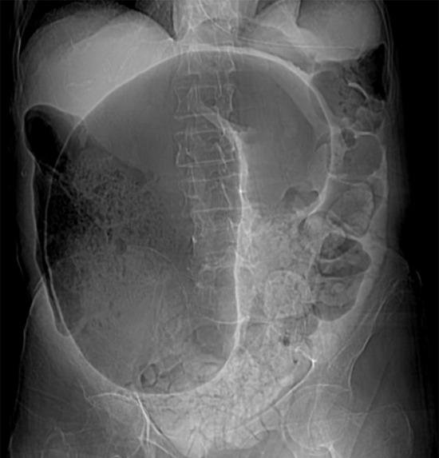
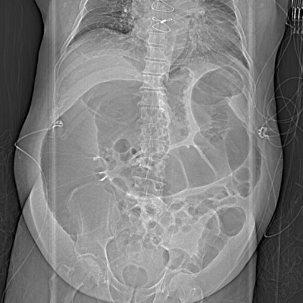

Source: "AC Surgery By MDCU 78" for Rotate C (file "AC 78 GenSx rotate C"), questions recalled by students in a table
(ข้อ / โจทย์ / Choice) grouped under topic headings (Pre-Op/Post-Op, Hemostasis, Fluid and Electrolyte, ...).
The paper restarts its question numbers in every topic. The questions are kept with the paper's own numbers and topics: the first topic
(Pre-Op/ Post-Op) is the main list below, and every other topic is under "Repeated question numbers", each question written as "<topic> Q<n>";
nothing is renumbered. Rows with nothing recalled (empty in the paper, not listed): Pre-Op/ Post-Op 5; Fluid and Electrolyte 5; Plastic surgery (kuy) isus 3,4,5; Surgical infection 4,5; Metabolic response 3,4,5; Surgical Nutrition 4,5; Small bowel and Small bowel obstruction 4,5; Jaundice + liver 4; Acute abdomen 5; Stomach and Duodenum 3,4,5; Breast 4,5; Spleen and Pancreas 4,5; Thyroid and Parathyroid 5; MIS + Gallstone 3,4,5; Colorectal tumor 4,5.
Stems and choices are as students recalled them, in their own words (Thai and English), including casual remarks; they are kept as written. Choices the paper does not list are not added;
a choice letter left empty is "(not recalled)". The topic heading "Plastic surgery (kuy) isus" is written that way in the paper.
Choices the paper numbers 1-5 are written A-E.
Answers: "Key MCQ 78 RoC" by MDCU 78 students (file "Key AC78 RoC MCQ Gen Sx"), a key written by students. It is NOT an official key and may contain
mistakes. The key follows the same topic-divided numbering ("เรียงลำดับข้อยึดตามอันที่แบ่งบทแล้ว"), so each answer is matched by topic and number. Its explanations
are copied as written; where it is unsure it says so (a "?", two or three letters, "-") and this file shows that exactly. Where the key's answer cell is empty, it says so.
exam_year 2025 is the PDF's own creation date (November 2025); the paper does not state the year.
Another file in the same Drive folder, "AC Sx MCQ by MDCU78", has the same text as this paper (a copy with an extra cover page); it was not filed separately.
The rotation letter (C) is not mapped to a G.
Questions in the Anorectal disease and Colorectal tumor topics look like subspecialty topics but are kept: a General Sx paper is filed whole.
Pictures with no name, label or ID band were checked by eye and are kept in images/ (file names with q00 belong to the topic questions, numbered in order of appearance). Left out: an emoji (Professionalism Q2)
and a screenshot of an image search whose caption names the diagnosis (Breast Q2); a watermark line at the bottom of one X-ray was cropped off.

## Q1 (original no. 1)
[paper topic: Pre-Op/ Post-Op] Pre-Op EKG ทำในใครดีที่สุด

A. คนแก่ U/D HT
B. อายุน้อย Healthy

**Answer:** A
**Explanation:** not stated in the key
**Guideline / source:** not stated

## Q2 (original no. 2)
[paper topic: Pre-Op/ Post-Op] Post-Op day 5 ของการผ่าไส้ติ่ง คนไข้ถอด foley day 2 เดิน ได้ปกติ แต่เจ็บแผลมาก แต่แผลไม่มีหนอง ไม่มีแดง ถามว่าเป็น ไร

A. Pneumonia
B. Thrombophlebitis
C. Wound infection
D. UTI

**Answer:** C
**Explanation:** key: ตามอจ ชัยสิทธิ์
**Guideline / source:** not stated

## Q3 (original no. 3)
[paper topic: Pre-Op/ Post-Op] DVT prophylaxis

A. Pneumatic intermittent compression
B. Aggressive ambulation
C. LMWH

**Answer:** not given in the key (its answer cell is empty)
**Explanation:** key: โจทย์ไม่ครบ ถ้า DVT ในคนไข้ผ่าตัดต้องดูตาม caprini criteria ตอบ A/B แล้วแต่สถานการณ์, ถ้าเป็น DVT ในคนที่เคยเป็นตอบ LMWH
**Guideline / source:** not stated

## Q4 (original no. 4)
[paper topic: Pre-Op/ Post-Op] Patient has car accident. Was fluid resuscitated. Was put Ng and Foley from ER, now was admitted to ICU. Now Urine output @3,2,1 hr = 50ml 0ml 0 ml, BP 120/80 HR 80 bpm for 3 hours. what is the first most appropriate  initial management

A. check foley catheter if it was blocked
B. Observe for more 1 hour
C. Increase fluid resus STAT

**Answer:** A
**Explanation:** not stated in the key
**Guideline / source:** not stated

## Repeated question numbers
(The paper restarts its question numbers in every topic. The first topic's questions are in the main list above; every other topic's questions are here, each as "<topic> Q<n>" with the paper's own number; nothing is renumbered.)

Hemostasis Q1: ให้เรียง response ต่อแผล
A. Inflammation -> Hemostasis -> Proliferation -> Modeling
Answer (from the key's Hemostasis row 1): A
Explanation: not stated in the key
Guideline / source: not stated

Hemostasis Q2: ให้ Warfarin โดน Factor อะไร
A. Factor 1
B. Factor 5
C. Factor 9
D. Factor 11
Answer (from the key's Hemostasis row 2): C
Explanation: not stated in the key
Guideline / source: not stated

Hemostasis Q3: Heparin monitor
A. aPTT
B. PT
Answer (from the key's Hemostasis row 3): A
Explanation: not stated in the key
Guideline / source: not stated

Hemostasis Q4: car accident, hypotension resuscitation fluid ?
A. ringer acetate
B. Dextrose
C. Prc + nss
Answer (from the key's Hemostasis row 4): A
Explanation: not stated in the key
Guideline / source: not stated

Hemostasis Q5: คนไข้ esrd normal aptt pt, prolonged bleeding time, platelet normal ถามว่าเป็นรัย
A. Uremic platelet function
B. Thrombocytopenia
Answer (from the key's Hemostasis row 5): A
Explanation: not stated in the key
Guideline / source: not stated

Fluid and Electrolyte Q1: คนไข้หนัก 60 kg, urine output เท่าไหร่ดี
A. 30-60 cc/hr
B. 5-10 cc/kg/hr
C. 5-10 cc/hr
Answer (from the key's Fluid and Electrolyte row 1): A
Explanation: not stated in the key
Guideline / source: not stated

Fluid and Electrolyte Q2: Which is LEAST  likely to find metabolic alkalosis
A. vomiting
B. Diuretics
C. HypoK
D. Hemorrhagic shock
E. Volume depletion
Answer (from the key's Fluid and Electrolyte row 2): D
Explanation: not stated in the key
Guideline / source: not stated

Fluid and Electrolyte Q3: Which one is not 3rd space loss
A. Ascites
B. Pleural effusion
C. Peripheral edema
D. Oozing burn
E. Fluid leak in small bowel
Answer (from the key's Fluid and Electrolyte row 3): D
Explanation: not stated in the key
Guideline / source: not stated

Fluid and Electrolyte Q4: ให้ Na ไวเกินไป เกิดอะไรขึ้น
A. Cerebral Pontine myelinolysis
Answer (from the key's Fluid and Electrolyte row 4): A
Explanation: not stated in the key
Guideline / source: not stated

Plastic surgery (kuy) isus Q1: เย็บ tendon
A. Silk
B. catgut
C. Polyglactin
D. Polyamide
E. Polyester
Answer (from the key's Plastic surgery (kuy) isus row 1): D
Explanation: not stated in the key
Guideline / source: not stated

Plastic surgery (kuy) isus Q2: เย็บสกิน ไหมไหนช่วยลด infection
A. polyamide
B. Polyester
Answer (from the key's Plastic surgery (kuy) isus row 2): A
Explanation: not stated in the key
Guideline / source: not stated

Surgical infection Q1: ruptured appendicitis อะไรสำคัญที่สุดเพื่อลด superficial surgical site infection
A. Delayed wound closure with wet dressing
B. Post antibiotics 10-14 day
C. Soak แผลด้วยน้ำเกลืออย่างชุ่มโชคก่อน ปิดแผล
D. ทา Iodine เยอะๆก่อนปิดแผล
E. ใช้ไหมเคลือบ ABX เย็บแผล
Answer (from the key's Surgical infection row 1): A
Explanation: not stated in the key
Guideline / source: not stated

Surgical infection Q2: คนไข้ DM s/p อะไรสักอย่าง มี serous ไหลออกมาจากแผล Risk มากที่สุดที่คนไข้คนนี้จะเกิด SSIs
A. Obesity
B. Serous
C. Abx prophylaxis
D. Elective surgery
Answer (from the key's Surgical infection row 2): A
Explanation: not stated in the key
Guideline / source: not stated

Surgical infection Q3: อะไรช่วยลดโอกาส SSIs มากที่สุด
A. Irrigate แผลด้วยน้ำเกลือ
B. Chlorhex เช็ดแผล
Answer (from the key's Surgical infection row 3): A
Explanation: not stated in the key
Guideline / source: not stated

Surgical Oncology Q1: GIST 2 cm ที่ small bowel  ทำไรต่อดี
A. ทำ Resection
B. ให้ Targeted therapy
Answer (from the key's Surgical Oncology row 1): A
Explanation: not stated in the key
Guideline / source: not stated

Surgical Oncology Q2: Adenocarcinoma pathway
A. Cumulative of mutation
B. Hyperplastic polyp -> Inflammative polyp -> Cancer
C. (not recalled)
Answer (from the key's Surgical Oncology row 2): A
Explanation: not stated in the key
Guideline / source: not stated

Surgical Oncology Q3: คนไข้เป็น spinal compression from cancer ทำไรต่อ
A. Radiation to reduce pain and fracture
B. Opioid to control pain
Answer (from the key's Surgical Oncology row 3): A
Explanation: not stated in the key
Guideline / source: not stated

Surgical Oncology Q4: Secondary prevention
A. Fecal occult blood test
B. Polypectomy
Answer (from the key's Surgical Oncology row 4): B
Explanation: key: จริงๆก็น่าจะได้ทั้งคู่
Guideline / source: not stated

Surgical Oncology Q5: คนไข้แก่ เป็นมะเร็งปอด มี Tp53 mutation ถามว่าข้อใดผิด
A. ได้รับ mutation นี้มาจากพ่อแม่
B. TP53 mutation ทำให้ DNA proliferate แบบบูมๆ และ repair ไม่ได้
Answer (from the key's Surgical Oncology row 5): A
Explanation: not stated in the key
Guideline / source: not stated

Professionalism and Surgical safety Q1: คนไข้ไม่อยากผ่า หมอเคารพอะไร
A. Autonomy
Answer (from the key's Professionalism and Surgical safety row 1): A
Explanation: not stated in the key
Guideline / source: not stated

Professionalism and Surgical safety Q2: a sexy woman with breast problem อ่อยมึง มึงจะทำยังไง
[picture in the paper: an emoji picture (left out of this file)]
A. ตามพยาบาลมาอยู่ด้วย แล้วซักประวัติ ต่อ
B. ตอบเท่าที่ได้
C. ส่งให้หมอคนอื่นตรวจแทน
D. ซักประวัติปกติต่อ แล้วค่อยถามให้ deep ขึ้น
Answer (from the key's Professionalism and Surgical safety row 2): A
Explanation: not stated in the key
Guideline / source: not stated

Professionalism and Surgical safety Q3: Time out ทำเพื่ออะไร
A. To confirm patient name, procedure, and where the incision will be made
B. To check the anaesthesia machine and medication
C. To count the instrument, sponge and needle used
Answer (from the key's Professionalism and Surgical safety row 3): A
Explanation: not stated in the key
Guideline / source: not stated

Professionalism and Surgical safety Q4: คนไข้ผ่า hernia ถามว่าข้อใดถูก
A. บอกคนไข้ว่า ผ่าอะไร ใช้ mesh อะไร
B. ไม่บอกเรื่อง mesh
C. ถ้าคนไข้มีปัญหาเรื่องฉี่ไม่จำเป็นต้อง ปรึกษา URO
Answer (from the key's Professionalism and Surgical safety row 4): A
Explanation: not stated in the key
Guideline / source: not stated

Professionalism and Surgical safety Q5: PPE for ng with massive UGIB in pt 1 face shield , 2 plastic apron , 3 sterile gloves , 4 disposable gloves , 5 n95 , 6 surgical mask , 7 something respirator?
A. 1 2 3 6
B. 1 2 4 6
Answer (from the key's Professionalism and Surgical safety row 5): B
Explanation: not stated in the key
Guideline / source: not stated

Metabolic response Q1: Patient had car accident? Now at hospital. Which is correct about his metabolic state
A. Hypermetabolism,  Hyperglycemia, Net nitrogen loss
B. Hypometabolism,  Hyperglycemia, Net nitrogen loss
C. Hypermetabolism,  Hyperglycemia, Net nitrogen gain
D. Hypermetabolism,  Hypoglycemia, Net nitrogen gain
E. Hypermetabolism,  Hypoglycemia, Net nitrogen loss
Answer (from the key's Metabolic response row 1): A
Explanation: not stated in the key
Guideline / source: not stated

Metabolic response Q2: กระบวนการใด ทำให้กล้ามเนื้อสามารถเปลี่ยน lactate from glycolysis กลับไปเป็น glucose
A. Cori cycle
B. Cahill (glucose-alanine) cycle
C. (not recalled)
Answer (from the key's Metabolic response row 2): A
Explanation: not stated in the key
Guideline / source: not stated

Surgical Nutrition Q1: S/P Gastrectomy คนไข้ response ตื้นดี มีตด nutritional plan คือไร
A. NJ feed
B. TPN
C. PPN
Answer (from the key's Surgical Nutrition row 1): A
Explanation: not stated in the key
Guideline / source: not stated

Surgical Nutrition Q2: คนไข้มีอาการ Glossitis ตรวจเลือดได้ Macrocytic anemia ถามว่าอะไร def
A. B12 def
B. C def
C. B9 def
Answer (from the key's Surgical Nutrition row 2): A
Explanation: not stated in the key
Guideline / source: not stated

Surgical Nutrition Q3: Post-op day 5 ileus ให้อะไรดี
A. TPN Central vein
B. PPN
C. Enteral
Answer (from the key's Surgical Nutrition row 3): not given in the key (the key has no row for this question)
Explanation: not stated in the key
Guideline / source: not stated

Hernia Q1: S/P ผ่า hernia มีอาการชาที่ต้นขาด้านใน โดน nerve อะไร
A. Ilioinguinal nerve
B. Genitofemoral nerve
C. (not recalled)
Answer (from the key's Hernia row 1): A
Explanation: not stated in the key
Guideline / source: not stated

Hernia Q2: คนไข้มีอาการ Gut obstruction มีก้อนที่ lateral ต่อ inguinal ligament และใต้ต่อ inguinal ligament ถามว่าเป็นไร
A. Incarcerated femoral hernia
B. Strangulated inguinal hernia
C. Adhesive small bowel obstruction with lymphadenopathy
Answer (from the key's Hernia row 2): A
Explanation: not stated in the key
Guideline / source: not stated

Hernia Q3: คนไข้ bilateral inguinal hernia ผ่าแก้ไปแล้ว มีก้อน cystic-liked lesion ขนาด 15 cm ที่บริเวณ suprapubic ถาม ว่าอะไรป้องกันสิ่งนี้ได้
A. Analgesic
B. Kegel Exercise
C. Prophylaxis antibiotic
Answer (from the key's Hernia row 3): A
Explanation: key: bladder
Guideline / source: not stated

Hernia Q4: คนไข้เป็น groin mass รักษาไง
A. Lichtenstein’s repair
B. Herniotomy
C. (not recalled)
Answer (from the key's Hernia row 4): A
Explanation: not stated in the key
Guideline / source: not stated

Hernia Q5: Male Patient present with mass in inguinal area that increase size when standing. What is not a risk of his condition
A. long wound from appendectomy
B. Ascites from cirrhosis
C. Smoking > 5 pack year
D. Partial obstruction from ca colon
Answer (from the key's Hernia row 5): D
Explanation: not stated in the key
Guideline / source: not stated

Small bowel and Small bowel obstruction Q1: ข้อใดเป็น specific sign ของ Strangulated small bowel obstruction
A. Pneumatosis intestinalis
B. String of bead
C. Small bowel dilatation
D. Step ladder
Answer (from the key's Small bowel and Small bowel obstruction row 1): A
Explanation: not stated in the key
Guideline / source: not stated

Small bowel and Small bowel obstruction Q2: POD 5 S/P คนไข้ stroke แต่ยังมี ileus ถามว่าให้ยาอะไรดี
A. Neostigmine
B. Atropine
C. Epinephrine
D. PEG
E. Loperamide
Answer (from the key's Small bowel and Small bowel obstruction row 2): A
Explanation: not stated in the key
Guideline / source: not stated

Small bowel and Small bowel obstruction Q3: Colicky pain without disproportion คนไข้มี U/D เป็น AF ถามว่าทำไรดี
A. CTA
B. X-ray
C. CT
Answer (from the key's Small bowel and Small bowel obstruction row 3): A
Explanation: not stated in the key
Guideline / source: not stated

Liver + Jaundice Q1: Female present with dyspepsia. Imaging show 15 x 20 cm hyper-intensity mass on MRI T2W1. CT with contrast show peripheral nodular enhancement in arterial phase and central fill-in. What is the management?
A. follow up
B. Liver Resection
C. Ablation
D. Portal vein embolization
E. TACE
Answer (from the key's Liver + Jaundice row 1): B
Explanation: not stated in the key
Guideline / source: not stated

Liver + Jaundice Q2: คนไข้อยู่จังหวัดร้อยเอ็ด มีอาการเหลือง ถามว่าเป็นอะไร
A. CCA
B. HCC
Answer (from the key's Liver + Jaundice row 2): A
Explanation: not stated in the key
Guideline / source: not stated

Liver + Jaundice Q3: คนไข้เป็น perihilar CCA ไม่อยากรักษาด้วย chemo หรือ รังสี แล้ว อยากจะสบาย ๆ ทำไรดี
A. Liver transplant
B. PTBD
C. ยัด Chemo เข้าไปอีก
Answer (from the key's Liver + Jaundice row 3): B
Explanation: not stated in the key
Guideline / source: not stated

Liver + Jaundice Q4: คนไข้เมื่อ 1 อาทิตย์ที่แล้ว มีอาการท้องเสีย ปัจจุบันมีก้อนที่ liver capsule enhancted ถามว่าข้อใดผิด
A. ให้ยา Ceftri + Metro
B. ให้ drain
C. (not recalled)
Answer (from the key's Liver + Jaundice row 4): B
Explanation: not stated in the key
Guideline / source: not stated

Liver + Jaundice Q5: คนไข้เป็น Hepatitis C และ Portal Hytension ถามว่าคนไข้จะ มีอาการอะไร
A. Palmar erythema + Thrombocytosis
B. Ascites + Thrombocytopenia
Answer (from the key's Liver + Jaundice row 5): B
Explanation: not stated in the key
Guideline / source: not stated

Jaundice + liver Q1: คนไข้มีอาการ painless progressive jaundice คลำได้ gallbladder วินิฉัยเป็น Ampullary CA
A. Duodenectomy
B. Pancreatoduodenectomy
Answer (from the key's Jaundice + liver row 1): B
Explanation: not stated in the key
Guideline / source: not stated

Jaundice + liver Q2: คนไข้มีอาการปวดท้อง RUQ มีอาการเหลือง Hypotension และมีอาการมึน ๆ ซึม ๆ มาโรงพยายาล ได้ทำ Resuscitation ไปแล้วถามว่าทำไรต่อ
A. Cholecystectomy
B. Abx
C. ERCP
Answer (from the key's Jaundice + liver row 2): C
Explanation: not stated in the key
Guideline / source: not stated

Jaundice + liver Q3: คนไข้เป็น HCC ที่ตรวจแล้วเจอ Extravasation ของตัวก้อน ถามว่าทำไรต่อ
A. TACE
B. Surgery
Answer (from the key's Jaundice + liver row 3): A
Explanation: not stated in the key
Guideline / source: not stated

Jaundice + liver Q5: คนไข้มีอาการปวดท้อง RUQ หลังกินข้าว แต่ปวดไม่ตลอด มา ๆ ไป ๆ ตรวจร่างกายปกติ ถามว่าเป็นไร
A. Biliary colic
Answer (from the key's Jaundice + liver row 5): A
Explanation: not stated in the key
Guideline / source: not stated

Acute abdomen Q1: ข้อใดไม่ใช่ ddx ของ acute appendicitis
A. Meckel’s Diverticulitis
B. Acute renal failure
Answer (from the key's Acute abdomen row 1): B
Explanation: not stated in the key
Guideline / source: not stated

Acute abdomen Q2: คนไข้มีอาการคล้าย appendicitis แต่มีอาการมานานหลายวัน คลำได้ก้อนที่ RLQ ขนาด 4 cm ถามว่าทำไรต่อ
A. ABx + drainage
B. ABx
C. (not recalled)
Answer (from the key's Acute abdomen row 2): A
Explanation: not stated in the key
Guideline / source: not stated

Acute abdomen Q3: (the stem is a picture only)
[picture in the paper: a plain abdominal film]

A. caecum volvulus
B. Sigmoid volvulus
Answer (from the key's Acute abdomen row 3): B
Explanation: not stated in the key
Guideline / source: not stated

Acute abdomen Q4: (the stem is a picture only)
[picture in the paper: a plain abdominal film]

A. sigmoid volvulus
B. Ogilvie
Answer (from the key's Acute abdomen row 4): B
Explanation: not stated in the key
Guideline / source: not stated

Stomach and Duodenum Q1: candidate bariatic surgery
A. Mr.Moon bmi 36 with osa
B. Female bmi38 housewife
C. Mr. Manu bussiness-man with hypertension BMI 38
D. Mr. Something Weight 60 kg is undergoing tummy tug
Answer (from the key's Stomach and Duodenum row 1): A
Explanation: not stated in the key
Guideline / source: not stated

Stomach and Duodenum Q2: อาการ gastritis urease test positive
A. h. Pylori gastritis
B. Atopic gastitis
Answer (from the key's Stomach and Duodenum row 2): A
Explanation: not stated in the key
Guideline / source: not stated

Breast Q1: คนไข้เป็น breast cancer ปฏิเสธ posop RT จะสูญเสีย ประโยชน์อะไร
A. Local recurrence of right breast
B. Growing of cancer in left breast
Answer (from the key's Breast row 1): A
Explanation: not stated in the key
Guideline / source: not stated

Breast Q2: Female, has mass in the breast that remain same size for 7 years , mammogram show this, almost like ”breast in breast tissue”
[picture in the paper: a screenshot of an internet image search result with a caption (left out of this file)]
A. harmartoma
B. Lipoma
C. Fibroadenoma
D. Phyllodes
Answer (from the key's Breast row 2): A
Explanation: not stated in the key
Guideline / source: not stated

Breast Q3: breast mass 4 cm. LN positive
A. neoadjuvant
B. Mastectomy + ALND
C. wide excision +
Answer (from the key's Breast row 3): C
Explanation: not stated in the key
Guideline / source: not stated

Spleen and Pancreas Q1: คนไข้มีอาการเจ็บปวด epigastric นอนแล้วแย่ลง เอนมาข้าง หน้าแล้วดีขึ้น คนไข้มีอาการอ้วกด้วย ถาม management ต่อ ไป
A. Aggressive Fluid resuscitation
B. ERCP
Answer (from the key's Spleen and Pancreas row 1): A
Explanation: not stated in the key
Guideline / source: not stated

Spleen and Pancreas Q2: คนไข้ตัด spleen ไป ตอนนี้มีอาการ meningitis มีผืนแดงขึ้น ตามตัว ถามว่าเป็นไร
A. Massive post-splenectomy infection
B. Autoimmune disease
Answer (from the key's Spleen and Pancreas row 2): A
Explanation: not stated in the key
Guideline / source: not stated

Spleen and Pancreas Q3: คนไข้มีอาการคล้าย ๆ Acute pancreatitis เป็นมา 6 ชม. ถาม ว่าตรวจไรดี
A. ตรวจ Lipase and amylase
B. CTA
C. (not recalled)
Answer (from the key's Spleen and Pancreas row 3): A
Explanation: not stated in the key
Guideline / source: not stated

Anorectal disease Q1: ประวัติคนไข้อึแข็ง เจ็บก้น
A. acute anal fissure
Answer (from the key's Anorectal disease row 1): A
Explanation: not stated in the key
Guideline / source: not stated

Anorectal disease Q2: ถ่ายเป็นเลือดสด An old man pass red flesh blood with stool, painless
A. hemorrhoid
B. Diverticulosis
C. Anal fissure
Answer (from the key's Anorectal disease row 2): A
Explanation: not stated in the key
Guideline / source: not stated

Anorectal disease Q3: MSM แผล
A. Squamous cell carcinoma
Answer (from the key's Anorectal disease row 3): A
Explanation: not stated in the key
Guideline / source: not stated

Anorectal disease Q4: แผล condyloma รักษา
A. excision and coagulation
B. Imiquimod cream
Answer (from the key's Anorectal disease row 4): A
Explanation: not stated in the key
Guideline / source: not stated

Anorectal disease Q5: ให้รูป mixed hemorrhoid มา โจทย์บอกว่าคนไข้ไม่เจ็บ มีก้อน ยื่นออกมา ต้องเอานิ้วดันเข้าไป ถามว่าทำไรดี
A. Rubber band ligation
B. Sclerosing injection
C. Hemorrhoidectomy
Answer (from the key's Anorectal disease row 5): C
Explanation: not stated in the key
Guideline / source: not stated

Anorectal disease Q6: เจอรูที่ก้น เอา probe เสียบเข้าไป เข้าไปที่ anal verge พร้อม ทั้งคลำได้ fibrous tract ถามว่าเกิดจากอะไร
A. Infection of Anal gland
Answer (from the key's Anorectal disease row 6): A
Explanation: not stated in the key
Guideline / source: not stated

Thyroid and Parathyroid Q1: Suspected Malignancy Bethesda V ถามว่าทำไรต่อดี
A. F/U
B. Total thyroidectomy
C. FNA
Answer (from the key's Thyroid and Parathyroid row 1): B
Explanation: not stated in the key
Guideline / source: not stated

Thyroid and Parathyroid Q2: U/S lesion แบบไหน กลัวเป็นมะเร็ง
A. Spongiform
B. Lobulated
C. Microcalcification
Answer (from the key's Thyroid and Parathyroid row 2): C
Explanation: not stated in the key
Guideline / source: not stated

Thyroid and Parathyroid Q3: คนไข้ไม่ได้เป็น CKD มี Ca สูง PO ตํ่า PTH สูง กระดูกพรุน ถาม ว่าเป็นไร
A. Parathyroid adenoma
B. Parathyroid carcinoma
C. Parathyroid hyperplasia
D. Secondary hyperparathyroidism
Answer (from the key's Thyroid and Parathyroid row 3): A/B/C (as written in the key)
Explanation: not stated in the key
Guideline / source: not stated

Thyroid and Parathyroid Q4: lid lag
[in the paper's choice column, without a letter: grave]
Answer (from the key's Thyroid and Parathyroid row 4): A
Explanation: not stated in the key
Guideline / source: not stated

MIS + Gallstone Q1: Most important benefit for old man laparoscopic
A. Less hospital stay & Rapid recovery
B. Better cosmetic
C. Less blood loss & transfusion risk
Answer (from the key's MIS + Gallstone row 1): A
Explanation: not stated in the key
Guideline / source: not stated

MIS + Gallstone Q2: มีอาการของ Acute cholecystitis แต่ตรวจแล้วไม่มี Stone ถามว่าเป็นไร
B. Acalculous cholecystitis
Answer (from the key's MIS + Gallstone row 2): A
Explanation: not stated in the key
Guideline / source: not stated

Colorectal tumor Q1: rectal mass size 4 cm above puborectalis muscle 3 cm, tumor invade serosa, abut uterus and cervix ด้วย with positive lymph node, management?
A. LAR chemotaradiation
B. Abdominalperineal resection with chemoradiation
C. LAR++TME
D. Neoadjuvant then surgery
E. AR with mesocolic resection
Answer (from the key's Colorectal tumor row 1): D
Explanation: not stated in the key
Guideline / source: not stated

Colorectal tumor Q2: Patient with hematochezia and tenesmus. He was diagnosed with cancer. What is the role of pelvic MRI in colorectal cancer
A. Detect sites of metastasis, including liver, lung, ….
B. Check depth of local tumor invasion?
C. (not recalled)
Answer (from the key's Colorectal tumor row 2): B
Explanation: not stated in the key
Guideline / source: not stated

Colorectal tumor Q3: ให้รูปริมฝีปากฟ้ามา ถามว่าเป็นไร ตรง AC
A. harmartomatus polyp
Answer (from the key's Colorectal tumor row 3): A
Explanation: not stated in the key
Guideline / source: not stated

Vascular Q1: CLTI investigation
A. CTA
Answer (from the key's Vascular row 1): A
Explanation: not stated in the key
Guideline / source: not stated

Vascular Q2: AAA male 5.8cm
A. surgery
Answer (from the key's Vascular row 2): A
Explanation: not stated in the key
Guideline / source: not stated

Vascular Q3: Acute arterial occlusion motor deficit class IIb
A. heparin IV
B. thrombectomy within 48 hours
Answer (from the key's Vascular row 3): A
Explanation: not stated in the key
Guideline / source: not stated

Vascular Q4: คนไข้ลงมาจากเครื่องบิน สงสัย DVT ทำไรดี
A. Venous Duplex ultrasound
B. D-Dimer
C. CTA
D. Trendelunberg
Answer (from the key's Vascular row 4): A
Explanation: not stated in the key
Guideline / source: not stated

Vascular Q5: 60 yo patient, present เดิน 100 เมตรแล้วเจ็บ เป็นทุกครั้งที่ เดินนาน ๆ ถามว่าหมอจะทำไรดี
A. Revascularization
B. Endovas
C. LMWH
D. Exercise and ….
E. Thrombolytic
Answer (from the key's Vascular row 5): D
Explanation: not stated in the key
Guideline / source: not stated

Esophagus Q1: คนไข้เป็นมะเร็ง Esophagus T2N0 Resectable แต่คนไข้มี severe COPD และ Comorbid อื่น ๆ เยอะ ถามว่ารักษาไงดี
A. ใส่ stent
B. Neoadjuvant + Sx
C. Surgery
D. Definitive chemoradiation
Answer (from the key's Esophagus row 1): D
Explanation: not stated in the key
Guideline / source: not stated

Esophagus Q2: คนไข้อาการกลืนอาหารลำบากมากขึ้นเรื่อย ๆ ตอนแรกกิน solid หลัง ๆ เหลือแค่ liquid ตรวจ barium swallowing แล้ว inconclusive ถามว่าทำไรต่อ
A. EGD
B. Esophageal manometry
C. CT
Answer (from the key's Esophagus row 2): A
Explanation: not stated in the key
Guideline / source: not stated

Esophagus Q3: CA Esophagus มี dysphagia มี Hoarseness of voice
A. Adenocarcinoma of distal esophagus
B. Leiomyosarcoma of esophagus
Answer (from the key's Esophagus row 3): A
Explanation: not stated in the key
Guideline / source: not stated

Esophagus Q4: ให้อาการ Achalasia มา ทำ barium แล้ว ไม่เจอไรเลย ถามว่า ทำไรต่อ
A. Esophageal manometry
B. EGD
C. EUS
D. CT
Answer (from the key's Esophagus row 4): A
Explanation: not stated in the key
Guideline / source: not stated

Esophagus Q5: ให้ประวัติคนไข้ที่มีโรคตับยม ๆ มา มีอาการอ้วกเป็นเลือด มาหา หมอ หมอ resuscitation แล้ว Which of the following would most benefit the patient
A. PPI
B. Octreotide
C. Propranolol
Answer (from the key's Esophagus row 5): B
Explanation: not stated in the key
Guideline / source: not stated

Esophagus Q6: ให้รูป esophagus ที่มี longitudinal tear มา ให้ประวัติไปปาร์ตี้ ดื่มเหล้า แล้วอ้วกหลายรอบมา สุดท้ายอ้วกเป็นเลือด ถามว่า เป็นไร
A. Mallory weiss tear
Answer (from the key's Esophagus row 6): A
Explanation: not stated in the key
Guideline / source: not stated

Transplantation + Immunology Q1: Which cannot be transplanted from living donor
A. Lung
B. Small bowel
C. Pancreas
D. Liver
E. Cornea
Answer (from the key's Transplantation + Immunology row 1): E
Explanation: not stated in the key
Guideline / source: not stated

Transplantation + Immunology Q2: ข้อใดถูกเกี่ยวกับ liver transplant
A. ส่วนใหญ่เป็น living donor
B. Adult liver can split in 2 for children
C. Diceased is brain death
D. Warm ischemia better than cold ischemia
E. Decrease donor, by definition, means heart stop beating
Answer (from the key's Transplantation + Immunology row 2): not given as a letter in the key (it writes: -)
Explanation: not stated in the key
Guideline / source: not stated

Transplantation + Immunology Q3: initial step that most important in donor transplant
A. ดูว่าสมองตายจริง
B. HLA mismatch
Answer (from the key's Transplantation + Immunology row 3): A
Explanation: not stated in the key
Guideline / source: not stated

Transplantation + Immunology Q4: multiple pregnancy ต้องรับ blood transfusion แล้วพบ incompatible with multiple donors ,ABO group match, HLA compatible
A. allorecognition (Autoimmunization?) to minor red blood cell antigen
Answer (from the key's Transplantation + Immunology row 4): A
Explanation: not stated in the key
Guideline / source: not stated

Transplantation + Immunology Q5: rbc transfusion ไม่ทราบหมู่เลือด ให้อันไหนปลอดภัยสุด
A. o negative
B. Ab positive
C. Positive
Answer (from the key's Transplantation + Immunology row 5): A
Explanation: not stated in the key
Guideline / source: not stated

Transplantation + Immunology Q6: คนไข้ DM1 จะทำ Kidney transplant เมื่อไหร่
A. ESRD
B. (not recalled)
Answer (from the key's Transplantation + Immunology row 6): A
Explanation: not stated in the key
Guideline / source: not stated

## Flagged for checking
- Pre-Op/Post-Op Q3: the key's answer cell is empty; its note says the question is incomplete and the answer depends on the situation (A/B).
- Thyroid and Parathyroid Q3: the key answers "A/B/C". Transplantation + Immunology Q2: the key answers "-".
- Surgical Oncology Q4: the key answers B and notes both choices could be right.
- MIS + Gallstone Q2: the paper lists only choice B ("Acalculous cholecystitis"), but the key answers A. What was choice A?
- Hernia Q3: the key's explanation is only "bladder".
- Surgical Nutrition Q3 has no row in the key. Rows with nothing recalled are listed in the header.
- Professionalism and Surgical safety Q2 contains a crude remark in the students' own words; it is kept as written.
