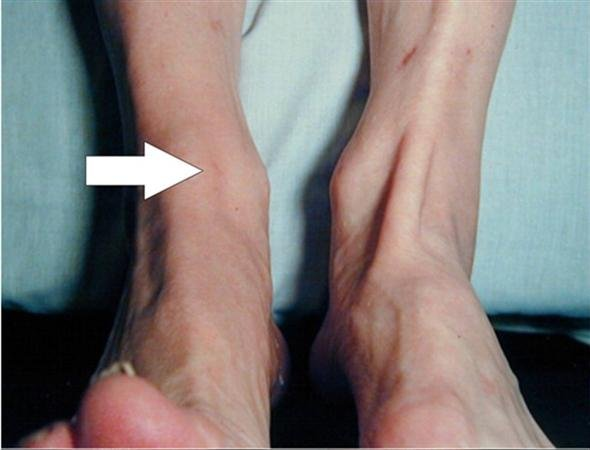
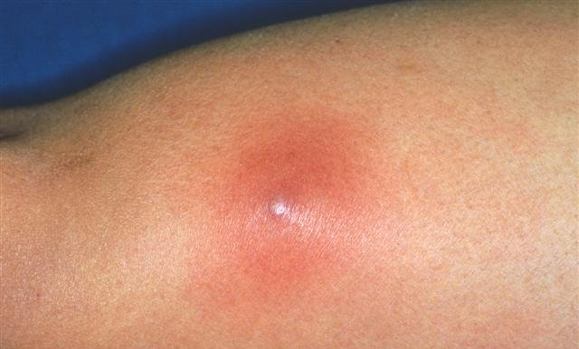
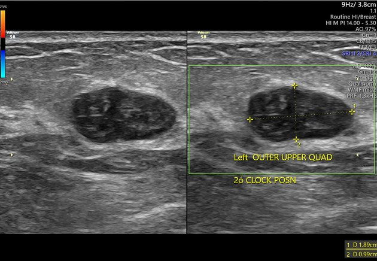

Source: "AC Sx MCQ by MDCU78D" (file "AC 78 GenSx rotate D"), questions recalled by students in a table
(ข้อ / โจทย์ / Choice) grouped under topic headings (Pre-Op/Post-Op, Hemostasis, Fluid and Electrolyte, ...).
The paper restarts its question numbers in every topic. The questions are kept with the paper's own numbers and topics: the first topic
(Pre-Op/ Post-Op) is the main list below, and every other topic is under "Repeated question numbers", each question written as "<topic> Q<n>";
nothing is renumbered. Rows with nothing recalled (empty in the paper, not listed): Pre-Op/ Post-Op 5; Hemostasis 5; Plastic surgery 4,5; Surgical Oncology 2,3,4,5; Professionalism and Surgical safety 3,4,5; Metabolic response 3,4,5; Surgical Nutrition 4,5; Small bowel and Small bowel obstruction 5; Liver + Jaundice 4; Jaundice + liver 2,3,4,5; Acute abdomen 3,4,5; Breast 4,5; Spleen and Pancreas 4,5; Anorectal disease 6; MIS + Gallstone 3,4,5; Vascular 4,5; Esophagus 4,6.
Stems and choices are as students recalled them, in their own words (Thai and English). Many questions were recalled only as a stem; a choice letter left empty is "(not recalled)", and choices the paper does not list are not added.
Choices the paper numbers 1-5 are written A-E.
Answers: "Key MCQ GenSx 78D" by MDCU 78 students (file "Key MCQ GenSx rotate D"), a key written by students. It is NOT an official key and may contain
mistakes. The key follows the same topic-divided numbering, so each answer is matched by topic and number. Its explanations are copied as written (long ones include
quotations from guidelines and textbook chapters and notes such as "Surgeonvivor:" where a picture was pasted; the key's pictures are not copied). Where the key writes "-" for a question the paper recalled only as a stem,
the key's note is shown in the explanation. Where the key is unsure it says so and this file shows that exactly.
exam_year 2025 follows the other MDCU78 PDFs of this batch (the Rotate C PDF's own creation date is November 2025); this PDF has no date of its own. Please check it.
The rotation letter (D) is not mapped to a G.
Questions in the Anorectal disease and Colorectal tumor topics look like subspecialty topics but are kept: a General Sx paper is filed whole.
Pictures with no name, label or ID band were checked by eye and are kept in images/ (file names with q00 belong to the topic questions, numbered in order of appearance). Left out: a colon drawing taken from a hospital website
(Colorectal tumor Q1); a photographer's credit at the corner of one skin photo was cropped off.

## Q1 (original no. 1)
[paper topic: Pre-Op/ Post-Op] A 68-year man with normal physical examination, > 4 mets ตรวจ pre op อะไรดี ทำ liver

A. ecg to search for undetected arrhythmia
B. Exercise test to confirm cardiopulmonary fitness
C. Echocardiogram to determine cardiac function
D. Proceed to surgery

**Answer:** A
**Explanation:** key: ตาม slide อาจารย์   ==========================================  ถ้าตาม 2024 AHA/ACC/ACS/ASNC/HRS/SCA/SCCT/SCMR/SVM Guideline for Perioperative Cardiovascular Management for Noncardiac Surgery *จะไม่เหมือนในสไลด์  จะต้องดูหลัก ๆ คนไข้มี risk มั้ย? Do we have to include them in this algorithm?? The risks include: Hypertension Smoking high cholesterol Diabetes women age >65 y; men age >55 y;  Obesity family history of premature CAD (1) elevated calculated risk ก็คือเอา risk คนไข้ใส่ calculator + severity of surgery มีหลายอันให้เลือก  (2) risk modifiers   จะเห็นได้ว่าถ้า elevated calculated risk >> จะต้อง EKG  แต่หากมี risk modifiers ด้วย >> จะต้อง EKG + Echocardiography  ==========================================  Echo ไม่ทําเป็น routine   Stress test ไม่ทํา ยกเว้นกําลัง consider revascularization
**Guideline / source:** not stated

## Q2 (original no. 2)
[paper topic: Pre-Op/ Post-Op] โอกาสเกิด perioperative complication เกี่ยวกับ lung น้อย สุด

A. Bilateral laparoscopic hernia repair
B. Open hernia repair with spinal block
C. Patient with asthma with history of exacerbation
D. Patient with COPD

**Answer:** B
**Explanation:** not stated in the key
**Guideline / source:** not stated

## Q3 (original no. 3)
[paper topic: Pre-Op/ Post-Op] มาelective arthroplasty (สักอย่างที่ scoreได้5) กันdvt ยังไงดี

A. Warfarin with sequential pneumatic compression
B. Early ambulation with compressive machine
C. Compressive stocking

**Answer:** not given as a letter in the key (it writes: 1)
**Explanation:** not stated in the key
**Guideline / source:** not stated

## Q4 (original no. 4)
[paper topic: Pre-Op/ Post-Op] ไข้ POD1 ตรวจร่างกายทุกอย่างอยู่ใน wnl ทำไรดี

A. Early ambulation + triflo

**Answer:** A
**Explanation:** not stated in the key
**Guideline / source:** not stated

## Repeated question numbers
(The paper restarts its question numbers in every topic. The first topic's questions are in the main list above; every other topic's questions are here, each as "<topic> Q<n>" with the paper's own number; nothing is renumbered.)

Hemostasis Q1: A boy presented with intra-joint bleeding, family hx uncle and male cousin have the same symptoms. Which factor is most likely deficient in this boy ?
A. Factor VIII
B. Factor VII
C. Factor X
D. Factor V
E. Factor XIII
Answer (from the key's Hemostasis row 1): A
Explanation: not stated in the key
Guideline / source: not stated

Hemostasis Q2: A man with U/D MI s/p cardiac stent on warfarin  and amlodipine, presented with epidural hematoma. What is the most appropriate management ?
A. FFP then emergency sx
B. PC then emergency sx
C. Admit ICU at observe
D. Elective sx
Answer (from the key's Hemostasis row 2): A
Explanation: key: ถ้าตาม 2024 AHA/ACC/ACS/ASNC/HRS/SCA/SCCT/SCMR/SVM Guideline for Perioperative Cardiovascular Management for Noncardiac Surgery:    = ตอบ Vitamin K, FFP
Guideline / source: not stated

Hemostasis Q3: A man received 12 units of PRC after trauma. 2 hours after the transfusion, he develops fever and dyspnea. What is the condition
A. ARDS
B. TRALI
C. Sepsis
D. Anaphylactic shock
Answer (from the key's Hemostasis row 3): B
Explanation: not stated in the key
Guideline / source: not stated

Hemostasis Q4: What is the function of fibroblast?
A. Collagen production
B. Debris removal
C. Epithelialization
Answer (from the key's Hemostasis row 4): A
Explanation: key: Keratinocyte = epithelization Neutrophil + Macrophage = debris removal
Guideline / source: not stated

Fluid and Electrolyte Q1: A man with gastric outlet obstruction presented with multiple episodes of vomiting and dehydration. What fluid resuscitation should she receive ?
A. 3% NaCl
B. 5%DN/2
C. 0.9%NaCl
Answer (from the key's Fluid and Electrolyte row 1): C
Explanation: not stated in the key
Guideline / source: not stated

Fluid and Electrolyte Q2: A man with poorly-controlled diabetes has polyuria. He denied impaired mental status. His plasma glucose is 600 mg/dL. What is the cause of his polyuria?
A. SIADH
B. Osmotic diuresis
Answer (from the key's Fluid and Electrolyte row 2): B
Explanation: not stated in the key
Guideline / source: not stated

Fluid and Electrolyte Q3: Which organ fluid content has the same osmolarity as plasma serum?
A. Gastric
B. Small bowel
C. Colon
D. Sweat
E. Pancreatic
Answer (from the key's Fluid and Electrolyte row 3): B
Explanation: not stated in the key
Guideline / source: not stated

Fluid and Electrolyte Q4: What is the total body water in male who weighs 70 kg?
A. 14 L
B. 28 L
C. 42 L
D. 49 L
Answer (from the key's Fluid and Electrolyte row 4): C
Explanation: key: 70 x 0.6 = 42L
Guideline / source: not stated

Fluid and Electrolyte Q5: A patient with CKD stage 5. Lab shows K 7 mg/dL. What is the appropriate next management?
A. Calcium gluconate IV
B. Furosemide
C. Dialysis
D. HCO3
Answer (from the key's Fluid and Electrolyte row 5): A
Explanation: not stated in the key
Guideline / source: not stated

Plastic surgery Q1: An accident results in muscle tear. What is used to connect these muscles?
A. silk
B. Nylon
C. Polygactin
D. Polypropylene
E. Catgut
Answer (from the key's Plastic surgery row 1): C
Explanation: not stated in the key
Guideline / source: not stated

Plastic surgery Q2: Image of contracture scar at anterior shin. How to lengthen the contracture?
[picture in the paper: a photo of both feet and ankles with an arrow]

A. Steroid injection
B. Excision of scar with graft
C. VY-flap
D. Z-plasty
Answer (from the key's Plastic surgery row 2): D
Explanation: not stated in the key
Guideline / source: not stated

Plastic surgery Q3: ตัดนม ต้องฉายแสงต่อ แต่อยากได้นมใหม่ทันใจทำไงดี
A. TRAM
B. Prosthetics alone
C. Delayed reconstruction
Answer (from the key's Plastic surgery row 3): A
Explanation: key: Other choices: Schwartz Chapter 17, The Breast
Guideline / source: not stated

Surgical infection Q1: which one is incorrect
A. Alfatoxin - HCC
B. Nitrosamine - Gastric cancer
C. Perfume - nasal cancer
D. Ultraviolet - skin cancer
E. Asbestos - Lung cancer
Answer (from the key's Surgical infection row 1): C
Explanation: key: *surgical oncology
Guideline / source: not stated

Surgical infection Q2: A man had intraabdominal surgery. Weeks  later, he has abdominal discomfort and LLQ tenderness. CT reveals 6 cm collection at LLQ. What is the most appropriate management?
A. IV ATB
B. Laparotomy
C. Percutaneous drainage
Answer (from the key's Surgical infection row 2): C
Explanation: key: Schwartz Chapter 6, Surgical Infections Intra-Abdominal Infections:   But dont choose percutaneous drain IF* there are these limitations:
Guideline / source: not stated

Surgical infection Q3: A patient with a history of shaving around that area. The lesion is tender with fluctuation and redness 4 cm circumferential. No systemic symptoms. What is the most appropriate management?
[picture in the paper: a photo of a red, raised skin lesion]

A. Incision and drainage with oral ATB
B. Oral ATB
C. Admit and observe
D. Excision
Answer (from the key's Surgical infection row 3): A
Explanation: key: Schwartz Chapter 6, Surgical Infections
Guideline / source: not stated

Surgical infection Q4: who need to receive tetanus immunoglobulin (TT = tetanus toxoid)
A. Dog bite recieved tetanus toxoid 12 years ago
B. Laceration wound recieved tetanus toxoid 11 years ago
C. Abrasion recieved tetanus toxoid 10 years ago
D. Contrusion recieved tetanus toxoid 6 years ago
E. Penetration  last tetanus toxoid from primary school
Answer (from the key's Surgical infection row 4): not given as a letter in the key (it writes: - / E most likely)
Explanation: not stated in the key
Guideline / source: not stated

Surgical infection Q5: ข้อฟีลๆ ซ้ำแอคที่แบบแผลน่าจะติดเชื้อ มีน้ำเหลืองไหลออกมา ถามว่าทำๆรต่อดี
Answer (from the key's Surgical infection row 5): not given in the key (the key has no row for this question)
Explanation: not stated in the key
Guideline / source: not stated

Surgical Oncology Q1: A 25 y/o woman has BRCA1 mutation. What is the primary prevention in this patient?
A. Annual MRI
B. Screening with U/S + mammogram
C. Tamoxifen until 40 y/o
D. Progestin therapy
E. MRM
Answer (from the key's Surgical Oncology row 1): E
Explanation: key: Schwartz Chapter 17, The Breast
Guideline / source: not stated

Professionalism and Surgical safety Q1: autonomy ซ้ำฟ
A. (not recalled)
Answer (from the key's Professionalism and Surgical safety row 1): not given in the key (the key has no row for this question)
Explanation: not stated in the key
Guideline / source: not stated

Professionalism and Surgical safety Q2: sign in
A. (not recalled)
Answer (from the key's Professionalism and Surgical safety row 2): not given in the key (the key has no row for this question)
Explanation: not stated in the key
Guideline / source: not stated

Metabolic response Q1: Which hormone has the least role in counter-acting metabolic response to injury?
A. Glucocorticoids
B. Catecholamines
C. Glucagon
D. Thyroid hormone
E. Growth hormone
Answer (from the key's Metabolic response row 1): D
Explanation: not stated in the key
Guideline / source: not stated

Metabolic response Q2: Which of the following leads to hyperglycemia in post-praumatic events?
A. Stress-induced insulin resistance
Answer (from the key's Metabolic response row 2): A
Explanation: not stated in the key
Guideline / source: not stated

Surgical Nutrition Q1: A woman has TAO BSO. Post op, no suppurative from surgical wound. Post-op day 1 has bowel distention hypoactive bowel sound. What is the appropriate nutrition for this patient?
A. glucose IV
B. PPN
C. oral diet as tolerated
D. NSS
Answer (from the key's Surgical Nutrition row 1): A
Explanation: not stated in the key
Guideline / source: not stated

Surgical Nutrition Q2: What is the primary goal of surgical nutrition in post-operative patient
A. Promote wound healing
Answer (from the key's Surgical Nutrition row 2): A
Explanation: not stated in the key
Guideline / source: not stated

Surgical Nutrition Q3: A man received TPN after a long period of starvation. Laboratory results review low potassium, magnesium, and calcium. What is the likely diagnosis?
A. Refeeding syndrome
Answer (from the key's Surgical Nutrition row 3): A
Explanation: not stated in the key
Guideline / source: not stated

Hernia Q1: A female without history of prior abdominal surgery, presented with a mass just lateral to rectus abdominis, inferior to umbilicus. What is the likely diagnosis?
A. Indirect inguinal hernia
B. Spigelian hernia
C. Femoral hernia
D. Incisional hernia
E. Umbilical hernia
Answer (from the key's Hernia row 1): B
Explanation: not stated in the key
Guideline / source: not stated

Hernia Q2: A man presented with right groin mass descends into scrotal sac. Occlusion test test positive. What is the likely diagnosis?
A. Direct inguinal hernia
B. Indirect inguinal hernia
C. Pentaloon hernia
Answer (from the key's Hernia row 2): B
Explanation: not stated in the key
Guideline / source: not stated

Hernia Q3: A man with irreducible  right groin mass, has abdominal distention, N/V, obstipation for 24 hr. What is the most appropriate management?
A. (not recalled)
Answer (from the key's Hernia row 3): not given as a letter in the key (it writes: -)
Explanation: key: Dx: Incarcerated inguinal hernia with bowel obstruction Mx:
Guideline / source: not stated

Hernia Q4: Which of the following is not a component of spermatic cord?
A. Genital branch of genitofemoral nerve
B. Ilioinguinal nerve
C. Cremasteric muscle
D. Vas deferens
E. Testicular artery
Answer (from the key's Hernia row 4): B
Explanation: not stated in the key
Guideline / source: not stated

Hernia Q5: Post op complication of hernia repair. Patients experience tenderness and swelling at the scrotum, firm mass is palpated. What is the most likely diagnosis?
A. Scrotal abscess
B. Torsion of testis
C. Ischemic of testis
D. Recurrent inguinal hernia
Answer (from the key's Hernia row 5): C
Explanation: not stated in the key
Guideline / source: not stated

Small bowel and Small bowel obstruction Q1: ตัดไส้ short bowel อะไรเป็น factor contribute to prognosis?
A. Age
B. Length of bowel
C. Presence of IC valve
D. All of the above
Answer (from the key's Small bowel and Small bowel obstruction row 1): D
Explanation: not stated in the key
Guideline / source: not stated

Small bowel and Small bowel obstruction Q2: x rayให้รูปbarium edemaสวนตูดมา เป็นsigmoid volvulus manageยังไงต่อดี
A. (not recalled)
Answer (from the key's Small bowel and Small bowel obstruction row 2): not given as a letter in the key (it writes: -)
Explanation: key: Endoscopic detorsion   If generalized peritonitis / ischemia signs >> explore lap
Guideline / source: not stated

Small bowel and Small bowel obstruction Q3: sudden epigastric pain(PUP) nextstep managemn
A. (not recalled)
Answer (from the key's Small bowel and Small bowel obstruction row 3): not given as a letter in the key (it writes: -)
Explanation: key: Schwartz Chapter 26
Guideline / source: not stated

Small bowel and Small bowel obstruction Q4: pain out of porportion pr ได้เลือด dx?
A. (not recalled)
Answer (from the key's Small bowel and Small bowel obstruction row 4): not given as a letter in the key (it writes: -)
Explanation: key: Dx: acute mesenteric ischemia
Guideline / source: not stated

Liver + Jaundice Q1: prehepatic portal hypertension
A. (not recalled)
Answer (from the key's Liver + Jaundice row 1): not given as a letter in the key (it writes: -)
Explanation: key: Schwartz Chapter 31
Guideline / source: not stated

Liver + Jaundice Q2: ไปเที่ยวภูเก็ตมา ปวดท้องล่างขวา จำclinicalอื่นไม่ได้ ปปช่วย ด้งย😭 โจทย์ให้รูปctมาด้วยอันนึง(bacterial. Abcess)
A. (not recalled)
Answer (from the key's Liver + Jaundice row 2): not given as a letter in the key (it writes: -)
Explanation: not stated in the key
Guideline / source: not stated

Liver + Jaundice Q3: hcc มาด้วยก้อนชนาด 8x10 cm mx?
A. (not recalled)
Answer (from the key's Liver + Jaundice row 3): not given as a letter in the key (it writes: -)
Explanation: key: 8-10 cm (if singular mass) → BCLC A (new BCLC, exam might still use old one) → Mx:  resection, ablation, transplant  8-10 cm (if many masses) → BCLC B → Mx: Transplant (but our patient doesn’t fit into Milan criteria either, or other extended criteria), TACE, Systemic Tx  Contraindication for TACE: portal vein thrombosis, Cirrhosis Child C    Milan + and the many other extended criterias for transplant: จะเห็นว่าคนไข้ไม่เข้า Milan, UCSF, Up-to-seven criteria
Guideline / source: not stated

Liver + Jaundice Q5: cca
Answer (from the key's Liver + Jaundice row 5): not given as a letter in the key (it writes: -)
Explanation: key: -
Guideline / source: not stated

Jaundice + liver Q1: double vessel disease with stent present with sign of acute cholecystitis ทำไรดี
A. emer LC
B. cholecystostomy
C. IV ATB
Answer (from the key's Jaundice + liver row 1): B
Explanation: key: Surgeonvivor:
Guideline / source: not stated

Acute abdomen Q1: adhesion band
A. Adhesion band
B. Hernia
Answer (from the key's Acute abdomen row 1): A
Explanation: not stated in the key
Guideline / source: not stated

Acute abdomen Q2: โจทย์มา clinical แบบ gut ob แต่เป็น adhesion band ทำ อะไรต่อ
A. NPO, IV fluid, NG decompression
Answer (from the key's Acute abdomen row 2): A
Explanation: not stated in the key
Guideline / source: not stated

Stomach and Duodenum Q1: Women experience sweating, palpitation, dizziness after Billroth II operation. What is the mechanism?
A. Late dumping due to reactive hypoglycemia
Answer (from the key's Stomach and Duodenum row 1): A
Explanation: key: Schwartz Chapter 26
Guideline / source: not stated

Stomach and Duodenum Q2: ขาด B12
A. (not recalled)
Answer (from the key's Stomach and Duodenum row 2): not given as a letter in the key (it writes: -)
Explanation: not stated in the key
Guideline / source: not stated

Stomach and Duodenum Q3: dyspepsia with anemic symptoms ทำไรต่อดี
A. (not recalled)
Answer (from the key's Stomach and Duodenum row 3): not given as a letter in the key (it writes: -)
Explanation: key: Mx: EGD  Dyspepsia + 1 alarm feature (anemia) → MUST EGD!
Guideline / source: not stated

Stomach and Duodenum Q4: UGIB ส่องกล่องไปเจอมะเร็ง biopsy ออกมาเป็น spindle cell ถามว่าก้อนนี้เป็นอะไร
A. (not recalled)
Answer (from the key's Stomach and Duodenum row 4): not given as a letter in the key (it writes: -)
Explanation: key: Dx: GIST
Guideline / source: not stated

Stomach and Duodenum Q5: patient presented with hematochezia ลองล้างท้องดู ปรากฏว่าได้แต่bile next step mx?
A. (not recalled)
Answer (from the key's Stomach and Duodenum row 5): not given as a letter in the key (it writes: -)
Explanation: key: NG returns bile >> most likely LGIB >> Mx: go COLONOSCOPE!!
Guideline / source: not stated

Breast Q1: A 30-year-old woman with 1 cm breast mass. Ultrasound is performed. What is the most likely diagnosis?
[picture in the paper: a breast ultrasound image with measurements and a position label]

A. Fibroadenoma
B. Phyllodes tumor
C. (not recalled)
Answer (from the key's Breast row 1): A
Explanation: key: Dx: Fibroadenoma Typically seen as a well-circumscribed, round to ovoid, or macrolobulated mass with generally uniform hypoechogenicity. Intralesional sonographically detectable calcification may be seen in ~10% of cases. Sometimes a thin echogenic rim (pseudocapsule) may be seen sonographically.
Guideline / source: not stated

Breast Q2: What investigation is least important to use in women with bilateral milky discharge?
A. Thyroid function test
B. Visual field examination
C. MRI brain
D. MRI breast
Answer (from the key's Breast row 2): D
Explanation: key: Bilateral milky discharge >> suspect pathologic endocrine!   Surgeonvivor:
Guideline / source: not stated

Breast Q3: Breast cancer แบบ T1N0M0 ทำไรดี
A. MRM
B. Ablation
C. Wide excision with SLNB
Answer (from the key's Breast row 3): C
Explanation: key: T1 is <2 cm  Surgeonvivor:   สรุป: no need for neoadjuvant + no indication for total mastectomy
Guideline / source: not stated

Spleen and Pancreas Q1: Post acute pancreatitis for 3 weeks. CT found hypodensity lesions at the head of pancreas. What is the most likely diagnosis?
A. Pseudocyst
B. Pancreatic Mucinous cystadenocarcinoma
Answer (from the key's Spleen and Pancreas row 1): A
Explanation: not stated in the key
Guideline / source: not stated

Spleen and Pancreas Q2: hop next step management
A. (not recalled)
Answer (from the key's Spleen and Pancreas row 2): not given as a letter in the key (it writes: -)
Explanation: key: Head of pancreas tumour >> Whipple procedure
Guideline / source: not stated

Spleen and Pancreas Q3: Pain at LUQ, radiated to the left shoulder. CT found intrasplenic lesion. U/S found hypoechoic lesion. BT 38.8 c. What is the most likely found in CT?
A. Delay enhancement lesion
B. Hypodensity lesion with rim enhancing
C. Hypodensity lesion with central scar
D. Hypodensity lesion with centrifugal
Answer (from the key's Spleen and Pancreas row 3): B
Explanation: key: Abscess
Guideline / source: not stated

Anorectal disease Q1: A man presented with intermittent bleeding after defecation, proctoscopic examination reveals a large internal hemorrhoid at 3,7,11 o’ clock. What is the ี most appropriate management
A. lifestyle modification
B. Rubber band ligation
C. Nitroglycerine ointment
Answer (from the key's Anorectal disease row 1): B > A (as written in the key)
Explanation: not stated in the key
Guideline / source: not stated

Anorectal disease Q2: low transsphincteric anal fistula, low risk of incontinence รักษาไงดีให้ lowest risk of recurrent
A. fistulotomy
B. LIFT
C. FLIP
D. Seton line
E. Advance anal flap
Answer (from the key's Anorectal disease row 2): A
Explanation: not stated in the key
Guideline / source: not stated

Anorectal disease Q3: what is the cause of anal abscess
A. anal gland infection
Answer (from the key's Anorectal disease row 3): A
Explanation: not stated in the key
Guideline / source: not stated

Anorectal disease Q4: ให้รูป forneign gangreneมา
A. (not recalled)
Answer (from the key's Anorectal disease row 4): not given as a letter in the key (it writes: -)
Explanation: not stated in the key
Guideline / source: not stated

Anorectal disease Q5: ขี้แล้วเจ็บตุด หมอเปิดตูดมาsphincterหดทำไงด
A. (not recalled)
Answer (from the key's Anorectal disease row 5): not given as a letter in the key (it writes: - / LIS is gold standard)
Explanation: not stated in the key
Guideline / source: not stated

Thyroid and Parathyroid Q1: A man with known anaplastic thyroid cancer, presented with dyspnea. What is the palliative treatment to relieve tracheal compression in this man?
A. Total thyroidectomy
B. Neoadjuvant chemotherapy
C. Radiotherapy
D. Lobectomy
Answer (from the key's Thyroid and Parathyroid row 1): not given as a letter in the key (it writes: - / Hard to say… should answer tracheostomy bc there is impending airway loss)
Explanation: key: Another source: Schwartz Chapter 38
Guideline / source: not stated

Thyroid and Parathyroid Q2: A patient presented with neck mass for 6 years. Thyroid function tests reveal mildly elevated TSH. What is the next investigations
A. Thyroid scan
Answer (from the key's Thyroid and Parathyroid row 2): not given as a letter in the key (it writes: - / Should say thyroid USG)
Explanation: key: Thyroid USG
Guideline / source: not stated

Thyroid and Parathyroid Q3: A patient presented with neck mass, U/S reveals spiculated lesions with hypervascularity. What is the next most appropriate management?
A. Thyroid scan
B. CNB
C. (not recalled)
Answer (from the key's Thyroid and Parathyroid row 3): not given as a letter in the key (it writes: - / Should say FNA)
Explanation: not stated in the key
Guideline / source: not stated

Thyroid and Parathyroid Q4: A woman has hypercalcemia (primary hyperparathyroidism). What is the goal of pre-operative imaging  in this patient?
A. Assess osteoporosis
B. Locate parathyroid gland
Answer (from the key's Thyroid and Parathyroid row 4): B
Explanation: not stated in the key
Guideline / source: not stated

Thyroid and Parathyroid Q5: know case metastatic anaplastic thyroid ca come to opd with stridor what is the best management for this
Answer (from the key's Thyroid and Parathyroid row 5): not given as a letter in the key (it writes: -)
Explanation: key: Same as 1
Guideline / source: not stated

MIS + Gallstone Q1: An elderly woman’s lung imaging reveals a 2 cm nodule in right middle lobe. Which of the following is the least invasive procedure to remove lung nodule?
A. Lobectomy
B. Video-assisted thoracoscopic surgery
C. Chemoradiation
Answer (from the key's MIS + Gallstone row 1): B
Explanation: key: Least invasive = chemoradiation But to remove the tumour as well??? → VATS
Guideline / source: not stated

MIS + Gallstone Q2: contraindication for lc
B. (not recalled)
Answer (from the key's MIS + Gallstone row 2): not given as a letter in the key (it writes: -)
Explanation: not stated in the key
Guideline / source: not stated

Colorectal tumor Q1: A man with descending colon cancer, s/p (X), after bowel anastomosis, (Y) is made to protect the anastomosis for (Z) period. What is the (X), (Y), (Z) respectively?
[picture in the paper: a drawing of the colon from a hospital website, with labels (left out of this file)]
A. Descending colectomy, loop ileostomy, temporary
B. Right colectomy, end ileostomy, temporary
C. Right colectomy, loop ileostomy, permanent
D. Left colectomy, loop ileostomy, temporary
E. Left colectomy, end ileostomy, permanent
Answer (from the key's Colorectal tumor row 1): D
Explanation: not stated in the key
Guideline / source: not stated

Colorectal tumor Q2: A  70 y/o man presented unintentional weight loss fatigue and anemia, no hx of bowel habit change. Fecal occult blood positive. What is the likely diagnosis?
A. Rt side colon CA
B. Lt side colon CA
Answer (from the key's Colorectal tumor row 2): A
Explanation: not stated in the key
Guideline / source: not stated

Colorectal tumor Q3: A man presented with weight loss, tenesmus and maroon stool color. Imaging shows a 5 cm mass and a few pericolic lymphadenopathy. The mass is fixed to right lobe of prostate, no distant metastasis
A. LAR + TME
B. Neoadjuvant then LAR
C. Abdominal perineal resection
Answer (from the key's Colorectal tumor row 3): not given as a letter in the key (it writes: ? / Neoadjuvant  /  / But not enough info regarding pelvic exenteration, APR, LAR (??))
Explanation: not stated in the key
Guideline / source: not stated

Colorectal tumor Q4: คนไข้อายุ55ปีมาทำอะไรสักอย่างลืมละ no fam hx of colon ca จะadviceว่าตรวจscreeningตอนไหนดี
A. Advice colorectal cancer screening
B. Advice colonoscope before age 60
Answer (from the key's Colorectal tumor row 4): A
Explanation: key: NCCN 2025 recommends screening to start at age 45 yrs for average risk!
Guideline / source: not stated

Colorectal tumor Q5: chronic constipation presented with ถ่ายไม่ออก
Answer (from the key's Colorectal tumor row 5): not given as a letter in the key (it writes: -)
Explanation: key: CA colon obstruction
Guideline / source: not stated

Colorectal tumor Q6: Patient with metastatic colon cancer S/P colostomy, present with gut obstruction. No defecation for 24 hr. what is the appropriate management?
A. Colonoscopy
B. Explore laparotomy
C. Laparoscopic diagnosis
Answer (from the key's Colorectal tumor row 6): not given as a letter in the key (it writes: -)
Explanation: not stated in the key
Guideline / source: not stated

Vascular Q1: A 60 y/o man, presented with intermittent buttock and thigh pain after a period of walking, relieved with sitting down. Decreased femoral pulse. What is the investigation to confirm the diagnosis?
A. ABI
B. CTA
C. Duplex ultrasound
Answer (from the key's Vascular row 1): C
Explanation: key: Dx: aortoiliac syndrome  Schwartz 11e Chapter 23, Aortoiliac Disease
Guideline / source: not stated

Vascular Q2: Deep vein thrombosis, what is the gold standard of diagnosis?
A. D-Dimer
B. CTA
C. Venography
D. Compression ultrasound
Answer (from the key's Vascular row 2): C
Explanation: key: Initial = Duplex USG GOLD STANDARD = VENOGRAPHY
Guideline / source: not stated

Vascular Q3: Afib โจทย์แนวๆมี emoboli มาอุดทำไรดี A patient with history of Afib and HT, presented with pain at left limb for 3 hours. The left limb is white, no pulse at femoral, popliteal, dorsalis pedis. The right limb appears normal. What is the appropriate management?
A. LMWH
B. Embolectomy
C. Warfarin
Answer (from the key's Vascular row 3): B
Explanation: key: If appropriate = definitive Mx, then answer (B) embolectomy bc it is the “cause of the occlusion”   Choice A is not correct → we use unfractionated heparin, not LMWH for ALI But for DVT we use LMWH <3
Guideline / source: not stated

Esophagus Q1: Progressive dysphagia for 3 years, cannot swallow both fluid and liquid. Barium swallowing เห็น bird beak sign
A. Esophageal achalasia
B. Cancer of cardia
Answer (from the key's Esophagus row 1): B
Explanation: key: Achalasia is intermittent Pseudoachalasia is progressive Can both see the bird beak!
Guideline / source: not stated

Esophagus Q2: อ้วกๆแล้ว อ้วกเป็นเลือด
A. (not recalled)
Answer (from the key's Esophagus row 2): not given as a letter in the key (it writes: -)
Explanation: not stated in the key
Guideline / source: not stated

Esophagus Q3: scopeดูeso scopeไปscopeมาทะลุ (ให้signของesoทะลุมา) ทำไรต่อ
A. (not recalled)
Answer (from the key's Esophagus row 3): not given as a letter in the key (it writes: -)
Explanation: not stated in the key
Guideline / source: not stated

Esophagus Q5: (the stem is a picture only)
[in the paper's choice column, without a letter: a.]
Answer (from the key's Esophagus row 5): not given in the key (the key has no row for this question)
Explanation: not stated in the key
Guideline / source: not stated

Transplantation + Immunology Q1: donor สมองตาย เป็น HCV RNA positive จะบริจาคยังไง
A. บริจาคได้แค่คนที่เป็น HCV เท่านั้น
B. บริจาคให้ใครก็ได้ แต่ต้องกินยาต้านไวรัส
C. บริจาคได้แค่ cornea เพราะ less blood supply
Answer (from the key's Transplantation + Immunology row 1): A
Explanation: not stated in the key
Guideline / source: not stated

Transplantation + Immunology Q2: Who are the plasma universal donors?
A. ab positive
B. O negative
C. O positive
Answer (from the key's Transplantation + Immunology row 2): A
Explanation: not stated in the key
Guideline / source: not stated

Transplantation + Immunology Q3: Transplant recipient candidate HLA matches with donor, but ABO mismatch. What is the appropriate management?
A. Cannot receive organ
B. Plasmapheresis and immunosuppression
Answer (from the key's Transplantation + Immunology row 3): B
Explanation: not stated in the key
Guideline / source: not stated

Transplantation + Immunology Q4: A DM type 1 patient with poorly controlled blood sugar despite insulin injections. Renal function is good. What is the most appropriate management?
A. pancreas transplant alone
B. SPK
C. Islet cell transplant
D. Pancreas after kidney transplant
E. Not a transplant candidate
Answer (from the key's Transplantation + Immunology row 4): A
Explanation: key: Patient doesn’t have renal fail >> do pancreas tx alone
Guideline / source: not stated

Transplantation + Immunology Q5: PRA score สูงหมายถึงอะไร?
A. Patient have exposed to multiple antigen
B. Patient is a good candidate for transplant
Answer (from the key's Transplantation + Immunology row 5): A
Explanation: not stated in the key
Guideline / source: not stated

Transplantation + Immunology Q6: A post kidney transplant patient experiences tremor. The laboratory shows serum Cr 4 mg/dL. What is the most likely diagnosis?
A. Acute graft rejection
B. Tacrolimus toxicity
Answer (from the key's Transplantation + Immunology row 6): B
Explanation: key: Tacrolimus → neurotoxicity (tremor is a common manifestation! It will generally involve the upper extremities, especially upon extension.)
Guideline / source: not stated

## Flagged for checking
- Pre-Op/Post-Op Q3: the key answers "1" (the paper lists its choices as 1-3, shown as A-C); which is meant?
- Surgical infection Q4: the key writes "-" and "E most likely". Surgical infection Q5 has no choices and no key row.
- Thyroid and Parathyroid Q1-Q3: the key writes "-" with a different answer in its note (tracheostomy; thyroid USG; FNA) from the choices recalled. Colorectal tumor Q3: the key writes "?" and "Neoadjuvant" but says there is not enough information.
- Anorectal disease Q1: the key answers "B > A".
- The key has no rows for Professionalism and Surgical safety (Q1, Q2) and Esophagus Q5; the paper's Esophagus Q4 is empty and Q5 is a picture only.
- exam_year 2025 is an inference (see above).
