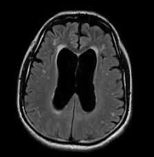

Source: "AC Sx subspe By MDCU 78A" (file "AC MCQ subspe 78A"), questions recalled by students in a table (ข้อ / โจทย์ / Choice). This is a subspecialty MCQ paper, so it is kept apart from General Surgery and is not tagged into the exam topic map. The topic in brackets at the start of some stems ((plastic), (neurosx), (CVT)) is printed in the paper and kept.
Only Q1-Q12 have any content; rows 13-100 are empty in the paper (the paper has no row 77) and are not listed.
Answers: the key file "Key AC MCQ subspe 78A" is a blank table (its Choices and reason columns are empty), and the paper marks no answers, so every answer is "not given in the source".
A choice letter the paper leaves blank is "(not recalled)". In Q4 the paper breaks the choices into the middle of the stem; the stem is joined here and the choices follow it.
exam_year 2025 is an inference: the paper does not state the year (same inference as the General Sx paper MDCU78 rotate A, from the MDCU78 rotate C PDF's creation date); please check it.
Pictures with no name, label or ID band are kept in images/. Left out: the coronary angiogram in Q5 (a stock photo with watermarks) and the chest X-ray in Q10 (it shows the answer as a drawn overlay).
The rotation (A) is not mapped to a G.

## Q1 (original no. 1)
(plastic) A woman presented with a hyperpigmented lesion at her right arm and had an excisional biopsy. Pathology confirmed malignant melanoma with Breslow thickness 2.5 mm. What is the next appropriate management?

A. Wide local excision with free margin 2 cm
B. Wide local excision with free margin 1 cm
C. Chemotherapy
D. Radiotherapy

**Answer:** not given in the source
**Explanation:** not stated
**Guideline / source:** not stated

## Q2 (original no. 2)
A chef 50 kg โดนน้ำมันลวกเป็น second degree burn at whole right arm, front and back of his body (ไปโดนท่าไหน?). ระหว่างทางมาโรงพยาบาล 3 ชม. ได้ Ringer lactate ไปแล้ว 500 cc. If you are a doctor at hospital จะ resuscitate fluid ด้วย rate เท่าไหนในอีก 5 ชม. ที่เหลือ

A. 500 cc/hr
B. 800 cc/hr
C. 1000 cc/hr
D. 1200 cc/hr
E. 1500 cc/hr

**Answer:** not given in the source
**Explanation:** not stated
**Guideline / source:** not stated

## Q3 (original no. 3)
(neurosx) An elderly Thai male presented with abnormal gait, urinary incontinence and cognitive decline, which all gradually increased over 6 months. His MRI brain is shown below -what is the diagnosis?

A. Alzheimer disease
B. Vascular dementia
C. Parkinson disease
D. Normal pressure hydrocephalus
E. Suprapontine urinary dysfunction

**Answer:** not given in the source
**Explanation:** not stated
**Guideline / source:** not stated

## Q4 (original no. 4)
A 25-year-old male who had previously treated tuberculosis last week came to the ER due to developing a sudden cough with massive blood. His vital sign is BT 37ºC, RR 24/min, PR 90/min, BP 120/90. What is the appropriate management?

A. Antibiotics
B. Protect airway, and oxygen therapy
C. Bronchoscopy

**Answer:** not given in the source
**Explanation:** not stated
**Guideline / source:** not stated

## Q5 (original no. 5)
A elderly man presented with chest pain, further investigation showed below. What is likely to be seen in his echocardiogram. [picture in the paper: a coronary angiogram (a stock photo with a watermark; left out of this file)]

A. Hypokinetic of lateral wall
B. Hypokinetics of anterior wall
C. Hypokinetics of anterior septum and apex
D. Hypokinetics of inferior wall
E. Hypokinetics of inferior septum

**Answer:** not given in the source
**Explanation:** not stated
**Guideline / source:** not stated

## Q6 (original no. 6)
A 1-month-old boy presenting with jaundice since his first 2 weeks of life. Liver function tests show conjugated hyperbilirubinemia. An upper abdomen ultrasound reveals……….

A. Kasai hepatoportoenterostomy
B. (not recalled)

**Answer:** not given in the source
**Explanation:** not stated
**Guideline / source:** not stated

## Q7 (original no. 7)
In neurosurgery OR, what is used to stop bleeding

A. Bipolar cautery
B. suture

**Answer:** not given in the source
**Explanation:** not stated
**Guideline / source:** not stated

## Q8 (original no. 8)
An adult female presenting with amenorrhea and galactoria……, what is likely diagnosis?

A. Pituitary tumour
B. Pineal tumour

**Answer:** not given in the source
**Explanation:** not stated
**Guideline / source:** not stated

## Q9 (original no. 9)
A man has grade II glioma, what is the treatment?

A. Surgery
B. Radiotherapy
C. Chemotherapy
D. Palliative

**Answer:** not given in the source
**Explanation:** not stated
**Guideline / source:** not stated

## Q10 (original no. 10)
(CVT) ทารกแรกเกิดอายุ 2 ชั่วโมง เขียวแต่ไม่มีอาการหอบเหนื่อยชัดเจน ผลเอกซเรย์เป็นดังภาพ จงให้การวินิจฉัย [picture in the paper: a newborn chest X-ray shown twice, the second copy with a drawn overlay that shows the answer (left out of this file)]

A. Truncus arteriosus
B. Tetralogy of Fallot
C. Transposition of great arteries
D. Total anomalous pulmonary venous return
E. Pneumopericardium

**Answer:** not given in the source
**Explanation:** not stated
**Guideline / source:** not stated

## Q11 (original no. 11)
(CVT) A 70-year-old female patient, with a history of mechanical mitral valve replacement for rheumatic mitral stenosis 30 years ago, recently developed a prosthetic valve infection requiring surgical intervention. What is the best surgical option?

A. Mitral valve repair
B. Mitral valve replacement with cage-ball valve
C. Mitral valve replacement with bileflet valve
D. Mitral valve replacement with autologous tissue valve

**Answer:** not given in the source
**Explanation:** not stated
**Guideline / source:** not stated

## Q12 (original no. 12)
(CVT) A 25-year-old man, previously healthy, has severe ARDS secondary to Influenza pneumonia. He was admitted to ICU, received fluid resuscitation and intubation. The patient remains unstable and refractory respiratory acidosis despite optimized management. What is the next step?

A. (not recalled)
B. VV-ECMO

**Answer:** not given in the source
**Explanation:** not stated
**Guideline / source:** not stated

## Flagged for checking
- Rows 13-100 are empty in the paper, so the paper as recalled has only 12 questions.
- exam_year 2025 is an inference.
- Q5 asks about an echocardiogram after a picture of a coronary angiogram that is not included here.
