Source: "AC Subspe MCQ By MDCU 78 RoB" (file "Subspe of AC MCQ rotate B"), questions recalled by students in a table (ข้อ / โจทย์ / Choice). This is a subspecialty MCQ paper (plastic, thoracic, cardiac, urology, paediatric and neurosurgery topics), so it is kept apart from General Surgery and is not tagged into the exam topic map.
Q2-Q62 have content. Q1 and rows 63-100 are empty in the paper (the paper has no row 77) and are not listed.
Answers: the key file "KEY AC Subspe MCQ 78 RoB" is a blank table (its Choice and reason columns are empty), and the paper marks no answers, so every answer is "not given in the source".
A choice letter the paper leaves blank is "(not recalled)". Questions that the paper writes with only some of the choices keep only those. The stems and choices that the table splits across a page break are joined. In Q45 and Q46 the stem is empty in the paper. Spelling and wording are the paper's ("รูปนี้เป๊ะ ๆ" means "this exact picture").
Pictures: those with no name, label or ID band are kept in images/ (file names -q<nn>-1). Left out: the photograph in Q9 (a child's face with printed text on the linen) and the radiograph in Q59 (it carries printed patient details at the top). The pictures belong to the question that holds them in the paper's table (the CT in Q15 sits under Q15's stem, although Q14 says "CT angiography as shown"). Q14, Q45 and Q51 mention a picture that the paper does not include.
exam_year 2025 is an inference: the paper does not state the year (same inference as the General Sx paper MDCU78 rotate B); please check it.
The rotation (B) is not mapped to a G.

## Q2 (original no. 2)
A 27-year-old man presents with a V-shaped laceration on the forearm after a glass injury. On examination, the wound forms a triangular skin flap with a pointed tip. The surgeon wants to close the wound while preserving blood supply to the tip of the flap and preventing tissue necrosis.

Which of the following suturing techniques is most appropriate for closing this wound?

A. Simple interrupted suture
B. Vertical mattress suture
C. Horizontal mattress suture
D. Half-buried mattress
E. Continuous running suture

**Answer:** not given in the source
**Explanation:** not stated
**Guideline / source:** not stated

## Q3 (original no. 3)
A 60-year-old man presents with a large traumatic wound over the anterior tibia after a motorcycle accident. On examination, there is exposed bone with minimal surrounding soft tissue coverage. The wound bed appears poorly vascularized.

Which of the following is the most appropriate management for wound coverage?

A. Secondary intention healing
B. Split-thickness skin graft
C. Full-thickness skin graft
D. Latissimus dorsi free flap

**Answer:** not given in the source
**Explanation:** not stated
**Guideline / source:** not stated

## Q4 (original no. 4)
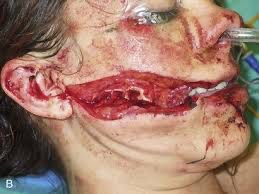

รูปไม่ชัดขนาดนี้ ถามว่าบาดเจ็บต่อโครงสร้างใด

A 25-year-old man presents to the emergency department. Which of the following structures is most likely injured?

A. Facial a.
B. Marginal mandibular branch of the facial n.
C. Procerus m.
D. Infraorbital n.
E. Stensen duct

**Answer:** not given in the source
**Explanation:** not stated
**Guideline / source:** not stated

## Q5 (original no. 5)
A 30-year-old man presents to the emergency department after being punched in the face. He complains of facial pain and swelling over the upper jaw. Physical examination reveals tenderness over the maxillary region and possible fracture is suspected. Which of the following radiographic views is most appropriate?

A. Towne view
B. Caldwell view
C. Submentovertex view
D. Water’s view
E. Lateral skull view

**Answer:** not given in the source
**Explanation:** not stated
**Guideline / source:** not stated

## Q6 (original no. 6)
A 70-kg man presents to the emergency department with thermal burns involving 20% of total body surface area (TBSA), including the anterior trunk and both arms. Fluid resuscitation is started using the Parkland formula.

How much crystalloid fluid should be administered during the first 8 hours after the burn?

A. 1,400 mL
B. 2,800 mL
C. 5,600 mL

**Answer:** not given in the source
**Explanation:** not stated
**Guideline / source:** not stated

## Q7 (original no. 7)
A 24-year-old woman sustains a scald burn on her forearm from hot water. On examination, the wound is erythematous, moist, and blistering, and the patient reports significant pain. Capillary refill is present, indicating a superficial partial-thickness burn.

What is the most appropriate treatment for this type of burn?

A. Topical silver dressing

**Answer:** not given in the source
**Explanation:** not stated
**Guideline / source:** not stated

## Q8 (original no. 8)
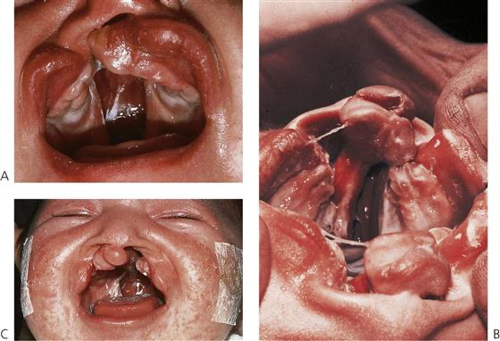

The pediatrician is concerned about complications related to this condition.

Which of the following is the most severe complication associated with this anomaly?

A. Feeding difficulty
B. Aspiration
C. Airway obstruction
D. Recurrent otitis media
E. Speech delay

**Answer:** not given in the source
**Explanation:** not stated
**Guideline / source:** not stated

## Q9 (original no. 9)
[picture in the paper: a photograph of an infant with a large swelling at the root of the nose (left out of this file: it shows a child's face and printed text)] รูปนี้เป๊ะ ๆ

The underlying defect responsible for this condition is most commonly located at which of the following sites?

A. Cribiform plate
B. Nasoethmoid bone
C. Skull base
D. Meninges
E. (not recalled)

**Answer:** not given in the source
**Explanation:** not stated
**Guideline / source:** not stated

## Q10 (original no. 10)
A 58-year-old man presents with fever, pleuritic chest pain, and shortness of breath. Chest imaging reveals a pleural effusion. Thoracentesis is performed and the pleural fluid analysis shows the following: Glucose: 30 mg/dL, LDH: 1200 U/L, pH: 6.2

What is the most appropriate management?

A. Observation and repeat thoracentesis
B. Oral antibiotics
C. Chest tube drainage
D. Pleurodesis
E. Immediate thoracotomy

**Answer:** not given in the source
**Explanation:** not stated
**Guideline / source:** not stated

## Q11 (original no. 11)
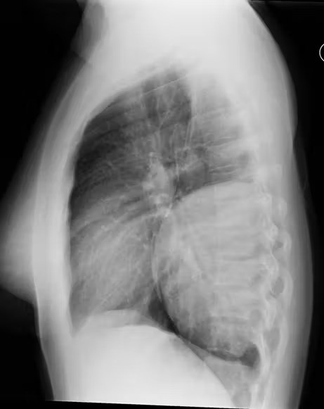

รูปนี้เป๊ะ ๆ Which of the following is the most likely diagnosis?

A. Bronchogenic cyst
B. Pericardial cyst
C. Lymphoma
D. Neurogenic tumor
E. Teratoma

**Answer:** not given in the source
**Explanation:** not stated
**Guideline / source:** not stated

## Q12 (original no. 12)
A 35-year-old woman presents with progressive muscle weakness that worsens at the end of the day. She reports ptosis and diplopia, which improve after rest. An imaging of the chest is ordered.

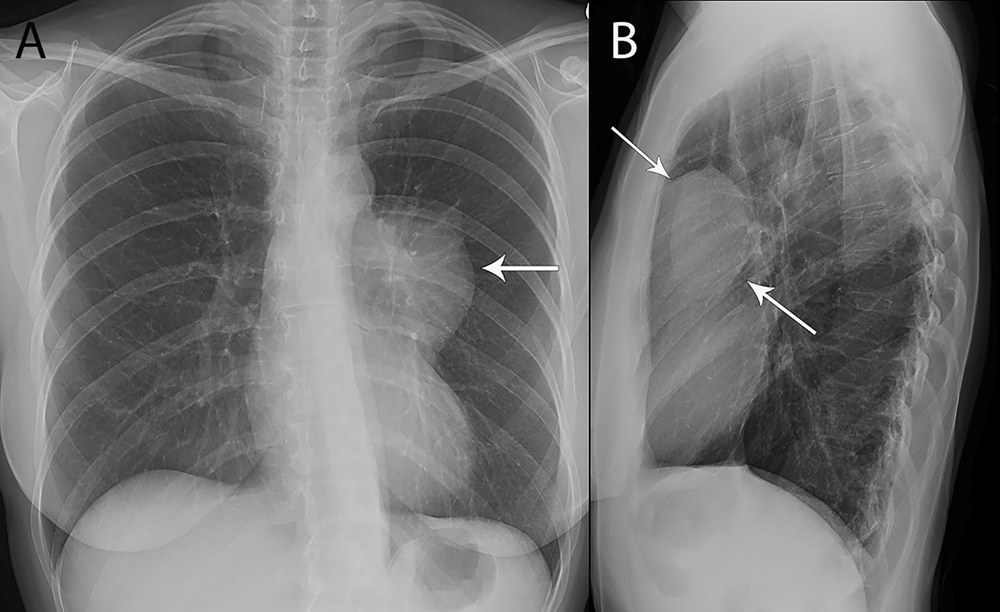

Which of the following is the most likely diagnosis?

A. Lymphoma
B. Bronchogenic cyst
C. Teratoma
D. Thymoma
E. Neurogenic tumor

**Answer:** not given in the source
**Explanation:** not stated
**Guideline / source:** not stated

## Q13 (original no. 13)
A 62-year-old man with coronary artery disease is scheduled for Coronary artery bypass grafting. Prior to surgery, he is given an antiplatelet medication to prevent platelet aggregation through inhibition of the non-endothelial pathway of platelet activation.

Which of the following best describes the mechanism of action of this drug?

A. Inhibition of thromboxane A₂ synthesis
B. Inhibition of cyclooxygenase (COX)
C. Inhibition of vitamin K–dependent clotting factors
D. Activation of antithrombin III

**Answer:** not given in the source
**Explanation:** not stated
**Guideline / source:** not stated

## Q14 (original no. 14)
A 65-year-old man presents with sudden onset of severe tearing chest pain radiating to the back. CT angiography as shown. The patient is hemodynamically stable and has no signs of organ ischemia or rupture.

What is the most appropriate initial management?

A. Emergency surgical repair
B. Intravenous beta-blocker therapy
C. Thrombolytic therapy
D. Anticoagulation with heparin
E. Immediate endovascular stent grafting

**Answer:** not given in the source
**Explanation:** not stated
**Guideline / source:** not stated

## Q15 (original no. 15)
Several life-threatening complications can occur and lead to death.

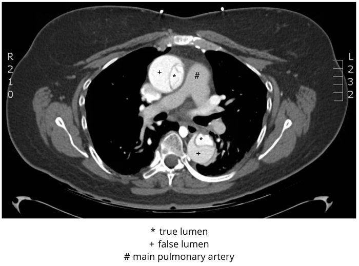

Which of the following is NOT a potential cause of death in this condition?

A. Cerebrovascular disease
B. Bowel ischemia
C. Myocardial infarction
D. Acute aortic insufficiency
E. Pulmonary embolism

**Answer:** not given in the source
**Explanation:** not stated
**Guideline / source:** not stated

## Q16 (original no. 16)
A 35-year-old man presents with sudden onset of severe right flank pain radiating to the groin, associated with nausea and restlessness. The patient reports a severe allergy to NSAIDs.

Which of the following is the most appropriate pain control strategy?

A. Ibuprofen
B. Ketorolac
C. Diclofenac
D. Morphine
E. xxx

**Answer:** not given in the source
**Explanation:** not stated
**Guideline / source:** not stated

## Q17 (original no. 17)
A 52-year-old man presents to the emergency department with sudden onset of severe right flank pain radiating to the groin. He also reports nausea and microscopic hematuria. Urinalysis shows multiple hexagonal crystals on microscopy. Which of the following is the most likely diagnosis?

A. Uric acid stone
B. Calcium oxalate stone
C. Struvite stone
D. Cystine stone

**Answer:** not given in the source
**Explanation:** not stated
**Guideline / source:** not stated

## Q18 (original no. 18)
A 67-year-old man presents with lower urinary tract symptoms including urinary frequency, nocturia, weak urinary stream, and a sensation of incomplete bladder emptying. His IPSS is 22. Digital rectal examination reveals a mildly enlarged, smooth prostate, and his PSA level is 1 ng/mL.

What is the most appropriate management?

A. Watchful waiting
B. Alpha-blocker therapy
C. 5-alpha reductase inhibitor
D. Transurethral resection of the prostate
E. Radical prostatectomy

**Answer:** not given in the source
**Explanation:** not stated
**Guideline / source:** not stated

## Q19 (original no. 19)
A 65-year-old man presents with painless hematuria. Cystoscopy reveals a bladder tumor, and Transurethral resection of bladder tumor is performed. Pathology shows high-grade non–muscle invasive bladder cancer.

What is the most appropriate next management?

A. Observation with cystoscopy follow-up
B. Intravesical chemotherapy with mitomycin C
C. Intravesical BCG therapy
D. Radical cystectomy
E. External beam radiotherapy

**Answer:** not given in the source
**Explanation:** not stated
**Guideline / source:** not stated

## Q20 (original no. 20)
A 60-year-old man undergoes abdominal CT for evaluation of flank discomfort. Imaging reveals a renal cystic lesion with contrast enhancement in the kidney.

What is the most appropriate management?

A. Observation with periodic ultrasound
B. Percutaneous aspiration
C. Antibiotic therapy
D. Surgical excision of the renal mass
E. Percutaneous drainage

**Answer:** not given in the source
**Explanation:** not stated
**Guideline / source:** not stated

## Q21 (original no. 21)
A 45-year-old woman presents with fever, flank pain, and malaise. CT scan of the abdomen reveals a 3.5 cm renal abscess. The patient is hemodynamically stable.

What is the most appropriate management?

A. Oral antibiotics
B. Intravenous antibiotics
C. Percutaneous drainage
D. Nephrectomy
E. Immediate surgical drainage

**Answer:** not given in the source
**Explanation:** not stated
**Guideline / source:** not stated

## Q22 (original no. 22)
Which of the following bladder cancers is most strongly associated with chronic infection and irritation?

A. Squamous cell carcinoma
B. Transitional cell carcinoma
C. Adenocarcinoma
D. Small cell carcinoma
E. Sarcoma

**Answer:** not given in the source
**Explanation:** not stated
**Guideline / source:** not stated

## Q23 (original no. 23)
A 15-month-old boy is brought to the clinic for evaluation of undescended testes. Physical examination reveals bilaterally palpable testes in the inguinal region.

What is the most appropriate management?

A. Bilateral orchiopexy during the same admission
B. Diagnostic laparoscopy
C. Observation until 2 years of age
D. Scrotal ultrasound
E. Hormonal therapy

**Answer:** not given in the source
**Explanation:** not stated
**Guideline / source:** not stated

## Q24 (original no. 24)
A 4-year-old child has a history of recurrent urinary tract infections. The current voiding cystourethrogram demonstrates grade IV vesicoureteral reflux.

What is the most appropriate management?

A. Observation only
B. Continuous prophylactic antibiotics
C. Endoscopic injection therapy
D. Bilateral ureteric reimplantation
E. Nephrectomy

**Answer:** not given in the source
**Explanation:** not stated
**Guideline / source:** not stated

## Q25 (original no. 25)
A 4-year-old child presents with recurrent abdominal pain and jaundice. On physical examination, there is mild right upper quadrant tenderness and mass. Laboratory tests show elevated bilirubin.

Which of the following is the most likely diagnosis?

A. Neonatal hepatitis
B. Choledochal cyst
C. Alpha-1 antitrypsin deficiency
D. Acute viral hepatitis
E. Cholelithiasis

**Answer:** not given in the source
**Explanation:** not stated
**Guideline / source:** not stated

## Q26 (original no. 26)
A newborn is noted to have a midline abdominal wall defect at the base of the umbilical cord. The abdominal contents and some parts of the liver are herniated into a sac covered by a membrane.

This congenital anomaly is most commonly associated with which of the following syndromes?

A. Turner syndrome
B. Down syndrome
C. Marfan syndrome
D. Noonan syndrome
E. Klinefelter syndrome

**Answer:** not given in the source
**Explanation:** not stated
**Guideline / source:** not stated

## Q27 (original no. 27)
What is the most common etiology of inguinal hernia in children?

A. Weakness of the transversalis fascia
B. Weak inguinal ligament
C. Increased intra-abdominal pressure
D. Defect of the external oblique aponeurosis
E. Patent processus vaginalis

**Answer:** not given in the source
**Explanation:** not stated
**Guideline / source:** not stated

## Q28 (original no. 28)
A 30-year-old man presents with painless enlargement of the testis for several weeks. Physical examination reveals a firm, non-tender testicular mass. Several conditions may be considered in the differential diagnosis.

Which of the following is NOT a likely differential diagnosis?

A. Testicular tumor
B. Hydrocele
C. Spermatocele
D. Varicocele
E. Epididymo-orchitis

**Answer:** not given in the source
**Explanation:** not stated
**Guideline / source:** not stated

## Q29 (original no. 29)
A 4-week-old infant presents with progressive non-bilious projectile vomiting after feeding. Physical examination reveals a palpable “olive-like” mass in the epigastric region.

Which of the following laboratory findings is most likely?

A. Hyperkalemia, hypochloremia with metabolic acidosis
B. Hypokalemia, hypochloremia with metabolic acidosis
C. Hypochloremia, hypokalemia, metabolic alkalosis
D. Hyperchloremia, hypokalemia with metabolic acidosis
E. Hypochloremia, hypokalemia, respiratory alkalosis

**Answer:** not given in the source
**Explanation:** not stated
**Guideline / source:** not stated

## Q30 (original no. 30)
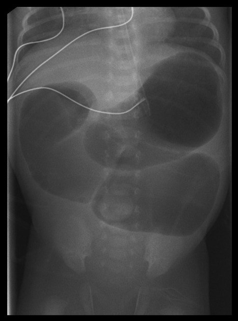

รูปนี้เป๊ะ ๆ A newborn develops bilious vomiting and abdominal distension shortly after birth. Abdominal radiograph as shown. Dx ?

A. Duodenal atresia
B. Jejunal atresia
C. Malrotation with midgut volvulus
D. Meconium ileus
E. Hirschsprung disease

**Answer:** not given in the source
**Explanation:** not stated
**Guideline / source:** not stated

## Q31 (original no. 31)
A newborn presents with failure to pass meconium within the first 24 hours of life, progressive abdominal distension, and obstipation. On digital rectal examination, the anal sphincter tone is increased, and after withdrawal of the finger there is a sudden explosive passage of stool and gas.

Which of the following investigations is most appropriate to confirm the diagnosis?

A. Anorectal manometry
B. CT abdomen
C. MRI pelvis
D. Abdominal ultrasound
E. Colonoscopy

**Answer:** not given in the source
**Explanation:** not stated
**Guideline / source:** not stated

## Q32 (original no. 32)
A newborn is noted to have absence of an anal opening on physical examination. Meconium is observed passing from the urethral opening.

What is the most appropriate initial investigation?

A. Urine examination
B. Prone lateral cross-table radiograph
C. CT scan of abdomen
D. MRI pelvis
E. NG tube

**Answer:** not given in the source
**Explanation:** not stated
**Guideline / source:** not stated

## Q33 (original no. 33)
A premature neonate develops feeding intolerance, abdominal distension, and bloody stools. On examination, the abdomen is tense and tender.

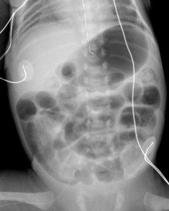

Dx ?

A. Malrotation with midgut volvulus
B. Hirschsprung-associated enterocolitis
C. NEC
D. Intussusception

**Answer:** not given in the source
**Explanation:** not stated
**Guideline / source:** not stated

## Q34 (original no. 34)
A 6-year-old child presents with sudden painless passage of a large amount of bright red blood per rectum. The child appears tachycardic but normotensive. What is the most appropriate initial management?

A. Meckel scan
B. Colonoscopy
C. Intravenous fluid resuscitation
D. CT abdomen
E. Capsule endoscopy

**Answer:** not given in the source
**Explanation:** not stated
**Guideline / source:** not stated

## Q35 (original no. 35)
A 7-year-old child presents with a midline neck swelling that moves upward when the patient protrudes the tongue and during swallowing. What is the most appropriate management?

A. Antibiotic therapy
B. Simple cyst excision
C. Sistrunk procedure
D. Thyroidectomy
E. Observation

**Answer:** not given in the source
**Explanation:** not stated
**Guideline / source:** not stated

## Q36 (original no. 36)
A 3-month-old infant presents with persistent head tilt to one side and limited neck movement.

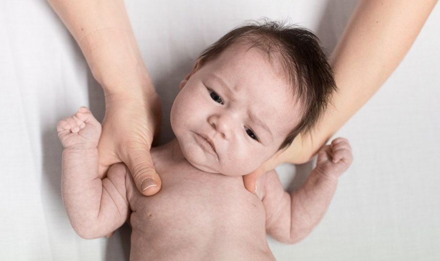

รูปนี้เป๊ะ ๆ

A. Congenital muscular torticollis

**Answer:** not given in the source
**Explanation:** not stated
**Guideline / source:** not stated

## Q37 (original no. 37)
A 65-year-old man suddenly develops muscle weakness grade II/V both upper and lower extremities and aphasia.

Localize?

A. Frontal, subcortical
B. Thalamus
C. Internal capsule
D. Cerebellar peduncle
E. Cerebral peduncle

**Answer:** not given in the source
**Explanation:** not stated
**Guideline / source:** not stated

## Q38 (original no. 38)
A 45-year-old patient presents with right-sided facial numbness in the maxillary region and progressive hearing loss with tinnitus in the right ear.

Which of the following is the most likely diagnosis?

A. Right jugular foramen schwannoma
B. Right vestibular schwannoma
C. Right CP angle meningioma

**Answer:** not given in the source
**Explanation:** not stated
**Guideline / source:** not stated

## Q39 (original no. 39)
A 20-year-old man sustains a head injury after a motorcycle accident. He briefly loses consciousness, then regains full awareness. Several hours later, he develops worsening headache and decreased level of consciousness. Which of the following CT findings is most likely?

A. Crescent-shaped hypodense lesion along the cerebral hemisphere
B. Diffuse cerebral edema
C. Convex hyperdense lesion between the skull and dura
D. Basal cistern enhancement
E. Subaarchnoid blood collection

**Answer:** not given in the source
**Explanation:** not stated
**Guideline / source:** not stated

## Q40 (original no. 40)
Kernohan, explain ?

A. (not recalled)

**Answer:** not given in the source
**Explanation:** not stated
**Guideline / source:** not stated

## Q41 (original no. 41)
GCS

A. (not recalled)

**Answer:** not given in the source
**Explanation:** not stated
**Guideline / source:** not stated

## Q42 (original no. 42)
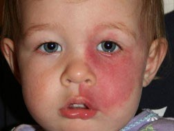 (รูปนี้เลย)

โจทย์บรรยายผู้ปกครองพาลูกมาหาเพราะมีปานสีแดงดังรูป ถามว่าเป็นโรคอะไร

A. Sturge weber syndrome

**Answer:** not given in the source
**Explanation:** not stated
**Guideline / source:** not stated

## Q43 (original no. 43)
4 cm laceration wound at fore arm well vascularize

A. primary closure after irrigation and debridement
B. Secondary healing
C. (not recalled)

**Answer:** not given in the source
**Explanation:** not stated
**Guideline / source:** not stated

## Q44 (original no. 44)
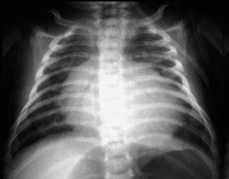

กินแล้วเขียวมากขึ้น ร้องไห้แล้วหายเขียว ฟังได้ single S2 diag

A. TGA

**Answer:** not given in the source
**Explanation:** not stated
**Guideline / source:** not stated

## Q45 (original no. 45)
(stem not recalled)

A. VSD
B. ASD

**Answer:** not given in the source
**Explanation:** not stated
**Guideline / source:** not stated

## Q46 (original no. 46)
(stem not recalled)

A. pineal germ cell tumor

**Answer:** not given in the source
**Explanation:** not stated
**Guideline / source:** not stated

## Q47 (original no. 47)
รูป lipoma ที่หลังคอ asymptomatic but a bit cosmetic concern management

A. (not recalled)

**Answer:** not given in the source
**Explanation:** not stated
**Guideline / source:** not stated

## Q48 (original no. 48)
brain abscess investigation

A. (not recalled)

**Answer:** not given in the source
**Explanation:** not stated
**Guideline / source:** not stated

## Q49 (original no. 49)
malignant melanoma management

A. (not recalled)

**Answer:** not given in the source
**Explanation:** not stated
**Guideline / source:** not stated

## Q50 (original no. 50)
A boy presents to the outpatient clinic with a small pit located anterior to the right ear since birth. His mother reports that the lesion became swollen and painful twice this year, both episodes treated with oral antibiotics. รูป preauricular pit ถาม management

A. (not recalled)

**Answer:** not given in the source
**Explanation:** not stated
**Guideline / source:** not stated

## Q51 (original no. 51)
ให้ film CXR ประวัติเกิดอุบัติเหตุรถยนต์ vital sign tachycardia Management

A. observe
B. O2 suplement
C. Thoracostomy

**Answer:** not given in the source
**Explanation:** not stated
**Guideline / source:** not stated

## Q52 (original no. 52)
A pregnant woman is found to have asymptomatic bacteriuria during routine antenatal screening. Urine culture grows Escherichia coli (>10⁵ CFU/mL). She receives appropriate oral antibiotics for 7 days. At follow-up, she remains asymptomatic but repeat urine culture is still positive.

What is the most appropriate next step in management?

A. Repeat another course of oral antibiotics
B. Start intravenous antibiotics
C. Renal and urinary tract ultrasound
D. No further treatment
E. Cystoscopy

**Answer:** not given in the source
**Explanation:** not stated
**Guideline / source:** not stated

## Q53 (original no. 53)
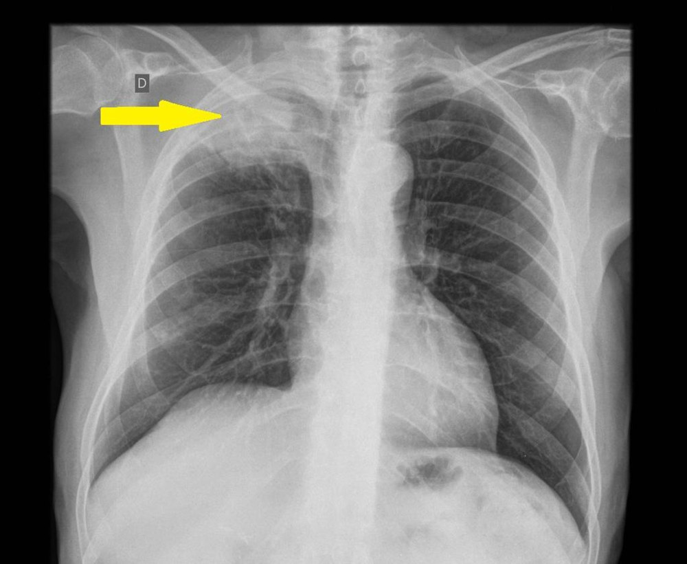

CXR เจอก้อน ถามทำอะไรต่อ

A. CT chest with contrast
B. Observe
C. Lobectomy

**Answer:** not given in the source
**Explanation:** not stated
**Guideline / source:** not stated

## Q54 (original no. 54)
62-year old woman complained of progressive weakness of left side for 15 months. Physical examination revealed left hemiparesis and papilledema. What is the most likely diagnosis in this patient?

A. Pituitary tumor
B. Pinealoma
C. Convexity meningioma
D. Cerebral metastasis
E. Vestibular schwannoma

**Answer:** not given in the source
**Explanation:** not stated
**Guideline / source:** not stated

## Q55 (original no. 55)
galactorrhea, amenorrhea treatment

A. dopamine antagonist
B. Domapine agonist

**Answer:** not given in the source
**Explanation:** not stated
**Guideline / source:** not stated

## Q56 (original no. 56)
clinical chest pain, dypsnea, syncope

A. aortic stenosis
B. Aortic regurgitation
C. Mitral stenosis

**Answer:** not given in the source
**Explanation:** not stated
**Guideline / source:** not stated

## Q57 (original no. 57)
กิน warfarin + antiplatelet เป็น mitral valve replacement คุม INR ได้ 2.3 (ไม่แน่ใจ) ถามทำไรต่อ

A. ไม่ต้องทำไร
B. เพิ่ม warfarin ให้ได้เท่า INR target

**Answer:** not given in the source
**Explanation:** not stated
**Guideline / source:** not stated

## Q58 (original no. 58)
initial management omphalocele

A. (not recalled)

**Answer:** not given in the source
**Explanation:** not stated
**Guideline / source:** not stated

## Q59 (original no. 59)
[picture in the paper: a chest and abdominal X-ray of a child (left out of this file: it carries printed patient details)] Management

A. (not recalled)

**Answer:** not given in the source
**Explanation:** not stated
**Guideline / source:** not stated

## Q60 (original no. 60)
เด็ก burn 8% at head and neck management

A. (not recalled)

**Answer:** not given in the source
**Explanation:** not stated
**Guideline / source:** not stated

## Q61 (original no. 61)
cardioplegia action

A. (not recalled)

**Answer:** not given in the source
**Explanation:** not stated
**Guideline / source:** not stated

## Q62 (original no. 62)
xantochromia persist กี่วัน

A. (not recalled)

**Answer:** not given in the source
**Explanation:** not stated
**Guideline / source:** not stated

## Flagged for checking
- Q1 and rows 63-100 are empty in the paper, so the paper as recalled has 61 questions (Q2-Q62).
- exam_year 2025 is an inference.
- Q9 and Q59 pictures were left out for the reasons in the header; Q14 and Q51 mention a picture that is not in the paper.
- Q55 reads "dopamine antagonist" and "Domapine agonist" as printed; the spelling is the paper's.
