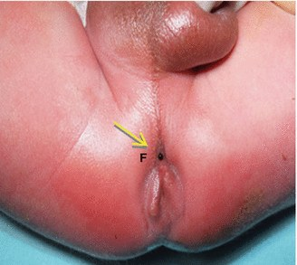
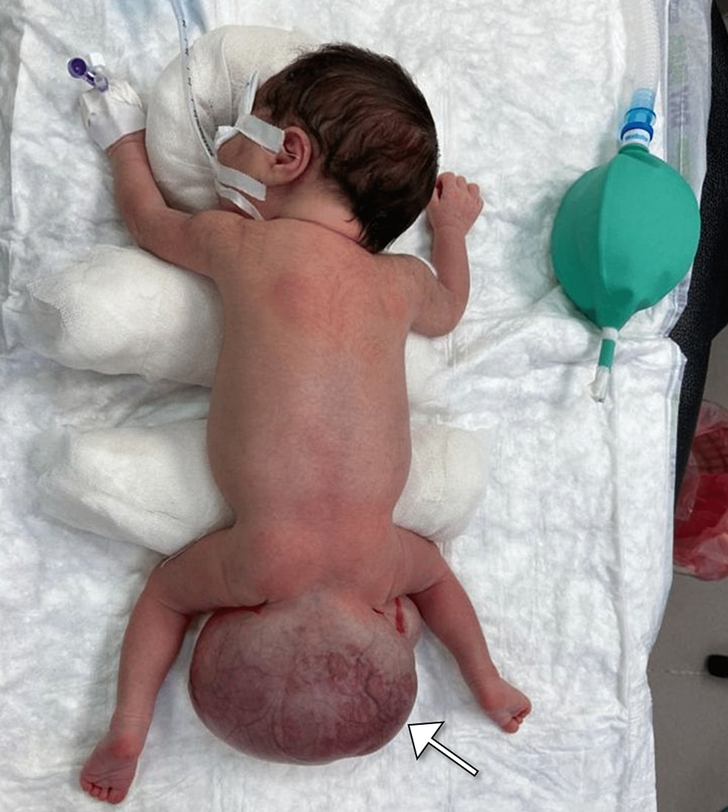
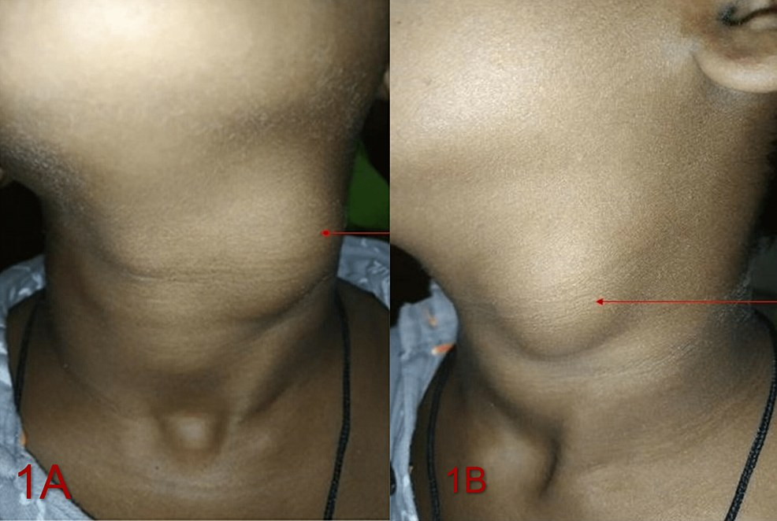
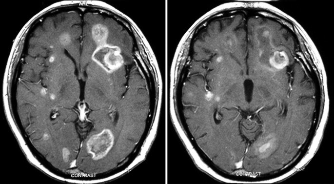
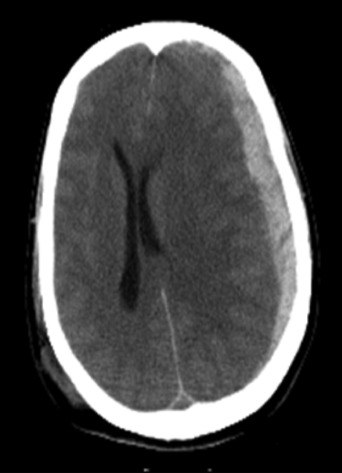
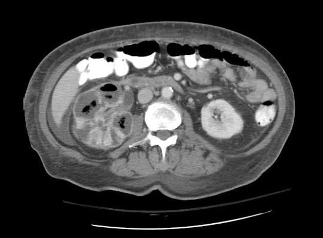

Source: "AC Subspe Sx By MDCU 78D" (file "AC78D Subspe Sx MCQ"), questions recalled by students in a table (ข้อ / โจทย์ / Choice) grouped under topic headings: PED (Q1-20), NeuroSx (Q21-40), CVT (Q41-60), Plastic (Q61-80) and Uro (Q81-100). This is a subspecialty MCQ paper, so it is kept apart from General Surgery and is not tagged into the exam topic map. The topic heading is written in brackets at the start of the first question under it.
Only 24 questions have content (Q1-6, Q21-25, Q41-44, Q61-63, Q65 and Q81-85); the other rows are empty in the paper (the paper has no row 77) and are not listed.
Answers: no answer key was found for this paper (the key file for MDCU78D that was supplied holds keys for other papers) and the paper marks no answers, so every answer is "not given in the source".
A choice letter the paper leaves blank is "(not recalled)". Stems and choices that the table splits across a page break are joined. Q6 has no stem in the paper (only a picture).
Pictures with no name, label or ID band are kept in images/ (Q2, Q4, Q6, Q21, Q22, Q83). Q1 and Q65 mention a picture that the paper does not include.
exam_year 2025 is an inference: the paper does not state the year (same inference as the General Sx paper MDCU78 rotate D); please check it.
The rotation (D) is not mapped to a G.

## Q1 (original no. 1)
[paper topic: PED] X-ray NEC [picture not in the paper]

A. NEC
B. (not recalled)

**Answer:** not given in the source
**Explanation:** not stated
**Guideline / source:** not stated

## Q2 (original no. 2)
เด็กชายอายุ 2 วัน ไม่ถ่าย meconium เลย ปัสสาวะเป็นสีเหลืองปกติ ที่ก้นเป็นดังภาพ ทำอะไรต่อดี

(รูปนี้เลย)

A. PSARP
B. Prone lateral cross table
C. Colostomy

**Answer:** not given in the source
**Explanation:** not stated
**Guideline / source:** not stated

## Q3 (original no. 3)
เด็กอายุ 6 สัปดาห์ มาด้วยท้องอืด ไม่กินนม ถ่ายเป็นเลือด at ER, V/S BT 37.2, HR 160 bpm, RR 44/min, BP 80/55? PE: abdominal distension, abdominal tenderness ทำไรต่อดี

A. u/s
B. UGIS
C. Explore lap

**Answer:** not given in the source
**Explanation:** not stated
**Guideline / source:** not stated

## Q4 (original no. 4)
เด็ก prenatal diagnosis ว่าเป็น sacrococcygeal teratoma คลอดออกมาแล้วเป็นแบบนี้ ทำไงดี

(รูปนี้เลย)

A. MRI to consult with multidisciplinary personnels
B. Surgery +- sacrectomy

**Answer:** not given in the source
**Explanation:** not stated
**Guideline / source:** not stated

## Q5 (original no. 5)
Central neck mass, moving with deglutition. What is the next management

A. Thyroid scan
B. Neck u/s
C. Thyroid function test

**Answer:** not given in the source
**Explanation:** not stated
**Guideline / source:** not stated

## Q6 (original no. 6)
(stem not recalled)

A. 1st Branchial cleft cyst
B. 2nd Branchial cleft cyst
C. Thyroglossal duct cyst

**Answer:** not given in the source
**Explanation:** not stated
**Guideline / source:** not stated

## Q21 (original no. 21)
[paper topic: NeuroSx] Which of the following is least likely to be the cause of this imaging?

A. Breast
B. Lung
C. Melanoma
D. Liver
E. Kidney

**Answer:** not given in the source
**Explanation:** not stated
**Guideline / source:** not stated

## Q22 (original no. 22)

What is the diagnosis?

A. Left epidural hematoma
B. Right epidural hematoma
C. Left subdural hematoma
D. Right subdural hematoma

**Answer:** not given in the source
**Explanation:** not stated
**Guideline / source:** not stated

## Q23 (original no. 23)
ผู้ชายวัยรุ่น, CD4 < 200, เป็นไข้ ปวดหัว น่าจะติดเชื้ออะไร

A. Toxoplasma
B. Cryptococcus neoforman
C. Neurocysticercosis

**Answer:** not given in the source
**Explanation:** not stated
**Guideline / source:** not stated

## Q24 (original no. 24)
ผู้ชาย 80 ปี ปวดหัวมาก CT non contrast normal ทำไรต่อดี

A. LP

**Answer:** not given in the source
**Explanation:** not stated
**Guideline / source:** not stated

## Q25 (original no. 25)
GCS 9

A. mild head trauma
B. moderate head trauma
C. Severe head trauma

**Answer:** not given in the source
**Explanation:** not stated
**Guideline / source:** not stated

## Q41 (original no. 41)
[paper topic: CVT] ข้อใดจับคู่ coronary artery และ branch ของมันได้ถูกต้อง

A. LAD : OM, LCX : DG , RCA : PDA
B. LAD : DG, LCX : OM , RCA : PL
C. LAD : OM ,LCX : DG , RCA : PL
D. LAD : PDA ,LCX : acute marginal , RCA : PL
E. LAD : DG ,LCX : PDA, RCA : OM

**Answer:** not given in the source
**Explanation:** not stated
**Guideline / source:** not stated

## Q42 (original no. 42)
ผู้ชาย สูบบุหรี่จัด CXR เจอ spiculate nodule 3.5 cm ทำไรต่อดี

A. Reassure, F/U CXR 3 m
B. ATB, F/U CT 3 m
C. Bronchoscopy w/ bronchoscopy lavage for cytology
D. lobectomy

**Answer:** not given in the source
**Explanation:** not stated
**Guideline / source:** not stated

## Q43 (original no. 43)
เด็ก 2 เดือน มาฉีดวัคซีน PE: systolic crescendo-decrescendo murmur at RUPSB ได้ยินเบา ๆ. เป็นอะไร

A. ASD
B. VSD
C. PDA

**Answer:** not given in the source
**Explanation:** not stated
**Guideline / source:** not stated

## Q44 (original no. 44)
ผู้หญิง 38 ปี เป็น symptomatic severe MS, already schedule for surgery แต่คนไข้อยากมีลูกมาก ทำไงดี

A. Mechanical valve due to longer durability
B. Biologic valve due to less anticoagulant use
C. Mechanical valve due to no repeat surgery
D. Biologic valve เพราะไรไม่รู้
E. เลื่อนการผ่าตัดออกไปจนกว่าคนไข้จะคลอดลูกคนแรก

**Answer:** not given in the source
**Explanation:** not stated
**Guideline / source:** not stated

## Q61 (original no. 61)
[paper topic: Plastic] ฟันหน้า ตรงแอค

A. Stensen duct
B. Frontal branch of facial nerve
C. Marginal branch of facial nerve

**Answer:** not given in the source
**Explanation:** not stated
**Guideline / source:** not stated

## Q62 (original no. 62)
น้ำร้อนลวกตรงรักแร้ เป็นสีชมพู เจ็บ ทำไงดี

A. sulfadiazine
B. STSG
C. FTSG

**Answer:** not given in the source
**Explanation:** not stated
**Guideline / source:** not stated

## Q63 (original no. 63)
Cleft palate ผ่าตอนกี่ขวบ

A. 3 เดือน
B. 6 เดือน
C. 1 ขวบ
D. 1.5 ขวบ
E. 2 ขวบ

**Answer:** not given in the source
**Explanation:** not stated
**Guideline / source:** not stated

## Q65 (original no. 65)
รูป crouzon อะไรเร่งด่วนสุด [picture not in the paper]

A. Keratonitis
B. Increased ICP

**Answer:** not given in the source
**Explanation:** not stated
**Guideline / source:** not stated

## Q81 (original no. 81)
[paper topic: Uro] ผช 52 ปี มาหาหมอเนื่องจาก ??? จำไม่ได้ แต่อยากตรวจเรื่องมะเร็งต่อมลูกหมาก ให้แนะนำไงดี

A. advice DRE annually
B. Advice DRE + PSA annually
C. Advice against screening
D. Screening at 60 yrs
E. Patient- doctor decision

**Answer:** not given in the source
**Explanation:** not stated
**Guideline / source:** not stated

## Q82 (original no. 82)
ไข้หนาวสั่น ปวด flank ให้ ATB ไม่หาย เลย CT เจอ Renal abscess > 5 cm ทำไรดี

A. PCN
B. Open drainage

**Answer:** not given in the source
**Explanation:** not stated
**Guideline / source:** not stated

## Q83 (original no. 83)

diag?

A. Emphesematous pyelonephritis
B. Emphysematous pyelitis

**Answer:** not given in the source
**Explanation:** not stated
**Guideline / source:** not stated

## Q84 (original no. 84)
เด็ก 4 ขวบ เป็น VUR grade 4 กิน ATB 3 ปี วันนี้ VCUG normal ทำไรดี

A. Stop ATB
B. F/U VCUG at 3 m
C. Ureteric reimplantation

**Answer:** not given in the source
**Explanation:** not stated
**Guideline / source:** not stated

## Q85 (original no. 85)
TCC least likely occurs in

A. renal calyx
B. Renal pelvis
C. Ureter
D. Bladder
E. Urethra

**Answer:** not given in the source
**Explanation:** not stated
**Guideline / source:** not stated

## Flagged for checking
- Only 24 of the 100 rows have content.
- exam_year 2025 is an inference.
- No answer key exists for this paper in the files supplied.
