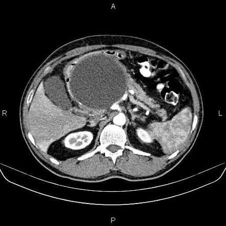

Source: "AC MCQ Gen Sx 79 Rotate C" (file "AC Sx MCQ 79 Ro C.pdf", a Google Doc of the "Peer support 79 Year 4" group, "AC79 MCQs"), questions recalled by students in a table (ข้อ / เฉลย / โจทย์) grouped under 25 topic headings (Pre- & Post-operative care, Hemostasis, Fluid and electrolyte, ...); 37 questions. The paper leaves the number of questions in the real exam and its duration blank ("จำนวนข้อสอบจริง … ข้อ (... นาที)").
The paper restarts its question numbers in every topic. Each question keeps the paper's own number and topic, and gets a unique Q id so it can be named and tagged: the first topic ("คิดไม่ออกว่าอยู่บทไหน", "cannot tell which chapter") keeps Q1, Q2, ...; every later topic, in the paper's order, gets ids from 101 (second topic), 201 (third) and so on, the id being (the topic's position - 1) x 100 + the paper's own number. The heading shows both, e.g. "## Q201 (original no. 1, topic: Hemostasis)".
9 rows have no number printed in the paper (their number cell is empty). They take their row position in their topic table as the number, and their heading says "no number printed in the paper"; no number is invented beyond that.
A row can hold more than one question, or the same question worded twice. The first keeps the row's id; the next one adds 30 (and a third adds 60), e.g. Q131, Q232; the heading says which ("second question in row 2", "second wording of row 1").
Stems and choices are as students recalled them, in their own words (Thai and English), including typos and casual remarks; they are kept as written. Choices the paper numbers 1-5 or labels a-e are written A-E in order; a choice left empty is "(not recalled)"; choices the paper does not list are not added, so many questions have fewer than four choices or none.
Answers: the paper has an answer column (เฉลย), and it is empty except in Q501, where a student typed the letter B. The paper says its key is a separate file ("Key AC Sx MCQ 79 Ro C", linked in the Google Doc); that file was not provided, so every other answer is "not given in the source". The B is a student's entry, NOT an official key, and may be wrong.
Topics with only empty rows (nothing recalled, so nothing is listed): Wound and management, Surgical infection, Professionalism and surgical safety, Surgical nutrition, Small bowel and SBO, Stomach and duodenum, Acute abdomen, Approach to colorectal symptomatology, Anorectal dz, Colorectal tumor and Emergency vascular conditions. Row 2 of Pre- & Post-operative care, Fluid and electrolyte and Surgical oncology is empty too.
The paper has one picture, the CT scan in Q501; it has no name, label or ID band, was checked by eye and is kept in images/. Q1 says a CT picture was shown, but no picture is in the PDF. In Q2332 a stray letter "P" sits before the achalasia question in the paper; it is not copied. In Q1802 the platelet count is written with a comma (240,000) here and without one in the paper, so the checker does not read it as an ID number.
exam_year 2026 is an inference: the PDF carries no date and the paper does not state the year; MDCU79 is in Year 4 in 2026. Please check it.
The rotation letter (C) is not mapped to a G. The text was taken from the PDF's text layer (a Google Docs export) and each line was checked against it.

## Q1 (original no. 1)
คนไข้ เป็นอายุ 60 กว่าดื่มเหล้า 50 ปี ดูผอม อึเป็นมัน+ท้องเสีย ไม่เคยหาหมอ ดูผอมๆ อ้วกๆๆๆ ให้รูป CT (chronic pan)

A. Recurrent acute pancreatitis
B. Chronic pancreatitis
C. Autoimmune pancreatitis
D. Head of pancreas cancer

**Answer:** not given in the source
**Explanation:** not stated
**Guideline / source:** not stated

## Q2 (original no. 2)
74 yo patient pail diaphoresis confuse present to clinic. V/S: Bp.70/40 PR 128 PE found abdominal pulsatile mass. What is the appropriate management.

A. Massive transfusion +fluid resuscitation
B. Fluid resuscitation + further examination
C. Fluid resuscitation + CTA
D. Fluid resuscitation + MRA
E. Go to repair operation instantly

**Answer:** not given in the source
**Explanation:** not stated
**Guideline / source:** not stated

## Q3 (original no. 3)
ใครทำ LC
Gallstone 3.5 cm
multiple gallstones (0.8-.12 cm), asymptomatic

**Answer:** not given in the source
**Explanation:** not stated
**Guideline / source:** not stated

## Q4 (original no. 4, topic: “คิดไม่ออกว่าอยู่บทไหน”; no number printed in the paper)
63 years old man มาด้วย sudden, severe epigastric pain
Physical examination พบ broad-like abdominal rigidity, tenderness, absent bowel sound
Manage ยังไงดี

A. High-dose IV PPI
B. CT abdomen
C. NG decompression + Antibiotic + Octreotide
D. Upper GI endoscope
E. Immediate laparotomy

**Answer:** not given in the source
**Explanation:** not stated
**Guideline / source:** not stated

## Q5 (original no. 5, topic: “คิดไม่ออกว่าอยู่บทไหน”; no number printed in the paper)
67 years old woman เคยทำ LC มาผ่าตัด
Post op day 1: off foley
Post op day 3: มี fever, dysuria
UA: พบ nitrate +, WBC 10-15 cell manage , Hemodynamic stableยังไงต่อ

A. Observe
B. Start broad spectrum antibiotics
C. Urine culture + Empiric antibiotic
D. CT abdomen กับ Pelvis
E. ใส่ Foley อีกรอบ

**Answer:** not given in the source
**Explanation:** not stated
**Guideline / source:** not stated

## Q6 (original no. 6, topic: “คิดไม่ออกว่าอยู่บทไหน”; no number printed in the paper)
4 cardinal signs เคยผ่า hernia 10 ปีที่แล้ว V/S ปกติหมด obstruct จุดไหน

A. Small bowel
B. Large bowel
C. (not recalled)

**Answer:** not given in the source
**Explanation:** not stated
**Guideline / source:** not stated

## Q7 (original no. 7, topic: “คิดไม่ออกว่าอยู่บทไหน”; no number printed in the paper)
คนท้อง 18 wks สงสัย appendicitis ทำไร

A. Graded compression ultrasound
B. MRI no contrast
C. CT with IV contrast
D. Acute Abdomen Series

**Answer:** not given in the source
**Explanation:** not stated
**Guideline / source:** not stated

## Q8 (original no. 8, topic: “คิดไม่ออกว่าอยู่บทไหน”; no number printed in the paper)
52 male long alcoholic related hepatic disease Recurrent ascite, hepatic encephalopathy, esophageal varices all LFT and bilirubin very high . bun 69, Cr6.1 eGFR 20. Management ?

A. Combined Liver and Kidney transplant
B. Liver transplant with peritoneal hemodialysis
C. Medication for severe hepatitis and kidney transplant
D. Liver replacement therapy with peritoneal dialysis
E. Medication for liver and peritoneal dialysis

**Answer:** not given in the source
**Explanation:** not stated
**Guideline / source:** not stated

## Q9 (original no. 9, topic: “คิดไม่ออกว่าอยู่บทไหน”; no number printed in the paper)
Colon cancer มี liver metast 3 lesion ที่ left lobe แต่ละ lesion ไม่เกิน 3 cm (จำไม่ได้เท่าไหร่บ้าง) right lobe ยังดีอยู่ มี plan จะ colectomy แล้ว appropriate management of liver lesion

A. liver resection
B. ablation
C. bsc

Note in the paper after the choices: "ไม่มีช้อย transplant"

**Answer:** not given in the source
**Explanation:** not stated
**Guideline / source:** not stated

## Q10 (original no. 10, topic: “คิดไม่ออกว่าอยู่บทไหน”; no number printed in the paper)
คนไข้58ปี เป็น cholan CA ที่ distal cbd ทำให้เป็น cholangitis + hypotension ต้องทำ biliary decompression แต่ inr สูง platelet ปกติต้องทำอะไร

A. ทำเลย + ให้ vitk
B. ทำเลย + ให้ platelet
C. ทำก่อน postopค่อยให้ffp
D. ทำก่อน postopค่อยให้platelet
E. ทำก่อน bleed ค่อยให้เลือด

**Answer:** not given in the source
**Explanation:** not stated
**Guideline / source:** not stated

## Q101 (original no. 1, topic: Pre- & Post-operative care)
อายุ 70 ปี จะต้องเข้าผ่า hernia มีประวัติ HTN, angina พอทำ EKG พบ old Q wave ที่ lead II III aVF ควรทำอะไรก่อนเข้ารับการผ่าตัด 4 METs เป็นการผ่าแบบ intermediate risk

A. Stress test
B. Cardiac MRI
C. เข้าผ่าได้เลย
D. Consult cardio

**Answer:** not given in the source
**Explanation:** not stated
**Guideline / source:** not stated

## Q131 (original no. 1, topic: Pre- & Post-operative care; second wording of row 1)
70 yo man. Elective laparoscopic hernioplasty. U/D DM HT stable angina dx 5 yr ago .current med asa,metformin,amlodipine,atorvastatin. ECG reveal old Q wave at lead II,III,aVF. Surgery classification at intermediate risk. What is managent.

A. coronary angiography
B. preop exercise stress test
C. preop cardiac MRI
D. surgery without further cardiac evaluation
E. postpone surgery and consult cardio

**Answer:** not given in the source
**Explanation:** not stated
**Guideline / source:** not stated

## Q201 (original no. 1, topic: Hemostasis)
คนไข้ hemophilia A รถชน ต้องผ่าตัด preopให้ไร

A. FFP
B. cryoprecipitate
C. factor 8 recombinant
D. prothrombin complex recombinant

**Answer:** not given in the source
**Explanation:** not stated
**Guideline / source:** not stated

## Q202 (original no. 2, topic: Hemostasis)
Hepatectomy ได้รับ RBC transfusion แล้วพบ abnormal oozing at inincision ถามว่าเพราะอะไร

A. Dilutional coagulopathy
B. Transfusion mismatch
C. Anemia

**Answer:** not given in the source
**Explanation:** not stated
**Guideline / source:** not stated

## Q203 (original no. 3, topic: Hemostasis; no number printed in the paper)
ให้เรียงลำดับก่อนหลังของ4ข้อนี้

A. Vasoconstriction
B. Coagulation
C. Fibrin formation
D. Platelet aggregation

**Answer:** not given in the source
**Explanation:** not stated
**Guideline / source:** not stated

## Q301 (original no. 1, topic: Fluid and electrolyte)
fluid loss

A. Ringer lactate
B. NSS

**Answer:** not given in the source
**Explanation:** not stated
**Guideline / source:** not stated

## Q401 (original no. 1, topic: Hernia)
มี Hernia แล้ว strangulate แต่ไม่มีอาการของ small bowel obstruction ->

A. Richter hernia
B. Littre hernia
C. Amyand’s hernia
D. Obturator hernia

**Answer:** not given in the source
**Explanation:** not stated
**Guideline / source:** not stated

## Q402 (original no. 2, topic: Hernia)
ซ่อม hernia ด้วย mesh Abx = cefazolin แล้ว 3 วันต่อมามี loose mucous bloody diarrhea ทำไงต่อ

A. ORS
B. Vancomycin IV
C. Metronidazole oral
D. Colectomy
E. Loperamide

**Answer:** not given in the source
**Explanation:** not stated
**Guideline / source:** not stated

## Q501 (original no. 1, topic: Spleen and pancreas)
50 yo man hx of acute pancreatitis 4 weeks ago. Present with persistent epigastric pain, early satiety, nausea. No fever no vomitting
PE: mild epigastrium tenderness
What is diagnosis

A. Recurrent peripancreatic fluid collection
B. Pancreatic pseudocyst
C. Necrotic pancreatitis
D. Pancreatic abscess
E. Pancreatic NET

**Answer:** B (typed in the paper's answer column by a student; not an official key)
**Explanation:** not stated
**Guideline / source:** not stated

## Q502 (original no. 2, topic: Spleen and pancreas)
Post Splenectomy ดูติดเชื้อยมๆ

A. Sepesis
B. Septic shock
C. OPSI
D. Toxic shock syndrome(?)

**Answer:** not given in the source
**Explanation:** not stated
**Guideline / source:** not stated

## Q901 (original no. 1, topic: Metabolic response to injury)
หลัง 24-48 hr metabolic เป็นยังไง

A. Anabolic
B. Catabolic

**Answer:** not given in the source
**Explanation:** not stated
**Guideline / source:** not stated

## Q902 (original no. 2, topic: Metabolic response to injury)
ผู้ป่วยผ่าตักมาน้ำหนัก 70 ควรได้ calories เท่าไหร่

A. 5-10
B. 20-25
C. 30-35
D. 40-45

**Answer:** not given in the source
**Explanation:** not stated
**Guideline / source:** not stated

## Q1101 (original no. 1, topic: Surgical oncology)
อะไรเป็น hallmark of cancer

A. Evading apoptosis

**Answer:** not given in the source
**Explanation:** not stated
**Guideline / source:** not stated

## Q1501 (original no. 1, topic: Breast)
ท้อง 18 week คลำได้ก้อนที่นม 2 cm firm non tender ทำอะไรต่อ

A. Ultrasound
B. Mammogram
C. Breast MRI

**Answer:** not given in the source
**Explanation:** not stated
**Guideline / source:** not stated

## Q1502 (original no. 2, topic: Breast)
metastatic breast cancer presents with progressive mid-back pain and difficulty walking for 3 days. On neurological examination, she has bilateral lower extremity weakness, hyperreflexia, and a sensory level at T7. She has no bowel or bladder dysfunction. MRI demonstrates metastatic tumor compressing the spinal cord at the T7 vertebral level.
What is the most appropriate initial management?

A. Observe and repeat MRI in 48 hours
B. Oral and intravenous analgesics only
C. High-dose corticosteroids followed by urgent radiotherapy
D. Systemic chemotherapy
E. Decompressive laminectomy within 1 week

**Answer:** not given in the source
**Explanation:** not stated
**Guideline / source:** not stated

## Q1801 (original no. 1, topic: Liver and biliary tract 1&2)
63 yo female present with progressive jaundice , pale stool, dark urine,pruritus, weight loss. PE:palpable non tender gallbladder. What is appropriate imaging

A. upper GI endoscopy
B. abdominal US
C. CT abdomen
D. mrcp
E. ercp

**Answer:** not given in the source
**Explanation:** not stated
**Guideline / source:** not stated

## Q1802 (original no. 2, topic: Liver and biliary tract 1&2)
CCA มาแบบยมมาก ต้อง emer biliary decompression platelet 240,000 inr 1.5/2(จำเลขแน่ๆไม่ได้) ต้อง management ยังไง

A. ให้ Vit K แล้ว proceed to procedure
B. ให้ platelet แล้ว proceed
C. Proceed เลย แล้วให้ FFP postop
D. Proceed เลย แล้วให้ platelet postop
E. Proceed เลย แล้วให้ blood component เมื่อ bleeding

**Answer:** not given in the source
**Explanation:** not stated
**Guideline / source:** not stated

## Q1901 (original no. 1, topic: Thyroid and Parathyroid)
thyroid nodule Thyroid function test ปกติ US look like cystic nodule

A. Papillary thyroid cancer
B. Medullary thyroid cancer
C. Anaplastic thryoid cancer
D. Simple cyst
E. (not recalled)

**Answer:** not given in the source
**Explanation:** not stated
**Guideline / source:** not stated

## Q1902 (original no. 2, topic: Thyroid and Parathyroid)
ESRL ล้างไตมา 5 ปี 8.2 calcium 5.3 phosphate 150 PTH ผลอันนี้หลังล้างไตมาแล้ว

A. Primary pth
B. Secondary pth
C. Tertiary pth

**Answer:** not given in the source
**Explanation:** not stated
**Guideline / source:** not stated

## Q1903 (original no. 3, topic: Thyroid and Parathyroid; no number printed in the paper)
Thyroid เจาะ FNA birads V ทำไรต่อ

A. Subtotal thyroidectomy ?
B. Total thyroidectomy
C. Reassure and pbserve
D. Repeat FNA

**Answer:** not given in the source
**Explanation:** not stated
**Guideline / source:** not stated

## Q2001 (original no. 1, topic: MIS)
who meet criteria for cholecystectomy

A. 28yr multiple gallstones (0.5-1.4cm) incidental finding from ultrasound
B. 50yr 3.5cm gallstones เจอจาก annual checkup
C. Confirmed diagnostic acute cholecystitis แต่ hemodynamic unstable

**Answer:** not given in the source
**Explanation:** not stated
**Guideline / source:** not stated

## Q2002 (original no. 2, topic: MIS)
laparoscopy effects

A. Decrease venous return -> decrease CO, Increase lung pressure

**Answer:** not given in the source
**Explanation:** not stated
**Guideline / source:** not stated

## Q2301 (original no. 1, topic: Esophagus)
64 yo patient present with 300cc bloody vommitting + 200cc blood clot in stomach. Hx Smoking 4 pack year. Drink every 1-2 week. What is the diagnosis.

A. Esophageal varice
B. Duodenal ulcer
C. Gastric ulcer
D. Malories veiss tear

**Answer:** not given in the source
**Explanation:** not stated
**Guideline / source:** not stated

## Q2302 (original no. 2, topic: Esophagus)
T3 esophagus cancer management

A. Neoadjuvant + Esophagectomy

**Answer:** not given in the source
**Explanation:** not stated
**Guideline / source:** not stated

## Q2332 (original no. 2, topic: Esophagus; second question in row 2)
ให้อาการ achalasia มาถาม definite diagnosis

A. Barium swallowing
B. Manometry
C. EGD

**Answer:** not given in the source
**Explanation:** not stated
**Guideline / source:** not stated

## Q2401 (original no. 1, topic: Transplantation and immunology)
tacrolimus mechanism

A. Calcinulin inhibitor -> IL 2 -> T cell

**Answer:** not given in the source
**Explanation:** not stated
**Guideline / source:** not stated

## Q2402 (original no. 2, topic: Transplantation and immunology)
unknown cause of death แต่ มี acinetobacter baun infectionถามอะไรเป็นสาเหตุที่ทำให้ donate organ ไม่ได้

A. Active infection
B. Unknown cause of death

**Answer:** not given in the source
**Explanation:** not stated
**Guideline / source:** not stated
