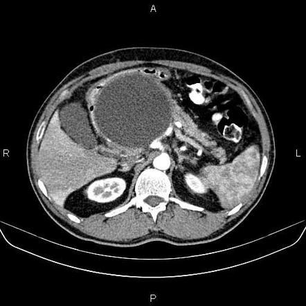
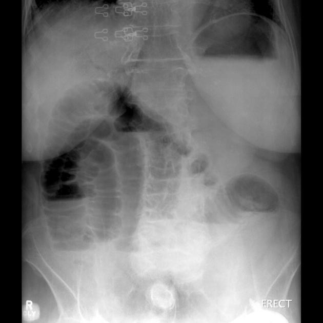
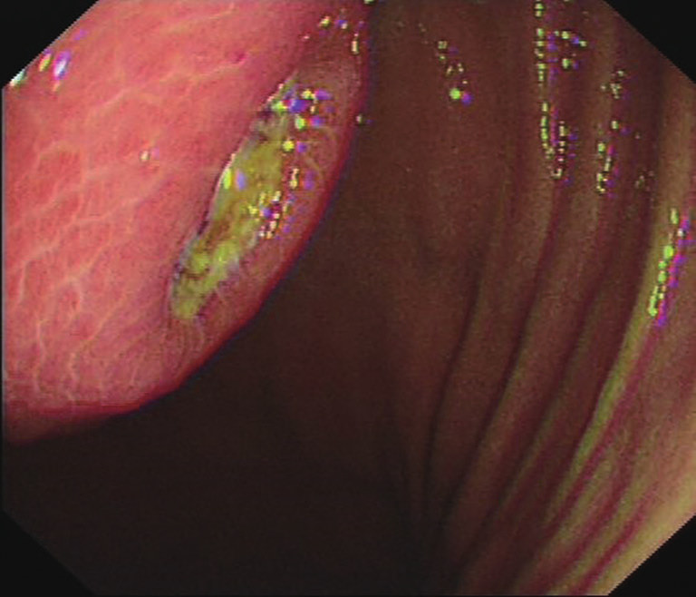
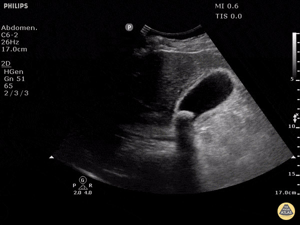

Source: "AC MCQ Gen Sx 79 Rotate D" (file "AC Sx MCQ 79 Ro D.pdf", a Google Doc of the "Peer support 79 Year 4" group, "AC79 MCQs"), questions recalled by students in a table (ข้อ / เฉลย / โจทย์) grouped under 22 topic headings (Pre- & Post-operative care, Hemostasis, Fluid and electrolyte, ...); 66 questions. The paper leaves the number of questions in the real exam and its duration blank ("จำนวนข้อสอบจริง … ข้อ (... นาที)").
The paper restarts its question numbers in every topic. Each question keeps the paper's own number and topic, and gets a unique Q id so it can be named and tagged: the first topic ("คิดไม่ออกว่าอยู่บทไหน", "cannot tell which chapter") keeps Q1, Q2, ...; every later topic, in the paper's order, gets ids from 101 (second topic), 201 (third) and so on, the id being (the topic's position - 1) x 100 + the paper's own number. The heading shows both, e.g. "## Q201 (original no. 1, topic: Hemostasis)".
A row can hold more than one question, or the same question worded twice. The first keeps the row's id; the next one adds 30 (and a third adds 60), e.g. Q131, Q232; the heading says which ("second question in row 2", "second wording of row 1").
Stems and choices are as students recalled them, in their own words (Thai and English), including typos and casual remarks; they are kept as written. Choices the paper numbers 1-5 or labels a-e are written A-E in order; a choice left empty is "(not recalled)"; choices the paper does not list are not added, so many questions have fewer than four choices or none.
Answers: the paper has an answer column (เฉลย), but it is empty. Its one entry, in Q401, reads "No ans ถาม อ.ศุภอัฐเเล้ว" (no answer; already asked Dr. ศุภอัฐ). The paper says its key is a separate file ("Key AC Sx MCQ 79 Ro D", linked in the Google Doc); that file was not provided, so every answer is "not given in the source".
The paper has four pictures: a CT scan (Q504), an abdominal X-ray marked ERECT (Q1201), an endoscopic image (Q1301) and an ultrasound (Q1802, with only machine settings written on the screen). None shows a name, label or ID band; they were checked by eye and are kept in images/. The paper mentions pictures that are not in the PDF: Q502 (calcification at L1), Q701 (the first picture of necrotising fasciitis on Google) and Q2001 (achalasia). Q1802 is the picture and the words "management?".
Q504 and Q1102 list their choices without numbers or letters; they are lettered A-E in order. Q1702 lists "normal TSH T4" as its first choice, as written.
exam_year 2026 is an inference: the PDF carries no date and the paper does not state the year; MDCU79 is in Year 4 in 2026. Please check it.
The rotation letter (D) is not mapped to a G. The text was taken from the PDF's text layer (a Google Docs export) and each line was checked against it.

## Q1 (original no. 1)
Non-bilious vomiting several hours after meal. Early satiety What?

A. Peptic ulcer-Pyloric stricture
B. Duodenal adenocarcinoma
C. Gastric adenocarcinoma
D. Head of pancreas carcinoma
E. SMA syndrome

**Answer:** not given in the source
**Explanation:** not stated
**Guideline / source:** not stated

## Q101 (original no. 1, topic: Pre- & Post-operative care)
what test should be done before esophageal CA stage T2 N0

A. CBC coagulogram
B. CT + Esopha
C. EKG + PFT

**Answer:** not given in the source
**Explanation:** not stated
**Guideline / source:** not stated

## Q102 (original no. 2, topic: Pre- & Post-operative care)
Antibiotic prophylaxis for open mesh repair :

A. Oral amoxicillin 1mg PO
B. IV cefazolin 40 minute before incision
C. Ceftri IV

**Answer:** not given in the source
**Explanation:** not stated
**Guideline / source:** not stated

## Q103 (original no. 3, topic: Pre- & Post-operative care)
Uterine prolapse มาผ่า ต้องให้ไรหลังผ่าตัดกัน DVT

A. early ambulatory
B. LMWH
C. pneumatic compression
D. pneumatic compression + LMWH

**Answer:** not given in the source
**Explanation:** not stated
**Guideline / source:** not stated

## Q104 (original no. 4, topic: Pre- & Post-operative care)
Atelectasis post op ทำไร

A. Triflow+ analgesia
B. High flow
C. Antibiotic

**Answer:** not given in the source
**Explanation:** not stated
**Guideline / source:** not stated

## Q201 (original no. 1, topic: Hemostasis)
apTT normal PT abnormal, Defect in which pathway

A. Extrinsic pathway
B. Intrinsic pathway
C. Common pathway

**Answer:** not given in the source
**Explanation:** not stated
**Guideline / source:** not stated

## Q202 (original no. 2, topic: Hemostasis)
female receive blood transfusion 30 minutes oozing coke urine fever normal lung heart hypotension

A. TACO
B. TRALI
C. acute febrile hemolytic transfusion
D. Febrile non hemolytic transfusion

**Answer:** not given in the source
**Explanation:** not stated
**Guideline / source:** not stated

## Q232 (original no. 2, topic: Hemostasis; second question in row 2)
Hemophilia A ทำไรดี

A. ให้ FFP + ผ่าเลย
B. Fator VIII + ป่าเลย

**Answer:** not given in the source
**Explanation:** not stated
**Guideline / source:** not stated

## Q301 (original no. 1, topic: Fluid and electrolyte)
80 kg male. What is the closest approximate of his intravascular volume

A. 3L
B. 5L
C. 10L
D. 15L
E. 20L

**Answer:** not given in the source
**Explanation:** not stated
**Guideline / source:** not stated

## Q302 (original no. 2, topic: Fluid and electrolyte)
highest Cl concentration

A. Stomach
B. Colon
C. Small bowel
D. pancreas

**Answer:** not given in the source
**Explanation:** not stated
**Guideline / source:** not stated

## Q303 (original no. 3, topic: Fluid and electrolyte)
Hyper K ทำไร

A. IV calcium
B. Urgent dialysis
C. IV fluid resuscitation

**Answer:** not given in the source
**Explanation:** not stated
**Guideline / source:** not stated

## Q304 (original no. 4, topic: Fluid and electrolyte)
ให้อาการ Trousseau's sign เกิดจากไร

A. Hypocalcemia from hypoparathyroidism

**Answer:** not given in the source
**Explanation:** not stated
**Guideline / source:** not stated

## Q305 (original no. 5, topic: Fluid and electrolyte)
Ca 8 (8.5-10.5), PO43- สูง, PTH 950 เป็น ESRD stage 5 เกิดจากอะไร

A. Primary hyperparathyroidism
B. Secondary hyperparathyroidism
C. Tertiary hyperparathyroidism

**Answer:** not given in the source
**Explanation:** not stated
**Guideline / source:** not stated

## Q401 (original no. 1, topic: Hernia)
mass at lateral to femoral vessel mass irreducible มีบวม แดง v/s ไม่ค่อยดี แต่ไม่มี abdominal distension, passing stool ได้

A. indirect
B. direct
C. Richter
D. Spegilion
E. Obturator

**Answer:** not given in the source (the paper's answer cell says "No ans ถาม อ.ศุภอัฐเเล้ว": no answer, already asked Dr. ศุภอัฐ)
**Explanation:** not stated
**Guideline / source:** not stated

## Q402 (original no. 2, topic: Hernia)
ผ่า hernia ใส่ mesh เเล้วskinแดง มีpurulent ไหลออกมา ทำไร

A. iv antibiotic
B. wound explore+drainage
C. Remove mesh

**Answer:** not given in the source
**Explanation:** not stated
**Guideline / source:** not stated

## Q403 (original no. 3, topic: Hernia)
อันไหนไม่ใช่ direct hernia

A. lateral to rectus abdominis
B. medial to epigastric vss
C. อยู่ในhesselburg triangle
D. อยู่เหนือ inguinal ligament
E. อยู่ที่ deep inguinal ring

**Answer:** not given in the source
**Explanation:** not stated
**Guideline / source:** not stated

## Q404 (original no. 4, topic: Hernia)
Groin mass at scrotum. Reducible ตอนนอน. Management?

A. Elective hernioplasty
B. Urgent hernioplasty
C. Manual reduction and follow up

**Answer:** not given in the source
**Explanation:** not stated
**Guideline / source:** not stated

## Q405 (original no. 5, topic: Hernia)
Acute MI อยู่ ICU มาทำ stent ได้ยาสักอย่าง เเล้วเจอมี reducible inguinal mass ด้วยก้อนใหญ่ เเต่เป็นข้างเดียว

A. Open repair (in this visit)
B. Laparoscopic after 6 months

**Answer:** not given in the source
**Explanation:** not stated
**Guideline / source:** not stated

## Q501 (original no. 1, topic: Spleen and pancreas)
Severe acute gallstone pancreatitis? นอน ICU มา 6 วัน develop necrotizing pancreatitis ที gas in necrotic cyst
fever ABX of choice

A. Piptazo
B. ampicillin sulbactam
C. ceftriaxone metronidazole
D. oral ciprofloxacin + metronidazole
E. vancomycin

**Answer:** not given in the source
**Explanation:** not stated
**Guideline / source:** not stated

## Q502 (original no. 2, topic: Spleen and pancreas)
รูป Calcification ที่ L1 ถาม What is diagnosis?

A. Acute recurrent pancreatitis
B. Chronic pancreatitis
C. Renal canaliculi
D. Severe PU

**Answer:** not given in the source
**Explanation:** not stated
**Guideline / source:** not stated

## Q503 (original no. 3, topic: Spleen and pancreas)
Severe Pancreatitis MOF with hypoactive bowel sound ทำไร

A. NJ
B. NG
C. PPN
D. TPN
E. No nutritional support until ileus resolved

**Answer:** not given in the source
**Explanation:** not stated
**Guideline / source:** not stated

## Q504 (original no. 4, topic: Spleen and pancreas)
เป็น Acute pan มา 5 wk ให้ CT มา รูปนี้เลย

A. Pancreatic abscess
B. Pseudocyst
C. Choledocal cyst
D. Walled of necrosis
E. Splenic vein thrombosis

**Answer:** not given in the source
**Explanation:** not stated
**Guideline / source:** not stated

## Q505 (original no. 5, topic: Spleen and pancreas)
Severe epigastric pain radiating to the back for 8 hours beer one can a day for 15 years
Best investigation for diagnosis

A. Serum lipase
B. CT with contrast
C. ERCP

**Answer:** not given in the source
**Explanation:** not stated
**Guideline / source:** not stated

## Q601 (original no. 1, topic: Wound and management)
Which management least likely to prevent surgical site infection

A. Clean from the incision outward
B. Keep BT > 36
C. keep no hypoglycemia and hypokalemia
D. antibiotic prophylaxis
E. meticulous scrub technique

**Answer:** not given in the source
**Explanation:** not stated
**Guideline / source:** not stated

## Q701 (original no. 1, topic: Surgical infection)
NF รูปแรกใน google 12 hr severe pain What is the initial management?

A. Surgical debridement
B. Oral ATB

**Answer:** not given in the source
**Explanation:** not stated
**Guideline / source:** not stated

## Q801 (original no. 1, topic: Professionalism and surgical safety)
อันไหนไม่ใช่ sign in method

A. Abx prophylaxis เริ่มไปรึยัง
B. Patient identification
C. Allergy
D. Procedure
E. Incision site

**Answer:** not given in the source
**Explanation:** not stated
**Guideline / source:** not stated

## Q802 (original no. 2, topic: Professionalism and surgical safety)
ผ่าตัดนานๆ อุปกรณ์พัง เพราะรพ.ทั้งจังหวัดมีอันเดียว คิดว่าเกิดจากเหตุผลอะไร

A. ใช้ซ้ำเยอะเกิ๊น

**Answer:** not given in the source
**Explanation:** not stated
**Guideline / source:** not stated

## Q803 (original no. 3, topic: Professionalism and surgical safety)
ขอ consent ยังไงให้ถูก

A. แจ้งทุกอย่างและนำเสนอทางเลือก
B. ถ้าขีฟบอกแล้วมึงเอากระดาษไปยื่นให้เซ็นพอ

**Answer:** not given in the source
**Explanation:** not stated
**Guideline / source:** not stated

## Q804 (original no. 4, topic: Professionalism and surgical safety)
คนไข้ comorbid เยอะๆๆๆ ผ่าเสดละต้องเข้า ICU ถามเหตุผล

A. Fail to optimize comorbidities

**Answer:** not given in the source
**Explanation:** not stated
**Guideline / source:** not stated

## Q901 (original no. 1, topic: Metabolic response to injury)
motorcycle collision 12hr แรก อยู่เฟสไหน

A. Ebb phase
B. Flow cata
C. Flow ana

**Answer:** not given in the source
**Explanation:** not stated
**Guideline / source:** not stated

## Q902 (original no. 2, topic: Metabolic response to injury)
post op 5%dnss 80cc/hr แล้ว hyperglycemia

A. insulin resistance
B. high glucagon increases gluconeogenesis
C. Too much IV fluid

**Answer:** not given in the source
**Explanation:** not stated
**Guideline / source:** not stated

## Q1001 (original no. 1, topic: Surgical nutrition)
Billroth2 อาการ hypoglycemia 1-3 hr after feed

A. Late dumping
B. early dumping
C. A loop syndrome
D. E loop syndrome

**Answer:** not given in the source
**Explanation:** not stated
**Guideline / source:** not stated

## Q1002 (original no. 2, topic: Surgical nutrition)
ให้ TPN 10 วัน แล้ว glucose 220, ALT/ASTขึ้น, clear urine from foley, clean around central line area ถามว่าเกิดจากอะไร

A. ไม่ให้อาหารทาง enteral (bact translocation)
B. Catheter related sepsis

**Answer:** not given in the source
**Explanation:** not stated
**Guideline / source:** not stated

## Q1003 (original no. 3, topic: Surgical nutrition)
postop 70 kg man actual energy expenditure

A. 1200-1500
B. 1750-2100
C. 2100-2800
D. 3000-3500

**Answer:** not given in the source
**Explanation:** not stated
**Guideline / source:** not stated

## Q1101 (original no. 1, topic: Surgical oncology)
CEA คืออะไร ข้อใดถูก

A. Use for life long follow up q 6-12 mo
B. Use for follow up only in patient already had colectomy
C. Use for screening
D. Use for diagnosis ca colon

**Answer:** not given in the source
**Explanation:** not stated
**Guideline / source:** not stated

## Q1102 (original no. 2, topic: Surgical oncology)
KRAS moderate atypia proliferate มากกว่าปกติไม่มี metas อยุ่ใน stage ไหน

A. iniatial
B. Promotion
C. Progression

**Answer:** not given in the source
**Explanation:** not stated
**Guideline / source:** not stated

## Q1201 (original no. 1, topic: Small bowel and SBO)
What is the diagnosis?

A. sigmoid volvulus
B. cecum volvulus
C. gallstone ileus
D. bladder calculus

**Answer:** not given in the source
**Explanation:** not stated
**Guideline / source:** not stated

## Q1202 (original no. 2, topic: Small bowel and SBO)
Perforated duodenal ulcer

**Answer:** not given in the source
**Explanation:** not stated
**Guideline / source:** not stated

## Q1301 (original no. 1, topic: Stomach and duodenum)
รูป endoscope บรรยายว่าเป็น submucosal mass with central ulceration

A. gastric adenoma
B. GIST
C. gatric ulcer

**Answer:** not given in the source
**Explanation:** not stated
**Guideline / source:** not stated

## Q1401 (original no. 1, topic: Acute abdomen)
A 27 years caucasian male presented with constipation and tapering stool. Physical exam review tenderness at RLQ without rebound tenderness and no palpable mass. Imaging found wall thickening at jejunum and ileum with perienteric fat standing. Comb sign positive (engorgement of vasa recta). What is the diagnosis?

A. Acute appendicitis
B. Meckel diverticulitis
C. Small bowel Crohn disease
D. Ulcerative colitis with backward ileitis
E. Cecal diverticulosis

**Answer:** not given in the source
**Explanation:** not stated
**Guideline / source:** not stated

## Q1402 (original no. 2, topic: Acute abdomen)
เด็กอายุ 12 ปวดท้อง peri umbilical ย้ายมา RLQ wbc 14,000 (N80กว่า%) pediatric surgeon want confirm diagnosis

A. Abdominal U/S
B. CT with iv contrast
C. Explore laparotomy

**Answer:** not given in the source
**Explanation:** not stated
**Guideline / source:** not stated

## Q1501 (original no. 1, topic: Breast)
ก้อนโตเร็วมาก node ปกติ leaf like architecture

A. Invasive ductal carcinoma
B. DCIS
C. Phyllodes
D. Giant adenofibroma

**Answer:** not given in the source
**Explanation:** not stated
**Guideline / source:** not stated

## Q1502 (original no. 2, topic: Breast)
ก้อนโตใน 2 เดือน ขยับไม่ได้ ผิวเป็นส้ม axillary lymph node positive

A. Invasive ductal carcinoma
B. DCIS
C. Phyllodes
D. Giant adenofibroma

**Answer:** not given in the source
**Explanation:** not stated
**Guideline / source:** not stated

## Q1503 (original no. 3, topic: Breast)
ก้อน 1.6 cm, CNA found invasive ductal carcinoma, PR+ ER+ HER2-

A. BCT + SLNB
B. Total Mastectomy + ALND
C. Neoadjuvant chemotherapy + surgery
D. Neoadjuvant hormonal therapy + surgery

**Answer:** not given in the source
**Explanation:** not stated
**Guideline / source:** not stated

## Q1601 (original no. 1, topic: Liver and biliary tract 1&2)
U/S acute cholecyst ตรง ๆ

A. Urgent cholecystectomy

**Answer:** not given in the source
**Explanation:** not stated
**Guideline / source:** not stated

## Q1602 (original no. 2, topic: Liver and biliary tract 1&2)
ameobic liver 11 cm

A. Oral metro
B. Oral metro + drainage
C. Vancomycin

**Answer:** not given in the source
**Explanation:** not stated
**Guideline / source:** not stated

## Q1632 (original no. 2, topic: Liver and biliary tract 1&2; second question in row 2)
Ligament ที่แบ่งตับเป็น left-right lobe, anteromedial peritoneal

A. Falciform ligament
B. couinaud ligament

**Answer:** not given in the source
**Explanation:** not stated
**Guideline / source:** not stated

## Q1662 (original no. 2, topic: Liver and biliary tract 1&2; third question in row 2)
เป็น sigmoid ca + เจอที่ตับหลายก้อนเรียกว่าไร

A. synchronous metastasis

**Answer:** not given in the source
**Explanation:** not stated
**Guideline / source:** not stated

## Q1603 (original no. 3, topic: Liver and biliary tract 1&2)
HCC 9 cm ก้อนเดียว ตัดได้จะทำไร

A. resection
B. TACE

**Answer:** not given in the source
**Explanation:** not stated
**Guideline / source:** not stated

## Q1701 (original no. 1, topic: Thyroid and Parathyroid)
marked Opthalmopathy

A. Medicine
B. Total thyroidectomy
C. Lobectomy + …

**Answer:** not given in the source
**Explanation:** not stated
**Guideline / source:** not stated

## Q1702 (original no. 2, topic: Thyroid and Parathyroid)
right lobe anechoic cystic consistency move ตามการกลืน regular border

A. normal TSH T4
B. Simple thyroid cyst
C. Thyroglossal duct cyst

**Answer:** not given in the source
**Explanation:** not stated
**Guideline / source:** not stated

## Q1703 (original no. 3, topic: Thyroid and Parathyroid)
2cm anechoic lesion ที่ thyroid ทำไรต่อ

A. Draingae and cytology
B. total thyroidectomy

**Answer:** not given in the source
**Explanation:** not stated
**Guideline / source:** not stated

## Q1704 (original no. 4, topic: Thyroid and Parathyroid)
Grave’s disease มี lid lag, exophthalmos. What is appropriate management?

A. Life long Metimazole
B. Total Thyroidectomy
C. RAI
D. Beta blocker

**Answer:** not given in the source
**Explanation:** not stated
**Guideline / source:** not stated

## Q1705 (original no. 5, topic: Thyroid and Parathyroid)
CKD ca ต่ำ phosphate สูง PTH สูง

A. primary hyperparathyroid
B. secondary hyperparathyroid
C. tertiary hyperparathyroid

**Answer:** not given in the source
**Explanation:** not stated
**Guideline / source:** not stated

## Q1801 (original no. 1, topic: MIS)
ข้อไหนทำ mis

A. symptomatic cholelithiasis
B. subsided cholecytitis with perforated bowel surgury

**Answer:** not given in the source
**Explanation:** not stated
**Guideline / source:** not stated

## Q1802 (original no. 2, topic: MIS)
management?

A. IV antibiotic + observe
B. Urgent open Cholecystectomy
C. Urgent LC
D. Elective cholecystectomy 6-8 wk

**Answer:** not given in the source
**Explanation:** not stated
**Guideline / source:** not stated

## Q1901 (original no. 1, topic: Emergency vascular conditions)
ก้อน ๆ ตุ่ย ๆ ปวดเฉย ๆ

A. symptomatic AAA

**Answer:** not given in the source
**Explanation:** not stated
**Guideline / source:** not stated

## Q1902 (original no. 2, topic: Emergency vascular conditions)
Symptomatic AAA ทำไร

A. CTA
B. explored lap
C. Heparin
D. เทน้ำ

**Answer:** not given in the source
**Explanation:** not stated
**Guideline / source:** not stated

## Q1903 (original no. 3, topic: Emergency vascular conditions)
Claudication leg pain after walking better when rest ABI left 0.65 right 0.8 ทำไร

A. revascularization
B. step up medication + life style mod
C. amputation

**Answer:** not given in the source
**Explanation:** not stated
**Guideline / source:** not stated

## Q1904 (original no. 4, topic: Emergency vascular conditions)
ให้ Pulse มา left Femoral 1+ ABI 0.6, Right Femoral 2+ ABI 0.85 ทำไร

A. Bypass
B. Exercise therapy
C. Thrombolectomy

**Answer:** not given in the source
**Explanation:** not stated
**Guideline / source:** not stated

## Q2001 (original no. 1, topic: Esophagus)
รูปAchalasia

**Answer:** not given in the source
**Explanation:** not stated
**Guideline / source:** not stated

## Q2002 (original no. 2, topic: Esophagus)
history of heavy smoking, drink diagnosed esophageal ca T3N1M0 no comorbidities ทำไร

A. esophagectomy
B. neoadjuvant + esophagectomy
C. Palliative chemo

**Answer:** not given in the source
**Explanation:** not stated
**Guideline / source:** not stated

## Q2101 (original no. 1, topic: Transplantation and immunology)
Tracolimus mechanism

A. calcineurin inhibitor
B. mTOR inhibitor
C. FKBP12 inhibitor

**Answer:** not given in the source
**Explanation:** not stated
**Guideline / source:** not stated

## Q2102 (original no. 2, topic: Transplantation and immunology)
Organ ไหนห้ามทำกับ living donor

A. Cornea
B. Renal
C. Liver

**Answer:** not given in the source
**Explanation:** not stated
**Guideline / source:** not stated

## Q2103 (original no. 3, topic: Transplantation and immunology)
Non identical twin Renal transplant ต้องระวังอะไร

A. HLA mismatch
B. ABO mismatch
C. ไม่ต้องกังวลอะไร

**Answer:** not given in the source
**Explanation:** not stated
**Guideline / source:** not stated

## Q2104 (original no. 4, topic: Transplantation and immunology)
brain dead อันไหนห้าม donate organ

A. เจอ melanoma ที่calf
B. skin infection
C. on low dose vasosuppressor
D. trauma เยอะ
E. Influenza vaccine

**Answer:** not given in the source
**Explanation:** not stated
**Guideline / source:** not stated
