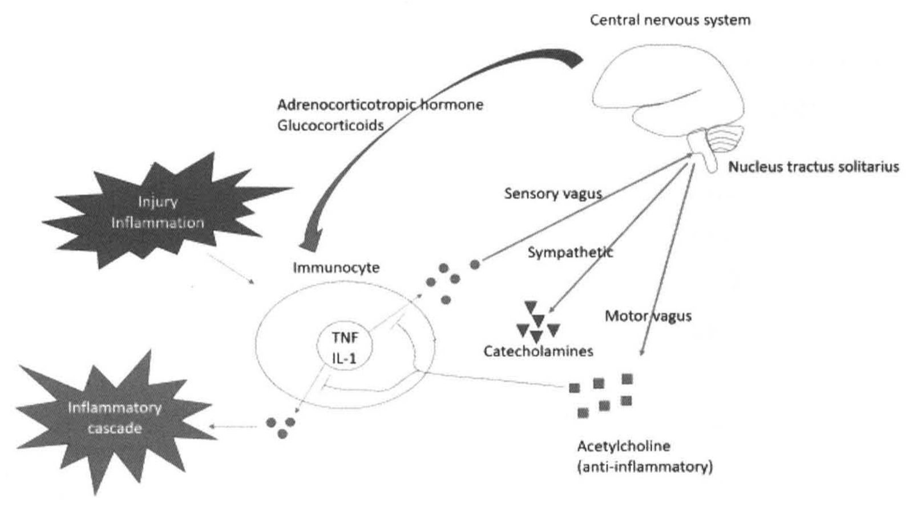
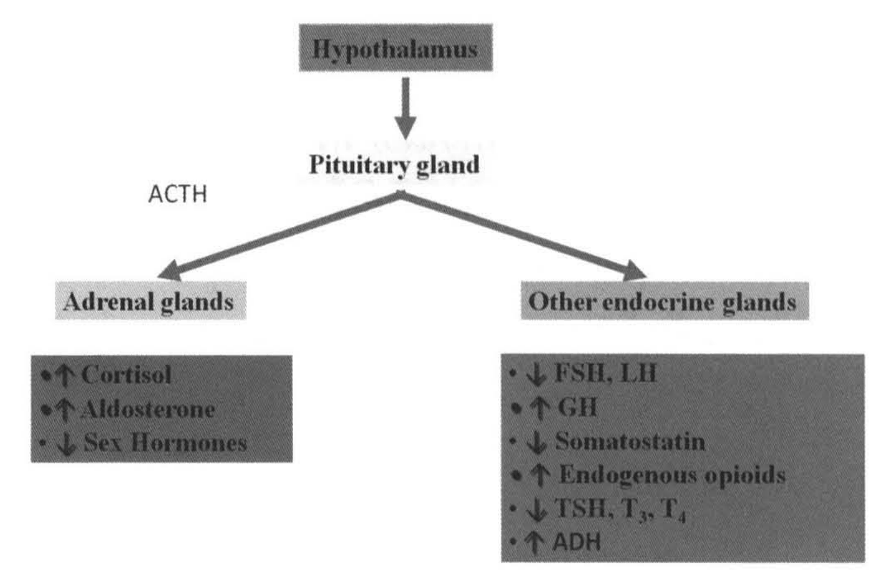
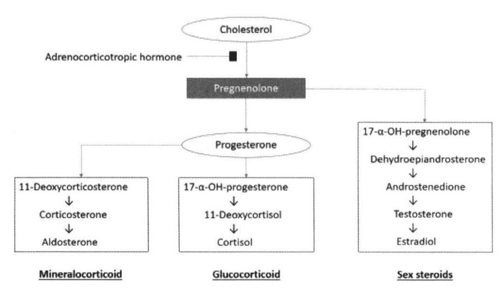
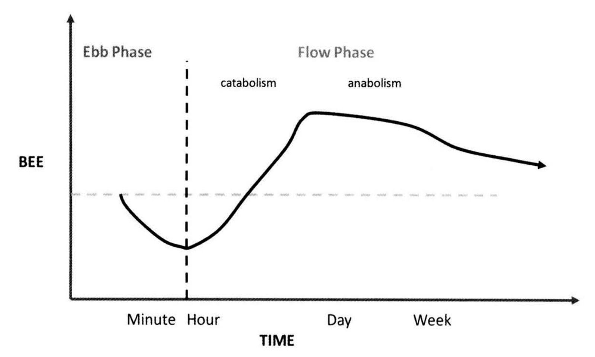
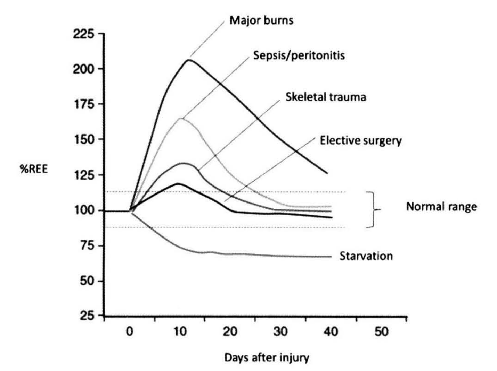
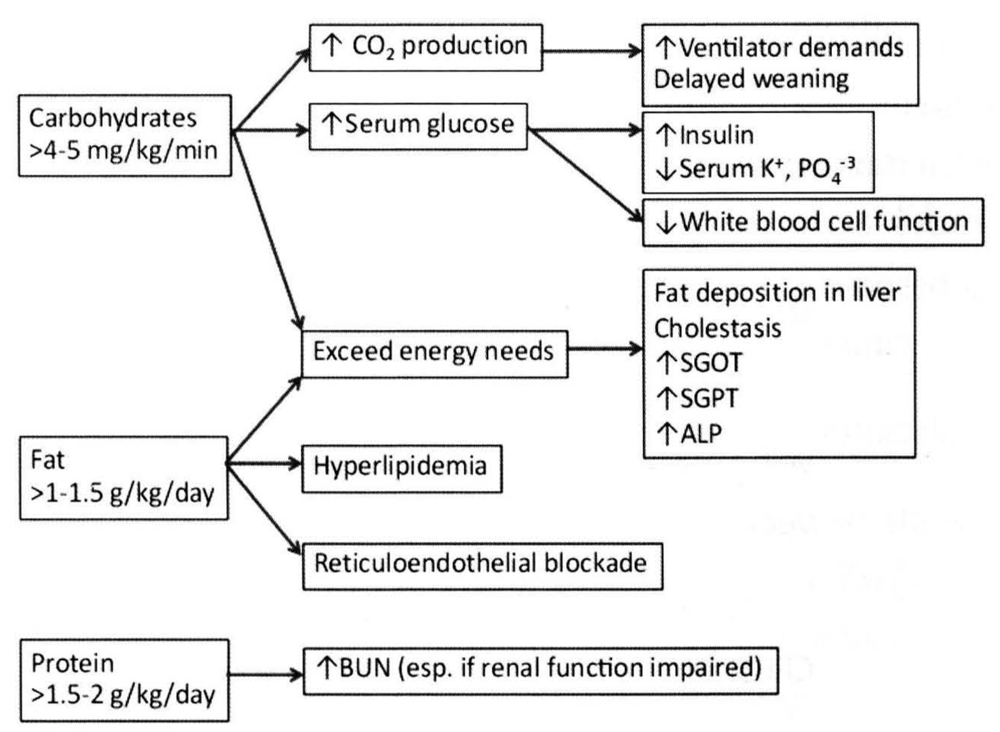
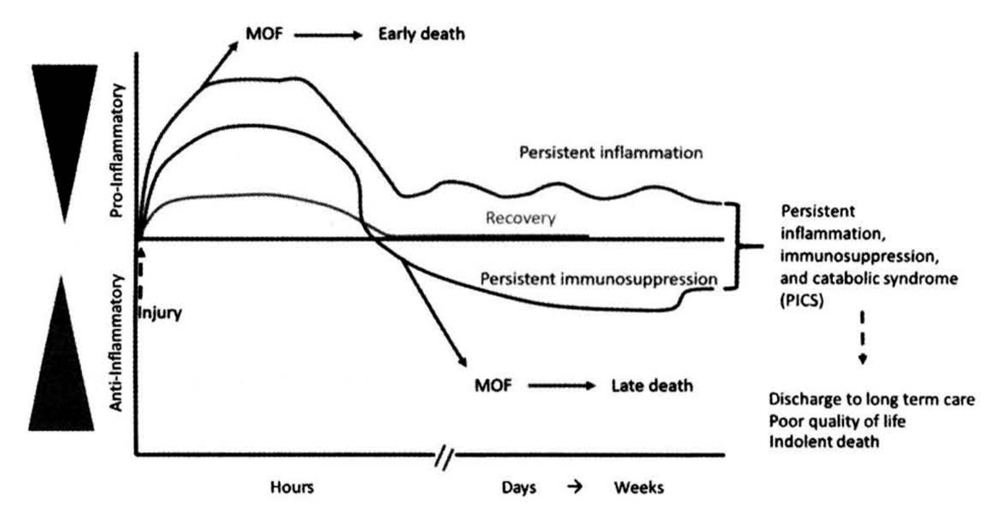
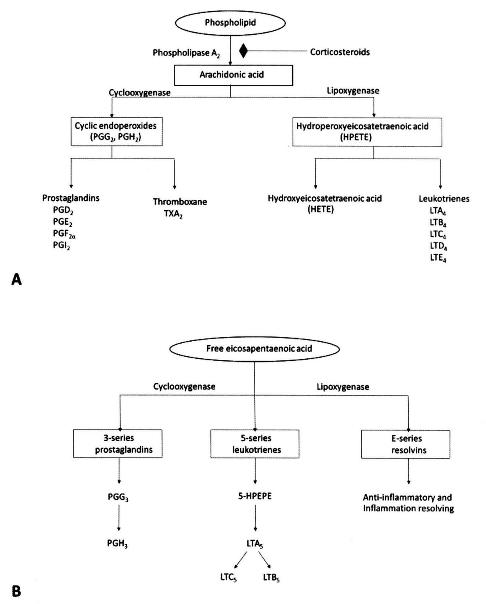
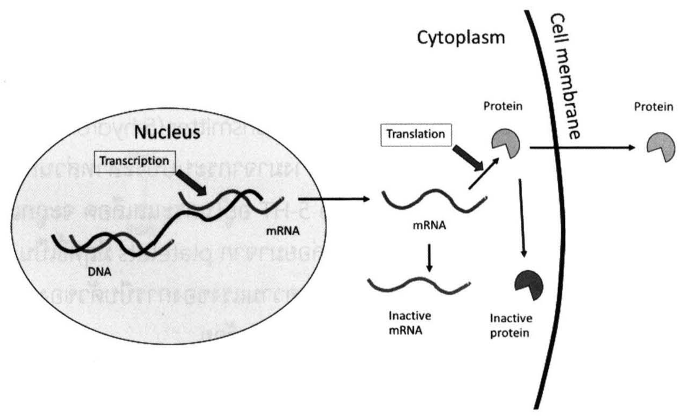
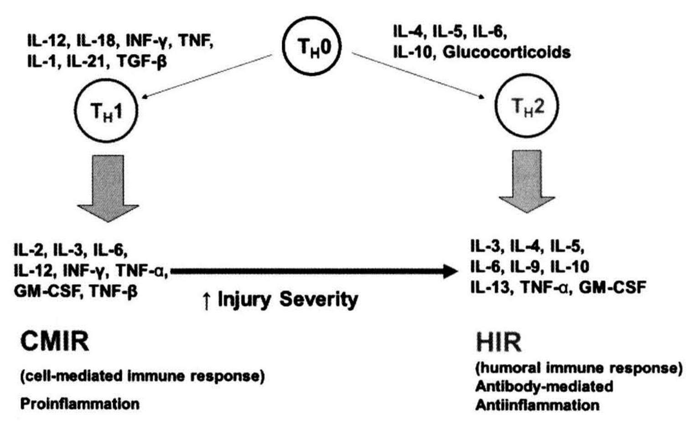

# การตอบสนองของร่างกายต่อการบาดเจ็บ (Systemic response to injury)

## Contents of this file
- Central nervous system (p.46)
- Hormonal system (p.47)
- Metabolic system (p.51)
- Immunologic system (p.66)
- Multiple organ failure (p.77)
- เอกสารอ้างอิง (p.85)

<!-- p.45 (printed none) -->
**การตอบสนองของร่างกาย**
**ต่อการบาดเจ็บ**
**Systemic response to injury**
ศุภฤกษ์ ปรีชายุทธ

<!-- p.46 (printed 32) -->
**การตอบสนองของร่างกายต่อการบาดเจ็บ**
**Systemic response to injury**
ศุภฤกษ์ ปรีชายุทธ

เมื่อร่างกายมีการบาดเจ็บจากสาเหตุต่างๆ ไม่ว่าจะเป็นการติดเชื้อ อุบัติเหตุ การผ่าตัด หรือการอักเสบ ร่างกายจะเกิดการตอบสนองขึ้นทั้ง local และ systemic เพื่อต่อสู้กับการบาดเจ็บนั้นๆ เพื่อรักษาสมดุลร่างกาย (homeostasis) เพื่อเอาชีวิตรอด ซึ่งการตอบสนองนี้ถ้าเกิดขึ้นแต่พอดี ผู้ป่วยมักจะต่อสู้กับโรคและรอดชีวิตได้ แต่ถ้าการตอบสนองผิดปกติไป เช่น มีการตอบสนองที่มากเกินไป จะทำให้ผู้ป่วยเกิด systemic inflammation, remote organ damage และ multiple organ failure ทำให้ผู้ป่วยเสียชีวิตได้ ซึ่งพบได้มากถึง 30% ในผู้ป่วยที่มีการบาดเจ็บรุนแรง1-2 การตอบสนองของร่างกายต่อการบาดเจ็บแบ่งได้ตามระบบต่างๆ ดังนี้

1. Central nervous system
2. Hormonal system
3. Metabolic system
4. Immunologic system

## Central nervous system1-2

เมื่อมีการบาดเจ็บเกิดขึ้นจะมีสิ่งกระตุ้นต่อระบบประสาทส่วนกลางมากมาย ได้แก่ ความเจ็บปวดที่รับผ่านทาง pain fiber, inflammatory cytokines ที่รับผ่านทาง sensory vagus, การเปลี่ยนแปลงของความดันโลหิต ปริมาณเลือดและเกลือแร่ในร่างกาย และอุณหภูมิกายที่รับผ่านทาง baroreceptor, chemoreceptor และ thermoreceptor ซึ่งสิ่งกระตุ้นเหล่านี้ เช่น inflammatory cytokines จะทำให้เกิดอาการต่างๆ เช่น

<!-- p.47 (printed 33) -->
อ่อนเพลีย ง่วงนอนมากขึ้น ลดความอยากอาหาร และเกิดไข้ได้ นอกจากนี้ระบบประสาทจะมีการตอบสนองผ่านทาง hypothalamic pituitary adrenal (HPA) axis และประสาทอัตโนมัติ (autonomic nervous system-ANS) ทั้ง sympathetic ANS (เพิ่ม blood pressure และ heart rate โดย catecholamine) และ parasympathetic ANS (ช่วยควบคุมการอักเสบไม่ให้รุนแรงจนเกินไป) ดังแสดงในรูปที่ 1 ในทางคลินิกการให้ adequate pain control กับผู้ป่วยจะช่วยลด excessive ANS response ได้

> **Caption (verbatim):** **รูปที่ 1** Inflammatory reflex : TNF = Tumor necrotic factor, IL-1 = Interleukin-1
> **Text in image (verbatim):** Central nervous system · Adrenocorticotropic hormone · Glucocorticoids · Nucleus tractus solitarius · Injury · Inflammation · Sensory vagus · Sympathetic · Immunocyte · TNF · IL-1 · Motor vagus · Catecholamines · Inflammatory cascade · Acetylcholine · (anti-inflammatory)
> **Description:** Schematic diagram of the inflammatory reflex. At upper right is a line drawing of the brain with brainstem and cerebellum labelled "Central nervous system", with the brainstem point labelled "Nucleus tractus solitarius". A thick curved black arrow runs from the brain down-left to an oval cell labelled "Immunocyte", with the arrow labelled "Adrenocorticotropic hormone / Glucocorticoids". A dark star-shaped burst at left labelled "Injury Inflammation" has a thin arrow pointing to the immunocyte. Inside the immunocyte is a small circle labelled "TNF IL-1"; thin arrows lead from it to scattered dots: one group of dots (upper right of the cell) is connected by a line labelled "Sensory vagus" going up to the nucleus tractus solitarius (signal to the brain), and another group of dots (lower left) leads by an arrow to a second dark star burst labelled "Inflammatory cascade". From the nucleus tractus solitarius two arrows descend: one labelled "Sympathetic" to a cluster of triangles labelled "Catecholamines", and one labelled "Motor vagus" to a cluster of squares labelled "Acetylcholine (anti-inflammatory)". A line from the acetylcholine squares returns to the immunocyte and ends in an inhibitory (T-bar) mark on the pathway from TNF/IL-1, and a similar inhibitory mark appears on the pathway toward the dots, indicating inhibition of TNF/IL-1 release.
> **Identifiers in image:** none

## Hormonal system1-4

1. Hypothalamic pituitary adrenal (HPA) axis ในการตอบสนองต่อการบาดเจ็บจะพบ hormone กลุ่ม stress hormone ซึ่งมีความจำเป็นต่อร่างกายในภาวะที่มีการบาดเจ็บเพิ่มขึ้น ดังแสดงในรูปที่ 2

<!-- p.48 (printed 34) -->

> **Caption (verbatim):** **รูปที่ 2** Hypothalamic pituitary adrenal (HPA) axis response to injury ACTH = Adrenocorticotropic hormone, FSH = follicle-stimulating hormone, LH = luteinizing hormone, GH = growth hormone, TSH = thyroid stimulating hormone, ADH = antidiuretic hormone
> **Text in image (verbatim):** Hypothalamus · Pituitary gland · ACTH · Adrenal glands · Other endocrine glands · ↑ Cortisol · ↑ Aldosterone · ↓ Sex Hormones · ↓ FSH, LH · ↑ GH · ↓ Somatostatin · ↑ Endogenous opioids · ↓ TSH, T3, T4 · ↑ ADH
> **Description:** Flow diagram. A dark box "Hypothalamus" at the top has a downward arrow to "Pituitary gland". From the pituitary gland two arrows branch: the left arrow, labelled "ACTH", goes to a light box "Adrenal glands", below which a dark box lists the adrenal changes: ↑ Cortisol, ↑ Aldosterone, ↓ Sex Hormones. The right arrow goes to a box "Other endocrine glands", below which a dark box lists: ↓ FSH, LH; ↑ GH; ↓ Somatostatin; ↑ Endogenous opioids; ↓ TSH, T3, T4; ↑ ADH. Flow: Hypothalamus → Pituitary gland → (ACTH) → Adrenal glands: ↑ Cortisol, ↑ Aldosterone, ↓ Sex Hormones; Pituitary gland → Other endocrine glands: ↓ FSH, LH, ↑ GH, ↓ Somatostatin, ↑ Endogenous opioids, ↓ TSH, T3, T4, ↑ ADH
> **Identifiers in image:** none

a. Adrenal steroids สร้างมาจาก cholesterol ดังรูปที่ 3 โดย hormone ที่สำคัญ ได้แก่ Cortisol สร้างจากชั้นกลาง (Zona fasciculata) ของ adrenal cortex มีหน้าที่เพิ่ม gluconeogenesis และ serum glucose และลดการอักเสบ (anti-inflammation) ในภาวะ stress นอกจากนี้ cortisol ยังช่วยให้หลอดเลือดตอบสนองต่อ catecholamines ด้วยการหดตัว (vasoconstriction)

> **Caption (verbatim):** **รูปที่ 3** Adrenal steroid synthesis
> **Text in image (verbatim):** Cholesterol · Adrenocorticotropic hormone · Pregnenolone · Progesterone · 11-Deoxycorticosterone · Corticosterone · Aldosterone · 17-α-OH-progesterone · 11-Deoxycortisol · Cortisol · 17-α-OH-pregnenolone · Dehydroepiandrosterone · Androstenedione · Testosterone · Estradiol · Mineralocorticoid · Glucocorticoid · Sex steroids
> **Description:** Flowchart of adrenal steroid synthesis. "Cholesterol" (oval, top) → "Pregnenolone" (dark box); a line from "Adrenocorticotropic hormone" ends at a small black square on the Cholesterol → Pregnenolone arrow, indicating ACTH acts at this step. From Pregnenolone, one arrow goes down to "Progesterone" (oval) and another goes right to a box (Sex steroids pathway): 17-α-OH-pregnenolone → Dehydroepiandrosterone → Androstenedione → Testosterone → Estradiol, labelled underneath "Sex steroids". From Progesterone, one arrow goes left-down to a box: 11-Deoxycorticosterone → Corticosterone → Aldosterone, labelled "Mineralocorticoid"; another goes straight down to a box: 17-α-OH-progesterone → 11-Deoxycortisol → Cortisol, labelled "Glucocorticoid". The three class labels are bold and underlined. Flow: Cholesterol →(Adrenocorticotropic hormone acts here) Pregnenolone → Progesterone → [11-Deoxycorticosterone → Corticosterone → Aldosterone] = Mineralocorticoid; Progesterone → [17-α-OH-progesterone → 11-Deoxycortisol → Cortisol] = Glucocorticoid; Pregnenolone → [17-α-OH-pregnenolone → Dehydroepiandrosterone → Androstenedione → Testosterone → Estradiol] = Sex steroids
> **Identifiers in image:** none

<!-- p.49 (printed 35) -->
b. Antidiuretic hormone (ADH, vasopressin) สร้างจาก hypothalamus มาเก็บไว้ที่ posterior pituitary gland มีหน้าที่ทำให้เกิด vasoconstriction และเพิ่มการดูดซึมน้ำกลับทาง collecting tubule ของไต โดยการสร้าง ADH จะถูกกระตุ้นโดยภาวะ volume depletion ภาวะที่มี ADH หลั่งมามากเกินไป เรียกว่า syndrome of inappropriate ADH secretion (SIADH) ทำให้ผู้ป่วยมี hyponatremia ในทางตรงข้าม ในผู้ป่วยที่มี hypothalamic failure เช่น มี severe head injury จะพบการขาดของ ADH ทำให้เกิด diabetic insipidus และ hypernatremia

c. Growth hormone (GH) สร้างโดย anterior pituitary gland ในภาวะ stress มีหน้าที่เกี่ยวกับ metabolism (promote protein synthesis, insulin resistance, mobilization of fat stores ผ่านทาง insulin-like growth factor ที่สร้างจากตับ) และ immune system (enhance phagocytic activity, T-cell proliferation) การสร้าง GH ถูกกระตุ้นโดย hypothalamic GH-releasing hormone และ Ghrelin (hormone กระตุ้นความอยากอาหารที่สร้างจากกระเพาะอาหาร) และถูกยับยั้งโดย somatostatin

2. Hormone under autonomic control

a. Catecholamines สร้างมาจาก adrenal medulla โดยมีสารตั้งต้นคือ tyrosine ประกอบด้วย dopamine, norepinephrine (NE- กระตุ้น α1 receptor ทำให้เกิด vasoconstriction) และ epinephrine (EPI- กระตุ้น α และ β receptor ทำให้เกิด vasoconstriction และ inotropic effect) โดย NE จะถูกสร้างจาก axon terminals ของ sympathetic postganglionic neurons ได้ด้วย และ NE จะถูกเปลี่ยนเป็น EPI โดย phenylethanolamine *N*-methyltransferase (PNMT) ในภาวะ stress จะพบ circulating catecholamine สูงขึ้นได้ถึง 3-4 เท่า ของภาวะปกติ ผลอื่นๆ ของ catecholamine นอกจาก hemodynamic effect ได้แก่ การเพิ่ม metabolism และระดับ glucose ในเลือด (increase gluconeogenesis, glycogenolysis และ lipolysis) และมีผล immune modulation อีกด้วย (decrease inflammation)

b. Glucagon สร้างจาก α cell ของตับอ่อน จะมีระดับเพิ่มขึ้นในภาวะ stress ทำหน้าที่ promote catabolism เพื่อเพิ่ม glucose ในเลือด (increase

<!-- p.50 (printed 36) -->
gluconeogenesis, glycogenolysis, lipolysis และ protein break down) เป็น counter-regulatory hormone ของ Insulin

c. Insulin สร้างจาก β cell ของตับอ่อน ทำหน้าที่ promote anabolism ลดระดับ glucose ในเลือด ซึ่ง insulin จะมีระดับลดลงในภาวะ stress

d. Aldosterone สร้างจากชั้นนอก (Zona glomerulosa) ของ adrenal cortex มีหน้าที่ทำให้เกิด salt and water retention โดยเพิ่มการดูดซึม Na+, Cl- และน้ำ กลับทาง distal convoluted tubule ของไต ถูกควบคุมโดย Renin-Angiotensin-Aldosterone system (RAAS) เป็นหลัก (มากกว่า ACTH) โดยการสร้าง aldosterone จะถูกกระตุ้นโดยภาวะ salt and water depletion และการที่เลือดไปไตน้อยลง เป็น stress hormone ที่มีความจำเป็นอย่างมากในภาวะ stress

3. ภาวะ Adrenal shock ผู้ป่วย adrenal insufficiency นั้นมีฮอร์โมน cortisol และ aldosterone ไม่เพียงพอที่จะตอบสนองต่อภาวะ stress ต่างๆ (Trauma, Surgery, Infection) ทำให้ผู้ป่วยเข้าสู่ภาวะ shock ได้ง่ายเมื่อมี stress เราควรสงสัย adrenal shock ในผู้ป่วยที่ไม่พบสาเหตุอื่นของ shock ชัดเจน และไม่ตอบสนองต่อการรักษาด้วยสารน้ำ หรือ inotropic drugs กลไกการ shock เกิดจากการสูญเสียน้ำและ sodium จากการขาด aldosterone และ vascular tone ที่ลดลงจากการขาด cortisol

a. Serum cortisol <u>ไม่</u>สามารถใช้วินิจฉัย adrenal insufficiency ได้อย่างแม่นยำ

b. หากผู้ป่วยมีสัญญาณชีพ<u>ไม่</u>คงที่ และสงสัยว่าอาจมี adrenal insufficiency ให้ส่งตรวจระดับ cortisol และให้การรักษาด้วย hydrocortisone ทันทีโดยไม่ต้องรอผล ถ้า serum cortisol ต่ำกว่า 15 µg/dL ในผู้ป่วยวิกฤติ (shock) เราอาจวินิจฉัยภาวะ adrenal insufficiency ได้เลย

c. Treatment

i. ในผู้ป่วยสัญญาณชีพไม่คงที่และสงสัยภาวะนี้ ให้การรักษาทันทีโดยไม่ต้องรอผลการตรวจ (ในปัจจุบันยังไม่มีระดับ serum cortisol ที่ใช้วินิจฉัยหรือ rule out adrenal insufficiency ในผู้ป่วยวิกฤติที่ชัดเจน ดังนั้นการตัดสินใจว่าจะให้ steroid ต่อไปหรือไม่ จึงควรขึ้นกับความสงสัยและการตอบสนองต่อ steroid ของผู้ป่วย มากกว่าการดูระดับ cortisol เพียงอย่างเดียว)

<!-- p.51 (printed 37) -->
ii. ให้ steroid โดยมักใช้ Hydrocortisone 100 mg intravenous (IV) ทุก 8 ชั่วโมง เพราะเป็นยามีผลทั้ง Glucocorticoid และ Mineralocorticoid

iii. ให้สารน้ำจนเพียงพอ ควรเลือกสารน้ำเป็น 5% dextrose in Normal saline เพื่อแก้ทั้งภาวะขาดน้ำ ขาด sodium และ hypoglycemia แต่ในกรณีที่ต้อง load fluid เร็วๆ เพื่อรักษา hypotension ควร load ด้วย Normal saline แทน

iv. หาและรักษา precipitating factors (trauma, bleeding, infection เป็นต้น)

## Metabolic system1, 2, 5

1. แบ่งการตอบสนองทาง Metabolism ต่อการบาดเจ็บเป็น 2 phase คือ Ebb phase และ Flow phase ดังรูปที่ 4

a. Ebb phase (decrease energy expenditure, occurs immediately after injury/shock)

Inadequate resuscitation → death

Adequate resuscitation → flow phase

b. Flow phase (increase energy expenditure)

i. Catabolic phase (hours to days, increase catecholamine, cortisol, glucagon)

ii. Anabolic phase (days to weeks, increase insulin)

1. Early (corticoid withdrawal phase, diuresis, increased appetite)

2. Late (restoration of adipose tissue and muscle, positive nitrogen balance)

<!-- p.52 (printed 38) -->

> **Caption (verbatim):** **รูปที่ 4** Metabolic phase of injury, BEE = Basal energy expenditure
> **Text in image (verbatim):** Ebb Phase · Flow Phase · catabolism · anabolism · BEE · Minute · Hour · Day · Week · TIME
> **Description:** Schematic line graph (no numeric scale). Y-axis labelled "BEE" (basal energy expenditure); X-axis labelled "TIME" with qualitative marks Minute, Hour, Day, Week. A faint horizontal dashed line marks baseline BEE. A vertical dashed line at "Hour" separates the "Ebb Phase" (left) from the "Flow Phase" (right); the Flow Phase is subdivided by the labels "catabolism" (earlier) and "anabolism" (later). The solid curve starts at baseline around "Minute", dips below baseline to its lowest point at the Ebb/Flow boundary (Hour), then rises steeply above baseline to a peak plateau around "Day" (catabolism), and then gradually declines through "Week" (anabolism), still above baseline, ending in an arrowhead pointing right.
> **Identifiers in image:** none

2. Metabolic response to fasting

a. ในผู้ใหญ่ ระหว่างการอดอาหาร ร่างกายต้องการพลังงานวันละ 22-25 kcal/kg/day เพื่อจะ maintain basal metabolic needs

b. ในวันแรกของการอดอาหาร ร่างกายจะใช้ glucose ที่สร้างได้เร็วจากการสลาย glycogen ที่ตับ (glycogenolysis) เป็นแหล่งพลังงานหลัก ซึ่งมักจะหมดไปภายใน 24 ชั่วโมง

c. หลังจาก glycogen ที่ตับหมดลงไป ร่างกายจำเป็นต้องสร้าง glucose ขึ้นมาใหม่ เพื่อใช้เป็นพลังงาน (gluconeogenesis) โดยสร้างจาก

i. Protein break down ได้ Alanine ซึ่งจะกลับไปเปลี่ยนเป็น glucose ที่ตับ (Glucose-alanine cycle)

ii. Lactate ซึ่งเกิดจาก anaerobic metabolism ก็สามารถกลับไปเปลี่ยนเป็น glucose ที่ตับได้ (Cori cycle)

iii. Lipolysis ไขมันในร่างกาย เป็นแหล่งพลังงานหลักระหว่างอดอาหาร (>40%) ด้วยอิทธิพลของ stress hormone ต่างๆ ทำให้มีการสลาย triglyceride จะได้

<!-- p.53 (printed 39) -->
1. Glycerol ซึ่งจะกลับไปเปลี่ยนเป็น glucose ที่ตับ

2. Fatty acid ซึ่งส่วนมาก (75%) จะถูกใช้เป็นพลังงานได้โดยตรงในบางอวัยวะ (heart, kidney และ muscle) ส่วนน้อย (25%) จะกลับไปเปลี่ยนเป็น ketone ที่ตับ และถูกใช้เป็นพลังงานได้เช่นกัน

d. Long term fasting (มากกว่า 5 ถึง 7 วัน)

i. จะมีการลดการสลาย protein และเพิ่มการสลายไขมัน (lipolysis)

ii. จะมีการลดการใช้พลังงานจาก glucose และเพิ่มการใช้พลังงานจาก fatty acid และ ketone โดยสมองจะปรับตัวให้สามารถใช้ ketone เป็นแหล่งพลังงานได้ด้วย (ketoadaptation)

iii. นอกจากตับแล้ว Renal cortex สามารถใช้ amino acid มาสร้าง glucose ได้ด้วย (gluconeogenesis)

e. ในทางปฏิบัติการให้ glucose ในคนไข้ที่อดอาหารเพียงวันละ 400 Kcal/day ผ่านทาง peripheral IV (เช่น การให้ 5% Dextrose วันละ 2 ลิตร) จะช่วยกระตุ้นการหลั่ง insulin และช่วยลด protein break down ได้ถึง 50% (Protein sparing effect) ซึ่งมักจะเพียงพอแล้วในผู้ป่วยที่ไม่ได้มีภาวะ malnutrition มาก่อน และเราวางแผนจะให้ผู้ป่วยกินอาหารในเวลาอันใกล้ ถ้าต้องการ protein sparing effect ที่สมบูรณ์ 100% จะต้องให้ glucose 100-150 kcal ต่อ protein 1 g nitrogen หรือประมาณเท่ากับ total daily calorie requirement (โดย gram protein /6.25 = gram Nitrogen) ซึ่งก็คือการให้ Total Parenteral Nutrition (TPN) นั่นเอง ซึ่งการให้ TPN เป็น routine ในผู้ป่วยที่ NPO ทุกคนนั้นไม่ practical และอาจเป็นอันตรายได้

3. Metabolic response to injury ข้อแตกต่างจาก fasting ได้แก่

a. จะมีการใช้พลังงานที่มากกว่า fasting โดยขึ้นกับความรุนแรงของ stress (maximum in burn and sepsis) ดังรูปที่ 5 ทำให้ glycogen ที่ตับ (glycogenolysis) จะหมดไปภายในเวลาไม่กี่ชั่วโมง

<!-- p.54 (printed 40) -->
b. พลังงานหลักจะได้จาก Gluconeogenesis ที่เกิดจาก lipolysis และ protein break down ซึ่งการให้ IV glucose ในกรณีนี้จะไม่สามารถลด protein break down ในระยะแรกๆ ได้

c. Triglyceride จาก lipolysis เป็นแหล่งพลังงานหลักภายหลังการบาดเจ็บ (50-80%)

> **Caption (verbatim):** **รูปที่ 5** Resting energy expenditure (REE) during stress conditions
> **Text in image (verbatim):** 225 · 200 · 175 · 150 · 125 · 100 · 75 · 50 · 25 · %REE · 0 · 10 · 20 · 30 · 40 · 50 · Days after injury · Major burns · Sepsis/peritonitis · Skeletal trauma · Elective surgery · Normal range · Starvation
> **Description:** Line graph. Y-axis "%REE" from 25 to 225 (ticks every 25); X-axis "Days after injury" from 0 to 50 (ticks every 10). A flat line at 100% runs from the left edge to day 0. Two faint horizontal dotted lines (roughly 88% and 113%) bound a bracket labelled "Normal range". From day 0 five curves diverge: "Major burns" rises steeply to a peak of about 205% around day 12, then declines roughly linearly to about 125% at day 40 (still above normal). "Sepsis/peritonitis" peaks at about 165% around day 10, then falls to just above 100% by about day 35-40. "Skeletal trauma" peaks at about 133% around day 10 and returns to about 100% by about day 30. "Elective surgery" peaks at about 118% around day 10 and returns to about 100% by day 20, ending slightly below 100% (about 95%) at day 40. "Starvation" falls below baseline, from 100% to about 72% by day 10, and then levels off at about 67-70% through day 40, below the normal range. Values are read from the graph and approximate.
> **Identifiers in image:** none

4. Nutrition support in surgical patients

a. Goal : to prevent or reverse the catabolic effects of disease or injury.

b. Indications

i. Malnutrition

ii. Expected inadequate intake for >7 days

c. Timing : Nutrition support should be started as soon as possible when patients are **hemodynamically stable** and have no contraindications.

<!-- p.55 (printed 41) -->
d. Enteral nutrition (EN)

i. EN is the preferred route and should be used whenever possible because EN : 1) preserves gut integrity, 2) preserves immunological function of gut/decreases bacterial translocation, 3) preserve hepatic function, 4) may act as agonists for endogenous neuroendocrine anti-inflammatory pathways via vagal pathway, 5) reduces costs and, 6) has fewer complications than parenteral nutrition.

ii. การให้ EN นั้นจึงถือว่าเป็นการป้องกันการติดเชื้อ (infectious control) ที่ได้ผลดีมากใน ICU ทั้งในแง่การป้องกัน bacterial translocation จากผนังลำไส้ซึ่งอาจนำไปสู่ unexplained sepsis และหลีกเลี่ยงการเกิด catheter sepsis ที่พบร่วมกับการให้ parenteral nutrition ได้อีกด้วย

iii. Contraindications of EN

1. Hemodynamic instability → EN can induce gut ischemia.

2. Ileus or gut obstruction

3. High output enterocutaneous fistula (in an early phase)

4. Active GI bleeding

5. Peritonitis (เช่น intestinal ischemia, severe acute pancreatitis ในระยะแรก)

iv. Gastric feeding ทำได้ง่ายผ่านทาง Nasogastric (NG) tube และสามารถให้อาหารเป็น bolus dose ได้ จึงเป็นที่นิยม แต่ในผู้ป่วยที่ GI function ยังไม่ดีพอ หากเราเริ่มให้ EN เร็วเกินไปจะเพิ่มความเสี่ยงของการสำลักอาหารสูงขึ้น จึงมีการนำ Gastric Residual Volume (GRV) มาช่วยพิจารณาในการหยุดให้ EN โดยดูดของเหลวที่เหลือในกระเพาะอาหารเพื่อวัดปริมาณหลังจากให้ EN 4 ชั่วโมง จากงานวิจัยต่างๆ พบว่าปริมาณที่ยอมรับได้อยู่ที่ GRV ที่น้อยกว่า 200 ml ใน 4-6 ชั่วโมง จึงจะสามารถให้อาหารมื้อต่อไปได้อย่างปลอดภัย

<!-- p.56 (printed 42) -->
อย่างไรก็ตามควรใช้ NG tube ให้อาหารแค่ระยะสั้นเท่านั้น เพราะมีความเสี่ยงต่อ aspiration และ nasopharyngeal complication ถ้าต้องให้อาหารทาง NG tube มากกว่า 30 วัน ควรเปลี่ยนไปใช้ percutaneous feeding แทน เช่น gastrostomy

v. Post pyloric/small bowel feeding อาจทำได้โดยการใส่ท่อผ่าน pylorus ลงไปใน duodenum/jejunum หรือทำโดยการผ่าตัด (jejunostomy) ในผู้ป่วยที่มีการทำงานของกระเพาะอาหารปกติ พบว่า small bowel feeding ช่วยลด aspiration ได้ 25% เทียบกับ NG feeding อย่างไรก็ตามการใส่ท่อลงลำไส้เล็กทำได้ยากกว่า gastric feeding และการให้อาหารต้องให้แบบ continuous drip ช้าๆ จึงควรพิจารณาใช้เป็นรายๆ ไป เช่น ในรายที่มี impaired gastric emptying หรือมี duodenal fistula เป็นต้น

**vi. Feeding regimen**

- Bolus q 6-8 hr in gastric feeding

- Determine GRV→ if >200-250 ml in 4-6 hr after feeding → hold feeding, ± change route (to post pyloric or PN).

- Infuse feeding in small bowel feeding (or in gastric feeding) for 12-16 hr, bowel rest 8-12 hr → decrease malabsorption and diarrhea.

- In small bowel feeding, start with low rate and concentration, and then gradually advance.

- Elevating the head of the bed to 30-40 degrees can reduce risk of aspiration.

e. Parenteral nutrition (PN)

i. Indications

<!-- p.57 (printed 43) -->
1. Patient requires nutrition support, and

2. EN is contraindicated or inadequate (e.g. EN cannot meet >60% of energy and protein requirements after 1 week).

ii. Contraindication : hemodynamic instability → PN can complicate resuscitation.

iii. Route of PN

1. Peripheral veins → Partial PN, concentration should be <650 mOsm/L (เพื่อหลีกเลี่ยง chemical thrombopheblitis)

2. Central veins → Total PN (TPN), hypertonic solution is needed (e.g. >12.5% dextrose, 700 mOsm/L) → ต้องให้ผ่านทาง central line

f. Calories

i. Calories requirement เริ่มจากการคิด Basal Energy Expenditure (BEE) โดยใช้

1. Harris-Benedict Equation : sex, weight, height, and age

Male BEE kcal/day = 66.47 + 13.7 (kg) + 5 (cm) - 6.76 (years)

Female BEE kcal/day = 66.51 + 9.56 (kg) + 1.85 (cm) - 4.68 (years)

2. เราอาจประมาณค่า BEE ได้ง่ายๆ โดย BEE = 25 X weight (in kg)

3. BEE จะสูงขึ้นใน stressed conditions เช่น

Fever : BEE X 1.1 for 1°C above normal body temperature

Mild stress : BEE X 1.2, Moderate stress : BEE X 1.4, Severe stress : BEE X 1.6, Severe burn : BEE X 2

<!-- p.58 (printed 44) -->
4. หลังจากได้ BEE แล้วก็นำมาคิด Resting Energy Expenditure (REE)

REE = 1.2 X BEE = ประมาณ 30 kcal/kg in normal condition

กล่าวโดยสรุป เราจะใช้วิธีคำนวณข้างต้นเพื่อหาค่า Calories requirement ก็ได้ หรืออาจใช้วิธีประมาณคร่าวๆ เช่น **ใช้ค่า 25-30 kcal/kg (ideal body weight)/day** เป็น daily calories requirement ก็ได้ และปรับค่าเพิ่มหรือลดตาม stress และ nutritional status ของผู้ป่วยอีกที

ii. สำหรับสารอาหารที่จะนำมาคิด Calories requirement นั้น เราควรใช้เฉพาะ Non protein calories (NPC) ได้แก่ carbohydrates (50-70%) และ lipid (30-50%) เท่านั้น เนื่องจากจุดประสงค์หลักในการให้ protein ในผู้ป่วยก็เพื่อให้เกิด positive nitrogen balance ไม่ใช่ให้ protein แตกสลายเป็นพลังงานทั้งหมด

iii. Carbohydrates โดยทั่วไปให้พลังงาน 4 kcal/gram แต่ถ้าเป็น dextrose monohydrate ซึ่งใช้ใน intravenous form จะให้พลังงาน 3.4 kcal/gram มักใช้ carbohydrates เป็นแหล่งพลังงานหลัก (50-70% ของ NPC) เนื่องจากราคาถูก แต่ควรพิจารณาลดสัดส่วนของ carbohydrates ลงในผู้ป่วยบางกลุ่ม เช่น ผู้ป่วยที่มี hyperglycemia หรือผู้ป่วย chronic obstructive pulmonary disease (COPD) ที่มี carbon dioxide (CO2) คั่ง

iv. Lipid การให้ไขมันมีเหตุผลหลักสองอย่าง คือ เป็นส่วนหนึ่งของสารที่ให้พลังงาน (30-50% ของ NPC) โดยไขมันให้พลังงาน 9 kcal/gram และให้เพื่อป้องกัน essential fatty acid deficiency ได้แก่ linoleic (omega-6) และ linolenic acid (omega-3) ซึ่งการขาดกรดไขมันเหล่านี้ทำให้เกิด scaly dermatitis, cardiac dysfunction และยังทำให้ผู้ป่วยเสี่ยงต่อการติดเชื้อได้ง่ายขึ้น นอกจากนี้ fatty acid บางชนิดยังช่วยลดการสร้าง inflammatory mediator ได้ เช่น omega-3 พบว่า การให้ omega-3 polyunsaturated fatty acids (PUFA) ที่พบมากใน fish oil ช่วยลดอัตราการเสียชีวิตและอัตราการใช้เครื่องช่วยหายใจในผู้ป่วยวิกฤติได้ โดยเชื่อว่า fish oil นั้นมีผล anti-inflammatory, antioxidant และ immunologic properties อย่างไรก็ตาม

<!-- p.59 (printed 45) -->
metabolite ของ fatty acid บางชนิด กลับมีส่วนเพิ่ม inflammatory process เช่น omega-6 ซึ่งพบมากใน soybean oil

1. Intravenous (iv) lipid emulsion ที่มีใช้กันอยู่ในรูปของสารละลาย เช่น 10% และ 20% intralipid ซึ่งผลิตจาก soybean และ 20% SMOF lipid ที่มีส่วนประกอบของ fish oil ด้วย ซึ่ง iv lipid emulsion นั้นต่างจาก carbohydrates และ protein คือไม่ก่อให้เกิด chemical thrombopheblitis เมื่อให้ในความเข้มข้นสูง (isotonic to plasma) จึงสามารถให้ผ่านทาง peripheral vein ได้ เนื่องจาก intravenous lipid มี glycerol และ phospholipid ผสมอยู่ด้วย จึงให้พลังงานมากกว่า pure fat เช่น 10% lipid จะให้พลังงาน 1.1 kcal/ml และ 20% lipid จะให้พลังงาน 2 kcal/ml เป็นต้น

2. การให้สัดส่วนของ Lipid เพิ่มขึ้น (เช่น 50% ของ NPC) มีที่ใช้ในผู้ป่วยเบาหวานเพื่อทำให้ glycemic control ทำได้ง่ายขึ้น ผู้ป่วยที่ต้องการจำกัดปริมาณสารน้ำเนื่องจาก lipid ให้พลังงานมากกว่าในปริมาตรที่น้อยกว่า carbohydrates และผู้ป่วย COPD ตามหลักของ Respiratory Quotient (RQ) = CO2 production/O2 consumption

Lipid = 0.7 (produces less CO2)

Protein = 0.8

Glucose = 1.0 (produces more CO2)

3. Contraindications ของการให้ iv lipid emulsion

i. Hyperlipidemia, abnormal lipid metabolism โดยระหว่างให้ lipid ควร monitor ระดับ triglyceride เป็นระยะ ถ้าพบว่าสูงกว่า 300-400 mg/dL ควรลดปริมาณ lipid แต่ถ้าสูงกว่า 1,000 mg/dL ควรหยุดให้ lipid

ii. Acute pancreatitis concomitant with/or caused by hyperlipidemia

<!-- p.60 (printed 46) -->
iii. Severe egg allergies

iv. ข้อควรระวังอื่นๆ ได้แก่ liver impairment (เพราะถ้า lipid metabolism เสียไป อาจเกิด hepatic steatosis ได้ จึงควร monitor liver function และ lipid profile อย่างใกล้ชิดในผู้ป่วยกลุ่มนี้), bleeding disorder (lipid อาจทำให้เกิด platelet dysfunction), severe sepsis, severe pulmonary disease (lipid อาจทำให้การมีการสร้าง inflammatory cytokines มากขึ้นทำให้ lung injury เพิ่มขึ้น), Lipid nephrosis (มี heavy proteinuria ร่วมกับ high serum lipid level)

g. Protein

i. Protein is not considered a source of calories in nutrition support. It should be used to maintain the stores of essential enzymatic and structural proteins.

ii. To achieve positive nitrogen balance, protein must be given simultaneously with adequate NPC. If we provide inadequate NPC with protein, protein will be degraded to provide energy.

**To achieve 100% protein sparing effect**

Give NPC 16-24 g : Protein 1 g, or

Give NPC 100-150 g : Nitrogen 1 g

(1 g protein = 6.25 g Nitrogen)

**iii. Protein requirement**

Normal 0.8-1 g/kg

Moderate stress 1-1.5 g/kg

Severe stress 1.5-2 g/kg (especially in severe burn/severe sepsis)

<!-- p.61 (printed 47) -->
Renal failure 0.8 g/kg

ชนิดและปริมาณของ Amino acid ต่างๆ สามารถปรับเปลี่ยนตามสภาพของผู้ป่วยได้ด้วย เช่น การเพิ่มปริมาณ protein ในผู้ป่วย hypercatabolic state, การลดปริมาณ protein และเพิ่มสัดส่วนของ essential amino acid (EAA) ในผู้ป่วยโรคไตวาย เป็นต้น

**iv. Nitrogen (N) balance**

N Balance (g) = Protein intake (g)/6.25-(Urine Urea Nitrogen +4)

ซึ่ง 4 g/d คือ Insensible N loss เช่น N ในอุจจาระ

The goal of N balance is to maintain positive balance of 4-6 g/day

ควรพิจารณา monitor N balance เมื่อคิดว่าผู้ป่วยอยู่ในช่วง Anabolic phase แล้ว ถ้าเราให้พลังงานและ protein ที่เพียงพอแก่ผู้ป่วย จะพบว่าผู้ป่วยจะมี positive N balance

v. Branched-chain amino acid (BCAA) ได้แก่ valine, leucine และ isoleucine พบว่าในภาวะ hepatic encephalopathy ผู้ป่วยมักมีสัดส่วนของ BCAA ลดลงเมื่อเทียบกับ aromatic amino acids (AAA-tyrosine, phenylalanine และ tryptophan) ที่จะเพิ่มมากขึ้น เชื่อว่า AAA ที่เพิ่มขึ้นนั้นจะผ่านเข้าไปยังสมองและทำตัวเป็น false neurotransmitters ทำให้อาการ hepatic encephalopathy แย่ลง อย่างไรก็ตามปัจจุบันยังไม่มีหลักฐานชัดเจนที่แสดงว่าการให้ BCAA สามารถลดอัตราการตายในผู้ป่วย hepatic encephalopathy ได้

vi. Immunonutrients พบว่า amino acids บางตัวมีคุณสมบัตินี้ เช่น Arginine ซึ่งเป็น precursor ของการสร้าง Nitric oxide และช่วยในการหายของแผล และ Glutamine ที่เป็นอาหารของ enterocyte และ immunocytes ต่างๆ และยังเป็น precursor ของการสร้าง glutathione ที่เป็น cellular

<!-- p.62 (printed 48) -->
antioxidant ที่สำคัญ อย่างไรก็ตามปัจจุบันยังไม่มีหลักฐานชัดเจนที่แสดงว่าการให้ immunonutrients สามารถลดอัตราการตายในผู้ป่วย ICU ได้

h. Complications of nutritional support

i. Metabolic complications ได้แก่

1. Hyperglycemia การป้องกัน ได้แก่ Increase glucose concentration in TPN gradually, ให้ insulin นอกจากนี้ hyperglycemia ยังเป็น early sign ของการเกิด catheter infection ด้วย

2. Hypoglycemia มักจะเกิดในช่วง weaning from TPN ที่แพทย์มีการลดความเข้มข้นของ dextrose solution เร็วจนเกินไป การป้องกันได้แก่ Decrease glucose concentration in TPN gradually

**3. Refeeding syndrome**

ได้รับการกล่าวถึงครั้งแรกในช่วงสงครามโลกครั้งที่สอง ซึ่งพบว่านักโทษที่มีภาวะขาดสารอาหาร หลังจากได้รับอาหารในปริมาณมากพบว่ามีความผิดปกติของระบบไหลเวียนโลหิตและระบบประสาทจนเสียชีวิตได้ อธิบายได้จากเมื่อผู้ป่วยได้รับสารอาหารไม่ว่าจากทาง EN หรือ PN และการได้รับของเหลวหรือ sodium ปริมาณมากอย่างรวดเร็ว จะทำให้เกิด volume expansion และ fluid retention จนร่างกายไม่สามารถปรับตัวได้ทัน ส่งผลให้เกิดภาวะหัวใจล้มเหลวได้ นอกจากนี้เมื่อผู้ป่วยได้รับ carbohydrates ในปริมาณมาก ร่างกายจะต้องดูดซึม phosphate กลับเข้าใน cell เพื่อใช้สังเคราะห์ ATP ทำให้ระดับ phosphate ในเลือดต่ำลง ส่งผลให้ระบบประสาทและระบบทางเดินหายใจมีปัญหาได้ นอกจากนี้การเผาผลาญ carbohydrates และการสร้าง cell ใหม่ยังเพิ่มความต้องการของการใช้ magnesium, thiamine และเพิ่มระดับของ insulin ในเลือด ส่งผลให้ระดับ potassium ในเลือดต่ำลง ซึ่งเป็นตัวการสำคัญที่ทำให้เกิดภาวะหัวใจเต้นผิดจังหวะได้ ความผิดปกติของระดับเกลือแร่ที่สามารถพบได้บ่อยคือ hypophosphatemia (96%), hypomagnesemia (51%), hypokalemia (46%), hypocalcemia (27%), hyponatremia (8%) และพบว่าผู้ป่วยเหล่านี้ ส่วนใหญ่จะมีความผิดปกติของระดับเกลือแร่มากกว่า 1 ค่า (71%) ถ้าหากผู้ป่วยอยู่ในกลุ่มเสี่ยงที่จะเกิด Refeeding syndrome

<!-- p.63 (printed 49) -->
ควรเริ่มให้สารอาหารแก่ผู้ป่วยเพิ่มขึ้นอย่างช้าๆ คือ 10 kcal/kg/day และค่อยๆ เพิ่มจนผู้ป่วยได้รับพลังงานตามเป้าหมาย ภายใน 4-7 วัน โดยในผู้ป่วยที่มี BMI <14 kg/m2 หรือไม่ได้รับสารอาหารมานานกว่า 2 สัปดาห์ ควรเริ่มที่ 5 kcal/kg/day ร่วมกับมีการเฝ้าระวังภาวะหัวใจเต้นผิดจังหวะอย่างใกล้ชิด ในส่วนของวิตามิน ต้องเริ่มให้ thiamine และ vitamin อื่นๆ ควบคู่กับการเริ่มให้สารอาหาร โดยเริ่มให้ผู้ป่วยรับประทาน thiamine 200-300 mg/day ร่วมกับ Vitamin B รวม 1-2 tab วันละครั้ง โดยให้อย่างน้อย 10 วัน

4. Metabolic complications อื่นๆ เช่น hyperlipidemia, azotemia, fluid and electrolyte imbalance และ overfeeding syndrome ถ้าให้สารอาหารมากเกินไป ดังรูปที่ 6

> **Caption (verbatim):** **รูปที่ 6** Overfeeding syndrome
> **Text in image (verbatim):** Carbohydrates >4-5 mg/kg/min · ↑ CO2 production · ↑Ventilator demands Delayed weaning · ↑Serum glucose · ↑Insulin ↓Serum K+, PO4-3 · ↓White blood cell function · Exceed energy needs · Fat deposition in liver Cholestasis ↑SGOT ↑SGPT ↑ALP · Fat >1-1.5 g/kg/day · Hyperlipidemia · Reticuloendothelial blockade · Protein >1.5-2 g/kg/day · ↑BUN (esp. if renal function impaired)
> **Description:** Black-and-white box-and-arrow flowchart with three source boxes on the left (Carbohydrates, Fat, Protein) and arrows to their consequences. Flow: (1) Carbohydrates >4-5 mg/kg/min → ↑ CO2 production → ↑Ventilator demands / Delayed weaning; (2) Carbohydrates >4-5 mg/kg/min → ↑Serum glucose → ↑Insulin / ↓Serum K+, PO4-3; (3) ↑Serum glucose → ↓White blood cell function; (4) Carbohydrates >4-5 mg/kg/min → Exceed energy needs; (5) Fat >1-1.5 g/kg/day → Exceed energy needs; (6) Exceed energy needs → Fat deposition in liver / Cholestasis / ↑SGOT / ↑SGPT / ↑ALP (one box); (7) Fat >1-1.5 g/kg/day → Hyperlipidemia; (8) Fat >1-1.5 g/kg/day → Reticuloendothelial blockade; (9) Protein >1.5-2 g/kg/day → ↑BUN (esp. if renal function impaired).
> **Identifiers in image:** none

- Carbohydrates >4-5 mg/kg/min
  - → ↑ CO2 production → ↑Ventilator demands Delayed weaning
  - → ↑Serum glucose
    - → ↑Insulin ↓Serum K+, PO4-3
    - → ↓White blood cell function
  - → Exceed energy needs → Fat deposition in liver Cholestasis ↑SGOT ↑SGPT ↑ALP
- Fat >1-1.5 g/kg/day
  - → Exceed energy needs (same box as above)
  - → Hyperlipidemia
  - → Reticuloendothelial blockade
- Protein >1.5-2 g/kg/day
  - → ↑BUN (esp. if renal function impaired)

ii. Complications of EN

1. Feeding tube dislodgement เราควรตรวจร่างกายเพื่อยืนยันตำแหน่ง NG tube ทุกครั้งก่อนเริ่มให้อาหาร ในกรณีที่ไม่แน่ใจควรส่ง x-ray ปอดยืนยันตำแหน่งท่อก่อนว่าไม่ได้อยู่ในหลอดลม

<!-- p.64 (printed 50) -->
2. Aspiration ลดได้โดยการใช้ feeding regimen

3. Diarrhea อาจเกิดจาก

i. Osmotic diarrhea อาจเกิดจาก sorbitol containing drugs (KCl elixir, acetaminophen elixir, etc), hypertonic feeding (โดยเฉพาะใน small bowel feeding) หรือ malabsorption จากสาเหตุต่างๆ เช่น short bowel syndrome เป็นต้น

ii. Clostridium difficile (antibiotic-associated) enterocolitis

iii. Complications of PN

1. Catheter related เช่น bleeding, pneumothorax, malposition และ venous thrombosis

2. Catheter sepsis (catheter related blood stream infection-CRBSI)

i. ควรสงสัยเมื่อผู้ป่วยมี high spiking fever, sepsis และไม่มี source อื่นที่อธิบายได้

ii. ตำแหน่ง catheter ที่พบ CRBSI ได้มากที่สุดคือ femoral vein รองลงมาคือ internal jugular vein และต่ำที่สุดคือ subclavian vein

iii. พบว่าการใส่ catheter ไว้ยิ่งนาน จะเพิ่มโอกาสการเกิด CRBSI ได้ เช่น 3-7 วัน = 3-5%, >7 วัน = 5-10%

iv. Differential culture → obtain 10 ml blood culture from peripheral vein and central line at the same time จะวินิจฉัย CRBSI เมื่อ

1. Both grow same organism

2. Blood from central line grows ≥3 times CFU greater or ≥2 hours faster than peripheral blood.

<!-- p.65 (printed 51) -->
v. การรักษา ในผู้ป่วยที่มีแค่อาการไข้และเรายังไม่แน่ใจในการวินิจฉัย เราอาจทำ differential culture ร่วมกับการให้ antibiotics แล้วสังเกตอาการได้ แต่ถ้าผู้ป่วยอาการไม่คงที่ (sepsis) เราควร remove catheter และส่งปลายไป culture ร่วมกับการให้ broad spectrum antibiotics และ resuscitation ทันที

3. Gastrointestinal complications

i. ภาวะ liver dysfunction, hepatic steatosis พบได้บ่อยในผู้ป่วยที่ได้รับ TPN เป็นเวลานาน สาเหตุการเกิดไม่ทราบแน่ชัด โดยอาจเกิดจาก overfeeding, การให้ lipid emulsion มากเกินไป โดยเฉพาะในผู้ป่วยที่การทำงานของตับไม่ดีอยู่แล้ว หรือจากการที่ผู้ป่วยไม่ได้รับสารอาหารผ่านทางลำไส้เป็นเวลานาน ทำให้ขาด hepatotrophic effect ของ EN ไป และเกิด bacterial overgrowth ในลำไส้ได้ หรืออาจเกิดจาก Nutrient toxicity ใน TPN (glucose, lipid, phytosterol, magnesium, aluminum) การป้องกันทำโดยหลีกเลี่ยง over feeding และพยายามให้ EN ร่วมด้วย การให้ Cyclic TPN (เช่น หยุดให้ TPN 8 ชั่วโมงต่อวัน) อาจช่วยลด liver dysfunction ได้จากการช่วยลด prolonged insulin hypersecretion ซึ่งจะทำให้เกิด hepatic steatosis ตามมา

ii. gut mucosal atrophy and bacterial translocation

iii. Acalculous cholecystitis จากการที่มี bile stasis นานๆ ในผู้ป่วยที่ไม่ได้รับ EN ร่วมกับ systemic illness ที่ทำให้เกิดภาวะ hypoperfusion, gall bladder ischemia และ infection ตามมา การรักษาคือการทำ cholecystectomy ส่วนในผู้ป่วยที่สภาพแย่มากอาจทำ percutaneous cholecystostomy ร่วมกับการให้ antibiotics ถ้ายังไม่มี gall bladder gangrene หรือ perforation

<!-- p.66 (printed 52) -->
## Immunologic system1, 2, 6

1. Phase of inflammation หลังจากมีการบาดเจ็บ ระบบภูมิคุ้มกันจะรับรู้ได้จากการมี mediators ต่างๆ ที่มาจาก cell ที่บาดเจ็บ (damage-associated molecular pattern-DAMP molecules) หรือเชื้อโรคในกรณีของการติดเชื้อ (เช่น gram negative bacteria endotoxin) โดยแบ่งการตอบสนองได้เป็น 2 แบบ คือ Systemic inflammatory response syndrome (SIRS) และ Counter regulatory anti-inflammatory response syndrome (CARS) ซึ่งเชื่อว่าจะเกิดขึ้นไปพร้อมๆ กัน เพื่อควบคุมไม่ให้การอักเสบเกิดมากหรือน้อยเกินไป (เพราะจะทำให้เกิด multiple organ failure ตามมาได้) และรักษาสมดุลร่างกายให้กลับเป็นปกติในที่สุด ดังแสดงในรูปที่ 7

> **Caption (verbatim):** **รูปที่ 7** Phase of inflammation
> **Text in image (verbatim):** Pro-Inflammatory · Anti-Inflammatory · Injury · MOF → Early death · Persistent inflammation · Recovery · Persistent immunosuppression · MOF → Late death · Persistent inflammation, immunosuppression, and catabolic syndrome (PICS) · Discharge to long term care · Poor quality of life · Indolent death · Hours · // · Days → Weeks
> **Description:** Schematic line graph of the immune response over time after injury. The vertical axis is split by a horizontal baseline: above it "Pro-Inflammatory" (with a black downward-pointing triangle on the far left), below it "Anti-Inflammatory" (with a black upward-pointing triangle). The horizontal axis runs from "Hours" through an axis break (//) to "Days → Weeks". A dashed upward arrow at the origin is labelled "Injury". Curves starting at the origin: (1) the steepest pro-inflammatory curve has an arrow branching off early to "MOF → Early death"; the curve itself plateaus high then falls and continues as a wavy line above baseline labelled "Persistent inflammation". (2) A second high pro-inflammatory curve rises, plateaus, then drops sharply through the baseline into the anti-inflammatory zone with an arrow to "MOF → Late death". (3) A lower grey curve rises modestly and gradually returns to the baseline, labelled "Recovery". (4) A curve crossing below baseline and staying low on the anti-inflammatory side is labelled "Persistent immunosuppression". A brace groups the persistent inflammation and persistent immunosuppression lines and points to "Persistent inflammation, immunosuppression, and catabolic syndrome (PICS)", from which a dashed downward arrow leads to "Discharge to long term care / Poor quality of life / Indolent death".
> **Identifiers in image:** none

2. DAMP molecules ต่างๆ ที่ออกมาจาก cell ที่บาดเจ็บ ก็จะทำการกระตุ้น immune cell เช่น macrophage ผ่านทาง receptors ต่างๆ (ตารางที่ 1) สังเกตได้ว่ามี DAMP molecules หลายๆ ชนิดที่มี target receptor ชนิดเดียวกับ endotoxin (lipopolysaccharide-LPS) ของ gram negative bacteria เช่น toll-like receptor ดังนั้น cellular injury ที่รุนแรงจากสาเหตุต่างๆ จึงสามารถทำให้ผู้ป่วยมี inflammatory response ที่รุนแรงเหมือนกับภาวะ sepsis ได้

<!-- p.67 (printed 53) -->
**ตารางที่ 1** Damage-associated molecular patterns (DAMPs) and their receptors

| **DAMP Molecule** | **Putative Receptor(s)** |
| --- | --- |
| HMGB1 | TLRs (2, 4, 9), RAGE |
| Heat shock proteins | TLR2, TLR4, CD40, CD14 |
| S100 protein | RAGE |
| Mitochondrial DNA | TLR9 |
| Hyaluronan | TLR2, TLR4, CD44 |
| Biglycan | TLR2 and TLR4 |
| Formyl peptides(mitochondrial) | Formyl peptide receptor 1 |
| IL-1 α | IL-1 receptor |

HMGB1 = high-mobility group protein B1; IL = interleukin; RAGE = receptor for advanced glycosylation end products; TLR = toll-like receptor.

3. Cellular stress response

a. Reactive oxygen species (ROS) หรือ Reactive oxygen metabolites (ROM) เป็น molecules ที่มี unpaired outer orbit electrons ทำให้เกิด cellular injury โดย cell membrane oxidation เป็น by-product ของ oxygen metabolism ใน mitochondria ใน cell ทั่วไป และเกิดจาก respiratory burst ของ phagocytic cells เพื่อสร้าง ROS มาใช้ฆ่าเชื้อโรคที่กินเข้าไป ในภาวะปกติร่างกายจะมีกลไกที่ใช้กำจัด ROS ไม่ให้เป็นอันตรายต่อร่างกาย (oxygen scavenger) โดย enzymes (เช่น superoxide dismutase, catalase และ glutathione reductase) และ antioxidants ต่างๆ แต่ในภาวะที่มี cell บาดเจ็บมากๆ มีการอักเสบรุนแรงที่ทำให้ phagocytic cells สร้าง ROS มาทำลายร่างกาย หรือในภาวะ ischemic reperfusion injury จะพบว่า ROS มีปริมาณมากเกินกว่า oxygen scavenger ของร่างกายจะจัดการได้ ทำให้เกิด cell และ organ damage ได้ ทั้งใน local tissue และ remote organs ต่างๆ

<!-- p.68 (printed 54) -->
b. Heat shock proteins (HSPs) เป็นกลุ่มของ intracellular protein ที่ทำหน้าที่ช่วยเรื่อง protein folding ภายใน cell ช่วยป้องกัน cell จาก traumatic stress แต่ในกรณีที่ cell บาดเจ็บ HSPs ที่ออกมาจาก cell จะทำตัวเป็น DAMP molecules ซึ่งอาจก่อให้เกิดการอักเสบหรือยับยั้งการอักเสบก็ได้ ขึ้นกับชนิดของ immune cell ที่ถูก HSPs กระตุ้น

c. Autophagy เป็นกลไกปกติของ cell ในการเก็บกิน organelles ที่เสื่อมสภาพ แต่ในภาวะ stress (hypoxia, low cellular energy) กระบวนการนี้จะเกิดเพิ่มขึ้นเพื่อเป็นการหาพลังงานให้ cell ใช้ และเป็นตัวกระตุ้นให้มีการเพิ่ม anaerobic respiration (glycolysis) ของ cell ด้วย และเชื่อว่าในภาวะที่มี inflammation จะพบ autophagy ของ cell เพิ่มขึ้นเพื่อเป็นการช่วย degrade inflammatory cytokines

d. Apoptosis (regulated cell death, programmed cell death) เป็นกระบวนการการกำจัด cell ที่หมดอายุขัย หรือ dysfunction โดยที่ไม่ทำให้เกิด inflammation (ต่างจาก *Necrosis* ซึ่งเป็นการตายของ cell ก่อนวัยอันควร จาก stress ต่างๆ เช่น ischemia, inflammation, trauma ทำให้เกิดการปล่อย DAMP molecules ต่างๆ จาก cell และเกิด inflammation ตามมา) เชื่อว่า apoptosis เป็นกลไกที่ช่วยควบคุม inflammatory cells ต่างๆ (ได้แก่ macrophage, neutrophil และ lymphocyte) ในช่วงที่ร่างกายมีการอักเสบ เพื่อไม่ให้ร่างกายเกิดการอักเสบที่มากเกินไป การเกิดมี 2 กลไก ได้แก่

  i. Extrinsic pathway : inflammatory cell จะถูกกระตุ้นโดย Tumor necrotic factor-α (TNF-α) ผ่านทาง death receptors (Fas หรือ CD95 และ TNF receptor) เกิดการสร้าง caspase ไปย่อยสลาย nuclear DNA

  ii. Intrinsic pathway : เกิดผ่าน intrinsic protein ภายใน cell ไปย่อยสลาย mitochondria ทำให้เกิดการปล่อย mitochondrial cytochrome C ออกมาใน cell ซึ่งจะไปกระตุ้นการสร้าง caspase ต่อไป

e. Necroptosis (programmed necrosis) คือการที่ cell มี necrosis จากการโดนกระตุ้นโดย stimuli ที่จำเพาะ เช่น TNF-mediated signal หรือ TLR-mediated signal ซึ่งพบการตายของ cell แบบนี้ได้ในภาวะ sepsis และ viral

<!-- p.69 (printed 55) -->
infection โดยพบว่า necroptosis เป็น viral defense mechanism แบบหนึ่งของร่างกายที่ทำให้ cell ที่มี viral infection ตาย (cellular suicide) และเกิด inflammation เพื่อ alert immune system

4. Mediators of inflammation

a. Cytokines (CKs) เป็น protein signaling compounds ที่ใช้สื่อสารระหว่าง immune cells กับ cells อื่นๆ สรุปการทำงานของ CK ได้ดังนี้

  i. Pro-inflammatory CK -TNF, IL (Interleukin) 1, 2, 8, 12, 15, 17, 18 และ INF (Interferon)

  ii. Anti-inflammatory CKs-IL4, 10, 11 และ 13

  iii. Dual effect-IL6 และ Transforming growth factor (TGF)-β

b. Eicosanoids เป็น Polyunsaturated Fatty Acid (PUFA) Metabolites สามารถสร้างได้โดย nucleated cells ทุกชนิด มี 2 series ขึ้นกับสารตั้งต้นในการสร้าง ได้แก่ (รูปที่ 8)

  i. Omega-6 PUFA Metabolites สร้างมาจาก oxidation ของ cell membrane phospholipid (arachidonic acid) ซึ่ง Omega-6 PUFA ได้มาจากการกินอาหารที่มี linoleic acid ซึ่งพบในน้ำมันพืช (corn, sunflower, soybean oils, margarines) โดย eicosanoids กลุ่มนี้จะมีฤทธิ์ proinflammatory มากกว่า (รูปที่ 8A)

  ii. Omega-3 PUFA Metabolites เป็น metabolite ของ α-linolenic acid ซึ่งพบในปลาน้ำเย็น (fish oils-tuna, salmon, mackerel, herring, sardine) ซึ่งจะถูกเปลี่ยนเป็น Eicosapentaenoic acid (EPA) และ Docosahexaenoic acid (DHA) โดย eicosanoids กลุ่มนี้จะมีฤทธิ์ anti-inflammatory (รูปที่ 8B)

<!-- p.70 (printed 56) -->

> **Caption (verbatim):** รูปที่ 8 Eicosanoids (A) arachidonic acid and (B) eicosapentaenoic acid metabolism. LT = leukotriene; PG = prostaglandin; TXA2 = thromboxane A2; HPEPE = hydroperoxyeicosapentaenoic acid.
> **Text in image (verbatim):** Phospholipid · Phospholipase A2 · Corticosteroids · Arachidonic acid · Cyclooxygenase · Lipoxygenase · Cyclic endoperoxides (PGG2, PGH2) · Hydroperoxyeicosatetraenoic acid (HPETE) · Prostaglandins PGD2 PGE2 PGF2α PGI2 · Thromboxane TXA2 · Hydroxyeicosatetraenoic acid (HETE) · Leukotrienes LTA4 LTB4 LTC4 LTD4 LTE4 · A · Free eicosapentaenoic acid · Cyclooxygenase · Lipoxygenase · 3-series prostaglandins · 5-series leukotrienes · E-series resolvins · PGG3 · PGH3 · 5-HPEPE · LTA5 · LTC5 · LTB5 · Anti-inflammatory and Inflammation resolving · B
> **Description:** Two-part black-and-white flowchart of eicosanoid synthesis. Panel A (top): "Phospholipid" (oval) → arrow labelled "Phospholipase A2" → "Arachidonic acid" (box); a line from "Corticosteroids" ends in a black diamond on the Phospholipid → Arachidonic acid arrow, marking the step that corticosteroids act on. Arachidonic acid splits into two branches: the left branch labelled "Cyclooxygenase" → "Cyclic endoperoxides (PGG2, PGH2)" (box), which divides → "Prostaglandins" (PGD2, PGE2, PGF2α, PGI2) and → "Thromboxane" (TXA2); the right branch labelled "Lipoxygenase" → "Hydroperoxyeicosatetraenoic acid (HPETE)" (box), which divides → "Hydroxyeicosatetraenoic acid (HETE)" and → "Leukotrienes" (LTA4, LTB4, LTC4, LTD4, LTE4). Panel B (bottom): "Free eicosapentaenoic acid" (oval) → a horizontal line with "Cyclooxygenase" written over its left part and "Lipoxygenase" over its right part, leading down to three boxes: left "3-series prostaglandins" → PGG3 → PGH3; middle (straight down from the oval) "5-series leukotrienes" → 5-HPEPE → LTA5, which splits into LTC5 and LTB5; right "E-series resolvins" → "Anti-inflammatory and Inflammation resolving".
> **Identifiers in image:** none

Flow (A):
- Phospholipid →(Phospholipase A2; Corticosteroids act on this step ◆) Arachidonic acid
  - →(Cyclooxygenase) Cyclic endoperoxides (PGG2, PGH2)
    - → Prostaglandins: PGD2, PGE2, PGF2α, PGI2
    - → Thromboxane: TXA2
  - →(Lipoxygenase) Hydroperoxyeicosatetraenoic acid (HPETE)
    - → Hydroxyeicosatetraenoic acid (HETE)
    - → Leukotrienes: LTA4, LTB4, LTC4, LTD4, LTE4

Flow (B):
- Free eicosapentaenoic acid (Cyclooxygenase / Lipoxygenase)
  - → 3-series prostaglandins → PGG3 → PGH3
  - → 5-series leukotrienes → 5-HPEPE → LTA5 → LTC5; LTA5 → LTB5
  - → E-series resolvins → Anti-inflammatory and Inflammation resolving

**<u>Normal state</u>** → cyclooxygenase-1 (COX-1) is the main functioning enzyme (constitutive) → Prostacyclin (PGI2) → physiologic effects (kidney and GI tract protection)

<!-- p.71 (printed 57) -->
**<u>Inflammatory stimulus</u>** → COX-2 function in macrophages and other inflammatory cells (induced) → PGE2, protease, histamine, bradykinin → inflammation

c. Plasma Contact System

  i. Complement เป็น protein ที่ส่วนมากสร้างมาจากตับ เป็นส่วนหนึ่งของ innate immune system ที่ทำหน้าที่เป็นด่านแรกในการต่อสู้กับ pathogen ต่างๆ ในกระแสเลือด ถูก activate ได้โดยการจับกับ antibody (classical pathway) และการจับกับสารอื่นๆ เช่น lectin และ properdin (alternative pathway-มีบทบาทในการ activate complement system 80-90%) หน้าที่อื่นของ complement ได้แก่ ช่วยในการ mobilization ของ hematopoietic stem/progenitor cells และช่วยเรื่อง lipid metabolism

  ii. Kallikrein-Kinin System เป็นกลุ่ม proteins ที่ช่วยในเรื่องของ inflammation, blood pressure control, pain response (เช่น Bradykinin ทำให้เกิด vasodilation, increased capillary permeability, tissue edema, pain pathway activation, bronchoconstriction และยับยั้ง gluconeogenesis) และ coagulation (Kallikrein)

d. Serotonin เป็น monoamine neurotransmitter (5-hydroxytryptamine [5-HT]) ที่ derive มาจาก tryptophan สร้างมาจากระบบประสาทส่วนกลาง และ intestinal enterochromaffin cells เมื่อ 5-HT อยู่ในกระแสเลือด จะถูกเก็บไว้ใน platelets เมื่อมีการบาดเจ็บ 5-HT จะถูกปล่อยมาจาก platelets มีฤทธิ์เป็น potent vasoconstrictor และเพิ่มอัตราการเต้นและความแรงของการบีบตัวของหัวใจ และยังช่วยเรียก neutrophil มายังที่ที่มีการบาดเจ็บอีกด้วย

e. Histamine เป็น short acting endogenous amine ที่ derive มาจาก histidine ในภาวะปกติจะถูกเก็บอยู่ใน mast cell, basophils, platelets และ cell อื่นๆ (skin, gastric mucosa, neurons) และถูกปล่อยออกมาในกระแสเลือดเมื่อมี stress/injury มีฤทธิ์ทำให้เกิด vasodilatation, bronchoconstriction, intestinal motility, myocardial contractility (Histamine 1 receptor) เพิ่มการหลั่งกรด (Histamine 2 receptor) และกระตุ้น inflammatory cells (Histamine 1-4 receptor)

<!-- p.72 (printed 58) -->
f. Chemokines เป็นกลุ่มของ protein ขนาดเล็ก (8-13 KDa) ที่มีมากกว่า 50 ชนิด ถูกสร้างและปล่อยมาจาก endothelial cell, mast cell และ lymphocyte ทำหน้าที่ activate และเรียก inflammatory cell (ผ่านทาง G-protein coupled receptors) ให้ออกนอกหลอดเลือดมายังจุดที่เกิด trauma, infection/inflammation ได้

5. Cell-mediated inflammatory response

a. Cell ทุกๆ cell มี specific receptors และ signal transduction pathways ในการสื่อสารหรือตอบสนองกับ cell อื่นๆ ของร่างกาย และการตอบสนองของ cell จะเกิดขึ้นในระดับ gene (genetic expression) ได้แก่ การเกิด DNA transcription ใน nucleus เพื่อสร้าง mRNA (messenger RNA) และเกิด mRNA translation ที่ cytoplasm เพื่อถอดรหัส mRNA มาสร้างเป็น specific protein/enzyme เพื่อไปทำหน้าที่ตอบสนองต่อสิ่งกระตุ้นต่างๆ ทั้งใน cell และนอก cell (รูปที่ 9) ส่วน Receptors and signaling pathways ที่มีบทบาทต่อการตอบสนองต่อการบาดเจ็บสรุปได้ดังตารางที่ 2

> **Caption (verbatim):** รูปที่ 9 Gene expression and protein synthesis
> **Text in image (verbatim):** Nucleus · Transcription · DNA · mRNA · Cytoplasm · Cell membrane · Translation · mRNA · Inactive mRNA · Protein · Inactive protein · Protein
> **Description:** Schematic diagram of gene expression. On the left a large grey oval labelled "Nucleus" contains a double-stranded wavy line labelled "DNA"; a thick arrow from the boxed label "Transcription" points to a strand peeling off the DNA, labelled "mRNA". An arrow leads out of the nucleus into the "Cytoplasm" to a wavy "mRNA". From this mRNA one arrow points down to a wavy "Inactive mRNA"; a thick arrow from the boxed label "Translation" points at the step where a thin arrow leads from the mRNA up to a grey Pac-Man-shaped "Protein". From this protein, one arrow points down to a black Pac-Man-shaped "Inactive protein", and another arrow passes right through the thick curved line labelled "Cell membrane" to a grey "Protein" outside the cell.
> **Identifiers in image:** none

Flow:
- DNA →(Transcription, in Nucleus) mRNA → mRNA in Cytoplasm
  - → Inactive mRNA
  - →(Translation) Protein
    - → Inactive protein
    - → across Cell membrane → Protein (outside the cell)

<!-- p.73 (printed 59) -->
**ตารางที่ 2** Receptors and signaling pathways

| **Stimuli** | **Receptors** | **Signal transduction pathways** |
| --- | --- | --- |
| Steroid | Intracellular receptor | Heat shock protein |
| β 1, 2 sympathetic ANS ACTH, TSH, Prostacyclin (PGI2) | G-protein coupled receptors | Adenylyl cyclase, cAMP Protein kinase A |
| α 1 sympathetic ANS ADH, Angiotensin II | G-protein coupled receptors | Phospholipase C, cAMP Protein kinase C |
| Nitric oxide | Guanylate cyclase-coupled receptor | Guanylyl cyclase, cGMP |
| Acetylcholine, amino acids, neurotransmitters | Ligand-gated ion channels | Ions influx into the cell |
| Insulin, growth factors, cytokines | Receptor tyrosine kinase | Tyrosine kinase |
| LPS, DAMP molecules | Toll-like receptor and CD14 | Adapter molecules → activate proinflammatory pathway |
| TNF-α | CD95/TNF receptor | Caspase → apoptosis |
| Cytokines | Type I/II cytokine receptors | Janus kinase/signal transducer and activator of transcription (JAK/STAT) |

b. Platelets นอกจากหน้าที่ด้านการห้ามเลือดแล้ว platelets ยังมี Toll-like receptor (TLR) ที่ใช้ detect pathogen และ DAMP molecules ต่างๆ และช่วย activate inflammatory response อีกด้วย เช่น platelets จะจับ และ activate neutrophils ให้สร้าง neutrophil extracellular traps (NETs) ซึ่งช่วยในการจับ bacteria แต่ NETs ก็มีบทบาทในการทำให้เกิด endothelial cell damage ด้วย

<!-- p.74 (printed 60) -->
c. Immune cells

  i. Adaptive immune response

1. CD4+ T helper (TH) cells ได้แก่ TH1 cell (ซึ่งควบคุม cellular immunity และเป็น proinflammatory cell), TH2 cell (ซึ่งควบคุม humoral immunity และเป็น anti-inflammatory cell), และ TH17 (สร้าง interleukin-17 ทำหน้าที่เกี่ยวกับ neutrophil production and recruitment, ช่วย maintain mucosal immunity และ barrier integrity) ในการบาดเจ็บที่รุนแรงจะมีการกดการทำงานของ TH1 และเพิ่มการทำงานของ TH2 เพื่อควบคุมไม่ให้ร่างกายมี inflammatory response ที่มากจนเกินไป (รูปที่ 10)

2. CD8+ T cytotoxic (TC) cells ทำหน้าที่ทำลาย cell ที่บาดเจ็บ ติดเชื้อ หรือกลายเป็นมะเร็ง

3. B-cell ทำหน้าที่สร้าง antibody

> **Caption (verbatim):** รูปที่ 10 Specific immunity mediated by helper T lymphocytes subtype 1 (TH1) and subtype 2 (TH2) after injury.
> **Text in image (verbatim):** TH0 · IL-12, IL-18, INF-γ, TNF, IL-1, IL-21, TGF-β · IL-4, IL-5, IL-6, IL-10, Glucocorticoids · TH1 · TH2 · IL-2, IL-3, IL-6, IL-12, INF-γ, TNF-α, GM-CSF, TNF-β · IL-3, IL-4, IL-5, IL-6, IL-9, IL-10 IL-13, TNF-α, GM-CSF · ↑ Injury Severity · CMIR · (cell-mediated immune response) · Proinflammation · HIR · (humoral immune response) · Antibody-mediated · Antiinflammation
> **Description:** Black-and-white schematic. A circle "TH0" at top centre has two thin arrows: one to the left to a circle "TH1", labelled with the factors "IL-12, IL-18, INF-γ, TNF, IL-1, IL-21, TGF-β"; one to the right to a circle "TH2", labelled "IL-4, IL-5, IL-6, IL-10, Glucocorticoids". Below each TH circle a broad grey downward arrow leads to the cytokines it produces: under TH1 "IL-2, IL-3, IL-6, IL-12, INF-γ, TNF-α, GM-CSF, TNF-β", heading the left column "CMIR (cell-mediated immune response) Proinflammation"; under TH2 "IL-3, IL-4, IL-5, IL-6, IL-9, IL-10 IL-13, TNF-α, GM-CSF", heading the right column "HIR (humoral immune response) Antibody-mediated Antiinflammation". A thick black horizontal arrow runs from the TH1 cytokine list to the TH2 cytokine list, labelled "↑ Injury Severity", showing a shift from the TH1/CMIR side toward the TH2/HIR side as injury severity increases.
> **Identifiers in image:** none

Flow:
- TH0
  - →(IL-12, IL-18, INF-γ, TNF, IL-1, IL-21, TGF-β) TH1 → IL-2, IL-3, IL-6, IL-12, INF-γ, TNF-α, GM-CSF, TNF-β → CMIR (cell-mediated immune response), Proinflammation
  - →(IL-4, IL-5, IL-6, IL-10, Glucocorticoids) TH2 → IL-3, IL-4, IL-5, IL-6, IL-9, IL-10 IL-13, TNF-α, GM-CSF → HIR (humoral immune response), Antibody-mediated, Antiinflammation
- TH1 side →(↑ Injury Severity) TH2 side

<!-- p.75 (printed 61) -->
  ii. Innate immune response

1. Dendritic cells เป็น antigen presenting cell (APC) ที่อยู่ใน tissue ทำหน้าที่คอยเก็บกิน pathogen แล้ว present ให้ T cell รับรู้ เป็นเหมือนตัวเชื่อมต่อกันระหว่าง Innate immune response กับ Adaptive immune response บทบาทอื่นๆ ของ dendritic cell ได้แก่ ช่วยควบคุม immune response ผ่านทางการหลั่ง chemokines และช่วยเรื่อง immune tolerance และ immune memory อีกด้วย

2. Eosinophils ทำหน้าที่ต่อสู้กับ parasite เป็นหลัก เมื่อถูกกระตุ้นจะหลั่ง toxic mediators หลายชนิด เช่น ROS, histamine และ peroxidase เป็นต้น

3. Mast cells อยู่ใน tissue ถูก activate โดย allergen (anaphylactic response), infection และ trauma โดยจะตอบสนองโดยการหลั่ง histamine, cytokines, eicosanoids, protease และ chemokines

4. Monocyte เป็น mononuclear phagocyte ที่อยู่ในเลือด เมื่อออกนอกหลอดเลือดไปจะ differentiate เป็น cell ต่างๆ ได้ เช่น macrophage, osteoclast และ dendritic cell โดย macrophage เป็น cell ที่มีบทบาทอย่างมากในการตอบสนองต่อ trauma และ infection โดยทำหน้าที่เป็น phagocyte เก็บกินเชื้อโรคและ cell ที่ตาย และหลั่ง inflammatory mediators ต่างๆ (M1 macrophage) นอกจากนี้ยังมีหน้าที่เกี่ยวกับ wound healing และ anti-inflammatory response อีกด้วย (M2 macrophage)

5. Neutrophils เป็น cell ชนิดแรกๆ ที่จะเข้าไปสู่ tissue ที่มี trauma และ infection ปกติเป็น cell ที่มี half life สั้น (4-10 ชั่วโมง) แต่จะมีอายุยืนขึ้นเมื่อมีการอักเสบเกิดขึ้น เมื่อ neutrophil ถูกกระตุ้นโดย inflammatory stimuli (TNF, IL-1, pathogen) จะสามารถฆ่าเชื้อโรคได้หลายวิธี ได้แก่ phagocytosis, การใช้ ROS จัดการ bacteria ใน phagosome (respiratory burst), การปล่อย granules ออกนอก cell ซึ่งจะไปกระตุ้นทั้ง Innate และ adaptive immune response และการสร้างตาข่าย chromatin fiber (NET) ช่วยในการดักจับ bacteria และ prime T cell

<!-- p.76 (printed 62) -->
6. Endothelium-mediated injury

a. Vascular endothelium ในภาวะปกติจะมี anticoagulation property จากการที่มีสารต่างๆ (heparin sulfate, dermatan sulfate, tissue factor pathway inhibitor, protein S, thrombomodulin, plasminogen และ tissue plasminogen activator) บน cell surface และ endothelium ยังเป็น barrier ที่สำคัญที่ป้องกันไม่ให้ cell ต่างๆ ในหลอดเลือดออกไปยัง tissue แต่ในภาวะ stress เช่น sepsis พบว่าการผลิต anticoagulant factors ต่างๆ บนผิวของ endothelial cell จะลดลง ทำให้ผู้ป่วยมีความเสี่ยงต่อการเกิด microthrombosis ในหลอดเลือดต่างๆ และเกิด organ injury ตามมาได้

b. Neutrophil-endothelium interaction เมื่อมี inflammation/infection เกิดขึ้น endothelial cell จะมีการแสดง adhesion molecules (selectin, integrin) บนผิว cell และหลั่ง chemoattractant (chemokines, thrombin, leukotrienes และ TNF) เพื่อเรียกให้ leukocyte มาเกาะ และมีการเพิ่ม vascular permeability เพื่อให้ leukocyte ออกไปทำงานนอกหลอดเลือดในบริเวณที่มี inflammation/infection ได้

c. Nitric oxide (NO) สร้างมาจาก endothelial cell โดย NO synthase มี Arginine เป็นสารตั้งต้น ทำหน้าที่ relax vascular smooth muscle (ผ่าน guanylyl cyclase) ทำให้เกิด vasodilatation และลด platelet adhesion/aggregation และลด leukocyte adhesion นอกจากนี้ในภาวะ inflammation/infection จะพบ NO synthase และ NO เพิ่มขึ้นด้วย เชื่อว่า NO น่าจะเป็น immunoregulator โดยจะกดการทำงานของ TH1 cell เพื่อควบคุมไม่ให้เกิดการอักเสบมากเกินไป ในภาวะ septic shock พบว่ามีการเพิ่มขึ้นของ NO ซึ่งทำให้เกิด vasodilatation และ increase vascular permeability ด้วย อย่างไรก็ตามการศึกษาโดยการให้ NO synthase inhibitor ในผู้ป่วย septic shock พบว่าไม่ได้ทำให้ organ dysfunction หรือ mortality ของผู้ป่วยลดลง

d. Prostacyclin (PGI2) สร้างจาก endothelial cell มีผลทำให้เกิด vasodilatation และลด platelet adhesion/aggregation ช่วยเพิ่ม renal blood flow ลด pulmonary blood pressure และลด bronchial hyperresponsiveness พบว่าในภาวะ systemic inflammation นั้น endothelial cell จะสร้าง PGI2

<!-- p.77 (printed 63) -->
ได้น้อยลง ทำให้เกิด microthrombosis ในหลอดเลือดต่างๆ ได้ง่ายขึ้น จากการศึกษาในผู้ป่วย sepsis พบว่าการให้ PGI2 ช่วย improve oxygenation, cardiac index, splanchnic blood flow และ oxygen delivery ได้

e. Endothelins สร้างจาก endothelial cell เป็น the most potent endogenous vasoconstrictor เป็น counter regulatory mediator ของ NO ซึ่งจะพบการสร้าง endothelin มากขึ้นในภาวะ hypotension, sepsis, trauma และ anoxia

f. Platelet-activating factor (PAF) เป็น product ของการย่อยสลาย cell membrane (phosphatidylcholine) ด้วย phospholipase A2 เหมือนกันกับ arachidonic acid โดย PAF จะถูกสร้างเพิ่มขึ้นจาก immune cells ในการตอบสนองต่อ acute inflammation โดย PAF จะไปออกฤทธิ์กับ cell ต่างๆ (platelets, leukocytes และ endothelial cell) ผ่านทาง PAF receptor (G-protein-coupled receptor of the rhodopsin family) ทำให้เกิด platelet aggregation และ leukocyte activation (adherence, motility, chemotaxis, invasion, ROS generation, NETs extrusion) พบว่าในภาวะ sepsis ร่างกายจะมีการสร้าง PAF เพิ่มขึ้น และมีการทำลาย PAF (โดย PAF-acetylhydrolase) ลดลง

g. Natriuretic peptides ได้แก่ atrial natriuretic factor (ANF) และ brain natriuretic peptide (BNP) สร้างจากหัวใจเป็นหลัก แต่อวัยวะอื่นๆ ก็สร้างได้ เช่น ลำไส้ ไต สมอง adrenal gland และ endothelium พบเพิ่มขึ้นในภาวะ cardiac disorder และ sepsis มีฤทธิ์ diuresis, natriuresis (ขับ sodium ออกทางปัสสาวะ), vasorelaxant และ cardiac remodeling

## Multiple organ failure6

1. Definitions

a. Systemic inflammatory response syndrome (SIRS) เป็นการตอบสนองของร่างกายต่อ insult ต่างๆ (infection และ non infection) ที่รุนแรงพอจนทำให้เกิด systemic inflammation การวินิจฉัยประกอบไปด้วย 2 ภาวะใน 4 ข้อต่อไปนี้ 1) temperature >38°C (100.4°F) or <36°C (96.8°F), 2) heart rate

<!-- p.78 (printed 64) -->
  ≥90 beats per minute, 3) respiratory rate ≥20 breaths per minute or PaCO2 ≤32 mmHg or mechanical ventilation, 4) White blood cell count ≥12,000/µL or ≤4,000/µL or ≥10% band forms

  b. Sepsis คือ SIRS ที่เกิดจาก infection

  c. Severe sepsis คือ sepsis ที่พบร่วมกับ organ dysfunction (≥1 organ)

  d. Septic shock คือ severe sepsis ที่พบร่วมกับ hypotension ที่ไม่ตอบสนองต่อ volume infusion

  e. Multiple organ dysfunction syndrome (MODS) คือกลุ่มอาการที่มีการทำงานผิดปกติของอวัยวะต่างๆ >1 ระบบ และ Multiple organ failure (MOF) คือภาวะที่มีการทำงานล้มเหลวของอวัยวะต่างๆ >1 ระบบ ได้แก่

    i. Nervous system ได้แก่ septic encephalopathy, polyneuropathy and myopathy of critical illness

    ii. Respiratory system ได้แก่ Acute respiratory distress syndrome (ARDS)

    iii. Cardiovascular system ได้แก่ shock

    iv. Gastrointestinal system ได้แก่ ileus, bacterial translocation, bleeding, malabsorption

    v. Liver failure

    vi. Renal insufficiency, acute tubular necrosis (ATN)

    vii. Coagulation failure ได้แก่ disseminated intravascular coagulation (DIC)

2. Pathophysiology มีหลายทฤษฎีที่พยายามอธิบายว่า SIRS/Sepsis นำไปสู่ MODS และ MOF ได้อย่างไร

  a. Inflammatory model

<!-- p.79 (printed 65) -->
    i. ใน SIRS จะมีการหลั่งของ pro-inflammatory cytokines ปริมาณมากก่อให้เกิดการอักเสบขึ้น ถ้าร่างกายอยู่ในสภาวะของ severe SIRS โดยไม่ได้รับการแก้ไขผู้ป่วยจะเสียชีวิตในที่สุด ดังนั้นร่างกายจึงมีกลไกที่ทำหน้าที่ควบคุมไม่ให้มีการอักเสบที่รุนแรงมากเกินไป คือ CARS โดยกลไกนี้ร่างกายจะมีการหลั่ง anti-inflammatory cytokines ซึ่งมีฤทธิ์เป็น immune-suppression ออกมาเพื่อยับยั้ง pro-inflammatory cytokines ที่ร่างกายสร้างขึ้นในระยะแรก ในกรณีที่มีการหลั่งของ anti-inflammatory cytokine ในปริมาณที่มากเกินไป ร่างกายก็จะอยู่ในภาวะ immune-suppression ทำให้มีความเสี่ยงต่อการติดเชื้อง่ายขึ้นและทำให้ผู้ป่วยเสียชีวิตได้ ดังนั้นร่างกายต้องมีกลไกที่ทำให้เกิดความสมดุลกันของ pro-inflammatory cytokines และ anti-inflammatory cytokines ผ่านทาง up-regulatory (SIRS) และ down-regulatory mechanism (CARS) เพื่อไม่ให้เกิดการตอบสนองที่มากเกินไป ผู้ป่วยจึงจะสามารถหายกลับมาเป็นปกติได้ในที่สุด (รูปที่7)

    ii. Neutrophils (PMNs) มีบทบาทที่สำคัญต่อการเกิด post-injury organ failure โดยการสร้าง inflammatory mediators ชนิดต่างๆ proteolytic enzymes และ ROM ซึ่งประกอบไปด้วย superoxide anion (O2-), hydrogen peroxide (H2O2), hydroxyl radical (OH-), hypochlorous acid (HOCL) ทำให้เกิด secondary tissue destruction (oxidative injury) ในภาวะปกติ PMNs จะใช้ ROM เหล่านี้ในการทำลาย bacteria ที่โดนจับเข้ามาใน cell โดย phagocytosis (respiratory burst) แต่ในภาวะ SIRS ที่รุนแรง PMNs จะมีการ migration ผ่าน endothelium เข้าสู่ tissue เกิด PMNs activation ส่งผลให้เกิด respiratory burst ที่มากขึ้น และมีการปล่อย ROM มาทำลาย tissue ต่างๆ เช่นที่ปอด ทำให้อวัยวะต่างๆ ทำงานผิดปกติไป และเกิด MOF ตามมา

  b. Circulatory failure

    i. Septic shock เกิดจากกลไกต่างๆ คือ <u>hypovolemic shock</u> จาก third space fluid loss (capillary leakage), <u>cardiogenic shock</u> จาก cardiac dysfunction (sepsis induced cardiomyopathy) และ <u>vasodilatory shock</u> จาก inflammatory cytokines และ endotoxin

<!-- p.80 (printed 66) -->
    ii. Microcirculatory failure ในผู้ป่วยที่มี severe SIRS หรือ sepsis จะมีปัญหาที่ระดับ microcirculation ได้ด้วย จากการที่มี 1) capillary leakage ทำให้เกิดปัญหา เช่น brain edema, ARDS, compartment syndrome ของท้องหรือแขนขา ร่วมกับทำให้ immune cells ออกนอกหลอดเลือดไปทำลาย organ ต่างๆ ด้วย และ 2) thrombosis จากภาวะ DIC และ increased leukocyte-endothelium adherence ที่พบร่วมด้วย ทำให้เกิด ischemia และ hypoxia ของ end organ ต่างๆ

  c. Ischemic reperfusion injury พบว่า organ ที่มีการขาดเลือดจาก prolonged shock หรือ arterial occlusion จะมีสารพิษต่างๆ เช่น intracellular electrolytes (potassium, phosphate), uric acid, myoglobin, bacteria คั่งอยู่แล้ว รวมถึงมี untransported electrons ปริมาณมากจาก prolonged anaerobic respiration การทำให้เลือดกลับไปเลี้ยง organ นั้นในเวลาต่อมาจะทำให้เกิดผลเสียต่อร่างกายและอวัยวะอื่นๆ ได้ จาก toxic substances ข้างต้น รวมถึง ROM ที่เกิดจากการที่ oxygen ที่กลับเข้าไปใน organ นั้นไปรวมกับ electrons ปริมาณมาก

  d. Gut hypothesis ภายหลังจากที่ร่างกายมี systemic inflammation เมื่อเกิด inflammatory response ในร่างกาย และเกิดภาวะ hypoperfusion ของอวัยวะต่างๆ mucosal barrier ของทางเดินอาหารจะสูญเสียไปได้จากภาวะ ischemia ทำให้ intestinal permeability เพิ่มขึ้น จึงมี bacteria, ROM และ inflammatory mediators หลายชนิดจากทางเดินอาหารผ่านเข้าสู่กระแสเลือดไปสู่ตับและอวัยวะต่างๆ ในร่างกาย (เชื่อว่า Kupffer cell ที่ตับเป็นด่านแรกที่จะได้พบกับ bacteria และเป็นตัวการสำคัญที่ทำให้เกิด SIRS ที่รุนแรง) ทำให้เกิด unexplained sepsis, organ dysfunction, MOF และเสียชีวิตในที่สุด

  e. Two-hit hypothesis ในผู้ป่วยที่มี stress ที่รุนแรง (first hit) เช่น trauma หรือ infection ถ้าไม่ได้รับการรักษาและ resuscitation ที่เพียงพอ จะเกิด circulatory failure/SIRS ที่รุนแรงตามมาและนำไปสู่ early MOF ได้อย่างรวดเร็ว ในกรณีที่ผู้ป่วยรอดชีวิตจาก first hit ได้ ถ้ามี stress ตามมาอีกครั้ง (second hit) ซึ่งอาจจะไม่รุนแรงเท่ากับ first hit แต่อาจจะทำให้เกิด SIRS ที่รุนแรงมากได้ เพราะว่า PMNs และ inflammatory response ของผู้ป่วยเคยถูกกระตุ้นมาแล้ว (PMN priming) เมื่อมีการกระตุ้นซ้ำจึงตอบสนองได้อย่างรวดเร็วและรุนแรงกว่าครั้งแรก ทำให้เกิด late MOF ตามมา โดยมักพบว่ามี liver failure ร่วมด้วย

<!-- p.81 (printed 67) -->
3. Scoring and prognosis

  a. วิธีที่ง่ายที่สุดในการประเมิน prognosis ของผู้ป่วย MOF คือนับจำนวนอวัยวะที่ล้มเหลว โดยประมาณได้ว่า 1 organ failure มี mortality rate 25%, 2 organ failure มี mortality rate 50%, 3 organ failure มี mortality rate 75%, และ ≥4 organ failure มี mortality rate ใกล้เคียง 100%

  b. Acute Physiology and Chronic Health Evaluation II (APACHE) เป็นการใช้ physiologic parameters ในวันแรกของการ admit ICU ร่วมกับอายุ และ chronic health ของผู้ป่วยมาคิดเป็นคะแนน (0-71) และใช้พยากรณ์อัตราตายของผู้ป่วยใน ICU เช่น คะแนน 10-mortality 12%, 20-mortality 40%, 30-mortality 71% เป็นต้น

  c. Sequential Organ Failure Assessment (SOFA) Score เป็นการประเมินการทำงานของอวัยวะหลัก 6 ระบบ (ตารางที่ 3) โดย initial score ใน 24 ชั่วโมงแรกจะใช้บอก prognosis ได้เหมือน APACHE II เช่น คะแนน 0-1-mortality 0%, 2-3-mortality 7%, 4-5-mortality 20%, 6-7-mortality 22%, 8-9-mortality 33%, 10-11-mortality 50%, >11-mortality 95% และการประเมิน SOFA score รายวันยังช่วยบอกถึงการดำเนินโรคของผู้ป่วยว่าดีขึ้นหรือแย่ลงได้อีกด้วย

<!-- p.82 (printed 68) -->
**ตารางที่ 3** Sequential Organ Failure Assessment (SOFA) Score : 1) Use the most abnormal value for each variable in a 24-hour period. 2) If a single value is missing, use the mean value of the sum of the results immediately preceding and following the missing value. 3) The score range is 0-24

| **Variables/ points** | **0** | **1** | **2** | **3** | **4** |
| --- | --- | --- | --- | --- | --- |
| PaO2/FiO2 | >400 | ≤400 | ≤300 | ≤200* | ≤100* |
| Platelets (/mm3) | >150,000 | ≤150,000 | ≤100,000 | ≤50,000 | ≤20,000 |
| Bilirubin (mg/dL) | <1.2 | 1.2-1.9 | 2.0-5.9 | 6.0-11.9 | ≥12 |
| Creatinine (mg/dL) Urine output (mL/day) | <1.2 | 1.2-1.9 | 2.0-3.4 | 3.5-4.9 Or < 500 | >5.0 Or <200 |
| GCS+ | 15 | 13-14 | 10-12 | 6-9 | <6 |
| Hypotension (dose = mcg/ kg/min) | None | MAP <70 | Dopamine ≤5 Dobutamine | Dopamine >5 Epinephrine ≤0.1 Norepinephrine ≤0.1 | Dopamine >15 Epinephrine >0.1 Norepinephrine >0.1 |

\* Values obtained during respiratory support.

\+ Use the best estimate of what GCS would be without sedation in sedated patients.

ในปี 2016 มีการให้คำจำกัดความ Sepsis ใหม่ โดยใช้ SOFA score ช่วยในการวินิจฉัย รายละเอียดดังตารางที่ 47

<!-- p.83 (printed 69) -->
4. Management

  a. รักษาสาเหตุ เช่น bleeding และ infection ให้เร็วที่สุด

  b. Adequate resuscitation

  c. Support organ function

  d. Nutritional support

  e. Targeted therapy เช่น การให้ **activated protein C** เพื่อหวังลด SIRS และ open microcirculation ในผู้ป่วย DIC แต่มีข้อเสีย คือ มี bleeding ได้ และไม่มีหลักฐานยืนยันว่ายานี้มีประโยชน์ หรือการให้ **steroid** ในผู้ป่วย severe sepsis ซึ่งก็ยังไม่มีหลักฐานยืนยันว่ามีประโยชน์ชัดเจน ดังนั้นการให้ steroid ควรใช้เฉพาะในผู้ป่วยที่เราสงสัยว่ามี adrenal insufficiency ร่วมด้วย หรือ shock ที่ไม่ตอบสนองต่อการรักษาด้วย fluid หรือ inotropic drugs และ vasopressors

<!-- p.84 (printed 70) -->
**ตารางที่ 4** New terms and definition of sepsis7

- Sepsis is defined as life-threatening organ dysfunction caused by a dysregulated host response to infection.
- Organ dysfunction can be identified as an acute change in total SOFA score ≥2 points consequent to the infection.
  - The baseline SOFA score can be assumed to be zero in patients not known to have preexisting organ dysfunction.
  - A SOFA score ≥2 reflects an overall mortality risk of approximately 10% in a general hospital population with suspected infection. Even patients presenting with modest dysfunction can deteriorate further, emphasizing the seriousness of this condition and the need for prompt and appropriate intervention, if not already being instituted.
- In lay terms, sepsis is a life-threatening condition that arises when the body's response to an infection injures its own tissues and organs.
- Patients with suspected infection who are likely to have a prolonged ICU stay or to die in the hospital can be promptly identified at the bedside with qSOFA ≥2, i.e., alteration in mental status, systolic blood pressure ≤100 mm Hg, or respiratory rate ≥22/min.
- Septic shock is a subset of sepsis in which underlying circulatory and cellular/metabolic abnormalities are profound enough to substantially increase mortality.
- Patients with septic shock can be identified with a clinical construct of sepsis with persisting hypotension requiring vasopressors to maintain MAP ≥65 mm Hg and having a serum lactate level >2 mmol/L (18 mg/dL) despite adequate volume resuscitation. With these criteria, hospital mortality is in excess of 40%.

Abbreviations : MAP, mean arterial pressure; qSOFA, quick SOFA; SOFA: Sequential [Sepsis-related] Organ Failure Assessment.

<!-- p.85 (printed 71) -->
## เอกสารอ้างอิง

1. Corbett SA. Systemic response to injury and metabolic support. In: Brunicardi FC, Andersen DK, Billiar TR, et al, editors. Schwartz's principles of surgery. 11th ed. New York : McGraw-Hill ; 2019 : P.27-82.

2. Corbett SA. Systemic response to injury and metabolic support. In: Brunicardi FC, Andersen DK, Billiar TR, et al, editors. Schwartz's principles of surgery. 10th ed. New York : McGraw-Hill ; 2014 : P.13-63.

3. Adrenal and thyroid dysfunction. In: Marino PL. The ICU Book. 3rd ed. Philadelphia: Lippincott Williams & Wilkins ; 2007 : P.871-881.

4. พสุรเชษฐ์ สมร. "Endocrine disorders" ใน: ศุภฤกษ์ ปรีชายุทธ, พรเลิศ ฉัตรแก้ว, สหดล ปุญญถาวร, บรรณาธิการ. Chula Surgical Critical Care หน้า 341-360. กรุงเทพมหานคร: สำนักพิมพ์ภาพพิมพ์, 2559.

5. ศุภฤกษ์ ปรีชายุทธ, ธรรมศักดิ์ ทวิชศรี, ธนพงษ์ ลอยเมฆ. "Nutrition in ICU" ใน: ศุภฤกษ์ ปรีชายุทธ, พรเลิศ ฉัตรแก้ว, สหดล ปุญญถาวร, บรรณาธิการ. Chula Surgical Critical Care หน้า 219-241. กรุงเทพมหานคร: สำนักพิมพ์ภาพพิมพ์, 2559.

6. ศุภฤกษ์ ปรีชายุทธ, รัฐพลี ภาคอรรถ, ทิติพัฒน์ วัฒนกุล. "Multiple organ failure" ใน: ศุภฤกษ์ ปรีชายุทธ, พรเลิศ ฉัตรแก้ว, สหดล ปุญญถาวร, บรรณาธิการ. Chula Surgical Critical Care หน้า 9-16. กรุงเทพมหานคร: สำนักพิมพ์ภาพพิมพ์, 2559.

7. Singer M, Deutschman CS, Seymour CW, Shankar-Hari M, Annane D, Bauer M, et al. The Third International Consensus Definitions for Sepsis and Septic Shock (Sepsis-3). JAMA. 2016;315(8):801-10.

<!-- p.86 (printed none) -->
*[blank page]*
