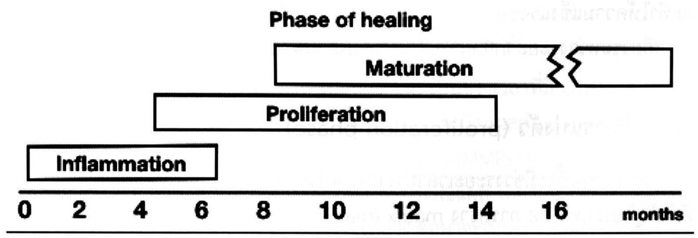
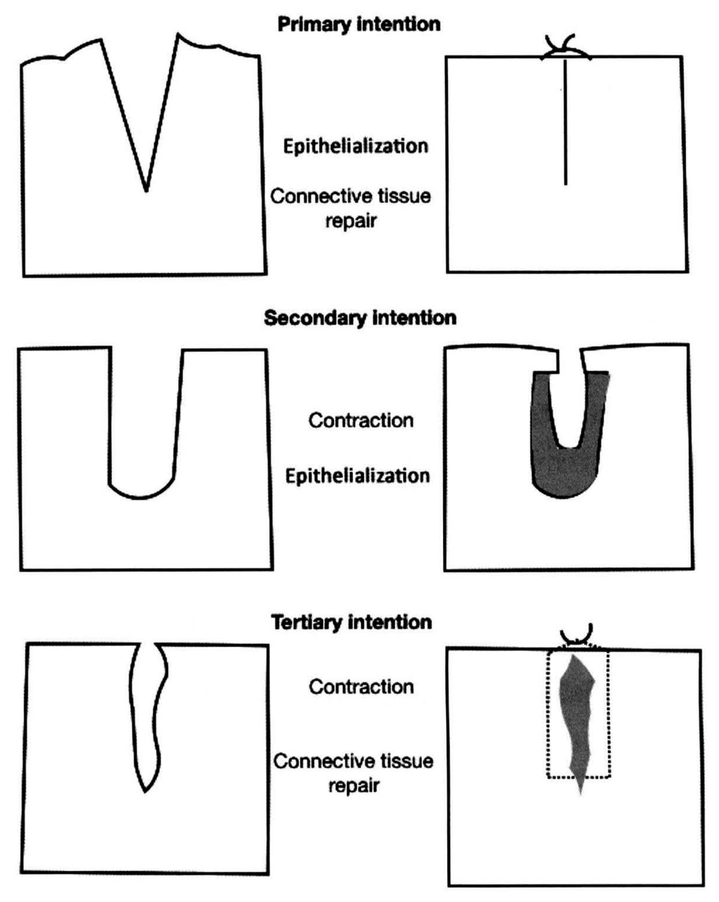
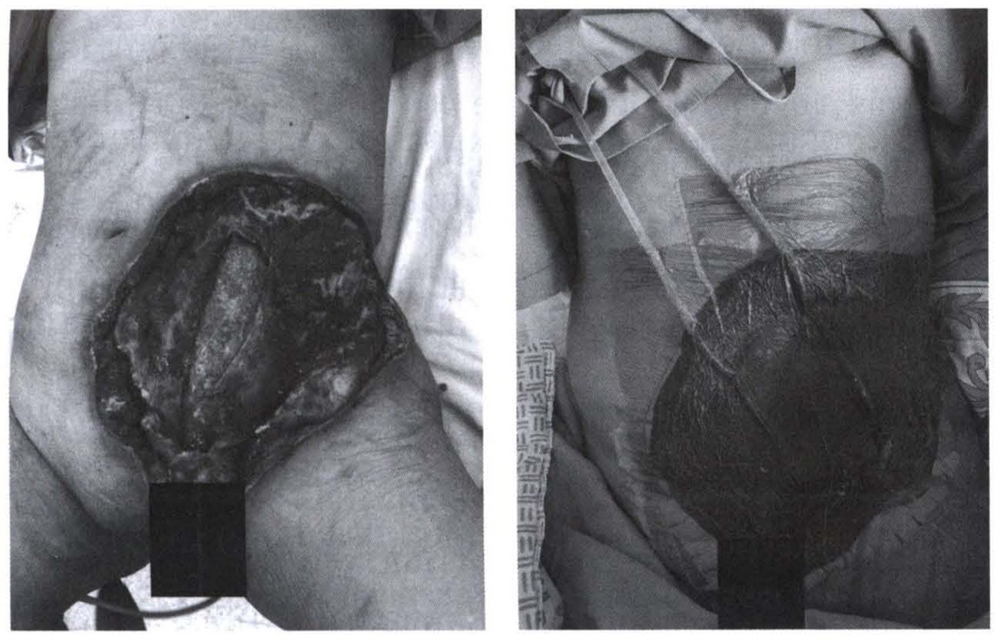

# กระบวนการหายของบาดแผลและการดูแลบาดแผล (Wound healing and wound care)

## Contents of this file
- บทนำ (p.89)
- กระบวนการหายของบาดแผลปกติ (Phase of wound healing) (p.89)
  - ระยะการแข็งตัวของเลือดและการอักเสบ (hemostasis and inflammatory phase) (p.90)
  - ระยะที่มีการแบ่งตัว (proliferation phase) (p.90)
  - ระยะปรับตัว (maturation and remodeling phase) (p.91)
- ปัจจัยที่มีผลต่อการหายของบาดแผล (p.92)
  - อายุ (Advanced age) (p.92)
  - Hypoxia, anemia, hypoperfusion (p.93)
  - ยากลุ่ม steroid และยาเคมีบำบัด (p.93)
  - Metabolic disorder (p.93)
  - ภาวะโภชนาการ (Nutrition status) (p.94)
  - การติดเชื้อ (Infection) (p.94)
- Excess healing (p.94)
- การดูแลแผล (Wound care) (p.95)
  - Medical care (p.97)
  - Local wound care (p.97)
  - Wound debridement (p.98)
  - Topical therapy (p.99)
  - การทำแผล (Wound dressing) (p.99)
  - Negative-pressure wound therapy (NPWT) (p.102)
- Wound coverage (p.103)
  - Adjunctive therapy : Hyperbaric oxygen therapy (HBOT) (p.104)
- Biofilm and chronic wound (p.105)
- สรุป (p.106)
- เอกสารอ้างอิง (p.106)

<!-- p.87 (printed none) -->
**กระบวนการหายของบาดแผลและการดูแลบาดแผล**

**Wound healing and wound care**

เมธี สุธีรศานต์

<!-- p.88 (printed 74) -->
**กระบวนการหายของบาดแผลและการดูแลบาดแผล**

**Wound healing and wound care**

เมธี สุธีรศานต์

**กระบวนการหายของบาดแผลปกติ (Phase of wound healing)**

- ระยะการแข็งตัวของเลือดและการอักเสบ (hemostasis and inflammatory phase)
- ระยะที่มีการแบ่งตัว (proliferation phase)
- ระยะปรับตัว (maturation and remodeling phase)

**ปัจจัยที่มีผลต่อการหายของบาดแผล**

**Excess healing**

**การดูแลแผล (Wound care)**

- Medical care
- Local wound care
- Wound debridement
- Topical therapy
- การทำแผล (Wound dressing)
- Negative-pressure wound therapy (NPWT)
- Wound coverage
- Adjunctive therapy : Hyperbaric oxygen therapy (HBOT)

**Biofilm and chronic wound**

<!-- p.89 (printed 75) -->
## บทนำ

ความรู้ความเข้าใจเกี่ยวกับกระบวนการหายของบาดแผลและการดูแลรักษาบาดแผลชนิดต่างๆ นั้น มีความสำคัญและจำเป็นอย่างยิ่งสำหรับแพทย์ทุกแขนง ซึ่งมีส่วนสำคัญทั้งเป็นผู้ที่ทำให้เกิดบาดแผลเองจากการทำหัตถการต่างๆ ตลอดจนต้องดูแลรักษาบาดแผลชนิดต่างๆให้กับผู้ป่วยจนกระทั่งบาดแผลนั้นหายโดยสมบูรณ์ การนำความรู้ความเข้าใจเกี่ยวกับกระบวนการหายของบาดแผล ปัจจัยที่มีผลต่อการหายของบาดแผลมาประยุกต์ใช้เพื่อช่วยให้กลไกตามธรรมชาติของร่างกายสามารถรักษาบาดแผลให้หายได้เอง รวมถึงเทคนิคการดูแลแผลชนิดต่างๆ นั้นจึงมีความสำคัญอย่างมาก

## กระบวนการหายของบาดแผลปกติ (Phase of wound healing)

กระบวนการหายของบาดแผลเป็นกระบวนการที่มีความซับซ้อนและมีความคาบเกี่ยวกันในแต่ละระยะ ในปัจจุบันสามารถแบ่งออกได้ออกเป็น 3 ระยะใหญ่ๆ โดยใช้ชนิดของเซลล์ที่เข้ามาเกี่ยวข้อง และ biochemical activity ได้แก่ ระยะการแข็งตัวของเลือดและการอักเสบ (hemostasis and inflammatory phase) ระยะที่มีการแบ่งตัว (proliferation phase) และระยะปรับตัว (maturation and remodeling phase) รูปที่ 1 การหายของบาดแผลทุกชนิดต้องผ่านกระบวนการเหล่านี้ก่อนที่บาดแผลจะหายโดยสมบูรณ์ หากมีปัจจัยเข้ามาขัดขวางกระบวนการเหล่านี้จะทำให้การหายของบาดแผลช้าลง กลายเป็นบาดแผลเรื้อรัง (chronic wound) หรือบาดแผลที่ไม่หาย (non-healing wound) ได้

> **Caption (verbatim):** **รูปที่ 1** Phase of wound healing
> **Text in image (verbatim):** Phase of healing · Maturation · Proliferation · Inflammation · 0 · 2 · 4 · 6 · 8 · 10 · 12 · 14 · 16 · months
> **Description:** Timeline diagram (line drawing) titled "Phase of healing" with three staggered, overlapping horizontal bars above a horizontal time axis marked 0, 2, 4, 6, 8, 10, 12, 14, 16, labelled "months". The lowest bar "Inflammation" runs from about 0 to just past 6. The middle bar "Proliferation" starts at about 4 and ends at about 14. The top bar "Maturation" starts at about 8 and extends past 16; it is drawn with a zigzag break near 16 and continues as a separate open-ended segment, indicating that it continues for a long time beyond the axis.
> **Identifiers in image:** none

<!-- p.90 (printed 76) -->
### ระยะการแข็งตัวของเลือดและการอักเสบ (hemostasis and inflammatory phase)1, 2

เมื่อมีบาดแผลเกิดขึ้นจะมีการฉีกขาดของหลอดเลือดเล็กๆ ทำให้มีการสัมผัสกันของ subendothelial collagen และ platelet นำไปสู่การรวมตัวกันของ platelet (platelet aggregation) การแตกตัวของ platelet granule (platelet degranulation) และกระตุ้นกระบวนการห้ามเลือด (coagulation cascade) หลังจากที่เกิด fibrin clot แล้วจะมีการเคลื่อนตัวของ inflammatory cell ชนิดต่างๆ เข้ามายังบาดแผล ได้แก่ polymorphonuclear leucocytes (PMNs) และ monocyte

PMNs เป็น inflammatory cell กลุ่มแรกที่เข้ามายังบริเวณบาดแผล โดยจะมีปริมาณมากที่สุดเมื่อเวลาประมาณ 24-48 ชั่วโมง โดยมีหน้าที่หลักในการเก็บกินเนื้อตาย สิ่งแปลกปลอม และเชื้อโรค (phagocytosis) นอกจากนี้ยังหลั่ง cytokines ที่มีหน้าที่ในการกระตุ้นการสร้างหลอดเลือด (angiogenesis) และ collagen อีกด้วย

monocyte เป็น inflammatory cell กลุ่มที่สองที่เข้ามายังบาดแผล คือ ประมาณ 48-96 ชั่วโมง เมื่อเข้ามายังบริเวณบาดแผลจะเปลี่ยนไปเป็น macophage ทำหน้าที่เก็บกินเชื้อโรคและเนื้อตายเช่นเดียวกัน นอกจากนี้ยังทำหน้าที่กระตุ้นการรวมตัวของเซลล์ชนิดอื่นๆ ผ่านทางการหลั่ง cytokines และ growth factors ชนิดต่างๆ

เซลล์อีกชนิดที่มีความสำคัญในระยะนี้ คือ T-lymphocyte จะมีปริมาณสูงสุดบริเวณบาดแผลที่ประมาณ 1 สัปดาห์ หน้าที่หลัก คือ ปรับแต่งสิ่งแวดล้อมของแผลให้มีความเหมาะสมต่อการหายของแผล และพบว่าหากบาดแผลมีปริมาณ T-lymphocyte ลดลงไปจะทำให้ความแข็งแรงของบาดแผลและปริมาณ collagen ลดลง โดยตัวมันทำหน้าที่คาบเกี่ยวระหว่างระยะ inflammatory phase และ proliferation phase

### ระยะที่มีการแบ่งตัว (proliferation phase)

ระยะที่สองนี้จะมีช่วงระยะเวลาประมาณ 4-12 วัน หลังจากเกิดบาดแผล กระบวนการที่สำคัญในระยะนี้ คือ การสร้าง matrix (matrix synthesis) โดยเซลล์ที่มีบทบาทสำคัญ คือ fibroblast และ endothelial cell ซึ่งถูกกระตุ้นโดย growth factor และ cytokine ที่หลั่งจาก macophage ในระยะแรก

<!-- p.91 (printed 77) -->
fibroblast ทำหน้าที่สร้างส่วนประกอบต่างๆ ของ extracellular matrix ขึ้นมาใหม่ที่สำคัญ คือ collagen และ glycosaminoglycans ส่วน endothelial cell มีหน้าที่สร้างหลอดเลือดฝอยขึ้นมาใหม่ (angiogenesis)3

Collagen เป็นโปรตีนที่มีความสำคัญมากที่สุดในกระบวนการหายของบาดแผล ปัจจุบัน collagen ในร่างกายมนุษย์มีอย่างน้อย 18 ชนิด แต่ที่มีความสำคัญต่อการหายของบาดแผล คือ type I และ type III บริเวณผิวหนังและบริเวณแผลเป็นที่หายแล้วจะมีอัตราส่วนของ collagen type I และ type III เท่ากับ 4 ต่อ 1 กระบวนการสร้าง collagen จำเป็นจะต้องมีสิ่งแวดล้อมที่เหมาะสมด้วย เช่น มีปริมาณออกซิเจนและสารอาหารที่เพียงพอ และปราศจากการติดเชื้อ

นอกจาก collagen แล้ว glycosaminoglycans ก็มีส่วนสำคัญในการสร้าง matrix โดยตัวมันทำหน้าที่เป็น ground substance หลักของ granulation tissue โดย fibroblast จะเป็นเซลล์ที่สร้างเช่นเดียวกัน glycosaminoglycans ชนิดที่พบมากที่บาดแผล คือ dermatan และ chondroitin sulfate โดยจะมีปริมาณมากที่สุดประมาณ 3 สัปดาห์ หลังจากที่เกิดแผล

granulation tissue คือ เนื้อเยื่อสีแดงที่พบได้ในบาดแผลเปิด ประกอบด้วยเส้นเลือดฝอยขนาดเล็กเป็นจำนวนมาก macrophage และ fibroblast ที่อยู่ภายใน provisional matrix ที่ประกอบด้วย fibronectin, hyaluronic acid และ collagen เมื่อบาดแผลเปิดมี granulation tissue เกิดขึ้น บ่งบอกว่าบาดแผลนั้นพร้อมที่รองรับ skin graft หรือสามารถหายเองได้ด้วย secondary intention healing

### ระยะปรับตัว (maturation and remodeling phase)3

ระยะนี้กินเวลาตั้งแต่ 2-3 สัปดาห์ ไปจนถึง 1 ปี เป็นช่วงเวลาที่มีการสร้างสมดุลกันของการสร้างและการย่อยสลาย collagen เพื่อนำไปสู่การเกิดแผลเป็น (scar) โดยเอนไซม์ที่ย่อยสลาย collagen คือ matrix metalloproteinase (MMPs) ความแข็งแรงของแผลนั้นเกิดจากการสะสมของ extracellular matrix บริเวณแผล โดยรูปแบบของการสะสมช่วงแรกจะเป็น fibronectin และ collagen type III ต่อมาจะเป็น glycosaminoglycans และ proteoglycans ระยะสุดท้ายจะเป็น collagen type I เป็นหลัก แผลเป็นที่เกิดขึ้นจะมีการปรับตัว (scar remodeling) ในช่วงเวลา 6-12 เดือน หลังจากที่มีการเกิดแผล

<!-- p.92 (printed 78) -->
โดยสุดท้ายจะมีลักษณะที่เป็น mature scar คือ avascular และ acellular โดยความแข็งแรงของ scar จะไม่มีทางกลับไปแข็งแรงเหมือนกับเนื้อเยื่อที่ไม่ได้รับการบาดเจ็บมาก่อนได้

ในระยะนี้อาจเกิดการดึงรั้งของแผลได้ (wound contraction) โดยเฉพาะในกรณีที่ขอบแผลไม่ได้ติดกัน โดยเซลล์ที่มีบทบาท คือ myofibroblast โดยตัวเซลล์จะมี stress fiber ที่ประกอบด้วย α-smooth muscle actin ที่มีความสามารถในการหดตัว โดยจะเริ่มพบในวันที่ 6 ของการเกิดแผล และจะมากขึ้นจนถึงวันที่ 15 จนหลังสัปดาห์ที่ 4 จะค่อยๆ หายไป

กระบวนการ epithelialization เป็นกระบวนการสุดท้ายของการหายของแผล โดยมีลักษณะของการแบ่งตัวและการเคลื่อนตัวของ epithelial cell จากบริเวณขอบแผล โดย marginal basal cell ที่ไม่ได้ยึดติดกับผิวหนังด้านล่างบริเวณขอบแผลจะมีการเคลื่อนตัวเข้าไปใน extracellular matrix และ fixed basal cell ที่ติดกับด้านล่างบริเวณขอบแผลจะมีการแบ่งตัวเพิ่มอย่างรวดเร็วและค่อยๆ เคลื่อนตัวแบบก้าวกระโดดไปปิดบาดแผลในที่สุด หลังจากนั้นชั้นของ epithelium ก็จะเริ่มแบ่งชั้นใกล้เคียงกับผิวหนังปกติ และมีการสร้าง keratin ในที่สุด บาดแผลที่มีการดึงหรือเย็บขอบแผลมาติดกันพอดี การ re-epithelialization จะเกิดขึ้นเสร็จภายใน 48 ชั่วโมง ในบาดแผลบางชนิดที่มีการทำลายเฉพาะชั้น epithelium หรือทำลายเฉพาะ superficial dermis เช่น แผล donor site ของ split-thickness skin graft หรือ superficial second degree burn การหายของแผลจะเป็นการ primary re-epithelialization เท่านั้น โดยไม่มีการสร้าง fibrin หรือ granulation tissue

## ปัจจัยที่มีผลต่อการหายของบาดแผล

### อายุ (Advanced age)4

ในผู้สูงอายุที่เข้ารับการผ่าตัดพบว่ามีอุบัติการณ์ของการเกิดแผลแยก (wound dehiscence) และไส้เลื่อนแผลผ่าตัด (incisional hernia) มากกว่าปกติ โดยเชื่อว่าสาเหตุน่าจะเกิดจากผู้สูงอายุมักมีปัจจัยที่ทำให้แผลหายได้ช้าอยู่แล้ว เช่น cardiovascular disease, metabolic diseases (เบาหวาน ภาวะทุพโภชนาการ) โรคมะเร็ง และการใช้ยาต่างๆ แต่อย่างไรก็ตามก็ไม่ได้เป็นข้อห้ามที่จะไม่นำผู้ป่วยเข้ารับการผ่าตัดหากมีความจำเป็น

<!-- p.93 (printed 79) -->
### Hypoxia, anemia, hypoperfusion5

กระบวนการสร้าง collagen จำเป็นต้องใช้ออกซิเจนเป็น cofactor พบว่าการเพิ่มค่า FiO2 (fraction of inspired oxygen) เป็นเวลาสั้นๆ ระหว่างและหลังผ่าตัด ช่วยเพิ่มปริมาณ collagen ในแผลผ่าตัด และลดการเกิดการติดเชื้อของแผลผ่าตัดได้

สาเหตุที่ทำให้การนำออกซิเจนไปสู่แผลทำได้ไม่ดีนั้นอาจเกิดได้จากหลายสาเหตุ เช่น hypovolemia, cardiac failure, arterial insufficiency, local vasoconstriction, tissue tension จากการเย็บแผลที่ตึงเกินไป severe anemia (hematocrit level <15%) การป้องกันและแก้ไขสาเหตุเหล่านี้จึงมีความสำคัญต่อการดูแลแผล

### ยากลุ่ม steroid และยาเคมีบำบัด6

corticosteroids ในขนาดสูง มีผลทำให้ลดการสร้าง collagen และยับยั้งกระบวนการ angiogenesis, inflammatory cell migration การสร้าง fibroblast อย่างไรก็ตามการให้ steroid ระยะสั้น คือ 3-4 วัน หลังผ่าตัด อาจไม่มีผลต่อการหายของบาดแผลมาก

ส่วนยาเคมีบำบัดที่ออกฤทธิ์ยับยั้ง cell proliferation โดยเฉพาะการสร้าง DNA และ protein จึงมีผลต่อการหายของบาดแผล ดังนั้นการให้ยาเคมีบำบัดจึงควรรอหลังผ่าตัดแล้วอย่างน้อย 2 สัปดาห์ เพื่อให้มีผลกระทบต่อการหายของบาดแผลให้น้อยที่สุด

### Metabolic disorder

ผู้ป่วยโรคเบาหวานที่มีระดับน้ำตาลในเลือดสูงจะส่งผลกระทบทำให้ inflammation, angiogenesis การสร้าง collagen และ phagocytosis ลดลง นอกจากนี้การที่มี vascular complication คือ arterial insufficiency ทำให้เกิด tissue hypoxia ดังนั้นการควบคุมระดับน้ำตาลในเลือดให้ดีในผู้ป่วยเบาหวานจึงมีความสำคัญก่อนการผ่าตัด

ผู้ป่วยที่มีค่า body mass index (BMI) อยู่ในเกณฑ์ obesity พบว่าพบภาวะแทรกซ้อนจากแผลผ่าตัดมากกว่าคนทั่วไป เช่น แผลแยก (wound dehiscence) แผลติดเชื้อ (surgical site infection) ไส้เลื่อนแผลผ่าตัด (incisional hernia) โดยที่ยังไม่ทราบถึงกลไกลที่แน่ชัดในปัจจุบัน7

<!-- p.94 (printed 80) -->
### ภาวะโภชนาการ (Nutrition status)

ภาวะทุพโภชนาการ (malnutrition) มีผลต่อการสร้าง granulation tissue และ collagen สารอาหารต่างๆ ที่มีความสัมพันธ์ต่อการหายของแผล เช่น โปรตีน มีกรดอะมิโนชนิด Arginine มีความจำเป็นต่อการสร้าง fibrous tissue วิตามินที่จำเป็นต่อการหายของแผล คือ วิตามิน A และ C และ trace element ที่สำคัญ คือ Zinc เนื่องจากเป็น cofactor ของเอนไซม์หลายชนิดในกระบวนการสร้าง fibroblast และ collagen8

### การติดเชื้อ (Infection)

wound infection เป็นสาเหตุที่พบบ่อยที่สุดที่ทำให้บาดแผลหายช้า เชื้อที่พบได้บ่อย คือ แบคทีเรีย การติดเชื้อแบคทีเรียบริเวณแผลทำให้ระยะ inflammation phase นานขึ้น ขัดขวางการ epithelialization, wound contraction และการสะสม collagen นอกจากนี้ endotoxin จากแบคทีเรียยังกระตุ้น phagocytosis และเอนไซม์ collagenase ทำให้มีการทำลาย collagen และเนื้อเยื่อข้างเคียง

## Excess healing

ปกติเมื่อบาดแผลหายสนิทแล้ว เซลล์ต่างๆ จะค่อยๆ หยุดการสร้างเนื้อเยื่อ แต่ในบางบาดแผลร่างกายจะสร้างเนื้อเยื่อต่อไป ทำให้มีลักษณะของ excessive scar ทำให้เกิดปัญหาขึ้นได้ ซึ่งปัจจุบันยังไม่ทราบกลไกการเกิดที่แน่ชัด ไม่ว่าจะเกิดที่อวัยวะส่วนใดก็ทำให้เกิดปัญหาขึ้นได้ เช่น ที่ผิวหนังเกิดเป็น hypertrophic scar หรือ keloid รวมถึงเกิดเป็น scar contracture ตามมาได้ ที่ทางเดินอาหารก็เกิดการตีบหรือตันได้ เช่น anastomosis stricture หรือลำไส้อุดตันจาก adhesion เป็นต้น

ภาวะที่พบบ่อยที่ผิวหนัง คือ hypertrophic scar และ keloid นั้นมีลักษณะเหมือนกัน คือ แผลนูน แดง คัน ตึง อาจมีอาการเจ็บหรือปวดได้ ข้อแตกต่าง คือ hypertrophic scar จะนูนเฉพาะในขอบเขตของแผลเดิมและเมื่อเวลาผ่านไปจะสามารถลดขนาดลงได้เอง แต่ keloid จะขยายตัวออกนอกขอบเขตของแผลเดิมและขนาดไม่ลดลงเอง ภาวะ hypertrophic scar และ keloid นั้นพบแต่ในมนุษย์เท่านั้น โดยเฉพาะในคนผิวสีคล้ำ

<!-- p.95 (printed 81) -->
## การดูแลแผล (Wound care)

ลักษณะการหายของบาดแผลนั้นสามารถแบ่งออกได้เป็น 3 ลักษณะด้วยกัน รูปที่ 2 ได้แก่

1. Primary intention healing

เหมาะกับบาดแผลที่มีการบาดเจ็บของเนื้อเยื่อหรือการปนเปื้อน (contamination) น้อย และมีสภาพแวดล้อมที่เหมาะสมต่อการหายของบาดแผล เช่น บาดแผลผ่าตัดที่ได้รับการเย็บแผล การปลูกถ่ายผิวหนัง (skin grafting) การโยกย้ายเนื้อเยื่อเพื่อปิดบาดแผล (flap coverage) โดยอาศัยเพียงแค่กระบวนการ epithelialization และ connective tissue repair

2. Secondary intention healing

ในบางบาดแผลอาจมีการปนเปื้อนที่รุนแรงหรือมีการหายไปของเนื้อเยื่อเป็นบริเวณที่กว้าง เช่น บาดแผลจากอุบัติเหตุหรือบาดแผลผ่าตัดที่มีการติดเชื้อ อาจปล่อยให้บาดแผลเปิด (open wound) และจัดสิ่งแวดล้อมให้เหมาะสมต่อการหายของบาดแผล ร่างกายจะสมานบาดแผลให้หายเองด้วยการสร้าง granulation tissue, wound contraction และ epithelial migration ถ้ามีการเย็บปิดแผลหลังจากที่มี granulation tissue บริเวณแผลแล้วเพื่อให้แผลปิดเร็วขึ้นอาจเรียกว่า secondary closure

3. Tertiary intention healing

เป็นกระบวนการที่รวมเอาสองวิธีแรกมาใช้ร่วมกัน โดยเปิดแผลทิ้งไว้ 2-3 วัน เพื่อให้มั่นใจว่าไม่มีการติดเชื้อหรือมีเนื้อตาย (devitalized tissue) บริเวณแผลเพิ่มขึ้น แล้วค่อยทำการเย็บปิดแผล อาจเรียกวิธีนี้ว่า delayed primary closure มักใช้กับบาดแผลที่มีการปนเปื้อนมากๆ เช่น แผลผ่าตัด ruptured appendicitis หรือแผลอุบัติเหตุที่มีเนื้อเยื่อบริเวณรอบแผลชอกช้ำ (laceration and contusion wound)

<!-- p.96 (printed 82) -->

> **Caption (verbatim):** **รูปที่ 2** ลักษณะการหายของบาดแผล
> **Text in image (verbatim):** Primary intention · Epithelialization · Connective tissue repair · Secondary intention · Contraction · Epithelialization · Tertiary intention · Contraction · Connective tissue repair
> **Description:** Schematic line drawing in three rows, each showing a block of tissue in cross-section before (left) and after healing (right), with the processes involved written between the two blocks. Row 1 "Primary intention": left, a block with a narrow V-shaped wound with clean edges; right, the wound edges are brought together by a single stitch drawn at the surface, leaving only a thin vertical line; labels "Epithelialization" and "Connective tissue repair". Row 2 "Secondary intention": left, a block with a wide, deep U-shaped open wound; right, the defect is filled by a thick dark-shaded U-shaped band of new tissue lining the cavity, with the surface opening narrowed to a small gap; labels "Contraction" and "Epithelialization". Row 3 "Tertiary intention": left, a block with a narrow, irregular, wavy wound left open; right, the wound is closed with a stitch at the surface and an irregular dark-shaded area of repair tissue fills the former wound track, outlined by a dotted rectangle; labels "Contraction" and "Connective tissue repair".
> **Identifiers in image:** none

ดังนั้นการดูแลแผลจึงเริ่มต้นด้วยการวางแผนว่าจะให้แผลของผู้ป่วยหายด้วยวิธีใด การจัดสิ่งแวดล้อมให้เหมาะสมต่อการหายของบาดแผล คอยมองหาภาวะแทรกซ้อนของแผลเพื่อที่จะดำเนินการแก้ไขได้ทันท่วงที และในกรณีที่บาดแผลหายช้ากว่าที่ควรจะเป็นหรือไม่หาย (chronic wound) นั้นต้องคำนึงถึงโรคหรือภาวะที่เป็นสาเหตุแล้วทำการแก้ไขเพื่อให้กระบวนการหายของแผลสามารถดำเนินต่อไปได้ เช่น ผู้ป่วยเบาหวานที่ควบคุมระดับน้ำตาลในเลือดไม่ดี (uncontrolled diabetes) ผู้ป่วยที่มีปัญหาเรื่องหลอดเลือด (arterial/venous insufficiency) หรือแผลที่มีสาเหตุจากการกดทับ (pressure ulcer) เป็นต้น โดยสิ่งแวดล้อมที่เหมาะสมสำหรับการหายของบาดแผล คือ มีเลือดมาเลี้ยง

<!-- p.97 (printed 83) -->
เพียงพอ (well-vascularized) ต้องไม่มีเศษของเนื้อตายปะปนอยู่ (devitalized tissue) ปราศจากการติดเชื้อ มีความชื้นที่เหมาะสม (moist environment)

### Medical care

1. การให้ยาปฏิชีวนะ

ในบาดแผลชนิดเปิด (open wound) ไม่ว่าจะเป็นชนิดเฉียบพลัน (acute) หรือเรื้อรัง (chronic) จะมีแบคทีเรียอยู่เป็นเรื่องปกติ ดังนั้นการเพาะเชื้อพบเชื้อแบคทีเรียไม่ได้หมายความว่าบาดแผลนั้นจะมีการติดเชื้อ ดังนั้นจำเป็นต้องแยกให้ได้ก่อนว่าแบคทีเรียที่พบบนบาดแผลนั้นเป็นเพียง contamination (การมีเชื้อแบคทีเรียแต่ไม่ได้มีการเพิ่มจำนวน), colonization (เชื้อแบคทีเรียมีการเพิ่มจำนวนแต่ไม่มีการตอบสนองจาก host) หรือ infection (เชื้อแบคทีเรียมีการเพิ่มจำนวนและมีการตอบสนองจาก host) ซึ่งการตอบสนองจาก host (host response) ที่บ่งบอกถึงการติดเชื้อ ได้แก่ แผลปวด บวม แดง ร้อน มี abnormal discharge มีกลิ่นเหม็นผิดปกติ บาดแผลหายช้ากว่าปกติ หรือถ้ามีการติดเชื้อที่รุนแรงอาจมีอาการทาง sysytemic ได้ เช่น ไข้ หนาวสั่น คลื่นไส้ อาเจียน เป็นต้น การให้ยาปฏิชีวนะควรสงวนไว้เฉพาะเมื่อมีการติดเชื้อเท่านั้น9

2. การควบคุมระดับน้ำตาลในเลือด

แม้ว่าจะยังไม่มีหลักฐานทางวิชาการบอกว่าการควบคุมระดับน้ำตาลในเลือดในระยะสั้นมีผลต่อการหายของแผลที่เร็วขึ้น แต่เป็นที่ทราบกันว่าภาวะ hyperglycemia นั้นมีผลเสียต่อการหายของบาดแผลอย่างที่ได้กล่าวมาแล้ว ดังนั้นโดยทั่วไปเมื่อมีบาดแผลเกิดขึ้นจึงควรที่จะควบคุมระดับน้ำตาลในเลือดให้อยู่ในเกณฑ์ปกติควบคู่ไปกับการดูแลแผลตามปกติ โดยเฉพาะในกรณีที่สงสัยภาวะติดเชื้อเนื่องจากแผลติดเชื้อในผู้ป่วยกลุ่มนี้มักมีอาการที่ไม่ชัดเจน10

### Local wound care

ในบาดแผลเฉียบพลันนั้น ควรเริ่มต้นด้วยการซักประวัติเกี่ยวกับกลไกการบาดเจ็บ ระยะเวลาที่เกิดและอาการข้างเคียงต่างๆ หลังจากนั้นจึงทำการตรวจบาดแผลอย่างละเอียด โดยดูถึงตำแหน่ง ขนาด ความลึก เนื้อตาย (devitalized tissue) สิ่งแปลกปลอม (foreign body) สิ่งปนเปื้อน หลังจากนั้นจึงเริ่มให้การดูแลโดยพิจารณาการให้ยาป้องกันบาดทะยัก (tetanus prophylaxis) ตามด้วยการระงับปวดบริเวณแผล (local anesthesia)

<!-- p.98 (printed 84) -->
ยาระงับปวดที่ใช้บ่อย คือ lidocaine ซึ่งอาจผสม adrenaline เพื่อช่วยในการห้ามเลือดด้วย แต่ต้องระมัดระวังในการใช้บริเวณปลายนิ้ว จมูก หู หรือปลายอวัยวะเพศชาย ซึ่งอาจเกิด tissue necrosis ได้ หลังจากนั้นจึงทำการชะล้างแผล (wound irrigation) เพื่อล้างเอาเลือด สิ่งแปลกปลอม สิ่งปนเปื้อนต่างๆ ออก โดยใช้ normal saline ก็เพียงพอ การใช้น้ำยาฆ่าเชื้อ เช่น iodine, povidone-iodine หรือ hydrogen peroxide เพื่อหวังผลฆ่าเชื้อบริเวณแผลนั้น อาจมีผลเสียเนื่องจากไปทำลาย neutrophil และ macrophage ดังนั้นจึงไม่ควรใช้ ทำการเตรียมพื้นที่บริเวณบาดแผลด้วยวิธีปลอดเชื้อด้วยการใช้น้ำยาฆ่าเชื้อโดยระมัดระวังไม่ให้น้ำยาเข้าไปในบาดแผลด้วยเหตุผลข้างต้น ปูผ้าปลอดเชื้อ (drape) หากมีจุดเลือดออกให้ทำการหยุดเลือดด้วยวิธีต่างๆ เช่น การผูก เย็บ หรือจี้ หากมีเนื้อตายให้ทำการ debridement ออก

หลังจากนั้นจึงพิจารณาว่าจะให้แผลหายด้วยวิธีใด (primary, seconadary หรือ tertiary intention healing) โดยพิจารณาจากจากปัจจัยต่างๆ ที่ได้กล่าวมาแล้ว โดยทั่วไปหากเป็นบาดแผลจากอุบัติเหตุที่ไม่ได้มีเนื้อตายเยอะมากหรือปนเปื้อนอย่างรุนแรงหรือผ่านการบาดเจ็บมาเป็นเวลานานมาก สามารถพิจารณาปิดแผลได้เลย (primary intetntion healing) โดยมักใช้ไหมเย็บแผลดึงแผลให้เข้ามาชิดกันโดยไม่ให้ตึงจนเกินไป (approximate not strangulate)

### Wound debridement

บาดแผลต่างๆ จะมีลักษณะที่แตกต่างกัน การตัดแต่งบาดแผล (surgical debridement) นั้นมีข้อบ่งชี้และประโยชน์หลายประการ เช่น เพื่อเอาเนื้อเยื่อที่ตายหรือขาดเลือดออกจากบาดแผลและแก้ไขปัญหาแผลติดเชื้อ โดยเฉพาะในบาดแผลเรื้อรังพบว่าการตัดแต่งบาดแผลสามารถลดปริมาณแบคทีเรียที่แผล เพิ่ม wound contraction และ re-epithelialization ได้11

ในบางกรณีการทำ surgical debridement อาจทำได้ยากหรือทำไม่ได้ เช่น ในกรณีบาดแผลอยู่ในที่ลึกหรือการแยกเนื้อดีกับเนื้อตายทำได้ยากด้วยตาเปล่า จึงมีการนำ debridement technique ต่างๆ กันมาใช้ เช่น enzymatic debridement คือ การใช้เอนไซม์สังเคราะห์เข้าไปช่วยในการย่อยสลายเนื้อตาย แต่จากหลายการศึกษาที่ผ่านมาผลการใช้อาจยังไม่เป็นที่น่าพอใจนัก เนื่องจากอัตราการหายของแผลไม่ได้ดีขึ้น เพียงช่วยให้สามารถทำ debridement ได้ง่ายขึ้น12 หรือ biologic debridement (Maggot therapy) คือ การใช้ larvae ของแมลง เช่น Australian sheep blow fly หรือ green bottle fly

<!-- p.99 (printed 85) -->
ในการช่วย debride แผล โดยเฉพาะในแผลที่ไม่สามารถใช้ sugical debridement ได้ โดยบาดแผลที่มักใช้วิธีนี้ คือ pressure ulcer, chronic venous ulcer และ diabetic foot ulcer โดยใช้หลักการที่ larvae สามารถหลั่งเอนไซม์ออกมาย่อยสลายเนื้อตายและตัวมันสามารถกินเนื้อตายที่เหลือเป็นอาหารด้วย โดยหลายการศึกษาที่ผ่านมาพบว่า maggot therapy มีประสิทธิภาพเทียบเท่ากับวิธีที่เป็นมาตรฐาน คือ surgical debridement และอาจมีผลในเรื่องของการยับยั้งแบคทีเรียและกระตุ้นการหายของแผลด้วย13

### Topical therapy

1. Growth factors เป็นสารที่มีความสำคัญต่อการหายของบาดแผล จึงมีการนำมาผลิตเป็นยาและนำมาใช้กับการดูแลแผล ได้แก่ Platelet-derived growth factor, epidermal growth factor และ granulocyte-macrophage colony stimulating factor โดยส่วนมากจะผลิตมาในรูปแบบของ gel หรือ ointment และนำมาใช้กับแผลที่มีลักษณะเป็นแผลเรื้อรังเพื่อกระตุ้นให้แผลหายเร็วขึ้น

2. Honey ในตัวมันเองมีคุณสมบัติในการรักษาบาดแผล เนื่องจากมี osmolality ที่ค่อนข้างสูง และมี hydrogen peroxide เป็นส่วนประกอบจึงออกฤทธิ์ยับยั้งแบคทีเรียได้ จึงมีการนำมาใช้ในบาดแผลที่ติดเชื้ออยู่บ้าง

3. Beta-blocker เนื่องจาก keratinocyte มี β-adrenergic receptor ยา beta-blocker จึงทำให้เกิดการเพิ่ม maturation และ migration ของ keratinocytes มีการนำยากลุ่ม topical Timolol มาใช้เพิ่มโอกาสหายของบาดแผล

4. Antimicrobial agents เป็นที่ทราบดีว่า antiseptic และ antimicrobial ส่วนใหญ่มีผลเสียต่อกระบวนการหายของบาดแผล และทำให้แผลหายช้าลงด้วยเหตุผลที่ได้กล่าวมาแล้ว โดยทั่วไปจึงไม่นิยมใช้ ยกเว้นบาดแผลบางชนิดที่อาจใช้ silver-based หรือ iodine-based ได้ เช่น แผลที่มีการติดเชื้อรุนแรง เป็นต้น

### การทำแผล (Wound dressing)

เป้าหมายหลักของการทำแผล คือ จัดสิ่งแวดล้อมให้เหมาะสมต่อการหายของบาดแผล บาดแผลต่างชนิดกันย่อมมีความแตกต่างกันในกระบวนการหายของบาดแผล ดังนั้นการเลือกวิธีการทำแผลที่ถูกต้องย่อมส่งผลให้บาดแผลหายได้เร็วขึ้นโดยไม่มีภาวะแทรกซ้อนตามมา คุณสมบัติของการทำแผลที่ดีประกอบด้วยปัจจัยตามตารางที่ 1

<!-- p.100 (printed 86) -->
**ตารางที่ 1** คุณสมบัติของการทำแผลที่ดี

| **คุณสมบัติของการทำแผลที่ดี** |
| --- |
| สนับสนุนการหายของแผล (รักษาความชุ่มชื้นของแผล) |
| ไม่ทำให้แผลมีการบาดเจ็บเพิ่มขึ้น โดยเฉพาะขณะทำแผล |
| ลดความเจ็บปวด |
| ไม่มีกลิ่นไม่พึงประสงค์ |
| ไม่กระตุ้นให้เกิดอาการแพ้หรือระคายเคือง |
| ป้องกันการเจริญของเชื้อโรคได้ |
| ไม่จำเป็นต้องเปลี่ยนบ่อยครั้ง |
| ราคาไม่แพง |

อย่างไรก็ตามวิธีการทำแผลในปัจจุบันยังไม่มีวิธีการใดที่มีคุณสมบัติครบทุกข้อ ดังนั้นเราจึงต้องเลือกวิธีการที่เหมาะสมกับบาดแผลแต่ละชนิด โดยชนิดของการทำแผลสามารถแบ่งได้หลายประเภทขึ้นกับว่าแบ่งโดยใช้เกณฑ์อะไร หากแบ่งตามวิธีการรักษาความชุ่มชื้นภายในแผลอาจแบ่งได้เป็น

1. Open dressing

หมายถึงการทำแผลแบบเปิดโดยอาศัยผ้าก๊อซชนิดเปียกใส่เข้าไปในแผลเพื่อให้เกิดความชุ่มชื้น (wet dressing) และปิดทับด้วยผ้าก๊อซแห้งอีกชั้นหนึ่ง ข้อดี คือ วัสดุที่ใช้ราคาไม่แพงและทำได้ง่าย แต่จะต้องเปลี่ยนผ้าก๊อซหลายครั้งในแต่ละวันเพื่อไม่ให้แผลแห้ง และตอนดึงผ้าก๊อซออกอาจทำให้เนื้อเยื่อได้รับบาดเจ็บได้หากผ้าก๊อซแห้งเกินไป

2. Semi-open dressing

หมายถึงการใช้ผ้าก๊อซที่มีลักษณะเป็นตาข่ายที่เคลือบด้วยสารบางชนิด เช่น petroleum, paraffin wax หรือ oinment ที่รู้จักกันดีในท้องตลาด เช่น Sofra Tulle

<!-- p.101 (printed 87) -->
หรือ Bactigras ก่อนใช้ผ้าก๊อซปิดทับอีกชั้นตามด้วย adhesive material โดยเป้าหมายเพื่อให้ความชุ่มชื้นและไม่ให้ติดกับแผลตอนดึงออก ข้อดี คือ ไม่ต้องเปลี่ยนแผลบ่อย ราคาไม่แพง ข้อเสีย คือ ไม่สามารถรักษาความชื้นได้ดีนัก และอาจทำให้เกิด skin maceration จากสารคัดหลั่งจากแผลได้

3. Semi-occlusive dressing

หมายถึงการใช้เวชภัณฑ์บำบัดแผล (wound dressing materials) ที่มีคุณสมบัติในการปิดกั้นแผลไม่ให้เชื้อโรคเข้าไป แต่สามารถดูดซึมสารคัดหลั่งต่างๆ ได้ค่อนข้างดี และสามารถรักษาความชุ่มชื้นของบาดแผลได้ดีด้วย ปัจจุบันมีวัสดุทำแผลเหล่านี้มากมายสามารถแบ่งย่อยได้อีกหลายประเภท

- Films หรือ polymer films เป็นวัสดุที่ใช้ในการปิดแผลที่มีคุณสมบัติสามารถให้น้ำสามารถระเหยออกมาจากภายในแผลได้ แต่ไม่ให้สารที่มีโมเลกุลใหญ่ เช่น โปรตีน แบคทีเรียผ่าน บางครั้งอาจเรียกว่า synthetic adhesive moisture-vapor-permeable dressing ที่มีใช้ในท้องตลาด เช่น Tegaderm เป็นต้น มีข้อเสีย คือ ไม่ควรใช้ในกรณีที่แผลมีสารคัดหลั่งปริมาณมาก เนื่องจากจะทำให้เกิดการระคายเคืองและอาจทำให้เกิด skin maceration ได้

- Foams หลักการคล้ายกับวัสดุประเภท film แต่จะเพิ่มคุณสมบัติการดูดซึมสารคัดหลั่งเข้าไป โดยวัสดุประเภทนี้จะมีสองชั้น คือ ด้านที่ติดกับแผล ซึ่งเป็นสารประเภท hydrophilic silicone หรือ polyurethane-based foam ส่วนชั้นนอกจะบุสารที่สามารถดูดซับสารคัดหลั่งได้ดีและป้องกันเชื้อโรคเข้าไปในแผล

- Alginates เป็นผลิตภัณฑ์ที่ทำจากสาหร่าย มีลักษณะที่เมื่อใช้ในบาดแผลที่มีสารคัดหลั่งปริมาณมากและมีโซเดียมเป็นส่วนประกอบ จะเกิดการแลกเปลี่ยน calcium ion กับ sodium ion ทำให้เกิดเป็น amorphous gel ปิดทับบาดแผลไว้ ซึ่งสามารถช่วยดูดซับสารคัดหลั่งได้เป็นจำนวนมาก ทำให้ไม่จำเป็นต้องทำแผลทุกวัน แต่ข้อเสีย คือ อาจมีกลิ่นไม่พึงประสงค์

- Hydrocolloids ประกอบด้วย gel หรือ foam ผนึกอยู่ใน self-adhesive polyurethane film ข้อดี คือ สามารถดูดซับสารคัดหลั่งได้ดี รักษาความชุ่มชื้นของแผลได้ดี สามารถดักจับเชื้อโรค เนื้อตายบางส่วน และนำออกไปพร้อมกับเวลาเปลี่ยน dressing แต่ข้อเสีย คือ อาจมีกลิ่นไม่พึงประสงค์และอาจต้องเปลี่ยนแผลทุกวัน

<!-- p.102 (printed 88) -->
- Hydrogels เป็น gel สังเคราะห์ที่ประกอบด้วย synthetic polymer ร่วมกับน้ำ ดังนั้นตัวมันสามารถรักษาความชุ่มชื้นให้กับแผลได้ดีและอาจทำให้รู้สึกปวดแผลลดลงจากการที่ตัวมันทำให้แผลมีอุณหภูมิลดลงด้วย

- Hydroactive เป็นผลิตภัณฑ์ที่ผสมผสานคุณสมบัติของ foam และ gel เข้าด้วยกัน คือสามารถดูดซึมสารคัดหลั่งจากแผลและรักษาความชุ่มชื้นของ growth factor ที่มีความจำเป็นต่อการหายของแผลไว้ได้อย่างดีด้วย

### Negative-pressure wound therapy (NPWT)

เป็นวิธีการที่มีประโยชน์และได้รับความนิยมมากในปัจจุบัน เทคนิคการทำแผลวิธีนี้ประกอบด้วยการใช้ฟองน้ำที่มีรูพรุนพอเหมาะสัมผัสกับบาดแผล ปิดทับด้วย occlusive dressing ที่ทำให้เกิดสุญญากาศได้ โดยมีกลไกที่เป็นประโยชน์ต่อบาดแผลสองกลไกด้วยกัน กลไกแรก คือ สามารถลดการบวมของบาดแผล ทำให้เซลล์ได้รับออกซิเจนได้ดีขึ้น และกลไกที่สอง คือ สามารถกำจัดเอนไซม์ที่เป็นอันตรายต่อแผลที่มักพบในบาดแผลเรื้อรัง เช่น collagenase, matrix metalloproteinases (MMPs) ซึ่งเป็นการกระตุ้นให้เซลล์มีการแบ่งตัวเร็วขึ้น ทำให้บาดแผลหายเร็วมากขึ้น

บาดแผลที่เหมาะกับการใช้วิธีนี้ คือ บาดแผลที่มีการรั่วของน้ำเหลือง บาดแผลจาก venous stasis บาดแผลในผู้ป่วยที่เป็นเบาหวาน บาดแผลกดทับ บาดแผลที่มีเนื้อเยื่อหายไปเป็นจำนวนมาก เช่น บาดแผลหลังจากการทำ surgical debridement จากภาวะ necrotizing fasciitis เพื่อกระตุ้นให้เกิดมี granulation tissue ก่อนที่จะทำการปิดแผลด้วย skin graft หรือ flap ต่อไป รูปที่ 3

<!-- p.103 (printed 89) -->

> **Caption (verbatim):** **รูปที่ 3** บาดแผลจากภาวะ necrotizing fasciitis บริเวณผนังหน้าท้องได้รับการทำแผลแบบ Negative-pressure wound therapy
> **Text in image (verbatim):** none
> **Description:** Two black-and-white clinical photographs side by side of a patient lying supine, showing the lower abdominal wall. Left: a large, roughly oval open wound on the lower abdominal wall after debridement, extending down toward the groin/suprapubic region, with an irregular dark wound bed, whitish strands of tissue, and a paler elongated central area; the surrounding skin of the abdomen and the upper thigh is visible, with a bed sheet at the side. Right: the same region with the wound covered by a dark sponge (foam) dressing sealed under a transparent occlusive adhesive film, with tubing running up from the dressing toward the top of the image, i.e. negative-pressure wound therapy in place; drapes are visible at the top and a hospital gown at the left edge. In both photos the genital area is covered by a black box placed by the book.
> **Identifiers in image:** none

## Wound coverage

ในบางกรณีบาดแผลไม่สามารถปิดด้วยวิธี primary closure, delayed primary closure หรือจะปล่อยให้หายแบบ secondary healing ก็อาจทำให้ผู้ป่วยทุกข์ทรมานกับบาดแผลนานเกินไป เนื่องจากบาดแผลมีขนาดใหญ่หรือมีเนื้อเยื่อที่หายไปปริมาณมาก อาจมีความจำเป็นต้องปิดแผลด้วยวิธีที่เหมาะสม ได้แก่

1. Skin graft สามารถแบ่งออกเป็นสองวิธีย่อยๆ คือ split-thickness skin graft (STSG) และ full-thickness skin graft (FTSG) ทั้งสองวิธีเป็นการนำเอาผิวหนังของผู้ป่วยจากบริเวณหนึ่งมาแทนที่ผิวหนังหรือเนื้อเยื่อส่วนที่หายไป

  1.1 Split-thickness skin graft เป็นการนำเอาผิวหนังส่วนที่เป็น epidermis และ dermis บางส่วนจากบริเวณที่เป็น donor site มาปิดบริเวณที่เป็นแผล ความหนาของ graft อยู่ที่ประมาณ 0.005-0.012 นิ้ว ข้อดี คือ สามารถปิดบริเวณที่เป็นแผลได้กว้าง และโอกาสที่ graft จะติดกับบริเวณแผลมีมากกว่า FTSG แต่ข้อเสีย คือ หลังจากแผลหายจะมีสีและความเรียบไม่เหมือนกับผิวหนังดั้งเดิม และพบว่ามี scar contracture ได้มาก ส่วนบริเวณ donor site แผลจะหายโดยวิธี re-epithelialization

<!-- p.104 (printed 90) -->
  1.2 Full-thickness skin graft คือ การนำเอาผิวหนังส่วนที่เป็น epidermis และ dermis ของบริเวณ donor site มาทั้งหมด ข้อดี คือ เมื่อแผลที่ปิดหายจะมีลักษณะผิวที่เหมือนกับผิวหนังปกติ และเกิด scar ที่น้อยกว่า แต่ข้อเสีย คือ พื้นที่ที่จะ harvest graft ออกมา มักต้องปิดให้ได้ด้วยวิธี primary closure ดังนั้นจึงมักได้ขนาดของ graft ที่เล็ก จึงมักใช้สำหรับบาดแผลที่ต้องการความสวยงามมากกว่าที่อื่น เช่น บริเวณใบหน้า

2. Skin substitutes ในบางกรณีเราไม่สามารถใช้ conventional skin graft ในการปิดแผลได้ ก็อาจใช้วัตถุดิบที่สร้างขึ้นมาทดแทนผิวหนังปกติ ข้อดี คือ ผู้ป่วยไม่ต้องมีแผลเพิ่มจากบริเวณ donor site และตัวมันเองสามารถกระตุ้นการหายของบาดแผลผ่านทาง cytokine หรือ growth factor ที่เป็นส่วนประกอบของตัวมันเองได้ ข้อเสีย คือ ราคาที่แพง อาจต้องเปลี่ยนหลายครั้งก่อนที่แผลจะหาย เนื่องจากมีอายุการใช้งานที่สั้น ปัจจุบัน skin substitutes ที่มีใช้อยู่ เช่น Cultured epithelial autograft (CEAs), Bioengineered dermal replacement เป็นต้น

### Adjunctive therapy : Hyperbaric oxygen therapy (HBOT)14

มีการนำเอา HBOT ที่ใช้ในการรักษาภาวะ decompression sickness ที่เกิดจากการดำน้ำลึก มาใช้รักษา chronic wound บางประเภท เนื่องจากการทดลองในห้องปฏิบัติการพบว่า HBOT สามารถกระตุ้น endothelial cell proliferation ได้15 และสาเหตุที่สำคัญอย่างหนึ่งของการเกิด chronic wound คือ ขาด oxygen supply มายังบริเวณแผล ปัจจุบัน HBOT มักมีลักษณะเป็นห้อง (chamber) ที่มีขนาดใหญ่ โดยที่คนไข้สามารถเข้าไปภายในห้องได้ทั้งตัวและภายในห้องจะทำการเพิ่มระดับออกซิเจนให้เป็น 100% และเพิ่มความดันให้มากกว่าความดันบรรยากาศระดับน้ำทะเล (sea level pressure = 1 atmosphere absolute) อย่างน้อย 1.4 เท่า

ปัจจุบันข้อบ่งชี้ที่เกี่ยวกับการรักษาแผลที่สามารถนำเอา HBOT มาใช้ได้ ได้แก่ แผลที่เกิดจาก clostidial myonecrosis, crush injury, radiation induced bone and soft tissue infection, diabetic ulcer, refractory osteomyelitis และ thermal burn

<!-- p.105 (printed 91) -->
## Biofilm and chronic wound

โดยทั่วไปบาดแผลเรื้อรังหรือบาดแผลที่ไม่หายนั้นจะมีปัจจัยที่ทำให้แผลไม่หายอยู่หลายอย่างตามที่ได้กล่าวมาแล้ว ปัจจุบันพบว่ามีปัจจัยหนึ่งที่ทำให้บาดแผลหายช้าได้ซึ่งเกี่ยวข้องกับเชื้อแบคทีเรียที่อยู่บนแผลที่ทำให้เกิดการอักเสบแบบเรื้อรัง และมีการต่อต้านต่อยาปฏิชีวนะ รวมถึงภูมิต้านทานของผู้ป่วยด้วย

Biofilm เป็นคำที่ใช้เรียกการเติบโตและเพิ่มจำนวนของเชื้อแบคทีเรียที่อยู่บนแผล มีลักษณะเป็นเยื่อบางๆ (film) ที่ปกคลุมอยู่ ทำหน้าที่ป้องกันเชื้อโรคจากยาปฏิชีวนะ รวมถึงภูมิต้านทานของผู้ป่วย และจะกระตุ้นให้เกิดการอักเสบแบบเรื้อรังรบกวนกระบวนการหายของแผลแบบปกติ โดย biofilm นี้สามารถพบได้ถึง 60% ของแผลเรื้อรัง16 มีอยู่สามระยะด้วยกัน

ระยะที่ 1 : reversible bacterial adhesion stage

เป็นระยะที่แบคทีเรียเริ่มมีการยึดติดกับผิวของบาดแผล

ระยะที่ 2 : permanent adhesion หรือ maturation stage

เป็นระยะที่แบคทีเรียเริ่มมีการแบ่งตัวและยึดติดกับผิวของบาดแผลอย่างถาวร และมีการติดต่อกันของแบคทีเรียโดยใช้ signaling molecule ต่างๆ เรียกว่า quorum sensing คอยควบคุม gene expression และช่วยในการสร้าง biofilm

ระยะที่ 3 : แบคทีเรียจะมีการสร้าง matrix ที่ป้องกันสิ่งต่างๆ จากภายนอก เรียกว่า extracellular polymeric substance (EPS)

ตัว biofilm ทำให้แผลมีลักษณะที่มีการอักเสบอยู่ตลอดเวลา เนื่องจากจะมี macrophage และ neutrophil เคลื่อนที่เข้าไปบริเวณ biofilm อยู่ตลอด และกระตุ้นให้มีการหลั่งเอนไซม์ที่ทำให้เกิดความเสียหายต่อเนื้อเยื่อที่อยู่ข้างเคียง มีผลให้เพิ่มปริมาณของ exudate ซึ่งเป็นสารอาหารให้กับ biofilm ต่อไป ยิ่งเพิ่มให้บาดแผลหายช้ามากขึ้นไปอีก17

การรักษาที่ดีที่สุดสำหรับ biofilm ปัจจุบันยังไม่มีวิธีที่ดีที่สุด แต่เชื่อว่าการทำ sugical debridement เพื่อนำเอา biofilm ออก น่าจะเป็นวิธีที่ดีที่สุด โดยเชื่อว่าการ debride ประมาณสัปดาห์ละหนึ่งครั้งน่าจะเหมาะสมที่สุด

<!-- p.106 (printed 92) -->
## สรุป

ปัจจุบันแม้ว่าจะมีวิวัฒนาการใหม่ๆ ในการดูแลแผลให้เลือกมากมาย แต่ความรู้ความเข้าใจในหลักการ กระบวนการหายของบาดแผลยังมีความสำคัญเป็นอันดับหนึ่งเสมอ เพื่อนำมาสู่การดูแลบาดแผลชนิดต่างๆ ได้อย่างถูกต้อง ทำให้บาดแผลต่างๆ หายได้เร็วขึ้น หลงเหลือแผลเป็นให้น้อยที่สุด และผู้ป่วยได้รับความทุกข์ทรมานน้อยที่สุด

## เอกสารอ้างอิง

1. Feiken E, Romer J, Eriksen J, Lund LR. Neutrophils express tumor necrosis factor-alpha during mouse skin wound healing. J Invest Dermatol. 1995;105(1):120-3.
2. Schaffer M, Barbul A. Lymphocyte function in wound healing and following injury. Br J Surg. 1998;85(4):444-60.
3. Zhou LJ, Ono I, Kaneko F. Role of transforming growth factor-beta 1 in fibroblasts derived from normal and hypertrophic scarred skin. Arch Dermatol Res. 1997;289(11):646-52.
4. Holt DR, Kirk SJ, Regan MC, Hurson M, Lindblad WJ, Barbul A. Effect of age on wound healing in healthy human beings. Surgery. 1992;112(2):293-7; discussion 7-8.
5. Kurz A, Sessler DI, Lenhardt R. Perioperative normothermia to reduce the incidence of surgical-wound infection and shorten hospitalization. Study of Wound Infection and Temperature Group. N Engl J Med. 1996;334(19):1209-15.
6. Ferguson MK. The effect of antineoplastic agents on wound healing. Surg Gynecol Obstet. 1982;154(3):421-9.
7. Coon D, Gusenoff JA, Kannan N, El Khoudary SR, Naghshineh N, Rubin JP. Body mass and surgical complications in the postbariatric reconstructive patient: analysis of 511 cases. Ann Surg. 2009;249(3):397-401.
8. Williams JZ, Barbul A. Nutrition and wound healing. Surg Clin North Am. 2003;83(3):571-96.

<!-- p.107 (printed 93) -->
9. Schultz GS, Sibbald RG, Falanga V, Ayello EA, Dowsett C, Harding K, et al. Wound bed preparation: a systematic approach to wound management. Wound Repair Regen. 2003;11 Suppl 1:S1-28.
10. Lipsky BA, Berendt AR, Deery HG, Embil JM, Joseph WS, Karchmer AW, et al. Diagnosis and treatment of diabetic foot infections. Plast Reconstr Surg. 2006;117 (7 Suppl):212S-38S.
11. Brem H, Stojadinovic O, Diegelmann RF, Entero H, Lee B, Pastar I, et al. Molecular markers in patients with chronic wounds to guide surgical debridement. Mol Med. 2007;13(1-2):30-9.
12. Klasen HJ. A review on the nonoperative removal of necrotic tissue from burn wounds. Burns. 2000;26(3):207-22.
13. Steenvoorde P, Jukema GN. The antimicrobial activity of maggots: in-vivo results. J Tissue Viability. 2004;14(3):97-101.
14. de Smet GHJ, Kroese LF, Menon AG, Jeekel J, van Pelt AWJ, Kleinrensink GJ, et al. Oxygen therapies and their effects on wound healing. Wound Repair Regen. 2017;25(4):591-608.
15. Thom SR. Hyperbaric oxygen: its mechanisms and efficacy. Plast Reconstr Surg. 2011;127 Suppl 1:131S-41S.
16. Scali C, Kunimoto B. An update on chronic wounds and the role of biofilms. J Cutan Med Surg. 2013;17(6):371-6.
17. Lawrence JR, Swerhone GD, Kuhlicke U, Neu TR. In situ evidence for microdomains in the polymer matrix of bacterial microcolonies. Can J Microbiol. 2007;53(3): 450-8.

<!-- p.108 (printed none) -->
*[blank page]*
