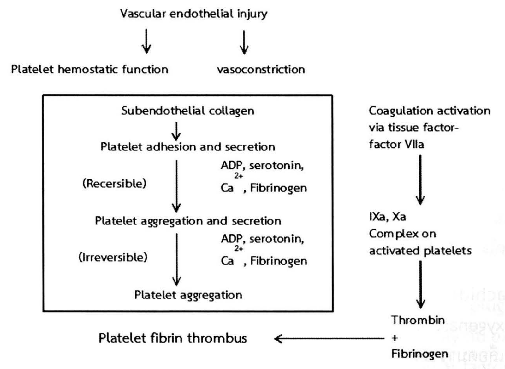
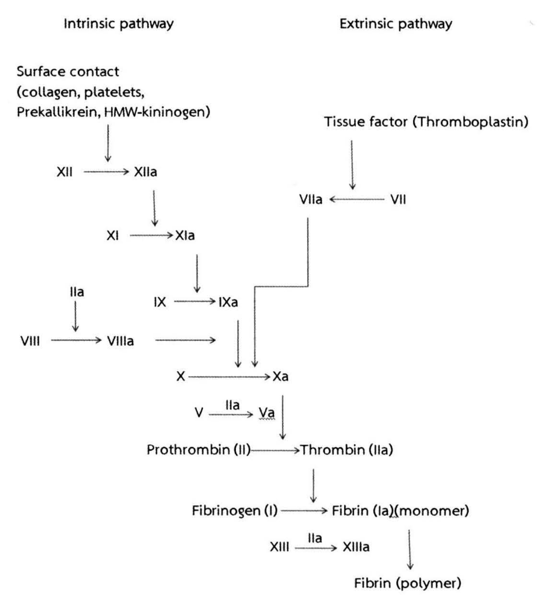
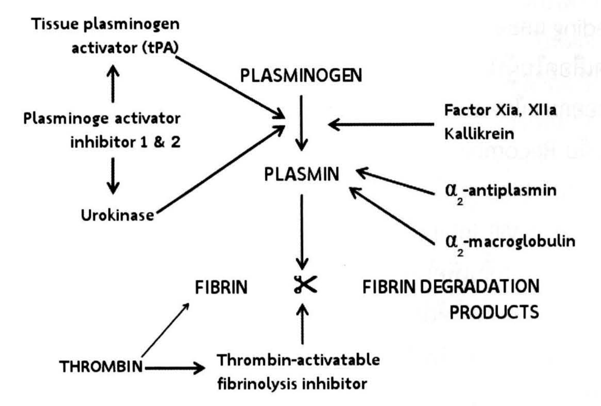
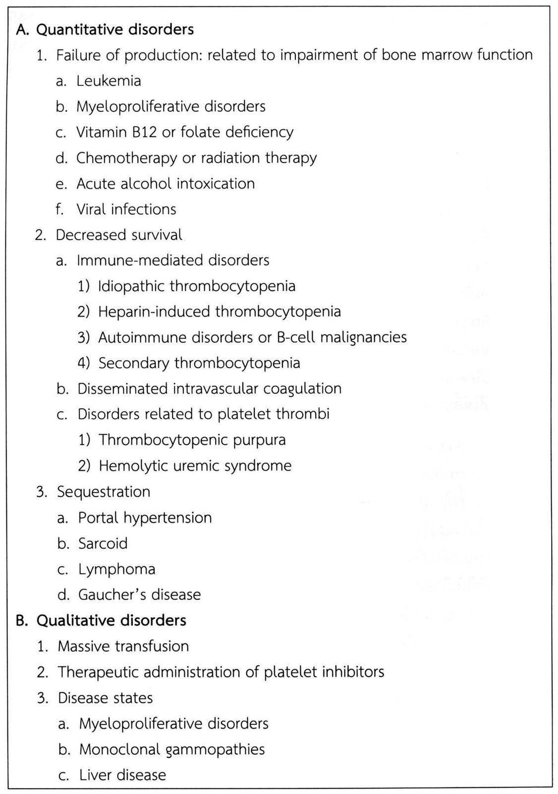
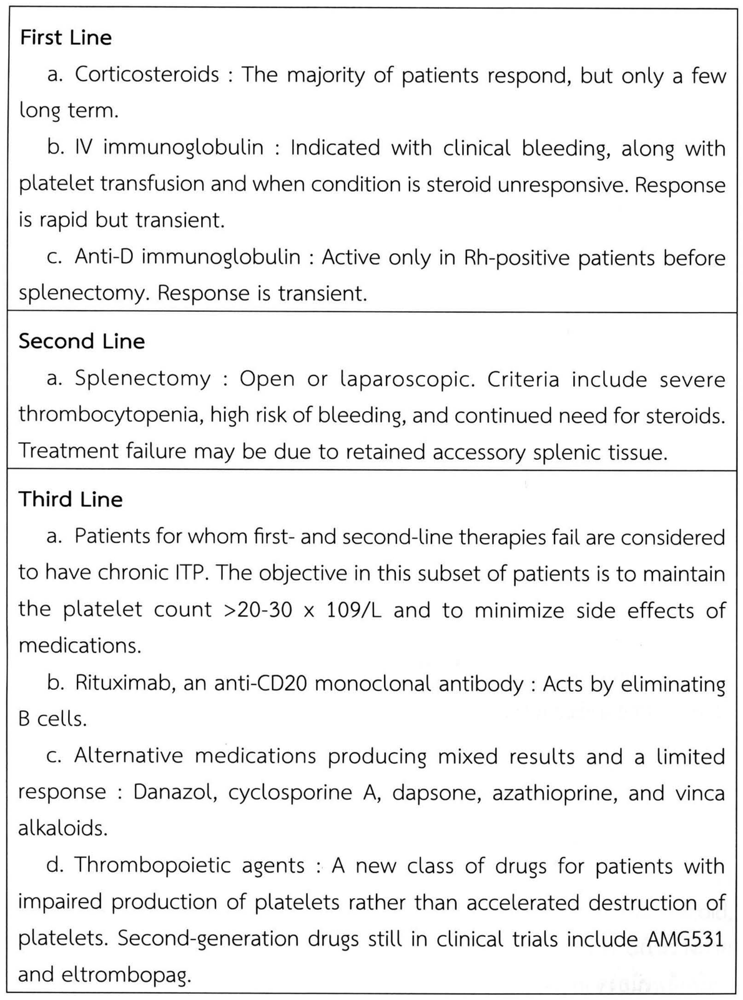
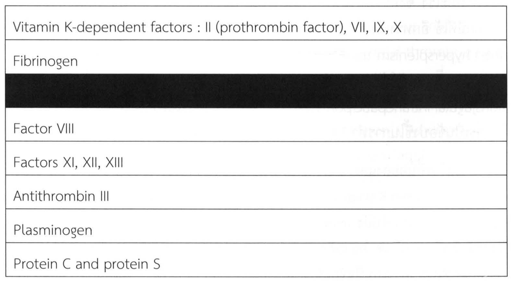

# การหยุดเลือดทางศัลยศาสตร์และการให้เลือด (Hemostasis, Surgical Bleeding, and Transfusion) — part 1 of 2

## Contents of this file
- 1. กลไกของร่างกายในการหยุดเลือด (Hemostasis) (p.110)
  - 1.1 การหดตัวของหลอดเลือด (Vascular Constriction) (p.110)
  - 1.2 การรวมตัวของเกล็ดเลือด (Platelet plug formation) (p.112)
  - 1.3 การเกิดไฟบริน (Fibrin formation) (p.113)
  - 1.4 การละลายไฟบริน (Fibrinolysis) (p.116)
- 2. ความผิดปกติเกี่ยวกับการแข็งตัวของเลือด (p.118)
  - 2.1 ความผิดปกติของการแข็งตัวของเลือดตั้งแต่กำเนิด (p.118)
    - 2.1.1 Coagulation factor deficiency (p.118)
      - 2.1.1.1 Von Willebrand’s disease (p.119)
      - 2.1.1.2 Factor XI Deficiency (p.119)
      - 2.1.1.3 Deficiency of Factors II (Prothrombin), V, and X (p.119)
      - 2.1.1.4 Factor VII Deficiency (p.120)
      - 2.1.1.5 Factor XIII Deficiency (p.120)
    - 2.1.2 Platelet Functional Defects (p.121)
  - 2.2 ความผิดปกติของการแข็งตัวของเลือดที่เกิดภายหลัง (p.122)
    - 2.2.1 ความผิดปกติของเกล็ดเลือด (p.122)
      - 2.2.1.1 ความผิดปกติของปริมาณเกล็ดเลือด (p.124)
      - 2.2.1.2 ความผิดปกติของคุณภาพเกล็ดเลือด (p.128)
    - 2.2.2 Acquired Hypofibrinogenemia (p.129)
      - 2.2.2.1 Disseminated Intravascular Coagulation (p.129)
      - 2.2.2.2 Primary Fibrinolysis (p.130)
    - Myeloproliferative Diseases (p.131)
    - Coagulopathy of Liver Disease (p.131)
    - Coagulopathy of Trauma (p.133)
    - ความผิดปกติในการแข็งตัวของเลือดที่ไม่ได้เป็นตั้งแต่กำเนิด (p.133)
    - Paraprotein Disorders (p.133)
    - ยาป้องกันการแข็งตัวของเลือดกับภาวะเลือดออก (p.134)
    - เครื่องปอดหัวใจเทียม (p.135)
- 3. Local Hemostasis (p.136)
  - Mechanical Procedures (p.136)
  - Thermal Agents (p.136)

<!-- p.109 (printed none) -->
**การหยุดเลือดทางศัลยศาสตร์และการให้เลือด**

**Hemostasis, Surgical Bleeding, and Transfusion**

กฤตยา กฤตยากีรณ

<!-- p.110 (printed 96) -->
**การหยุดเลือดทางศัลยศาสตร์และการให้เลือด**

**Hemostasis, Surgical Bleeding and Transfusion**

กฤตยา กฤตยากีรณ

## 1. กลไกของร่างกายในการหยุดเลือด (Hemostasis)1

การไหลเวียนของเลือดมีความจำเป็นต่อการดำรงชีวิต การไหลเวียนของเลือดอาจเสียไป ถ้าระบบสูบฉีดเลือดล้มเหลว มีการสูญเสียเลือดเป็นจำนวนมาก หรือมีการอุดตันของหลอดเลือด ซึ่งร่างกายมนุษย์ได้มีวิวัฒนาการเพื่อป้องกันการสูญเสียเลือดเมื่อได้รับบาดเจ็บ และป้องกันการอุดตันของหลอดเลือดไม่ให้มีการอุดตันที่ผิดปกติ ทำให้เลือดสามารถดำรงสถานะเป็นของเหลวไหลเวียนอยู่ในหลอดเลือดได้

Virchow กล่าวไว้เมื่อศตวรรษที่แล้ว เกี่ยวกับการหยุดเลือดออก (Hemostasis) ว่าเป็นสมดุลระหว่างการไหลของเลือด, ฮอร์โมนในกระแสเลือด และเซลล์ต่างๆ ในกระแสเลือด ซึ่งปัจจุบันนี้เรามีความรู้ถึงปัจจัยต่างๆ ในการหยุดเลือดออก การแข็งตัวของเลือด (Coagulation) และกลไกต่างๆ ที่ควบคุมขบวนการเหล่านี้

ในทางศัลยกรรมเราแบ่งกลไกการหยุดเลือดออกเป็น 4 ขั้นตอนที่เกิดขึ้นเป็นลำดับและพร้อมๆ กัน ดังรูปที่ 1

1.1 การหดตัวของหลอดเลือด (Vascular Constriction)

1.2 การรวมตัวของเกล็ดเลือด (Platelet plug formation)

1.3 การเกิดไฟบริน (Fibrin formation)

1.4 การละลายไฟบริน (Fibrinolysis)

### 1.1 การหดตัวของหลอดเลือด (Vascular Constriction)

<!-- p.111 (printed 97) -->
การหดตัวของหลอดเลือดเป็นกลไกการตอบสนองอันดับแรกของการหยุดเลือดหลังจากหลอดเลือดได้รับบาดเจ็บ ซึ่งปรากฏการณ์นี้จะเห็นเด่นชัดในหลอดเลือดที่มีกล้ามเนื้อเรียบอยู่ (medial smooth muscle) การหดตัวของหลอดเลือดยังขึ้นอยู่กับอีกหลายปัจจัย เช่น การฉีกขาดที่สมบูรณ์ (complete transection) จะมีการหยุดเลือดได้ดีกว่าการฉีกขาดแค่บางส่วนของหลอดเลือด (partial transection) นอกจากนี้แล้วตำแหน่งของหลอดเลือดที่ได้รับบาดเจ็บในร่างกายก็มีความรุนแรงที่แตกต่างกันออกไป เช่น หลอดเลือดที่มีขนาด 1 mm ฉีกขาดบริเวณต้นขาเทียบกับหลอดเลือดขนาดเดียวกันแต่ฉีกขาดในเนื้อสมองผลลัพธ์ต่อร่างกายจะแตกต่างกันมาก ผู้ป่วยที่เป็นโรคเนื้อเยื่อเกี่ยวพันธ์ก็จะทำให้การหดตัวของหลอดเลือดไม่สมบูรณ์เท่าคนปกติ เช่น ผู้ป่วยที่เป็น Ehlers-Danlos syndrome

> **Caption (verbatim):** **รูปที่ 1** แสดงลำดับขั้นในการแข็งตัวของเลือด
> **Text in image (verbatim):** Vascular endothelial injury · Platelet hemostatic function · vasoconstriction · Subendothelial collagen · Platelet adhesion and secretion · (Recersible) · ADP, serotonin, Ca2+, Fibrinogen · Platelet aggregation and secretion · (Irreversible) · ADP, serotonin, Ca2+, Fibrinogen · Platelet aggregation · Coagulation activation via tissue factor-factor VIIa · IXa, Xa Complex on activated platelets · Thrombin + Fibrinogen · Platelet fibrin thrombus
> **Description:** Flowchart (line diagram). Flow: (1) Vascular endothelial injury → Platelet hemostatic function; Vascular endothelial injury → vasoconstriction. (2) Boxed sequence (platelet pathway): Subendothelial collagen → Platelet adhesion and secretion → [arrow labelled "(Recersible)" on the left and "ADP, serotonin, Ca2+, Fibrinogen" on the right] → Platelet aggregation and secretion → [arrow labelled "(Irreversible)" on the left and "ADP, serotonin, Ca2+, Fibrinogen" on the right] → Platelet aggregation. (3) Right column (coagulation pathway), outside the box: Coagulation activation via tissue factor-factor VIIa → IXa, Xa Complex on activated platelets → Thrombin + Fibrinogen. (4) Thrombin + Fibrinogen → (horizontal arrow pointing left) Platelet fibrin thrombus, placed below the box. The word "Recersible" is printed as such in the figure.
> **Identifiers in image:** none

เมื่อมีการบาดเจ็บต่อหลอดเลือด จะมีสารที่ทำให้หลอดเลือดหดตัวเกิดขึ้น ได้แก่ Thromboxane A2 ซึ่งเป็นสารที่มีฤทธิ์ในการหดตัวอย่างมาก ผลิตมาจาก Arachidonic acid บริเวณผิวของเกล็ดเลือด นอกจากนี้ยังมี Endothelin ซึ่งผลิตมาจาก endothelium เมื่อมีการรวมตัวกันของเกล็ดเลือด เกล็ดเลือดจะหลั่ง Serotonin (5 Hydroxytryptamine) สารอื่นที่มีฤทธิ์ในการหดตัวของหลอดเลือด เช่น Bradykinin และ Fibrinopeptides ซึ่งเป็นสารเคมีที่อยู่ใน coagulation cascade อีกด้วย

<!-- p.112 (printed 98) -->
### 1.2 การรวมตัวของเกล็ดเลือด (Platelet plug formation)

เกล็ดเลือดเป็น fragmentation ของ megakaryocytes ไม่มี nucleus มีขนาดประมาณ 2 ไมครอน ซึ่งในกระแสเลือดคนปกติจะมีเกล็ดเลือดอยู่ประมาณ 150,000-400,000/µl โดยจะมีเกล็ดเลือดอยู่ในม้ามประมาณ 30% ของทั้งร่างกาย ซึ่งภาวะปกติแล้วเกล็ดเลือดจะถูกทำลายที่ม้ามใน 7-10 วัน

ในกระแสเลือดเกล็ดเลือดจะไม่เกาะติดกันและไม่ยึดติดกับผนังหลอดเลือด แต่เมื่อมีการบาดเจ็บต่อหลอดเลือดแล้วเกล็ดเลือดจะทำหน้าที่ในการห้ามเลือด โดยเกล็ดเลือดจะสัมผัสกับ subendothelial collagen ซึ่งจำเป็นต้องมี von Willebrand's factor (vWF) เพื่อให้เกล็ดเลือดยึดเกาะ ซึ่งในผู้ป่วยที่เป็น von Willebrand's disease จะไม่มีปัจจัยนี้ทำให้เลือดออกแล้วหยุดไหลยากกว่าคนปกติ

vWF จะยึดกับ glycoprotein I/IX/V บริเวณผนังของเกล็ดเลือด (ผู้ป่วยที่ขาด glycoprotein Ib receptor จะทำให้เกล็ดเลือดไม่สามารถเกาะติดกับ vWF ได้ เรียกโรค Bernard-Soulier syndrome) หลังจากนั้นเกล็ดเลือดจะปล่อยสารเคมี Adenosine diphosphate (ADP) และ serotonin ให้เกล็ดเลือดมารวมตัวกัน เพื่อช่วยในการห้ามเลือดบริเวณหลอดเลือดที่ฉีกขาด ซึ่งขั้นตอนนี้เรียกว่า *primary hemostasis* การรวมตัวกันของเกล็ดเลือดในขั้นตอนนี้ยังไม่แน่นพอและสามารถหลุดออกได้ และ heparin ยังไม่เข้ามามีผลในการแข็งตัวของเลือดในขั้นนี้ ทำให้ผู้ป่วยที่ได้รับ heparin ยังสามารถเกิดการหยุดของเลือดได้

Arachidonic acid ที่หลั่งจาก platelet membranes จะถูกเปลี่ยนโดย Cyclooxygenase เป็น TXA2 ซึ่งมีฤทธิ์ในการหดตัวของหลอดเลือดและเป็นสารชักนำให้เกล็ดเลือดมารวมตัวกัน นอกจากนี้แล้ว Arachidonic acid บางส่วนจะถูกนำไปยัง endothelial cells แล้วเปลี่ยนเป็น prostacyclin (PGI2) ซึ่งมีฤทธิ์ทำให้หลอดเลือดคลายตัวและป้องกันการรวมตัวกันของเกล็ดเลือด

Cyclooxygenase ของเกล็ดเลือดจะถูกยับยั้งอย่างถาวรเมื่อผู้ป่วยได้รับยา aspirin ผู้ป่วยที่ทาน NSAID ฤทธิ์ของ Cyclooxygenase สามารถเปลี่ยนกลับได้เมื่อหยุดยา NSAID ส่วน COX-2 inhibitors ไม่มีผลกระทบต่อ Cyclooxygenase เพราะฉะนั้นถ้าผู้ป่วยต้องรับการผ่าตัดมีความจำเป็นที่ต้องหยุดยา aspirin อย่างน้อยหนึ่งสัปดาห์ก่อนผ่าตัด เพื่อให้เกล็ดเลือดที่สร้างใหม่ ทดแทนส่วนที่เสีย function ไป ถ้าผู้ป่วยทานยา NSAID สามารถหยุดยาวันผ่าตัดได้ ส่วนผู้ป่วยที่ทาน COX-2 inhibitor ไม่จำเป็นต้องหยุดยา

<!-- p.113 (printed 99) -->
ยาอีกตัวที่ใช้กันมากขึ้นคือ Clopidogrel มีฤทธิ์ต่อ Adenosine diphosphate (ADP) receptor บนผิว platelet มีความจำเพาะและยับยั้งอย่างถาวรต่อ P2Y12 ซึ่งเป็น subtype ของ ADP receptor มีผลทำให้การรวมตัวกันของ platelet เสียไปโดยยับยั้งการกระตุ้น glycoprotein IIb/IIIa pathway ผู้ป่วยที่ทานยานี้ควรหยุดยาอย่างน้อย 1 สัปดาห์ก่อนผ่าตัด

หลังจากที่เกล็ดเลือดมารวมตัวกันจะมีการหลั่ง ADP, Ca2+, serotonin, TXA2, และ α-granule proteins เมื่อถึงขั้นนี้ fibrin จะเชื่อม glycoprotein IIb/IIIa receptor บน activated platelets ทำให้เกล็ดเลือดแข็งตัวมากขึ้นและไม่สามารถเปลี่ยนกลับได้ ผู้ป่วยที่ขาด glycoprotein IIb/IIIa เรียก Glanzmann's thrombasthenia Thrombospondin เป็นโปรตีนอีกตัวที่หลั่งจาก α–granule มีฤทธิ์ทำให้ fibrinogen ที่ติดกับผิว platelet แข็งแรงขึ้น ส่วน Platelet factor 4 (PF4) เป็น potent heparin antagonist

สารที่มีฤทธิ์ในการยับยั้งการแข็งตัวของเกล็ดเลือดในขั้นนี้ ได้แก่ aspirin, NSAIDs, cyclic adenosine monophosphate (cAMP) และ nitric oxide หลังจากมีการหลั่งสารเคมีของเกล็ดเลือดจะมีการเปลี่ยนแปลงของ phospholipids บริเวณผิวเกล็ดเลือด ทำให้แคลเซียม และ clotting factors เกาะที่ผิวเกล็ดเลือดเกิดเป็น enzymatically active complexes เรียกว่า platelet factor 3 ซึ่งเป็นตัวเร่งปฏิกิริยาในการเปลี่ยน prothrombin (factor II) เป็น thrombin (factor IIa)

### 1.3 การเกิดไฟบริน (Fibrin formation)

Coagulation path way ทำให้เกิดไฟบรินซึ่งนำไปสู่ fibrin platelet plug เพื่อให้ง่ายต่อการเข้าใจมักแบ่ง coagulation pathway เป็น intrinsic pathway กับ extrinsic pathway ทั้งสอง pathway จะมาบรรจบกันที่ common pathway ที่ factor X แต่ในความเป็นจริง ในร่างกายจะมีการทำงานร่วมกันของ factor ต่างๆ อย่างซับซ้อนทั้งสอง pathway ดังรูปที่ 2

<!-- p.114 (printed 100) -->

> **Caption (verbatim):** **รูปที่ 2** แสดง Coagulation cascade
> **Text in image (verbatim):** Intrinsic pathway · Extrinsic pathway · Surface contact (collagen, platelets, Prekallikrein, HMW-kininogen) · XII · XIIa · XI · XIa · IIa · IX · IXa · VIII · VIIIa · Tissue factor (Thromboplastin) · VIIa · VII · X · Xa · V · IIa · Va · Prothrombin (II) · Thrombin (IIa) · Fibrinogen (I) · Fibrin (Ia)(monomer) · XIII · IIa · XIIIa · Fibrin (polymer)
> **Description:** Line diagram of the coagulation cascade with two column headings, "Intrinsic pathway" (left) and "Extrinsic pathway" (right). Flow: (1) Intrinsic: Surface contact (collagen, platelets, Prekallikrein, HMW-kininogen) → (arrow down onto) XII → XIIa; XIIa → (down onto) XI → XIa; XIa → (down onto) IX → IXa; IIa → (down onto) VIII → VIIIa; VIIIa → (horizontal arrow toward the IXa downward arrow); IXa → (down onto) X. (2) Extrinsic: Tissue factor (Thromboplastin) → (down onto the arrow) VII → VIIa (arrow pointing left from VII to VIIa); VIIa → a stepped line running down and left, ending in an arrow onto X. (3) Common: X → Xa; V → Va with "IIa" written above the arrow; Xa → (down onto) Prothrombin (II) → Thrombin (IIa); Thrombin (IIa) → (down onto) Fibrinogen (I) → Fibrin (Ia)(monomer); XIII → XIIIa with "IIa" above the arrow; Fibrin (Ia)(monomer) → (down) Fibrin (polymer). "Va" and "(Ia)" carry a faint wavy spell-check-style underline in the printed figure.
> **Identifiers in image:** none

Intrinsic pathway เริ่มด้วย factor XII แล้วผ่านขบวนการกระตุ้นเอนไซม์ต่างๆ ตามลำดับขั้นของ factors XI, IX, และ VII ซึ่ง pathway นี้สามารถเกิดขึ้นได้ในหลอดเลือดโดยไม่ต้องสัมผัสกับ tissue factor เพื่อกระตุ้นขบวนการนี้ ในทางตรงกันข้าม extrinsic pathway ต้องอาศัย tissue factor ของบริเวณที่ได้รับบาดเจ็บเพื่อกระตุ้นขั้นตอนนี้ ซึ่งเริ่มที่ factor VII ทั้งสอง pathway จะมาบรรจบกันที่ common pathway (factor X) แล้วกระตุ้น factors II (prothrombin) และ factor I (fibrinogen)

เราสามารถตรวจทางห้องปฏิบัติการเพื่อดูความผิดปกติของการแข็งตัวของเลือด โดยส่งตรวจ activated partial thromboplastin time (aPTT) ถ้ามีค่าสูงกว่ามาตรฐานแสดงถึงการเสียของ intrinsic pathway และ prothrombin time (PT) ถ้ามีค่าสูงกว่ามาตรฐานแสดงถึงการเสียของ extrinsic pathway ดังตารางที่ 1 ในผู้ป่วยที่พร่อง Vitamin K หรือทาน warfarin จะมีผลต่อ factors II, VII, IX, และ X โดยทั่วไประดับ fibrinogen ต้อง <50 mg/dL ถึงจะมีผลต่อค่า PT และ aPTT

<!-- p.115 (printed 101) -->
**ตารางที่ 1 แสดง Coagulation factors ที่ตรวจโดย prothrombin time และ activated partial thromboplastin time**

| PT | aPTT |
| --- | --- |
| VII | XII |
| X | HMWK |
| V | Prekallikrein |
| II | XI |
| Fibrinogen | IX |
|  | VIII |
|  | X |
|  | V |
|  | II |
|  | Fibrinogen |

กลไกการแข็งตัวของเลือดซับซ้อนและมีความสัมพันธ์กันหลายขั้นหลายตอน เมื่อผนังหลอดเลือดได้รับบาดเจ็บ coagulation pathway ถูกกระตุ้นโดย subendothelial tissue และมีการทำงานของ proteolytic enzyme ซึ่งจะเป็นตัวกระตุ้นเอนไซม์ลำดับต่อไป โดยการ cleavage ของ proenzyme และผิว phospholipid เช่น ที่ผิวเกล็ดเลือด tissue factor VIIa complex จะเป็นตัว catalyzes ปฏิกิริยา factor X เป็น factor Xa ซึ่งปฏิกิริยานี้เกิดขึ้นที่ phospholipid surface ของ activated platelets ซึ่งมีความสามารถในการ activate factor X เป็น Xa มากกว่า factor VIIa อย่างเดียวถึงสี่เท่า

factor Xa, Va, Ca2+ และ phospholipid รวมกันเป็น prothrombinase complex ที่เปลี่ยน prothrombin เป็น thrombin ซึ่งมีบทบาทหลายตำแหน่งในกลไกการแข็งตัวของเลือด โดยกระตุ้น fibrinogen เป็น fibrin กระตุ้น factors V, VII, VIII, XI, XIII, และ platelets

<!-- p.116 (printed 102) -->
factor VIIIa รวมกับ factor IXa เป็น intrinsic factor complex มีความสามารถในการกระตุ้น factor X เป็น Xa มากกว่า extrinsic (tissue factor VIIa) complex หลายเท่า หลัง prothrombin ถูกเปลี่ยนเป็น thrombin thrombin จะหลุดจากผิว platelet แล้วเปลี่ยน fibrinogen เป็น fibrin และได้ peptides สองตัวคือ fibrinopeptides A และ B ซึ่งการตัด fibrinopeptide A ทำให้เกิด end-to-end polymerization ของ fibrin ส่วนการตัดของ fibrinopeptide B ทำให้เกิด side-to-side polymerization ของ fibrin clot ขั้นตอนหลังนี้ จะได้รับการช่วยเหลือจาก thrombin-activatable fibrinolysis inhibitor (TAFI) ทำให้ลิ่มเลือดมีความเสถียรมากขึ้น

การแข็งตัวของเลือดมีการควบคุมนอกจากป้องกันไม่ให้เสียเลือดแล้ว ยังมีกลไกป้องกันไม่ให้มีลิ่มเลือดเกิดการกระจายไปยังบริเวณอื่นที่ไม่ได้รับบาดเจ็บ ซึ่งมีอยู่หลายกลไกคือ กลไกแรกเป็น feedback inhibition ของ coagulation cascade ซึ่งจะ deactivates เอนไซม์ต่างๆ ที่ทำให้เกิด thrombin กลไกที่สองคือ fibrinolysis ทำให้เกิดการย่อยสลาย fibrin clot

Tissue factor pathway inhibitor (TFPI) ยับยั้ง extrinsic tissue factor-VIIa complex ซึ่งเป็นการยับยั้งตัวเร่งปฏิกิริยาการผลิต factors Xa และ IXa หน้าที่หลักของ Antithrombin III คือไปยับยั้งการผลิต thrombin กลไกหลักอีกอันในการยับยั้ง thrombin formation คือ protein C system ระบบนี้เกิดขึ้นเมื่อ thrombin bind กับ thrombomodulin แล้วเปลี่ยน protein C เป็น activated protein C (APC) แล้วรวมตัวกับ protein S เป็น APC–protein S complex ซึ่งจะไป cleaves factors Va และ VIIIa ทำให้ไม่สามารถไปรวมทำปฏิกิริยากับ tissue factor–VIIa และ prothrombinase complexes มีผู้ป่วยกลุ่มหนึ่งที่มีความผิดปกติทางพันธุกรรมของ factor V ที่เรียก factor V Leiden ที่ resistant ต่อการ cleavage โดย APC ทำให้ factor V ยังคง active อยู่ (procoagulant) ทำให้ผู้ป่วยกลุ่มนี้มีอุบัติการณ์ venous thromboembolic สูงกว่าคนปกติ

### 1.4 การละลายไฟบริน (Fibrinolysis)

ในขบวนการสมานแผลลิ่มเลือดจะถูกย่อยสลายทำให้หลอดเลือดที่อุดตันกลับมามีเลือดไหลผ่านได้อีกครั้ง เอนไซม์หลัก ได้แก่ plasmin ซึ่งจะย่อย fibrin ที่หลายตำแหน่งนำไปสู่ circulating fragments และถูกกำจัดโดย proteases อื่นๆ ต่อไป หรือโดยไตและตับ การสลายไฟบริน (Fibrinolysis) เริ่มต้นพร้อมๆ กับการแข็งตัวของเลือด โดย

<!-- p.117 (printed 103) -->
ได้รับอิทธิพลจาก circulating kinases, tissue activators, และ kallikrein ซึ่งสามารถพบได้ในหลายอวัยวะของร่างกายรวมถึง vascular endothelium Plasminogen ถูกเปลี่ยนเป็น plasmin โดย plasminogen activators หลายตัว เช่น tissue Plasminogen Activator, urokinase Plasminogen Activator และ factor XII เอนไซม์ tPA ผลิตที่ endothelial cells เมื่อมีการแข็งตัวของเลือด tPA และ plasminogen จะรวมตัวกับ fibrin ทำให้เกิด trimolecular complex ซึ่งสามารถที่จะย่อยไฟบรินได้อย่างมีประสิทธิภาพ

ร่างกายมีหลายกลไกเพื่อให้ขบวนการ fibrinolysis เกิดเฉพาะที่และเป็นไปตามลำดับความเหมาะสมในบริเวณที่มีลิ่มเลือดอยู่ tPA กระตุ้น plasminogen ได้ดีขึ้นเมื่อ fibrinogen ยึดติดกับ fibrin plasmin จะถูกยับยั้งโดย α2-antiplasmin เป็นโปรตีนที่ cross-link กับ fibrin โดย factor XIII ทำให้ลิ่มเลือดไม่ถูกย่อยสลายเร็วจนเกินไป การย่อยสลายไฟบรินทำให้เกิด fibrin degradation products ซึ่งรวมไปถึง E-nodules และ D-dimers ชิ้นส่วนลิ่มเลือดที่เป็น fragment เล็กๆ จะ interfere กับ platelet aggregation ส่วน fragment ที่ใหญ่กว่าอาจถูกรวมเข้าไปในลิ่มเลือดใหม่ที่กำลังเกิด ทำให้ลิ่มเลือดใหม่ไม่เสถียร การตรวจพบ D-dimers ในกระแสเลือดเป็นตัวบ่งชี้ว่ามี thrombosis หรือสภาวะที่กระตุ้น fibrinolytic system ตัวยับยั้งตัวสุดท้ายของระบบ fibrinolytic คือ TAFI เป็น procarboxypeptidase ซึ่งถูกกระตุ้นโดย thrombin-thrombomodulin complex ดังรูปที่ 3

> **Caption (verbatim):** **รูปที่ 3** แสดงการกระตุ้นและยับยั้งขบวนการ fibrinolysis
> **Text in image (verbatim):** Tissue plasminogen activator (tPA) · Plasminoge activator inhibitor 1 & 2 · Urokinase · PLASMINOGEN · Factor Xia, XIIa Kallikrein · PLASMIN · α2-antiplasmin · α2-macroglobulin · FIBRIN · FIBRIN DEGRADATION PRODUCTS · THROMBIN · Thrombin-activatable fibrinolysis inhibitor
> **Description:** Line diagram of the fibrinolytic system. A central vertical axis runs PLASMINOGEN → PLASMIN → a scissors symbol placed between FIBRIN (left) and FIBRIN DEGRADATION PRODUCTS (right), i.e. plasmin cleaves fibrin into fibrin degradation products. Activators converge on the PLASMINOGEN → PLASMIN arrow: diagonal arrows from Tissue plasminogen activator (tPA) (upper left) and from Urokinase (lower left), and a horizontal arrow from "Factor Xia, XIIa Kallikrein" (right). On the left, "Plasminoge activator inhibitor 1 & 2" has an arrow pointing up to tPA and an arrow pointing down to Urokinase. On the right, α2-antiplasmin and α2-macroglobulin each have an arrow pointing to PLASMIN. At the bottom, THROMBIN has a thin arrow up to FIBRIN and a horizontal arrow to "Thrombin-activatable fibrinolysis inhibitor", which has an arrow pointing up to the scissors (fibrin cleavage step). "Plasminoge" is spelled as printed.
> **Identifiers in image:** none

<!-- p.118 (printed 104) -->
## 2. ความผิดปกติเกี่ยวกับการแข็งตัวของเลือด

### 2.1 ความผิดปกติของการแข็งตัวของเลือดตั้งแต่กำเนิด

#### 2.1.1 Coagulation factor deficiency

ความผิดปกติเกี่ยวกับการแข็งตัวของเลือดที่เป็นแต่กำเนิดพบได้ทุก factor แต่ที่พบบ่อย ได้แก่ การพร่อง factor VIII (hemophilia A และ von Willebrand's disease) พร่อง factor IX (hemophilia B หรือ Christmas disease) และพร่อง factor XI Hemophilia A และ hemophilia B ถ่ายทอดทางพันธุกรรมโดย sex-linked recessive โดยจะพบโรคนี้ในเพศชายเป็นหลัก ความรุนแรงของโรค hemophilia A และ hemophilia B ขึ้นกับระดับของ factor VIII หรือ factor ใน plasma ผู้ป่วย ระดับ plasma factor <1% ถือว่าเป็น severe disease ระดับ factor ระหว่าง 1 และ 5% เป็น moderately severe และ 5 ถึง 30% เป็น mild disease ผู้ป่วยที่เป็น severe hemophilia จะมี severe spontaneous bleed มักพบในข้อต่างๆ ซึ่งนำไปสู่ arthropathies อาจพบ Intramuscular hematomas, retroperitoneal hematomas, GI, genitourinary, retropharyngeal, Intracranial bleeding and bleeding จากลิ้นหรือ lingual frenulum ซึ่งอาจเป็นภัยคุกคามชีวิตผู้ป่วยได้ใน severe disease ผู้ป่วยที่เป็น moderately severe hemophilia ไม่ค่อยพบ spontaneous bleeding แต่จะมีเลือดออกอย่างมากในกรณี trauma หรือผ่าตัด ผู้ป่วยที่เป็น mild disease จะไม่มี spontaneous bleeding และจะมีแค่ minor bleeding หลัง major trauma หรือผ่าตัด เนื่องจากเกล็ดเลือดในผู้ป่วย hemophilia ยังสามารถทำงานได้ตามปกติ ผู้ป่วยอาจไม่มีเลือดออกมากในตอนแรกหลังบาดเจ็บ ผู้ป่วยที่เป็น hemophilia A รักษาโดยให้ factor VIII หรือ Recombinant factor VIII ส่วน hemophilia B ให้ factor IX ทดแทนหรือ recombinant หรือ high-purity factor IX ผู้ป่วย hemophilia C จำนวนหนึ่งจะมี factor VIII inhibitor ในผู้ป่วยที่มี low titer สามารถที่จะให้ factor VIII ในปริมาณที่มากขึ้นเพื่อให้ได้ระดับ plasma ที่ต้องการ ผู้ป่วยที่มี high titer ของ inhibitors อาจต้องให้เป็น porcine factor VIII หรือ prothrombin complex concentrates, activated prothrombin complex concentrates, หรือ recombinant factor VIIa Recombinant factor VIIa สามารถใช้ในผู้ป่วยที่เป็น factor IX–deficient และมี inhibitor บางกรณีอาจใช้ **ε** -aminocaproic acid

<!-- p.119 (printed 105) -->
ซึ่งทำหน้าที่ยับยั้ง fibrinolysis ยาอีกตัวที่สามารถใช้ได้คือ desmopressin acetate (DDAVP)

##### 2.1.1.1 Von Willebrand’s disease

von Willebrand’s disease (vWD) เป็นความผิดปกติตั้งแต่กำเนิดที่พบบ่อยที่สุดใน congenital bleeding disorder จะพบว่าผู้ป่วยเหล่านี้จะมี factor VIII ต่ำ โรคนี้เป็น autosomal dominant disorder vWF มีหน้าที่นำพา factor VIII ในกระแสเลือด และเป็นตัวเกาะของเกล็ดเลือด ผู้ป่วยที่เป็น vWD จะมีลักษณะอาการคล้ายผู้ป่วยที่มีเกล็ดเลือดทำงานผิดปกติคือ ช้ำง่าย มีเลือดออกตามไรฟัน และ menorrhagia vWD แบ่งเป็นสามชนิด Type I คือมี partial quantitative deficiency Type II คือ qualitative defect และ Type III คือ total deficiency หนึ่งในการรักษา vWD คือให้ intermediate-purity factor VIII concentrate ซึ่งจะมีทั้ง vWF และ factor VIII นอกจากนี้แล้วยังสามารถให้ desmopressin acetate ทำให้ปริมาณ endogenous vWF สูงขึ้นโดยกระตุ้นให้หลั่งจาก endothelial cells Desmopressin acetate ใช้ได้วันละครั้งเนื่องจากร่างกายต้องใช้เวลาในการผลิตและเก็บใน endothelium

##### 2.1.1.2 Factor XI Deficiency

เป็น autosomal recessive บางครั้งเรียก hemophilia C พบได้บ่อยในชนกลุ่ม Ashkenazi ชาวยิว Spontaneous bleeding พบได้น้อย มักพบเลือดออกผิดปกติในผู้ป่วยหลังผ่าตัด ประสบอุบัติเหตุ หรือได้รับหัตถการที่ลุกล้ำ ผู้ป่วยที่พร่อง factor XI ที่มาด้วยเลือดออก หรือมีแผนที่จะผ่าตัด รักษาโดยให้ fresh-frozen plasma ทุกๆ หนึ่งมิลลิลิตรของ FFP จะประกอบไปด้วย 1 unit ของ factor XI activity ดังนั้นปริมาณที่ต้องทดแทนขึ้นอยู่กับภาวะเดิมของผู้ป่วย ระดับที่ต้องการจะแก้ไข และปริมาตรที่ผู้ป่วยจะได้รับ Recombinant factor VIIa สามารถใช้ในผู้ป่วยเด็กที่เป็น severe factor XI deficiency ได้ Desmopressin acetate ก็สามารถใช้ป้องกันเลือดออกในผู้ป่วยเหล่านี้

##### 2.1.1.3 Deficiency of Factors II (Prothrombin), V, and X

ภาวะพร่อง factors II, V, และ X ตั้งแต่กำเนิดพบได้น้อยมาก มีการถ่ายทอดแบบ autosomal recessive ภาวะเลือดออกอย่างมีนัยสำคัญพบในผู้ป่วย

<!-- p.120 (printed 106) -->
homozygotes ที่มี <1% ของ activity ปกติ ในภาวะที่พร่องปัจจัยต่างๆ เหล่านี้รักษาโดยการให้ FFP เช่นเดียวกับ factor XI ทุกๆ หนึ่งมิลลิลิตรของ FFP จะประกอบไปด้ย 1 unit ของ factor ต่างๆ อย่างไรก็ตาม factor V จะต่ำกว่าปกติ เนื่องจากความไม่เสถียรของมัน half-life ของ prothrombin (factor II) อยู่ที่ประมาณ 72 ชั่วโมง) ปริมาณ factor ที่ต้องใช้ในการแข็งตัวของเลือดต้องมีอย่างน้อย 25% ของค่าปกติ Prothrombin complex concentrates สามารถใช้รักษาภาวะพร่อง prothrombin หรือ factor X การให้ FFP ทุกวันใช้สำหรับรักษาภาวะเลือดออกในผู้ป่วยที่มีภาวะพร่อง factor V โดยมีเป้าให้ค่าอยู่ที่ประมาณ 20 to 25% ของ activity ปกติ ภาวะพร่อง Factor V อาจพบร่วมกับภาวะพร่อง factor VIII ซึ่งต้องรักษาโดยให้ factor VIII concentrate และ FFP ผู้ป่วยบางรายที่พร่อง factor V จะมีภาวะพร่อง factor V ในเกล็ดเลือดด้วย จึงต้องรักษาผู้ป่วยเหล่านี้โดยให้ platelet transfusions ร่วมกับ FFP

##### 2.1.1.4 Factor VII Deficiency

ภาวะพร่อง factor VII ตั้งแต่กำเนิดพบได้น้อยมากเป็นความผิดปกติแบบ autosomal recessive ภาวะเลือดออกในผู้ป่วยเหล่านี้ไม่จำเป็นต้องสัมพันธ์กับระดับของ factor VII coagulant activity ใน plasma ภาวะเลือดออกพบได้น้อยมากนอกจากระดับของ factor VII <3% ภาวะเลือดออกที่พบได้บ่อยคือช้ำง่ายและมีเลือดออกตามเยื่อเมือกต่างๆ โดยเฉพาะ epistaxis หรือเลือดออกตามเยื่อเมือกในปาก ภาวะเลือดออกหลังผ่าตัดก็พบได้ซึ่งมีรายงานสูงถึง 30% ในผู้ป่วยกลุ่มนี้ รักษาโดยการให้ FFP หรือ recombinant factor VIIa half-life ของ recombinant factor VIIa อยู่ที่ 2 ชั่วโมง ซึ่ง half-life ของ factor VII ใน FFP อยู่ที่ 4 ชั่วโมง จึงมีความจำเป็นในการให้ factor VII ซ้ำๆ

##### 2.1.1.5 Factor XIII Deficiency

ภาวะพร่อง factor XIII ตั้งแต่กำเนิดพบโดย François Duckert ในปี 1960 พบได้น้อยถ่ายทอดแบบ autosomal recessive อัตราส่วนชายต่อหญิงเป็น 1 : 1 ภาวะพร่อง factor XIII ที่เป็นภายหลังพบได้ในผู้ป่วยที่มี hepatic failure, inflammatory bowel disease, และ myeloid leukemia ภาวะเลือดออกในผู้ป่วยกลุ่มนี้มักจะพบแบบ delayed เนื่องจากภาวะการแข็งตัวของเลือดเป็นไปตามปกติแต่จะเกิด fibrinolysis ได้ง่าย เลือดออกที่ Umbilical stump

<!-- p.121 (printed 107) -->
เป็นลักษณะที่พบได้บ่อยและมีความเสี่ยงสูงต่อการเกิดเลือดออกในสมอง Spontaneous abortion พบได้ในผู้ป่วยที่มีภาวะพร่อง factor XIII นอกจากจะได้ clotting factor ทดแทนโดยให้ FFP, cryoprecipitate, หรือ factor XIII concentrate โดยปกติค่าระหว่าง 1 ถึง 2% ก็เพียงพอต่อการแข็งตัวของเลือด

#### 2.1.2 Platelet Functional Defects

ความผิดปกติของเกล็ดเลือดตั้งแต่กำเนิด รวมถึงความผิดปกติของ platelet surface proteins, abnormalities of platelet granules และ enzyme defects ความผิดปกติของโปรตีนที่ผิวเกล็ดเลือด ได้แก่ thrombasthenia และ Bernard-Soulier syndrome Thrombasthenia หรือ Glanzmann thrombasthenia เป็นความผิดปกติที่พบได้น้อยถ่ายทอดแบบ autosomal recessive โดยผิดปกติที่ glycoprotein IIb/IIIa complex พบได้ทั้งแบบพร่องและทำงานผิดปกติ ความผิดปกตินี้ทำให้การทำงานของเกล็ดเลือดรวมตัวกันผิดปกติทำให้เลือดออกได้ง่าย ความผิดปกตินี้พบครั้งแรกโดยนายแพทย์ Eduard Glanzmann ในปี 1918 ผู้ป่วยกลุ่มนี้รักษาโดยการให้เกล็ดเลือดทดแทน Bernard-Soulier syndrome เป็นความผิดปกติที่ glycoprotein Ib/IX/V receptor ซึ่งเป็นตำแหน่งที่ vWF จะจับกับเกล็ดเลือด รักษาภาวะเลือดออกที่ผิดปกติในผู้ป่วยกลุ่มนี้โดยการให้เกล็ดเลือดเช่นกัน

ความผิดปกติภายในเกล็ดเลือดที่พบบ่อยที่สุดคือ storage pool disease ประกอบไปด้วยการสูญเสียของ dense granules [เป็นที่เก็บ ADP, adenosine triphosphate (ATP), Ca2+, และ inorganic phosphate] และ α-granules ภาวะพร่อง Dense granule พบได้บ่อยที่สุด ในกลุ่มโรคนี้อาจเป็นความผิดปกติอย่างเดียวของโรคหรืออาจพบร่วมกับ partial albinism ใน Hermansky-Pudlak syndrome ภาวะเลือดออกขึ้นอยู่กับความรุนแรงของ granule defect เลือดออกเนื่องจากมีการหลั่ง ADP จากเกล็ดเลือดลดลง ภาวะพร่อง α-granules หรืออีกชื่อหนึ่งคือ gray platelet syndrome เนื่องจากพบเกล็ดเลือดเป็นสีเทาในการย้อมแบบ Wright’s stain มีรายงานพบผู้ป่วยที่มีภาวะพร่องทั้ง dense และ α-granules ในผู้ป่วยกลุ่มนี้จะมีเลือดออกที่รุนแรง ผู้ป่วยที่มีเลือดออกเล็กน้อยเนื่องจาก storage pool disease สามารถรักษาโดยให้ desmopressin acetate ทำให้มีระดับของ vWF ใน plasma สูงขึ้นเกิดกลไกที่สามารถทดแทน intrinsic platelet defect ได้ ในผู้ป่วยที่เลือดออกอย่างมากต้องรักษาโดยการให้เกล็ดเลือดทดแทน

<!-- p.122 (printed 108) -->
### 2.2 ความผิดปกติของการแข็งตัวของเลือดที่เกิดภายหลัง

#### 2.2.1 ความผิดปกติของเกล็ดเลือด

ความผิดปกติของเกล็ดเลือดที่เกิดภายหลังเป็นได้ทั้งความผิดปกติของปริมาณเกล็ดเลือด หรือความผิดปกติทางคุณภาพของเกล็ดเลือด ซึ่งอาจเกิดทั้งสองอย่างในผู้ป่วยคนเดียวกันได้ ความผิดปกติของปริมาณเกล็ดเลือด อาจเป็นผลจากการสร้างเกล็ดเลือดที่ลดลง อายุขัยของเกล็ดเลือดสั้นลง หรือถูกทำลายเป็นจำนวนมากในม้าม การที่เกล็ดเลือดถูกสร้างน้อยลงมักเป็นผลจากความผิดปกติของไขกระดูก เช่น โรค leukemia, myelodysplastic syndrome, ภาวะพร่อง vitamin B12 พร่อง folate ได้รับเคมีบำบัด ฉายรังสี ภาวะเป็นพิษจากแอลกอฮอลเฉียบพลัน หรือติดเชื้อไวรัส ถ้ามีความผิดปกติของปริมาณเกล็ดเลือดและมีข้อบ่งชี้ในการรักษาเนื่องจากมีอาการ หรือต้องทำหัตถการที่ลุกล้ำ การรักษาคือการให้เกล็ดเลือดทดแทน สาเหตุของปริมาณและคุณของเกล็ดเลือดที่ผิดปกติดังตารางที่ 2

<!-- p.123 (printed 109) -->
**ตารางที่ 2 สาเหตุของความผิดปกติของเกล็ดเลือด**

**A. Quantitative disorders**
1. Failure of production: related to impairment of bone marrow function
  a. Leukemia
  b. Myeloproliferative disorders
  c. Vitamin B12 or folate deficiency
  d. Chemotherapy or radiation therapy
  e. Acute alcohol intoxication
  f. Viral infections
2. Decreased survival
  a. Immune-mediated disorders
    1) Idiopathic thrombocytopenia
    2) Heparin-induced thrombocytopenia
    3) Autoimmune disorders or B-cell malignancies
    4) Secondary thrombocytopenia
  b. Disseminated intravascular coagulation
  c. Disorders related to platelet thrombi
    1) Thrombocytopenic purpura
    2) Hemolytic uremic syndrome
3. Sequestration
  a. Portal hypertension
  b. Sarcoid
  c. Lymphoma
  d. Gaucher’s disease

**B. Qualitative disorders**
1. Massive transfusion
2. Therapeutic administration of platelet inhibitors
3. Disease states
  a. Myeloproliferative disorders
  b. Monoclonal gammopathies
  c. Liver disease

> **Caption (verbatim):** ตารางที่ 2 สาเหตุของความผิดปกติของเกล็ดเลือด
> **Text in image (verbatim):** A. Quantitative disorders · 1. Failure of production: related to impairment of bone marrow function · a. Leukemia · b. Myeloproliferative disorders · c. Vitamin B12 or folate deficiency · d. Chemotherapy or radiation therapy · e. Acute alcohol intoxication · f. Viral infections · 2. Decreased survival · a. Immune-mediated disorders · 1) Idiopathic thrombocytopenia · 2) Heparin-induced thrombocytopenia · 3) Autoimmune disorders or B-cell malignancies · 4) Secondary thrombocytopenia · b. Disseminated intravascular coagulation · c. Disorders related to platelet thrombi · 1) Thrombocytopenic purpura · 2) Hemolytic uremic syndrome · 3. Sequestration · a. Portal hypertension · b. Sarcoid · c. Lymphoma · d. Gaucher’s disease · B. Qualitative disorders · 1. Massive transfusion · 2. Therapeutic administration of platelet inhibitors · 3. Disease states · a. Myeloproliferative disorders · b. Monoclonal gammopathies · c. Liver disease
> **Description:** Boxed single-column table laid out as a hierarchical outline of causes of platelet disorders. Two bold top-level groups: A. Quantitative disorders (with three numbered subgroups: failure of production with six lettered causes; decreased survival with immune-mediated disorders (four numbered items), DIC, and disorders related to platelet thrombi (two numbered items); sequestration with four lettered causes) and B. Qualitative disorders (massive transfusion, therapeutic platelet inhibitors, and disease states with three lettered items). The full content is transcribed above as a nested list.
> **Identifiers in image:** none

<!-- p.124 (printed 110) -->
##### 2.2.1.1 ความผิดปกติของปริมาณเกล็ดเลือด

ความผิดปกติในการสร้างเกล็ดเลือดจะเกิดเมื่อมีความผิดปกติของไขกระดูก อายุขัยของเกล็ดเลือดที่สั้นลงพบได้ในผู้ป่วยที่เป็น immune thrombocytopenia, disseminated intravascular coagulation และความผิดปกติที่พบเป็น platelet thrombi เช่น thrombotic thrombocytopenic purpura และ hemolytic uremic syndrome ความผิดปกติแบบ Immune thrombocytopenia may อาจไม่พบสาเหตุ หรืออาจเป็นร่วมกับ autoimmune disorders หรือ low-grade B-cell malignancies, อาจเป็นเนื่องจากการติดเชื้อไวรัส รวมถึงเชื้อ HIV หรือจากการใช้ยาบางชนิด Secondary immune thrombocytopenia ผู้ป่วยมักมาด้วยปริมาณเกล็ดเลือดที่ต่ำมาก petechiae, purpura และเลือดกำเดาไหล จะพบเกล็ดเลือดขนาดใหญ่ใน peripheral smear การรักษาเบื้องต้นโดยการให้สเตียรอยด์ IV gamma globulin, หรือ anti-D immunoglobulin ในผู้ป่วยที่เป็น Rh-positive ผลของทั้ง gamma globulin และ anti-D immunoglobulin ออกฤทธิ์ทันที การให้เกล็ดเลือดไม่มีความจำเป็นในผู้ป่วยกลุ่มนี้ นอกจากมีเลือดออกในระบบประสาทส่วนกลาง หรือจากตำแหน่งอื่นๆ อายุขัยของเกล็ดเลือดที่ให้สั้นมาก

Primary immune thrombocytopenia หรือเรียกอีกชื่อหนึ่ง idiopathic thrombocytopenic purpura (ITP) ในผู้ป่วยเด็กมักเป็นเร็วตามหลังการติดเชื้อไวรัสและระยะเวลาการเป็นโรคสั้น ในผู้ใหญ่มักเป็นแบบค่อยเป็นค่อยไปเรื้อรังและไม่สามารถหาสาเหตุได้ เนื่องจากเกล็ดเลือดในกระแสเลือดผู้ป่วย ITP เป็นเกล็ดเลือดที่เพิ่งออกมาในกระแสเลือดและยังสามารถทำงานได้อย่างปกติ ทำให้เลือดออก พบได้น้อยกว่าในผู้ป่วยที่มีความผิดปกติในการสร้างเกล็ดเลือดในปริมาณเกล็ดเลือดที่เท่าๆ กัน pathophysiology ของ ITP เชื่อว่าเป็นความผิดปกติทั้งการผลิตของเกล็ดเลือด และ T cell–mediated platelet destruction2 แนวทางการรักษา ITP ดังที่สรุปในตารางที่ 3 แนวทางการรักษาผู้ป่วยที่เป็น drug-induced immune thrombocytopenia รักษาโดยการหยุดยาที่ทำให้เกิดโรคออก แต่บางครั้งอาจให้ corticosteroids, gamma globulin และ anti-D immunoglobulin ทำให้เกล็ดเลือดกลับมาเป็นปกติเร็วขึ้น

<!-- p.125 (printed 111) -->
**ตารางที่ 3 แนวทางรักษา Idiopathic Thrombocytopenic Purpura (ITP) ในผู้ใหญ่**

| Line | Treatment |
| --- | --- |
| **First Line** | a. Corticosteroids : The majority of patients respond, but only a few long term. |
| **First Line** | b. IV immunoglobulin : Indicated with clinical bleeding, along with platelet transfusion and when condition is steroid unresponsive. Response is rapid but transient. |
| **First Line** | c. Anti-D immunoglobulin : Active only in Rh-positive patients before splenectomy. Response is transient. |
| **Second Line** | a. Splenectomy : Open or laparoscopic. Criteria include severe thrombocytopenia, high risk of bleeding, and continued need for steroids. Treatment failure may be due to retained accessory splenic tissue. |
| **Third Line** | a. Patients for whom first- and second-line therapies fail are considered to have chronic ITP. The objective in this subset of patients is to maintain the platelet count >20-30 x 109/L and to minimize side effects of medications. |
| **Third Line** | b. Rituximab, an anti-CD20 monoclonal antibody : Acts by eliminating B cells. |
| **Third Line** | c. Alternative medications producing mixed results and a limited response : Danazol, cyclosporine A, dapsone, azathioprine, and vinca alkaloids. |
| **Third Line** | d. Thrombopoietic agents : A new class of drugs for patients with impaired production of platelets rather than accelerated destruction of platelets. Second-generation drugs still in clinical trials include AMG531 and eltrombopag. |

> **Caption (verbatim):** ตารางที่ 3 แนวทางรักษา Idiopathic Thrombocytopenic Purpura (ITP) ในผู้ใหญ่
> **Text in image (verbatim):** First Line · a. Corticosteroids : The majority of patients respond, but only a few long term. · b. IV immunoglobulin : Indicated with clinical bleeding, along with platelet transfusion and when condition is steroid unresponsive. Response is rapid but transient. · c. Anti-D immunoglobulin : Active only in Rh-positive patients before splenectomy. Response is transient. · Second Line · a. Splenectomy : Open or laparoscopic. Criteria include severe thrombocytopenia, high risk of bleeding, and continued need for steroids. Treatment failure may be due to retained accessory splenic tissue. · Third Line · a. Patients for whom first- and second-line therapies fail are considered to have chronic ITP. The objective in this subset of patients is to maintain the platelet count >20-30 x 109/L and to minimize side effects of medications. · b. Rituximab, an anti-CD20 monoclonal antibody : Acts by eliminating B cells. · c. Alternative medications producing mixed results and a limited response : Danazol, cyclosporine A, dapsone, azathioprine, and vinca alkaloids. · d. Thrombopoietic agents : A new class of drugs for patients with impaired production of platelets rather than accelerated destruction of platelets. Second-generation drugs still in clinical trials include AMG531 and eltrombopag.
> **Description:** Boxed single-column table divided by horizontal rules into three sections, each with a bold heading (First Line, Second Line, Third Line) followed by lettered treatment entries in "agent : comment" form. First Line has three entries (corticosteroids, IV immunoglobulin, anti-D immunoglobulin), Second Line one (splenectomy), Third Line four (chronic ITP target platelet count, rituximab, alternative medications, thrombopoietic agents). In the print the "109/L" appears without a superscript. The section heading is repeated on each row in the Markdown table above because the book shows it once per section.
> **Identifiers in image:** none

<!-- p.126 (printed 112) -->
Heparin-induced thrombocytopenia (HIT) เป็นชนิดหนึ่งของ drug-induced immune thrombocytopenia เป็นภาวะที่ร่างกายมีภูมิต่อ PF4 ซึ่งเกิดขึ้นหลังจากที่ผู้ป่วยสัมผัสกับ heparin ทำให้มีความผิดปกติในการทำงานของเกล็ดเลือดและ endothelial function ทำให้เกิดภาวะเกล็ดเลือดต่ำและ thrombosis ในหลอดเลือด3 โดยปกติปริมาณเกล็ดเลือดจะเริ่มลดลงใน 5 ถึง 7 วันหลังได้รับ heparin ถ้าผู้ป่วยเคยได้รับ heparin มาก่อนเกล็ดเลือดจะต่ำใน 1 ถึง 2 วัน ควรสงสัย HIT เมื่อปริมาณเกล็ดเลือด <100,000/L หรือลดลงจากเดิม 50% HIT พบได้บ่อยในผู้ป่วยที่ได้รับ unfractionated heparin ประมาณ 1 ถึง 3% และภาวะนี้ยังสามารถพบได้ในผู้ป่วยที่ได้รับ low molecular weight heparin เป็นที่น่าสังเกตผู้ป่วยที่ได้รับ unfractionated heparin จะมีภูมิต่อ PF4 ประมาณ 17% และพบได้ 8% ของผู้ป่วยที่ได้รับ low molecular weight heparin ในผู้ป่วยเหล่านี้จะเกิด thrombocytopenia และอีกจำนวนหนึ่งในผู้ป่วยกลุ่มนี้จะมีอาการทางคลินิกของ HIT4 ผู้ป่วยกลุ่มนี้จะพบการแข็งตัวของเลือดที่ผิดปกติทั้งในหลอดเลือดแดงและหลอดเลือดดำ ในผู้ป่วยที่ไม่มี thrombocytopenia ไม่ได้แปลว่าผู้ป่วยจะไม่เป็น HIT

ในการวินิจฉัย HIT สามารถทำโดยใช้ serotonin release assay หรือ enzyme-linked immunosorbent assay (ELISA) การตรวจโดย serotonin release assay มีความจำเพาะสูงแต่ไม่ไวพอ ดังนั้นในผู้ป่วยที่ได้ผลตรวจเป็นบวกแสดงว่าเป็น HIT แต่ถ้าผลเป็นลบยังต้องทำการตรวจต่อไป การตรวจแบบ ELISA มีความจำเพาะต่ำ ดังนั้นถ้าผลตรวจเป็นบวกแสดงว่ามี anti–heparin-PF4 แต่ไม่สามารถวินิจฉัย HIT ได้ แต่ถ้าได้ผลเป็นลบแสดงว่าไม่เป็น HIT

ในการรักษาผู้ป่วยที่สงสัย HIT ในเบื้องต้นคือหยุดการให้ heparin และให้ยากลุ่มอื่นที่ต้านการแข็งตัวของเลือด การหยุด heparin เพียงอย่างเดียวไม่เพียงพอสำหรับการป้องกันการแข็งตัวของเลือด ในผู้ป่วยกลุ่มนี้ต้องให้ยาป้องกันการแข็งตัวของเลือดกลุ่ม thrombin inhibitors เช่น lepirudin, argatroban และ bivalirudin หรืออาจให้ danaparoid เป็น heparinoid ซึ่งอาจมีปฏิกิริยากับ HIT antibodies ได้ถึง 20% ในหลอดทดลองแต่พบได้ต่ำกว่านี้ในร่างกาย เนื่องจาก warfarin ในระยะแรกมีผลทำให้เกิดภาวะ hypercoagulable ดังนั้นก่อนเริ่ม warfarin มีความจำเป็นที่จะต้องได้ full anticoagulation ด้วยวิธีอื่นก่อนและเกล็ดเลือดกลับเป็นปกติจึงเริ่มให้ warfarin ได้

<!-- p.127 (printed 113) -->
ความผิดปกติของเกล็ดเลือดแบบ thrombocytopenia ที่เป็นผลลัพธ์จากการกระตุ้น เกล็ดเลือดทำให้เกิด platelet thrombi เรียกโรค thrombotic thrombocytopenic purpura (TTP) โมเลกุล large vWF กระตุ้นและทำปฏิกิริยากับเกล็ดเลือด ซึ่งโมเลกุลขนาดใหญ่นี้เป็นผลมาจากการยับยั้ง metalloproteinase enzyme, ADAMTS ซึ่งมีหน้าที่ตัดโมเลกุล large vWF โรค TTP ประกอบไปด้วย thrombocytopenia, microangiopathic hemolytic anemia, ไข้, อาการและอาการแสดงของโรคไตและระบบประสาท ถ้าพบ schistocytes ใน peripheral blood smear จะช่วยในการวินิจฉัยโรคนี้ วิธีการรักษา TTP ที่ดีที่สุดคือการทำ plasmapheresis ซึ่งมีบางการศึกษาให้ plasma แต่จากการศึกษาพบว่ากลุ่มที่ให้ plasma จะมีการกลับเป็นซ้ำของโรคและอัตราการเสียชีวิตที่สูงกว่า การให้เกล็ดเลือดในผู้ป่วยกลุ่มนี้เป็นข้อห้าม นอกจากนี้การให้ rituximab ซึ่งเป็น monoclonal antibody ต่อ CD20 โปรตีนที่อยู่บน B lymphocytes แสดงผลเป็นที่น่าพอใจในแง่ immunomodulatory ซึ่งผู้ป่วยส่วนใหญ่ของโรคนี้เป็นautoimmune mediated

Hemolytic uremic syndrome (HUS) มักเป็น secondary จากการติดเชื้อ Escherichia coli 0157 : H7 หรือแบคทีเรียอื่นที่สร้าง Shiga toxin โดยทั่วไป HUS มักมี renal failure ร่วมด้วย ผู้ป่วยบางรายอาจรุนแรงถึงขั้นต้องผ่าตัดเปลี่ยนไต อาการ และอาการแสดงทางระบบประสาทพบได้น้อย มีผู้ป่วยบางรายเป็นทั้ง TTP และ HUS ซึ่งโรค HUS มักพบในผู้ป่วยที่เป็น autoimmune diseases โดยเฉพาะ systemic lupus erythematosus และ HIV อาจพบในผู้ป่วยที่ได้รับยาบางกลุ่ม เช่น ticlopidine, mitomycin C, gemcitabine ผู้ป่วยที่รับประทานยากดภูมิ เช่น cyclosporine และ tacrolimus การรักษาคือหยุดยาตัวที่ทำให้เกิดอาการ การทำ Plasmapheresis ได้ผล แต่ปัจจุบันยังไม่ทราบถึงกลไกที่ทำให้ผู้ป่วยดีขึ้น

Sequestration เป็นอีกสาเหตุหนึ่งที่สำคัญของภาวะเกล็ดเลือดต่ำ ซึ่งมักพบร่วมกับม้ามที่โต โดยทั่วไปจะสัมพันธ์กับ portal hypertension, sarcoid, lymphoma, หรือ Gaucher’s disease จำนวนเกล็ดเลือดทั้งหมดในร่างกายจะปกติแต่จะอยู่ในม้ามเป็นส่วนใหญ่ อายุขัยของเกล็ดเลือดสั้นลงเล็กน้อย จะพบว่าภาวะเลือดออกรุนแรงน้อยกว่าที่ควรจะเป็นเมื่อเทียบกับจำนวนเกล็ดเลือด เนื่องจากเกล็ดเลือดที่อยู่ในม้ามบางส่วนสามารถเข้าสู่กระแสเลือดได้ การให้

<!-- p.128 (printed 114) -->
เกล็ดเลือดไม่สามารถทำให้จำนวนเกล็ดเลือดในกระแสโลหิตสูงขึ้นเหมือนคนปกติได้ เนื่องจากเกล็ดเลือดที่ให้ไปจะอยู่ในม้ามเช่นกัน และไม่มีข้อบ่งชี้ในการตัดม้ามในผู้ป่วยที่มีเกล็ดเลือดต่ำจาก hypersplenism ที่มาจาก portal hypertension

ภาวะเกล็ดเลือดต่ำเป็นสาเหตุที่พบได้บ่อยที่สุดที่ทำให้ผู้ป่วยศัลยกรรมเลือดออก ภาวะเกล็ดเลือดต่ำในผู้ป่วยมีได้หลายสาเหตุ และหลายโรคดังที่กล่าวในเบื้องต้น โดยทั่วไปไขกระดูกผู้ป่วยเหล่านี้จะมี megakaryocytes ที่ปกติหรือมากขึ้นเล็กน้อย ในทางกลับกันในผู้ป่วยที่มีเกล็ดเลือดต่ำจาก leukemia หรือ uremia และในผู้ป่วยที่ได้รับยาที่เป็น cytotoxic มักจะมีจำนวน megakaryocytes ในไขกระดูกที่ลดลง ภาวะเกล็ดเลือดต่ำในผู้ป่วยศัลยกรรมยังอาจเกิดจาก massive blood loss แล้วทดแทนด้วยผลิตภัณฑ์ของเลือดที่พร่องเกล็ดเลือด ภาวะเกล็ดเลือดต่ำยังสามารถเกิดจากการให้ heparin ทำให้เกิด HIT ในกรณีที่ผู้ป่วยมีกำหนดผ่าตัดที่ไม่ฉุกเฉินร่วมกับภาวะเกล็ดเลือดที่ต่ำ จำเป็นต้องหาสาเหตุและแก้ไขก่อนผ่าตัด ถ้าผู้ป่วยมีเกล็ดเลือดมากกว่า 50,000/L โดยทั่วไปไม่จำเป็นต้องให้เกล็ดเลือดเพื่อป้องกันเลือดออก

การให้เกล็ดเลือดก่อนมีข้อบ่งชี้ปัจจุบันเป็นส่วนหนึ่งของ massive transfusion นอกจากนี้เรายังให้เกล็ดเลือดเพื่อเพิ่มปริมาณเกล็ดเลือดในผู้ป่วยที่มี thrombocytopenia เกล็ดเลือดหนึ่ง unit ประกอบไปด้วยเกล็ดเลือดประมาณ 5.5 x 1010 ตัว ซึ่งจะทำให้เกล็ดเลือดเพิ่มประมาณ 10,000/L ในผู้ป่วยที่มีน้ำหนักตัว 70 กิโลกรัม ในผู้ป่วยที่มีไข้, ติดเชื้อ, hepatosplenomegaly และผู้ป่วยที่มี alloantibodies ต่อเกล็ดเลือดจะทำให้ผลของการให้เกล็ดเลือดลดลง ในผู้ป่วยที่ได้รับเกล็ดเลือดแบบปกติแล้วไม่ทำให้ปริมาณเกล็ดเลือดสูงขึ้นได้ อาจพิจารณาให้ human leukocyte antigen (HLA)-compatible platelets อาจทำให้ปริมาณเกล็ดเลือดเพิ่มขึ้นได้

##### 2.2.1.2 ความผิดปกติของคุณภาพเกล็ดเลือด

การทำงานของเกล็ดเลือดที่ผิดปกติมักพบร่วมกับภาวะ thrombocytopenia ความผิดปกติของ ADP ในการกระตุ้นการรวมตัวของเกล็ดเลือดจะเกิดในผู้ป่วยที่ได้รับ massive transfusion ภาวะ Uremia ทำให้ bleeding time นานกว่าปกติ ซึ่งแก้ไขได้โดยการทำการฟอกเลือดหรือทำ peritoneal dialysis การรวมตัวร่วมกับการหลั่งสารของเกล็ดเลือดที่ผิดปกติพบได้ในผู้ป่วย thrombocythemia, polycythemia vera และ myelofibrosis

<!-- p.129 (printed 115) -->
ยาที่มีผลต่อการทำงานของเกล็ดเลือด ได้แก่ aspirin, clopidogrel, dipyridamole และ glycoprotein IIb/IIIa inhibitors ทั้ง aspirin และ clopidogrel จะยับยั้งการทำงานของเกล็ดเลือดอย่างถาวร โดย clopidogrel จะยับยั้งการทำงานของ ADP ส่วน aspirin จะยับยั้งขบวนการ acetylation ของ prostaglandin synthase ปัจจุบันยังไม่มีการศึกษาแบบ prospective randomized trials ถึงระยะเวลาในการหยุดยา aspirin และ clopidogrel ก่อนการผ่าตัดแบบ elective แต่เป็นที่แนะนำโดยทั่วไปควรหยุดยาประมาณ 7 วันก่อนผ่าตัด ระยะเวลาในการหยุดยาก่อนการผ่าตัดแบบ urgent และ emergent ยังไม่มีข้อสรุปที่ชัดเจน การให้เกล็ดเลือดก่อนผ่าตัดอาจช่วยได้ แต่ยังไม่มีข้อมูลที่ดีรองรับ ปัญหาหลักคือยังไม่มีวิธีการตรวจสอบการทำงานของเกล็ดเลือดโดยเฉพาะ ภาวะผิดปกติอื่นที่มีผลต่อเกล็ดเลือด ได้แก่ uremia, myeloproliferative disorders, monoclonal gammopathies และโรคตับ ในผู้ป่วยศัลยกรรมการทำงานของเกล็ดเลือดที่ผิดปกติจากภาวะ uremia สามารถแก้ไขได้โดยการทำ dialysis หรือให้ desmopressin acetate การให้เกล็ดเลือดในผู้ป่วย uremic จะไม่ได้ผล การทำงานของเกล็ดเลือดในผู้ป่วยโรค myeloproliferative จะดีขึ้นเมื่อจำนวนเกล็ดเลือดลดลงสู่ค่าปกติจากการให้เคมีบำบัด จึงควรเลื่อนการผ่าตัดจนค่าเกล็ดเลือดเป็นปกติถ้าผู้ป่วยสามารถรอได้เนื่องจากผู้ป่วยกลุ่มนี้เสี่ยงต่อทั้งเลือดออกและ thrombosis การทำงานของเกล็ดเลือดที่ผิดปกติจาก monoclonal gammopathies เป็นผลจาก monoclonal protein ต่อเกล็ดเลือด การรักษาคือให้เคมีบำบัดในบางครั้งอาจต้องทำ plasmapheresis เพื่อลดจำนวนของ monoclonal protein ทำให้การแข็งตัวของเลือดดีขึ้น

#### 2.2.2 Acquired Hypofibrinogenemia

##### 2.2.2.1 Disseminated Intravascular Coagulation

นิยามอย่างเป็นทางการของ disseminated intravascular coagulation (DIC) โดย the Scientific Subcommittee on DIC of the Scientific and Standardization Committee of the International Society of Thrombosis and Haemostasis (SSC/ISTH) คือ DIC เป็น acquired syndrome ที่มีลักษณะการแข็งตัวของเลือดที่ผิดปกติในหลอดเลือดโดยไม่มี

<!-- p.130 (printed 116) -->
ความจำเพาะต่อตำแหน่งที่เกิด และเกิดได้จากหลายสาเหตุ อาจมีเริ่มและทำให้เกิดความเสียหายต่อ microvasculature ซึ่งถ้ารุนแรงมากอาจทำให้เกิด organ dysfunction ภาวะ thrombin ที่มากผิดปกตินำไปสู่การเกิด microthrombus ตามด้วยการใช้ coagulation factors และเกล็ดเลือด ทำให้ปริมาณลดลงจนเกิดภาวะเลือดออกทั่วๆ จำเป็นที่ต้องหาสาเหตุของการเกิดภาวะ DIC การบาดเจ็บต่อระบบประสาทส่วนกลางที่มีเนื้อสมองหลุดเข้าสู่กระแสเลือด กระดูกหักที่มี bone marrow เข้าสู่กระแสเลือดและ amniotic fluid embolization เป็นตัวกระตุ้น thromboplastins ที่รุนแรงทำให้เกิด DIC cascade5 สาเหตุอื่นได้แก่ มะเร็ง มีการบาดเจ็บต่ออวัยวะต่างๆ เช่น ตับอ่อนอักเสบ ตับวาย ความผิดปกติของหลอดเลือด เช่น เส้นเลือดโป่งพองที่มีขนาดใหญ่ งูกัด ยาเสพติด ปฏิกิริยาต่อเลือดที่ได้รับ การปฏิเสธอวัยวะหลังการปลูกถ่าย และภาวะติดเชื้อในกระแสโลหิต ภาวะ DIC มักพบร่วมกับการติดเชื้อในกระแสโลหิตซึ่งมักนำไปสู่ภาวะ multiple organ failure ความสัมพันธ์ระหว่างการติดเชื้อในกระแสโลหิตกับการแข็งตัวของเลือดที่ผิดปกติศึกษาโดย Dhainaut และคณะ แสดงถึงผลในแง่บวกเมื่อให้ activated protein C การวินิจฉัย DIC ใช้หลักการให้คะแนนของ SSC/ISTH ได้แก่ thrombocytopenia, prolongation PT, low fibrinogen level และ elevated levels of fibrin markers (fibrin degradation products, D-dimer, soluble fibrin monomers)

หลักการที่สำคัญในการรักษาผู้ป่วยกลุ่มนี้คือการกำจัดสาเหตุที่ทำให้เกิด DIC และประคับประคองระบบไหลเวียนโลหิตให้เพียงพอ ปัจจัยการแข็งตัวของเลือดต้องได้รับการทดแทน โดยการให้ FFP ซึ่งโดยทั่วไปเพียงพอต่อการแก้ไขภาวะ hypofibrinogenemia แต่ในบางครั้งอาจต้องให้ cryoprecipitate และ platelet concentrates

##### 2.2.2.2 Primary Fibrinolysis

ภาวะ hypofibrinogenic ในผู้ป่วยศัลยกรรมอาจเป็นผลจากความผิดปกติของ fibrinolysis สามารถพบได้ในผู้ป่วยที่ผ่าตัดต่อมลูกหมาก ทำให้ urokinase เข้าสู่กระแสโลหิต หรือผู้ป่วยที่ต้องใช้เครื่องปอดหัวใจเทียม เป็นต้น amino acid-aminocaproic acid ยับยั้งขบวนการ fibrinolysis โดยไปยับยั้ง plasminogen

<!-- p.131 (printed 117) -->
#### Myeloproliferative Diseases

โรค Polycythemia โดยเฉพาะภาวะ thrombocytosis เป็นปัจจัยเสี่ยงในการผ่าตัดที่สำคัญ ควรผ่าตัดในกรณีฉุกเฉินเท่านั้น และถ้าเป็นไปได้ควรเลื่อนการผ่าตัดออกไปก่อนโดยรักษาผู้ป่วยให้มีค่าของ hematocrit และเกล็ดเลือดที่เป็นปกติ Spontaneous thrombosis เป็นภาวะแทรกซ้อนของ polycythemia vera และสามารถอธิบายได้ในส่วนของความหนืดของเลือดที่เพิ่มขึ้น ทำให้มีแนวโน้มในหลอดเลือดเกิด stasis ในทางกลับกันผู้ป่วยมีแนวโน้มที่ทำให้เลือดออกแล้วหยุดยาก การรวมตัวของเกล็ดเลือดผิดปกติ ภาวะ thrombocytosis สามารถแก้ไขโดยให้ hydroxyurea หรือ anagrelide ก่อนผ่าตัดแบบ elective รอให้ค่า hematocrit ต่ำกว่า 48% และค่าเกล็ดเลือดต่ำกว่า 400,000/L ถ้าต้องผ่าตัดฉุกเฉินอาจต้องทำ phlebotomy แล้วให้สารน้ำ lactated Ringer's ทดแทน

#### Coagulopathy of Liver Disease

ตับมีบทบาทที่สำคัญในการแข็งตัวของเลือด เนื่องจากเป็นที่สังเคราะห์ coagulation factors ต่างๆ ดังตารางที่ 4

**ตารางที่ 4 ปัจจัยการแข็งตัวของเลือดที่สร้างโดยตับ**

| Vitamin K-dependent factors : II (prothrombin factor), VII, IX, X |
| --- |
| Fibrinogen |
| [illegible] |
| Factor VIII |
| Factors XI, XII, XIII |
| Antithrombin III |
| Plasminogen |
| Protein C and protein S |

> **Caption (verbatim):** ตารางที่ 4 ปัจจัยการแข็งตัวของเลือดที่สร้างโดยตับ
> **Text in image (verbatim):** Vitamin K-dependent factors : II (prothrombin factor), VII, IX, X · Fibrinogen · [illegible] · Factor VIII · Factors XI, XII, XIII · Antithrombin III · Plasminogen · Protein C and protein S
> **Description:** Single-column bordered table with eight rows and no header row, listing coagulation factors made by the liver. The third row (between "Fibrinogen" and "Factor VIII") is printed/scanned as a solid black band; no text in it can be read even with contrast enhancement. The table is saved as a figure because of this obscured row.
> **Identifiers in image:** none

<!-- p.132 (printed 118) -->
ความผิดปกติของการแข็งตัวของเลือดที่พบบ่อยที่สุดในโรคตับคือ thrombocytopenia ร่วมกับความผิดปกติของ humoral coagulation function ซึ่งตรวจพบได้โดยมี prolongation ของ PT และ International Normalized Ratio (INR) เกล็ดเลือดต่ำในผู้ป่วยโรคตับมักเกี่ยวกับ hypersplenism มีการลดลงของ thrombopoietin และ immune-mediated destruction ต่อเกล็ดเลือด ในผู้ป่วย hypersplenism จำนวนเกล็ดเลือดรวมในร่างกายจะปกติ แต่เกล็ดเลือดปริมาณมากจะอยู่ในม้ามที่โต เมื่อมีเลือดออกเกล็ดเลือดในม้ามจะออกมาสู่กระแสเลือดทำให้เลือดออกไม่รุนแรงเมื่อเทียบกับ platelet count ที่ต่ำ Thrombopoietin เป็น primary stimulus สำหรับขบวนการ thrombopoiesis ซึ่งอาจเป็นสาเหตุของ thrombocytopenia ในผู้ป่วยตับแข็ง ภาวะ immune-mediated thrombocytopenia อาจเกิดได้ในผู้ป่วยตับแข็งโดยเฉพาะผู้ป่วยตับแข็งที่เกิดจาก hepatitis C และ primary biliary cirrhosis ก่อนการแก้ไขภาวะเกล็ดเลือดต่ำจำเป็นต้องคำนึงถึงข้อบ่งชี้เพราะเกล็ดเลือดต่ำอย่างเดียวไม่เป็นข้อบ่งชี้ในการให้เกล็ดเลือด ส่วนใหญ่มักให้เกล็ดเลือดเมื่อต้องผ่าตัดผู้ป่วย หรือมีเลือดออกที่ผิดปกติ เนื่องจากเกล็ดเลือดที่ให้จะอยู่ในกระแสโลหิตไม่กี่ชั่วโมง ควรคำนึงถึงปัจจัยเสี่ยงต่างๆ ในการให้เกล็ดเลือด ผู้ป่วยอาจเกิด antiplatelet antibodies ได้ถ้าต้องให้เกล็ดเลือดบ่อยๆ มีอีกทางเลือกคือการให้ interleukin-11 เป็น cytokine ซึ่งกระตุ้น proliferation ของ hematopoietic stem cells และ megakaryocyte progenitors ซึ่งการศึกษาส่วนใหญ่ใช้ interleukin-11 ในผู้ป่วยมะเร็ง ซึ่งอาจมีประโยชน์ในผู้ป่วยตับแข็ง แต่เนื่องจากผลข้างเคียงที่รุนแรงจึงไม่ค่อยมีที่ใช้ อีกทางเลือกหนึ่งที่ทำได้คือการตัดม้าม หรือ splenic embolization เพื่อรักษา hypersplenism นอกจากความเสี่ยงจากการผ่าตัดแล้วการตัดม้ามทำให้ลด splenic blood flow อาจทำให้ลด portal vein flow นำไปสู่ vein thrombosis ผลลัพธ์จากการทำ transjugular intrahepatic portosystemic shunt (TIPS) เพื่อรักษา thrombocytopenia ไม่ควรเป็นข้อบ่งชี้ในการทำ TIPS

การสร้างที่น้อยลงและการทำลายที่มากขึ้นของปัจจัยในการแข็งตัวของเลือด รวมถึงภาวะพร่อง vitamin K ต่างมีผลต่อค่า PT และ INR ในผู้ป่วยที่เป็นโรคตับ เมื่อการทำงานของตับแย่ลงจะส่งผลไปถึง liver synthetic function ด้วย ทำให้มีการลดลงของปัจจัยในการแข็งตัวของเลือด ความผิดปกติทางห้องปฏิบัติการอาจให้ค่าเหมือน DIC ค่าของ D-dimer ที่สูงขึ้นอาจเป็นปัจจัยเสี่ยงต่อ variceal bleeding ได้ การดูดซึมของ vitamin K ขึ้นอยู่กับน้ำดี ดังนั้นผู้ป่วยที่เป็นโรคตับที่ไม่สามารถผลิตน้ำดีได้ หรือผู้ป่วยที่เป็น cholestatic disease จะเสี่ยงต่อภาวะพร่อง vitamin K

<!-- p.133 (printed 119) -->
เช่นเดียวกับการแก้ไขภาวะเกล็ดเลือดต่ำ การแก้ไขภาวะ coagulopathy ควรแก้เมื่อมีข้อบ่งชี้คือ เมื่อมีเลือดออกและเมื่อมีความจำเป็นต้องผ่าตัด ภาวะ coagulopathy ที่เกิดจากโรคตับแก้ไขโดยการให้ FFP ถ้าค่า fibrinogen level is <100 mg/dL การให้ cryoprecipitate สามารถช่วยได้ ซึ่งยังเป็นแหล่งของ factor VIII อีกด้วย

#### Coagulopathy of Trauma

เป็นที่ทราบกันดีถึง Bloody vicious cycle ที่พบได้ในผู้ป่วยอุบัติเหตุที่อยู่ในภาวะ acidosis, hypothermia และ coagulopathy ผู้ป่วยที่มาถึงห้องฉุกเฉินในภาวะ shock จะพบว่ามีภาวะ coagulopathy ร่วมด้วย ซึ่ง shock เป็นสาเหตุให้เกิด coagulopathy โดยกระตุ้นขบวนการ anticoagulant และ fibrinolytic pathway ในผู้ป่วย hypoperfusion จะทำให้เกิดการกระตุ้น thrombomodulin บน endothelial โดยจะทำปฏิกิริยากับ thrombin ในกระแสเลือด เกิดเป็น thrombin-thrombomodulin complexes ขึ้น complex นี้จะกระตุ้นการทำงานของ protein C และเร่งกลไก fibrinolysis โดยไป deinhibition tPA ผ่านขบวนการ consumption ตัว plasminogen activator inhibitor 1 และ thrombin-thrombomodulin complex จะไปยับยั้งการทำงานของ thrombin ทำให้ไม่สามารถเปลี่ยน fibrinogen เป็น fibrin ได้

#### ความผิดปกติในการแข็งตัวของเลือดที่ไม่ได้เป็นตั้งแต่กำเนิด

ที่พบได้บ่อยคือ antiphospholipid syndrome (APLS) จะพบ lupus anticoagulant และ anticardiolipin antibodies ซึ่งทำให้เกิด venous หรือ arterial thrombosis หรือทั้งสองอย่าง เพราะฉะนั้นในผู้ป่วยที่มีการกลับเป็นซ้ำของ thrombosis ควรที่จะตรวจหา APLS ในผู้ป่วย systemic lupus erythematosus จะพบ antiphospholipid antibodies ได้บ่อยและอาจพบได้ในผู้ป่วย rheumatoid arthritis และ Sjögren's syndrome ผู้ป่วยบางรายที่ไม่ได้มีความผิดปกติทาง autoimmune แต่พบ transient antibodies ได้จากการติดเชื้อหรือจาก drug-induced APLS ได้ ในผู้ป่วยที่เป็น APLS จะพบ prolonged aPTT แต่จะเกิด thrombosis ในร่างกาย

#### Paraprotein Disorders

Paraprotein disorders มีความผิดปกติของ globulin หรือ fibrinogen ที่รบกวนขบวนการแข็งตัวของเลือดและเกล็ดเลือด อาจเป็น immunoglobulin M ใน Waldenström's macroglobulinemia หรือ immunoglobulin G หรือ immunoglobulin A ใน multiple

<!-- p.134 (printed 120) -->
myeloma ในผู้ป่วยโรคตับโดยเฉพาะตับอักเสบ C จะพบ cryoglobulin โดยทั่วไปการให้เคมีบำบัดสามารถลดระดับของ paraproteins ใน macroglobulinemia และ myeloma ได้ ถ้ามีความจำเป็นต้องลดระดับอย่างรวดเร็วก่อนผ่าตัดก็สามารถทำ plasmapheresis เพื่อแยก Cryoglobulins และ cryofibrinogens ออก

#### ยาป้องกันการแข็งตัวของเลือดกับภาวะเลือดออก

Spontaneous bleeding สามารถพบได้จากภาวะแทรกซ้อนของการให้ heparin, warfarin, low molecular weight heparins หรือ factor Xa inhibitors ภาวะแทรกซ้อนจากการให้ heparin จะลดลงถ้าให้ด้วยวิธี continuous infusion การให้ low molecular weight heparin จะได้ระดับ anticoagulation ที่น่าเชื่อถือมากกว่าและไม่จำเป็นต้องตรวจทางห้องปฏิบัติการ ถ้ามีความจำเป็นต้องตรวจ เช่น ในผู้ป่วยที่เป็นโรคไตหรืออ้วนมากก็สามารถตรวจค่า anti-Xa activity

ผู้ป่วยที่รับประทานยา Warfarin เป็นระยะเวลานานๆ เช่น deep vein thrombosis, pulmonary embolism, valvular heart disease, atrial fibrillation, recurrent systemic embolism, recurrent myocardial infarction และผู้ป่วยที่ผ่าตัดเปลี่ยนลิ้นหัวใจเทียม จะพบ interaction ของยาทำให้ฤทธิ์ของ warfarin ลดลง ได้แก่ barbiturates ผู้ป่วยที่มีภาวะพร่อง vitamin K ยาที่ทำให้ฤทธิ์ของ warfarin เพิ่มขึ้น ได้แก่ ยาที่มี estrogen, corticosteroids หรือ adrenocorticotropic hormone ดังตารางที่ 5

**ตารางที่ 5 แสดงยาที่มีฤทธิ์ต่อ warfarin**

| | |
| --- | --- |
| ยาที่ลดฤทธิ์ warfarin | Barbiturates, oral contraceptives, estrogen-containing compounds, corticosteroids, adrenocorticotropic hormone |
| ยาที่เพิ่มฤทธิ์ warfarin | Phenylbutazone, clofibrate, anabolic steroids, L-thyroxine, glucagons, amiodarone, quinidine, cephalosporins |

ภาวะแทรกซ้อนจากการให้ยา anticoagulants พบได้บ่อย เช่น hematuria, soft tissue bleeding, intracerebral bleeding, skin necrosis และ abdominal bleeding ซึ่งพบได้ทั้ง intraperitoneal, extraperitoneal หรือ retroperitoneal ได้ ภาวะ intramural bowel hematoma เป็นภาวะแทรกซ้อนที่พบได้บ่อย ผู้ป่วยจะมีอาการปวดท้องซึ่งมักสามารถรักษาได้โดยไม่ต้องผ่าตัด มีหลายครั้งที่ผู้ป่วยจะมี rectus sheath

<!-- p.135 (printed 121) -->
hematomas ซึ่งสามารถรักษาได้โดยไม่ต้องผ่าตัดเช่นกัน ที่สำคัญที่สุดคือผู้ป่วยที่เริ่มรับประทานยา anticoagulant แล้วพบเลือดออกในทางเดินอาหารจำเป็นต้องค้นหาสาเหตุเนื่องจากส่วนใหญ่เป็นเลือดที่ออกจากมะเร็งในทางเดินอาหาร

ในผู้ป่วยที่รับยา anticoagulation และมีความจำเป็นต้องผ่าตัดถ้าค่า aPTT <1.3 เท่า หรือ INR <1.5 เท่าไม่จำเป็นต้องแก้ไข แต่ถ้าค่าสูงกว่านี้ก็สามารถผ่าตัดได้ในบางกรณีโดยไม่จำเป็นต้องแก้ไขค่าให้เป็นปกติแต่ต้องพิจารณาผู้ป่วยเป็นรายๆ ไป แต่ถ้าการผ่าตัดมีอันตรายหรืออวัยวะที่สำคัญก็มีความจำเป็นต้องแก้ไข้ค่าให้เป็นปกติ เช่น การผ่าตัดระบบประสาทส่วนกลางหรือการผ่าตัดตา เป็นต้น ผู้ป่วยที่ได้รับยา heparin อยู่ บางครั้งมีความจำเป็นต้องผ่าตัดฉุกเฉินขั้นแรกต้องหยุดยา heparin ก่อน ถ้าจำเป็นต้องแก้ไขอย่างรีบด่วนสามารถให้ protamine sulfate แต่ต้องระวังภาวะแทรกซ้อนที่อาจเกิดได้ โดยเฉพาะในผู้ป่วยที่แพ้ปลา อาการได้แก่ hypotension, flushing, bradycardia, nausea, vomiting จนถึงขั้นเสียชีวิต ในกรณีที่ผู้ป่วยทาน warfarin แล้วมี ความจำเป็นต้องผ่าตัดแบบไม่เร่งด่วนสามารถหยุดยาก่อนผ่าตัดได้ ถ้ามีความจำเป็นต้องรีบผ่าตัดด่วนสามารถแก้ไขได้โดยการให้ FFP ในผู้ป่วยที่มีทางเดินน้ำดีอุดตันหรือมีภาวะขาดอาหารสามารถรักษาโดยการให้ vitamin K แต่ถ้าผู้ป่วยมีความผิดปกติของเนื้อตับ การให้ vitamin K ก็ไม่สามารถช่วยได้ ถ้าผู้ป่วยมีความจำเป็นต้องได้รับ warfarin และมีความจำเป็นต้องหยุดยาควรเริ่มให้ low molecular weight heparin และให้เริ่มยาใหม่หลังผ่าตัดให้เร็วที่สุดซึ่งเป็น bridging หรือสามารถให้ IV unfractionated heparin เพื่อเป็นการลดโอกาสเกิด venous thromboembolism

#### เครื่องปอดหัวใจเทียม

ปัจจัยที่ทำให้เลือดออกมากผิดปกติคือการใช้เครื่องปอดหัวใจเทียมเป็นระยะเวลานานเกินไป มีการใช้ยา anticoagulants ยาต้านการแข็งตัวของเกล็ดเลือด ผู้ป่วยเป็นโรคหัวใจชนิดตัวเขียว อุณหภูมิร่างกายที่ต่ำ สาเหตุที่ทำให้เลือดออกมากผิดปกติจาก cardiopulmonary bypass คือเกิด fibrinolysis และการทำงานของเกล็ดเลือดที่ผิดปกติ ซึ่งการทำงานของเกล็ดเลือดที่ผิดปกติมีความสำคัญมากกว่า

การตรวจทางห้องปฏิบัติการณ์ที่ต้องส่งเพื่อประเมินผู้ป่วยที่มีเลือดออกหลังใช้เครื่องปอดหัวใจเทียม ได้แก่ INR, aPTT, CBC, platelet count, peripheral blood smear examination และระดับของ fibrin degradation products เริ่มต้นด้วยการให้เกล็ดเลือด ถ้าสงสัย hyperheparinemia เป็นสาเหตุ ควรให้ protamine sulfate 25% ของค่าที่

<!-- p.136 (printed 122) -->
คำนวณได้และให้ซ้ำทุก 30 นาทีถึงหนึ่งชั่วโมงจนกว่าเลือดจะหยุด ถ้ามีภาวะ fibrinolysis แก้ไขโดยการให้ epsilon-aminocaproic acid เริ่มให้ 5 ถึง 10 g แล้วให้ต่อ 1 ถึง 2 g/h จนกว่าเลือดจะหยุด Aprotinin เป็น protease inhibitor ทำหน้าที่เป็น antifibrinolytic ซึ่งพบว่าสามารถลดการให้เลือด Desmopressin acetate กระตุ้นการหลั่ง factor VIII จาก endothelial

## 3. Local Hemostasis

เลือดออกอย่างมากจากการผ่าตัดมักเกิดจากเทคนิคการผ่าตัดที่ไม่ดี ไม่ได้ทำการห้ามเลือดบริเวณที่ผ่าตัดอย่างเหมาะสม เป้าหมายคือการป้องกันเลือดออกที่มาจากหลอดเลือดที่ฉีกขาดจากการผ่าตัด

### Mechanical Procedures

การห้ามเลือดเบื้องต้นคือการใช้นิ้วกดตรงบริเวณที่ได้รับบาดเจ็บ เมื่อกดหลอดเลือดที่ proximal ต่อบริเวณที่ได้รับบาดเจ็บจะทำให้เลือดหยุดไหล หรือไหลช้าลงทำให้สามารถทำการห้ามเลือดที่เหมาะสมต่อไป เช่น การใช้ tourniquet รัดรยางค์ที่ได้รับบาดเจ็บเพื่อเป็นการห้ามเลือด หรือการทำ Pringle maneuver เพื่อลดเลือดที่ออกจากตับที่ได้รับบาดเจ็บ การใช้นิ้วกดหลอดเลือดดีกว่าการใช้ atraumatic vascular clamp เนื่องจากการใช้ clamp จะเกิดการบาดเจ็บต่อผนังหลอดเลือดไม่มากก็น้อย

เมื่อหลอดเลือดที่มีขนาดเล็กฉีกขาดสามารถใช้วิธีการผูกหลอดเลือดได้ แต่ถ้าเป็นหลอดเลือดขนาดใหญ่จำเป็นต้องทำการเย็บหลอดเลือดเพื่อป้องกันการหลุดของวัสดุที่ใช้ผูกหลอดเลือด ไหมที่ใช้มักเป็น polypropylene suture เลือดที่ออกจากไขกระดูกสามารถใช้ขี้ผึ้งในการห้ามเลือด Harmonic scalpel เป็นเครื่องเมื่อที่ใช้ตัดพร้อมกับการห้ามเลือดโดยใช้การสั่นสะเทือนที่มีความถี่สูง

### Thermal Agents

ความร้อนสามารถห้ามเลือดได้ด้วยการ denaturation protein เครื่อง electrocautary ใช้กระแสไฟฟ้าทำให้เกิดความร้อนในการห้ามเลือด ควรใช้ความแรงที่น้อยที่สุดที่สามารถทำการห้ามเลือด เนื่องจากถ้าใช้พลังงานที่สูงจนเกินไปจะทำให้เนื้อเยื่อข้างเคียงได้รับการบาดเจ็บด้วย เกิดกระแสไฟฟ้าผ่านอุปกรณ์ทางการแพทย์ที่ติดอยู่ที่ตัวคนไข้ เช่น electrocardiographic leads, permanent pacemakers หรือ defibrillators ต้องติด
