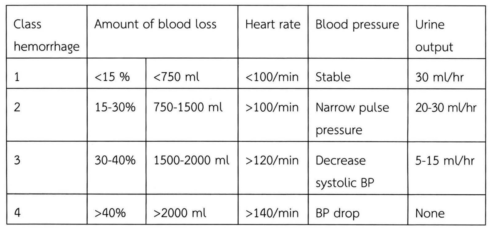

# การหยุดเลือดทางศัลยศาสตร์และการให้เลือด (Hemostasis, Surgical Bleeding, and Transfusion) — part 2 of 2

## Contents of this file
  - Topical Hemostatic Agents (p.137)
- 4. Transfusion (p.138)
  - Typing and Cross-Matching (p.138)
    - 4.1.1 Banked Whole blood (p.139)
    - 4.1.2 Fresh Whole Blood (p.140)
    - 4.1.3 RED CELL (p.140)
    - 4.1.4 Platelet (p.142)
    - 4.1.5 PLASMA (p.145)
    - 4.1.6 CRYOPRECIPITATE (p.146)
  - 4.2 ข้อบ่งชี้ในการให้เลือดและส่วนประกอบของเลือด (p.147)
  - 4.3 วิธีการให้เลือด (p.149)
  - 4.4 ปฏิกิริยาจากการรับเลือดและส่วนประกอบเลือด (TRANSFUSION REACTIONS) (p.150)
    - 1.1 ปฏิกิริยาจากการรับเลือดและส่วนประกอบเลือดชนิดเฉียบพลันแบบไม่รุนแรง (Mild reactions) (p.150)
    - 1.2 ปฏิกิริยาจากการรับเลือดและส่วนประกอบเลือดชนิดเฉียบพลันแบบรุนแรงปานกลาง (Moderately severe reactions) (p.151)
    - 1.3 ปฏิกิริยาจากการรับเลือดและส่วนประกอบเลือดชนิดเฉียบพลันแบบรุนแรง (Life-threatening reactions) (p.152)
  - Damage Control Resuscitation (p.159)
    - หลักการและเหตุผลของ damage control resuscitation (p.160)
    - หลักการใหม่ในการให้สารน้ำทดแทน (p.160)
- 5. การตรวจขบวนการแข็งตัวของเลือด (p.160)
- 6. การประเมินผู้ป่วยผ่าตัดที่เสี่ยงต่อเลือดออกผิดปกติ (p.162)
- เอกสารอ้างอิง (p.163)

<!-- p.137 (printed 123) -->
negative grounding plate ใต้ตัวผู้ป่วยเพื่อป้องกันการไหม้ของผิวหนัง มียาดมสลบบางตัวซึ่งปัจจุบันไม่ค่อยใช้กันแล้วสามารถระเบิดได้เมื่อใช้ electrocautery

### Topical Hemostatic Agents

ตัวช่วยการแข็งตัวของเลือดเฉพาะที่ มีบทบาทสำคัญในการผ่าตัด ซึ่งสารเหล่านี้แบ่งได้ตามคุณสมบัติและกลไกการทำงาน ได้แก่ physical หรือ mechanical, caustic, biologic และ physiologic agents ตัวช่วยบางตัวชักนำ protein coagulation ทำให้หลอดเลือดขนาดเล็ก หยุดเลือดออกได้ ตัวช่วยการแข็งตัวของเลือดในอุดมคติควรมีความสามารถในการห้ามเลือดสูง มีปฏิกิริยาต่อเนื่อเยื่อข้างเคียงต่ำ มีความเป็นแอนติเจนต่ำ สามารถย่อยสลายในร่างกาย ไม่ก่อให้เกิดการติดเชื้อและราคาถูก ตัวอย่างตัวช่วยการแข็งตัวของเลือดดังตารางที่ 6

**ตารางที่ 6** ตัวช่วยการแข็งตัวของเลือด

| Hemostatic agent | Trade name |
| --- | --- |
| Thrombin product | Floseal |
| Fibrin sealant | Crosseal |
| Gelatin agent | Gel foam |
| Oxidized cellulose polymer | Surgicel |

Thrombin-derivative เป็นตัวเปลี่ยน fibrinogen เป็น fibrin ทำให้เกิดลิ่มเลือด ข้อควรระวังสำหรับกลุ่มนี้คือ ถ้าเข้าสู่กระแสโลหิตจะทำให้เกิด disseminated intravascular clotting หรือเสียชีวิตได้

Fibrin sealants เตรียมจาก cryoprecipitate เวลาใช้ต้องใช้ syringe สองหลอด หลอดหนึ่งบรรจุ fibrinogen, factor XIII, fibronectin และ fibrinolysis inhibitors อีกหลอดหนึ่งบรรจุ thrombin และ calcium chloride ตัวช่วยนี้เหมาะในผู้ป่วยที่ได้รับ heparin หรือผู้ป่วยที่มีภาวะพร่องปัจจัยการแข็งตัวของเลือด

Purified gelatin สามารถนำมาใช้หลายรูปแบบ เช่น เป็นผง ฟองน้ำ แผ่น และ foams Gelatin เป็น hygroscopic มีคุณสมบัติในการดูดซับได้สูง ถูกย่อยสลายในร่างกายโดย proteinases ในเวลา 4 ถึง 6 สัปดาห์ แต่ข้อเสียคือสามารถเป็น nidus สำหรับการติดเชื้อได้

<!-- p.138 (printed 124) -->
ตัวช่วยเหล่านี้ไม่ได้ทดแทนการผ่าตัดที่พิถีพิถัน เวลาใช้ต้องคำนึงถึงข้อดีข้อเสียแต่ละตัวและประโยชน์ที่จะได้รับ โดยทั่วไปควรใช้สารเหล่านี้ให้น้อยที่สุดเท่าที่จะทำได้เพื่อลดภาวะแทรกซ้อนที่อาจเกิดขึ้นได้ ไม่รบกวนขบวนการสมานของบาดแผล รวมทั้งเป็นการลดต้นทุนในการผ่าตัด

## 4. Transfusion

การให้เลือดผู้ป่วยเริ่มมีทำกันตั้งแต่สมัย ค.ศ. 1667 โดยแพทย์ได้นำเลือดแกะมาให้เด็กชายวัย 15 ปี ซึ่งผลลัพธ์ที่ได้คือผู้ป่วยเด็กมีอาการดีขึ้นจึงได้มีการให้เลือดจากสัตว์สู่คนอีก แต่ผู้ป่วยรายต่อๆ มาเสียชีวิต จึงมีการห้ามให้เลือดตั้งแต่นั้นเป็นต้นมา จนในปี ค.ศ. 1900 Landsteiner ได้นำเลือดกลุ่ม A, B, O มาใช้ และในปี ค.ศ. 1939 มีการค้นพบ Rh group ทำให้การให้เลือดเริ่มแพร่หลายอีกครั้ง

การให้เลือดและส่วนประกอบของเลือดเป็นการช่วยชีวิตผู้ป่วยอย่างหนึ่ง แต่เหมือนกับการรักษาผู้ป่วยด้วยวิธีอื่นๆ ที่อาจมีผลแทรกซ้อนได้ทั้งในระยะสั้นและระยะยาว มีโอกาสติดเชื้อ HIV, hepatitis, syphilis, malaria และ ฯลฯ

หลักในการให้เลือดและส่วนประกอบของเลือด6, 7

1. การให้เลือดและส่วนประกอบของเลือดเป็นเพียงส่วนหนึ่งในการรักษาผู้ป่วย
2. พยายามให้มีการเสียเลือดให้น้อยที่สุด เพื่อลดความต้องการของเลือดและส่วนประกอบของเลือด
3. ผู้ป่วยที่เสียเลือดอย่างเฉียบพลันควรได้รับการให้สารน้ำทดแทนที่เหมาะสมในระหว่างที่รอการให้เลือดและส่วนประกอบของเลือด (effective resuscitation)
4. ระวัง transfusion-transmissible infections
5. ให้เลือดและส่วนประกอบของเลือดเมื่อมี benefit มากกว่า risk

### Typing and Cross-Matching

Major Cross-Match เป็นการนำเม็ดเลือดแดงของผู้บริจาค ทำปฏิกิริยากับน้ำเหลืองผู้ป่วย เพื่อดู A, B, O compatibility ซึ่งน้ำเหลืองผู้ป่วยที่นำมาใช้ตรวจไม่ควรเก็บนานเกิน

<!-- p.139 (printed 125) -->
72 ชั่วโมง ในกรณีที่ผู้ป่วยต้องได้รับ Dextran ร่วมด้วยควรนำเลือดไปทำ Cross-Match ก่อนให้ Dextran เพราะอาจไปกวนการ Cross-Match ได้

ในภาวะปกติเราจะไม่นำเลือด Rh-positive ไปให้ผู้ป่วย Rh-negative แต่ถ้ามีความจำเป็นจริงๆ ก็อาจให้ได้ และพิจารณาให้ Anti-Rh antiserum (RhoGAM) เลือด O Rh-negative สามารถให้ผู้ป่วยอุบัติเหตุได้อย่างปลอดภัย แต่ไม่ควรเกิน 4 Unit เนื่องจากอาจเกิด hemolysis

#### 4.1.1 Banked Whole blood

ในประเทศไทยมี 2 ขนาด คือ 350, 450 ml มีระดับฮีโมโกลบินประมาณ 12 g/dl และระดับฮีมาโตคริตประมาณ 36% Whole blood จะขาดเกล็ดเลือดที่ทำงานได้ (Functional platelet), Factor V และ Factor VIII

การเปลี่ยนแปลงคุณสมบัติของเม็ดเลือดแดงเมื่อเก็บไว้นานๆ

- intracellular ADP ลดลง
- 2, 3 Diphosphoglycerate ลดลงทำให้ oxygen dissociation curve shift to the left
- ความสามารถในการนำ oxygen ลดลง
- pH ลดลง
- lactic acid เพิ่มความเข้มข้นขึ้น
- potassium ออกมานอกเม็ดเลือดแดง
- ความเข้มข้นของ ammonia เพิ่มขึ้น

ข้อบ่งชี้

- การทดแทนเม็ดเลือดแดงในภาวะ hypovolemia ที่เกิดจากการเสียเลือดเฉียบพลัน
- การเปลี่ยนถ่ายเลือด (Exchange transfusion)

<!-- p.140 (printed 126) -->
#### 4.1.2 Fresh Whole Blood8

เป็นเลือดที่เก็บไม่เกิน 24 ชั่วโมง ปัจจุบันใช้ในสนามรบที่ไม่ค่อยมี Blood Bank ทหารแต่ละคนจะทราบหมู่เลือดของตนเองเมื่อมีผู้บาดเจ็บต้องได้รับเลือด ทหารที่มีหมู่เลือดตรงกันจะมาบริจาคและให้ผู้ป่วยทันที ทำให้ไม่มีปัญหาเรื่องการเก็บเลือดและ hypothermia แต่อาจมีการติดเชื้อทางเลือดได้

#### 4.1.3 RED CELL

1. PACKED RED CELL (PRC)

Packed red cell 1 unit มีปริมาณ 150-330 ml มีระดับฮีโมโกลบินประมาณ 20 g/dl และระดับฮีมาโตคริตประมาณ 55-75%

ข้อบ่งชี้

- ผู้ป่วยที่มีอาการโลหิตจางทั้งแบบเฉียบพลันและเรื้อรัง (Acute หรือ Chronic symptomatic anemia)

2. LEUKOCYTE-REDUCED RED BLOOD CELL CONCENTRATES

- LEUKOCYTE POOR PACKED RED BLOOD CELL (LPRC) คือ ส่วนประกอบของเลือด ที่ได้ปั่นแยกเม็ดเลือดขาวออกไป Leukocyte poor packed red blood cell จากสภากาชาดไทย มีปริมาณเม็ดเลือดขาวที่เหลือในถุงน้อยกว่า 1.2 × 109 cells/bag ระดับฮีมาโตคริตประมาณ 50-70% Leukocyte poor packed red blood cell 1 unit มีปริมาณ 200-350 ml
- LEUKODEPLETED PACKED RED BLOOD CELL (LDPRC) คือ ส่วนประกอบของเลือด ที่ได้กรองแยกเม็ดเลือดขาวออกไปโดยใช้ Leukocyte depleting filter ปริมาณเม็ดเลือดขาวที่เหลือในถุงน้อยกว่า 5 × 106 cells/bag ระดับฮีมาโตคริทและปริมาณจะเปลี่ยนแปลงตามส่วนประกอบของเลือดที่นำมากรอง ราคา 1,980 บาทต่อ bag แบ่งได้เป็น 2 ชนิด ได้แก่

Prestorage filter

คือ ส่วนประกอบของเลือดที่กรองเม็ดเลือดขาวออกหลังจากที่ได้รับบริจาคไม่เกิน 24 ชั่วโมง (สภากาชาดไทยทำการกรองแยกเม็ดเลือดขาวที่ 4 ชั่วโมง) เป็นส่วนประกอบของ

<!-- p.141 (printed 127) -->
เลือดที่ได้ผลดีที่สุดในการลด Febrile nonhemolytic transfusion reactions เนื่องจากเหลือเม็ดเลือดขาว Cytokine และสารอื่นๆ ที่หลั่งจากเม็ดเลือดขาวมีปริมาณน้อย แต่การกรองแยกเม็ดเลือดขาวออกทันทีหลังจากได้รับบริจาค ส่วนประกอบของเลือดนั้นอาจทำให้เชื้อแบคทีเรียที่ปนเปื้อนจากกระบวนการเจาะเลือดจากผู้บริจาคยังคงอยู่ และสามารถเจริญเติบโตได้ เพราะฉะนั้นจึงควรทิ้งระยะเวลาสักพักก่อนกรองแยกเม็ดเลือดขาว เพื่อให้เม็ดเลือดขาวเก็บกินเชื้อแบคทีเรียก่อนทำการกรองแยกเม็ดเลือดขาว

Poststorage filter

คือ ส่วนประกอบของเลือดที่กรองแยกเม็ดเลือดขาวออก หลังจากได้รับบริจาคเกิน 24 ชั่วโมง สามารถกรองแยกเม็ดเลือดขาวได้ทั้งที่ธนาคารเลือดหรือที่ข้างเตียงผู้ป่วย (Bedside filter) อาจจะไม่สามารถลดการเกิด Febrile nonhemolytic transfusion reactions ได้ดีเท่ากับ Prestorage filter เนื่องจากสามารถกรองออกได้เพียงเม็ดเลือดขาว แต่ในส่วนประกอบของเลือดยังคงมี Cytokine และสารอื่นๆ ที่หลั่งจากเม็ดเลือดขาว

ส่วนประกอบของเลือดอื่นที่มีเม็ดเลือดขาวปนเปื้อนสามารถนำมากรองแยกเม็ดเลือดขาวออกได้ โดยใช้ Leukocyte depleting filter เช่นกัน

ข้อบ่งชี้

- เพื่อลดอัตราการเกิด Febrile nonhemolytic transfusion reaction (LPRC หรือ LDPRC)
- เพื่อลดอัตราการเกิด Human leukocyte antigen alloimmunization (LDPRC)
- เพื่อลดอัตราการติดเชื้อ Cytomegalovirus (LDPRC)

วิธีให้และข้อควรระวังในการใช้ Red cell

- Packed red cell, Leukocyte poor packed red blood cell และ Leukodepleted packed red blood cell 1 unit สามารถเพิ่มระดับฮีมาโตคริตได้ประมาณ 3% และเพิ่มระดับฮีโมโกลบินได้ประมาณ 1 g/dl
- ควรเก็บรักษาที่อุณหภูมิ 2-6 °c

<!-- p.142 (printed 128) -->
#### 4.1.4 Platelet

1. PLATELET CONCENTRATES (PC) คือ เกล็ดเลือดที่เตรียมจากการปั่นแยก Whole blood โดย Platelet concentrates 1 unit มีปริมาณ 50-60 ml มีจำนวนเกล็ดเลือดมากกว่า 5.5 × 1010 ตัว

2. POOLED-LEUKOCYTE POOR PLATELET CONCENTRATE (LPPC) คือ เกล็ดเลือดที่เตรียมจากการรวม Platelet concentrates 4-6 donor units โดยวิธี Close system ปริมาณเกล็ดเลือดที่ได้จะมีประมาณเทียบเท่ากับ 4-6 units ของ Platelet concentrates มีปริมาณ 300-350 ml

3. SINGLE DONOR PLATELET CONCENTRATE (SDP) คือ เกล็ดเลือดที่เตรียมโดยเทคนิค Apheresis จากผู้บริจาค 1 ราย SDP 1 unit มีปริมาณ 200-400 ml มีจำนวนเกล็ดเลือด 3-5 × 1011 ตัว

ข้อบ่งชี้

- รักษาภาวะเลือดออก เนื่องจากเกล็ดเลือดต่ำหรือเกล็ดเลือดทำงานผิดปกติ (Platelet function defects)
- ป้องกันภาวะเลือดออก เนื่องจากเกล็ดเลือดต่ำ

วิธีให้และข้อควรระวังในการใช้ Platelet

- 1 unit of Platelet concentrates/10 kg body weight จะสามารถเพิ่มเกล็ดเลือดได้ประมาณ 20-40 × 109/L
- ในบางภาวะอาจจำเป็นต้องเพิ่มปริมาณเกล็ดเลือดที่ให้ เช่น Disseminated intravascular coagulation, Septicemia, Splenomegaly
- ควรใช้ Special platelet infusion set หรือในกรณีที่ไม่มีให้เปลี่ยน Infusion set ใหม่ก่อนให้เกล็ดเลือด
- ควรเก็บรักษาที่อุณหภูมิ 20-24 °c ห้ามแช่เย็น

ระดับเกล็ดเลือด (threshold) ที่ควรได้รับเกล็ดเลือดเพื่อป้องกันการมีเลือดออกในภาวะต่างๆ ดังตารางที่ 7

<!-- p.143 (printed 129) -->
**ตารางที่ 7** Threshold for platelet transfusion

|  |  |
| --- | --- |
| Chronic thrombocytopenia (AA, MDS) | 5,000 /mm3 |
| Acute leukemia | 10,000 / mm3 |
| Post Chemotherapy | 10,000 / mm3 |
| Bone marrow transplantation | 10,000-20,000 / mm3 |
| Acute leukemia with high fever | 20,000 / mm3 |
| Invasive procedure, minor surgery | 50,000 / mm3 |
| Lumbar puncture | 80,000 / mm3 |
| Major Surgery | 100,000 / mm3 |

การไม่ตอบสนองต่อการให้เกล็ดเลือด (Platelet Refractoriness)

การไม่ตอบสนองต่อการให้เกล็ดเลือดเป็นปัญหาสำคัญมากในผู้ป่วยที่ต้องได้รับเลือดและเกล็ดเลือดเป็นระยะเวลานาน เนื่องจากภาวะนี้ส่งผลกระทบต่อการรักษาผู้ป่วยทำให้อัตรา Morbidity และ Mortality เพิ่มขึ้น จึงถือเป็นภาวะที่ต้องให้ความสำคัญในการดูแลรักษาผู้ป่วย

การวินิจฉัยการไม่ตอบสนองต่อการให้เกล็ดเลือด สามารถคำนวณโดยใช้สูตร Corrected Count Increment (CCI)

**CCI = Body Surface Area (m2) × Platelet Count Increment / 1011 × No. of Platelets Transfused**

โดยการวินิจฉัยการไม่ตอบสนองต่อการให้เกล็ดเลือด ต้องวัดปริมาณเกล็ดเลือดที่ 1 ชั่วโมงหลังจากได้รับเกล็ดเลือด แล้วนำมาคำนวณตามสูตร CCI โดยกำหนดให้ค่า CCI น้อยกว่า 5,000 /mm3 ติดต่อกัน 2 ครั้งของการได้รับเกล็ดเลือด สาเหตุของการไม่ตอบสนองต่อการให้เกล็ดเลือด

<!-- p.144 (printed 130) -->
1. Platelet Alloimmunization คือ ภาวะที่ผู้ป่วยมี Antibodies ต่อ Antigen บนผิวของเกล็ดเลือดผู้บริจาคที่ไม่ตรงกับ Antigen ของผู้ป่วย ที่สำคัญแบ่งเป็น 3 ชนิด ได้แก่

  - ABO antigen
  - Human Leukocyte Antigen บนผิวเกล็ดเลือดมี HLA class I (มีเฉพาะ HLA-A และ HLA-B antigens) ซึ่ง anti HLA-A และ anti HLA-B ถือเป็นสาเหตุสำคัญที่สุดของการเกิดการไม่ตอบสนองต่อการให้เกล็ดเลือด
  - Human Platelet Antigen เกิดจากความแตกต่างของ Platelet glycoprotein IIb/IIIa หรือ Platelet glycoprotein Ib ระหว่างผู้ป่วยและผู้บริจาค โดยการเรียกชื่อ Antibodies ในระบบนี้จะใช้ HPA system โดยจะตั้งชื่อให้ allele ที่พบบ่อยในชาวตะวันตกเป็น a และอีก allele ที่พบน้อยกว่าเป็น b

  เช่น HPA-la จะพบบนเกล็ดเลือดของประชากรตะวันตก 98% เป็นต้น

2. Platelet Autoimmunization

คือ ภาวะที่ผู้ป่วยมี Antibodies ต่อ Antigen ของเกล็ดเลือดของตนเองและผู้บริจาคทุกคน มักพบเป็น Antibodies ต่อ High frequency antigens

3. สาเหตุที่ไม่ใช่ภูมิต้านทาน (Non immune causes of Platelet Refractoriness)

ได้แก่ ภาวะไข้ ติดเชื้อ ม้ามโต ยาบางชนิด เช่น Amphotericin B, Vancomycin, Massive bleeding หรือ Disseminated Intravascular coagulation

การป้องกันของการไม่ตอบสนองต่อการให้เกล็ดเลือด

- Leukodepleted blood product
- การกรองเม็ดเลือดขาวออกสามารถช่วยลดการเกิดภาวะการไม่ตอบสนองต่อเกล็ดเลือดได้ โดยการใช้เลือดและส่วนประกอบของเลือดที่มีปริมาณเม็ดเลือดขาวน้อยกว่า 106 ตัวในแต่ละ unit ของการให้เลือดและส่วนประกอบของเลือดพบว่าสามารถลดการเกิด Platelet Alloimmunization ได้ 30-50%

<!-- p.145 (printed 131) -->
- การฉายแสง UVB (ไม่ใช่รังสีแกมม่า) พบว่าสามารถลดอัตราการเกิด Platelet Alloimmunization ได้ใกล้เคียงกับการใช้ Leukodepleted blood product
- การใช้ Single donor platelet เพื่อช่วยให้การเกิด anti-HLA ช้าลง แต่ไม่สามารถป้องกันได้ 100%

การรักษาของการไม่ตอบสนองต่อการให้เกล็ดเลือด

- พิจารณาให้ HLA-matched platelets ในกรณีที่มี anti-HLA โดยการให้ HLA-matched platelets ต้องฉายรังสีแกมม่าแก่ HLA-matched platelets เพื่อป้องกันภาวะ Transfusion-associated graft-versus-host disease
- พิจารณาให้ Cross-matched Platelet ในกรณีที่ไม่สามารถหา HLA-matched platelets ได้
- พิจารณาให้ยา Intravenous Immunoglobulin, Corticosteroid, Immunosuppressive หรือ Therapeutic Plasmapheresis เพื่อลดปริมาณ Antibodies (แต่ไม่มี Randomized controlled trial ยืนยัน)
- พิจารณาให้เกล็ดเลือดในปริมาณที่มากขึ้นหรือถี่ขึ้นในกรณีที่เกิดจากสาเหตุที่ไม่ใช่ภูมิต้านทาน

#### 4.1.5 PLASMA

1. FRESH FROZEN PLASMA

คือ Plasma ที่เตรียมจากการปั่นแยก Whole blood และแช่แข็งที่อุณหภูมิต่ำกว่า -25 °c ภายใน 6 ชั่วโมงหลังการบริจาค ถือเป็นส่วนประกอบของเลือดที่มี Coagulation factor ครบและเป็นส่วนประกอบของเลือดชนิดเดียวที่มี factor V อยู่ FFP 1 unit มีปริมาณ 150-300 ml

ปัจจุบันมีการทดลองใช้ lyophilized plasma (freeze dry) ซึ่งไม่ต้องแช่แข็งและสามารถเก็บได้เป็นเวลานาน

<!-- p.146 (printed 132) -->
ข้อบ่งชี้

- ทดแทนการขาด multiple coagulation factor เช่น ผู้ป่วย Liver disease, Massive blood transfusion และ Disseminated intravascular coagulation
- Thrombotic thrombocytopenic purpura

2. CRYOREMOVED PLASMA (CRP)

คือ Plasma ที่เหลือจากการปั่นแยก Cryoprecipitate ออกจาก FFP แล้วนำมาแช่แข็งที่อุณหภูมิ -20 °c อีกครั้ง โดยจะมีปริมาณ Factor VIII, Factor XIII และ Fibrinogen ลดลง Cryoremoved plasma 1 unit มีปริมาณ 150-300 ml

ข้อบ่งชี้

- ทดแทนการขาด multiple coagulation factor (ยกเว้น Factor VIII, Factor XIII และ Fibrinogen)
- Thrombotic thrombocytopenic purpura

วิธีให้และข้อควรระวังในการใช้ Plasma

- Initial dose 15 ml/kg
- หลังจากละลาย (Thaw) ควรใช้ให้หมดภายใน 6 ชั่วโมง เนื่องจาก Labile coagulation factors (Factor V, VIII) จะลดลง
- หลังจากละลาย (Thaw) ต้องเก็บรักษาในอุณหภูมิ 2-6 °c

#### 4.1.6 CRYOPRECIPITATE

เตรียมจาก FFP โดยนำ FFP มาละลายและปั่นแยกตะกอน Cryoprecipitate ที่อุณหภูมิ 4 °c แล้วนำตะกอน Cryoprecipitate มาแช่แข็งกลับที่อุณหภูมิน้อยกว่า -25 °c Cryoprecipitate 1 unit มีปริมาณ 10-20 ml มี Factor VIII, XIII, Fibrinogen และ Von Willebrand Factor

<!-- p.147 (printed 133) -->
ข้อบ่งชี้

- รักษา Inherited coagulopathies

Von Willebrand Factor (Von Willebrand’s disease)

Factor VIII deficiency (Hemophilia A)

Factor XIII deficiency

- รักษา Acquired coagulopathies เช่น Disseminated intravascular coagulation with bleeding

วิธีใช้และข้อควรระวัง

- หลังจากละลาย (Thaw) ควรใช้ให้หมดภายใน 6 ชั่วโมง เนื่องจาก Labile coagulation factors จะลดลง
- ไม่จำเป็นต้องใช้เป็น ABO-compatible product

Concentrated and recombinant DNA technology เช่น recombinant factor VIIa (NovoSeven) 5, recombinant factor VIII ( Bioclate), factor IX recombinant (BeneFIX), 20% human albumin ใน 1 ml จะมี albumin 200 mg เป็นต้น

### 4.2 ข้อบ่งชี้ในการให้เลือดและส่วนประกอบของเลือด

ข้อบ่งชี้โดยทั่วไป

Improvement in Oxygen Carrying Capacity การนำ Oxygen ไปเลี้ยงส่วนต่างๆ ของร่างกายเป็นหน้าที่หลักของเม็ดเลือดแดง ในกรณี chronic anemia ควรจะแก้ไขที่สาเหตุแทนการให้เลือด เนื่องจากร่างกายมีการปรับตัวมาระยะหนึ่งเช่นเดียวกับหญิงตั้งครรภ์จะมีภาวะ physiologic anemia ที่ไม่จำเป็นต้องแก้ไข ผู้ป่วยส่วนใหญ่ทางศัลยกรรมจะพบผู้ป่วย acute anemia ซึ่งบางครั้งจำเป็นที่จะต้องให้เลือดเพื่อแก้ไขภาวะ anemia นั้นๆ

<!-- p.148 (printed 134) -->
[illegible] ผ่าตัดอยู่ โดยเฉพาะค่าปกติต่างๆ ที่เราต้องการมีค่าแตกต่างกันออกไปในแต่ละกรณี เช่น ผู้ป่วยผู้ใหญ่ที่แข็งแรงเสียเลือดในเวลาอันรวดเร็ว 1000 ml จะมีค่า Hct ลด 3% ในชั่วโมงแรก 5% ใน 24 ชั่วโมงต่อมา และ 8% ที่ 72 ชั่วโมง หลักโดยทั่วไปในการให้สารทดแทนเลือดเราจะประเมิน Estimate blood loss และให้สารทดแทนดังตารางที่ 8 และ 9

**ตารางที่ 8** Recommendation for fluid resuscitate

|  |  |
| --- | --- |
| <20% ของ Total Blood Volume | Crystalloid solution |
| <50% ของ Total Blood Volume | Crystalloid solution plus PRC |
| >50% ของ Total Blood Volume | Crystalloid solution plus PRC plus plasma |

โดย Crystalloid ที่ให้จะมีค่าเป็นสามเท่าของปริมาณเลือดที่ประเมิน

Replacement of Clotting Factors ให้ในผู้ป่วยที่ขาดปัจจัยต่างๆ ตามที่จำเป็น

**ตารางที่ 9** แสดง class และ ปริมาณเลือดที่เสียร่วมกับอาการและอาการแสดง

| Class hemorrhage | Amount of blood loss | Amount of blood loss | Heart rate | Blood pressure | Urine output |
| --- | --- | --- | --- | --- | --- |
| 1 | <15 % | <750 ml | <100/min | Stable | 30 ml/hr |
| 2 | 15-30% | 750-1500 ml | >100/min | Narrow pulse pressure | 20-30 ml/hr |
| 3 | 30-40% | 1500-2000 ml | >120/min | Decrease systolic BP | 5-15 ml/hr |
| 4 | >40% | >2000 ml | >140/min | BP drop | None |

> **Caption (verbatim):** ตารางที่ 9 แสดง class และ ปริมาณเลือดที่เสียร่วมกับอาการและอาการแสดง
> **Text in image (verbatim):** Class hemorrhage · Amount of blood loss · Heart rate · Blood pressure · Urine output · 1 · <15 % · <750 ml · <100/min · Stable · 30 ml/hr · 2 · 15-30% · 750-1500 ml · >100/min · Narrow pulse pressure · 20-30 ml/hr · 3 · 30-40% · 1500-2000 ml · >120/min · Decrease systolic BP · 5-15 ml/hr · 4 · >40% · >2000 ml · >140/min · BP drop · None
> **Description:** Table with 5 header columns (Class hemorrhage, Amount of blood loss, Heart rate, Blood pressure, Urine output) and 4 rows for class 1 to 4. The header "Amount of blood loss" is a merged cell spanning two sub-columns: the first gives blood loss as a percentage, the second as volume in ml. Saved as an image because of the merged header cell; the Markdown table above repeats the merged header for both sub-columns.
> **Identifiers in image:** none

<!-- p.149 (printed 135) -->
ข้อบ่งชี้ที่จำเพาะ

Massive Transfusion หมายถึง การให้เลือดมากกว่า 2500 ml ในครั้งเดียว หรือมากกว่า 5000 ml ใน 24 ชั่วโมง ปัญหาต่างๆ ที่ตามมาในผู้ป่วย Massive transfusion มี

Volume over load

DIC

Dilution thrombocytopenia

Impaired plt function

Depletion of coagulation factor V, VIII, XI

Hypothermia

### 4.3 วิธีการให้เลือด

Routine administration ในระยะแรกให้เลือดทางเส้นเลือดดำในอัตรา 5ml/min เมื่อสังเกตไม่พบปฏิกิริยาที่ผิดปกติจึงให้ในอัตราที่เร็วขึ้น และปัจจัยที่จะจำกัดความเร็วในการให้คือ ขนาดของเข็มที่ใช้และความยาวของสาย

ระยะเวลาที่เหมาะสมในการให้เลือดและส่วนประกอบของเลือดดังตารางที่ 10

**ตารางที่ 10** ระยะเวลาที่เหมาะสมในการให้เลือด

|  | Start infusion | Complete infusion |
| --- | --- | --- |
| Whole blood or red cells | Within 30 minutes | Within 4 hours (or less in high ambient temperature) |
| Platelet concentrates | Immediately | Within 20 minutes |
| Fresh frozen plasma and cryoprecipitate | As soon as possible | Within 20 minutes |

<!-- p.150 (printed 136) -->
### 4.4 ปฏิกิริยาจากการรับเลือดและส่วนประกอบเลือด (TRANSFUSION REACTIONS)

Transfusion reactions สามารถเกิดได้ในผู้ป่วยทุกคนที่ได้รับเลือดและส่วนประกอบของเลือด ที่สำคัญมีดังนี้

1. ปฏิกิริยาจากการรับเลือดและส่วนประกอบเลือดชนิดเฉียบพลัน (Acute complications of transfusion) คือปฏิกิริยาจากการรับเลือดและส่วนประกอบของเลือดที่เกิดขึ้นภายใน 24 ชั่วโมง แบ่งเป็น 3 ชนิดดังนี้

#### 1.1 ปฏิกิริยาจากการรับเลือดและส่วนประกอบเลือดชนิดเฉียบพลันแบบไม่รุนแรง (Mild reactions)

สาเหตุ

- ภาวะ Hypersensitivity ระดับไม่รุนแรง

อาการและอาการแสดง

ผื่นลมพิษหรือผื่นแดงคันเกิดภายในเวลาสั้นๆ ภายในเวลาเป็นนาทีจากการได้รับเลือดและส่วนประกอบเลือด เนื่องจากโปรตีนใน Plasma ของผู้บริจาค ทำให้เกิด Hypersensitivity และมีการหลั่ง Histamine

การรักษา

- ให้เลือดและส่วนประกอบเลือดช้าลง
- ให้ยา Antihistamine (Chlorpheniramine 0.1 ml/kg ทางกล้ามเนื้อหรือทางหลอดเลือดดำ)
- ถ้าอาการไม่ดีขึ้นควรหยุดให้เลือดและส่วนประกอบเลือด แล้วให้ยา Corti-costeroids ทางหลอดเลือดดำ

การป้องกัน

ถ้าผู้ป่วยมีประวัติการเกิดปฏิกิริยาจากการรับเลือดและส่วนประกอบเลือดชนิดเฉียบพลันแบบไม่รุนแรง ควรให้ยา Antihistamine ก่อนให้เลือดและส่วนประกอบเลือดทุกครั้ง

<!-- p.151 (printed 137) -->
#### 1.2 ปฏิกิริยาจากการรับเลือดและส่วนประกอบเลือดชนิดเฉียบพลันแบบรุนแรงปานกลาง (Moderately severe reactions)

สาเหตุ

- ภาวะ Hypersensitivity ระดับปานกลางถึงรุนแรง
- ภาวะ Febrile non-hemolytic reaction เกิดจาก Antibodies ต่อเม็ดเลือดขาว เกล็ดเลือด หรือโปรตีนใน Plasma เกิดในผู้ป่วยที่เคยได้รับเลือดหรือเคยตั้งครรภ์มาก่อน
- การปนเปื้อนของเชื้อแบคทีเรียในระยะเริ่มต้น

อาการและอาการแสดง

ไข้ หนาวสั่น หน้าแดง (Flushing) ผื่นลมพิษคัน (Urticaria) เหนื่อย (Mild dyspnea) ใจสั่น (Palpitation, Tachycardia) และปวดศีรษะ อาการเหล่านี้เกิดจาก Antibodies ใน Plasma ของผู้ป่วยเกิดปฏิกิริยากับเม็ดเลือดขาวของผู้บริจาค

การรักษา

- หยุดให้เลือดและส่วนประกอบของเลือด
- ให้สารน้ำทางหลอดเลือดดำ (Normal saline)
- รับประทานยา Paracetamol และให้ยา Antihistamine, Corticosteroid ทางหลอดเลือดดำ
- บันทึกปริมาณปัสสาวะ 24 ชั่วโมง เพื่อเฝ้าระวังอาการแสดงของ Hemolysis
- ส่งเลือดและส่วนประกอบของเลือด Infusion set และเจาะเลือดผู้ป่วยหลังเกิดปฏิกิริยาจากการให้เลือดและส่วนประกอบของเลือดมาให้ธนาคารเลือด

<!-- p.152 (printed 138) -->
การป้องกัน

ในผู้ป่วยที่เคยเกิดภาวะ Febrile non-hemolytic reaction ควรให้รับประทานยา Paracetamol ก่อนให้เลือดและส่วนประกอบของเลือด 1 ชั่วโมง และให้ซ้ำอีกครั้งที่ 3 ชั่วโมงหลังจากเริ่มให้เลือดและส่วนประกอบของเลือด การให้เลือดและส่วนประกอบของเลือดในอัตราที่ช้าลงที่มีส่วนช่วยลดภาวะ Febrile non-hemolytic reaction

#### 1.3 ปฏิกิริยาจากการรับเลือดและส่วนประกอบเลือดชนิดเฉียบพลันแบบรุนแรง (Life-threatening reactions)

สาเหตุ

- ภาวะ Acute intravascular hemolysis
- การปนเปื้อนของเชื้อแบคทีเรียและ Septic shock
- ภาวะ Anaphylactic reaction
- ภาวะ Transfusion-associated lung injury
- ภาวะน้ำเกิน (Fluid overload)

Acute intravascular hemolysis

เป็นปฏิกิริยาที่เกิดจาก type II Hypersensitivity โดยผู้ป่วยมี Antibodies ต่อ Red blood cell ในเลือดและส่วนประกอบของเลือดที่ได้รับ ซึ่งปฏิกิริยาที่รุนแรงมักเกิดจากให้เลือดผิดหมู่ โดยเฉพาะหมู่ ABO และ Rh

อาการและอาการแสดง

- ในผู้ป่วยรู้สึกตัว (Conscious patient)

ไข้ หนาวสั่น ปวดร้อนผิวหนังบริเวณที่ได้รับเลือด ปัสสาวะสีชาและออกน้อย (Hemoglobinuria, Oliguria) ใจสั่น (Tachycardia) Hypotension และ Disseminated intravascular coagulation อาการจะเกิดขึ้นภายในเวลาสั้นๆ (ภายในเวลาเป็นนาที) หรือหลังจากได้รับเลือดและส่วนประกอบของเลือดน้อยกว่า 10 ml

<!-- p.153 (printed 139) -->
- ในผู้ป่วยไม่รู้สึกตัว (Unconscious patient)

มีอาการแสดงบางอย่างที่สามารถสังเกตได้ เช่น Hypotension ปัสสาวะสีชาและออกน้อย (Hemoglobinuria, Oliguria) ภาวะเลือดออกจาก Disseminated intravascular coagulation

การตรวจทางห้องปฏิบัติการ

- ส่งเลือดผู้ป่วยเพื่อตรวจ CBC, Coagulation screen, Direct antiglobulin test, BUN, Creatinine, Electrolytes, Hemoculture (เพื่อวินิจฉัยแยกโรค Bacteria contamination)
- ส่งเลือดและส่วนประกอบของเลือด Infusion set และเจาะเลือดผู้ป่วยหลังเกิดปฏิกิริยาจากการให้เลือดและส่วนประกอบของเลือดมาให้ธนาคารเลือด

การรักษา

- หยุดให้เลือดและส่วนประกอบของเลือดและแจ้งให้เจ้าหน้าที่ธนาคารเลือดทราบ เพื่อตรวจสอบปฏิกิริยาดังกล่าว
- ให้ออกซิเจน
- ให้สารน้ำทางหลอดเลือดดำ (Normal saline)
- ให้ยาขับปัสสาวะ
- ถ้าเกิดภาวะ Disseminated intravascular coagulation ควรให้ส่วนประกอบของเลือดเพื่อแก้ไขภาวะนี้

การป้องกัน

- ตรวจสอบชื่อ-นามสกุล เลขที่ผู้ป่วยบนตัวอย่างเลือดและส่งใบขอเลือดกับตัวผู้ป่วยอย่างถูกต้องก่อนส่งมาที่ธนาคารเลือด
- ตรวจสอบชื่อ-นามสกุล เลขที่ผู้ป่วยบนถุงเลือดและส่วนประกอบของเลือดว่าตรงกับผู้ป่วยก่อนให้ทุกครั้ง

<!-- p.154 (printed 140) -->
Bacterial contamination and Septic shock

การปนเปื้อนของเชื้อแบคทีเรียสามารถเกิดได้ในทุกขั้นตอนของการรับบริจาค การตรวจหมู่เลือดและการให้เลือด เพราะฉะนั้นจึงควรระมัดระวังในทุกขั้นตอน ซึ่งเชื้อที่พบมากคือ Pseudomonas species (สามารถเจริญเติบโตได้ที่อุณหภูมิ 2-6°c) และ Staphylococci (สามารถเจริญเติบโตได้ที่อุณหภูมิ 20-24°c)

อาการและอาการแสดง

ไข้สูง หนาวสั่นและอาจมี Hypotension ซึ่งอาจเกิดทันทีหรือเกิดภายในระยะเวลาเป็นชั่วโมง หลังให้เลือดและส่วนประกอบของเลือด

การรักษา

- ให้ยาปฏิชีวนะทางหลอดเลือดดำ
- รักษาประคับประคองตามอาการ (Supportive care)

Anaphylactic reactions

ปัจจัยเสี่ยงคือการให้ FFP ในปริมาณมากและเร็วโดยเฉพาะการทำ Plasma exchange เกิดเนื่องจาก Cytokine ใน Plasma สาเหตุที่พบน้อยแต่สามารถก่อให้เกิด Anaphylactic reactions ที่รุนแรงคือ IgA deficiency ซึ่งเกิดจากผู้ป่วยที่ขาด IgA แต่กำเนิด ทำให้มีปฏิกิริยาต่อ IgA ในส่วนประกอบของเลือด

อาการและอาการแสดง

ภาวะ Cardiovascular collapse (Hypotension), Respiratory distress (Wheezing, Bronchospasm, Laryngeal edema), Urticaria โดยไม่มีไข้

การรักษา

- ให้ยา Adrenaline 1 : 1000 ขนาด 0.01 mg/kg ฉีดเข้าทางกล้ามเนื้อ

Transfusion-associated lung injury (TRALI) 6

เกณฑ์การวินิจฉัย Transfusion-associated lung injury

- Acute lung injury

<!-- p.155 (printed 141) -->
1. เกิด Bilateral infiltrates บน Chest X-rays ภายในระยะเวลา 6 ชั่วโมง (ส่วนมากจะเกิดภายในระยะเวลา 1-2 ชั่วโมง) โดยไม่พบหลักฐานของ Left atrial hypertension (เช่น Circulatory overload)

2. Hypoxemia

Ratio of PaO2/FiO2 ≤300 หรือ SpO2 ≤90% on room air หรืออาการของ Hypoxemia อื่นๆ

- ไม่พบ Acute lung injury ก่อนได้รับเลือดหรือส่วนประกอบของเลือด
- ไม่พบ Risk factor อื่นของ Acute lung injury

กลไกการเกิดโรค

1. Immune (Antibody)-mediated transfusion-associated lung injury

พบ 65-90% ของผู้ป่วย กลไกของโรคเกิดจากภาวะที่ผู้บริจาคเลือดมี Leukocyte antibodies ต่อ Neutrophils ของผู้ป่วย เมื่อได้รับเลือดและส่วนประกอบของเลือดเข้าไปในร่างกายของผู้ป่วยแล้ว Antibodies จากผู้บริจาคจะไปจับกับ Neutrophils ของผู้ป่วย ทำให้ Neutrophils ถูกกระตุ้นที่บริเวณเนื้อเยื่อปอดและหลั่งสาร Bioactive products ออกมาทำให้มีการทำลายเนื้อเยื่อปอด ซึ่งมักเกิดกับผู้บริจาคเลือดผู้หญิงที่มีบุตรแล้ว

2. Non-immune Mechanism

พบ 15% ของผู้ป่วย หรือเรียกว่า a two hit model โดยมี Cytokines ที่หลั่งจาก Endothelium ในปอด ทำให้ Neutrophils ยึดติดอยู่กับ Endothelium ซึ่งเหตุการณ์แรกนี้ถูกกระตุ้นได้โดยการติดเชื้อ การผ่าตัด อุบัติเหตุ และ Massive transfusion ส่วนเหตุการณ์ 2 ที่มากระตุ้นคือ การได้รับเลือดที่มี Lipid priming molecules, Cytokines, CD40 ligand หรือ Endotoxin เข้าไปทำให้ Neutrophils หลั่ง Oxidases และ Proteases มาทำลาย Endothelium ที่ปอด

<!-- p.156 (printed 142) -->
การรักษา

ให้การรักษาแบบประคับประคองตามอาการ เนื่องจากไม่มีการรักษาที่จำเพาะ ผู้ป่วยจะดีขึ้นภายใน 96 ชั่วโมง แต่มีโอกาสเสียชีวิต 5-10%

2. ปฏิกิริยาจากการรับเลือดและส่วนประกอบเลือดชนิดช้า (Delayed complications of transfusion)

สาเหตุ

- การติดเชื้อจากการได้รับเลือด (Transfusion-transmitted infectious)
- ภาวะ Delayed hemolytic reaction
- ภาวะ Post-transfusion purpura
- ภาวะ Transfusion-associated graft-versus-host disease (TA-GVHD)
- ภาวะเหล็กเกิน (Iron overload)

การติดเชื้อจากการได้รับเลือด (Transfusion-transmitted infectious)

การได้รับเลือดและส่วนประกอบของเลือด มีโอกาสเสี่ยงที่จะได้รับเชื้อต่างๆ (Infectious agents) เช่น Human immunodeficiency virau (HIV), Hepatitis C virus (HCV), Hepatitis B virus (HBV), Human T-cell lymphotropic virus (HTLV), Malaria, Cytomegalovirus, Epstein-Barr virus, Human parvovirus B19, Toxoplasmasis, Treponema pallidum, Trypanosoma cruzi, Brucellosis เป็นต้น ปัจจุบันได้พัฒนาเทคนิคการตรวจเชื้อไวรัส ซึ่งสามารถลดระยะเวลาการตรวจพบเชื้อไวรัสซึ่งอยู่ในระยะฟักตัว (Window period) คือ Nucleic-acid amplification testing (NAT)

Nucleic-acid amplification testing (NAT) ใช้หลักการ Polymerase chain reaction (PCR) ซึ่งเป็นการตรวจตัวเชื้อไวรัสโดยตรง เนื่องจากสามารถลดระยะเวลาการตรวจพบเชื้อไวรัส ซึ่งอยู่ในระยะฟักตัว จึงทำให้ลดโอกาสการติดเชื้อจากการได้รับเลือด ปัจจุบันเราสามารถใช้ NAT ในการตรวจ HIV, HCV, HBV โดยสามารถลดระยะเวลาการตรวจพบเชื้อไวรัสซึ่งอยู่ในระยะฟักตัวในโรค HIV15 จาก 16 วัน

<!-- p.157 (printed 143) -->
เหลือ 9 วันใน 16 unit minipool-NAT (MP-NAT) และ 9.5 วันใน 24 unit MP-NAT สำหรับ HCV15 จาก 70-80 วันเหลือ 7.4 วันใน 16 unit MP-NAT และ 8 วัน ใน 24 unit MP-NAT ส่วน HBV16 จาก 56 วันเหลือ 40-50 วันใน MP-NAT และ 15-34 วัน

Delayed hemolytic reaction

เกิดในผู้ป่วยที่เคยได้รับตัวกระตุ้นให้สร้าง Antibodies จาก Antigen บนผิวเม็ดเลือดในระหว่างตั้งครรภ์หรือเคยได้รับเลือดและส่วนประกอบเลือด เมื่อระยะเวลาผ่านได้ระดับ Antibodies ลดระดับลงจึงไม่สามารถตรวจพบได้ หลังจากที่ผู้ป่วยได้รับการกระตุ้นอีกครั้งโดยการได้รับเลือดที่มี Antigen บนผิวเม็ดเลือดที่ตรงกับ Antibodies ในร่างกาย จะก่อให้เกิดการเพิ่มขึ้นของ Antibodies ในร่างกายอย่างรวดเร็ว (Secondary immune response)

อาการและอาการแสดง

ไข้ ซีด เหลือง (ส่วนมากเป็น Extravascular hemolysis) บางครั้งอาจมีภาวะ Hemoglobinuria

การตรวจทางห้องปฏิบัติการเพิ่มเติม

- ส่งเลือดผู้ป่วยเพื่อตรวจ CBC, Coagulation screen, Antiglobulin test, BUN, Creatinine, Electrolytes
- ตรวจเช็กหมู่เลือดผู้ป่วยซ้ำ

การรักษา

- ไม่มีการรักษาที่จำเพาะควรรักษาประคับประคองตามอาการ
- ถ้ามีภาวะ Hypotension หรือภาวะไตวาย ให้รักษาเหมือนภาวะ Acute intravascular hemolysis

การป้องกัน

ควรตรวจ Antibodies ต่อเม็ดเลือดแดงใน Plasma ของผู้ป่วยด้วยความรอบคอบ

<!-- p.158 (printed 144) -->
Post-transfusion Purpura

เป็นภาวะที่พบได้น้อยโดยจะพบเกล็ดเลือดต่ำ (ปริมาณเกล็ดเลือดน้อยกว่า 100 x 109/L) ร่วมกับภาวะเลือดออกหลังจากได้รับส่วนประกอบของเม็ดเลือดแดงหรือเกล็ดเลือดประมาณ 5-10 วัน สาเหตุเนื่องจากผู้ป่วยมี Alloantibodies ต่อ Antigens บนผิวเกล็ดเลือดที่ได้รับ พบบ่อยในผู้ป่วยที่มี Human platelet-specific antigen 1b (HPA-1b) แบบ Homozygous ซึ่งเคยถูกกระตุ้นด้วยการตั้งครรภ์หรือการได้รับเลือดและส่วนประกอบของเลือดที่มี HPA-1a จึงมีการสร้าง Alloantibodies ต่อ HPA-1a เมื่อได้รับเกล็ดเลือดที่มี HPA-1a จึงเกิดการทำลายของทั้งเกล็ดเลือดที่ได้รับและเกล็ดเลือดของตัวผู้ป่วยด้วย ทำให้เกิดภาวะเกล็ดเลือดต่ำอย่างรุนแรง โดยยังไม่ทราบกลไกการเกิดโรคที่แน่ชัด ส่วนมากเกล็ดเลือดจะขึ้นเองภายใน 2-4 สัปดาห์ (Self-limited disease) ผู้ป่วยมีโอกาสเกิดภาวะเลือดออกอย่างรุนแรงประมาณ 10-20%

การรักษา

- ให้ Immunoglobulin (IVIG) ทางหลอดเลือดดำปริมาณ 1 g/kg นาน 2 วัน
- ถ้าไม่ตอบสนองให้ทำ Plasmapheresis
- ในกรณีที่เกิดภาวะเลือดออกให้เกล็ดเลือดชนิด Antigen-negative platelet

การป้องกัน

ในกรณีที่ผู้ป่วยมีประวัติ Post-transfusion purpura การให้เกล็ดเลือดครั้งต่อไปต้องให้เกล็ดเลือดชนิด Antigen-negative platelet

Transfusion-associated graft-versus-host disease (TA-GVHD)

เกิดขึ้นเมื่อ Viable T-lymphocytes ในเลือดและส่วนประกอบของเลือดที่ได้รับเข้าไป (Engraft) เพิ่มจำนวน (Proliferate) และต่อต้านเนื้อเยื่อของผู้ป่วย (Host tissues)

กลไกการเกิดโรค

- มีความแตกต่างใน Human Leukocyte Antigen (HLA) ของผู้ป่วยและผู้บริจาคเลือด

<!-- p.159 (printed 145) -->
- ในส่วนประกอบของเลือดที่ได้รับมี Viable T-lymphocytes
- ผู้ป่วยขาด Viable T-lymphocytes ที่ทำงานได้ตามปกติ จึงไม่สามารถทำลาย Viable T-lymphocytes ของผู้บริจาคเลือดได้

ซึ่งเมื่อมีครบทั้ง 3 ปัจจัยที่กล่าวมาแล้วจะพบว่า Viable T-lymphocytes ในเลือดและส่วนประกอบของเลือดที่ได้รับ สามารถเข้าไปในตัวผู้ป่วยและเจริญเติบโตต่อต้านเนื้อเยื่อของผู้ป่วยได้

อีกกลไกหนึ่งที่สำคัญคือ One-way HLA match เป็นภาวะที่ผู้บริจาคมี HLA เหมือนกันทั้ง 2 ข้าง (HLA homozygous donor) และ HLA ของผู้บริจาคตรงกันกับ HLA ของผู้ป่วย (Shares one HLA haplotype) ทำให้ Viable T-lymphocytes ของผู้บริจาคสามารถตรวจพบความไม่เข้ากันในอีก haplotype ใน HLA ของผู้ป่วย ส่งผลให้ Viable T-lymphocytes ของผู้บริจาคต่อต้านเนื้อเยื่อของผู้ป่วย โดยที่ระบบภูมิคุ้มกันของผู้ป่วยไม่สามารถกำจัด Viable T-lymphocytes ของผู้บริจาคได้ มีโอกาสพบได้สูงในผู้บริจาคที่เป็นญาติพี่น้อง

อาการและอาการแสดง

ไข้ คลื่นไส้อาเจียน ท้องเสีย ผื่น การทำงานของตับผิดปกติ และภาวะ Pancytopenia มักเกิดขึ้นในระยะเวลา 7-10 วันหลังได้รับเลือดและส่วนประกอบของเลือด

การรักษา

ให้การรักษาแบบประคับประคองตามอาการ เนื่องจากไม่มีการรักษาที่จำเพาะ ผู้ป่วยมีโอกาสเสียชีวิตประมาณ 90%

การป้องกัน

ให้เลือดและส่วนประกอบของเลือดที่ผ่านการฉายรังสีแกมมาแก่ผู้ป่วยที่อยู่ในกลุ่มเสี่ยงดังข้อบ่งชี้ที่กล่าวมาแล้วข้างต้น

### Damage Control Resuscitation

แนวทางในการให้สารน้ำทดแทนจะเริ่มด้วยการให้ crystalloid ตามด้วยเม็ดเลือดแดงแล้ว จึงให้ plasma และเกล็ดเลือดซึ่งปฏิบัติกันมาตั้งแต่ยุค ค.ศ. 1970 ในปัจจุบันมี

<!-- p.160 (printed 146) -->
แนวทางในการให้สารน้ำที่เรียก damage control resuscitation (DCR) โดยมีเป้าหมายที่จะยับยั้งและป้องกันการเกิด lethal triad อันได้แก่ coagulopathy, acidosis และ hypothermia

#### หลักการและเหตุผลของ damage control resuscitation

ผู้ป่วยอุบัติเหตุภาคประชาชนเกือบครึ่งหนึ่งเสียชีวิตก่อนมาถึงโรงพยาบาล และในกลุ่มนี้มีจำนวนหนึ่งที่เป็นการเสียชีวิตแบบป้องกันได้ ผู้ป่วยที่รอดชีวิตจากอุบัติเหตุมาถึงโรงพยาบาลมักมีการบาดเจ็บที่มีเลือดออกภายใน ซึ่งผู้ป่วยกลุ่มนี้ส่วนใหญ่สามารถป้องกันได้ ผู้ป่วยที่มีเลือดออกในร่างกายร่วมกับภาวะ shock มักอยู่ในระยะต้นของ coagulopathy ซึ่งถ้าดูแลรักษาไม่ดีผู้ป่วยจะมีโอกาสเสียชีวิตสูง ผู้ป่วยกลุ่มนี้มักได้รับเลือดเป็นอย่างมาก (massive transfusion) นิยามที่ยอมรับกันคือการได้รับเลือดเท่ากับหนึ่ง total blood volume ใน 24 ชั่วโมง หรือครึ่งหนึ่งของ total blood volume ในระยะแรก

#### หลักการใหม่ในการให้สารน้ำทดแทน9

ตามหลักการของ Advanced trauma life support จะเริ่มต้นด้วยการให้สารน้ำ crystalloid ก่อนแล้วจึงตามด้วย packed red blood cell10 ซึ่งกว่าจะเริ่มให้ FFP และ Plt ผู้ป่วยได้รับสารน้ำเป็นจำนวนมาก ปัจจุบันมีหลายการศึกษาแสดงให้เห็นถึงข้อเสียในการให้สารน้ำเป็นจำนวนมาก ซึ่งจะก่อให้เกิด coagulopathy และอัตราการเสียชีวิตที่เพิ่มขึ้น ในขณะเดียวกันคนไข้ในกลุ่มที่ให้อัตราส่วนของ เม็ดเลือดแดงต่อ plasma และ platelet ที่สูงขึ้นแสดงถึงอัตราการรอดชีวิตที่สูงกว่า ซึ่งห้องฉุกเฉินโรงพยาบาลจุฬาฯ ได้เตรียม Pack red cell low titer 2 unit ไว้สำหรับผู้ป่วยอุบัติเหตุที่เสียเลือดเป็นปริมาณมาก และได้เริ่มมี massive blood transfusion protocol โดยเมื่อแพทย์ศัลยศาสตร์อุบัติเหตุประเมินผู้ป่วยแล้วต้องให้เลือดเป็นจำนวนมาก ทางห้องเลือดจะให้เลือด Pack Red Cell 4 Unit Fresh Frozen Plasma 4 Unit และเกล็ดเลือด 10 Unit เป็นการเริ่มต้นและจะมีเลือดมาให้ผู้ป่วยเรื่อยๆ จนกว่าแพทย์ประเมินแล้วไม่จำเป็นต้องให้เลือดอีก

## 5. การตรวจขบวนการแข็งตัวของเลือด

เริ่มตั้งแต่การซักประวัติที่ละเอียด ประวัติเลือดออกง่ายผิดปกติ ฟกช้ำดำเขียวง่าย ยาที่รับประทานอยู่ ส่งตรวจทางห้องปฏิบัติการพื้นฐาน ได้แก่ platelet count, PT, INR, and aPTT การทำงานที่ผิดปกติของเกล็ดเลือดพบได้ทั้งปริมาณเกล็ดเลือดที่น้อยเกินไป

<!-- p.161 (printed 147) -->
และมากเกินไป ค่าปกติของเกล็ดเลือดควรอยู่ระหว่าง 150,000 ถึง 400,000/L เกล็ดเลือดที่ >1,000,000/L อาจทำให้เลือดออกได้จาก thrombotic complications การผ่าตัดใหญ่ควรให้ค่าเกล็ดเลือดมากกว่า 100,000/L และถ้าเป็นการผ่าตัดเล็กควรมากกว่า 50,000/L spontaneous hemorrhage เกิดได้เมื่อค่าต่ำกว่า 20,000/L

ค่า PT และ aPTT ได้จาก plasma recalcification times ที่เริ่มจากการเติม thromboplastic agent น้ำยา PT reagent ประกอบไปด้วย thromboplastin และ calcium เมื่อเติมใน plasma ทำให้เกิด fibrin clot การตรวจ PT เป็นการตรวจการทำงานของ factors I, II, V, VII และ X ซึ่ง Factor VII เป็นส่วนหนึ่งของ extrinsic pathway ส่วน factor อื่นเป็น common pathway Factor VII มี half-life ที่สั้นที่สุด การตรวจ PT ใช้ตรวจว่าผู้ป่วยมีภาวะพร่อง vitamin K หรือไม่และวัดระดับการทำงานของ warfarin เนื่องจากความไม่คงที่ของการทำงานของ thromboplastin ทำให้ยากในการตรวจอย่างแม่นยำเพื่อให้ค่าที่เชื่อถือได้มากขึ้นจึงมีค่า INR

น้ำยาที่ใช้ตรวจ aPTT ประกอบไปด้วย phospholipid substitute, activator และ calcium เมื่อเติมในพลาสมาจะทำให้เกิดลิ่มเลือด เป็นการวัด factors I, II และ V ของ common pathway และ factors VIII, IX, X และ XII ของ intrinsic pathway มักใช้ในการดูผลการรักษาด้วย Heparin และมักต้องการค่าประมาณ 1.5 ถึง 2.5 เท่าของค่าปกติ (ประมาณ 50 ถึง 80 วินาที) Low molecular weight heparins เป็น selective factor Xa inhibitors ซึ่งอาจทำให้ค่า aPTT สูงขึ้นเล็กน้อยและไม่แนะนำให้เจาะตรวจเพื่อดูผลการรักษาด้วย LMWH

Bleeding time ใช้ตรวจการทำงานของเกล็ดเลือดและหลอดเลือดมีหลายวิธี แต่วิธีที่นิยมใช้กันมากที่สุดคือ Ivy bleeding time ทำโดยใช้ sphygmomanometer รัดต้นแขนที่ 40 mmHg แล้วใช้ใบมีดเจาะที่แขนด้าน flexor surface ยาว 5-mm นับเวลาจนกระทั่งเลือดหยุดไหล ค่าปกติไม่ควรเกิน 5 นาที

Thromboelastography11 (TEG) ได้มีการบันทึกวิธีนี้ครั้งแรกโดย Hartert ในปี 1948 ซึ่งปัจจุบันมีบทบาทในการใช้มากขึ้นเนื่องจากเป็นการตรวจแบบพลวัต เป็นภาพรวมของการแข็งตัวของเลือด แทนที่จะเป็นการตรวจเฉพาะอย่างเช่น PT, aPTT TEG เป็นการวัดคุณสมบัติ viscoelastic ของเลือด การเปลี่ยนแปลงความหนืด และการแข็งตัวของเลือดจะสามารถวัดได้ด้วยเครื่องนี้ ซึ่งจะวัดความแข็งแรงและความเสถียรของลิ่มเลือด

<!-- p.162 (printed 148) -->
## 6. การประเมินผู้ป่วยผ่าตัดที่เสี่ยงต่อเลือดออกผิดปกติ

การประเมินผู้ป่วยก่อนผ่าตัด

ควรซักประวัติเกี่ยวกับโรคเลือด ภาวะเลือดออกผิดปกติจากการทำหัตถการต่างๆ ในอดีต ประวัติที่ละเอียดเชื่อถือได้ทำให้ผู้ป่วยไม่จำเป็นต้องตรวจเพิ่มเติมและสามารถผ่าตัดได้อย่างปลอดภัย ปัญหาที่พบได้บ่อยที่สุดคือผู้ป่วยที่รับประทานยากลุ่ม anticoagulant กับโลหิตจาง และควรประเมินผู้ป่วยเป็นพิเศษถ้ามีโรคตับหรือไตร่วมด้วย ถ้าเป็นไปได้ควรหาสาเหตุที่ทำให้ผู้ป่วยเป็นโลหิตจาง เนื่องจากพบภาวะแทรกซ้อนจากการผ่าตัดสูงขึ้นถ้าค่าฮีโมโกลบินต่ำกว่า 7 g/dL แต่ทั้งนี้ควรประเมินสภาพรวมผู้ป่วยก่อนที่จะให้เลือด เช่น ผู้ป่วยมีโรคหัวใจร่วมด้วย ประเภทการผ่าตัดผู้ป่วยจำนวนมากอาจมีโลหิตจางหลังผ่าตัดได้เนื่องจากสูญเสียเลือดจากการผ่าตัด ภาวะน้ำเกินซึ่งไม่จำเป็นต้องให้เลือดทดแทน

การประเมินผู้ป่วยที่เสียเลือดอย่างมากระหว่างผ่าตัดและหลังผ่าตัด

การเสียเลือดอย่างมากระหว่างผ่าตัดและหลังผ่าตัดมักเกิดจากการผ่าห้ามเลือดที่ไม่เพียงพอ ได้รับผลิตภัณฑ์ของเลือดเป็นปริมาณ ไม่ได้วินิจฉัยภาวะเลือดออกผิดปกติตั้งแต่กำเนิด consumptive coagulopathy fibrinolysis ตัวเย็น เกล็ดเลือดต่ำ hypofibrinogenemia ให้เลือดผิด DIC gram-negative sepsis เป็นต้น

สรุปแนวทางในการตรวจวินิจฉัยผู้ป่วยก่อนการผ่าตัดดังตารางที่ 11

**ตารางที่ 11** แนวทางในการตรวจวินิจฉัยผู้ป่วยก่อนการผ่าตัด

|  |  |  |
| --- | --- | --- |
| Level I | Hx negative procedure minor | No screening |
| Level II | Hx negative procedure major surgery | CBC aPTT |
| Level III | Hx suggest of defective hemostasis or pt plan on CPB, intracranial surgery | Bleeding time PT INR |
| Level IV | Hx of hemostatic deficit | Consult hematologist |

<!-- p.163 (printed 149) -->
## เอกสารอ้างอิง

1. Gonzalez EA, Holcomb JB, Jastrow KM, et al: Hemostasis, Surgical bleeding and Transfusion. In: Brunicardi FC, Andersen DK, Billiar TR, editors. Principle of surgery. 9th ed. New York: McGraw-Hill companies; 2009; 67-88.

2. Stasi R, Evangelista ML, Stipa E, et al. Idiopathic thrombocytopenic purpura: Current concepts in pathophysiology and management. Thromb Haemost. 2008; 99(1): 4-13.

3. Baldwin ZK, Spitzer AL, Ng VL, et al. Contemporary standards for the diagnosis and treatment of heparin-induced thrombocytopenia (HIT). Surgery. 2008; 143(3): 305-12.

4. Amiral J, Peynaud-Debayle E, Wolf M, et al. Generation of antibodies to heparin-PF4 complexes without thrombocytopenia in patients treated with unfractionated or low-molecular-weight heparin. Am J Hematol. 1996; 52(2): 90-5.

5. Hess JR, Lawson JH. The coagulopathy of trauma versus disseminated intravascular coagulation. J Trauma. 2006; 60(6 Suppl): S12-9.

6. พรรณดี วัฒนบุญยงเจริญ, พลภัทร โรจน์นครินทร์. Basic Transfusion Medicine. Collective Review; จุฬาลงกรณ์มหาวิทยาลัย; 2551.

7. World Health Organization Blood Transfusion Safety. The Clinical Use of Blood. 2008; 1-221.

8. Spinella PC. Warm fresh whole blood transfusion for severe hemorrhage: U.S. military and potential civilian applications. Crit Care Med. 2008; 36(7 Suppl): S340-5.

9. Holcomb JB, Wade CE, Michalek JE, et al. Increased plasma and platelet to red blood cell ratios improve outcome in 466 massively transfused civilian trauma patients. Ann Surg. 2008; 248(3):447-58.

10. Gunter OL Jr, Au BK, Isbell JM, et al. Optimizing outcomes in damage control resuscitation: Identifying blood product ratios associated with improved survival. J Trauma. 2008: 65(3); 527-34.

11. Mallett SV, Cox DJ. Thrombelastography: A review article. Br J Anaesth. 1992; 69(3): 307-13.

<!-- p.164 (printed none) -->
*[blank page]*
