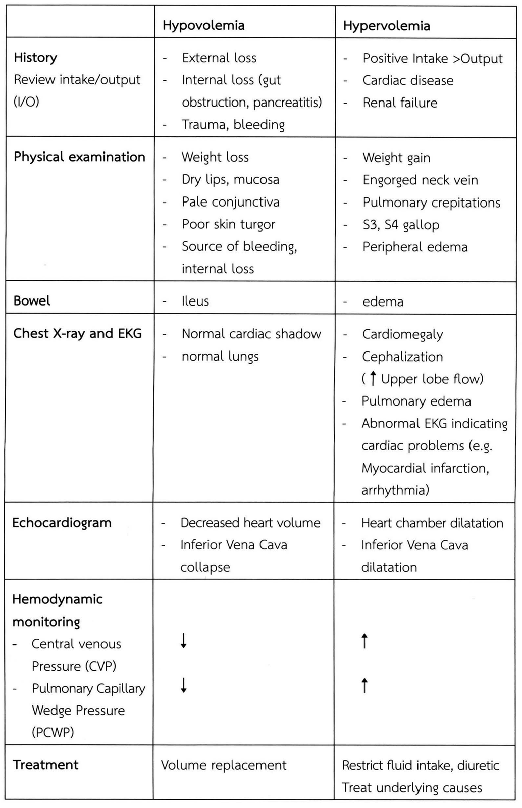
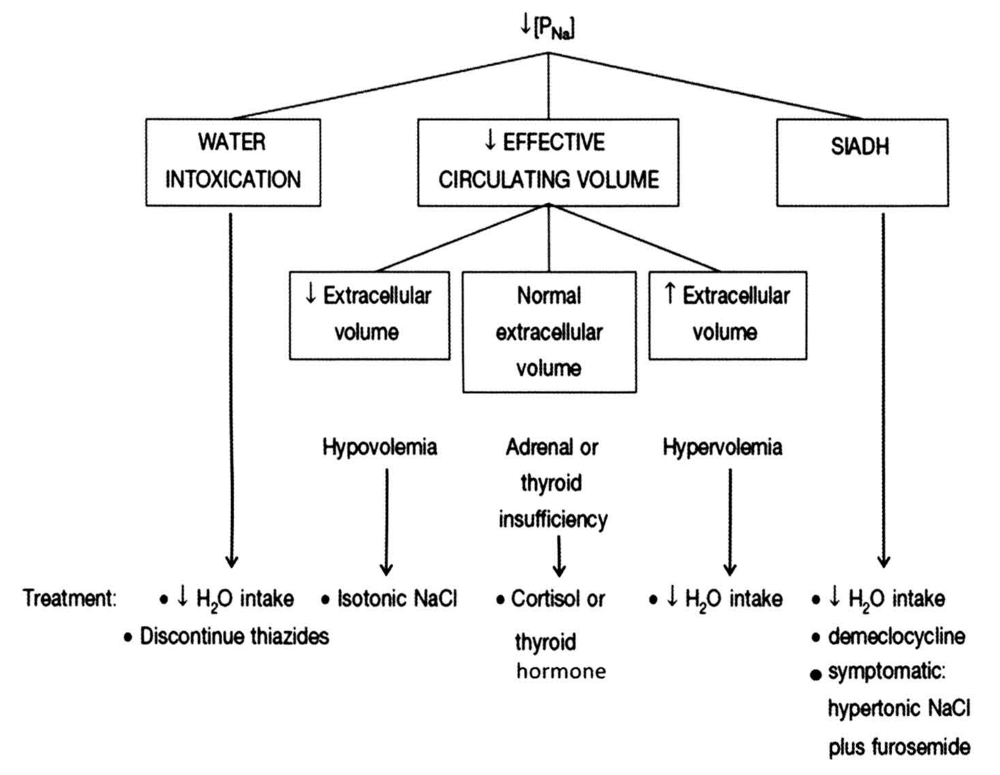
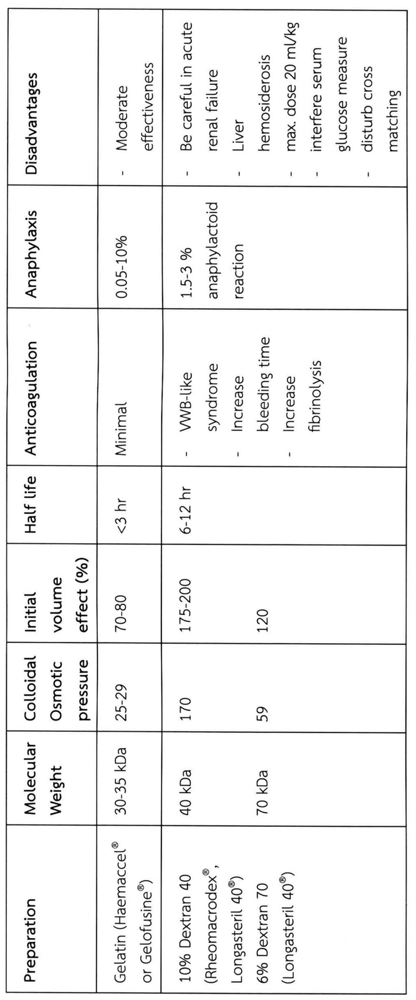
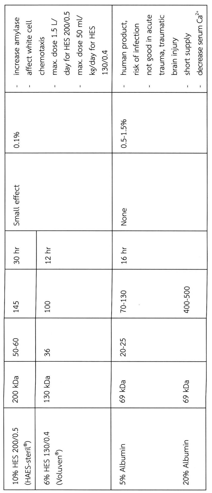

# สารน้ำและเกลือแร่ในผู้ป่วยศัลยกรรม (Fluid and electrolyte management)

## Contents of this file
- Physiology of fluid and electrolyte (p.166)
  - Total body water : (p.166)
  - Salt gain and loss : (p.167)
  - Osmolarity : (p.168)
- การเปลี่ยนแปลงของ fluid-electrolyte : (p.169)
- 1. Volume change (p.169)
- 2. Concentration change (p.169)
  - 2.1 Hyponatremia (p.169)
  - 2.2 Hypernatremia, hyperosmolality (p.175)
- การให้สารน้ำและเกลือแร่ (Fluid and electrolyte therapy) : คำนึงถึง (p.194)
- 1. Volume คิดโดย 1.1 + 1.2 + 1.3 (p.194)
  - 1.1 Maintenance (MN) volume → ใช้ maintain homeostasis (p.194)
  - 1.2 Deficit (p.194)
- 2. Concentration (p.195)
  - 2.2 <u>Osmolarity</u> (p.196)
- 3. Compositions (p.196)
  - 3.1 <u>K</u> (p.196)
  - 3.3 Other electrolytes (p.198)
- 4. ชนิดของสารน้ำ (p.198)
- ตัวอย่างการสั่งสารน้ำในผู้ป่วย (p.205)
- สรุป (p.208)
- เอกสารอ้างอิง (p.208)

<!-- p.165 (printed none) -->
**สารน้ำและเกลือแร่ในผู้ป่วยศัลยกรรม**

**Fluid and electrolyte management**

ศุภฤกษ์ ปรีชายุทธ

<!-- p.166 (printed 152) -->
**สารน้ำและเกลือแร่ในผู้ป่วยศัลยกรรม**

**Fluid and electrolyte management**

ศุภฤกษ์ ปรีชายุทธ

การให้สารน้ำแก่ผู้ป่วยอย่างถูกต้องเป็นเรื่องสำคัญมากสำหรับแพทย์ เพราะเป็นสิ่งทำกันอยู่ทุกวันในเวชปฏิบัติ แพทย์จำเป็นต้องมีความรู้เกี่ยวกับ 1) สรีรวิทยาและความผิดปกติของสารน้ำและเกลือแร่ในร่างกายผู้ป่วย และ 2) ความรู้เกี่ยวกับสารน้ำที่เราจะสั่งให้ผู้ป่วย

## Physiology of fluid and electrolyte1,2

### Total body water :

Total body water คิดเป็นประมาณ 60% ของ body weight (BW) ในผู้ใหญ่ เด็ก 70-80% BW (เด็กเล็ก > เด็กโต)

- Intracellular ~ 40% BW → ส่วนใหญ่อยู่ในกล้ามเนื้อลาย, ส่วนประกอบที่มีความเข้มข้นสูง ได้แก่ K+, Mg2+, PO4– และ protein
- Extracellular ~ 20% BW → ส่วนประกอบที่มีความเข้มข้นสูง ได้แก่ Na+, Cl– และ HCO3–
  - Interstitial fluid ~ 15% (ระหว่าง cell ต่างๆ, connective tissue, CSF, joint fluid)
  - Intravascular fluid (plasma) ~ 5% BW, มี protein มากกว่าใน interstitial

Body fluid ในแต่ละ compartment จะมี osmolarity เท่ากันหมด (~ 280-300 mOsm/L) ปริมาณ cation-anion เท่าๆ กัน แต่ component ต่างกันได้

<!-- p.167 (printed 153) -->
**Water exchange :** คนปกติต้องการน้ำ ~ 2,000-2,500 cc/d

1. Gain → Sensible (ที่มองเห็น) จาก - oral fluid ~ 1,500 cc/d
   - Solid food ~ 500-700 cc/d

   → Insensible (ที่มองไม่เห็น) จากปฏิกิริยา oxidation ~ 250 cc/d (ในผู้ป่วยที่อดอาหารนาน >4-5 วัน เช่น post operative period ผู้ป่วยมี catabolism ↑ อาจได้น้ำส่วนนี้เพิ่มขึ้นถึง 500 cc/d)
2. Loss → sensible จาก – urine ~ 800-1,500 cc/d (0.5-1 cc/kg/hr)
   - เหงื่อ
   - อุจจาระ ~ 250 cc/d
   - Abnormal loss เช่น diarrhea, Nausea/Vomiting (N/V), เสียเลือด, 3rd space loss

   → Insensible – ปกติเราจะสูญเสียน้ำจาก<u>ไอน้ำ</u>ที่ระเหยทางผิวหนังและปนกับลมหายใจ ~ 500-600 cc/d (10-15 cc/kg/d)
   - ในภาวะไข้สูง, hyperventilation, on ventilator, hyperthyroidism จะเสียน้ำส่วนนี้เพิ่มขึ้น โดยภาวะไข้ที่เพิ่มขึ้น 10 C จะเสียน้ำเพิ่มขึ้น 250-300 cc/d
   - แม้ผู้ป่วยจะไม่ได้รับน้ำเลย แต่ก็จำเป็นต้องขับน้ำจำนวนหนึ่งออกจากร่างกายคือ ปัสสาวะ ~ 500-800 cc/d (เพื่อขับของเสีย) + insensible loss (skin, lung) ซึ่งผู้ป่วยจะมีชีวิตได้เพียง 3-4 วัน ถ้าขาดทั้งอาหารและน้ำ

### Salt gain and loss :

- คนปกติได้รับเกลือแร่ ~ 50-90 mEq (3-5 g)/d ส่วนใหญ่อยู่ในรูปของ NaCl
- ไตมีหน้าที่สำคัญในการรักษาสมดุลเกลือแร่
- Serum Na+ ปกติ 135-145 mEq/L
- เหงื่อที่ร่างกายขับ → hypotonic solution (Na ~ 15-60 mEq/L)

<!-- p.168 (printed 154) -->
- Insensible loss → pure water
- GI loss → ส่วนมากเป็น isotonic solution (Osmolarity ใกล้เคียงกับ serum) ดังแสดงในตารางที่ 1

  Stomach → Cl– ↑ ~ 130 mEq/L

  Ileum → HCO3– ↑ ~ 104 mEq/L

  Pancreas → HCO3 ↑ ~ 75 mEq/L
- Colon ⇢ Na+ = 60 mEq/L, K+ = 30 mEq/L, Cl– = 40 mEq/L ไม่มี HCO3– เป็นส่วนที่มี K+ มากที่สุด

### Osmolarity :

Osmolarity คือ ความเข้มข้นของสารละลายต่อปริมาตรของตัวทำละลาย (mOsm/L) ส่วน Osmolality คือ ความเข้มข้นของสารละลายต่อน้ำหนักของตัวทำละลาย (mOsm/Kg) ในทางคลินิกพบว่าค่าทั้งสองนี้ไม่แตกต่างกันมาก เนื่องจาก serum มีความถ่วงจำเพาะสูงกว่าน้ำเพียงเล็กน้อย

Osmolarity ในร่างกาย ~ 280-300 mOsm/L (เท่ากันทั้ง intra และ extracellular) แต่ละ compartment แบ่งกันด้วย semi-permeable membrane ซึ่งยอมให้น้ำกระจายไปในระหว่าง compartment ต่างๆ ได้อย่างเสรี และปรับตัวให้ osmotic pressure และ osmolarity ในทุก compartment เท่ากัน

Serum Osmolarity = 2 x Na + Glucose/18 + BUN/2.8

- สารหลักที่ก่อให้เกิดความแตกต่างของ osmotic pressure
- ระหว่าง plasma และ Interstitial fluid คือ protein โดยเฉพาะ albumin (ไม่สามารถผ่าน Semi-permeable membrane ได้ เป็นตัวก่อให้เกิด colloidal osmotic pressure)
- ระหว่างใน cell และ นอก cell คือ Na+ (ผ่าน cell membrane ได้ช้า)

<!-- p.169 (printed 155) -->
**ตารางที่ 1** Composition of GI secretions

| TYPE OF SECRETION | VOLUME (mL/24 h) | Na+ (mEq/L) | K+ (mEq/L) | Cl– (mEq/L) | HCO3– (mEq/L) |
| --- | --- | --- | --- | --- | --- |
| Stomach | 1000-2000 | 60-90 | 10-30 | 100-130 | 0 |
| Small intestine | 2000-3000 | 120-140 | 5-10 | 90-120 | 30-40 |
| Colon | - | 60 | 30 | 40 | 0 |
| Pancreas | 600-800 | 135-145 | 5-10 | 70-90 | 95-115 |
| Bile | 300-800 | 135-145 | 5-10 | 90-110 | 30-40 |

## การเปลี่ยนแปลงของ fluid-electrolyte :

ควรประเมินก่อนการให้สารน้ำ1-3

## 1. Volume change

ประเมินว่าผู้ป่วยขาดน้ำหรือว่าอยู่ในภาวะน้ำเกิน โดยอาศัยประวัติ และการตรวจร่างกาย และการตรวจพิเศษต่างๆ เพื่อหา signs ของ dehydration หรือ volume overload ดังตารางที่ 2

## 2. Concentration change

Sodium (Na+, ปกติ 135-145 mEq/L) เป็นเกลือแร่หลักที่เป็นตัวกำหนดความเข้มข้นของ serum ความผิดปกติของ Na+ จึงทำให้เกิดความเปลี่ยนแปลงของ serum osmolarity และมักพบร่วมกับการเปลี่ยนแปลงของ volume ด้วย

### 2.1 Hyponatremia

a. **hypoosmolality** หรือ hyponatremia เกิดจาก **ก) ร่างกายได้รับน้ำในปริมาณที่มากเกินกว่าความสามารถของไตในการขับออกจากร่างกาย ข) ไตขับน้ำออกจากร่างกายลดลง** นอกจากนี้การมีน้ำเคลื่อนที่จากในเซลล์ออกมาอยู่ในพลาสมา เช่น ในภาวะ hypermetabolism หรือ sepsis ก็มีส่วนทำให้เกิดภาวะ hypoosmolality ได้

<!-- p.170 (printed 156) -->
**ตารางที่ 2** Assessment of volume status

|  | **Hypovolemia** | **Hypervolemia** |
| --- | --- | --- |
| **History** Review intake/output (I/O) | - External loss - Internal loss (gut obstruction, pancreatitis) - Trauma, bleeding | - Positive Intake >Output - Cardiac disease - Renal failure |
| **Physical examination** | - Weight loss - Dry lips, mucosa - Pale conjunctiva - Poor skin turgor - Source of bleeding, internal loss | - Weight gain - Engorged neck vein - Pulmonary crepitations - S3, S4 gallop - Peripheral edema |
| **Bowel** | - Ileus | - edema |
| **Chest X-ray and EKG** | - Normal cardiac shadow - normal lungs | - Cardiomegaly - Cephalization (↑ Upper lobe flow) - Pulmonary edema - Abnormal EKG indicating cardiac problems (e.g. Myocardial infarction, arrhythmia) |
| **Echocardiogram** | - Decreased heart volume - Inferior Vena Cava collapse | - Heart chamber dilatation - Inferior Vena Cava dilatation |
| **Hemodynamic monitoring** - Central venous Pressure (CVP) | ↓ | ↑ |
| **Hemodynamic monitoring** - Pulmonary Capillary Wedge Pressure (PCWP) | ↓ | ↑ |
| **Treatment** | Volume replacement | Restrict fluid intake, diuretic Treat underlying causes |

> **Caption (verbatim):** ตารางที่ 2 Assessment of volume status
> **Text in image (verbatim):** Hypovolemia · Hypervolemia · History · Review intake/output (I/O) · External loss · Internal loss (gut obstruction, pancreatitis) · Trauma, bleeding · Positive Intake >Output · Cardiac disease · Renal failure · Physical examination · Weight loss · Dry lips, mucosa · Pale conjunctiva · Poor skin turgor · Source of bleeding, internal loss · Weight gain · Engorged neck vein · Pulmonary crepitations · S3, S4 gallop · Peripheral edema · Bowel · Ileus · edema · Chest X-ray and EKG · Normal cardiac shadow · normal lungs · Cardiomegaly · Cephalization (↑ Upper lobe flow) · Pulmonary edema · Abnormal EKG indicating cardiac problems (e.g. Myocardial infarction, arrhythmia) · Echocardiogram · Decreased heart volume · Inferior Vena Cava collapse · Heart chamber dilatation · Inferior Vena Cava dilatation · Hemodynamic monitoring · Central venous Pressure (CVP) · Pulmonary Capillary Wedge Pressure (PCWP) · ↓ · ↓ · ↑ · ↑ · Treatment · Volume replacement · Restrict fluid intake, diuretic · Treat underlying causes
> **Description:** Scan of the printed three-column table (row label, Hypovolemia, Hypervolemia) with seven rows: History, Physical examination, Bowel, Chest X-ray and EKG, Echocardiogram, Hemodynamic monitoring, Treatment. Saved as an image because the Hemodynamic monitoring cell contains two sub-items (CVP and PCWP) each with its own arrow in the same row (↓ ↓ under Hypovolemia, ↑ ↑ under Hypervolemia); in the Markdown table above this cell is shown as two rows, with the label "Hemodynamic monitoring" repeated.
> **Identifiers in image:** none

<!-- p.171 (printed 157) -->
สาเหตุ hyponatremia ทั้งหมด แบ่งตาม Pathophysiology ได้แก่

i. **Nonhypotonic hyponatremia**

1. Pseudohyponatremia

a. Hyperlipidemia

b. Hyperproteinemia (multiple myeloma and macroglobulinemia)

2. Hyperglycemia

3. Exogenous solutes

Hypertonic mannitol, postprostatectomy syndrome (isotonic)

ii. **Hypotonic hyponatremia**

1. Intact (minimally impaired) diluting ability

Psychotic polydipsia, Beer protomania, Infants

2. Impaired diluting ability independent of ADH

Renal failure, diuretics

3. Impaired diluting ability from hemodynamic stimulus to ADH

a. Volume depletion

i. Extrarenal losses (GI loss)

ii. Renal losses (Addison’s disease, Cerebral salt wasting, Renal salt-wasting disorders)

b. Edematous conditions เช่น Congestive heart failure, Cirrhosis, Nephrotic syndrome

<!-- p.172 (printed 158) -->
4. Inappropriate secretion of ADH (SIADH)

b. **อาการและอาการแสดงของ hyponatremia** ส่วนใหญ่จะเป็นอาการทางสมอง ซึ่งเป็นผลจาก hypoosmolality อาการทางสมองจะเป็นมากหรือน้อยขึ้นอยู่กับ **1) Rapidity** หมายถึง ระดับ PNa ลดลงเร็วหรือช้า (พบว่าถ้า PNa ลดลงในอัตรา ≥0.5 mEq/ลิตร/ชม. จะมีอาการ) **2) Level** โดยทั่วไปจะเริ่มมีอาการทางสมองเมื่อ PNa ต่ำกว่า 120 mEq/ลิตร แต่อาจพบอาการได้แม้ที่ระดับ PNa ต่ำกว่า 125 mEq/ลิตร หากเกิดขึ้นอย่างรวดเร็ว อาการทางสมองมักรุนแรงหาก PNa ต่ำกว่า 110 mEq/ลิตร และเกิดขึ้นอย่างรวดเร็ว พบว่าระดับ PNa มีบทบาทในการเกิดอาการในกรณีที่เป็น chronic hyponatremia **3) Host** พบว่าผู้หญิงในวัยที่ยังมีประจำเดือน (menstruant woman) ผู้หญิงสูงอายุที่ได้รับยา thiazide เด็ก ผู้ป่วยจิตเวช ผู้ป่วยที่อยู่ในภาวะ hypoxia และในผู้ป่วยหลังการผ่าตัด จะมีโอกาสเสี่ยงสูงที่จะมีอาการทางระบบประสาท โดยทั่วไปอาการของ chronic-hyponatremia (เกิดในเวลานานกว่า 48 ชั่วโมง) ไม่ค่อยมีอาการรุนแรงและอาการมักไม่จำเพาะ เช่น คลื่นไส้อาเจียน เบื่ออาหาร อ่อนเพลีย เป็นตะคริว แต่ถ้าระดับ PNa ต่ำจริงๆ อาจสับสน ซึม ชักได้ ผู้ป่วยในกลุ่มนี้มีโอกาสเกิด osmotic demyelination syndrome ได้ ถ้าแก้ไข hyponatremia เร็วเกินไป

c. **การวินิจฉัยภาวะ hyponatremia**

i. ประวัติและการตรวจร่างกาย ควรซักประวัติการดื่มน้ำ การให้น้ำทางหลอดเลือด ประวัติ polydipsia การสูญเสียน้ำออกนอกร่างกาย ประวัติโรคทางปอด โรคระบบประสาทส่วนกลาง การตรวจทางห้องปฏิบัติการ ที่สำคัญคือ Posm, Uosm (อาจใช้ Urine specific gravity แทน Urine specific gravity เพิ่มขึ้น 0.001 จะทำให้ Uosm เพิ่มขึ้น 30-35 mOsm/กก.), UNa การวัด Posm เพื่อเป็นการยืนยันว่าเป็น true hyponatremia ทำการวัด Uosm เพื่อประเมินว่าไตขับน้ำเป็นปกติหรือไม่ อาจช่วยในการแยกโรคได้ ถ้า Uosm ต่ำกว่า 100 mOsm/กก. แสดงว่า arginine vasopressin (AVP) สามารถถูกยับยั้งได้ ซึ่งพบได้ใน primary polydipsia หรือ reset osmolality

<!-- p.173 (printed 159) -->
ii. UNa มีประโยชน์ในการแยกกลุ่มของ hyponatremia

1. UNa ต่ำกว่า 20 mEq/ลิตร พบในภาวะ extracellular volume (ECV) depletion (hypovolemia) ภาวะ heart failure และ hepatic cirrhosis (ยกเว้นภาวะ hypovolemia ที่เกิดในภาวะที่มีการสูญเสีย Na+ ทางไต) ภาวะ primary polydipsia ที่มีปริมาณปัสสาวะมาก

2. UNa สูงกว่า 40 mEq/ลิตร พบใน SIADH, renal failure, reset osmolality, diuretics, adrenal insufficiency, ผู้ป่วยบางรายที่อาเจียนและมีการสูญเสีย NaHCO3 ทางปัสสาวะ, ภาวะ osmotic diuresis (ร่วมกับภาวะ pseudohyponatremia เนื่องจาก glucose หรือ mannitol)

d. **การรักษาภาวะ hyponatremia**

i. **การรักษาภาวะ Hyponatremia** และ Hypernatremia มีสิ่งที่ต้องคำนึงถึง 3 ประการได้แก่ ผู้ป่วยมีอาการหรือไม่ (symptomatic หรือ asymptomatic), เป็น acute (<48 ชั่วโมง) หรือ chronic (>48 ชั่วโมง) และเกิดจากสาเหตุใด

ii. **การแก้ไขระดับ Hyponatremia** มีหลักการรักษาที่สำคัญอยู่ 2 ประการ คือ 1) การเพิ่มระดับ PNa ด้วยอัตราที่เหมาะสมโดยการให้ NaCl และ/หรือ การจำกัดน้ำ 2) การรักษาโรคหรือภาวะที่เป็นต้นเหตุของภาวะ hyponatremia

iii. **การเพิ่มระดับ PNa ด้วยอัตราที่เหมาะสม**

1. Acute symptomatic hyponatremia (มักพบผู้ป่วยในโรงพยาบาลหลังผ่าตัดและได้รับสารละลาย hypotonic) ควรได้รับการรักษาทันทีเมื่อมีอาการ เนื่องจากความเสี่ยงที่เกิดจาก brain edema มากกว่าจาก osmotic demyelination syndrome ควรเพิ่มระดับ PNa 2 mEq/ลิตร/ชม. จนอาการหายไป ทำการรักษาโดยให้ hypertonic saline (3% NaCl) ในอัตรา 1-2 มล./กก./ชม. อาจให้ loop diuretics ซึ่งออกฤทธิ์เพิ่มการขับ free water ทางปัสสาวะจะทำให้การรักษาได้ผลเร็วขึ้น ในผู้ป่วยที่มีอาการชักหรือซึมหรือไม่รู้สึกตัว อาจให้ 3% NaCl ในอัตรา 4-6 มล./กก./ชม.

<!-- p.174 (printed 160) -->
2. Symptomatic hyponatremia ที่ไม่รู้ระยะเวลาหรือมีระยะเวลามากกว่า 48 ชั่วโมง มีความจำเป็นต้องระวังผลที่เกิดจากภาวะ hyponatremia และจากการรักษา hyponatremia (osmotic demyelination syndrome) มีข้อแนะนำดังนี้

a. เนื่องจาก cerebral water เพิ่มขึ้นเพียงร้อยละ 10 ในภาวะ severe chronic hyponatremia ดังนั้นควรเพิ่มระดับ PNa ทันที 10 เปอร์เซ็นต์ หรือประมาณ 10 mEq/ลิตร

b. หลังจากนั้นให้เพิ่มระดับ PNa ด้วยอัตรา ≤1.0-1.5 mEq/ลิตร/ชม.

c. ไม่ให้เพิ่มระดับ PNa มากกว่า 15 mEq/ลิตร/วัน

3. Chronic asymptomatic hyponatremia ไม่จำเป็นต้องให้การรักษาเพื่อเพิ่มระดับ PNa ควรหาสาเหตุพื้นฐานการเกิดโรคในผู้ป่วยเหล่านี้และให้การรักษา

iv. สามารถทำการเพิ่ม PNa โดยวิธีต่างๆ หลายวิธี เช่น **คำนวณปริมาณ Na+ ที่ใช้ทดแทน** ใช้สูตร

**ปริมาณ Na+ ที่ใช้ในการทดแทน = Total body water (TBW) x Na+ deficit**

TBW มีค่าร้อยละ 60 ในผู้ชาย และร้อยละ 50 ในผู้หญิง ของน้ำหนักตัว

ถ้าเป้าหมายของ PNa ที่ต้องการคือ 120 mEq/L

ดังนั้น **ปริมาณ Na+ ที่ใช้ในการทดแทน** = 0.6 หรือ 0.5 x น้ำหนักตัว (กก.) x (120- PNa)

ข้อพึงสังวรณ์คือ ปริมาณ Na+ ที่ได้จากการคำนวณเป็นเพียงค่าประมาณเท่านั้น การวัด PNa บ่อยๆ เป็นสิ่งจำเป็นในการประเมินผลการรักษา อีกประการหนึ่งสูตรนี้ไม่ได้คำนวณการสูญเสียของเหลวที่มีลักษณะ isotonicity เรายังต้องทดแทน Na+ และน้ำอันเกิดจากการสูญเสียของเหลวที่มีลักษณะ isotonicity อีกด้วย

<!-- p.175 (printed 161) -->
v. **การรักษาตามภาวะหรือต้นเหตุโรค** (รูปที่ 1)

- ↓[PNa]
  - WATER INTOXICATION → Treatment: • ↓ H2O intake • Discontinue thiazides
  - ↓ EFFECTIVE CIRCULATING VOLUME
    - ↓ Extracellular volume — Hypovolemia → Treatment: • Isotonic NaCl
    - Normal extracellular volume — Adrenal or thyroid insufficiency → Treatment: • Cortisol or thyroid hormone
    - ↑ Extracellular volume — Hypervolemia → Treatment: • ↓ H2O intake
  - SIADH → Treatment: • ↓ H2O intake • demeclocycline • symptomatic: hypertonic NaCl plus furosemide

> **Caption (verbatim):** รูปที่ 1 แนวทางการรักษาภาวะ hyponatremia ตามสาเหตุ
> **Text in image (verbatim):** ↓[PNa] · WATER INTOXICATION · ↓ EFFECTIVE CIRCULATING VOLUME · SIADH · ↓ Extracellular volume · Normal extracellular volume · ↑ Extracellular volume · Hypovolemia · Adrenal or thyroid insufficiency · Hypervolemia · Treatment: · • ↓ H2O intake · • Discontinue thiazides · • Isotonic NaCl · • Cortisol or thyroid hormone · • ↓ H2O intake · • ↓ H2O intake · • demeclocycline · • symptomatic: hypertonic NaCl plus furosemide
> **Description:** Black-and-white tree flowchart. At the top is ↓[PNa] (low plasma sodium), which branches by lines into three boxes: WATER INTOXICATION (left), ↓ EFFECTIVE CIRCULATING VOLUME (centre) and SIADH (right). The centre box branches into three smaller boxes: ↓ Extracellular volume, Normal extracellular volume and ↑ Extracellular volume; beneath them, unboxed, are the labels Hypovolemia, Adrenal or thyroid insufficiency and Hypervolemia respectively, each with a downward arrow to its treatment. Long downward arrows run from WATER INTOXICATION and from SIADH straight down to the treatment row. The bottom row, introduced by "Treatment:", lists in columns from left to right: for water intoxication "↓ H2O intake" and "Discontinue thiazides"; for hypovolemia "Isotonic NaCl"; for adrenal or thyroid insufficiency "Cortisol or thyroid hormone"; for hypervolemia "↓ H2O intake"; for SIADH "↓ H2O intake", "demeclocycline" and "symptomatic: hypertonic NaCl plus furosemide".
> **Identifiers in image:** none

### 2.2 Hypernatremia, hyperosmolality

a. **hypernatremia** หมายถึง ภาวะที่มีค่า PNa สูงกว่า 150 mEq/L โดยทั่วไปการเกิด hypernatremia หมายถึง ภาวะ hyperosmolality ด้วย เพราะ Na+ อยู่ภายนอกเซลล์ทำให้เกิดภาวะ hypertonicity สามารถทำให้เกิด effective osmolality ได้

b. **สาเหตุ**

**Water loss**

1. Insensible loss

a. increased skin vaporization : fever, exposure to high temperatures, exercise

<!-- p.176 (printed 162) -->
  b. Burns
  c. Hyperventilation: Respiratory infections
2. Gastrointestinal loss
3. Renal loss
  a. Central diabetes insipidus
  b. Nephrogenic diabetes insipidus
  c. Osmotic diuresis: glucose, urea, mannitol
4. Hypothalamic disorders
  a. Primary hypodipsia
  b. Reset osmostat due to volume expansion in primary mineralocorticoid excess
  c. Essential hypernatremia with loss of osmoreceptor function
5. Water loss into cells
  a. Seizures or severe exercise
  b. Rhabdomyolysis

**Sodium retention**

1. Administration of hypertonic NaCl or NaHCO3
2. Ingestion of sodium

c. **อาการและอาการแสดงของ hypernatremia** ส่วนใหญ่เป็นอาการทางระบบประสาท เช่น อ่อนเพลีย สับสน ซึม กระตุก ลมชัก และ coma ความรุนแรงของอาการขึ้นอยู่กับอัตราการเคลื่อนที่ของน้ำออกจากเซลล์สมองตาม osmotic gradient เมื่อน้ำในเซลล์สมองลดลงมาก ปริมาตรสมองจะลดลงด้วยทำให้ cerebral

<!-- p.177 (printed 163) -->
veins มีการแตก เกิด focal intracerebral และ subarachnoid hemorrhage ได้ พบว่าค่า osmotic gradient ที่สูงกว่า 30-35 mOsm/กก. (ที่ระดับ PNa สูงกว่า 158 mEq/ลิตร) จะทำให้เกิดความผิดปกติทางสมองดังกล่าว ผู้ป่วย hypernatremia อาจมีอาการของสภาวะ ECV ขาดหรือเกินก็ได้แล้วแต่สาเหตุ ถ้าสาเหตุของ hypernatremia เกิดจาก sodium overload จะมี ECV เกิน ถ้าเกิดจากการสูญเสียน้ำจะมี ECV ต่ำ ภาวะ essential hypernatremia จะมี ECV ปกติ

d. **การวินิจฉัย**

- ประวัติและการตรวจร่างกาย ควรซักประวัติเกี่ยวกับการดื่มน้ำ ปริมาณปัสสาวะที่ขับออกในแต่ละวัน (คำจำกัดความของ polyuria คือ การมีปริมาณปัสสาวะอย่างน้อยวันละ 3 ลิตร) ประวัติเบาหวาน การเสียเหงื่อมาก ท้องเสีย การได้รับยา (เช่น lithium)
- การตรวจปัสสาวะ ดู Uosm, UNa
- แนวทางการแยกโรค ภาวะ hypernatremia ประเด็นสำคัญ คือ หาสาเหตุพื้นฐานของ hypernatremia ได้แก่ 1) การได้ Na+ มากเกินไป (มี ECV เพิ่มขึ้น) 2) ภาวะ reset osmolality (มี ECV ในเกณฑ์ปกติ) และ 3) ภาวะที่ร่างกายมีการสูญเสียน้ำมากกว่า Na+ ซึ่งแบ่งเป็น การสูญเสียทางไต ได้แก่ ก. osmotic diuresis ข. diabetic insipidus และ ค. การสูญเสียนอกไต ได้แก่ การสูญเสียน้ำทางผิวหนังหรือระบบทางเดินอาหาร

e. **การรักษาภาวะ hypernatremia**

  i. **Acute onset (<48 hr)** ใน <u>symptomatic</u> ลด PNa 1-2 mEq/L/hr และ ใน <u>asymptomatic</u> ลด PNa 1 mEq/L/hr จนกระทั่ง PNa ได้ประมาณ 145 mEq/L

  ii. **Chronic onset (>48 hr)** ลด PNa < 0.5 mEq/L/hr และ <12 mEq/L/day จนกระทั่ง PNa ได้ประมาณ 150 mEq/L

  iii. **Unknown onset** ใน <u>symptomatic</u> รักษาแบบ acute และ ใน <u>asymptomatic</u> รักษาแบบ chronic

<!-- p.178 (printed 164) -->
  iv. **การคำนวณ water deficit** สาเหตุส่วนใหญ่ของ hypernatremia เกิดจากการขาดน้ำ การแก้ไขควรคำนวณปริมาณน้ำที่ขาดไป และแก้อย่างช้าๆ โดยยึดหลักว่า ถ้ามีการสูญเสียน้ำแต่เพียงอย่างเดียว ปริมาณ solute ของทั้งร่างกายจะมีค่าเท่าเดิม

**TBW ปัจจุบัน = PNa ปกติ × TBW ปกติ/ PNa ปัจจุบัน**

**Water deficit (∆W) = TBW ปกติ - TBW ปัจจุบัน**

ตัวอย่างผู้ป่วยชายหนัก 70 กก. ขณะนี้ตรวจ PNa ได้ 160 mEq/ลิตร จากการสูญเสียน้ำ

TBW ปกติ = 0.6 × 70 = 42 ลิตร

TBW ปัจจุบัน  = 140 × 42/160 = 36.8 ลิตร

∆W = 42-36.8 = 5.2 ลิตร

เพื่อให้อัตราการให้น้ำทดแทนมีความปลอดภัย ไม่ควรให้อัตราการลดลงของ PNa เร็วกว่า 0.5 mEq/ลิตร/ชั่วโมง หรือ 12 mEq/ลิตร/วัน ดังนั้นการให้น้ำ 5.2 ลิตร เพื่อลดระดับ PNa ลงมาจาก 160 เหลือ 140 mEq/ลิตร ควรใช้เวลา = 160-140/0.5 = 40 ชั่วโมง ซึ่งเท่ากับอัตราการให้น้ำ 5200/40 = 130 มล./ชั่วโมง ถ้ามีการสูญเสียน้ำทาง insensible loss อาจต้องเพิ่มอัตราการให้อีก 30-50 มล./ชั่วโมง มีวิธีการให้สารน้ำทดแทนอีกวิธีหนึ่ง คือ ให้ปริมาณน้ำเป็นปริมาณครึ่งหนึ่งของที่คำนวณได้ในเวลา 12-24 ชั่วโมง พร้อมทั้งเฝ้าดูอาการทางระบบประสาทอย่างใกล้ชิด ให้ทดแทนปริมาณที่เหลือต่อในอีก 24-48 ชั่วโมง

  v. **ชนิดของสารน้ำที่ให้ทดแทน** ถ้าผู้ป่วยรับประทานได้ให้น้ำดื่มจะดีที่สุด ถ้ามีอาการแสดงของการขาด Na+ ร่วมด้วย ควรให้ในลักษณะ half-strength NSS หรือ NSS (Normal saline solution) แต่ถ้าผู้ป่วยขาด Na+ รุนแรง จนมีความดันโลหิตลดลงควรให้เป็น NSS

f. **การรักษาจำเพาะโรคพื้นฐาน**

  i. **การรักษา Central diabetic insipidus (CDI)** การรักษาที่ดีที่สุด คือ ให้ AVP ทดแทน ซึ่งมีหลายรูปแบบ Desmopressin (dDAVP) มีฤทธิ์ลดปริมาณปัสสาวะ (antidiuresis) มากที่สุด และไม่มีผลด้าน vasopressor

<!-- p.179 (printed 165) -->
พบว่า dDAVP ออกฤทธิ์นาน สามารถให้ได้วันละ 1-2 ครั้ง (1-2 mcg IV q 12 hr) ไม่ก่อให้เกิด antibody มีข้อควรระวังในการให้ dDAVP คือ ถ้ากลไกกระหายน้ำยังดี ผู้ป่วยจะดื่มน้ำชดเชยได้ การให้ dDAVP จะทำให้เกิดน้ำคั่งและมี hyponatremia ตามมาได้ ยาอื่นๆ ที่ถูกนำมารักษา CDI เป็นการรักษาเสริม ได้แก่ การให้อาหารที่มีโซเดียมและโปรตีนต่ำ การให้ thiazide diuretic ซึ่งแม้จะเป็นยาขับปัสสาวะ แต่จะช่วยลด polyuria ลงได้มาก (กลไกไม่ทราบแน่ชัด) ยาอื่นๆ เช่น Clofibrate, Carbamazepine ลดปริมาณปัสสาวะลงได้โดยที่ clofibrate จะช่วยส่งเสริมการหลั่งของ ADH ในขณะที่ carbamazepine ทำให้ ADH ออกฤทธิ์ได้ดีขึ้น สามารถให้ร่วมกับ chlorpropamide ได้ (chlorpropamide ช่วยลด PNa ได้)

  ii. **การรักษา Nephrogenic diabetic insipidus (NDI)** หลักการรักษา NDI คล้ายกับ CDI คือ ให้น้ำทดแทน แก้ไขโรคดั้งเดิม เช่น obstructive uropathy ขจัดยาที่เป็นต้นเหตุ เช่น demeclocycline การให้ dDAVP มักไม่ได้ผลใน NDI การรักษาต้องให้อาหารที่มีโซเดียมและโปรตีนต่ำร่วมกับ thiazide บางครั้งอาจพิจารณาให้ amiloride ร่วมด้วย เพราะออกฤทธิ์คนละตำแหน่งกับ thiazide ทำให้เสริมฤทธิ์กัน และลดปัญหาการเกิด hypokalemia พบว่า amiloride มีประโยชน์ใน lithium toxicity อาจนำ NSAIDs มาใช้ใน congenital NDI ได้ เพราะ NSAIDs มีฤทธิ์เพิ่มความสามารถในการทำให้ปัสสาวะเข้มข้นเหมือนการเสริมฤทธิ์ของ AVP พบว่าการใช้ NSAIDs ใน NDI จะสามารถลดปริมาณปัสสาวะได้ร้อยละ 50 ถ้าให้ NSAIDs ร่วมกับ thiazide จะได้ผลดียิ่งขึ้น ยา NSAIDs ที่ใช้ได้ผลดีคือ indomethacin

3. **Composition change** ได้แก่ การเปลี่ยนแปลงของ Potassium และเกลือแร่อื่นๆ และการเปลี่ยนแปลงของสมดุลกรด-ด่าง

1. **Potassium** เป็น intracellular electrolyte ที่มีความสำคัญอย่างยิ่งกับการทำงานของกล้ามเนื้อและหัวใจ ระดับ plasma K+ ปกติ = 3.5-5.5 mEq/L ซึ่งปริมาณ K+ ใน extracellular compartment นั้นเป็นเพียงแค่ 2% ของ total body K+ stores เท่านั้น

<!-- p.180 (printed 166) -->
a. **Hypokalemia (K+ <3.5 mEq/L)**

  i. **สาเหตุ**

    1. Inadequate intake
    2. Excessive loss
      a. Non renal เช่น nausea/vomiting (N/V), diarrhea จะพบระดับ urine K+ <30 mEq/L
      b. Renal เช่น diuretic, hyperaldosteronism, Mg2+ ↓
    3. Transcellular shift- K+ shift เข้า cells (alkalosis, insulin, β2 agonist)

  ii. **อาการ** ได้แก่ กล้ามเนื้ออ่อนแรง, ileus, EKG change (↓T, ↓ST, U wave) และ arrhythmia ได้ โดยทั่วไประดับ K+ ที่ต่ำเล็กน้อย (3-3.5 mEq/L) มักจะไม่ทำให้เกิด arrhythmia ได้ ถ้าไม่มี precipitating อื่นๆ เช่น digitalis toxicity จึงไม่จำเป็นต้องรีบ correct

  iii. **Treatment**

    1. Correct cause (eg. Mg2+ ↓)
    2. K+ replacement อาจให้ KCl elixir oral ถ้ากินได้ หรือ 15% KCl intravenous (iv) โดยผสมไม่เกิน 40 mEq/L (ซึ่งถ้าจะให้ concentration มากกว่านี้ เช่น 20 mEq/100 ml ควรให้ทาง central line) ห้ามให้เร็ว (max ≤20 mEq/hr) เพราะทำให้เกิด arrhythmia ได้ ก่อนให้ควรมี urine ออกดีก่อน (30-50 cc/hr) เพราะ K+ ขับทางไต

b. **Hyperkalemia (K+ >5.5 meq/L)**

<!-- p.181 (printed 167) -->
  i. **สาเหตุ**

    1. Excessive intake, massive blood transfusion
    2. Inadequate excretion (renal failure, Renal Tubular Acidosis-RTA, hypoaldosteronism)
    3. K+ shift ออกจาก cell (acidosis, tissue damage, drug เช่น β blocker)
    4. ยาที่ทำให้เกิด hyperkalemia ได้เช่น ACE inhibitor, Angiotensin receptor blocker, K-sparing diuretic, digitalis, NSAIDs, succinylcholine, heparin
    5. Pseudohyperkalemia อาจเกิดจาก traumatic hemolysis ตอนเจาะเลือด ดังนั้นถ้าพบ unexpected hyperkalemia ในคนไข้ที่ไม่มีอาการ ควรจะ repeat การตรวจ plasma K+ ซ้ำ ก่อนจะให้การรักษา

  ii. **อาการ**

    1. GI (N/V, ปวดท้องจากลำไส้บีบตัว)
    2. Muscle weakness
    3. Heart พบ EKG change (↑ T, QRS กว้าง, ↓ P, ↑ PR interval, sine wave) → ventricular fibrillation, cardiac arrest ได้

  iii. **Treatment**

    1. รักษาสาเหตุ
    2. Acute management
      a. EKG changes and circulatory compromise → 10% Calcium chloride 10 ml IV over 3 minutes (มี Calcium มากกว่า Calcium gluconate 3 เท่า)

<!-- p.182 (printed 168) -->
      b. EKG changes or serum K+>7 mEq/L → 10% Calcium gluconate 10 ml IV over 3 minutes, สามารถให้ซ้ำได้ใน 5 นาที, response lasts only 20-30 minutes ไม่ควรให้ bicarbonate ตามหลัง calcium เพราะจะจับกับ calcium ได้
      c. AV block refractory to calcium treatment → 10 U regular insulin in 500 ml of 20% dextrose : infuse over 1 hour และพิจารณาใช้ transvenous pacemaker
      d. Digitalis cardiotoxicity → Magnesium sulfate 2 g iv bolus และพิจารณาใช้ digitalis specific antibody การใช้ calcium ในกรณีนี้ยังเป็นที่ถกเถียงกันอยู่ เพราะกลัวว่า calcium จะทำให้เกิด Stone heart (irreversible non-contractile state, due to impaired diastolic relaxation) แต่ในทางปฏิบัติเป็นไปได้ยากที่แพทย์จะรู้ก่อนว่าผู้ป่วยมี digitalis toxicity ร่วมด้วย และมีรายงานการใช้ calcium รักษาผู้ป่วย hyperkalemia กลุ่มนี้ได้อย่างปลอดภัย
    3. การรักษาเพื่อ ขับ K+ ออกจากร่างกาย
      a. Kayexalate® (Sodium Polystyrene Sulfonate) เป็น cation exchange resin, ↓ K+ absorption ทาง GI tract <u>Oral dose</u> 30 g in 50 ml of 20% sorbitol (preferred) หรือ <u>Rectal dose</u> (ใช้ในกรณีผู้ป่วยมีปัญหาเกี่ยวกับ upper GI หรือใช้คู่กับการให้ทาง oral ในกรณีที่ต้องการผลเร็ว) 50 g in 200 ml of 20% sorbitol retention enema ให้ซ้ำได้ทุก 6 ชั่วโมง
      b. Kalimate® (Calcium Polystyrene Sulfonate) ประสิทธิภาพในการลดระดับ K+ เท่ากับ sodium polystyrene sulfonate เหมาะสำหรับผู้ป่วยที่ต้องจำกัด Na+ เช่น edema, hypertension และ heart failure <u>Oral dose</u> 15-30 g ผสมกับน้ำหรือยาระบาย หรือ <u>Rectal dose</u> 30 g ผสมกับน้ำ 100 mL เข้าทางทวาร ให้ยาค้างอยู่ ในลำไส้นาน 30-60 นาที ให้ซ้ำได้ทุก 6 ชั่วโมง เนื่องจากใน Kalimate® จะมี Calcium 6.5-9.5% จึงพบการเกิด hypercalcemia ได้ในผู้ป่วย renal failure

<!-- p.183 (printed 169) -->
      c. Resin ทั้ง 2 ชนิด ควรให้ร่วมกับยาระบายเสมอ มิฉะนั้น Resin จะจับกันเป็นก้อน ทำให้เกิด GI tract obstruction ได้ และมีรายงานการเกิด colonic necrosis ในผู้ป่วยที่ได้ Resin สวนทวารหนัก
      d. Furosemide (loop diuretic) IV ช่วยเพิ่ม K+ excretion ทางไต แต่จะใช้ไม่ได้ผลใน renal failure
    4. Dialysis ใน renal failure

2. **Calcium** ค่าปกติ 8.5-10.5 mg/dl, ionized calcium 1.1-1.3 mmol/L ควรตรวจร่วมกับ serum albumin พบว่า 40% ของ calcium ในเลือดจะรวมกับ protein (esp. albumin), 10% รวมกับสารอื่นๆ เช่น phosphate, 50% เป็น ionized form (Ca2+, free form) ซึ่งเกี่ยวกับการทำงานของระบบประสาทและกล้ามเนื้อ

Corrected serum Calcium = serum Calcium + 0.8 (4-serum albumin)

a. **Hypocalcemia**

  i. **สาเหตุ**

    1. Loss ↑ (pancreatitis, fistula ของลำไส้เล็ก, necrotizing fasciitis)
    2. Renal failure
    3. ขาด vitamin D
    4. Hypoparathyroidism → มักพบระดับ PO43- ↑ ด้วย เช่น หลังผ่าตัด thyroid
    5. อื่นๆ เช่น alkalosis (↓ ionized form of Ca2+), Mg2+ ↓

  ii. **อาการ** ชารอบๆ ปากและปลายนิ้วมือ-เท้า, carpopedal spasm → ชัก laryngospasm ได้ถ้า Ca2+ ต่ำมากๆ, EKG change (QT ↑, abnormal T wave) → arrhythmia, hypotension และ cardiac arrest ได้

<!-- p.184 (printed 170) -->
  iii. **Treatment**

    1. รักษาสาเหตุ
    2. Calcium replacement therapy
      a. Intravenous calcium → indicated only for symptomatic hypocalcemia หรือ ionized calcium <0.65 mmol/L
        i. 10% calcium gluconate (680 mOsm/L, peripheral vein) 10 ml → 90 mg elemental (4.6 mEq)
        ii. 10% calcium chloride (2000 mOsm/L, central vein) 10 ml → 270 mg elemental (13.6 mEq) ควรให้ทาง central vein
        iii. Bolus dose = 200 mg elemental calcium (8 cc of 10% calcium chloride or 22 cc of 10% calcium gluconate) in 100 cc isotonic saline over 10 minutes
        iv. Follow with a continuous infusion of 1-2 mg elemental calcium/kg/hr for 6-12 hr
      b. Maintenance dose 2-4 g elemental/day in adult PO (calcium carbonate 1 g tab = 400 mg elemental), ใน hypoparathyroidism อาจให้ vitamin D3 ที่เป็น active form (calcitriol 0.5 mcg-1 mcg/day, 1 tab= 0.25 mcg)

b. Hypercalcemia

  i. **สาเหตุ** >90% เกิดจาก Hyperparathyroidism (adenoma, MEN) และ Malignancy (lung, kidney, hematologic, bony metastasis) สาเหตุอื่นๆ เช่น vitamin D intoxication, ได้รับ Ca2+ ↑, ยา thiazide, hyperthyroidism

  ii. **อาการ** มักพบเมื่อ serum calcium >12 mg/dL (ionized calcium >3.0 mmol/L)

<!-- p.185 (printed 171) -->
    1. Gastrointestinal : N/V, constipation, ileus, pancreatitis
    2. Cardiovascular : hypovolemia (จาก polyuria), hypotension, shortened QT interval
    3. Renal : polyuria, nephrocalcinosis
    4. Neurologic : confusion, depressed consciousness, coma

  iii. **Treatment**

    1. รักษาสาเหตุ
    2. Hydration <u>*แก้ภาวะขาดน้ำเป็นอันดับแรก*</u> โดยให้ isotonic solution IV
    3. Loop diuretic (furosemide) ช่วยขับ Ca2+ ในปัสสาวะ 40-80 mg IV q 2 hr, maintain urine output 100-200 ml/hr
    4. Calcitonin 4 U/kg IM or SC q 12 hr, ออกฤทธิ์ใน 2-3 ชั่วโมง แต่จะลดระดับ ionized calcium ได้มากที่สุด 0.5 mmol/L
    5. Hydrocortisone 200 mg IV daily (in 2-3 divided doses) ใช้ร่วมกับ calcitonin
    6. Bisphosphonates ช่วยลดระดับ calcium ได้ดีกว่า calcitonin แต่ออกฤทธิ์ช้า (4-10 วัน) ได้แก่ pamidronate 90 mg iv over 2 hr (ลด dose เหลือ 60 mg ใน renal impairment) หรือ Zoledronate 4 mg iv over 15 minutes
    7. Plicamycin 25 mcg/kg iv over 4 hr ให้ซ้ำได้ทุก 2 hr ออกฤทธิ์เร็วกว่า pamidronate แต่ toxicity สูง (GI symptoms, liver toxicity)

3. **Phosphorus** ค่าปกติ 2.5-5.0 mg/dL (0.8-1.6 mmol/L) ความผิดปกติของ Phosphorus มักทำให้เกิดความผิดปกติของการทำงานของหัวใจ กล้ามเนื้อ และความผิดปกติของระดับ calcium

<!-- p.186 (printed 172) -->
a. **Hypophosphatemia**

  i. **สาเหตุ**

    1. Glucose loading เช่น ใน Refeeding syndrome ซึ่งมักพบในผู้ป่วยที่ขาดอาหารมาเป็นเวลานาน แล้วได้รับ glucose ปริมาณมาก ดังนั้นการเริ่มให้ parenteral nutrition ในผู้ป่วยกลุ่มนี้จึงควรเพิ่มระดับ dextrose concentration ช้าๆ
    2. Phosphate-binding agents เช่น calcium กิน, Aluminum (sucralfate, antacid)
    3. Transcellular shift (β agonists, respiratory alkalosis, sepsis)

  ii. **อาการ** อาจพบ impaired cardiac contractility, muscle weakness หรือ hemolytic anemia (reduce deformity of red blood cells) ได้ใน severe hypophosphatemia

  iii. **Treatment** ได้แก่ การรักษาสาเหตุ และ phosphorus replacement (ตารางที่ 3)

b. **Hyperphosphatemia**

  i. **สาเหตุ** Renal failure, widespread cell necrosis (e.g., rhabdomyolysis, tumor lysis)

  ii. **อาการ** อาจพบ ectopic calcium deposition, hypocalcemia

  iii. **Treatment**

    1. Phosphate binding in the upper GI tract (sucralfate, antacid, calcium PO)
    2. Dialysis ใน renal failure

<!-- p.187 (printed 173) -->
**4. Magnesium** ค่าปกติ 1.4-2.0 mEq/L (0.7-1.0 mmol/L) ความผิดปกติของ magnesium มักทำให้เกิดความผิดปกติของ electrolyte ตัวอื่นๆ ร่วมด้วย ร่วมกับความผิดปกติของการทำงานของหัวใจและระบบประสาท

**a. Hypomagnesemia**

**i. สาเหตุ** predisposing conditions

1. Drugs เช่น furosemide (พบ Mg2+ ต่ำได้ ในผู้ป่วย 50% ที่ได้รับยา), Aminoglycoside (30%), Digitalis (20%), Amphotericin, pentamidine, cisplatin, cyclosporin

2. Diarrhea (secretory)

3. Chronic alcohol abuse

4. DM (glycosuria → urinary Mg2+ loss)

5. Acute myocardial infarction (พบ Mg2+ ↓ได้ 80% ใน 48 ชั่วโมงแรก)

**ii. อาการ**

1. พบ Electrolyte ผิดปกติได้หลายตัว เช่น K+ ↓ (40%), PO43- ↓ (30%), Na+ ↓ (27%), Ca2+ ↓ (22%)

2. Cardiac abnormality เช่น promote tachyarrhythmia, refractory arrhythmia และ digitalis toxicity ในรายที่รุนแรงอาจเกิด Torsades de pointes (polymorphous ventricular tachycardia) ได้

3. Neurological findings เช่น altered mentation, generalized seizure, tremors, hyperreflexia, ataxia, slurred speech (reactive CNS magnesium deficiency)

**iii. Treatment** ได้แก่ การรักษาสาเหตุ และ Magnesium replacement (ตารางที่ 3) ซึ่ง hypomagnesemia นั้นพบได้บ่อยถึง 65% ใน ICU เราจึงควรเฝ้าระวังและคอยให้ Mg2+ replacement ทุกวัน

<!-- p.188 (printed 174) -->
**b. Hypermagnesemia**

**i. สาเหตุ** predisposing conditions

1. Massive hemolysis

2. Renal insufficiency

3. อื่นๆ เช่น Diabetic ketoacidosis, adrenal insufficiency, hyperparathyroidism, lithium intoxication

**ii. อาการ** ขึ้นกับระดับ serum Mg2+

1. >4 mEq/L → hyporeflexia

2. >5 mEq/L → 1st degree AV block

3. >10 mEq/L → complete heart block, respiratory depression

4. >13 mEq/L → cardiac arrest

**iii. Treatment** ได้แก่ การรักษาสาเหตุ และการทำ Hemodialysis ใน severe hypermagnesemia การให้ calcium gluconate 1 g IV อาจช่วยลด cardiovascular effect ได้ และการให้ IV fluid ร่วมกับ furosemide อาจช่วยขับ Mg2+ ทางปัสสาวะได้

**ตารางที่ 3** Electrolyte replacement, PO = per oral, IV = intravenous

| Electrolyte | Preparation | Usual dosage |
| --- | --- | --- |
| **Na+** | - 0.9% NaCl (Normal saline) = 154 mEq/L iv - 3% NaCl = 513 mEq/L iv | Na deficit (mEq) = TBW x (130-plasma Na) **Total Body Water** Male 0.6 x Body weight (kg) Female 0.5 x Body weight (kg) Rate of serum Na increment <10 mEq/L/day |

<!-- p.189 (printed 175) -->
*[ตารางที่ 3 continued from previous page; column headers repeated from p.188]*

| Electrolyte | Preparation | Usual dosage |
| --- | --- | --- |
| **K+** | KCl iv → must be diluted (hyperosmolar) KCl elixir oral (safer route) **Hypokalemia correction** 3-3.5 → 10 mEq iv <3 → 20 mEq iv PO → 40 mEq PO | **IV infusion** → rate ≤ 20 mEq/hr, need central line + good urine output + EKG monitoring **Add in MIVF** → ≤40 mEq/L (OK with peripheral iv) |
| **Ca2+** | - 10% calcium gluconate (680 mOsm/L, peripheral v.) 10ml → 90mg elemental (4.6 meq) - 10% calcium chloride (2000 mOsm/L, central vein) 10 ml → 270 mg elemental (13.6 mEq) | IV calcium is indicated only for symptomatic hypocalcemia 90-200 mg elemental iv bolus (in 100 ml isotonic saline >10 min) ± continuous iv drip 1-2 mg/kg/hr X 6-12 hr |
| **Mg2+** | PO Mg oxide 400 mg (21 mg elemental, 19.8 mEq) IV 50% MgSO4 1g = 8 mEq (must be diluted) | EX: In ICU → keep Mg ≥ 2 mEq/L 1.8-2 → 1-2 g <1.7 → 3-4 g <1 → 6-8 g |
| **PO43-** | **IV** Na Phosphate 93 mg (3 mmol)/ml Na = 4 mEq/ml K Phosphate 93 mg (3 mmol)/ml K = 4.3 mEq/ml **PO** : Neutra-Phos, K-Phos, tab 250 mg, dose 1200-1500 mg daily | **IV** over 6 hr (diluted in 100 ml) 2-3 mg/dL : K2HPO4 7.5 mmol (K 10 mEq) or Na2HPO4 8 mmol <2 mg/dL : K2HPO4 15 mmol (K 20 mEq) or Na2HPO4 15-30 mmol (central line) **PO** when level >2 mg/dl |

<!-- p.190 (printed 176) -->
**5. Metabolic acidosis** ร่างกายมี H+ เพิ่มขึ้นจาก 2 กรณี คือ 1) ได้รับ endogenous หรือ exogenous acid 2) เสีย HCO3- หากตรวจพบค่าพลาสมา HCO3- ต่ำกว่า 10 mEq/L แสดงว่าผู้ป่วยต้องมีภาวะ primary metabolic acidosis

**a. ชนิด** แบ่งเป็น high anion gap และ normal anion gap (hyperchloremic acidosis) โดย Anion gap = Na+ - (Cl- + HCO3-), ค่าปกติ = 12 ± 4 mEq/L

**i. High anion gap** (organic acidosis)-MUDPILES

1. **M**ethanol or formaldehyde : formate

2. **U**remia

3. **D**iabetic ketoacidosis

4. **P**ropylene glycol

5. **I**soniazid

6. **L**actic acidosis-lactic acid เป็น metabolic product ที่เกิดขึ้นในขบวนการเมตาบอลิซึมของกลูโคสโดย glycolysis และ โดย deamination ของ alanine พบว่า lactic acid ที่เกิดขึ้นจะถูกบัฟเฟอร์อย่างรวดเร็วกลายเป็น lactate และ lactate จะถูกเปลี่ยนเป็น bicarbonate ที่ตับ แต่เมื่อร่างกายขาดออกซิเจน เช่น ในภาวะที่มี low tissue perfusion จะทำให้เซลล์ของร่างกายไม่สามารถเปลี่ยน lactate ให้กลับเป็น bicarbonate ได้ทัน เนื่องจากขาด NAD จึงมีการสะสม lactic acid อย่างรวดเร็วเกินกว่าที่ตับจะทำลายได้ทัน เราจึงสามารถใช้ระดับ lactate ในเลือด เป็น endpoint of resuscitation เพื่อ monitor tissue perfusion/oxygenation ได้ โดยค่าปกติควร <2 mmol/L

โรคทางอายุรกรรมหลายๆ อย่างที่ทำให้เกิดภาวะ lactic acidemia ขึ้นได้โดยไม่จำเป็นต้องมีภาวะ low tissue perfusion ร่วมด้วย ตัวอย่าง เช่น ก) โรคของตับแข็ง ทำให้ตับเสื่อมสมรรถภาพในการทำลาย lactate ที่มีในกระแสโลหิต ข) ในภาวะ leukemia จะมีการสังเคราะห์ lactic acid จาก leukemia cell เพิ่มขึ้น ค) โรคเบาหวาน มีรายงานภาวะ lactic acidosis ในภาวะ diabetic ketoacidosis ง) ยาหลายชนิดมีผลกระทบต่อ lactic acid metabolism เช่น

<!-- p.191 (printed 177) -->
ยาในกลุ่ม biguanide จะกระตุ้น anaerobic respiration ทำให้เกิด lactic acidosis โดยเฉพาะยา phenformin

7. **E**thylene glycol

8. **S**alicylates

**ii. Normal anion gap** (hyperchloremic acidosis)

1. Ingestions of Ammonium chloride or Hyperalimentation fluids

2. Gastrointestinal loss of HCO3- เช่น Diarrhea, Ureterosigmoidostomy หรือ ureteroileostomy

3. Renal tubular acidosis (RTA)

4. Some cases of ketoacidosis, particularly during treatment with insulin

**b. อาการ** มักจะ non specific และมีหลายระบบ ได้แก่ CNS (mild : fatigue, weakness, lethargy, severe : stupor, coma), hyperventilation (Kussmaul's respiration), CVS (decreased cardiac output, central vasoconstriction, systemic arterial vasodilatation, warm skin), abdominal pain, decreased glomerular infiltration rate ในระยะยาวอาจทำให้เกิด bone disease ได้ เช่น osteomalacia, fracture

**c. Treatment**

i. การรักษาสาเหตุ

ii. การพยายามเพิ่มระดับความดันโลหิต การให้สารน้ำอย่างเพียงพอ และการรักษาระดับออกซิเจนในเลือดให้เพียงพอ

iii. ควรให้ NaHCO3 ทดแทนเฉพาะเมื่อ pH ต่ำกว่า 7.2 หรือมีแนวโน้มที่ pH จะต่ำลงเพิ่มมากขึ้น ประโยชน์ที่ได้จากการแก้ไขความเป็นกรดในเลือด ได้แก่ การลด work of breathing การลดภาวะ arrhythmia การทำให้หลอดเลือดและหัวใจ

<!-- p.192 (printed 178) -->
ตอบสนองต่อยา vasopressor/inotropic agent ได้ดีมากขึ้น (7.5% NaHCO3 50 ml มี HCO3- 44 mEq) ในกรณี severe metabolic acidosis สามารถให้ 7.5% Sodium bicarbonate 50-100 ml intravenous drip ใน 30 นาที - 1 ชม HCO3- ที่ให้ทดแทนจะอยู่ใน extracellular fluid ในช่วง 15 นาทีแรก ทำให้ระดับ plasma HCO3- สูงขึ้นอย่างรวดเร็ว แต่ในเวลา 2-4 ชั่วโมงต่อมาระดับ HCO3- จะเริ่มลดลงเนื่องจากปรับสมดุลกับ intracellular และ buffers

**6. Metabolic alkalosis**

a. สาเหตุที่พบบ่อยใน ICU และผู้ป่วยศัลยกรรม ได้แก่

i. Loss of gastric secretion (Cl- depletion กระตุ้นให้เกิด HCO3- reabsorption ที่ไต hypovolemia และ hypokalemia ก็เป็นตัวกระตุ้นให้เกิด metabolic alkalosis ด้วยเช่นกัน)

ในผู้ป่วยที่อาเจียนมากๆ เช่น ใน pyloric obstruction → จะเสียสารน้ำ (Gastric juice) ที่มีกรด HCl สูง → hypochloremic, hypokalemic metabolic alkalosis

ซึ่งระยะแรก ไตจะ compensate โดยขับ HCO3- ออกทางปัสสาวะ ↑

↓

ต่อมาถ้ามี dehydration มากขึ้น ไต (distal convoluted tubule) จะเปลี่ยน priority เป็นการดูด Na+ และน้ำกลับแทน โดยต้อง <u>excrete K+ หรือ H+</u> เพื่อแลกกับ Na+ ตามอิทธิพลของ aldosterone ซึ่งถ้าร่างกายอยู่ในภาวะ hypokalemia ไตจะทำการขับ H+ เพื่อแลกกับ Na+ แทน เพื่อรักษาระดับ K+ ในเลือด

↓

ทำให้พบภาวะ *"Paradoxical aciduria"* คือพบปัสสาวะเป็นกรด ทั้งๆ ที่ร่างกายมีภาวะ metabolic alkalosis อยู่

การรักษา ควรแก้ไขการขาด extracellular fluid ก่อน เมื่อชดเชย volume ได้พอแล้ว ไตจะกลับมาขับ HCO3- ได้เอง (ในกรณีนี้การให้ 0.9% NaCl IV เป็น resuscitation fluid จะเหมาะสมที่สุด เพราะมี Cl- มากกว่า isotonic crystalloid solution อื่นๆ จึงช่วยแก้ไขภาวะ hypochloremia ได้ด้วย)

<!-- p.193 (printed 179) -->
ii. Diuretics เช่น Thiazide และ loop diuretic ทำให้เกิด metabolic alkalosis จาก urinary loss of Na+, K+, Mg2+

iii. Volume depletion (contraction alkalosis) จากการที่กระตุ้นให้เกิด Na+ และ HCO3- reabsorption ที่ไต และจากอิทธิพลของ aldosterone ทำให้เกิด H+ secretion ที่ distal tubule ของไต

iv. Hypokalemia มักพบร่วมด้วย โดยเป็นทั้ง<u>สาเหตุ</u>ทำให้ไตเสีย H+ ใน urine และอาจเป็น<u>ผล</u>จาก alkalosis ทำให้ K+ shift เข้า cell

v. Chronic CO2 retention ทำให้เกิด compensatory HCO3- reabsorption ที่ไต

b. อาจแบ่งชนิดของ metabolic alkalosis เป็น 2 ชนิด โดยใช้ผลตรวจ spot urine chloride

i. Chloride-Responsive (Urinary Cl- <15 mEq/L)

1. Loss of gastric acid

2. Diuretics

3. Volume depletion

4. Post hypercapnia

ii. Chloride-Resistant (Urinary Cl- >25 mEq/L)

1. Mineralocorticoid excess

2. Potassium depletion

c. Treatment ได้แก่ การรักษาสาเหตุ เช่น แก้ไขภาวะ extracellular volume depletion ด้วย Normal saline ใน Gastric fluid loss เนื่องจาก metabolic alkalosis เองมีผลเสียต่อร่างกายน้อย การรักษาโดยการให้กรดทดแทนจึงไม่เป็นที่นิยม

<!-- p.194 (printed 180) -->
## การให้สารน้ำและเกลือแร่ (Fluid and electrolyte therapy) : คำนึงถึง

- Volume
- Concentration (Na+, osmolarity)
- Compositions (acid-base status, K+, other electrolytes)
- Type of IV fluid
- Rate
- Route

โดยถ้ามีความผิดปกติของ Volume, concentration, composition ก็ต้องแก้ไขด้วย

## 1. Volume คิดโดย 1.1 + 1.2 + 1.3

### 1.1 Maintenance (MN) volume → ใช้ maintain homeostasis

คิดโดย **Holiday Segar law** คำนวณจาก BW

10 kg แรก = 100 ml/kg/day

10 kg ที่ 2 = 50 ml/kg/day

10 kg ต่อไป = 20 ml/kg/day

เช่น BW = 50 kg, MN fluid = (100 x 10) + (50 x 10) + (20 x 30)

= 2,100 ml/day

### 1.2 Deficit

- มองเห็น : เสียเลือดออกมานอกร่างกาย, Vomiting, diarrhea, drain loss
  - ที่ผ่านมาแล้วในอดีต
  - ที่กำลังเกิดขึ้นในปัจจุบัน (Concomitant loss)

<!-- p.195 (printed 181) -->
- มองไม่เห็น :
  - 3rd space loss คือการเสีย extracellular fluid เข้าไปใน non-functioning compartment เช่น ascites, pleural effusion, burn, crush injury, peritonitis (peritoneum มีพื้นที่ ~ 1 ตารางเมตร แม้ว่าจะบวมหนาขึ้นเล็กน้อย ก็อาจทำให้เสียน้ำเป็นจำนวนหลายลิตรได้), gut obstruction (เสียน้ำเข้าไปใน bowel lumen), pancreatitis (เกิด peritonitis เสีย fluid เข้ามาในช่องท้อง)
  - Internal blood loss

1.3 Insensible loss ที่เพิ่มมากขึ้นกว่าปกติ เช่น on ventilator, hyperthyroidism, ไข้สูง → เป็น pure water ไม่มีเกลือแร่ เช่น ไข้ ↑ 1° C → ↑ fluid need ~ 250-300 ml/day

Hyperventilation → ↑ fluid 10-30% ของ maintenance

Hyperthyroidism → ↑ fluid 30% ของ maintenance

Intraoperative fluid therapy ใน open surgery (laparotomy, thoracotomy) ผู้ป่วยจะมีการเสียน้ำเพิ่มขึ้น ทั้งจาก 3rd space loss, insensible loss และ blood loss โดยทั่วไปการให้ balanced salt solution IV 500-1,000 ml/hr จะช่วยทดแทน fluid loss ได้เพียงพอ

ในคนสูงอายุ มีโรคหัวใจหรืออยู่ในภาวะน้ำเกิน ควรให้สารน้ำในปริมาณที่น้อยๆ ไว้ก่อน อย่าพึ่งการคำนวณมากนัก เพราะถ้าให้สารน้ำมากจนเกินไป อาจทำให้เกิด complication เช่น volume overload และ pulmonary edema ได้

ช่วง Post-operative day ~ 3-4 วัน จะพบ fluid จาก 3rd space shift กลับเข้า circulation ได้ ➡ ระวัง volume overload โดยเฉพาะในคนสูงอายุ มีโรคหัวใจ และผู้ป่วยที่มีภาวะ shock ในวันแรก และได้รับ fluid resuscitation ในปริมาณมาก

## 2. Concentration

2.1 <u>Na</u>+ ปกติต้องการ ~ 2-3 mEq/kg/day (~ Cl-) ในผู้ใหญ่ถ้าได้ Na+ ~ 70-90 mEq/day ก็มักจะเพียงพอแล้ว

<!-- p.196 (printed 182) -->
### 2.2 <u>Osmolarity</u>

Serum Osmolarity ปกติเท่ากับ 290-310 mOsm/L

- ควรให้สารน้ำที่มี osmolarity เท่ากับ serum (isotonic solution)
- การให้สาร hypotonic solution ไม่ค่อยได้ใช้ในเวชปฏิบัติ เพราะอาจทำให้ cell เม็ดเลือดแดงแตกได้ แต่อาจมีที่ใช้บ้าง เช่น การให้ 0.45% NaCl ในคนไข้ hypernatremia ที่มีอาการ แต่ต้องให้ช้าๆ
- การให้สาร hypertonic solution จะพบ cell เหี่ยวได้ จะเป็นอันตรายถ้าให้แล้วเกิดการเปลี่ยนแปลง osmolarity เร็วๆ แต่ถ้าสารน้ำนั้นมี osmolarity มากกว่า serum ไม่มากนักก็ให้ได้ปลอดภัย เช่น 5% Dextrose in NS/2 (414 mOsm/L)
- Peripheral vein ทน osmolarity ได้ ~ 650 mOsm/L ถ้าให้สารน้ำที่มี osmolarity สูงกว่านี้ จะทำให้เกิด chemical thrombopheblitis ได้
- ถ้าให้สารที่ osmolarity สูง เช่น glucose >12.5% (700 mOsm/L) → ควรให้ผ่านทาง <u>Central line</u> (central venous catheter คือท่อน้ำเกลือที่แทงผ่าน peripheral vein, subclavian vein หรือ jugular vein ให้ปลายท่อไปอยู่ที่ Superior Vena Cava) ซึ่ง Vena Cava จะทนสารน้ำที่มี hyperosmolarity ได้มากกว่า เช่น เราอาจให้ glucose เข้มข้นได้ถึง 47% (~ 2,000 mOsm/L) ผ่านทาง central line เช่น การให้สารอาหารทางหลอดเลือดดำ (Parenteral Nutrition) ซึ่งจะมี osmolarity ที่สูงมากจาก dextrose และ amino acid ความเข้มข้นสูง

## 3. Compositions

### 3.1 <u>K</u>+

- ปกติต้องการ ~ 1-2 mEq/kg/d (15% KCl = 2 mEq/ml, 4,000 mOsm/L)
- การให้มักรวมกับ maintenance IV fluid, concentration, ≤40 mEq/L (dilute ก่อนให้)
- มักไม่ให้ใน 24 hr แรก post-operative (ยกเว้นมี K+ ↓)

<!-- p.197 (printed 183) -->
- ก่อนให้ urine output ต้องดีก่อน (30-50 ml/hr)

3.2 Energy : "Energy is ***not an issue in unstable patients***!" เช่น ในผู้ป่วยที่อยู่ในภาวะ shock การให้สารน้ำในขณะนั้นควรคำนึงถึงการแก้ไข hypovolemia เป็นหลักมากกว่าการให้พลังงานทดแทน

- โดยทั่วไปในช่วงหลังผ่าตัด 24 ชั่วโมงแรก น้ำเกลือที่ให้ผู้ป่วยควรเป็น isotonic crystalloid solution ที่ไม่มีน้ำตาล โดยเฉพาะผู้ป่วยที่มีปัญหาเรื่อง volume loss หรือ hemodynamic instability และเริ่มให้สารน้ำที่มีน้ำตาล เช่น 5% Dextrose in 0.45% Saline (5% DN/2) ในช่วง 24-48 ชั่วโมงหลังผ่าตัด เมื่อผู้ป่วย stable ดีแล้ว
- ในทางปฏิบัติ การให้ glucose ในคนไข้ที่อดอาหารเพียงวันละ -400 Kcal/d ผ่านทาง peripheral IV จะช่วยกระตุ้นการหลั่ง insulin และช่วยลด protein break down ได้ ~ 50% (Protein sparing effect) ซึ่งมักจะเพียงพอแล้วในผู้ป่วยที่ไม่ได้มีภาวะ malnutrition และเราวางแผนจะให้ผู้ป่วยกินอาหารในเวลาอันใกล้ ถ้าต้องการ protein sparing effect ที่สมบูรณ์ จะต้องให้ glucose 100-150 Kcal ต่อ protein 1 g nitrogen หรือประมาณเท่ากับ total daily calorie requirement (โดย gram protein /6.25 = gram Nitrogen) ซึ่งก็คือการให้ Total Parenteral Nutrition (TPN) นั่นเอง ซึ่งการให้ TPN เป็น routine ในผู้ป่วยที่ NPO ทุกคนนั้นไม่ practical และอาจเป็นอันตรายได้
- ในรายที่จำเป็นต้องอดอาหาร >7 วัน หรือ มีภาวะ malnutrition และกินอาหารได้ไม่พอ ควรให้ parenteral nutrition (ประกอบด้วย glucose, protein, fat, electrolyte, trace element และ vitamin ต่างๆ) ผ่านทาง central line เนื่องจากมี osmolarity ที่สูงมาก
- Dextrose = D form ของ glucose (isomer เวียนขวา) → stable กว่า glucose จึงใช้ใน intravenous solution, Dextrose 1 g ให้พลังงาน = 3.4 Kcal (D-glucose monohydrate)
- Glucose 1 g ให้พลังงาน = 4 Kcal

<!-- p.198 (printed 184) -->
- Protein 1 g ให้พลังงาน = 4 Kcal
- Fat 1 g ให้พลังงาน = 9 Kcal

### 3.3 Other electrolytes

Requirement /day

- Ca2+ 5-10 mEq
- Phosphate 10 mmol
- Mg2+ 2.5-5 mEq (50% MgSO4 = 4 mEq/ml)

ถ้าผู้ป่วยงดอาหารช่วงสั้นๆ ไม่จำเป็นต้อง add เกลือแร่เหล่านี้ใน IV fluid ถ้าผู้ป่วยไม่ได้มีความผิดปกติของเกลือแร่เหล่านี้อยู่แล้ว ในทางปฏิบัติจะให้เกลือแร่เหล่านี้ใน PN ในผู้ป่วยที่ต้องงดอาหารนานๆ

## 4. ชนิดของสารน้ำ

- **Colloid** เป็นสารน้ำที่มีส่วนประกอบของสารที่เพิ่ม osmotic pressure โดยมีสารที่ molecular weight สูง ทำให้สารน้ำอยู่ในหลอดเลือด และทดแทน intravascular volume ได้นานกว่ากลุ่ม crystalloids แบ่งเป็น 2 ชนิด คือ synthetic และ natural colloids (ตารางที่ 4) ในทางปฏิบัติ มักใช้ colloid เป็น resuscitative fluid ในรายที่ให้ crystalloid ในการ resuscitation แล้วยังไม่ดีขึ้น แต่ปัจจุบันยังไม่มีหลักฐานชัดเจนที่บอกว่า การ resuscitation ด้วย colloid ดีกว่า crystalloid

- Natural colloid ได้แก่ Human albumin สกัดมาจาก human plasma มีโอกาสเสี่ยงในการติดเชื้อเหมือนส่วนประกอบของเลือด มีใช้ในรูป 5% และ 20% albumin solutions ตัวทำละลายเป็น 0.9% NaCl ข้อดีคือไม่เป็นสารแปลกปลอม และไม่พบหลักฐานว่าเกิดโทษในการใช้รักษาภาวะ shock (ยกเว้น กลุ่ม acute trauma และ traumatic brain injury ที่อาจเพิ่มอัตราตายได้) แต่ไม่พบประโยชน์ที่ชัดเจนเมื่อเทียบกับกลุ่ม isotonic crystalloids ข้อเสียคือ ราคาแพง

- Synthetic colloids มี 3 ชนิด คือ dextran, gelatin และ hydroxyethyl starch (HES) ในกลุ่ม dextran และ gelatin มีรายงานการเกิด anaphylaxis ทำให้

<!-- p.199 (printed 185) -->
ไม่นิยมใช้เป็นสารน้ำสำหรับรักษาภาวะ shock กลุ่ม HES ข้อดีคือ ราคาถูกกว่า albumin 4-5 เท่า และสามารถเพิ่ม effective intravascular volume ได้มากกว่า colloids ชนิดอื่นๆ ข้อเสียคือ อาจลด factor VIII และ von Willebrand factor ทำให้เกิดภาวะ coagulopathy ได้ นอกจากนี้ยังมีรายงานการเพิ่ม renal failure ในผู้ป่วย septic shock

- **Crystalloid** คือ น้ำ ± เกลือแร่ ± น้ำตาล ไม่มีสาร Molecule ใหญ่ เช่น albumin

<u>ตัวอย่าง Crystalloid</u> (ตารางที่ 5)

- 5% Dextrose water (5% DW) = 253 mOsm/L
- 0.9% NaCl (normal saline, NS) = 308 mOsm/L

  Na+ 154 mEq/L, Cl- 154 mEq/L
- 0.45% NaCl (N/2, Half Normal Saline) = 154 mOsm/L
- 5% D/N/2 (5% Dextrose in Half Normal Saline) = 253 + 154 = 407 mOsm/L
- Ringer's lactate solution (RLS), Ringer's Acetate = 273 mOsm/L → "Balanced salt solution" (มีระดับ electrolyte ต่างๆ ใกล้เคียงกับ serum)
- อื่นๆ เช่น 10% D/W, 10% DN/2

อาจสรุปชนิดของสารน้ำที่ให้ในผู้ป่วยได้ดังนี้

1. **Maintenance iv fluid (MIVF)** มักเป็นสารน้ำที่มีน้ำตาล (dextrose) และให้ปริมาตรเท่ากับ Maintenance volume

2. **Resuscitative fluid** เป็น isotonic solution ที่ไม่มีน้ำตาล ใช้ replace loss, แก้ไขภาวะ dehydration

\*Fluid ที่เหมาะกับการ resuscitation (replace loss) ไม่ควรมีน้ำตาล เพราะจะทำให้เกิด hyperglycemia และเกิด osmotic diuresis ได้จาก glycosuria และน้ำตาลยัง enhance lactate production ด้วย โดยเฉพาะผู้ป่วยที่อยู่ในภาวะ shock ตัวอย่างสารน้ำที่เหมาะสมกับการ resuscitation ได้แก่

<!-- p.200 (printed 186) -->
- 0.9% NaCl (NS)
- Ringer's lactate, Ringer's Acetate = Balanced salt solution มีส่วนประกอบของเกลือแร่ต่างๆ และ pH คล้าย plasma จึงใช้ทดแทนในรายที่เสียเลือดได้ดี

กรณีที่เสียเลือด การให้ crystalloid จำเป็นต้องให้ปริมาตรมากเป็น 3 เท่าของปริมาตรเลือดที่เสีย (3 to 1 rule) เนื่องจาก สารน้ำ 2/3 จะ leak ออกนอกหลอดเลือดอย่างรวดเร็ว ผิดกับการให้ colloid ซึ่งสามารถให้ในอัตรา 1 : 1 ml ของเลือดที่เสีย อย่างไรก็ตาม สารน้ำ Isotonic Crystalloid Solution ยังเป็น first line fluid ในการทดแทนการเสียเลือด เนื่องจากมีราคาถูกกว่า และผลข้างเคียงจากการให้น้อยกว่า colloid

- ในรายที่มี <u>deficit</u> ที่เป็น pure extracellular fluid (isotonic) volume loss หรือมีการเปลี่ยนแปลงของ concentration-composition เพียงเล็กน้อย → ควร replace ด้วย isotonic solution (NS, Ringer's lactate, Ringer's acetate)

- GI loss มักเป็น isotonic or slightly hypotonic → ควร replace ด้วย isotonic salt solution อาจใช้

  → 0.9% NaCl เหมาะกับรายที่มี Gastric loss ที่ผู้ป่วยมี Na+ ↓, Cl- ↓, metabolic alkalosis

  → Lactated Ringer's solution, Acetated Ringer's solution ใช้ในราย bile, small bowel loss ได้ดี (Small bowel obstruction, fistula)

- Hypotonic loss เช่น abnormal urine loss ใน Diabetic insipidus ควรทดแทนด้วย hypotonic solution เช่น 0.45% NaCl แต่ทั้งนี้ต้องคำนึงถึงระดับ Na+ ในเลือดด้วย และระวังอย่าให้มีการเปลี่ยนแปลงของระดับ serum Na+ เร็วเกินไป

<!-- p.201 (printed 187) -->
**ตารางที่ 4** เปรียบเทียบคุณสมบัติของ colloid แต่ละประเภท

| Preparation | Molecular Weight | Colloidal Osmotic pressure | Initial volume effect (%) | Half life | Anticoagulation | Anaphylaxis | Disadvantages |
| --- | --- | --- | --- | --- | --- | --- | --- |
| Gelatin (Haemaccel® or Gelofusine®) | 30-35 kDa | 25-29 | 70-80 | <3 hr | Minimal | 0.05-10% | - Moderate effectiveness |
| 10% Dextran 40 (Rheomacrodex®, Longasteril 40®) | 40 kDa | 170 | 175-200 | 6-12 hr | - VWB-like syndrome - Increase bleeding time - Increase fibrinolysis | 1.5-3 % anaphylactoid reaction | - Be careful in acute renal failure - Liver hemosiderosis - max. dose 20 ml/kg - interfere serum glucose measure - disturb cross matching |
| 6% Dextran 70 (Longasteril 40®) | 70 kDa | 59 | 120 | 6-12 hr | - VWB-like syndrome - Increase bleeding time - Increase fibrinolysis | 1.5-3 % anaphylactoid reaction | - Be careful in acute renal failure - Liver hemosiderosis - max. dose 20 ml/kg - interfere serum glucose measure - disturb cross matching |

*(In the printed table the Dextran 40 and Dextran 70 entries share one row; the Half life, Anticoagulation, Anaphylaxis and Disadvantages cells are a single cell for both and are repeated above.)*

> **Caption (verbatim):** ตารางที่ 4 เปรียบเทียบคุณสมบัติของ colloid แต่ละประเภท
> **Text in image (verbatim):** Preparation · Molecular Weight · Colloidal Osmotic pressure · Initial volume effect (%) · Half life · Anticoagulation · Anaphylaxis · Disadvantages · Gelatin (Haemaccel® or Gelofusine®) · 30-35 kDa · 25-29 · 70-80 · <3 hr · Minimal · 0.05-10% · - Moderate effectiveness · 10% Dextran 40 (Rheomacrodex®, Longasteril 40®) · 40 kDa · 170 · 175-200 · 6-12 hr · - VWB-like syndrome · - Increase bleeding time · - Increase fibrinolysis · 1.5-3 % anaphylactoid reaction · - Be careful in acute renal failure · - Liver hemosiderosis · - max. dose 20 ml/kg · - interfere serum glucose measure · - disturb cross matching · 6% Dextran 70 (Longasteril 40®) · 70 kDa · 59 · 120
> **Description:** Scan of a ruled table printed in landscape orientation on the page (the image is rotated 90°; the header row runs along the left edge and is read by turning the image clockwise). Eight columns: Preparation, Molecular Weight, Colloidal Osmotic pressure, Initial volume effect (%), Half life, Anticoagulation, Anaphylaxis, Disadvantages. Two body rows: Gelatin (Haemaccel or Gelofusine) with 30-35 kDa, 25-29, 70-80, <3 hr, Minimal anticoagulation, 0.05-10% anaphylaxis, disadvantage moderate effectiveness; and a combined dextran row in which 10% Dextran 40 (40 kDa, 170, 175-200) and 6% Dextran 70 (70 kDa, 59, 120) are listed with separate values in the first four columns but share single cells for half life (6-12 hr), anticoagulation (VWB-like syndrome, increased bleeding time, increased fibrinolysis), anaphylaxis (1.5-3 % anaphylactoid reaction) and disadvantages (caution in acute renal failure, liver hemosiderosis, max. dose 20 ml/kg, interference with serum glucose measurement, disturbance of cross matching). Saved as a figure because of the merged cells.
> **Identifiers in image:** none

<!-- p.202 (printed 188) -->
*(ตารางที่ 4 continued; the header row is not reprinted on this page and is repeated below from p.201)*

| Preparation | Molecular Weight | Colloidal Osmotic pressure | Initial volume effect (%) | Half life | Anticoagulation | Anaphylaxis | Disadvantages |
| --- | --- | --- | --- | --- | --- | --- | --- |
| 10% HES 200/0.5 (HAES-steril®) | 200 kDa | 50-60 | 145 | 30 hr | Small effect | 0.1% | - increase amylase - affect white cell chemotaxis - max. dose 1.5 L/day for HES 200/0.5 - max. dose 50 ml/kg/day for HES 130/0.4 |
| 6% HES 130/0.4 (Voluven®) | 130 kDa | 36 | 100 | 12 hr | Small effect | 0.1% | - increase amylase - affect white cell chemotaxis - max. dose 1.5 L/day for HES 200/0.5 - max. dose 50 ml/kg/day for HES 130/0.4 |
| 5% Albumin | 69 kDa | 20-25 | 70-130 | 16 hr | None | 0.5-1.5% | - human product, risk of infection - not good in acute trauma, traumatic brain injury - short supply - decrease serum Ca2+ |
| 20% Albumin | 69 kDa |  | 400-500 | 16 hr | None | 0.5-1.5% | - human product, risk of infection - not good in acute trauma, traumatic brain injury - short supply - decrease serum Ca2+ |

*(In the printed table the two HES preparations have separate cells for Preparation through Half life but share single Anticoagulation, Anaphylaxis and Disadvantages cells, repeated above. 5% and 20% Albumin share one row: Molecular Weight and Initial volume effect have a value on each line; the Colloidal Osmotic pressure cell shows only 20-25 on the 5% Albumin line; Half life, Anticoagulation, Anaphylaxis and Disadvantages are single cells for both and are repeated above.)*

> **Caption (verbatim):** none
> **Text in image (verbatim):** 10% HES 200/0.5 (HAES-steril®) · 200 kDa · 50-60 · 145 · 30 hr · Small effect · 0.1% · - increase amylase · - affect white cell chemotaxis · - max. dose 1.5 L/day for HES 200/0.5 · - max. dose 50 ml/kg/day for HES 130/0.4 · 6% HES 130/0.4 (Voluven®) · 130 kDa · 36 · 100 · 12 hr · 5% Albumin · 69 kDa · 20-25 · 70-130 · 16 hr · None · 0.5-1.5% · - human product, risk of infection · - not good in acute trauma, traumatic brain injury · - short supply · - decrease serum Ca2+ · 20% Albumin · 69 kDa · 400-500
> **Description:** Continuation of Table 4 (comparison of colloid types), printed in landscape orientation without a header row (the image is rotated 90°; read by turning it clockwise). Columns as on p.201: Preparation, Molecular Weight, Colloidal Osmotic pressure, Initial volume effect (%), Half life, Anticoagulation, Anaphylaxis, Disadvantages. First block: 10% HES 200/0.5 (HAES-steril; 200 kDa, 50-60, 145, 30 hr) and 6% HES 130/0.4 (Voluven; 130 kDa, 36, 100, 12 hr) in separate cells, sharing anticoagulation "Small effect", anaphylaxis 0.1%, and disadvantages (increased amylase, effect on white cell chemotaxis, max. dose 1.5 L/day for HES 200/0.5, max. dose 50 ml/kg/day for HES 130/0.4). Second block: 5% Albumin (69 kDa, 20-25, 70-130) and 20% Albumin (69 kDa, colloid osmotic pressure cell blank on its line, 400-500) sharing half life 16 hr, anticoagulation None, anaphylaxis 0.5-1.5%, and disadvantages (human product with risk of infection, not good in acute trauma and traumatic brain injury, short supply, decreased serum Ca2+). Saved as a figure because of the merged cells.
> **Identifiers in image:** none

<!-- p.203 (printed 189) -->
**ตารางที่ 5** Comparison of plasma and crystalloid infusion fluids

| Fluid | Na (mEq/L) | Cl (mEq/L) | K (mEq/L) | Ca (mEq/L) | Mg (mEq/L) | Buffer (mEq/L) | pH | Osmolarity (mOsm/L) |
| --- | --- | --- | --- | --- | --- | --- | --- | --- |
| Plasma | 140 | 103 | 4 | 5 | 2 | HCO3 (25) | 7.4 | 290 |
| 0.9% NaCl | 154 | 154 | - | - | - | - | 5.7 | 308 |
| 3% NaCl | 513 | 513 | - | - | - | - | 5.7 | 1026 |
| Lactated Ringer's | 130 | 109 | 4 | 3 | - | Lactate (28) | 6.4 | 273 |
| Acetar | 130 | 109 | 4 | 2.7 | - | Acetate (28) | 7.4 | 273 |
| Isolyte | 140 | 98 | 5 | - | 3 PO4 = 1 | Acetate (27) Gluconate (23) | 7.4 | 295 |
| 5% Dextrose in 0.45% NaCl | - | - | - | - | - | - | 4.0 | 407 |
| 5% Dextrose in Water | - | - | - | - | - | - | 4.3 | 253 |

<!-- p.204 (printed 190) -->
5. **Rate** ขึ้นกับ severity & type of fluid disturbance, presence of continuing loss, cardiac status

- ปกติถ้าไม่มีภาวะขาดน้ำมากจะให้สารน้ำต่อเนื่องตลอดทั้งวัน
- ในรายที่มีภาวะขาดน้ำมากขึ้น อาจให้ rate เร็วขึ้น เช่น

  Mild dehydration → deficit + Maintenance (MN) iv ใน 24 hr

  Moderate dehydration → deficit ใน 8 hr แรก, MN ใน 16 hr ที่เหลือ

  Severe dehydration → แก้ deficit ก่อน 20 ml/kg/hr 1-2 hr จนอาการดีขึ้นแล้วจึงค่อยๆ ลด rate

  Hypovolemic shock → ให้ NS or RLS iv load 1-2 L ในผู้ใหญ่ (20-40 ml/kg ในเด็ก)

  ถ้ายังไม่ดีขึ้นหลัง Crystalloid resuscitation อาจพิจารณาให้ colloid

\*<u>Priority</u> ในการ correct volume

1st – deficit correction → ต้องแก้ก่อน (loss ที่เกิดขึ้นแล้วในอดีต)

2nd – replacement Rx (concomitant loss ที่เกิดขึ้นในปัจจุบัน)

3rd – maintenance Rx

- Rate ที่ใช้จะสั่งเป็น ml/hr (มีค่าเท่ากับ micro drop/min) เช่น 40 ml/hr → ~ 1,000 ml/day, 80 ml/hr → ~ 2,000 ml/day, 120 ml/hr → ~ 3,000 ml/day เป็นต้น
- 3 micro drops = 1 drop, 20 drops = 1 ml

\*ในรายที่เราให้ fluid เพื่อ replace loss รักษาภาวะ dehydration เราควรดูการตอบสนองของผู้ป่วยว่าดีขึ้นหรือไม่ โดยการ monitor Endpoints of resuscitation ในผู้ป่วย โดยดูจาก

  - Clinical → อาการขาดน้ำต่างๆ, capillary refill time

<!-- p.205 (printed 191) -->
  - Hemodynamic parameters → pulse, BP, CVP
  - Urine output → ควรได้ ~30-50 ml/hr ในผู้ใหญ่ (0.5-1 ml/kg/hr)
  - Labs → Plasma lactate (normal <2 mEq/L), Base Deficit (acidosis) ที่ลดลงกลับสู่ปกติ ซึ่งบอกถึง perfusion และ oxygenation ในระดับ cell ที่ดีขึ้น

6. **Route** การให้สารน้ำทั่วไปควรเริ่มให้ทาง peripheral line ก่อนถ้าเป็นไปได้ เนื่องจากทำได้ง่ายและเร็ว และมีภาวะแทรกซ้อนน้อยกว่า central line อย่างไรก็ตาม การแทง central line อาจจำเป็นในรายที่เราหาหลอดเลือดดำสำหรับแทงน้ำเกลือไม่ได้ หรือกรณีที่เราต้องการให้สารน้ำความเข้มข้นสูง เช่น TPN หรือเราต้องการวัด central venous pressure (CVP) เพื่อใช้ในการประเมิน volume status ของผู้ป่วย

## ตัวอย่างการสั่งสารน้ำในผู้ป่วย

<u>Case 1</u> : ผู้ป่วยชาย 20 ปี ผ่าตัดไส้ติ่ง หนัก 50 kg, post-operative day 1 (ไม่มี drain, ไม่มี deficit, ไม่มี insensible loss ที่มากขึ้น), Vital signs stable, NPO อยู่

1. Volume → MN = 2,100 ml/day
2. Concentration → Na+ 2-3 mEq/Kg/day = 100-150 mEq/day
3. Compositions → K+ ยังไม่ให้ใน postoperative day 0-1

   → Energy อาจให้ Dextrose ~ 100 g/d (340 kcal) เพื่อ ↓ protein break down (protein sparing effect)
4. Type of IV fluid

IV fluid เพื่อให้ได้ Volume 2,000 ml/day, Na ประมาณ 150 mEq/day และ Glucose 100 g/day อาจให้เป็น

- 10% D/W 1,000 ml + 0.9% NaCl 1,000 ml
- 10% D/N/2 1,000 ml + 0.45% NaCl 1,000 ml

<!-- p.206 (printed 192) -->
- 5% DN/2 1,000 ml x II \*ส่วนมากมักสั่งแบบนี้ เพราะจะได้ glucose ต่อเนื่องทั้งวัน

\*\* นี่จึงเป็นสาเหตุที่เรามักใช้ 5% DN/2 เป็น Maintenance IV fluid (MIVF) ใน adult

5. Rate → ให้สารน้ำต่อเนื่องตลอดทั้งวัน

Volume ~ 2,000 ml, rate ~ 80 ml/hr

\* <u>สรุป</u> : สั่ง 5% DN/2 1,000 ml iv drip 80 ml/hr x II ขวด ต่อวัน

<u>Case 2</u> :ผู้ป่วยชาย 30 ปี 70 kg Gastric outlet obstruction อาเจียนปริมาณมาก

NPO

NG output 1,500 ml yesterday

Mild dehydration

Vital signs stable, urine output - OK

Na+ 130 K+ 3 Cl- 80 HCO3- 32

BUN 22 Cr 1.3

1. Volume : dehydration
   - MN = 2,500 ml/day
   - Loss อาจใช้ = 1,500 ml/day (NG output) หรืออาจประเมินจาก clinical mild dehydration = 3% BW (30 ml/kg) = 2,100 ml/day ก็ได้
2. Concentration
   - Low Na → Correct Na+

<!-- p.207 (printed 193) -->
3. Compositions
   - hypochloremic, hypokalemic metabolic alkalosis
4. Type of fluid
   - Volume 4,000 ml/d
   - Want to correct Na+ ↓, Cl- ↓, K+ ↓
     - 5% DNS + KCl 40 mEq/L 4,000 ml?
     - NS + KCl 40 mEq/L 4,000 ml?
     - RLS + KCl 40 mEq/L 4,000 ml?
     - TPN 4,000 ml?
   - Suggestion : *use 1 fluid for **MN** & 1 fluid for replacing **Loss*** โดยการให้น้ำเกลือ 2 เส้นแยกกัน
     - MN → 5% DN/2 + KCl 40 mEq/L 2,500 ml/day ร่วมกับ
     - Loss → NS 1,500 ml/day ใช้ replace gastric loss ได้ดี
5. Rate : mild dehydration → constant
   - 5% DN/2 + KCl 40 mEq/L iv 100 ml/hr
   - NS iv 60 ml/hr
   - total rate = 160 ml/hr

ในกรณีที่ผู้ป่วยเสียน้ำมากๆ เราไม่ควรแก้ไขการขาดน้ำโดยเพิ่ม rate ของ MIVF เพื่อ replace deficit เพราะ composition ของ MIVF มักเป็นปริมาณ dextrose และเกลือแร่ต่างๆ ที่ร่างกายต้องการต่อวัน (daily requirement) ซึ่งไม่เหมือนกับสารน้ำที่เสียไป ดังนั้นควรเลือกชนิดของสารน้ำที่ใช้ replace deficit ให้มี composition ใกล้เคียงกับสารน้ำที่เสียไป (resuscitative fluid) และมักเป็นสารน้ำที่ไม่มีน้ำตาลดังที่กล่าวไปแล้ว

<!-- p.208 (printed 194) -->
## สรุป

ก่อนให้สารน้ำแก่ผู้ป่วย แพทย์ควรประเมินความผิดปกติของ Volume, Concentration และ Compositions ของผู้ป่วยเป็นรายๆ ไปเป็นอันดับแรก เพื่อที่จะเลือกชนิด ปริมาตร และอัตราการให้สารน้ำแก่ผู้ป่วยได้อย่างเหมาะสม การคำนวณต่างๆ ที่กล่าวมาแล้วเป็นเพียงแค่แนวทางคร่าวๆ เท่านั้น สิ่งที่สำคัญที่สุดคือ ภายหลังการสั่งสารน้ำให้แก่ผู้ป่วยแล้ว แพทย์ต้องติดตามดูการเปลี่ยนแปลงของผู้ป่วยหลังสั่งการรักษา (Volume status, electrolyte status, acid-base status) ว่าตอบสนองต่อการรักษา หรือเปลี่ยนแปลงไปในทางที่ดีขึ้นหรือไม่

## เอกสารอ้างอิง

1. Shires III GT. Fluid and electrolyte management of the surgical patient. In: Brunicardi FC, editor. Schwartz's principles of surgery. 10th ed. New York : McGrow-Hill ; 2014 : p.65-83
2. Neal MD, Fluid and electrolyte management of surgical patients In: Brunicardi FC, Andersen DK, Billiar TR, et al, editors. Schwartz's principles of surgery. 11th ed. New York: McGraw-Hill; 2019: P. 83-101.
3. ณัฐชัย ศรีสวัสดิ์, สมชาย เอี่ยมอ่อง, ศุภฤกษ์ ปรีชายุทธ. "Common electrolyte and acid-base disorder in ICU". ใน: ศุภฤกษ์ ปรีชายุทธ, พรเลิศ ฉัตรแก้ว, สหดล ปุญญถาวร, บรรณาธิการ. Chula Surgical Critical Care หน้า 279-298. กรุงเทพมหานคร: สำนักพิมพ์ภาพพิมพ์, 2559
