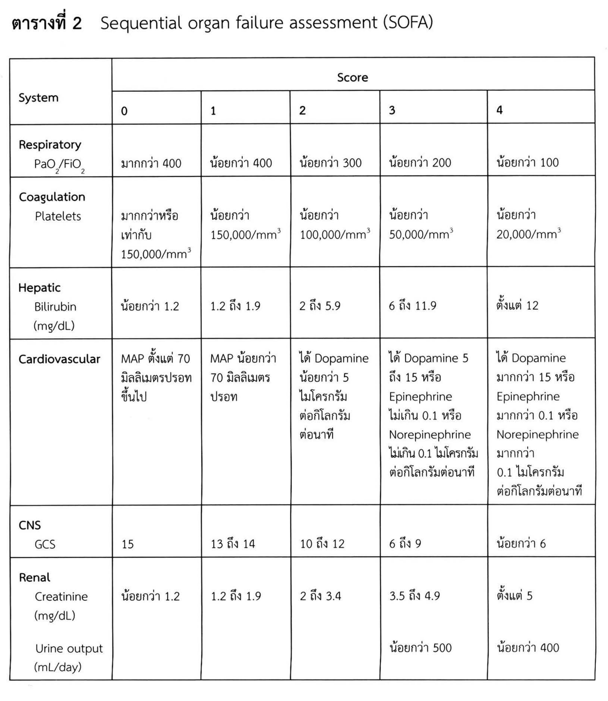
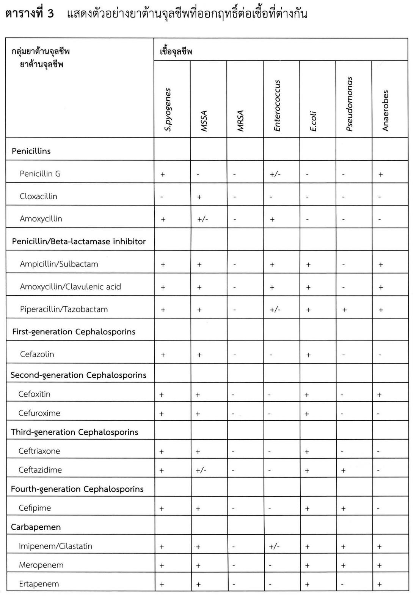
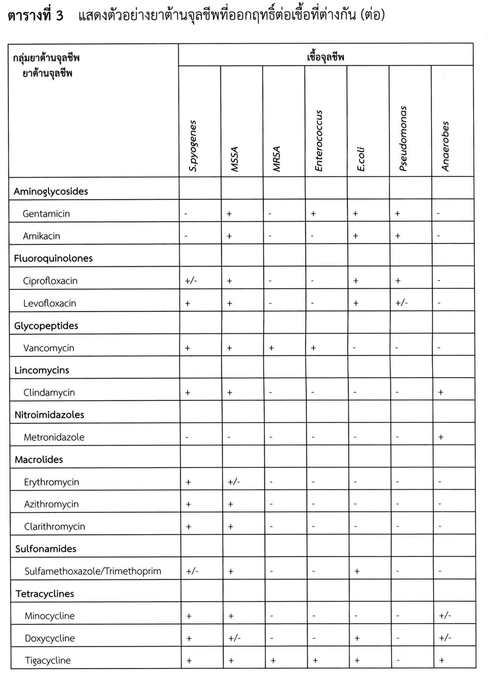
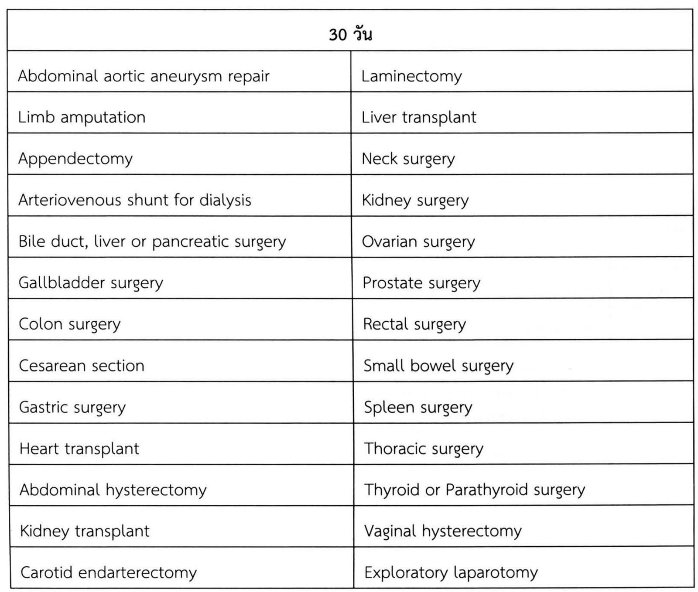
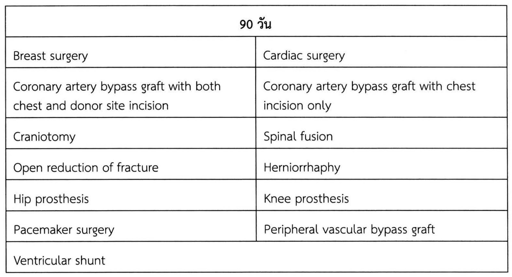

# การติดเชื้อทางศัลยศาสตร์ (Surgical infection)

## Contents of this file
- คำจำกัดความ (p.210)
- พยาธิกำเนิดของการติดเชื้อ (p.212)
  - Host defense (p.212)
- เชื้อจุลชีพก่อโรค (p.214)
  - แบคทีเรีย (p.214)
  - เชื้อรา (p.214)
  - ไวรัส (p.215)
- การป้องกันและรักษาการติดเชื้อทางศัลยศาสตร์ (p.215)
  - หลักการ (p.215)
  - Source control (p.215)
  - ยาต้านจุลชีพ (p.216)
- แผลผ่าตัดติดเชื้อ (Surgical site infection) (p.219)
- Surgical site infection criteria (p.219)
- Wound classification (p.223)
- ปัจจัยเสี่ยงต่อการติดเชื้อของแผลผ่าตัด (p.224)
- การป้องกันการติดเชื้อของแผลผ่าตัด (p.225)
  - การให้ยาต้านจุลชีพเพื่อป้องกันแผลผ่าตัดติดเชื้อ (Antimicrobial prophylaxis) (p.227)
- Standard precaution (p.229)
- สรุปสาระสำคัญ (p.231)
- เอกสารอ้างอิง (p.232)

<!-- p.209 (printed none) -->
**การติดเชื้อทางศัลยศาสตร์**

**Surgical infection**

พสุรเชษฐ์ สมร

<!-- p.210 (printed 196) -->
**การติดเชื้อทางศัลยศาสตร์**

**Surgical infection**

พสุรเชษฐ์ สมร

## คำจำกัดความ

การติดเชื้อ (infection) คือการมีเชื้อจุลชีพอยู่ในเนื้อเยื่อ หรือกระแสเลือด ซึ่งการติดเชื้อในคนที่มีภูมิคุ้มกันปกติจะก่อให้เกิด local manifestation คือ ปวด บวม แดง และร้อน ร่วมกับ systemic manifestation คืออุณหภูมิกายสูง หัวใจเต้นเร็ว หายใจเร็ว และปริมาณเม็ดเลือดขาวสูง

Systemin manifestation ข้างต้นเรียกว่า systemic inflammatory response syndrome (SIRS) ซึ่งเกิดได้จากหลายสาเหตุ ได้แก่ การติดเชื้อ การบาดเจ็บรุนแรง มะเร็ง ตับอ่อนอักเสบ และไฟไหม้ เป็นต้น แพทย์จะวินิจฉัยภาวะนี้ เมื่อผู้ป่วยเข้าได้กับ criteria อย่างน้อย 2 ข้อ ในตารางที่ 1

**ตารางที่ 1** แสดง criteria ของ systemic inflammatory response syndrome (SIRS)

|  |  |
| --- | --- |
| **อุณหภูมิกาย** | น้อยกว่า 36 องศาเซลเซียส หรือ มากกว่า 38 องศาเซลเซียส |
| **อัตราการเต้นของหัวใจ** | มากกว่า 90 ครั้งต่อนาที |
| **อัตราการหายใจ** | มากกว่า 20 ครั้งต่อนาที หรือ PaCO2 น้อยกว่า 32 มิลลิเมตรปรอท |
| **เม็ดเลือดขาว** | น้อยกว่า 4,000 เซลล์ต่อลูกบาศก์มิลลิลิตร หรือ มากกว่า 12,000 เซลล์ต่อลูกบาศก์มิลลิตร หรือ Band-form neutrophil มากกว่า ร้อยละ 10 |

<!-- p.211 (printed 197) -->
คำจำกัดความของ sepsis ในระยะก่อนหน้านี้จะมี SIRS เป็นองค์ประกอบอยู่ แพทย์สามารถวินิจฉัย sepsis ได้เมื่อผู้ป่วยมี SIRS ที่เกิดจากการติดเชื้อ เพราะเชื่อว่าเมื่อมีการติดเชื้อ กลไกภูมิคุ้มกันของร่างกายจะหลั่ง inflammatory cytokine กระตุ้นให้เกิด SIRS สารพิษที่สร้างจากจุลชีพเองก็กระตุ้น SIRS เช่นเดียวกัน

แต่พบว่าผู้ป่วยส่วนหนึ่งอาจเกิด SIRS จากสาเหตุอื่น และพบผู้ป่วยส่วนหนึ่งเกิด sepsis โดยที่ยังไม่เข้าได้กับ SIRS ก่อให้เกิดปัญหาในการรักษา การศึกษาทางระบาดวิทยาและการวิจัยทางคลินิกตามมา จึงมีการเปลี่ยนคำจำกัดความของ sepsis ในปีคริสตศักราช 2016 โดยมีรายละเอียด คือ

1. Sepsis คือภาวะที่อวัยวะทำงานบกพร่อง (organ dysfunction) จากกลไกการตอบสนองที่ผิดปกติของร่างกายต่อการติดเชื้อ

2. Organ dysfunction คือการเพิ่มขึ้นของ sequential organ failure assessment (SOFA) มากกว่าหรือเท่ากับ 2 คะแนน ดังตารางที่ 2

3. Septic shock คือกลุ่มย่อยของ sepsis ที่เกิดความผิดปกติของระบบไหลเวียนโลหิต และเมตาบอลิซึมระดับเซลล์มากจนกระทั่งเพิ่มความเสี่ยงต่อการเสียชีวิต

<!-- p.212 (printed 198) -->
**ตารางที่ 2** Sequential organ failure assessment (SOFA)

| System | Score 0 | Score 1 | Score 2 | Score 3 | Score 4 |
| --- | --- | --- | --- | --- | --- |
| **Respiratory** PaO2/FiO2 | มากกว่า 400 | น้อยกว่า 400 | น้อยกว่า 300 | น้อยกว่า 200 | น้อยกว่า 100 |
| **Coagulation** Platelets | มากกว่าหรือเท่ากับ 150,000/mm3 | น้อยกว่า 150,000/mm3 | น้อยกว่า 100,000/mm3 | น้อยกว่า 50,000/mm3 | น้อยกว่า 20,000/mm3 |
| **Hepatic** Bilirubin (mg/dL) | น้อยกว่า 1.2 | 1.2 ถึง 1.9 | 2 ถึง 5.9 | 6 ถึง 11.9 | ตั้งแต่ 12 |
| **Cardiovascular** | MAP ตั้งแต่ 70 มิลลิเมตรปรอทขึ้นไป | MAP น้อยกว่า 70 มิลลิเมตรปรอท | ได้ Dopamine น้อยกว่า 5 ไมโครกรัมต่อกิโลกรัมต่อนาที | ได้ Dopamine 5 ถึง 15 หรือ Epinephrine ไม่เกิน 0.1 หรือ Norepinephrine ไม่เกิน 0.1 ไมโครกรัมต่อกิโลกรัมต่อนาที | ได้ Dopamine มากกว่า 15 หรือ Epinephrine มากกว่า 0.1 หรือ Norepinephrine มากกว่า 0.1 ไมโครกรัมต่อกิโลกรัมต่อนาที |
| **CNS** GCS | 15 | 13 ถึง 14 | 10 ถึง 12 | 6 ถึง 9 | น้อยกว่า 6 |
| **Renal** Creatinine (mg/dL) | น้อยกว่า 1.2 | 1.2 ถึง 1.9 | 2 ถึง 3.4 | 3.5 ถึง 4.9 | ตั้งแต่ 5 |
| **Renal** Urine output (mL/day) |  |  |  | น้อยกว่า 500 | น้อยกว่า 400 |

> **Caption (verbatim):** ตารางที่ 2 Sequential organ failure assessment (SOFA)
> **Text in image (verbatim):** System · Score · 0 · 1 · 2 · 3 · 4 · Respiratory · PaO2/FiO2 · มากกว่า 400 · น้อยกว่า 400 · น้อยกว่า 300 · น้อยกว่า 200 · น้อยกว่า 100 · Coagulation · Platelets · มากกว่าหรือเท่ากับ 150,000/mm3 · น้อยกว่า 150,000/mm3 · น้อยกว่า 100,000/mm3 · น้อยกว่า 50,000/mm3 · น้อยกว่า 20,000/mm3 · Hepatic · Bilirubin (mg/dL) · น้อยกว่า 1.2 · 1.2 ถึง 1.9 · 2 ถึง 5.9 · 6 ถึง 11.9 · ตั้งแต่ 12 · Cardiovascular · MAP ตั้งแต่ 70 มิลลิเมตรปรอทขึ้นไป · MAP น้อยกว่า 70 มิลลิเมตรปรอท · ได้ Dopamine น้อยกว่า 5 ไมโครกรัมต่อกิโลกรัมต่อนาที · ได้ Dopamine 5 ถึง 15 หรือ Epinephrine ไม่เกิน 0.1 หรือ Norepinephrine ไม่เกิน 0.1 ไมโครกรัมต่อกิโลกรัมต่อนาที · ได้ Dopamine มากกว่า 15 หรือ Epinephrine มากกว่า 0.1 หรือ Norepinephrine มากกว่า 0.1 ไมโครกรัมต่อกิโลกรัมต่อนาที · CNS · GCS · 15 · 13 ถึง 14 · 10 ถึง 12 · 6 ถึง 9 · น้อยกว่า 6 · Renal · Creatinine (mg/dL) · น้อยกว่า 1.2 · 1.2 ถึง 1.9 · 2 ถึง 3.4 · 3.5 ถึง 4.9 · ตั้งแต่ 5 · Urine output (mL/day) · น้อยกว่า 500 · น้อยกว่า 400
> **Description:** Bordered table with a two-level header: the first column "System" spans both header rows, and a merged header "Score" spans five sub-columns numbered 0, 1, 2, 3, 4. Six system rows follow: Respiratory (PaO2/FiO2), Coagulation (Platelets), Hepatic (Bilirubin, mg/dL), Cardiovascular (MAP or vasopressor dose), CNS (GCS) and Renal. The Renal row is a single cell containing two parameters stacked vertically: Creatinine (mg/dL) with values in all five score columns, and below it Urine output (mL/day) with values only under scores 3 (น้อยกว่า 500) and 4 (น้อยกว่า 400); score 0-2 cells are empty for urine output. Saved as a figure because of the merged header and the stacked Renal sub-rows; in the Markdown transcription the Score header is repeated per column and the Renal row is split into two rows.
> **Identifiers in image:** none

## พยาธิกำเนิดของการติดเชื้อ

### Host defense

มนุษย์มีหลายกลไกร่วมกันป้องกันการติดเชื้อ ประกอบด้วยกลไกป้องกันจุลชีพรุกราน กลไกจำกัดไม่ให้จุลชีพแบ่งตัว และกลไกกักขังหรือกำจัดเชื้อ กระบวนการเหล่านี้ร่วมกันทำงานอย่างซับซ้อน และมีประสิทธิภาพสูงมาก

<!-- p.213 (printed 199) -->
เยื่อบุผิว (epithelium หรือ mucosa) ป้องกันไม่ให้จุลชีพเข้าสู่ชั้นที่ลึกกว่า ด้วยลักษณะทางกายภาพและการผลิตสารคัดหลั่งที่ออกฤทธิ์ยับยั้งการรุกรานหรือการแบ่งตัวของเชื้อ บนเยื่อบุผิวมักมีเชื้อจุลชีพประจำถิ่นอยู่ ซึ่งเป็นอีกกลไกหนึ่งที่ช่วยป้องกันเชื้อจุลชีพที่เป็นอันตราย

ผิวหนังเป็นอวัยวะป้องกันการติดเชื้อที่มีพื้นที่มากที่สุด ผิวหนังมีเชื้อจุลชีพประจำถิ่นที่ป้องกันไม่ให้เชื้อก่อโรคยึดเกาะหรือบุกรุกชั้นผิวหนัง โดยเชื้อประจำถิ่นส่วนใหญ่เป็นเชื้อแบคทีเรียชนิดแกรมบวก ได้แก่ *Staphylococcus species, Streptococcus species, Corynebacterium species* และ *Propioniobacterium species* อาจพบเชื้อ *Enterococcus faecalis* หรือ *faecium, Escherichia coli, Enterobacteriaceae* ชนิดอื่นๆ และยีสต์ เช่น *Candida albicans* ในชั้นผิวหนังบริเวณที่ต่ำกว่าสะดือ

หลายกลไกของทางเดินหายใจช่วยปกป้องให้หลอดลมขนาดเล็กและถุงลมปราศจากเชื้อ mucus บนเยื่อบุทางเดินหายใจส่วนต้นดักจับอนุภาคขนาดใหญ่และเชื้อจุลชีพ เมื่อ mucus เหล่านี้ไหลลงไปใน oropharynx ร่างกายจะกำจัดออกด้วยการไอ จุลชีพขนาดเล็กที่ผ่านเข้าไปในทางเดินหายใจส่วนล่างจะถูกกำจัดโดย alveolar macrophage หากมีความผิดปกติใดๆ ของกลไกข้างต้นจะส่งผลให้เกิดการติดเชื้อของหลอดลมและปอดตามมา

ทางเดินปัสสาวะ ทางเดินน้ำดี และทางเดินหายใจส่วนล่าง ปกติแล้วไม่มีจุลชีพประจำถิ่นอยู่ แต่อาจพบหากว่ามีโรค เช่น มะเร็ง การอักเสบ นิ่ว หรือสิ่งแปลกปลอม แต่จุลชีพประจำถิ่นกลับมีจำนวนมากในทางเดินอาหาร ตั้งแต่ช่องปากลงไปจนถึงทวารหนัก

เชื้อจุลชีพที่พบในทางเดินอาหารนั้นเป็นกลุ่ม anaerobe เพราะในทางเดินอาหารมีปริมาณออกซิเจนน้อยมาก โดยเชื้อ anaerobe โดยเฉพาะ *Bacteroides fragilis* พบมากกว่า aerobe ถึงหนึ่งร้อยเท่า ส่วนเชื้อ facultative anaerobe และ aerobe ที่พบบ่อย ได้แก่ *Enterococcus faecalis* หรือ *faecium, Escherichia coli, Enterobacteriaceae* ชนิดอื่นๆ และยีสต์ เช่น *Candida albicans*

เชื้อจุลชีพที่พบในทางเดินอาหารเหล่านี้ช่วยป้องกันไม่ให้จุลชีพก่อโรค เช่น *Salmonella, Shigella* และ *Vibrio species* รุกรานเข้ามาในเนื้อเยื่อได้ ในทางกลับกันเชื้อจุลชีพประจำถิ่นเหล่านี้จะกลายเป็นเชื้อก่อโรค หากมีการแตกทะลุของทางเดินอาหารกลายเป็นการติดเชื้อในช่องท้องตามมา

<!-- p.214 (printed 200) -->
หากเชื้อจุลชีพเข้ามาถึงตำแหน่งที่ควรปราศจากเชื้อในร่างกาย เช่น ในช่องท้อง หรือเนื้อเยื่อชั้นลึก ร่างกายจะมีระบบอื่นมาช่วยป้องกันและกำจัดเชื้อดังกล่าว ประกอบด้วยลักษณะทางกายภาพของเนื้อเยื่อ โปรตีน เช่น lactoferrin และ transferrin ที่จะจับกับธาตุเหล็กซึ่งจุลชีพจะนำไปใช้ในการเจริญเติบโต fibrinogen ที่อยู่ในพลาสมาจะจับกับเชื้อปริมาณมากในระหว่างการสร้าง fibrin หลังร่างกายถูกกระตุ้นให้เกิดภาวะอักเสบเฉพาะที่

เมื่อมีเชื้อเข้าสู่ช่องท้อง กระบังลมจะช่วยดึงเชื้อจุลชีพให้เข้ามาชิดกับทางเดินน้ำเหลืองในช่องอก ทำให้เม็ดเลือดขาวสามารถเข้าจัดการกับเชื้อเหล่านั้นได้เร็วขึ้น omentum ช่วยกักการติดเชื้อให้อยู่เฉพาะบริเวณ แต่มักจะก่อให้เกิด abscess ในช่องท้องตามมา

## เชื้อจุลชีพก่อโรค

### แบคทีเรีย

เชื้อจุลชีพที่ก่อโรคส่วนใหญ่ในการติดเชื้อทางศัลยศาสตร์คือแบคทีเรีย แพทย์สามารถแยกชนิดของแบคทีเรียในเบื้องต้นจาก Gram stain (แกรมบวกและแกรมลบ) รูปร่าง (cocci และ bacilli) ลักษณะของการรวมกลุ่ม (เดี่ยว คู่ สายยาว หรือจับกลุ่ม) และสปอร์

แบคทีเรียแกรมบวกมักก่อให้เกิดการติดเชื้อมักเป็นเชื้อที่อาศัยอยู่บนผิวหนัง เช่น *Staphylococcus species, Streptococcus species, Enterococcus faecalis* หรือ *faecium* โดยเชื้อกลุ่ม aerobic นั้นเป็นสาเหตุหลักของแผลผ่าตัดติดเชื้อ ส่วน enterococci อาจก่อให้เกิดการติดเชื้อทางเดินปัสสาวะในโรงพยาบาล ในผู้ป่วยเรื้อรัง แต่แทบไม่ก่อให้เกิดผลเสียในคนปกติ

แบคทีเรียแกรมลบส่วนใหญ่ที่ก่อโรคมักอยู่ในวงศ์ *Enterobacteriaceae* ได้แก่ *Escherichia coli, Klebsiella pneumoniae, Enterobacter, Citrobacter,* and *Acinetobacter* species ส่วนเชื้ออื่นๆ ที่อาจพบได้คือ *Pseudomonas* และ *Stenotrophomonas* species แบคทีเรียชนิด anaerobe อาศัยอยู่อย่างมากมายในช่องปากและลำไส้ใหญ่ โดยไม่ก่อโรคดังที่กล่าวถึงข้างต้น

### เชื้อรา

แพทย์สามารถแยกชนิดของราเบื้องต้นได้จากการย้อมสีพิเศษต่างๆ เช่น potassium hydroxide, India ink, methenamine silver หรือ Giemsa และจะแยกชนิดชัดเจนได้

<!-- p.215 (printed 201) -->
จากการเพาะเชื้อ เชื้อราที่ก่อให้เกิด surgical infection นั้นเป็นกลุ่มที่เป็นสาเหตุของการติดเชื้อในโรงพยาบาล เช่น *Candida* species ส่วนน้อยจะเป็นสาเหตุของการติดเชื้อของผิวหนังและเนื้อเยื่อใต้ผิวหนัง เช่น *Mucor* specie และบางชนิดเป็น opportunistic infection ในผู้ป่วยที่มีภูมิคุ้มกันผิดปกติ เช่น *Aspergillus* และ *Cryptococcus* species

### ไวรัส

การติดเชื้อทางศัลยศาสตร์ที่เกิดจากไวรัสนั้นมักเกิดในผู้ป่วยภูมิคุ้มกันบกพร่อง โดยเฉพาะผู้ป่วยที่ได้ยากดภูมิคุ้มกันหลังปลูกถ่ายอวัยวะ เช่น cytomegalovirus, Epstein-Barr virus, herpes simplex virus, และ varicella-zoster virus

ศัลยแพทย์ต้องระมัดระวังการผ่าตัดในผู้ป่วยที่ติดเชื้อ hepatitis B และ C viruses และ HIV เพราะเชื้อเหล่านี้อาจแพร่ไปสู่ตนเองและผู้ร่วมงานได้

## การป้องกันและรักษาการติดเชื้อทางศัลยศาสตร์

### หลักการ

การป้องกันการติดเชื้อเป็นสิ่งสำคัญ เพราะเมื่อผู้ป่วยเกิดการติดเชื้อแล้วจะเกิดผลเสียตามมามากมาย เช่น นอนโรงพยาบาลนานขึ้น ค่าใช้จ่ายมากขึ้น อวัยวะทำงานล้มเหลว และเสียชีวิตในที่สุด เชื้อก่อโรคนั้นอาจมาจากตัวผู้ป่วยเอง แพทย์หรือสิ่งแวดล้อมก็ได้

ผู้ป่วยต้องอาบน้ำด้วยสบู่ผสมน้ำยาฆ่าเชื้อกลางคืนก่อนผ่าตัดเพื่อลดเชื้อจุลชีพบนผิวหนัง ไม่ควรใช้มีดโกนเพื่อกำจัดขนบริเวณผ่าตัดเพราะอาจทำให้เกิดบาดแผลบนผิวหนังและ bacterial overgrowth ได้ หากจำเป็นควรเลือกใช้ clipper ก่อนผ่าตัดแพทย์ใช้น้ำยาฆ่าเชื้อเพื่อทากำจัดเชื้อบนผิวหนังให้กว้างเพียงพอ การให้ยาต้านจุลชีพทางหลอดเลือดดำก่อนผ่าตัดจะช่วยลดอัตราการติดเชื้อของแผลผ่าตัดบางประเภทลงได้ การควบคุมระดับน้ำตาลในเลือดให้ต่ำกว่า 200 mg/dL ทำให้อุณหภูมิกายและออกซิเจนในเลือดไม่ต่ำระหว่างผ่าตัดก็ช่วยลดการติดเชื้อลงได้เช่นเดียวกัน

### Source control

หลักการสำคัญของการติดเชื้อทางศัลยศาสตร์คือ source control เช่น การระบายหนอง การกำจัดเนื้อตาย หรือเนื้อเยื่อที่มีการติดเชื้อ การกำจัดสิ่งแปลกปลอม และการรักษาสาเหตุของการผ่าตัด

<!-- p.216 (printed 202) -->
Abscess ต้องได้รับการระบายด้วยการผ่าตัดหรือ percutaneous drainage ในกรณีที่อยู่ลึกเข้าไปในช่องต่างๆ ของร่างกาย การระบายหนองออกจะช่วยลดปริมาณจุลชีพ ลด inflammatory cytokine ที่ร่างกายหลั่งออกมาเพื่อต่อต้านการติดเชื้อ และกำจัด necrotic tissue หรือ fibrin ทำให้เซลล์ภูมิคุ้มกัน และยาต้านจุลชีพเข้าสู่บริเวณที่ติดเชื้อได้ดีขึ้น

การรักษาไส้ติ่งอักเสบนั้นก็มีหลักการรักษาไม่แตกต่างกัน คือทำ source control ด้วยการทำ appendectomy เพราะจะสามารถกำจัดเนื้อตายที่เหมาะสมกับการเจริญของเชื้อจุลชีพ และเชื้อปริมาณมากไปในคราวเดียว

ผู้ป่วยที่มีเท้าเบาหวานและมีการติดเชื้อที่ควบคุมไม่ได้ต้องทำการผ่าตัดกำจัดเนื้อตาย (debridement) อาจจะต้องทำ amputation เพื่อ source control เพราะการให้ยาต้านจุลชีพเพียงอย่างเดียวมักจะไม่ได้ผล

### ยาต้านจุลชีพ

การให้ยาต้านจุลชีพที่เหมาะสมกับการติดเชื้อจะทำให้การรักษาได้ผลดี เพราะยาต้านจุลชีพแต่ละชนิดออกฤทธิ์ต่อเชื้อแตกต่างกันไป ดังตารางที่ 3

<!-- p.217 (printed 203) -->
**ตารางที่ 3** แสดงตัวอย่างยาต้านจุลชีพที่ออกฤทธิ์ต่อเชื้อที่ต่างกัน

| **กลุ่มยาต้านจุลชีพ** **ยาต้านจุลชีพ** | **เชื้อจุลชีพ** *S.pyogenes* | **เชื้อจุลชีพ** *MSSA* | **เชื้อจุลชีพ** *MRSA* | **เชื้อจุลชีพ** *Enterococcus* | **เชื้อจุลชีพ** *E.coli* | **เชื้อจุลชีพ** *Pseudomonas* | **เชื้อจุลชีพ** Anaerobes |
| --- | --- | --- | --- | --- | --- | --- | --- |
| **Penicillins** |  |  |  |  |  |  |  |
| Penicillin G | + | - | - | +/- | - | - | + |
| Cloxacillin | - | + | - | - | - | - | - |
| Amoxycillin | + | +/- | - | + | - | - | - |
| **Penicillin/Beta-lactamase inhibitor** |  |  |  |  |  |  |  |
| Ampicillin/Sulbactam | + | + | - | + | + | - | + |
| Amoxycillin/Clavulenic acid | + | + | - | + | + | - | + |
| Piperacillin/Tazobactam | + | + | - | +/- | + | + | + |
| **First-generation Cephalosporins** |  |  |  |  |  |  |  |
| Cefazolin | + | + | - | - | + | - | - |
| **Second-generation Cephalosporins** |  |  |  |  |  |  |  |
| Cefoxitin | + | + | - | - | + | - | + |
| Cefuroxime | + | + | - | - | + | - | - |
| **Third-generation Cephalosporins** |  |  |  |  |  |  |  |
| Ceftriaxone | + | + | - | - | + | - | - |
| Ceftazidime | + | +/- | - | - | + | + | - |
| **Fourth-generation Cephalosporins** |  |  |  |  |  |  |  |
| Cefipime | + | + | - | - | + | + | - |
| **Carbapemen** |  |  |  |  |  |  |  |
| Imipenem/Cilastatin | + | + | - | +/- | + | + | + |
| Meropenem | + | + | - | - | + | + | + |
| Ertapenem | + | + | - | - | + | - | + |

> **Caption (verbatim):** ตารางที่ 3 แสดงตัวอย่างยาต้านจุลชีพที่ออกฤทธิ์ต่อเชื้อที่ต่างกัน
> **Text in image (verbatim):** กลุ่มยาต้านจุลชีพ · ยาต้านจุลชีพ · เชื้อจุลชีพ · S.pyogenes · MSSA · MRSA · Enterococcus · E.coli · Pseudomonas · Anaerobes · Penicillins · Penicillin G · Cloxacillin · Amoxycillin · Penicillin/Beta-lactamase inhibitor · Ampicillin/Sulbactam · Amoxycillin/Clavulenic acid · Piperacillin/Tazobactam · First-generation Cephalosporins · Cefazolin · Second-generation Cephalosporins · Cefoxitin · Cefuroxime · Third-generation Cephalosporins · Ceftriaxone · Ceftazidime · Fourth-generation Cephalosporins · Cefipime · Carbapemen · Imipenem/Cilastatin · Meropenem · Ertapenem · + · - · +/-
> **Description:** Bordered grid table. The first column header reads "กลุ่มยาต้านจุลชีพ" with "ยาต้านจุลชีพ" indented below it (drug class, then individual drug). A merged header "เชื้อจุลชีพ" spans seven organism columns whose names are printed rotated 90° (reading bottom to top): S.pyogenes, MSSA, MRSA, Enterococcus, E.coli, Pseudomonas (all italic) and Anaerobes (upright). Bold drug-class rows (Penicillins; Penicillin/Beta-lactamase inhibitor; First-, Second-, Third-, Fourth-generation Cephalosporins; Carbapemen) have empty organism cells; indented drug rows below each class carry a "+", "-" or "+/-" in each organism column. The MRSA column is "-" for every drug listed. Saved as a figure because of the merged header and the class/drug two-level row structure; the Markdown version repeats "เชื้อจุลชีพ" in each organism column header.
> **Identifiers in image:** none

<!-- p.218 (printed 204) -->
**ตารางที่ 3** แสดงตัวอย่างยาต้านจุลชีพที่ออกฤทธิ์ต่อเชื้อที่ต่างกัน (ต่อ)

| **กลุ่มยาต้านจุลชีพ** **ยาต้านจุลชีพ** | **เชื้อจุลชีพ** *S.pyogenes* | **เชื้อจุลชีพ** *MSSA* | **เชื้อจุลชีพ** *MRSA* | **เชื้อจุลชีพ** *Enterococcus* | **เชื้อจุลชีพ** *E.coli* | **เชื้อจุลชีพ** *Pseudomonas* | **เชื้อจุลชีพ** *Anaerobes* |
| --- | --- | --- | --- | --- | --- | --- | --- |
| **Aminoglycosides** |  |  |  |  |  |  |  |
| Gentamicin | - | + | - | + | + | + | - |
| Amikacin | - | + | - | - | + | + | - |
| **Fluoroquinolones** |  |  |  |  |  |  |  |
| Ciprofloxacin | +/- | + | - | - | + | + | - |
| Levofloxacin | + | + | - | - | + | +/- | - |
| **Glycopeptides** |  |  |  |  |  |  |  |
| Vancomycin | + | + | + | + | - | - | - |
| **Lincomycins** |  |  |  |  |  |  |  |
| Clindamycin | + | + | - | - | - | - | + |
| **Nitroimidazoles** |  |  |  |  |  |  |  |
| Metronidazole | - | - | - | - | - | - | + |
| **Macrolides** |  |  |  |  |  |  |  |
| Erythromycin | + | +/- | - | - | - | - | - |
| Azithromycin | + | + | - | - | - | - | - |
| Clarithromycin | + | + | - | - | - | - | - |
| **Sulfonamides** |  |  |  |  |  |  |  |
| Sulfamethoxazole/Trimethoprim | +/- | + | - | - | + | - | - |
| **Tetracyclines** |  |  |  |  |  |  |  |
| Minocycline | + | + | - | - | - | - | +/- |
| Doxycycline | + | +/- | - | - | + | - | +/- |
| Tigacycline | + | + | + | + | + | - | + |

> **Caption (verbatim):** ตารางที่ 3 แสดงตัวอย่างยาต้านจุลชีพที่ออกฤทธิ์ต่อเชื้อที่ต่างกัน (ต่อ)
> **Text in image (verbatim):** กลุ่มยาต้านจุลชีพ · ยาต้านจุลชีพ · เชื้อจุลชีพ · S.pyogenes · MSSA · MRSA · Enterococcus · E.coli · Pseudomonas · Anaerobes · Aminoglycosides · Gentamicin · Amikacin · Fluoroquinolones · Ciprofloxacin · Levofloxacin · Glycopeptides · Vancomycin · Lincomycins · Clindamycin · Nitroimidazoles · Metronidazole · Macrolides · Erythromycin · Azithromycin · Clarithromycin · Sulfonamides · Sulfamethoxazole/Trimethoprim · Tetracyclines · Minocycline · Doxycycline · Tigacycline · + · - · +/-
> **Description:** Continuation of Table 3, same layout as on the previous page: first column "กลุ่มยาต้านจุลชีพ" / indented "ยาต้านจุลชีพ", and a merged header "เชื้อจุลชีพ" (centred here) over seven organism columns printed rotated 90° in italics: S.pyogenes, MSSA, MRSA, Enterococcus, E.coli, Pseudomonas, Anaerobes. Bold drug-class rows (Aminoglycosides, Fluoroquinolones, Glycopeptides, Lincomycins, Nitroimidazoles, Macrolides, Sulfonamides, Tetracyclines) have empty organism cells; each indented drug row shows "+", "-" or "+/-" per organism. Only Vancomycin and Tigacycline have "+" under MRSA; Metronidazole is "+" only under Anaerobes. Saved as a figure because of the merged header and two-level row structure.
> **Identifiers in image:** none

<!-- p.219 (printed 205) -->
แม้ว่าแพทย์จะทราบประเภทของยาต้านจุลชีพที่เหมาะสมกับเชื้อแต่ละชนิดแล้ว ยังมีรายละเอียดปลีกย่อยอีกมากมาย เกี่ยวกับเภสัชจลนศาสตร์ เภสัชพลศาสตร์ และผลข้างเคียง หากจำเป็นต้องใช้ยาที่ไม่คุ้นเคย แพทย์ควรปรึกษาแพทย์ผู้เชี่ยวชาญด้านโรคติดเชื้อเสมอ

ปัจจัยเพื่อเลือกใช้ยาต้านจุลชีพ ได้แก่

1. พิจารณาว่าเชื้อก่อโรคคือชนิดใด
2. เลือกยาต้านจุลชีพที่ออกฤทธิ์ได้ดีต่อเชื้อก่อโรคนั้น
3. เริ่มให้ยาต้านจุลชีพอย่างรวดเร็วหลังวินิจฉัยการติดเชื้อ เพราะการให้ยาล่าช้าอาจส่งผลให้เพิ่มอัตราการเสียชีวิต
4. พิจารณาให้ broad-spectrum antibiotics เมื่อเป็นการติดเชื้อรุนแรง และยังไม่สามารถแยกเชื้อได้
5. เปลี่ยนยาต้านจุลชีพที่เหมาะสมกับเชื้อ เมื่อผลเพาะเชื้อและความไวต่อยาออก
6. ให้ยาต้านจุลชีพในระยะเวลาที่เหมาะสม เพราะหากให้ยานานเกินไปอาจกระตุ้นให้เกิดเชื้อดื้อยา

## แผลผ่าตัดติดเชื้อ (Surgical site infection)

แผลผ่าตัดติดเชื้อ (Surgical site infection : SSI) เป็นปัญหาสำคัญทางการแพทย์ เพราะเป็นการติดเชื้อในโรงพยาบาลที่พบบ่อยที่สุด (ร้อยละ 31) ซึ่งก่อให้เกิดภาวะแทรกซ้อนและการเสียชีวิตตามมา ความรู้เกี่ยวกับการติดเชื้อของแผลผ่าตัด ทั้งวิธีการป้องกันและการรักษา จะทำให้อัตราการติดเชื้อ ความพิการ และการเสียชีวิตลดลง

## Surgical site infection criteria

1. Superficial incisional SSI มี criteria ดังต่อไปนี้
  a. เกิดขึ้นภายใน 30 วัน นับจากผ่าตัด
  b. Skin และ subcutaneous tissue เท่านั้นที่ติดเชื้อ

<!-- p.220 (printed 206) -->
  c. ผู้ป่วยมีอาการ อาการแสดง หรือสิ่งตรวจพบอย่างน้อยหนึ่งข้อ ได้แก่
    i. มีหนองไหลจากแผลผ่าตัด
    ii. พบเชื้อก่อโรคจากแผลผ่าตัด (culture หรือ Gram stain)
    iii. แผลผ่าตัดที่ถูกเปิดออก (เช่น ตัดไหม หรือแหวกแผล) หลังจากการผ่าตัดเสร็จสิ้น โดยไม่ได้ส่งตรวจทางจุลชีววิทยา โดยมีสาเหตุของการเปิดแผล คือ ผู้ป่วยปวดแผล กดเจ็บบริเวณแผล แผลบวม แผลแดง หรือร้อน
    iv. ศัลยแพทย์เจ้าของไข้วินิจฉัยว่า มีการติดเชื้อของแผลผ่าตัด
2. Deep incisional SSI มี criteria ดังต่อไปนี้
  a. เกิดขึ้นภายใน 30 วัน หรือ 90 วัน หลังผ่าตัด ขึ้นกับชนิดของการผ่าตัดตามตารางที่ 1
  b. มีการติดเชื้อของ deep tissue เช่น fascia และ muscle
  c. ผู้ป่วยมีอาการ อาการแสดง หรือสิ่งตรวจพบอย่างน้อยหนึ่งข้อ ได้แก่
    i. มีหนองไหลจาก deep tissue
    ii. Deep incision แยกออก เช่น rectus abdominis แยกหลังการผ่าตัดช่องท้อง หรือพบเชื้อก่อโรคจาก deep incision (culture หรือ Gram stain) และผู้ป่วยมีอาการ อาการแสดง หรือสิ่งตรวจพบอย่างน้อยหนึ่งข้อ ได้แก่
      1. ไข้มากกว่า 38 องศาเซลเซียส
      2. ปวดหรือกดเจ็บ
    iii. พบว่ามีการติดเชื้อใน deep incision จากการตรวจทางรังสีวิทยา หรือพยาธิวิทยา
3. Organ/Space SSI มี criteria ดังต่อไปนี้
  a. เกิดขึ้นภายใน 30 วัน หรือ 90 วัน หลังผ่าตัด ขึ้นกับชนิดของการผ่าตัดตามตารางที่ 1

<!-- p.221 (printed 207) -->
  b. การติดเชื้อเกิดในชั้นที่ลึกกว่า fascia หรือ muscle โดยบริเวณดังกล่าวถูกเปิดหรือทำหัตถการระหว่างผ่าตัด
  c. ผู้ป่วยมีอาการ อาการแสดง หรือสิ่งตรวจพบอย่างน้อยหนึ่งข้อ ได้แก่
    i. มีหนองไหลจาก drain ที่วางไว้ใน organ/space เช่น closed suction drainage system, open drain, T-tube drain, Percutaneous drain
    ii. พบเชื้อก่อโรคจาก fluid หรือ tissue จาก organ/space (culture หรือ Gram stain)
    iii. พบว่ามีการติดเชื้อใน organ/space จากการตรวจทางรังสีวิทยา หรือพยาธิวิทยา
  d. อวัยวะที่พบการติดเชื้ออยู่ใน list ตามตารางที่ 2

**ตารางที่ 4** ระยะเวลาของการเฝ้าระวัง deep incisional SSI ตามชนิดของการผ่าตัด

| **30 วัน** | **30 วัน** |
| --- | --- |
| Abdominal aortic aneurysm repair | Laminectomy |
| Limb amputation | Liver transplant |
| Appendectomy | Neck surgery |
| Arteriovenous shunt for dialysis | Kidney surgery |
| Bile duct, liver or pancreatic surgery | Ovarian surgery |
| Gallbladder surgery | Prostate surgery |
| Colon surgery | Rectal surgery |
| Cesarean section | Small bowel surgery |
| Gastric surgery | Spleen surgery |
| Heart transplant | Thoracic surgery |
| Abdominal hysterectomy | Thyroid or Parathyroid surgery |
| Kidney transplant | Vaginal hysterectomy |
| Carotid endarterectomy | Exploratory laparotomy |

> **Caption (verbatim):** ตารางที่ 4 ระยะเวลาของการเฝ้าระวัง deep incisional SSI ตามชนิดของการผ่าตัด
> **Text in image (verbatim):** 30 วัน · Abdominal aortic aneurysm repair · Laminectomy · Limb amputation · Liver transplant · Appendectomy · Neck surgery · Arteriovenous shunt for dialysis · Kidney surgery · Bile duct, liver or pancreatic surgery · Ovarian surgery · Gallbladder surgery · Prostate surgery · Colon surgery · Rectal surgery · Cesarean section · Small bowel surgery · Gastric surgery · Spleen surgery · Heart transplant · Thoracic surgery · Abdominal hysterectomy · Thyroid or Parathyroid surgery · Kidney transplant · Vaginal hysterectomy · Carotid endarterectomy · Exploratory laparotomy
> **Description:** Boxed two-column table with a single bold header cell "30 วัน" merged across both columns, followed by 13 rows of two operation types each (26 operations in total), all belonging to the 30-day surveillance period. The full content is transcribed above as a Markdown table (the merged header is repeated in both columns). The table continues on the next page.
> **Identifiers in image:** none

<!-- p.222 (printed 208) -->
| **90 วัน** | **90 วัน** |
| --- | --- |
| Breast surgery | Cardiac surgery |
| Coronary artery bypass graft with both chest and donor site incision | Coronary artery bypass graft with chest incision only |
| Craniotomy | Spinal fusion |
| Open reduction of fracture | Herniorrhaphy |
| Hip prosthesis | Knee prosthesis |
| Pacemaker surgery | Peripheral vascular bypass graft |
| Ventricular shunt | |

> **Caption (verbatim):** none
> **Text in image (verbatim):** 90 วัน · Breast surgery · Cardiac surgery · Coronary artery bypass graft with both chest and donor site incision · Coronary artery bypass graft with chest incision only · Craniotomy · Spinal fusion · Open reduction of fracture · Herniorrhaphy · Hip prosthesis · Knee prosthesis · Pacemaker surgery · Peripheral vascular bypass graft · Ventricular shunt
> **Description:** Continuation of ตารางที่ 4 from the previous page (no new caption printed). Boxed two-column table with a single bold header cell "90 วัน" merged across both columns, followed by 6 rows of two operation types each and a final row in which "Ventricular shunt" occupies one cell spanning the full width (13 operations in total), all belonging to the 90-day surveillance period. Transcribed above as a Markdown table (merged header repeated in both columns; the full-width last cell is placed in the first column with the second left empty).
> **Identifiers in image:** none

**ตารางที่ 5** อวัยวะที่เกิด organ/space SSI

| **อวัยวะ** | **การติดเชื้อ** | **อวัยวะ** | **การติดเชื้อ** |
| --- | --- | --- | --- |
| Bone | Osteomyelitis | Lung | Empyema thoraces or infection of lower respiratory tract |
| Breast | Mastitis or breast abscess | Mediastinum | Mediastinitis |
| Heart | Myocarditis or pericarditis or endocarditis | Oral cavity | Oral cavity abscess |
| Disc | Disc space infection | Reproductive | Infections of male and female reproductive tract |
| Ear | Otitis media or mastoiditis | Spine | Spinal abscess |
| GI tract | GI tract infection | Nasal sinus | Sinusitis |
| Abdomen | Intraabdominal collection or abscess | Urinary system | Urinary system infection |
| Brain | Intracranial, dura or brain abscess Meningitis or ventriculitis | Vascular | Arterial or venous infection |
| Joint | Joint or bursa infection | Vagina | Vaginal cuff infection |

<!-- p.223 (printed 209) -->
## Wound classification

แบ่งแผลผ่าตัดตามการปนเปื้อนได้เป็น 4 ระดับ คือ

1. Clean wound
  - แผลผ่าตัดที่ไม่ผ่านบริเวณที่มีการติดเชื้อ หรือการอักเสบ
  - ไม่ผ่านเข้าทางเดินหายใจ ทางเดินอาหาร รวมถึงตับ ทางเดินน้ำดี ตับอ่อน ระบบสืบพันธุ์ และทางเดินปัสสาวะ
2. Clean-contaminated wound
  - แผลผ่าตัดที่ผ่านเข้าทางเดินหายใจ ทางเดินอาหาร รวมถึงตับ ทางเดินน้ำดี ตับอ่อน ระบบสืบพันธุ์ และทางเดินปัสสาวะ
  - อวัยวะและบริเวณที่ทำการผ่าตัดต้องไม่มีการติดเชื้อหรือการอักเสบ
3. Contaminated wound
  - แผลเปิดที่เกิดจากอุบัติเหตุและการบาดเจ็บ
  - การผ่าตัดที่ผิดหลัก sterile technique เช่น open cardiac massage
  - มีการปนเปื้อนจากสิ่งคัดหลั่งหรืออุจจาระจากทางเดินอาหารปริมาณมาก
  - การผ่าตัดในบริเวณที่มีการอักเสบแต่ไม่มีหนอง เช่น acute appendicitis และ acute cholecystitis
4. Dirty or infected
  - แผลจากการบาดเจ็บที่มีการตายของเนื้อเยื่อร่วมด้วย
  - การผ่าตัดภาวะที่เกิดจากการแตกทะลุของ visceral organ

<!-- p.224 (printed 210) -->
อัตราการติดเชื้อของแผลผ่าตัดในแต่ละ wound classification จะแตกต่างกันดังตารางที่ 6

**ตารางที่ 6** อัตราการติดเชื้อของแผลผ่าตัด

| Wound Class | Description | SSIs (%) |
| --- | --- | --- |
| I | Clean | 1.3 to 2.9 |
| II | Clean-contaminated | 2.4 to 7.7 |
| III | Contaminated | 6.4 to 15.2 |
| IV | Dirty | 4.1 to 40.0 |

## ปัจจัยเสี่ยงต่อการติดเชื้อของแผลผ่าตัด

มีปัจจัยเสี่ยงมากมายทั้งแบบที่ควบคุมได้และไม่ได้

1. การควบคุมการติดเชื้อ
  a. ความสะอาดและการทำให้ห้องผ่าตัดปลอดเชื้อ ถ้าห้องผ่าตัดออกแบบได้ไม่ดี มีบริเวณที่ทำความสะอาดได้ยาก มีการไหลเวียนของอากาศที่ไม่เหมาะสม หรือการทำให้ปลอดเชื้อไม่เหมาะสม จะทำให้พบเชื้อก่อโรคในห้องผ่าตัด และเพิ่มความเสี่ยง
  b. การทำความสะอาดเครื่องมือผ่าตัด และการทำให้ปลอดเชื้อที่ไม่เหมาะสม
2. ผู้ป่วย
  a. สูงอายุ
  b. เบาหวาน
  c. อ้วน
  d. สูบบุหรี่

<!-- p.225 (printed 211) -->
  e. ได้รับยากดภูมิคุ้มกันหรือยาเคมีบำบัด
  f. ทุพโภชนาการ
  g. มีการติดเชื้อในระบบอื่นๆ อยู่ระหว่างผ่าตัด
  h. เคยมีการติดเชื้อของผิวหนัง
  i. ได้รับการผ่าตัดใดๆ ก่อนหน้าไม่เกิน 1 เดือน
  j. เข้าพักรักษาในโรงพยาบาลก่อนผ่าตัดเป็นเวลานาน
  k. มีโรคประจำตัวอื่นๆ ที่รุนแรง เช่น โรคหัวใจ โรคปอดเรื้อรัง
3. การผ่าตัด และการดูแลระหว่างผ่าตัด
  a. การโกนขนหรือผมก่อนการผ่าตัด
  b. การใช้ antiseptic ที่ไม่เหมาะสม
  c. การทำหัตถการที่รุนแรงก่อให้เกิดความบาดเจ็บต่อเนื้อเยื่อ
  d. ระยะเวลาการผ่าตัดที่ยาวนาน
  e. การใช้ electrocautery มากเกินไป
  f. อุณหภูมิกายที่ต่ำเกินไประหว่างผ่าตัด
  g. เกิด hypoxia ระหว่างผ่าตัด
  h. ระดับน้ำตาลในเลือดที่สูงระหว่างผ่าตัด
  i. จำเป็นต้องได้รับเลือดระหว่างผ่าตัด
  j. มีการใส่สิ่งแปลกปลอมหรืออวัยวะเทียม

## การป้องกันการติดเชื้อของแผลผ่าตัด

1. การควบคุมการติดเชื้อที่ดี

<!-- p.226 (printed 212) -->
  a. การรักษาความสะอาด และการทำให้ห้องผ่าตัดปลอดเชื้อที่เหมาะสม
  b. การทำให้เครื่องมือผ่าตัดปลอดเชื้ออย่างถูกต้อง
  c. Hand hygiene จะขยายความในส่วนของ hand hygiene
  d. Antimicrobial prophylaxis จะขยายความในส่วนของ antimicrobial prophylaxis
  e. เครื่องแต่งกายในห้องผ่าตัด
    i. ให้เปลี่ยนหากจำเป็นต้องดูแลผู้ป่วยอื่นนอกห้องผ่าตัด
    ii. ไม่ควรใส่ออกนอกโรงพยาบาล
    iii. ต้องสวมเสื้อคลุมยาวทับหากจะออกนอกห้องผ่าตัด
    iv. เปลี่ยนเสื้อผ้า หมวก และหน้ากากกันเปื้อนหลังเสร็จผ่าตัดที่สกปรก
    v. เปลี่ยนเสื้อผ้าที่เปื้อนคราบใดๆ ทันทีที่เป็นไปได้
    vi. สวมหน้ากากกันเปื้อน ปิดปาก และจมูกตลอดเวลาขณะผ่าตัด
    vii. ถอดสร้อยคอ ตุ้มหู หรือเครื่องประดับใดๆ บนศีรษะก่อนเข้าผ่าตัด
  f. เลือกน้ำยาฆ่าเชื้อเพื่อเตรียมผ่าตัดอย่างเหมาะสม
    i. Chlorhexidine in alcohol ดีที่สุดเพราะมี residual activity และไม่ถูก deactivate ด้วยเลือด หรือ serum
    ii. Povidone iodine
    iii. Iodine in alcohol
    iv. *Chlorhexidine in water* ไม่มีข้อมูลว่าสามารถใช้เตรียมผ่าตัดได้
  g. การกำจัดขน
    i. กำจัดขนเมื่อจำเป็นเท่านั้น
    ii. ใช้ clipper หรือน้ำยากำจัดขน ไม่ใช้มีดโกน

<!-- p.227 (printed 213) -->
2. การเตรียมผู้ป่วยก่อนผ่าตัด
  a. ให้หยุดบุหรี่อย่างน้อย 4 ถึง 6 สัปดาห์ก่อนผ่าตัด
  b. แก้ไขภาวะทุพโภชนาการ
  c. ควบคุมระดับน้ำตาลในเลือดให้ดี
  d. รักษาการติดเชื้อในระบบอื่นๆ ให้หายก่อน
  e. เว้นระยะหลังจากการให้ยาเคมีบำบัดหรือรังสีรักษาอย่างน้อย 6 สัปดาห์ หรือหายจากภาวะข้างเคียง เช่น เม็ดเลือดขาวต่ำ
  f. ให้ผู้ป่วยอาบน้ำด้วยสบู่ที่ผสมน้ำยาฆ่าเชื้อ เช่น Chlorhexidine soap คืนก่อนผ่าตัด
3. การดูแลผู้ป่วยระหว่างผ่าตัด และการผ่าตัด
  a. เคร่งครัดในกระบวนการปลอดเชื้อ (aseptic technique)
  b. จับเนื้อเยื่อต่างๆ อย่างระมัดระวัง
  c. เปิดแผลผ่าตัดทิ้งไว้โดยไม่เย็บปิดหากแผลผ่าตัดเป็นชนิด dirty wound และนำมาเย็บปิดหลังจากผ่าตัดประมาณ 5 วัน
  d. ใช้สายระบาย (drain) เมื่อจำเป็นเท่านั้น

### การให้ยาต้านจุลชีพเพื่อป้องกันแผลผ่าตัดติดเชื้อ (Antimicrobial prophylaxis)

หลักการเลือกยาต้านจุลชีพเพื่อป้องกันแผลผ่าตัดติดเชื้อ มีหลักการดังนี้

1. ให้ยาต้านจุลชีพตามหลักฐานเชิงประจักษ์ว่าสามารถลดแผลผ่าตัดติดเชื้อได้ในการผ่าตัดชนิดนั้นๆ
2. เลือกยาต้านจุลชีพให้ครอบคลุมเชื้อทุกชนิดที่อาจปนเปื้อนได้ระหว่างผ่าตัด
  a. ปลอดภัย
  b. ประสิทธิภาพดี

<!-- p.228 (printed 214) -->
  c. ราคาถูก
  d. ออกฤทธิ์แบบ bacteriocidal
3. ระดับของยาในเลือดและในเนื้อเยื่อต้องสูงกว่าระดับที่ฆ่าเชื้อได้ขณะที่จะลงมีดผ่าตัด และตลอดเวลาที่ผ่าตัด หากการผ่าตัดยาวนานอาจจะต้องให้ยาซ้ำ
  a. ให้ยาต้านจุลชีพก่อนผ่าตัดไม่เกิน 30 นาที
  b. ให้ยาซ้ำเมื่อระยะเวลาผ่าตัดนานกว่า half life ของยานั้น
4. ไม่ควรให้ยาต้านจุลชีพเกินกว่า 24 ชั่วโมง หลังการผ่าตัด

**ตารางที่ 7** ยาต้านจุลชีพที่เหมาะสมกับชนิดของการผ่าตัด

| **ประเภทการผ่าตัด** | **เชื้อก่อโรคที่พบบ่อย** | **ยาต้านจุลชีพที่เหมาะสม** | **ยาต้านจุลชีพ กรณีที่แพ้ penicillin** |
| --- | --- | --- | --- |
| Cardiovascular | *Staphylococcus sp.* | Cefazolin | Clindamycin Vancomycin |
| Upper gastrointestinal area | Gram negative | Cefazolin | Ciprofloxacin |
| Hepatobiliary | Gram negative | Cefazolin or Ceftriaxone | Ciprofloxacin |
| Appendectomy | Gram negative and anaerobes | Cefoxitin or Ceftriaxone plus metronidazole | Ciprofloxacin plus metronidazole |
| Colorectal | Gram negative and anaerobes | Ceftriaxone plus metronidazole | Ciprofloxacin plus metronidazole |
| Head and neck (class II) | Gram positive and anaerobes | Ampicillin-sulbactam | Clindamycin |
| Neurosurgical | *Staphylococcus sp.* | Cefazolin | Clindamycin Vancomycin |
| Orthopedic | *Staphylococcus sp.* | Cefazolin | Clindamycin Vancomycin |
| Hernia (prosthesis) | *Staphylococcus sp.* | Cefazolin | Clindamycin Vancomycin |

<!-- p.229 (printed 215) -->
## Standard precaution

แพทย์มีความเสี่ยงต่อการติดเชื้อจากผู้ป่วย โดยเฉพาะกลุ่มที่ติดต่อทางเลือดในขณะทำหัตถการ และยังสามารถเป็นพาหะแพร่เชื้อจุลชีพดื้อยาให้กับผู้ป่วยอีกด้วย

**Standard precaution** คือวิธีการใดๆ ที่ช่วยลดความเสี่ยงต่อการติดต่อหรือส่งผ่านของ bloodborne pathogen รวมถึงเชื้อโรคชนิดอื่นๆ จากแหล่งที่ใดๆ ก็ตาม

กระบวนการนี้เป็นการควบคุมการติดเชื้อขั้นพื้นฐาน และต้องนำไปใช้ในการดูแลผู้ป่วยทุกคน standard precaution นี้ประกอบด้วย

1. **Hand hygiene** โดยอาจทำได้ 2 วิธีการ คือ
   - ล้างมือใช้เวลา 40 ถึง 60 วินาที
     - ล้างด้วยน้ำสะอาดให้มือเปียกทั้งสองข้าง
     - ใช้สบู่ฟอกมือให้ทั่วทุกด้าน
     - เช็ดมือให้แห้งด้วยผ้าสะอาด ที่ใช้เพียงครั้งเดียว
     - ปิดน้ำโดยใช้ผ้าเช็ดมือนั้นจับบริเวณก๊อกน้ำ
   - Hand rubbing ใช้เวลา 20 ถึง 30 วินาที
     - ใช้ alcohol base hand rub ปริมาณเพียงพอที่จะทาได้ทั่วมือทั้งสองข้าง ถูมือทั้งสองข้างจนกว่าจะแห้ง

   โดยมีข้อบ่งชี้คือ
   - ก่อนและหลังสัมผัสผู้ป่วย ไม่ว่าขณะสัมผัสจะสวมถุงมือหรือไม่ก็ตาม
   - ทันทีหลังจากถอดถุงมือ
   - ก่อนที่จะทำหัตถการ

<!-- p.230 (printed 216) -->
   - หลังจากสัมผัสเลือด สิ่งคัดหลั่ง บาดแผล เครื่องมือที่มีการปนเปื้อน ไม่ว่าขณะสัมผัสจะสวมถุงมือหรือไม่ก็ตาม
   - ระหว่างการดูแลผู้ป่วยคนเดียวกัน หากมีการเปลี่ยนตำแหน่งจากบริเวณสกปรกไปบริเวณที่สะอาด
   - เมื่อสัมผัสกับวัตถุใดๆ ที่อาจสัมผัสกับผู้ป่วย เช่น โต๊ะ เตียง ประตูในหอผู้ป่วย เป็นต้น

2. **Personal protective equipment**

   2.1 สวมถุงมือ
   - เมื่อสัมผัสกับเลือด สิ่งคัดหลั่ง เยื่อบุต่างๆ และผิวหนังที่มีบาดแผล
   - เปลี่ยนถุงมือทุกครั้งที่ย้ายบริเวณการทำหัตถการไปยังส่วนอื่นของร่างกาย แม้จะเป็นผู้ป่วยคนเดิม โดยเฉพาะหากบริเวณเดิมมีความเสี่ยงต่อการปนเปื้อน
   - ถอดถุงมือก่อนที่จะสัมผัสอุปกรณ์และเครื่องใช้ที่สะอาด
   - ถอดถุงมือก่อนที่จะเปลี่ยนไปดูแลผู้ป่วยรายอื่นๆ
   - ทำ hand hygiene หลังถอดถุงมือทันที

   2.2 อุปกรณ์ป้องกันใบหน้า เมื่อเสี่ยงต่อการกระเด็นของเลือดหรือสิ่งคัดหลั่งโดย
   - สวม surgical mask และเครื่องป้องกันดวงตา เช่น goggles
   - หรือสวม face shield

   2.3 เสื้อคลุม
   - สวมเมื่อเสี่ยงต่อการกระเด็นของเลือดหรือสิ่งคัดหลั่ง ที่อาจทำให้เสื้อผ้าปนเปื้อน
   - ถอดทันทีหลังจากที่เสร็จหัตถการ
   - ทำ hand hygiene หลังถอดเสื้อคลุม

<!-- p.231 (printed 217) -->
3. **ป้องกันเข็มตำ และของมีคมบาด** โดยระมัดระวังเมื่อ
   - ถือเข็ม มีด หรือของมีคมอื่นๆ
   - ทำความสะอาดเครื่องมือต่างๆ
   - ทิ้งเข็มหรือของมีคม
     - ไม่สวมปลอกเข็มกลับ
     - ไม่ถอดเข็มออกจาก syringe
     - ทิ้งลงในภาชนะที่กันเข็มทะลุหรือมีดตัดไม่ขาด และติดป้ายว่าขยะติดเชื้อ
     - ไม่ปล่อยให้ภาชนะทิ้งของมีคม มีขยะเกินกว่าสองในสามของความจุ

## สรุปสาระสำคัญ

1. Sepsis คือภาวะที่เกิดจากการติดเชื้อและกลไกการตอบสนองของร่างกายต่อการติดเชื้อ ผู้ป่วยที่มีภาวะ sepsis ต้องได้รับการรักษาอย่างมีระบบซึ่งประกอบด้วย resuscitation, antibiotics และ source control เพื่อเพิ่มอัตราการรอดชีวิต

2. Source control เป็นหัวใจสำคัญในการรักษาการติดเชื้อทางศัลยศาสตร์เกือบทุกชนิด โดยวิธีการคือกำจัดเนื้อเยื่อที่ติดเชื้อหรือสิ่งแปลกปลอมในร่างกาย หากล่าช้าจะทำให้การรักษาได้ผลไม่ดีเท่าที่ควร

3. การเลือกยาต้านจุลชีพสำหรับการติดเชื้อที่รุนแรงมีหลักการคือ

   3.1 เลือกยาที่ครอบคลุมเชื้อที่ก่อให้เกิดโรค

   3.2 ให้ยาให้เร็วที่สุดเท่าที่จะเป็นไปได้

   3.3 เก็บสิ่งส่งตรวจที่เหมาะสมเพื่อเพาะเชื้อ และตรวจสอบความไวต่อยาต้านจุลชีพ

   3.4 ให้ยาในระยะเวลาที่เหมาะสมกับการติดเชื้อแต่ละประเภท

<!-- p.232 (printed 218) -->
4. การเตรียมผู้ป่วยเพื่อผ่าตัดอย่างเหมาะสม ให้ antimicrobial prophylaxis รักษาระดับอุณหภูมิกาย น้ำตาลในเลือดระหว่างผ่าตัดให้ดี จะลดอัตราการเกิดแผลผ่าตัดติดเชื้อ

5. หลักการให้ antimicrobial prophylaxis ที่เหมาะสมคือ

   5.1 เลือกยาให้ตรงกับเชื้อประจำถิ่นของบริเวณที่จะผ่าตัด

   5.2 ระดับยาในเลือดต้องสูงพอที่จะฆ่าเชื้อจุลชีพตลอดการผ่าตัด

   5.3 ไม่ควรให้ยานานเกิน 24 ชั่วโมง หลังผ่าตัด

## เอกสารอ้างอิง

1. F.C. Brunicardi, et, al. Schwartz's Principles of Surgery. 11th edition. United States of America: McGraw-Hill Education; 2019.
2. C. Townsend, R.D. Beauchamp, B.M. Evers, K. Mattox. Sabiston Textbook of Surgery. United States of America: Elsevier; 2016.

<!-- p.233 (printed none) -->
*[blank page]*
