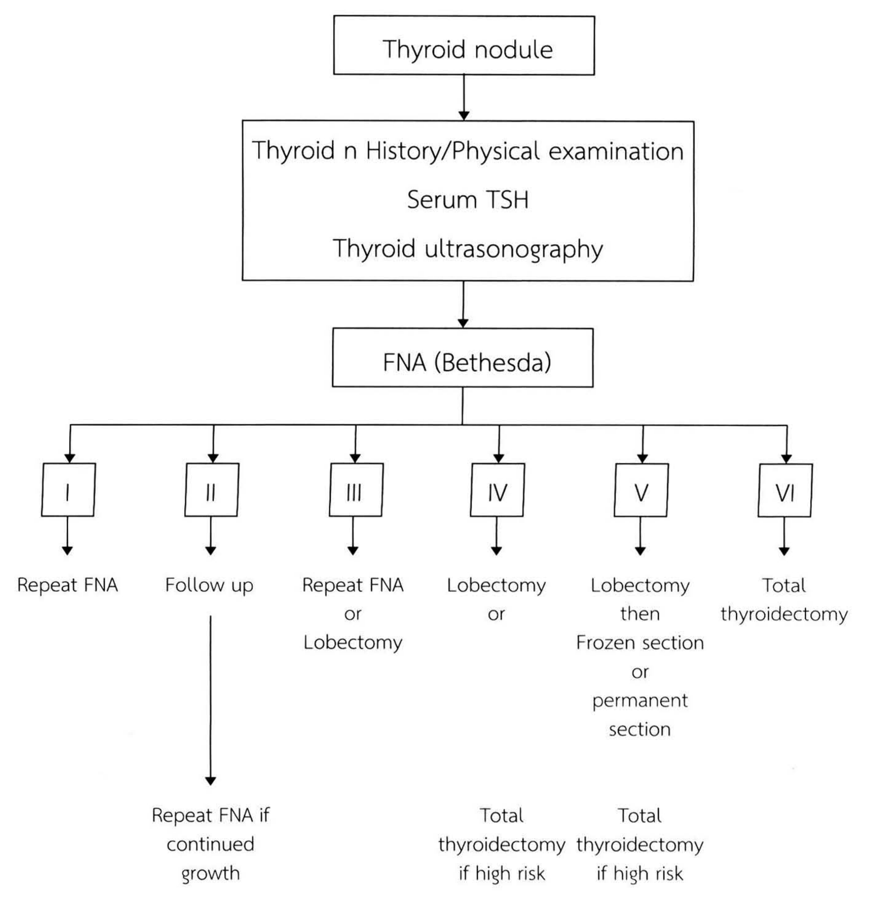
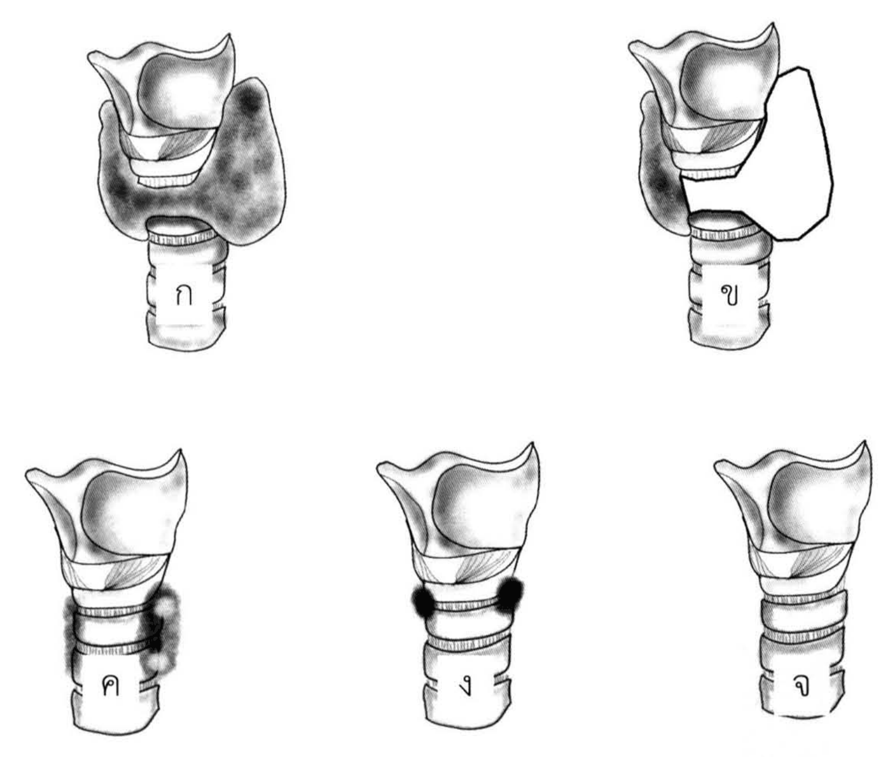
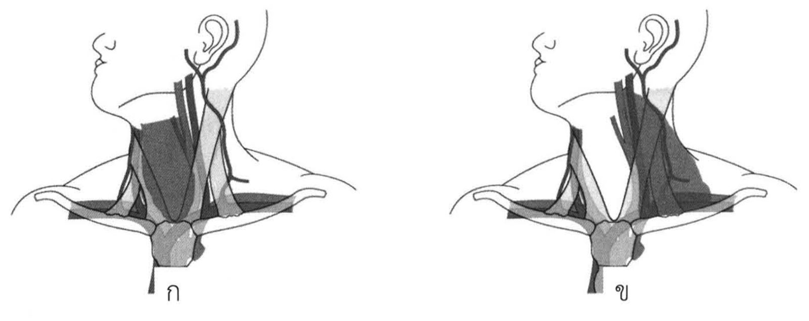

# ต่อมไทรอยด์และต่อมพาราไทรอยด์ (Thyroid and Parathyroid)

## Contents of this file
- ต่อมไทรอยด์ (p.238)
  - Embryology (p.238)
  - Surgical anatomy (p.239)
- Laryngeal nerve (p.239)
  - Recurrent laryngeal nerve (p.239)
  - Superior laryngeal nerve (p.241)
  - Blood supply (p.241)
  - Lymphatic system (p.242)
- Thyroid nodules (p.243)
- ประวัติและตรวจร่างกาย (p.243)
- การส่งตรวจเพิ่มเติม (p.244)
  - Serum Thyroid-Stimulating Hormone (TSH) (p.244)
  - Ultrasonography (p.245)
  - Fine needle aspiration (FNA) (p.245)
- Management (p.245)
- สรุป (p.250)
- ต่อมพาราไทรอยด์ (p.251)
  - Embryology (p.251)
  - Surgical anatomy (p.251)
  - โรคของต่อมพาราไทรอยด์ (p.251)
- การผ่าตัดต่อมไทรอยด์และพาราไทรอยด์ (p.253)
- 1. การผ่าตัดต่อมไทรอยด์ (p.253)
  - การส่งตรวจทางรังสีวิทยา (p.254)
  - Extension of surgery (p.254)
  - Lymphadenectomy (Neck dissection) for thyroid cancer (p.256)
- 2. การผ่าตัดต่อมพาราไทรอยด์ (p.257)
  - การส่งตรวจทางรังสีวิทยา (p.257)
  - Extension of surgery (p.258)
- 3. ภาวะแทรกซ้อนจากการผ่าตัดต่อมไทรอยด์และพาราไทรอยด์ (p.258)
  - Postoperative Hemorrhage (p.259)
    - อาการและอาการแสดง (p.259)
    - Management (p.259)
  - Hypoparathyroidism (p.259)
    - Risk factor (p.260)
  - Recurrent laryngeal nerve palsy (RLNP) (p.260)
    - Voice and glottic exam (p.260)
    - อาการและอาการแสดง (p.261)
  - Post-thyroidectomy tracheomalacia (p.261)
- สรุป (p.261)
- สรุปสาระสำคัญ (p.261)
- เอกสารอ้างอิง (p.262)

<!-- p.237 (printed none) -->
**ต่อมไทรอยด์และต่อมพาราไทรอยด์**

**Thyroid and Parathyroid**

พสุรเชษฐ์ สมร

<!-- p.238 (printed 224) -->
**ต่อมไทรอยด์และต่อมพาราไทรอยด์**

**Thyroid and Parathyroid**

พสุรเชษฐ์ สมร

## ต่อมไทรอยด์

Thyroid แปลว่าโล่ในภาษากรีก ต่อมไทรอยด์จึงได้ชื่อนี้มาจากรูปร่างที่คล้ายกับโล่ของมัน ในช่วงต้นคริสต์ศตวรรษที่ 19 นั้นการผ่าตัดต่อมไทรอยด์ไม่เป็นที่ยอมรับ เนื่องจากมีอัตราการตายและภาวะแทรกซ้อนที่สูงมาก

ปลายคริสต์ศตวรรษที่ 19 มีความรู้ความเข้าใจเกี่ยวกับการผ่าตัดรักษาโรคของต่อมนี้มากขึ้น โดยศัลยแพทย์สองท่านคือ Theodor Billroth และ Emil Theodor Kocher เป็นผู้บุกเบิก ประกอบกับเทคนิคการดมยาสลบและการป้องกันการติดเชื้อที่ดีขึ้น ทำให้การผ่าตัดปลอดภัยและมีประสิทธิภาพมากขึ้น

จากผลงานเกี่ยวกับสรีรวิทยา และการผ่าตัดต่อมไทรอยด์ ทำให้ Emil Theodor Kocher ได้รับรางวัลโนเบลในปีคริสต์ศักราช 1909

### Embryology

ต่อมไทรอยด์นั้นเกิดมาจาก midline diverticulum ของ floor of the pharynx ซึ่งเดิมเป็นส่วนหนึ่งของทางเดินอาหารและมีส่วนประกอบหลักเป็น endoderm

เนื้อเยื่อต้นกำเนิดของต่อมจะเคลื่อนที่ลงมาที่คอแล้วจึงแบ่งออกเป็น 2 lobe โดยยังมีส่วนที่เชื่อมต่อกับช่องปากบริเวณ foramen cecum คือ thyroglossal duct ซึ่งส่วนใหญ่จะหายไปเมื่อทารกอายุประมาณ 6 สัปดาห์ อาจเหลือส่วนที่ชิดกับต่อมไทรอยด์และกลายเป็น pyramidal lobe ในผู้ใหญ่

Thyroid follicle เริ่มสร้างหลังจากที่มีการแบ่ง lobe เมื่อ embryo มีขนาดประมาณ 6 เซนติเมตร จะพบว่า follicle เหล่านี้มีการสร้าง colloid และเมื่อ embryo อายุประมาณ 3 เดือน จะพบว่ามีการจับไอโอดีนและเริ่มสร้างไทรอยด์ฮอร์โมน

<!-- p.239 (printed 225) -->
C cell ซึ่งสร้าง calcitonin นั้นสร้างมาจาก fourth pharyngeal pouch และเคลื่อนจาก neural crest มาทางด้านข้างของต่อมไทรอยด์ โดยจะไปอยู่ทางด้านข้างและด้านหลังของต่อม และมักจะจำกัดอยู่เพียงบริเวณส่วนบนและส่วนกลางเท่านั้น C cell เป็นส่วนประกอบเดียวของต่อมไทรอยด์ในผู้ใหญ่ที่ไม่ได้เจริญมาจาก endoderm

### Surgical anatomy

ต่อมไทรอยด์หนักประมาณ 10 ถึง 20 กรัม มีสอง lobe วางอยู่ทางด้านหน้า ด้านข้างของ thyroid cartilage บริเวณรอยต่อระหว่าง larynx และ trachea

แต่ละ lobe ของต่อมอยู่

- ข้างต่อ trachea และ esophagus
- Anteromedial ต่อ carotid sheath
- Posteromedial ต่อกล้ามเนื้อ sternocleidomastoid, sternohyoid และ sternothyroid

Isthmus เชื่อมต่อมทั้งสองข้างเข้าด้วยกันตรงกึ่งกลาง โดยขอบบนจะอยู่ต่ำกว่า cricoid cartilage เล็กน้อย อาจพบ pyramidal lobe เหนือ isthmus ได้ประมาณร้อยละ 30

Pretracheal fascia นั้นหุ้มรอบต่อมไทรอยด์อยู่และสามารถแยกออกได้โดยง่าย ซึ่งต่างจาก thyroid capsule ที่ติดชิดกับต่อม และไม่สามารถแยกออกจากกันได้ fascia สองชั้นนี้รวมกันทางด้านหลังกลายเป็น ligament of Berry ซึ่งยึดต่อมไทรอยด์กับ larynx นั่นเอง

## Laryngeal nerve

### Recurrent laryngeal nerve

Recurrent laryngeal nerve เป็นแขนงของ vagus nerve ซึ่งวิ่งย้อนขึ้นมาจากในช่องอก ชิดกับแต่ละข้างของ trachea ลอดทางด้านข้างของ ligament of Berry ก่อนเข้าสู่ larynx

<!-- p.240 (printed 226) -->
หลังแยกแขนงออกจาก vagus nerve ที่พาดอยู่หน้าต่อ subclavian artery ข้างขวาแล้ว เส้นประสาทนี้จะลอดอ้อมหลัง subclavian artery แล้ววางตัวอยู่ใน tracheoesophageal groove

ระหว่างการผ่าตัดต่อมไทรอยด์จะพบว่า บริเวณ lower pole ของต่อมนั้นเส้นประสาทข้างขวาจะอยู่ใน tracheoesophageal groove หรือห่างออกไปทางด้านข้างไม่เกิน 1 เซนติเมตร

บริเวณส่วนกลางของต่อมไทรอยด์นั้น recurrent laryngeal nerve ก็ยังอยู่ใน tracheoesophageal groove และอาจแตกเป็นแขนงเล็กๆ เป็นสองถึงสามแขนง แขนงที่สำคัญที่สุดนั้นจะเข้าสู่ larynx ที่ขอบล่างของกล้ามเนื้อ cricothyroid

พบ non recurrent laryngeal nerve ข้างขวาได้ประมาณร้อยละ 1 โดยเส้นประสาทจะแยกจาก vagus nerve ทอดขวางสู่แนวกึ่งกลางเข้าสู่ larynx พบร่วมกับความผิดปกติแต่กำเนิดของหลอดเลือดแดงคือ aberrant right subclavian artery (arteria lusoria)

สำหรับข้างซ้าย recurrent laryngeal nerve จะแตกแขนงเมื่อ vagus nerve พาดผ่าน arch of aortas จากนั้นจึงลอดใต้ aorta ตรงตำแหน่งของ ligamentum arteriosum และทอดสู่ tracheoesophageal groove ไปสิ้นสุดที่ larynx เช่นเดียวกับเส้นประสาทข้างขวา

Non recurrent laryngeal nerve ข้างซ้ายนั้นพบน้อยกว่ามาก เนื่องจากต้องพบร่วมกับความผิดปกติแต่กำเนิดของ arch of aorta และ great vessels

ประมาณ 2 ถึง 3 เซนติเมตร ก่อนที่เส้นประสาทจะเข้าสู่ larynx เส้นประสาททั้งสองข้างมักจะพบอยู่ใน tracheoesophageal groove เสมอ และจะเข้าสู่ larynx บริเวณขอบของกล้ามเนื้อ cricothyroid ในระดับเดียวกับข้อต่อของ cricoid cartilage และ thyroid cartilage

บริเวณใกล้ larynx นั้น recurrent laryngeal nerve จะชิดกับ inferior thyroid artery ต่อม parathyroid และด้านหลังของต่อม thyroid มาก หากไม่ระมัดระวังอาจทำให้เกิดการบาดเจ็บของเส้นประสาทได้

Recurrent laryngeal nerve นั้นทำหน้าที่ทั้ง motor, sensory และ autonomic เลี้ยง intrinsic laryngeal muscle ดังนั้นการบาดเจ็บของเส้นประสาทนี้ก่อให้เกิดความผิดปกติหลายอย่าง

<!-- p.241 (printed 227) -->
หากเกิดการบาดเจ็บขึ้น ความผิดปกติที่สำคัญคือ vocal cord paralysis ซึ่ง vocal cord จะติดอยู่ที่ตำแหน่ง medial position คือเอียงจากแนวกลางเพียงเล็กน้อย ซึ่งจะทำให้ vocal cord ปิดไม่สนิทและทำให้เสียงแหบ บางครั้ง vocal cord ด้านตรงข้ามจะสามารถขยับชดเชยเลยแนวกึ่งกลาง ทำให้สามารถเปล่งเสียงออกมาได้

ถ้าเกิดการบาดเจ็บสองข้างอาจจะทำให้เกิดการอุดกั้นทางเดินหายใจเฉียบพลัน และมักจำเป็นต้องใส่ endotracheal tube หรือ tracheostomy ฉุกเฉิน ผู้ป่วยบางส่วนอาจไม่เกิดการอุดกั้นดังกล่าวเพราะ vocal cord ติดอยู่ในท่า abduction ผู้ป่วยยังสามารถหายใจได้ แต่จะไม่สามารถไอได้อย่างมีประสิทธิภาพ และสำลักจากการเปิดค้างของ vocal cord ทำให้เกิดปอดติดเชื้อซ้ำๆ ได้

### Superior laryngeal nerve

แตกแขนงจาก vagus nerve บริเวณฐานของกะโหลกศีรษะ ทอดตัวตามแนว internal carotid artery จากนั้นจึงแตกแขนงออกเป็น internal branch ซึ่งทำหน้าที่รับความรู้สึกบริเวณ larynx ส่วน external branch ซึ่งมีขนาดเล็กมากนั้นจะอยู่คู่กับ superior thyroid artery จนใกล้ถึงตำแหน่งที่หลอดเลือดนี้จะผ่านเข้าสู่ thyroid capsule เส้นประสาทจึงเปลี่ยนแนวทอดขวางและเข้าเลี้ยงกล้ามเนื้อ cricothyroid

การค้นหา external branch ระหว่างผ่าตัดนั้นอาจเป็นไปได้ยาก เนื่องจากมีขนาดเล็กมาก และมักจะเข้าสู่ larynx ในระดับที่สูงกว่า superior pole ของต่อมไทรอยด์ การบาดเจ็บของเส้นประสาทนี้มักเกิดจากการผูก superior thyroid artery ในระดับที่สูงเกินไปและทำให้เกิด nerve entrapment

ความผิดปกติที่พบหากมีการบาดเจ็บของเส้นประสาทนี้คือ ไม่สามารถส่งเสียงดังได้ และไม่สามารถพูดต่อเนื่องได้เป็นเวลานาน แม้จะไม่ก่อให้เกิดผลที่รุนแรงเท่าการบาดเจ็บของ recurrent laryngeal nerve แต่หากผู้ป่วยทำอาชีพที่ต้องใช้เสียง เช่น ครู หรือ นักร้อง ก็อาจจะมีผลในระยะยาวได้

### Blood supply

หลอดเลือดแดงที่มาเลี้ยงต่อมไทรอยด์ปกติแล้วมีข้างละ 2 เส้น คือ superior thyroid artery และ inferior thyroid artery

<!-- p.242 (printed 228) -->
Superior thyroid artery เป็นแขนงแรกของ external carotid artery ที่แตกออกมาเกือบชิดกับ carotid bifurcation และเข้าสู่ต่อมไทรอยด์บริเวณ superior pole

Inferior thyroid artery เป็นแขนงของ thyrocervical trunk ซึ่งแยกออกมาจาก subclavian artery อ้อมมาทางด้านหลังของ carotid sheath จากนั้นจึงโค้งและทอดขวางเข้าสู่ต่อมไทรอยด์ทางด้านหลัง ใกล้กับ ligament of Berry ระหว่างผ่าตัดต่อมไทรอยด์มีสิ่งที่ควรระวังเกี่ยวกับหลอดเลือดนี้ คือ

- Recurrent laryngeal nerve อยู่ห่างจากตำแหน่งที่หลอดเลือดนี้เข้าสู่ต่อมไทรอยด์ไม่มากนัก (ประมาณไม่เกิน 1 เซนติเมตร) ก่อนที่จะตัดหรือผูกหลอดเลือดหรือแขนงของมันควรจะหาเส้นประสาทดังกล่าวให้พบก่อน เพื่อหลีกเลี่ยงการบาดเจ็บ
- Inferior thyroid artery นั้นเลี้ยงต่อมพาราไทรอยด์ทั้งบนและล่าง หลังจากที่ตัดหรือผูกหลอดเลือดนี้แล้ว ต้องดูต่อมพาราไทรอยด์เสมอว่ามีการขาดเลือดหรือไม่

ปกติจะไม่มีหลอดเลือดแดงที่เข้าสู่ต่อมไทรอยด์ทางด้านล่าง แต่อาจพบ thyroidea ima artery ซึ่งแยกจาก innominate artery หรือ arch of aorta ได้ประมาณร้อยละ 5

หลอดเลือดดำที่รับเลือดจากต่อมไทรอยด์ประกอบด้วย 3 ส่วนคือ superior thyroid vein ทอดคู่กับ superior thyroid artery และเข้าสู่ internal jugular vein บริเวณ carotid bifurcation ส่วนกลางของต่อมไทรอยด์นั้นส่งเลือดเข้าสู่ middle thyroid vein ซึ่งเป็นแขนงของ internal jugular vein เช่นเดียวกัน ส่วน inferior thyroid vein นั้นจะรับเลือดจากทางด้านล่างของต่อมและเข้าสู่ brachiocephalic vein

### Lymphatic system

ต่อมน้ำเหลืองที่คอมีความสำคัญมากในการผ่าตัดรักษามะเร็งของต่อมไทรอยด์ เนื่องจากต่อมไทรอยด์เป็นอวัยวะที่มี lymphatic drainage มากและกระจายไปทุกทิศทาง

แบ่งต่อมน้ำเหลืองที่คอได้เป็นสองกลุ่มคือ central node และ lateral node โดยใช้ carotid sheath เป็นตัวแบ่ง มะเร็งต่อมไทรอยด์ส่วนใหญ่จะแพร่กระจายเข้าสู่ central node ซึ่งอยู่ใกล้กับต่อมก่อน ยกเว้นมะเร็งที่อยู่บริเวณ superior pole อาจกระจายเข้าสู่ lateral node ได้โดยตรง

<!-- p.243 (printed 229) -->
## Thyroid nodules

Thyroid nodule เป็นภาวะที่พบได้ประมาณร้อยละ 4 ของประชากร มากกว่าร้อยละ 95 ของ thyroid nodule เป็น benign disease เช่น adenomatous goiter หรือ thyroid adenoma

แม้จะพบมะเร็งของต่อมไทรอยด์ได้เพียงร้อยละ 5 ของผู้ป่วยที่มี thyroid nodule แต่หน้าที่สำคัญของแพทย์คือ ประเมินว่าก้อนดังกล่าวมีความเสี่ยงต่อการเป็นมะเร็งหรือไม่ และทำการวินิจฉัยให้ได้ว่าใช่หรือไม่ใช่มะเร็ง ด้วยข้อมูลจากประวัติ การตรวจร่างกาย และการส่งตรวจเพิ่มเติม

อุบัติการณ์ของมะเร็งต่อมไทรอยด์แต่ละชนิดนั้น แสดงในตารางที่ 1

**ตารางที่ 1** อุบัติการณ์ของมะเร็งต่อมไทรอยด์แยกตามชนิด

| **ชนิด** | **อุบัติการณ์ (ร้อยละ)** |
| --- | --- |
| Papillary thyroid carcinoma | 80 |
| Follicular thyroid carcinoma (รวม Hurthle cell) | 15 |
| Anaplastic thyroid carcinoma | น้อยกว่า 2 |
| Medullary thyroid carcinoma | น้อยกว่า 5 |
| มะเร็งอื่น ๆ เช่น lymphoma | น้อยกว่า 1 |

## ประวัติและตรวจร่างกาย

ระยะเวลาของการพบก้อน การเปลี่ยนแปลงขนาดของก้อน และอาการจากการกดเบียด เช่น หายใจลำบากโดยเฉพาะท่านอนหงาย หรือกลืนลำบากจะช่วยแยกชนิดโรคและความรุนแรงของโรคในเบื้องต้น เช่น ก้อนที่เป็นมานานมากกว่า 10 ปี ย่อมมีโอกาสที่จะเป็นมะเร็งน้อยกว่าก้อนที่พบมาเพียง 1 ปี เป็นต้น ประวัติอื่นๆ ที่มีความสำคัญ ได้แก่

อาการของภาวะ hyperthyroid เพราะก้อนของต่อมไทรอยด์นั้นอาจเป็นก้อนที่ทำงานมากกว่าปกติ เช่น toxic adenoma หรือ toxic multinodular goiter ส่วนมะเร็งต่อมไทรอยด์นั้นไม่สร้างฮอร์โมน ผู้ป่วยส่วนใหญ่จึงอยู่ในภาวะ euthyroid

<!-- p.244 (printed 230) -->
เสียงแหบและสำลัก ซึ่งเกิดจากมะเร็งลุกลามเข้าสู่ recurrent laryngeal nerve

การสัมผัสรังสีบริเวณลำคอในเด็กหรือวัยรุ่นตั้งแต่ 6.5 cGy หรือเคยสัมผัสกับกัมมันตภาพรังสี เพิ่มความเสี่ยงต่อการเกิดมะเร็งไทรอยด์ได้รับ

ประวัติครอบครัวของมะเร็งต่อมไทรอยด์หรือมะเร็งอื่นๆ ที่เกี่ยวข้อง เช่น multiple endocrine neoplasia type 2 (MEN2) syndrome จะสัมพันธ์กับ MTC และ มีโรคที่สัมพันธ์กับการเกิด well-differentiated thyroid carcinoma (PTC และ FTC) เช่น Familial non-medullary thyroid cancer และ Familial adenomatous polyposis เป็นต้น

ก้อนเดี่ยวที่ขนาดใหญ่กว่า 4 เซนติเมตร เป็นมะเร็งได้ถึงร้อยละ 15

สรุปประวัติและการตรวจร่างกายที่ทำให้สงสัยมะเร็งของต่อมไทรอยด์ได้ดังตารางที่ 2

**ตารางที่ 2** ความเสี่ยงที่พบจากอาการและอาการแสดงของมะเร็งต่อมไทรอยด์

| **ประวัติ** | **ลักษณะผู้ป่วย** | **ตรวจร่างกาย** |
| --- | --- | --- |
| ประวัติครอบครัว | อายุน้อยกว่า 20 ปี | ก้อนแข็ง |
| ก้อนโตเร็ว | อายุมากกว่า 60 ปี | พบต่อมน้ำเหลืองโต |
| ได้รับรังสีที่คอในเด็กหรือวัยรุ่น | เพศชาย | เสียงแหบ |

## การส่งตรวจเพิ่มเติม

### Serum Thyroid-Stimulating Hormone (TSH)2, 3

ผู้ป่วยที่มีอาการและอาการแสดงที่เกี่ยวข้องกับต่อมไทรอยด์ ไม่ว่าจะเป็น thyroid nodule ภาวะ hypothyroidism หรือ hyperthyroidism ให้เจาะ serum TSH ทุกราย หาก TSH สูง ให้ประเมินและรักษาภาวะ hypothyroidism แต่ถ้า TSH ต่ำ ให้ประเมินและรักษาภาวะ hyperthyroidism และควรทำ thyroid scan เพื่อประเมินสาเหตุของ hyperthyroidism เกิดจากตัวก้อนเองหรือเกิดจากโรคของต่อมไทรอยด์ เช่น Graves’ disease

<!-- p.245 (printed 231) -->
### Ultrasonography

แพทย์ควรตรวจ thyroid ultrasonography ในผู้ป่วยที่สงสัยโรคของต่อมไทรอยด์ทุกราย เพื่อประเมินความเสี่ยงต่อมะเร็งต่อมไทรอยด์ และช่วยเลือกการตรวจเพิ่มเติมดังตารางที่ 3 และควรตรวจต่อมน้ำเหลืองที่คอด้วยเสมอ (cervical lymph node survey) ถ้าพบต่อมน้ำเหลืองโตให้ตรวจ fine needle aspiration ต่อไป

### Fine needle aspiration (FNA)

FNA เป็นการตรวจสำคัญในผู้ป่วย thyroid nodule มีความแม่นยำสูง sensitivity และ specificity สูงกว่าร้อยละ 95 และช่วยเลือกวิธีการรักษาอีกด้วย การรายงานผล FNA ปัจจุบันยึดตาม Bethesda system ดังตารางที่ 4 อาจตรวจ molecular testing เพื่อหา mutation ของ gene ต่างๆ (BRAF, RAS, RET/PTC) เพื่อเพิ่มความแม่นยำของ FNA แต่การตรวจนี้ยังไม่แพร่หลาย และมีราคาแพงจึงยังไม่นิยม

## Management

การวางแผนการรักษาจะใช้ข้อมูลจากประวัติ การตรวจร่างกาย และการตรวจเพิ่มเติมประกอบกัน แต่เนื่องจากอาการและอาการแสดงของมะเร็งต่อมไทรอยด์นั้นแยกได้ยากจากภาวะอื่นที่ไม่ใช่มะเร็ง จึงต้องใช้ข้อมูลจากการตรวจเพิ่มเติม ได้แก่ thyroid ultrasonography และ FNA เป็นหลัก เช่น

ถ้าข้อมูลจากประวัติและตรวจร่างกายเข้าได้กับ benign disease ผลการตรวจ ultrasonography ไม่มี high risk feature และ FNA เป็น benign แพทย์ควรรักษาผู้ป่วยแบบ benign disease คือ clinical follow up

ถ้าข้อมูลจากประวัติและตรวจร่างกายเข้าได้กับ benign disease แต่ผลการตรวจ ultrasonography พบ high risk feature และ FNA สงสัย malignancy แพทย์ควรรักษาผู้ป่วยแบบมะเร็งคือ ผ่าตัด

การรักษามาตรฐานในผู้ป่วยที่ผลเจาะ FNA อยู่ในแต่ละ category แสดงในตารางที่ 4

<!-- p.246 (printed 232) -->
**ตารางที่ 3 Sonographic Patterns, Estimated Risk of Malignancy, and Fine-Needle Aspiration guidance for Thyroid Nodules**

| Sonographic pattern | US features | Estimated risk of malignancy | FNA size cutoff |
| --- | --- | --- | --- |
| High suspicion | Solid hypoechoic nodule (or partially cystic nodule) with ≥1 of : - irregular margins (infiltrative, microlobulated) - microcalcifications - taller than wide shape - rim calcifications with small extrusive soft tissue component - evidence of extrathyroidal extension | >70-90 | FNA at ≥1 cm |
| Intermediate suspicion | Hypoechoic solid nodule with smooth margins without microcalcifications, ETE, or taller than wide shape | 10-20 | FNA at ≥1 cm |
| Low suspicion | Isoechoic or hyperechoic solid nodule, or partially cystic nodule with eccentric solid areas, without microcalcification, irregular margin or ETE, or taller than wide shape. | 5-10 | FNA at ≥1.5 cm |
| Very low suspicion | Spongiform or partially cystic nodules without any of the sonographic features described in low, intermediate, or high suspicion patterns | <3 | FNA at ≥2 cm Or observation |
| Benign | Purely cystic nodules (no solid component) | <1 | No FNA |

<!-- p.247 (printed 233) -->
**ตารางที่ 4 The Bethesda System for Reporting Thyroid Cytopathology and management**

| Category (Bethesda) | Meaning | Risk of malignancy (Percent) | Usual management |
| --- | --- | --- | --- |
| I | Nondiagnostic or unsatisfactory | 1-4 | Repeat FNA |
| II | Benign | 0-3 | Clinical follow up |
| III | Atypia of undetermined significance (AUS) or Follicular lesion of undetermined significance (FLUS) | 5-15 | Repeat FNA |
| IV | Follicular neoplasm (FN) or suspicious for a follicular neoplasm (SFN) | 15-30 | Lobectomy |
| V | Suspicious for malignancy | 60-75 | Lobectomy or Total thyroidectomy |
| VI | Malignant | 96-99 | Total thyroidectomy |

1. Bethesda I ให้เจาะตรวจซ้ำและควรทำเป็น ultrasonographic guidance

2. Bethesda II ให้ตรวจติดตามทุกปี อาจทำ thyroid ultrasonography เป็นระยะ ให้ทำ FNA ซ้ำถ้าก้อนโตเร็ว และแนะนำให้ผู้ป่วยผ่าตัดถ้ามีอาการจากการกดเบียด (compressive symptom)

3. Bethesda III ทางเลือกในการรักษา ได้แก่

  a. ทำ FNA ซ้ำ และควรทำเป็น ultrasonographic guidance หากผลการเจาะซ้ำยังเป็น Bethesda I หรือ III ควรผ่าตัด

  b. ผ่าตัด lobectomy ถ้าผู้ป่วยมีความเสี่ยงของมะเร็งไทรอยด์จากประวัติ ตรวจร่างกายและ ultrasonography

<!-- p.248 (printed 234) -->
4. Bethesda IV ส่วนมากผู้ป่วยในกลุ่มนี้จะเป็น follicular adenoma แต่ก็มี risk ของ thyroid cancer ได้ถึงร้อยละ 15 ถึง 30

  a. ผ่าตัด lobectomy ของข้างที่มีรอยโรคและตัดต่อมไทรอยด์เพิ่มอีกข้างหนึ่ง (completion thyroidectomy) ในกรณีที่ผลการตรวจทางพยาธิวิทยาเป็น malignancy การส่ง frozen section ในระหว่างผ่าตัดไม่สามารถแยกระหว่าง follicular adenoma กับ carcinoma ได้ จึงไม่ควรทำ

  b. ผ่าตัด total thyroidectomy

    i. ผู้ป่วยมีความเสี่ยงของมะเร็งไทรอยด์จากประวัติ การตรวจร่างกาย เช่น ครอบครัวเป็นมะเร็งไทรอยด์ เคยได้รับการฉายแสงบริเวณลำคอ ก้อนขนาดใหญ่กว่า 4 เซนติเมตร เสียงแหบ หรือ thyroid ultrasonography พบ high risk features

    ii. ศัลยแพทย์พบลักษณะที่เข้าได้กับมะเร็งระหว่างผ่าตัด เช่น invasion, extrathyroidal extension, lymph node metastasis

5. Bethesda V มีความเสี่ยงต่อมะเร็งสูงถึงร้อยละ 75 ชนิดของมะเร็งต่อมไทรอยด์ที่เป็นได้จากผลการตรวจนี้แสดงดังตารางที่ 5

  a. ผ่าตัด total thyroidectomy

    i. ผู้ป่วยมีความเสี่ยงของมะเร็งไทรอยด์จากประวัติ การตรวจร่างกาย เช่น ครอบครัวเป็นมะเร็งไทรอยด์ เคยได้รับการฉายแสงบริเวณลำคอ ก้อนขนาดใหญ่กว่า 4 เซนติเมตร เสียงแหบ หรือ thyroid ultrasonography พบ high risk features

    ii. ศัลยแพทย์พบลักษณะที่เข้าได้กับมะเร็งระหว่างผ่าตัด เช่น invasion, extrathyroidal extension, lymph node metastasis

  b. ในกรณีที่ข้อมูลอื่นยังไม่เหมือนมะเร็งชัดเจน

    i. ผ่าตัด lobectomy และส่ง frozen section ซึ่งมีประโยชน์มากเพื่อวินิจฉัย papillary thyroid carcinoma

<!-- p.249 (printed 235) -->
    ii. ผ่าตัด lobectomy รอผลการตรวจทางพยาธิวิทยาแบบมาตรฐาน หากผลเป็นมะเร็งจึงตัดต่อมอีกข้างหนึ่ง (completion thyroidectomy)

6. Bethesda VI เป็นมะเร็งร้อยละ 99 ชนิดของมะเร็งต่อมไทรอยด์ที่เป็นได้จากผลการตรวจนี้แสดงดังตารางที่ 5 การรักษามาตรฐานคือ total thyroidectomy

**ตารางที่ 5 แสดงผลการตรวจ fine needle aspiration ตาม Bethesda system**

| Bethesda category | Findings |
| --- | --- |
| I | Cyst fluid only Virtually acellular specimen Other (obscuring blood, clotting artifact, etc) |
| II | Consistent with a benign follicular nodule (includes adenomatoid nodule, colloid nodule, etc) Consistent with lymphocytic (Hashimoto) thyroiditis in the proper clinical context Consistent with granulomatous (subacute) thyroiditis |
| III | |
| IV | Specify if Hürthle cell (oncocytic) type |
| V | Suspicious for papillary carcinoma Suspicious for medullary carcinoma Suspicious for metastatic carcinoma Suspicious for lymphoma |
| VI | Papillary thyroid carcinoma Poorly differentiated carcinoma Medullary thyroid carcinoma Undifferentiated (anaplastic) carcinoma Squamous cell carcinoma Carcinoma with mixed features Metastatic carcinoma Non-Hodgkin lymphoma |

<!-- p.250 (printed 236) -->
## สรุป

ก้อนของต่อมไทรอยด์เป็นภาวะที่พบได้บ่อย หน้าที่สำคัญของแพทย์คือการวินิจฉัยว่าก้อนดังกล่าวเป็นมะเร็งหรือไม่ด้วยข้อมูลจากประวัติ การตรวจร่างกายอย่างละเอียด thyroid ultrasonography และ fine needle aspiration หากพบว่าก้อนดังกล่าวมีความเสี่ยงต่อการเป็นมะเร็ง ควรส่งต่อให้แพทย์ผู้เชี่ยวชาญให้ทำการรักษาที่เหมาะสมต่อไป ขั้นตอนการดูแลผู้ป่วยสรุปไว้ในแผนภูมิที่ 1

**แผนภูมิที่ 1** Management of thyroid nodule. FNA = Fine needle aspiration

- Thyroid nodule
  → Thyroid n History/Physical examination · Serum TSH · Thyroid ultrasonography
  → FNA (Bethesda)
    - → I → Repeat FNA
    - → II → Follow up → Repeat FNA if continued growth
    - → III → Repeat FNA or Lobectomy
    - → IV → Lobectomy or · Total thyroidectomy if high risk
    - → V → Lobectomy then Frozen section or permanent section · Total thyroidectomy if high risk
    - → VI → Total thyroidectomy

> **Caption (verbatim):** แผนภูมิที่ 1 Management of thyroid nodule. FNA = Fine needle aspiration
> **Text in image (verbatim):** Thyroid nodule · Thyroid n History/Physical examination · Serum TSH · Thyroid ultrasonography · FNA (Bethesda) · I · II · III · IV · V · VI · Repeat FNA · Follow up · Repeat FNA or Lobectomy · Lobectomy or · Lobectomy then Frozen section or permanent section · Total thyroidectomy · Repeat FNA if continued growth · Total thyroidectomy if high risk · Total thyroidectomy if high risk
> **Description:** Top-down flowchart (line drawing). Box "Thyroid nodule" → arrow down to a box listing "Thyroid n History/Physical examination", "Serum TSH", "Thyroid ultrasonography" → arrow down to box "FNA (Bethesda)". From this box a horizontal line branches into six arrows to small boxes labelled with Bethesda categories I, II, III, IV, V, VI. Each box has an arrow down to its management text: I → "Repeat FNA"; II → "Follow up", then a long arrow down to "Repeat FNA if continued growth"; III → "Repeat FNA or Lobectomy"; IV → "Lobectomy or", with "Total thyroidectomy if high risk" printed lower in the same column (no arrow drawn between them); V → "Lobectomy then Frozen section or permanent section", with "Total thyroidectomy if high risk" printed lower in the same column (no arrow drawn); VI → "Total thyroidectomy".
> **Identifiers in image:** none

<!-- p.251 (printed 237) -->
## ต่อมพาราไทรอยด์

### Embryology

ต่อมพาราไทรอยด์คู่บนพัฒนามาจาก branchial pouch ที่สี่และเคลื่อนที่ลงมาพร้อมกับต่อมไทรอยด์ ตำแหน่งของต่อมคู่นี้จึงค่อนข้างคงที่ อยู่ที่ posterolateral ของต่อมไทรอยด์ ส่วนต่อมพาราไทรอยด์คู่ล่างนั้นพัฒนามาจาก branchial pouch ที่สามและเคลื่อนที่ลงมาพร้อมกับต่อมไทมัส ระยะทางการเคลื่อนที่ไกลกว่าต่อมคู่บน ทำให้ตำแหน่งของต่อมคู่ล่างหลากหลายกว่า อาจพบต่อมคู่นี้ได้สูงกว่า carotid bifurcation หรือต่ำลงไปถึง superior mediastinum

### Surgical anatomy

คนส่วนใหญ่มีต่อมพาราไทรอยด์ 4 ต่อม แต่พบว่าร้อยละ 13 มีมากกว่านั้น (supernumerary gland) และร้อยละ 3 มีเพียง 3 ต่อม

ต่อมพาราไทรอยด์ปกติหนักประมาณ 30 ถึง 50 มิลลิกรัม ความยาวประมาณ 3 ถึง 5 มิลลิเมตร สี รูปร่างและลักษณะเนื้อเยื่อนั้นแตกต่างกันไปในแต่ละคน มักมีสีน้ำตาลแต่อาจมีสีเหลืองซีดหากมีไขมันล้อมรอบต่อม

ต่อมพาราไทรอยด์คู่บนอยู่ใกล้ tracheoesophageal groove หลังต่อ recurrent laryngeal nerve ส่วนต่อมคู่ล่างจะอยู่ติดกับ lower pole หน้าต่อ recurrent laryngeal nerve ต่อมทั้งสองข้างเกินกว่าร้อยละเจ็ดสิบจะอยู่ในตำแหน่งใกล้เคียงกัน

หลอดเลือดที่เลี้ยงต่อมพาราไทรอยด์ทั้งบนและล่างนั้นมาจาก inferior thyroid artery ร้อยละ 80 อีกร้อยละ 20 ต่อมคู่บนจะรับเลือดจาก superior thyroid artery หลอดเลือดแขนงเหล่านี้ขนาดเล็กมาก และเกิดการบาดเจ็บหรืออุดตันได้ง่าย ทำให้ต่อมพาราไทรอยด์เกิดการขาดเลือดหลังผ่าตัดและเป็นสาเหตุหลักของ postoperative hypoparathyroidism

### โรคของต่อมพาราไทรอยด์

1. Hypoparathyroidism เกือบทั้งหมดเกิดหลังการผ่าตัด (postoperative hypoparathyroidism) ซึ่งจะกล่าวถึงภายหลังในเรื่องภาวะแทรกซ้อนของการผ่าตัด

2. Hyperparathyroidism อาจแยกตามสาเหตุการเกิดได้เป็น

<!-- p.252 (printed 238) -->
  a. Primary hyperparathyroidism เกิดจากตัวต่อมที่ผิดปกติ ได้แก่ parathyroid adenoma หรือ parathyroid hyperplasia

  b. Secondary hyperparathyroidism เกิดจากต่อมพาราไทรอยด์ถูกกระตุ้นให้ทำงานมากผิดปกติ สาเหตุที่พบบ่อยแสดงดังตารางที่ 7

  c. Tertiary hyperparathyroidism คือ secondary hyperparathyroidism ที่ถูกกระตุ้นเป็นเวลายาวนานและเกิด autonomous ของต่อม ทำให้ต่อมทำงานผิดปกติแม้ว่าจะกำจัดสาเหตุที่กระตุ้นแล้ว

  อาการและอาการแสดงของ hyperparathyroidism แสดงดังตารางที่ 6

**ตารางที่ 6 อาการและอาการแสดงของ hyperparathyroidism**

| อาการ | อาการแสดง |
| --- | --- |
| ปวดกระดูก | Muscle weakness |
| ปวดกล้ามเนื้อ | Osteoporosis/osteopenia |
| ปัสสาวะมาก (polyuria) | Nephrolithiasis |
| คลื่นไส้อาเจียน | Nephrocalcinosis |
| ปวดท้อง | Pathologic fracture |
| ท้องผูก | |
| อ่อนเพลีย | |
| ขาดสมาธิ ความจำสั้น หงุดหงิด | |

<!-- p.253 (printed 239) -->
**ตารางที่ 7 สาเหตุที่พบบ่อยของ secondary hyperparathyroidism**

| กลุ่มสาเหตุของ secondary hyperparathyroidism |
| --- |
| Chronic renal failure (พบมากที่สุด) |
| Vitamin D deficiency |
| Malabsorption |
| &emsp;&emsp;Short bowel &emsp;&emsp;Bariatric surgery |
| Medications &emsp;&emsp;Lithium &emsp;&emsp;Diuretics |

## การผ่าตัดต่อมไทรอยด์และพาราไทรอยด์

การผ่าตัดเป็นหนึ่งในวิธีการรักษาโรคของต่อมไทรอยด์และต่อมพาราไทรอยด์ ความรู้ความเข้าใจเกี่ยวกับการผ่าตัด ข้อบ่งชี้ และภาวะแทรกซ้อน จะทำให้แพทย์สามารถดูแลผู้ป่วยแบบบูรณาการได้ดียิ่งขึ้น

ภาวะแทรกซ้อนเป็นสิ่งที่หลีกเลี่ยงไม่ได้เมื่อมีการผ่าตัด การเลือกผู้ป่วยเพื่อส่งต่อให้กับศัลยแพทย์เพื่อผ่าตัดนั้น ควรพิจารณาให้เหมาะสมว่าประโยชน์ที่ได้รับจากการผ่าตัดมากกว่าผลเสียที่อาจเกิดขึ้นหรือไม่

## 1. การผ่าตัดต่อมไทรอยด์

ผู้ป่วยที่จำเป็นต้องรับการผ่าตัดต่อมไทรอยด์อาจแบ่งตามอาการนำได้เป็นสองกลุ่ม คือ กลุ่มที่อาการนำคือ ก้อนของต่อมไทรอยด์ และกลุ่มที่มีอาการของไทรอยด์เป็นพิษ ซึ่งการซักประวัติ ตรวจร่างกาย และการส่งตรวจเพิ่มเติมเพื่อช่วยวินิจฉัยนั้นจะแตกต่างกันไปตามอาการนำ

<!-- p.254 (printed 240) -->
### การส่งตรวจทางรังสีวิทยา

1. Ultrasonography เป็นการตรวจที่ใช้บ่อยที่สุดในผู้ป่วยโรคของต่อมไทรอยด์ในผู้ป่วยที่จำเป็นต้องผ่าตัด การตรวจนี้อาจจะเปลี่ยนแปลง extension of surgery ได้ เช่น

  - ถ้าตรวจพบก้อนที่คลำไม่ได้ในต่อมไทรอยด์อีกข้าง และมี high risk feature ศัลยแพทย์มักจะเปลี่ยนจาก thyroid lobectomy เป็น total thyroidectomy

  - ถ้าตรวจพบว่ามีต่อมน้ำเหลืองที่ผิดปกติในผู้ป่วยมะเร็งต่อมไทรอยด์และสงสัยว่าเป็นการแพร่กระจายอาจพิจารณาทำการผ่าตัดเลาะต่อมน้ำเหลืองในบริเวณดังกล่าวออกด้วย

  - หากพบว่ามีก้อนของต่อมไทรอยด์ที่มี high risk feature ใน Graves’ disease ศัลยแพทย์จะพยายามทำ total thyroidectomy แทนที่จะทำเพียง near total thyroidectomy

2. Computed tomography (CT) มักไม่จำเป็นต้องส่งตรวจ เพราะข้อมูลที่ได้นั้นไม่มากไปกว่า ultrasonography ในผู้ป่วยส่วนใหญ่ ควรทำเฉพาะในผู้ป่วยที่ ultrasonography เพียงอย่างเดียวไม่สามารถประเมินและวางแผนการผ่าตัดได้ครบถ้วน เช่น

  - ผู้ป่วยที่สงสัย substernal goiter จากการตรวจร่างกายนั้น CT จะแสดงขอบล่างของก้อนเทียบกับหลอดเลือดใหญ่ในช่องอก และแสดงหลอดเลือดที่เลี้ยงก้อนว่ามาจากคอหรือจากช่องอก ทำให้วางแผนการผ่าตัดได้ง่ายขึ้น

  - ผู้ป่วยที่สงสัยว่ามี aerodigestive tract invasion จากการตรวจร่างกาย

  - ผู้ป่วยที่สงสัยว่าอาจมี major vascular invasion จากการตรวจร่างกาย

  - Anaplastic thyroid carcinoma

3. การตรวจอื่นๆ เช่น MRI ยังไม่แพร่หลายและประโยชน์ไม่ชัดเจน

### Extension of surgery

1. Lobectomy คือการตัดต่อมไทรอยด์ข้างที่มีรอยโรค ต้องตัด isthmus และ pyramidal lobe ออกด้วยเสมอ

<!-- p.255 (printed 241) -->
2. Subtotal thyroidectomy คือการตัดต่อมไทรอยด์ออกสองข้าง โดยเหลือเนื้อต่อมไว้ข้างละเกิน 1 กรัม ในอดีตนิยมทำในผู้ป่วยที่ไม่ใช่มะเร็ง แต่ปัจจุบันไม่แนะนำให้ทำ เนื่องจากมีอัตราการกลับเป็นซ้ำของโรคที่สูง และอาจพบมะเร็งต่อมไทรอยด์ได้ถึงร้อยละ 15 ในผู้ป่วยที่เข้ารับการผ่าตัด

3. Near total thyroidectomy คือการตัดต่อมไทรอยด์ออกสองข้าง โดยเหลือเนื้อต่อมไว้ไม่เกินข้างละ 1 กรัม ใช้ในโรคที่ไม่ใช่มะเร็ง และต่อมไทรอยด์บริเวณ cricothyroid junction ใกล้กับ recurrent laryngeal nerve มาก หากทำ total thyroidectomy อาจเกิดการบาดเจ็บได้

4. Total thyroidectomy คือการตัดต่อมไทรอยด์ที่ตามองเห็นออกทั้งหมด ใช้กับโรคมะเร็งของต่อมไทรอยด์

> **Caption (verbatim):** **ภาพที่ 1** แสดงต่อมไทรอยด์ที่เหลือหลังจากผ่าตัด (ก) ยังไม่ได้ผ่าตัด (ข) Lobectomy (ค) Subtotal thyroidectomy (จุดสีขาวคือต่อมพาราไทรอยด์ทางด้านหลัง) (ง) Near total thyroidectomy (จ) Total thyroidectomy
> **Text in image (verbatim):** ก · ข · ค · ง · จ
> **Description:** Five shaded pencil-style drawings of the larynx (thyroid cartilage and cricoid with cricothyroid muscle) and upper trachea seen in oblique anterior view, each labelled with a Thai letter on the trachea, showing how much thyroid tissue (dark mottled shading) remains. Top row: (ก) intact thyroid gland with both lobes and isthmus draped over the trachea below the cricoid; (ข) one lobe and the isthmus removed — the removed part is drawn as an empty white outline, with only the opposite lobe still shaded. Bottom row: (ค) a moderate rim of shaded thyroid tissue left on each side of the trachea, with small white round spots on the remnant (the parathyroid glands posteriorly, per caption); (ง) only a small dark nodule of tissue left on each side at the level of the first tracheal ring just below the cricoid (cricothyroid junction region); (จ) larynx and trachea with no thyroid tissue remaining.
> **Identifiers in image:** none

<!-- p.256 (printed 242) -->
### Lymphadenectomy (Neck dissection) for thyroid cancer

มีมะเร็งต่อมไทรอยด์หลายชนิดที่แพร่กระจายไปที่ต่อมน้ำเหลืองบริเวณข้างเคียง และอาจจำเป็นต้องทำการเลาะต่อมน้ำเหลืองออกเพื่อผลการรักษาที่ดีขึ้น สามารถแบ่งการเลาะต่อมน้ำเหลืองออกได้เป็น 2 ประเภท ตามจุดประสงค์ คือ

1. Prophylactic neck dissection คือการเลาะต่อมน้ำเหลืองโดยที่ไม่พบว่ามีความผิดปกติจากการตรวจร่างกาย การตรวจทางรังสีวิทยา หรือการตรวจทางพยาธิวิทยา จุดประสงค์ของการผ่าตัดนี้คือลดอัตราการกลับเป็นซ้ำและเพิ่มอัตราการรอดชีวิต

2. Therapeutic neck dissection คือการเลาะต่อมน้ำเหลืองเมื่อพบการแพร่กระจายจากการตรวจร่างกาย การตรวจทางรังสีวิทยา หรือการตรวจทางพยาธิวิทยา จุดประสงค์เพื่อเพิ่มอัตราการรอดชีวิต และเพิ่มประสิทธิภาพของ adjuvant therapy โดยเฉพาะ radioiodine treatment

หรืออาจแบ่งตามตำแหน่งของการเลาะต่อมน้ำเหลืองออกเป็น

1. Central neck dissection คือการเลาะต่อมน้ำเหลืองที่อยู่ระหว่าง common carotid artery ทั้งสองข้าง

2. Lateral neck dissection (Modified radical neck dissection) คือการเลาะต่อมน้ำเหลืองที่อยู่ด้านข้างต่อ common carotid artery

> **Caption (verbatim):** **ภาพที่ 2** บริเวณที่แรเงาคือตำแหน่งของการเลาะต่อมน้ำเหลือง (ก) central neck dissection (ข) lateral neck dissection
> **Text in image (verbatim):** ก · ข
> **Description:** Two grayscale schematic drawings of the anterior neck with the head turned to the left (face profile on the left, ear on the right), showing the clavicles, sternum/manubrium, sternocleidomastoid and strap muscles, and the carotid/jugular vessels running up the neck. The dark-shaded area marks the region of lymph node dissection. (ก) Central neck dissection: the dark shaded area is a central, roughly rectangular/V-shaped zone in the midline of the neck between the two carotid sheaths, from about the hyoid level down to the sternal notch/clavicles. (ข) Lateral neck dissection: the dark shaded area is on the lateral side of the neck (the right side of the drawing), lateral to the carotid sheath, extending from below the ear down to the clavicle, covering the area behind and beneath the sternocleidomastoid; the central zone is left unshaded.
> **Identifiers in image:** none

<!-- p.257 (printed 243) -->
## 2. การผ่าตัดต่อมพาราไทรอยด์

ผู้ป่วยที่จำเป็นต้องได้รับการผ่าตัดต่อมพาราไทรอยด์เกือบทั้งหมดมีข้อบ่งชี้คือ มีภาวะ hyperparathyroidism ซึ่งอาจเป็น primary hyperparathyroidism หรือเกิดจาก chronic kidney disease ก็ได้

การผ่าตัดต่อมพาราไทรอยด์ในผู้ป่วยที่มีอาการนั้นมีผลดีหลายอย่าง เช่น

- อาจเพิ่ม median survival ในผู้ป่วย chronic kidney disease
- เพิ่มมวลกระดูกในระยะยาว ลดอัตราการเกิดข้อสะโพกหัก กระดูกข้อมือหัก และกระดูกสันหลังยุบตัว
- คุณภาพชีวิตดีขึ้นจาก nonspecific symptom ต่างๆ ดีขึ้นหรือหายไป เช่น ปวดเมื่อย อ่อนเพลีย คัน

### การส่งตรวจทางรังสีวิทยา

การส่งตรวจทางรังสีวิทยาไม่มีประโยชน์ในการวินิจฉัยโรค แต่จะส่งตรวจเมื่อผู้ป่วยมีข้อบ่งชี้ในการผ่าตัดเท่านั้น โดยมีจุดประสงค์เพื่อเป็น preoperative localization ว่าตำแหน่งของต่อมที่ผิดปกติอยู่ที่ไหน ทำให้การผ่าตัดง่ายขึ้น sensitivity ของการตรวจทางรังสีจะลดลงเมื่อตรวจใน multiglandular disease เช่น MEN-1 หรือ secondary hyperparathyroidism

1. Ultrasonography เป็นการตรวจที่ทำได้ง่าย ราคาถูก และไม่ต้องสัมผัสกับรังสี แต่มีความไวต่ำ ควรทำร่วมกับ parathyroid scan เสมอ

2. Parathyroid scan (sestamibi scan) เป็นการตรวจทางนิวเคลียร์ โดยอาศัยคุณสมบัติของต่อมพาราไทรอยด์ในการจับกับ radiotracer มีความไวสูงกว่า ultrasonography

3. SPECT/CT นำภาพจาก single photon emission computed tomography (SPECT) มาซ้อนกับภาพรังสีจาก CT scan ทำให้ sensitivity ดีขึ้น

4. 4DCT คือ multiphasic contrast enhanced CT ของต่อมพาราไทรอยด์ เป็นการตรวจที่มีความสามารถสูงที่สุดในปัจจุบัน

<!-- p.258 (printed 244) -->
5. MRI เริ่มใช้มากขึ้น และอาจมีความสามารถใกล้เคียงหรือดีกว่าการตรวจอื่นๆ แต่ยังไม่แพร่หลายและข้อบ่งใช้ยังไม่ชัดเจน

### Extension of surgery

1. Single gland parathyroidectomy คือการตัดต่อมที่ผิดปกติออกเพียงต่อมเดียว ทำในผู้ป่วยที่เป็น primary hyperparathyroidism ที่ทำการตรวจทางรังสีวิทยาแล้วพบว่าเป็น single adenoma

2. Four-gland exploration for parathyroidectomy คือการผ่าตัดเข้าไปดูว่าต่อมพาราไทรอยด์ทั้งหมดผิดปกติหรือไม่ แล้วตัดต่อมที่ผิดปกติออก ทำในผู้ป่วย primary hyperparathyroidism ที่ทำการตรวจทางรังสีวิทยาแล้วไม่ชัดเจน หรือพบรอยโรคทั้งสองข้าง

3. Subtotal parathyroidectomy คือการตัดต่อมพาราไทรอยด์ที่ผิดปกติออก 3 ต่อมและเหลือต่อมสุดท้ายไว้ครึ่งหนึ่งหรือน้อยกว่า ใช้ใน renal hyperparathyroidism และ MEN-1

4. Total parathyroidectomy with autotransplantation คือการตัดต่อมทั้งหมดออก และนำบางส่วนของต่อมที่มีความผิดปกติน้อยที่สุดไปฝังในส่วนอื่นๆ เช่น กล้ามเนื้อของ forearm กล้ามเนื้อ biceps หรือชั้นไขมันของผนังหน้าอก ข้อดีเมื่อเทียบกับ subtotal parathyroidectomy คือหากมีการกลับเป็นซ้ำ จะไม่ต้องผ่าตัดที่ตำแหน่งเดิม ซึ่งมีโอกาสเกิด recurrent laryngeal nerve injury มากกว่า

5. Total parathyroidectomy คือการตัดต่อมทั้งหมดออก มีโอกาสกลับเป็นซ้ำน้อยที่สุด แต่เกิด persistent hypoparathyroidism ได้มากที่สุด ใช้ใน renal hyperparathyroidism และ MEN-1

## 3. ภาวะแทรกซ้อนจากการผ่าตัดต่อมไทรอยด์และพาราไทรอยด์

แม้ว่าศัลยแพทย์จะใช้ความระมัดระวังในการผ่าตัดอย่างเต็มที่ แต่ภาวะแทรกซ้อนจากการผ่าตัดอาจเกิดขึ้นได้เสมอ การเตรียมความพร้อมของผู้ป่วยก่อนผ่าตัด ความรู้ ความเข้าใจด้านกายวิภาคและสรีรวิทยาของต่อมไทรอยด์ รวมถึงทักษะและประสบการณ์การผ่าตัดของศัลยแพทย์ จะช่วยลดโอกาสเกิดภาวะแทรกซ้อนได้

<!-- p.259 (printed 245) -->
ภาวะแทรกซ้อนหลังผ่าตัดไทรอยด์ ในหลายการศึกษาพบว่าภาวะแทรกซ้อนที่พบบ่อยได้แก่ Hypocalcemia, vocal cord palsy, injury of external branch of superior laryngeal nerve, hemorrhage

### Postoperative Hemorrhage

ภาวะเลือดออกหลังผ่าตัดไทรอยด์ เป็นภาวะแทรกซ้อนที่เกิดขึ้นค่อนข้างน้อย แต่สามารถทำให้เกิดอันตรายถึงแก่ชีวิตจากทางเดินหายใจอุดตัน หากไม่สามารถแก้ไขได้ทัน พบอุบัติการณ์การเกิดเลือดออกหลังผ่าตัดถึงร้อยละ 6.5

#### อาการและอาการแสดง

อาการแสดงถึงภาวะเลือดออกสามารถวินิจฉัยได้จาก เลือดที่ออกในสายระบายปริมาณมาก, อาการคอบวม, ปวดหรือรู้สึกแน่นบริเวณคอ, กลืนลำบาก, เลือดออกจากบริเวณแผลผ่าตัด หรืออาการทางเดินหายใจอุดตัน

ภาวะเลือดออกหลังการผ่าตัดร้อยละ 97 เกิดใน 24 ชั่วโมงหลังผ่าตัด ดังนั้นหลังผ่าตัดไทรอยด์ ผู้ป่วยควรได้รับการดูแลอย่างใกล้ชิดในระยะเวลา 24 ชั่วโมงแรก

#### Management

เมื่อมีภาวะเลือดออกที่ทำให้ทางเดินหายใจอุดตัน อาจทำให้ผู้ป่วยเสียชีวิตได้ จึงจำเป็นต้องได้รับการรักษาโดยเร็ว คือการใส่ท่อช่วยหายใจและการผ่าตัดซ้ำเพื่อหยุดเลือดที่ออก

เดิมนิยมใส่สายระบายหลังการผ่าตัดไทรอยด์ เพราะเชื่อว่าสามารถป้องกันการกดทับของ hematoma ซึ่งทำให้เกิดทางเดินหายใจอุดตัน และอาจลดภาวะแทรกซ้อนอื่นๆ เช่น seroma ได้ แต่จาก meta-analysis พบว่าการใส่สายระบายไม่ลดภาวะแทรกซ้อนใดๆ และอาจเพิ่มระยะเวลาการนอนโรงพยาบาลด้วย จากข้อมูลดังกล่าวอาจสรุปได้ว่าการใส่สายระบายหลังการผ่าตัดไทรอยด์นั้นไม่จำเป็น

### Hypoparathyroidism

Hypoparathyroidism คือภาวะที่ parathyroid hormone (PTH) ในเลือดลดลงจากการบาดเจ็บหรือขาดเลือดของต่อมพาราไทรอยด์ระหว่างการผ่าตัด หรือการตัดต่อมพาราไทรอยด์ออก เป็นภาวะแทรกซ้อนที่เกิดขึ้นได้บ่อยที่สุดหลังการผ่าตัดต่อมไทรอยด์

<!-- p.260 (printed 246) -->
โดยอุบัติการณ์อยู่ระหว่างร้อยละ 1.6 ถึง 50 เนื่องจากต่อมพาราไทรอยด์มีขนาดเล็ก และใช้ blood supply ร่วมกับต่อมไทรอยด์ โดยจะแบ่งเป็น

1. Transient hypoparathyroidism คือ hypoparathyroidism ที่เกิดหลังจากผ่าตัด ส่วนใหญ่มักเกิดตั้งแต่วันแรกและจำเป็นต้องได้รับการรักษาเพื่อคงระดับแคลเซียมในเลือด แต่ภาวะนี้จะหายได้เป็นปกติภายใน 6 เดือน

2. Permanent hypoparathyroidism คือ hypoparathyroidism ที่จำเป็นต้องรักษา เพื่อคงระดับแคลเซียมในเลือด และแสดงอาการนานกว่า 6 เดือน

#### Risk factor

- Extension of resection
- Graves’ disease
- Recurrent disease
- Malignancy
- Recurrent disease

### Recurrent laryngeal nerve palsy (RLNP)

Transient RLNP หมายถึงการบาดเจ็บของ RLN หลังการผ่าตัดไทรอยด์ ทำให้เกิด nerve paralysis ซึ่งเกิดจากบวมหรือการอักเสบของเส้นประสาท ส่วนใหญ่อาการจะหายภายใน 6 เดือน แต่หากมีอาการนานกว่า 12 เดือน จะบ่งบอกว่า Permanent RLNP

อุบัติการณ์ของ post surgical recurrent laryngeal nerve palsy (RLNP) ประมาณร้อยละ 10 แบ่งเป็น กลไกการบาดเจ็บเกิดจาก complete หรือ partial transection, traction, handling, contusion, crush, clamping, misplaced ligature หรือ compromise blood supply

#### Voice and glottic exam

ผู้ป่วย vocal cord paralysis (VCP) ในบางรายอาจไม่ได้มีอาการหรือไม่มีความผิดปกติของเสียง ดังนั้นควรตรวจผู้ป่วยทุกครั้งทั้งก่อนและหลังผ่าตัด

<!-- p.261 (printed 247) -->
#### อาการและอาการแสดง

Unilateral RLNP อาการส่วนใหญ่คือ เสียงแหบ (hoarseness) มักเกิดในวันที่ 2-5 หลังการผ่าตัด อาจจะมีอาการ dysphonia ได้นานถึง 6 เดือน หากนานกว่า 6 เดือน บ่งบอกว่ามีโอกาสเป็น permanent unilateral RLNP สามารถทำให้ผู้ป่วยเสียชีวิตได้จาก aspiration pneumonia โดยเฉพาะในผู้สูงอายุ เนื่องจากมีปัญหาของ laryngeal closure ระหว่างกลืน ไอ หรือการออกเสียง อาจทำให้เกิดอาการเหนื่อยมากขึ้นได้เมื่อออกแรง

Bilateral RLNP เป็นอาการที่ค่อนข้างรุนแรง เนื่องจาก vocal cord ทั้งสองเข้ามาชิดตรงกลาง (median or paramedian position) และทำให้เกิด airway obstruction ทำให้ผู้ป่วยอาจจำเป็นต้องทำ tracheostomy

### Post-thyroidectomy tracheomalacia

Post-thyroidectomy tracheomalacia (PTTM) พบว่าผู้ป่วยที่มีก้อนไทรอยด์ค่อนข้างใหญ่จะมีความเสี่ยงทำให้เกิด PTTM ซึ่งเกิดจากการกดทับเป็นระยะเวลานาน ทำให้ trachea เสียรูปทรงและความแข็งไป จึงมีโอกาสเกิด trachea collapse หลังจากผ่าตัดไทรอยด์และเกิดทางเดินหายใจอุดตัน พบว่าอุบัติการณ์การเกิดค่อนข้างน้อยประมาณร้อยละ 0.1 ถึง 1.5

## สรุป

การผ่าตัดต่อมไทรอยด์และต่อมพาราไทรอยด์ เป็นการผ่าตัดที่พบได้บ่อยที่สุดของโรคต่อมไร้ท่อ เมื่อแพทย์ได้ศึกษารายละเอียดต่างๆ ของการผ่าตัดเหล่านี้แล้วจะทำให้สามารถเลือกการส่งตรวจและดูแลผู้ป่วยที่รับการผ่าตัดได้ดียิ่งขึ้น ภาวะแทรกซ้อนของการผ่าตัดเป็นสิ่งที่หลีกเลี่ยงได้ยาก การวินิจฉัยและแก้ปัญหาอย่างรวดเร็วจะช่วยให้ความรุนแรงของภาวะเหล่านั้นบรรเทาลงได้

## สรุปสาระสำคัญ

1. อาการนำที่พบบ่อยที่สุดของต่อมไทรอยด์คือ มีก้อน

2. ประวัติและตรวจร่างกายช่วยแยกมะเร็งออกจากก้อนอื่นของต่อมไทรอยด์ได้ในเบื้องต้น

<!-- p.262 (printed 248) -->
3. การตรวจเพิ่มเติมโดยเฉพาะ ultrasonography และ fine-needle aspiration สามารถช่วยวินิจฉัยมะเร็งต่อมไทรอยด์ได้อย่างแม่นยำ

4. ลักษณะที่ตรวจพบจาก ultrasonography ของต่อมไทรอยด์สามารถจำแนกความเสี่ยงต่อมะเร็งต่อมไทรอยด์

5. ผลการตรวจ fine-needle aspiration ของต่อมไทรอยด์แบ่งได้เป็น 6 ระดับ ซึ่งมี management ที่แตกต่างกันออกไป

6. Hyperparathyroidism แบ่งเป็น primary, secondary และ tertiary

7. สาเหตุที่มากที่สุดของ secondary hyperparathyroidism คือ chronic renal failure

8. การผ่าตัดแต่ละประเภทของต่อมไทรอยด์และพาราไทรอยด์เหมาะสมกับโรคที่แตกต่างกันออกไป

9. ภาวะแทรกซ้อนที่พบบ่อยของการผ่าตัดคือ
  - Recurrent laryngeal nerve palsy
  - Postoperative hypoparathyroidism
  - Postoperative bleeding

## เอกสารอ้างอิง

1. F.C. Brunicardi, et, al. Schwartz’s Principles of Surgery. 11th edition. United States of America: McGraw-Hill Education; 2019.

2. C. Townsend, R.D. Beauchamp, B.M. Evers, K. Mattox. Sabiston Textbook of Surgery. United States of America: Elsevier; 2016.
