# เต้านม (The Breast) — part 1 of 3

## Contents of this file
- Embryology (p.264)
- Anatomy (p.265)
- Nipple-Areola complex (p.265)
- Blood supply, Innervation และ lymphatics (p.266)
- Breast development and function (p.269)
- Breast cancer incidence and breast cancer screening (p.276)
- Hereditary breast cancer : Breast cancer screening and prevention (p.285)
- 1. การพิจารณาหลักเกณฑ์ในการตรวจทางพันธุกรรม (p.285)
- แนวทางการปฏิบัติเมื่อผลการตรวจมีความผิดปกติต่อ BRCA (p.293)
- อุบัติการณ์ของ CBC ใน BRCA1, 2 mutation และประโยชน์ของ CPM (Contralateral Prophylactic Mastectomy) (p.300)

<!-- p.263 (printed none) -->
**เต้านม**

**The Breast**

สุกัญญา ศรีอัษฎาพร

<!-- p.264 (printed 250) -->
**เต้านม**

**The Breast**

สุกัญญา ศรีอัษฎาพร

## Embryology

สัปดาห์ที่ 5, 6 ของการตั้งครรภ์ จะมีการพัฒนาของ mammary ridges หรือ milk lines ซึ่งเป็น thickened ectoderm ซึ่งอยู่ทาง ventral ตั้งแต่ฐานของแขนซึ่งต่อมาคือ axilla ไปจนถึงบริเวณขาหนีบ  สัตว์เลี้ยงลูกด้วยน้ำนมปกติจะมีการพัฒนาเต้านมเป็นคู่ตามแนวของ milk lines ในคนจะมีการพัฒนาเป็นเต้านม 1 คู่บริเวณ pectoralis muscle บริเวณอื่นของ mammary ridges จะหายไป อาจพบ accessory breasts (polymastia) หรือ accessory nipples (polythelia) ตาม milk lines แต่พบได้น้อย เต้านมพัฒนาจาก ectoderm เจริญเป็น primary tissue bud ใน mesenchyme primary tissue bud จะพัฒนาไปเป็น 15-20 secondary buds ต่อมา epithelial cords เจริญจาก secondary buds โดยมี mesenchyme ล้อมรอบ major ducts (lactiferous) พัฒนาขึ้นและมีรูเปิดบริเวณ mammary pit ในช่วงทารก การเจริญของ mesenchyme ทำให้ mammary pit เป็น nipple ถ้าการเจริญนี้ไม่พ้นระดับผิวหนังก็จะเกิดเป็น inverted nipple ซึ่งพบได้ 4% แรกเกิดเต้านมทารกชายและหญิงมีลักษณะเหมือนกันซึ่งมีเพียง major ducts เต้านมอาจมีขนาดใหญ่และมีสารคัดหลั่งซึ่งเรียกว่า Witch’s milk ซึ่งเป็นผลจากฮอร์โมนของแม่ที่ผ่านมาทางรก

เต้านมเริ่มพัฒนาในเพศหญิงเมื่อเข้าสู่ puberty จากการตอบสนองต่อ estrogen และ progesterone จากรังไข่ ซึ่งกระตุ้นให้เกิดการเจริญของ epithelium และ connective tissue แต่การพัฒนาจะสมบูรณ์เมื่อตั้งครรภ์ การไม่มีเต้านม (amastia) พบน้อยมากเกิดจากการที่ mammary ridge ไม่พัฒนา Poland’s syndrome ประกอบด้วย hypoplasia ของ breast หรือไม่มีเต้านม, hypoplasia ของ subcutaneous tissue ของ chest wall, defect ของ ribs และ costal cartilages และ brachysyndactyly นอกจากนี้ breast hypoplasia อาจเกิดจาก trauma, infection หรือ radiotherapy ในช่วงก่อน puberty

<!-- p.265 (printed 251) -->
accessory nipples (polythelia) พบน้อยกว่า 1% ของทารก อาจพบความผิดปกติอื่นร่วมด้วย เช่น renal agenesis, cancer, ความผิดปกติของหัวใจ เช่น conduction disturbances, hypertension, congenital heart anomalies หรือความผิดปกติอื่น Pyloric stenosis, epilepsy, ear abnormalities, arthrogryposis polymastia มักพบระหว่าง nipple และ groin ซึ่งอาจพบใน Turner’s syndrome (ovarian agenesis and dysgenesis) และ Fleischer’s syndrome (displacement of nipple, bilateral renal hypoplasia) accessory axillary breast tissue พบไม่บ่อยและมักพบ 2 ข้าง

## Anatomy

เต้านมประกอบด้วย 15-20 lobes แต่ละ lobe มีหลาย lobules fibrous bands ผ่านเต้านมไปสู่ dermis (Cooper’s suspensory ligaments) ช่วยในการพยุงโครงสร้างเต้านมของผู้หญิงที่เจริญแล้วจะอยู่บริเวณระหว่างซี่โครงที่ 2 หรือ 3 จนถึงซี่โครงที่ 6 หรือ 7 ซึ่งคือบริเวณ mammary fold ขอบนอกคือ anterior axillary line ด้านในคือขอบของ sternum เต้านมวางอยู่บน fascia ของ pectoralis major, serratus anterior, external oblique abdominal muscles และส่วนบนของ rectus sheath tail of breast หรือ axillary tail of Spence อยู่พ้นขอบของ anterior axillary fold breast tissue พบมากสุดบริเวณ upper outer quadrant บริเวณฐานของเต้านมที่วางอยู่บนผนังทรวงอก มีรูปร่างกลมขนาดประมาณ 10-12 เซนติเมตร

## Nipple-Areola complex

บริเวณ areola มี sebaceous glands, sweat glands และ accessory glands ซึ่งทำให้ผิวของ areola มีตุ่มเล็กๆ หรือเรียกว่า Montgomery’s tubercles รอบ major ducts มี smooth muscle เรียงตัวขนานไปกับ ducts dermal papilla ด้านบนของ nipple มี sensory nerve endings และ Meissner’s corpuscles จำนวนมาก มีความสำคัญในการเกิด milk letdown ซึ่งเป็นการตอบสนองต่อทารก

แต่ละ lobe จะมี major (lactiferous) duct (2-4 mm) ซึ่งจะเปิดผ่านรูเล็กๆ เข้าสู่ ampulla ของ nipple Major ducts ประกอบด้วย Cuboidal cells 2 ชั้น บริเวณใต้ nipple-areolar complex major ducts จะมีส่วนขยาย (lactiferous sinus) ซึ่งมี stratified squamous epithelium เรียงตัว minor ducts ประกอบด้วย columnar หรือ

<!-- p.266 (printed 252) -->
cuboidal cells ชั้นเดียว myoepithelial cells มี myofibril เรียงตัวอยู่ระหว่าง epithelium minor ducts มี small lumina เมื่อการกระตุ้นจาก estrogen ขณะที่มีการตกไข่ alveolar epithelium เพิ่มขนาด lumina ใหญ่ขึ้น อาจมีสารคัดหลั่งอยู่ภายใน

เต้านมจะพัฒนาเต็มที่เมื่อตั้งครรภ์ เต้านมขยายขนาด lymphocytes, plasma cells, eosinophils เพิ่มจำนวนใน connective tissues Minor ducts แตกแขนง และเกิด alveoli เต้านมขนาดใหญ่ขึ้นจากการขยายขนาดของ alveolar epithelium และการสะสมของสารคัดหลั่งใน lumina ของ minor ducts alveolar epithelium สร้างสาร 2 ชนิด คือ โปรตีนในน้ำนม ซึ่งสร้างใน endoplasmic reticulum และไขมันน้ำนมที่ออกมาในช่วง 2-3 วันแรก เรียกว่า colostrum มีไขมันต่ำแต่มี antibodies จำนวนมากซึ่งสร้างมาจาก lymphocytes และ plasma cells

## Blood supply, Innervation และ lymphatics

Blood supply มาจาก perforating branches ของ internal mammary artery, lateral branches ของ posterior intercostal arteries และ branches จาก axillary artery ได้แก่ highest thoracic, lateral thoracic และ pectoral branch ของ thoracoacromial artery

Veins ของเต้านมไปคู่กับ artery ระบายเลือดสู่ axilla ได้แก่ perforating branches ของ internal thoracic vein, perforating branches ของ posterior intercostal veins และ branches ของ axillary veins Batson’s vertebral venous plexus ซึ่งอยู่ใน vertebra ตั้งแต่ base ของ skull จนถึง sacrum อาจเป็นช่องทางในการแพร่กระจายของมะเร็งเต้านมสู่ skull, vertebra, pelvis และ central nervous system lymph vessels มักจะไปตาม blood vessels

Sensory nerve มาจาก intercostal nerves ที่ 3-6 ซึ่งให้ lateral cutaneous branches มาเลี้ยงเต้านม และ chest wall cutaneous branches ที่มาจาก cervical plexus เช่น anterior branches ของ supraclavicular nerve เลี้ยงส่วนบนของเต้านม intercostobrachial nerve คือ lateral cutaneous branch ของ intercostal nerve ที่ 2 ซึ่งการตัด nerve นี้ทำให้ต้นแขนด้านในชา

<!-- p.267 (printed 253) -->
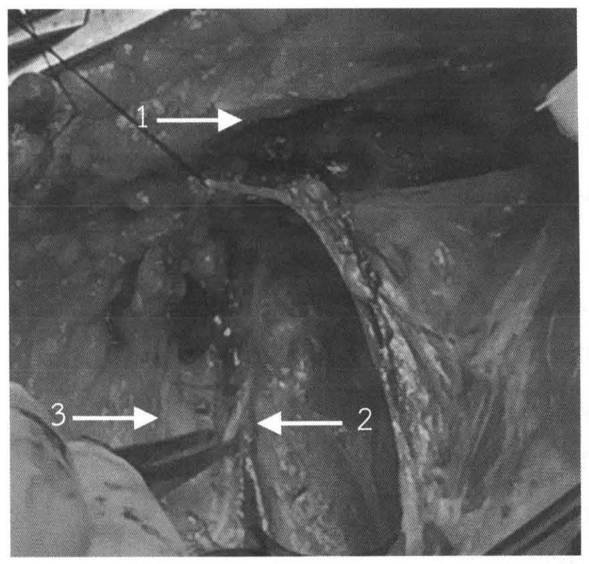

> **Caption (verbatim):** **รูปที่ 1** (1) axillary vein, (2) thoracodoral nerve, (3) latissimus dorsi
> **Text in image (verbatim):** 1 · 2 · 3
> **Description:** Black-and-white intraoperative photograph of an opened axilla during dissection, with retractors and a gloved hand visible at the edges. Three white numbered arrows: arrow 1 (upper part of the field, pointing right) points to a large dark tubular structure running across the top of the field (axillary vein); arrow 2 (lower centre, pointing left) points to a thin pale cord running vertically in the depth of the field (thoracodoral nerve); arrow 3 (lower left, pointing right) points to the muscle at the lateral/lower-left side of the field (latissimus dorsi). A curved band of fatty fibrous tissue sweeps from the top centre down to the lower right.
> **Identifiers in image:** none

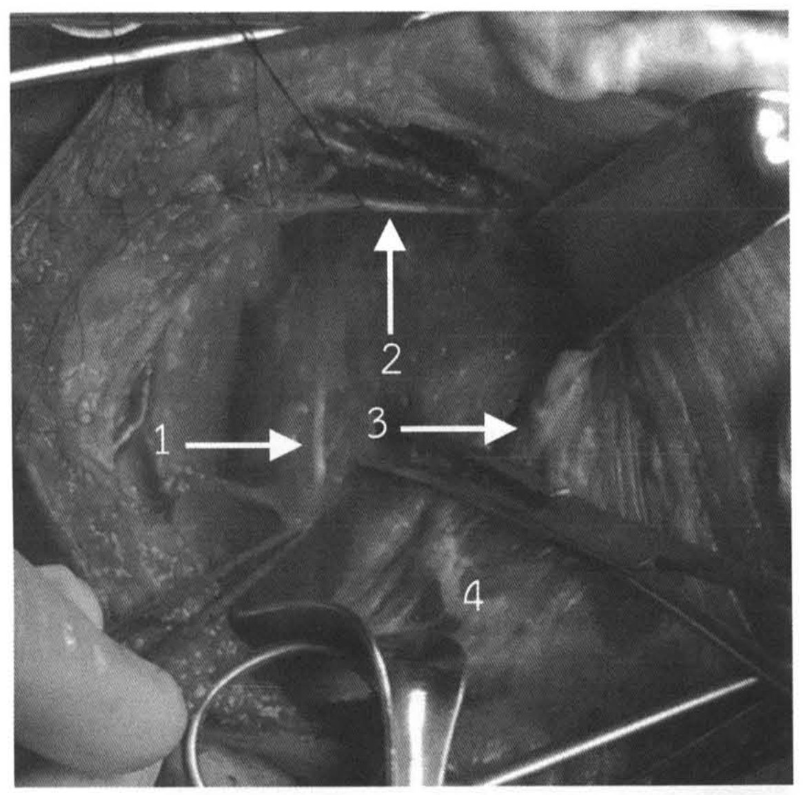

> **Caption (verbatim):** **รูปที่ 2** (1) long thoracic nerve, (2) intercostobrachial nerve, (3) pectoralis minor, (4) serratus anterior
> **Text in image (verbatim):** 1 · 2 · 3 · 4
> **Description:** Black-and-white intraoperative photograph of an axillary dissection with retractors, instruments and a gloved finger visible. Arrow 1 (left centre, pointing right) points to a thin pale vertical cord on the chest wall (long thoracic nerve); arrow 2 (centre, pointing upward) points to a thin pale structure crossing horizontally near the top of the dissected space (intercostobrachial nerve); arrow 3 (centre, pointing right) points to the striated muscle held by a retractor on the right side of the field (pectoralis minor); label 4 (lower centre, no arrow) lies on the muscle of the chest wall at the bottom of the field (serratus anterior).
> **Identifiers in image:** none

Lymphatic drainage ของ axilla ขอบเขตไม่ได้แบ่งชัดเจน กลุ่มของ lymph node แบ่งตาม anatomy ใกล้เคียง 6 กลุ่ม ได้แก่ 1. axillary vein group (lateral) มี 4-6 lymph nodes อยู่ medial หรือ posterior ต่อ axillary vein และรับการระบาย

<!-- p.268 (printed 254) -->
จากแขน 2. external mammary group (anterior or pectoral group) มี 5-6 lymph nodes อยู่ตามขอบล่างของ pectoralis minor muscle ติดกับ lateral thoracic vessels และรับการระบายน้ำเหลืองจากด้านนอกของเต้านม 3. scapular group (posterior หรือ subscapular) มี 5-7 lymph nodes อยู่บริเวณด้านหลังของ axilla ตรงขอบนอกของ scapula อยู่ใกล้กับ subscapular vessels และรับน้ำเหลืองจากส่วนล่างของคอด้านหลังด้านหลังของไหล่ 4. central group มี 3-4 lymph nodes อยู่ด้านหลัง pectoralis minor muscle รับน้ำเหลืองจาก 3 กลุ่มแรก และจากเต้านม 5. subclavicular group (apical) มี 6-12 lymph nodes วางอยู่ด้านหลังและเหนือต่อขอบบนของ pectoralis minor muscle รับน้ำเหลืองมาจากทุกกลุ่ม 6. interpectoral group (Rotter’s lymph node) มี 1-4 lymph nodes อยู่ระหว่าง pectoralis major และ pectoralis minor muscle รับน้ำเหลืองจากเต้านม และระบายต่อไปยัง central และ subclavicular groups การแบ่งระดับของ axillary lymph node โดยใช้ขอบของ pectoralis minor muscle คือ level I ได้แก่ กลุ่ม 1-3, level II ได้แก่ กลุ่ม 4 และ 6 level III คือ apical group axillary lymph nodes รับน้ำเหลือง >75% ของน้ำเหลืองที่ระบายจากเต้านม การระบายน้ำเหลืองจากด้านในของเต้านมจะไปคู่กับ internal mammary artery เข้าสู่ internal mammary group

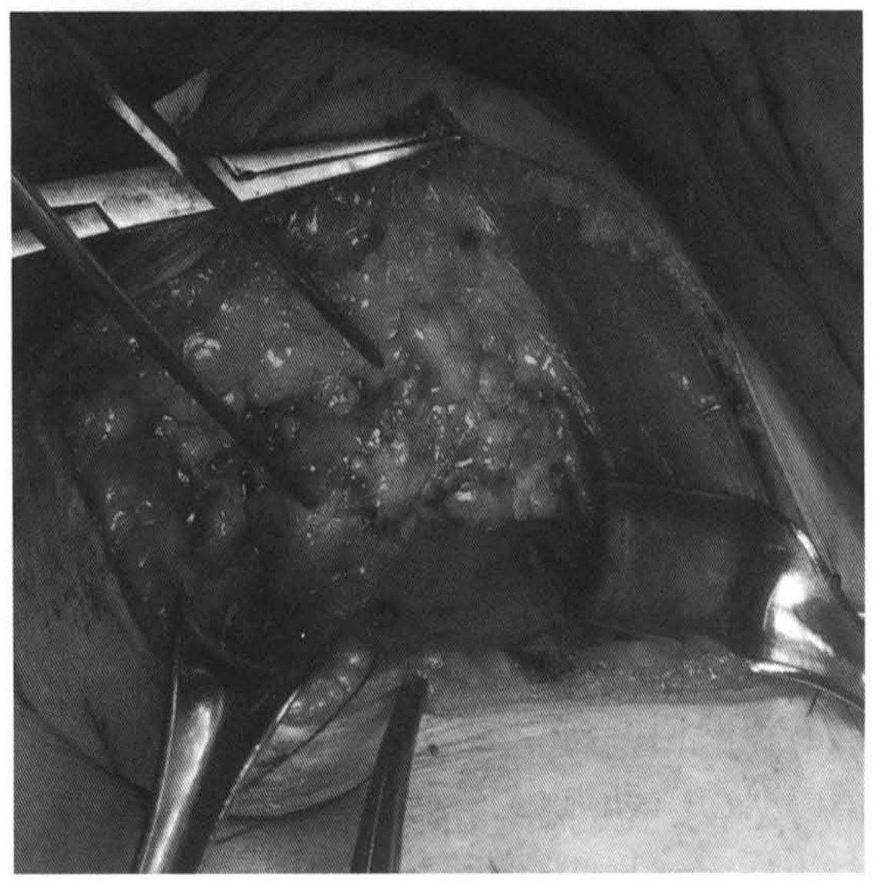

> **Caption (verbatim):** **รูปที่ 3** lymph nodes level I
> **Text in image (verbatim):** none
> **Description:** Black-and-white intraoperative photograph of an axillary dissection. Metal retractors hold the wound edges open (one across the top left, curved retractors at the bottom and lower right) and a long instrument crosses diagonally from the upper left. The centre of the field shows a mass of nodular fatty tissue with glistening lobules in the axilla (the level I lymph node region named in the caption), bordered by muscle on the right side of the field and skin at the bottom. No labels or arrows.
> **Identifiers in image:** none

<!-- p.269 (printed 255) -->
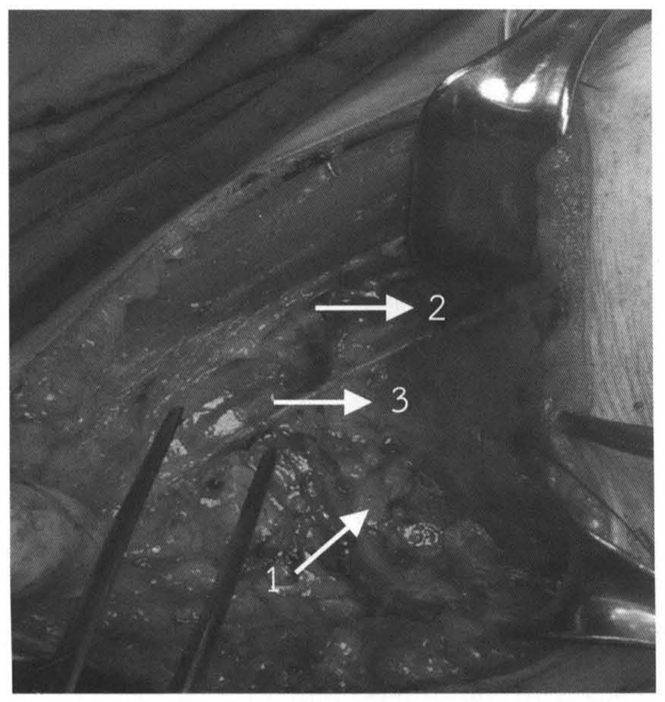

> **Caption (verbatim):** **รูปที่ 4** รูปหลังจาก level I lymph node dissection (1) thoracodorsal vessels, (2) axillary vein, (3) intercostobrachial nerve
> **Text in image (verbatim):** 1 · 2 · 3
> **Description:** Black-and-white intraoperative photograph of the axilla after level I lymph node dissection. A large metal retractor is at the upper right and two long thin instruments enter from the lower left. Arrow 2 (centre, pointing right) points to a large dark structure running obliquely across the upper middle of the field toward the retractor (axillary vein); arrow 3 (below arrow 2, pointing right) points to a thin structure crossing the field just below it (intercostobrachial nerve); arrow 1 (lower centre, pointing up and to the right) points to vessels running in the lower part of the dissected field (thoracodorsal vessels). Muscle with oblique fibres occupies the upper left part of the image.
> **Identifiers in image:** none

## Breast development and function

การพัฒนาและการทำงานของเต้านมมี hormone หลายชนิดที่เกี่ยวข้อง เช่น estrogen, progesterone, prolactin, oxytocin, thyroid hormone, cortisol และ growth hormone

Estrogen ทำให้เกิด duct, progesterone กระตุ้น proliferation ของ epithelium และการเกิด lobule, prolactin กระตุ้นให้เกิดการสร้างน้ำนมในช่วงปลายของการตั้งครรภ์และช่วงหลังคลอด gonadotropin-releasing hormone (GnRH) จาก hypothalamus ซึ่งควบคุมการหลั่ง gonadotropins luteinizing hormone (LH) และ follicle-stimulating hormone (FSH) จาก anterior pituitary gland LH และ FSH ควบคุมการสร้าง estrogen และ progesterone จากรังไข่ estrogen และ progesterone จะมีระดับลดลงหลังเด็กเกิด และจะมีระดับต่ำในเด็กผู้หญิงจนกระทั่ง puberty เนื่องจาก hypothalamic-pituitary axis มี sensitivity ต่อ negative feedback เมื่อถึง puberty negative feedback sensitivity จะลดลง และจะเพิ่ม positive feedback ต่อ estrogen

<!-- p.270 (printed 256) -->
ทำให้ระดับ GnRH, FSH และ LH เพิ่มขึ้น เกิด menstrual cycle ช่วงเริ่ม cycle เต้านมจะเพิ่มขนาดและความหนาแน่นซึ่งมี epithelial proliferation และ engorgement ของ breast tissue เมื่อมีประจำเดือนก็จะลด epithelial proliferation

estrogens และ progestins จะเพิ่มขึ้นในขณะตั้งครรภ์จากการสร้างโดยรังไข่และรก ขนาดเต้านมใหญ่ขึ้นจาก ductal และ lobular epithelial proliferation, areolar สีเข้มขึ้น, accessory areolar gland (Montgomery’s glands) ชัดขึ้น ช่วง trimesters ที่ 1, 2 minor ducts เจริญมากขึ้น trimester ที่ 3 มี fat droplets สะสมใน alveolar epithelium และมี colostrum ใน alveolar และ duct ช่วงปลายการตั้งครรภ์ prolactin กระตุ้นการสร้างน้ำนม

หลังคลอดระดับ estrogen และ progesterone ลดลง ทำให้การกระตุ้นของ prolactin ต่อเต้านมชัดเจนขึ้น โดยการสร้างและหลั่งน้ำนมควบคุมโดย neural reflex arc โดยที่ nerve endings ที่ nipple-alveolar complex เป็นส่วนที่กระตุ้นจากการดูดของทารก oxytocin ตอบสนองจากการเห็น, กลิ่น และการได้ยินขณะให้นม ทำให้ myoepithelial cells บีบตัว alveoli และขับน้ำนมสู่ lactiferous sinuses หลังจากหย่านมระดับ prolactin และ oxytocin ลดลง หลังจากหมดประจำเดือน estrogen และ progesterone ลดลง ทำให้เกิด involution ของ ducts และ alveoli breast tissues จะถูก adipose tissue แทนที่

ความรู้เกี่ยวกับการเปลี่ยนแปลงเต้านมในแต่ละช่วงอายุ และอาการที่อาจพบได้ช่วยให้มีความเข้าใจ ลดอาการกังวลว่าจะเป็นอาการของมะเร็งเต้านม โดยการเปลี่ยนแปลงของเต้านมแบ่งเป็น 3 ช่วง

1. ช่วงอายุ 15-25 ปี หรือช่วงต้นของวัยเจริญพันธุ์ เต้านมเริ่มมีการพัฒนาตามการกระตุ้นของฮอร์โมนเพศหญิง คือ ต่อมน้ำนม, ท่อน้ำนมและเนื้อเยื่อรอบๆ มีการเจริญจะพบขนาดเต้านมเริ่มโตขึ้น หัวนมโผล่พ้นฐานหัวนมความผิดปกติที่อาจพบได้คือการมีเนื้องอกชนิด (fibroadenoma) ซึ่งการพบขนาด 1 เซนติเมตรไม่ถือว่าผิดปกติ โดยทั่วไปมักพบขนาด 1-2 เซนติเมตร ซึ่งไม่จำเป็นต้องผ่าตัดเอาก้อนออก การพบเนื้องอกชนิดนี้ขนาดมากกว่า 3 เซนติเมตร หรือพบมากกว่า 5 ก้อนในเต้านม 1 ข้าง จัดว่าเป็นโรค แต่ไม่เป็นปัจจัยเสี่ยงต่อมะเร็งเต้านมซึ่งถ้าขนาดมากกว่า 2.5 เซนติเมตร ในคนอายุมากกว่า 30 ปี อาจจะพิจารณาตัดก้อนออก ถ้าการตรวจร่างกายและลักษณะอัลตราซาวน์ไม่เหมือน typical fibroadenoma

<!-- p.271 (printed 257) -->
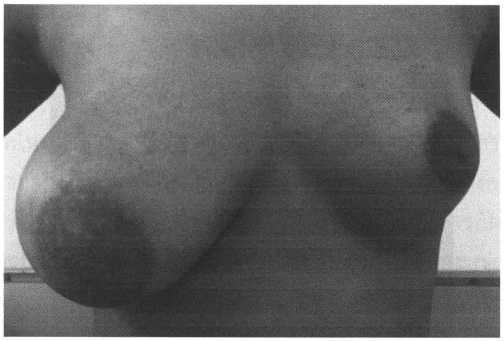

> **Caption (verbatim):** **รูปที่ 6 ,5 และ 7** Juvenile fibroadenoma
> **Text in image (verbatim):** none
> **Description:** First of three stacked black-and-white photographs sharing one caption. Frontal clinical photograph of a female chest, cropped from below the neck to the upper abdomen (no face shown). The breast on the left side of the image is markedly enlarged, rounded and pendulous, with a stretched, darker lower skin surface extending well below the level of the opposite breast; the breast on the right side of the image is of ordinary size with a visible areola.
> **Identifiers in image:** none

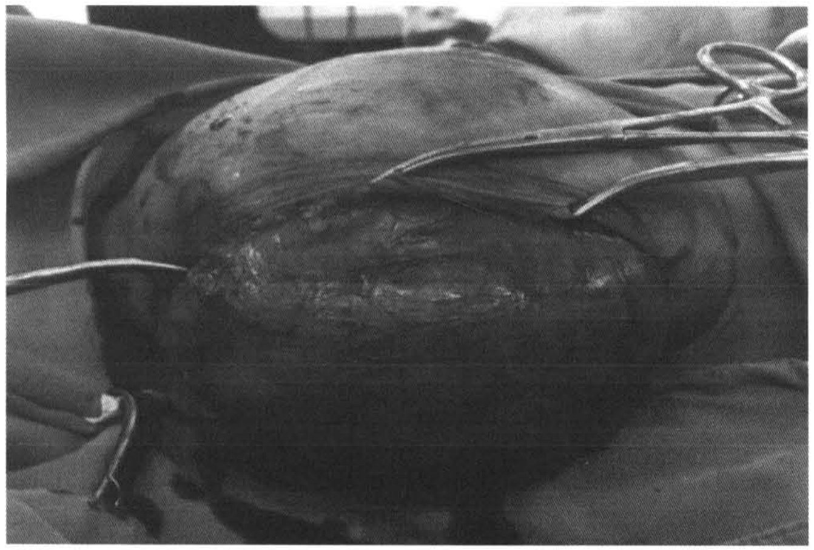

> **Caption (verbatim):** **รูปที่ 6 ,5 และ 7** Juvenile fibroadenoma
> **Text in image (verbatim):** none
> **Description:** Second photograph of the set. Intraoperative black-and-white photograph showing a very large, smooth, rounded mass being delivered through a curved incision, surrounded by surgical drapes. Curved artery forceps/clamps from the upper right and retractors from the left hold the incision edges over the surface of the mass.
> **Identifiers in image:** none

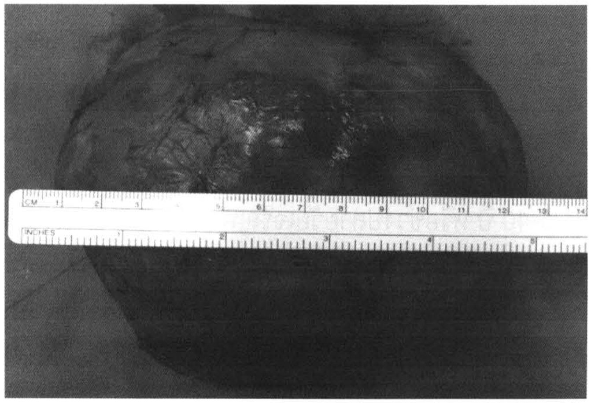

> **Caption (verbatim):** **รูปที่ 6 ,5 และ 7** Juvenile fibroadenoma
> **Text in image (verbatim):** CM · 1 · 2 · 3 · 5 · 6 · 7 · 8 · 9 · 10 · 11 · 12 · 13 · 14 · INCHES · 1 · 2 · 3 · 4 · 5
> **Description:** Third photograph of the set. Black-and-white photograph of the excised, large, round to oval, well-circumscribed specimen lying on a drape, with a ruler (centimetre scale on top, inch scale below) laid horizontally across its middle; the specimen spans most of the length of the visible ruler (about 14 cm visible) and extends beyond its right end. The specimen surface is smooth with some shiny fibrous areas on its upper left part.
> **Identifiers in image:** none

<!-- p.272 (printed 258) -->
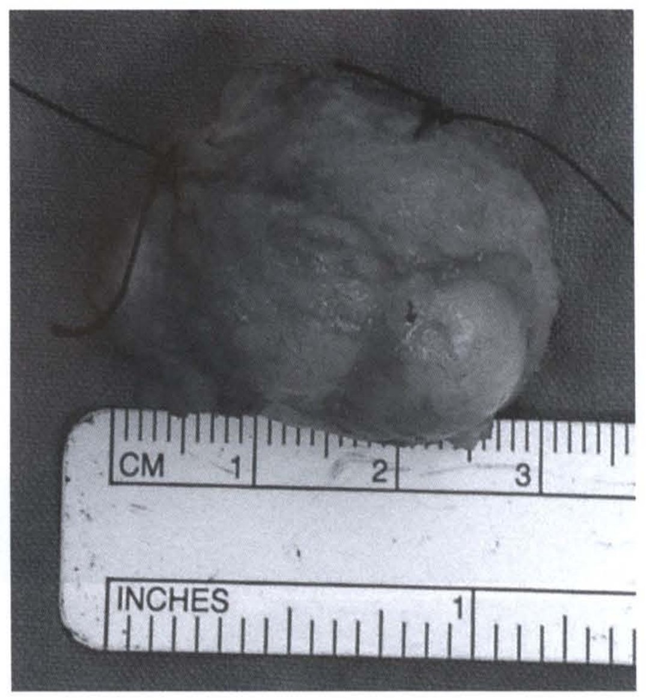

> **Caption (verbatim):** **รูปที่ 8** fibroadenoma
> **Text in image (verbatim):** CM · 1 · 2 · 3 · INCHES · 1
> **Description:** Black-and-white photograph of an excised, rounded, lobulated, well-circumscribed specimen lying on a drape, with suture threads attached at its upper left and upper right. A ruler (centimetre scale above, inch scale below) lies along the bottom of the specimen; the specimen spans roughly from just before the 1 cm mark to beyond the 3 cm mark. A smooth, bulging rounded lobule forms the lower right part of the specimen.
> **Identifiers in image:** none

การเจริญเติบโตของเต้านมที่ผิดปกติจนเกิดขนาดใหญ่ยังไม่ทราบสาเหตุที่ชัดเจน โดยเต้านมขนาดที่โตขึ้นอาจทำให้เกิดอาการปวด, มีแผลบริเวณเต้านม, มีผลต่อการยืนที่ผิดปกติเนื่องจากน้ำหนักของเต้านมที่ถ่วงด้านหน้า อาจทำให้ปวดหลัง หรือบางรายความรู้สึกบริเวณหัวนมหายไปเนื่องจากเส้นประสาทถูกดึงรั้ง การรักษาในกรณีที่มีอาการมาก คือการผ่าตัดลดขนาดเต้านม

ความผิดปกติที่อาจพบได้ในช่วงอายุนี้คือ  หัวนมไม่โผล่พ้นฐานหัวนม  ซึ่งถ้าทำให้อุดตันท่อน้ำนมก็อาจเกิดการอักเสบเป็นหนอง เป็นซ้ำกันก็อาจทำให้ท่อน้ำนมอักเสบติดต่อทะลุถึงผิวหนังได้

2. ช่วงอายุ 25-40 ปี หรือช่วงปลายวัยเจริญพันธุ์จะเกิดอาการที่มีความเปลี่ยนแปลงตามรอบเดือน คือมีอาการคัดตึงเต้านม 2 สัปดาห์ ก่อนมีรอบเดือน เนื่องจากการตอบสนองต่อฮอร์โมนเอสโตรเจนและโปรเจสเตอโรน  ความผิดปกติที่อาจเกิดขึ้นได้คืออาการปวดก่อนมีรอบเดือน ถ้าอาการปวดรุนแรงมากจนมีผลต่อการดำเนินชีวิตก็จัดว่าเป็นโรค ซึ่งอาจรักษาด้วยยาแก้ปวด การรักษาด้วยฮอร์โมนอาจต้องพิจารณาถึงผลข้างเคียงของยา อาการปวดเพียงอย่างเดียวไม่ใช่อาการของมะเร็งเต้านม

การเจริญของเต้านมในขณะตั้งครรภ์ บางครั้งอาจเกิดน้ำเหมือนสีเลือดออกจากหัวนม 2 ข้างได้ ควรได้รับการตรวจยืนยันว่าไม่มีมะเร็งเต้านมที่ทำให้เกิดอาการนี้ เนื่องจากถ้าเป็นอาการของมะเร็งจำเป็นที่จะต้องวางแผนการรักษาในขณะตั้งครรภ์

<!-- p.273 (printed 259) -->
3. ช่วงอายุ 35-55 ปี หรือช่วงที่เต้านมเริ่มฝ่อ โดยจะพบว่าต่อมน้ำนมฝ่อ, ท่อน้ำนมฝ่อหรือมีความเปลี่ยนแปลงของเยื่อบุต่อมน้ำนมและท่อน้ำนม ความผิดปกติที่อาจพบได้คือถุงน้ำหรือซีสต์ ซึ่งไม่ใช่ปัจจัยเสี่ยงต่อมะเร็งเต้านมไม่จำเป็นต้องเจาะดูดน้ำออกเนื่องจากอาจยุบเองหรือเกิดใหม่ได้ ถุงน้ำที่มีเนื้อปนอาจจะต้องเจาะพิสูจน์เนื้อ, การฝ่อของท่อน้ำนมอาจเกิดท่อน้ำนมขยายขนาด ซึ่งไม่เป็นปัจจัยเสี่ยงต่อมะเร็งเต้านม บางครั้งอาจพบหัวนมหดใต้ฐานหัวนม ซึ่งถ้ามีการอุดตันต่อท่อน้ำนมก็เกิดเป็นโรคคือการอักเสบเต้านมรอบท่อน้ำนม (periductal mastitis) ซึ่งอาจเกิด periductal fibrosis และ nipple retraction ได้ ความเปลี่ยนแปลงของเยื่อบุต่อมน้ำนม และท่อน้ำนมที่เพิ่มจำนวนจะเกิดเป็นโรคเมื่อมีการเพิ่มจำนวนอย่างมาก ซึ่งการวินิจฉัยทำโดยการตรวจพิสูจน์ชิ้นเนื้อ ซึ่งมักตรวจพบจากการตรวจคัดกรอง และเป็นปัจจัยเสี่ยงต่อมะเร็งเต้านม

**ตารางที่ 1** Classification of benign breast disorders.

|  | NORMAL | DISORDER | DISEASE |
| --- | --- | --- | --- |
| Early reproductive years (age 15-25 y) | Lobular development | Fibroadenoma | Giant fibroadenoma |
|  | Stromal development | Adolescent hypertrophy | Gigantomastia |
|  | Nipple eversion | Nipple inversion | Subareolar abscess |
| Later reproductive years (age 25-40 y) | Cyclical changes of menstruation | Cyclical mastalgia | Incapacitating mastalgia |
|  | Epithelial hyperplasia of pregnancy | Bloody nipple discharge |  |
| Involution (age 35-55 y) | Lobular involution | Macrocysts | - |
|  |  | Sclerosing lesions |  |
|  | Duct involution |  |  |
|  | Dilatation | Duct ectasia | Periductal mastitis |
|  | Sclerosis | Nipple retraction | - |
|  | Epithelial turnover | Epithelial hyperplasia | Epithelial hyperplasia with atypia |

<!-- p.274 (printed 260) -->
**ตารางที่ 2** Cancer risk associated with benign breast disorders and in situ carcinoma of the breast.

| ABNORMALITY | RELATIVE RISK |
| --- | --- |
| Nonproliferative lesions of the breast | No increased risk |
| Sclerosing adenosis | No increased risk |
| Intraductal papilloma | No increased risk |
| Florid hyperplasia. | 1.5 to 2-fold |
| Atypical lobular hyperplasia. | 4-fold |
| Atypical ductal hyperplasia. | 4-fold |
| Ductal involvement by cells of atypital ductal hyperplasia. | 7-fold |
| Lobular carcinoma in situ | 10-fold |
| Ductal carcinoma in situ | 10-fold |

**ตารางที่ 3** Classification of benign breast disorders.

| **Nonproliferative disorders of the breast** |
| --- |
| Cysts and apocrine metaplasia Duct ectasia Mild ductal epithelial hyperplasia Calcification Fibroadenoma and related lesions |
| **Proliferative breast disorders without atypia** |
| Sclerosing adenosis Radial and complex sclerosing lesions Ductal epithelial hyperplasia Intraductal papillomas |
| **Atypical proliferative lesions** |
| Atypical lobular hyperplasia Atypical Ductal hyperplasia |

<!-- p.275 (printed 261) -->
การแบ่ง benign breast disorders ช่วยให้จำแนกกลุ่มที่ไม่เพิ่มความเสี่ยงต่อมะเร็งเต้านมหรือกลุ่มที่เพิ่มความเสี่ยงโดยแบ่งเป็น

- Non proliferative disorders ได้แก่ cysts, apocrine metaplasia, duct ectasia, mild ductal epithelial hyperplasia, calcifications และ fibroadenoma ซึ่งการพบลักษณะเหล่านี้ไม่เพิ่มความเสี่ยงต่อการเกิดมะเร็งเต้านม ซึ่ง lesions เหล่านี้พบได้ 70% ของ benign breast conditions การพบ calcium ส่วนใหญ่เป็น benign อาจเกิดจาก cellular secretions, debris, trauma, inflammation calcifications ที่เป็นลักษณะของมะเร็งคือ microcalcifications ขนาด <0.5 mm, fine, linear branching

- Proliferative breast disorders without atypia ได้แก่ sclerosing adenosis, radial scars, complex sclerosing lesions, ductal epithelial hyperplasia และ intraductal papilloma sclerosing adenosis พบในช่วงวัยเจริญพันธุ์และใกล้หมดประจำเดือน ไม่เป็นความเสี่ยงต่อมะเร็งเต้านม ประกอบด้วย proliferation (ductal proliferation) และ involution (stromal fibrosis, epithelial regression) มักพบเป็น distorted breast lobules ใน multiple microcysts มักคลำไม่พบก้อน มีไม่บ่อยที่มาด้วยก้อนที่เต้านม benign calcifications มักพบใน sclerosing adenosis, radial scar, complex sclerosing lesion มีลักษณะ central sclerosis, epithelial proliferation, apocrine metaplasia, papilloma formation imaging findings อาจแยกยากระหว่าง radial scar หรือ complex sclerosing lesions จาก invasive cancer ซึ่งอาจจะต้องทำ excision เพื่อพิสูจน์ชิ้นเนื้อ

Mild ductal hyperplasia ไม่เพิ่มความเสี่ยงต่อการเกิดมะเร็งเต้านม moderated ductal hyperplasia เพิ่มความเสี่ยงต่อการเกิดมะเร็งเต้านม 1.5-2 เท่า

Intraductal papillomas พบในวัยใกล้หมดประจำเดือน ขนาดมักจะ <0.5 เซนติเมตร ใน major ducts มักมีอาการ serous หรือ bloody nipple discharge ไม่เพิ่มความเสี่ยงต่อมะเร็งเต้านม แต่ถ้าเกิดในอายุน้อยกว่านี้และเป็น multiple intraductal papillomas ซึ่งพบ nipple discharge น้อยกว่า เป็นความเสี่ยงของการเกิดมะเร็งเต้านม

- Atypical proliferative disease ได้แก่ atypical ductal hyperplasia (ADH), atypical lobular hyperplasia (ALH), ซึ่งเพิ่มความเสี่ยงต่อการเกิดมะเร็งเต้านม 4 เท่า บางครั้งแยกยากกับ carcinoma in situ ALH เกิดใน lobular units ลักษณะคล้าย LCIS

<!-- p.276 (printed 262) -->
(lobular carcinoma in situ) LCIS ไม่มีลักษณะเฉพาะใน mammography คลำก้อนไม่ได้ มักพบเป็น incidental finding จากการทำ breast biopsy ปกติเมื่อพบ LCIS ไม่จำเป็นต้อง excision เนื่องจากการเพิ่มความเสี่ยงต่อมะเร็งเต้านมอาจเกิดที่ใดก็ได้ทั้งข้างเดียวกันและเต้านมอีกข้าง ควรพิจารณาวิธีลดความเสี่ยงต่อมะเร็งเต้านม

## Breast cancer incidence and breast cancer screening

มะเร็งเต้านมเป็นมะเร็งที่พบมากที่สุดในเพศหญิง โดยพบว่าอุบัติการณ์เพิ่มขึ้นจาก 110/100,000 ราย ในปี ค.ศ. 1975 เมื่อมีการใช้ mammography ในการตรวจคัดกรอง พบว่า อุบัติการณ์เพิ่มเป็น 165/100,000 ราย ในปี ค.ศ. 2011 คือ เพิ่มขึ้น 50% ปี คศ. 2012-2016 พบ 127.50 คน/ผู้หญิง 100,000 คน อุบัติการณ์เพิ่มขึ้นในรอบ 10 ปี (คศ. 2007-2016) พบมะเร็งเต้านมเพิ่มขึ้น 0.3% ต่อปี อัตราการเสียชีวิตลดลง 1.8% ต่อปี1 โดย lifetime risk ของผู้หญิงอเมริกันคือ 12.8%, ผู้หญิงเอเชีย 8% ช่วงอายุที่พบมากที่สุดคือ 55-64 ปี พบ 25.6% ของผู้ป่วยรายใหม่ อายุน้อยกว่า 35 ปี พบ 1.9% ของผู้ป่วยใหม่

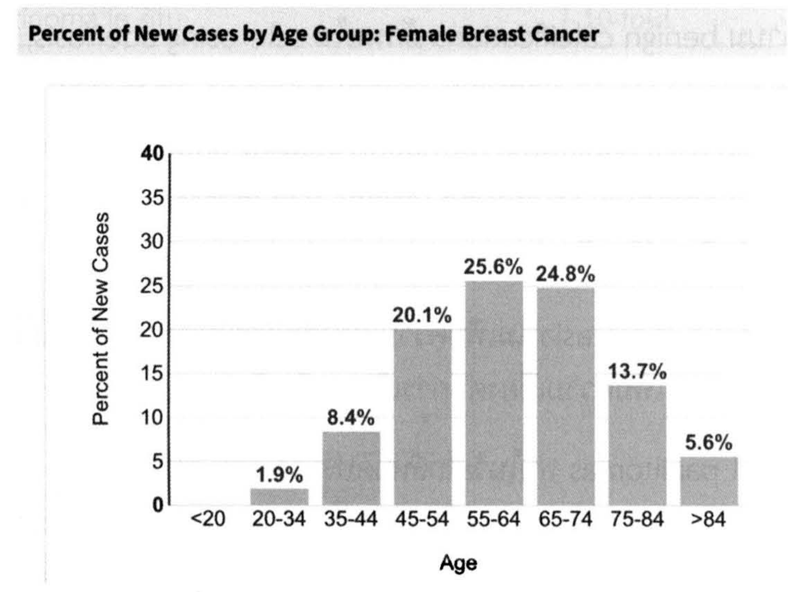

> **Caption (verbatim):** แผนภูมิที่ 1
> **Text in image (verbatim):** Percent of New Cases by Age Group: Female Breast Cancer · Percent of New Cases · 0 · 5 · 10 · 15 · 20 · 25 · 30 · 35 · 40 · Age · <20 · 20-34 · 35-44 · 45-54 · 55-64 · 65-74 · 75-84 · >84 · 1.9% · 8.4% · 20.1% · 25.6% · 24.8% · 13.7% · 5.6%
> **Description:** Vertical bar chart titled "Percent of New Cases by Age Group: Female Breast Cancer" (title on a grey band above the chart). Y-axis "Percent of New Cases", 0 to 40 in steps of 5 with light horizontal gridlines; x-axis "Age" with eight age groups. Grey bars, each labelled with its value: <20 no visible bar (no label); 20-34 1.9%; 35-44 8.4%; 45-54 20.1%; 55-64 25.6% (highest); 65-74 24.8%; 75-84 13.7%; >84 5.6%. The distribution rises steeply from age 35 to a peak at 55-64, stays nearly as high at 65-74, then falls in the older groups.
> **Identifiers in image:** none

เนื่องจากมีอุบัติการณ์ของโรคมากที่สุดในเพศหญิงเทียบกับโรคมะเร็งของอวัยวะอื่นและผลการรักษาที่ดีถ้าพบในระยะต้น Shapiro S2 ทำการศึกษาผลของการทำ screening mammography ในการลด mortality โดยทำการศึกษาแบบ Randomized Controlled

<!-- p.277 (printed 263) -->
Trial (RCT) ในปี ค.ศ. 1963 โดยทำ screening mammography ร่วมกับ Clinical Breast Examination (CBE) ในผู้หญิงอายุ 40-64 ปี หลังจากติดตามมาเป็นเวลา 30 ปี พบว่า screening mammography ลด mortality ประมาณ 30% ในช่วงอายุ 50-69 ปี ต่อมามีการศึกษาการทำ screening mammography ว่ามีผลต่อการลด mortality หรือไม่ ซึ่งมีการศึกษาแบบ RCT3-9 การศึกษาพบว่าอายุ 40-49 ปี การทำ screening mammography ไม่พบว่ามีประโยชน์ในช่วง 5-7 ปีแรก มีการศึกษาที่พบว่าที่ 12 ปี มีผลลด mortality 13% แต่ไม่มีความสำคัญทางสถิติ การศึกษาของ Shapiro S มีการติดตามหลังการทำนานที่สุด โดยพบว่าที่ 10-18 ปี หลัง screening mammography ในช่วงอายุ 40-49 ช่วยลด mortality 25% แต่ไม่มีความสำคัญทางสถิติ

**ตารางที่ 4** Selected characteristics of the design and conduct of eight randomized controlled trials of breast cancer screening3-9

| Study (year begun) | Age at entry. y | Screening modality* | Periodicity, mo | Sample size: Study | Sample size: Control | % screened at 1st examination |
| --- | --- | --- | --- | --- | --- | --- |
| HIP (1963) Sweden | 40-64 | 2-view MM + CBE | 12 | 30239 | 30759 | 67 |
| Two-county (1977) | 40-74 | 1-view MM | 24 (age <50 y) 33 (age >50 y) | 78085 | 56782 | 89 |
| Malmo (1976) | 45-69 | 2-view MM | 18-24 | 21088 | 21195 | 74 |
| Stockholm (1981) | 40-64 | 1-view MM | 28 | 39164 | 19943 | 81 |
| Göteborg (1982) | 40-59 | 2-view MM | 18 | 20724 | 28809 | 84 |
| Edinburgh (1976) | 45-64 | 2-view MM + CBE | 12 | 23226 | 21904 | 61 |
|  |  | initially (later, usually 1-view MM) | 24 |  |  |  |
| Canada NBSS1 (1980) | 40-49 | 2-view MM + CBE | 12 | 25214 | 25216 | 100 |
| Canada NBSS2 (1980) | 50-59 | 2-view MM + CBE versus CBE only | 12 | 19711 | 19694 | 100 |

*CBE = clinical breast examination ; MM = mammography

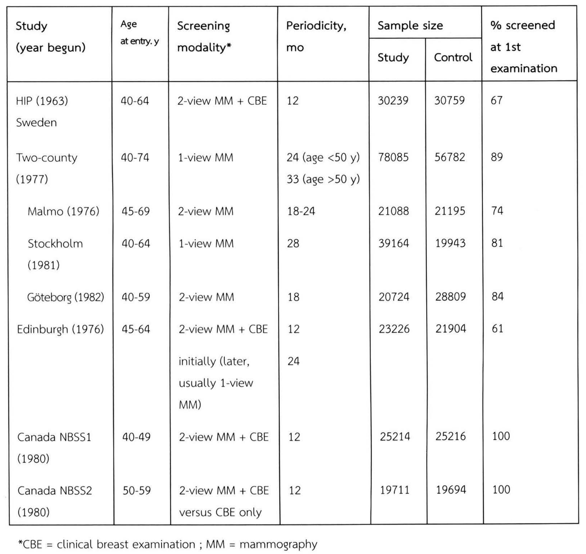

> **Caption (verbatim):** ตารางที่ 4 Selected characteristics of the design and conduct of eight randomized controlled trials of breast cancer screening3-9
> **Text in image (verbatim):** Study (year begun) · Age at entry. y · Screening modality* · Periodicity, mo · Sample size · Study · Control · % screened at 1st examination · HIP (1963) Sweden · 40-64 · 2-view MM + CBE · 12 · 30239 · 30759 · 67 · Two-county (1977) · 40-74 · 1-view MM · 24 (age <50 y) 33 (age >50 y) · 78085 · 56782 · 89 · Malmo (1976) · 45-69 · 2-view MM · 18-24 · 21088 · 21195 · 74 · Stockholm (1981) · 40-64 · 1-view MM · 28 · 39164 · 19943 · 81 · Göteborg (1982) · 40-59 · 2-view MM · 18 · 20724 · 28809 · 84 · Edinburgh (1976) · 45-64 · 2-view MM + CBE · 12 · 23226 · 21904 · 61 · initially (later, usually 1-view MM) · 24 · Canada NBSS1 (1980) · 40-49 · 2-view MM + CBE · 12 · 25214 · 25216 · 100 · Canada NBSS2 (1980) · 50-59 · 2-view MM + CBE versus CBE only · 12 · 19711 · 19694 · 100 · *CBE = clinical breast examination ; MM = mammography
> **Description:** Image of the printed Table 4 (saved because the header has a merged cell). Seven columns: Study (year begun), Age at entry (years), Screening modality, Periodicity (months), Sample size split into two sub-columns Study and Control under one merged "Sample size" header, and % screened at 1st examination. Rows: HIP (1963) Sweden; Two-county (1977); Malmo (1976), Stockholm (1981) and Göteborg (1982), whose study names are printed slightly indented under Two-county; Edinburgh (1976), which has a second line in the modality and periodicity columns ("initially (later, usually 1-view MM)", 24) with the other cells blank; Canada NBSS1 (1980); Canada NBSS2 (1980). The footnote below the table defines CBE and MM.
> **Identifiers in image:** none

<!-- p.278 (printed 264) -->
**ตารางที่ 5** Age at entry, duration of follow-up, and relative risk for deaths due to breast cancer. Study group compared with control group: eight randomized controlled trials

| Trial | Duration of follow-up, y | Relative risk (95% confidence interval): All ages | Relative risk (95% confidence interval): Younger than 50 y | Sensitivity ‡ (detection method) |
| --- | --- | --- | --- | --- |
| HIP | 10 | 0.71 (0.55-0.93)* | 0.77 (0.50-1.16) | 74 |
| Sweden |  |  |  |  |
| Kopparberg | 12 | 0.68 (0.52-0.89) | 0.75 (0.41-1.36) | 76 |
| Ostergotland | 12 | 0.82 (0.64-1.05) | 1.28 (0.76-2.33) | 76 |
| Malmö | 12 | 0.81 (0.62-1.07) | 0.51 (0.22-1.17) | 79 |
| Stockholm | 8 | 0.80 (0.53-1.22) | 1.04 (0.53-2.05) | 68 |
| Göteborg | 7 | 0.86 (0.54-1.37) | 0.73 (0.27-1.97) |  |
| Edinburgh | 10 | 0.84 (0.63-1.12) | 0.86 (0.41-1.80) | 88 |
| Canada |  |  |  |  |
| NBSS1§ | 7 |  | 1.36 (0.84-2.21) | 81 |
| NBSS2‖ | 7 | 0.97 (0.62-1.52) |  | 88 |

§ Comparison is between annual mammography plus clinical breast examination versus clinical breast examination at initial screening, subsequently no examination.

‖ Comparison is between annual mammography plus clinical breast examination versus annual clinical breast examination alone.

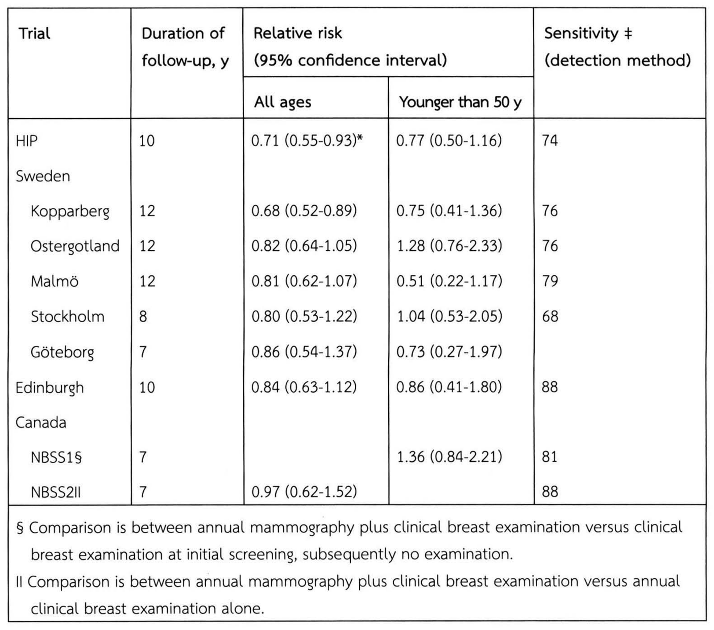

> **Caption (verbatim):** ตารางที่ 5 Age at entry, duration of follow-up, and relative risk for deaths due to breast cancer. Study group compared with control group: eight randomized controlled trials
> **Text in image (verbatim):** Trial · Duration of follow-up, y · Relative risk (95% confidence interval) · All ages · Younger than 50 y · Sensitivity ‡ (detection method) · HIP · 10 · 0.71 (0.55-0.93)* · 0.77 (0.50-1.16) · 74 · Sweden · Kopparberg · 12 · 0.68 (0.52-0.89) · 0.75 (0.41-1.36) · 76 · Ostergotland · 12 · 0.82 (0.64-1.05) · 1.28 (0.76-2.33) · 76 · Malmö · 12 · 0.81 (0.62-1.07) · 0.51 (0.22-1.17) · 79 · Stockholm · 8 · 0.80 (0.53-1.22) · 1.04 (0.53-2.05) · 68 · Göteborg · 7 · 0.86 (0.54-1.37) · 0.73 (0.27-1.97) · Edinburgh · 10 · 0.84 (0.63-1.12) · 0.86 (0.41-1.80) · 88 · Canada · NBSS1§ · 7 · 1.36 (0.84-2.21) · 81 · NBSS2‖ · 7 · 0.97 (0.62-1.52) · 88 · § Comparison is between annual mammography plus clinical breast examination versus clinical breast examination at initial screening, subsequently no examination. · ‖ Comparison is between annual mammography plus clinical breast examination versus annual clinical breast examination alone.
> **Description:** Image of the printed Table 5 (saved because the header has a merged cell). Five columns: Trial; Duration of follow-up (years); Relative risk (95% confidence interval) as one merged header split into two sub-columns "All ages" and "Younger than 50 y"; and Sensitivity ‡ (detection method). Rows: HIP; a group label "Sweden" with indented trials Kopparberg, Ostergotland, Malmö, Stockholm and Göteborg (Göteborg has no sensitivity value); Edinburgh; a group label "Canada" with indented NBSS1§ (no all-ages value) and NBSS2‖ (no younger-than-50 value). Two footnotes inside the bottom of the table box explain the § and ‖ comparisons. The table does not define the * and ‡ marks. The ‖ mark is printed as two thin vertical strokes (looks like "II").
> **Identifiers in image:** none

<!-- p.279 (printed 265) -->
**ตารางที่ 6** Relative risk for deaths due to breast cancer. Study group compared with control group in women aged 50 y and older at entry-HIP, Sweden, and Edinburgh

| Trial Age at entry, y | Duration of follow-up, y | Relative risk (95% confidence interval) |
| --- | --- | --- |
| HIP | 10 |  |
| 50-64 |  | 0.68 (0.49-0.96) |
| Sweden centers combined | 12 |  |
| 50-59 |  | 0.71 (0.57-0.90) |
| 60-69 |  | 0.71 (0.56-0.91) |
| 70-74 |  | 0.94 (0.60-1.46) |
| Edinburgh |  |  |
| 50-64 | 10 | 0.82 (0.63-1.5h) |

**ตารางที่ 7** Swedish trial results: woman-years of exposure, numbers of deaths due to breast cancer, and relative risk. Study group compared with control group in women 40-49 y at entry

| Screening center | Woman-years: Study | Woman-years: Control | Deaths due to breast cancer: Study | Deaths due to breast cancer: Control | Relative risk (95% confidence interval) |
| --- | --- | --- | --- | --- | --- |
| Kopparberg | 107000 | 56000 | 26 | 18 | 0.75 (0.41-1.35) |
| Ostergotland | 104000 | 106000 | 24 | 19 | 1.28 (0.70-2.33) |
| Malmö | 46000 | 47000 | 8 | 16 | 0.51 (0.22-1.17) |
| Stockholm | 107000 | 64000 | 20 | 12 | 1.04 (0.53-2.05) |
| Göteborg | 64000 | 77000 | 6 | 10 | 0.73 (0.27-1.92) |
| All centers | 428000 | 350000 | 84 | 75 | 0.87 (0.63-1.20) |

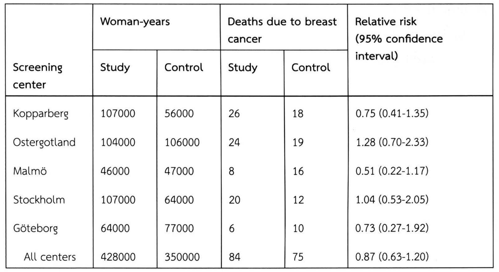

> **Caption (verbatim):** ตารางที่ 7 Swedish trial results: woman-years of exposure, numbers of deaths due to breast cancer, and relative risk. Study group compared with control group in women 40-49 y at entry
> **Text in image (verbatim):** Screening center · Woman-years · Study · Control · Deaths due to breast cancer · Study · Control · Relative risk (95% confidence interval) · Kopparberg · 107000 · 56000 · 26 · 18 · 0.75 (0.41-1.35) · Ostergotland · 104000 · 106000 · 24 · 19 · 1.28 (0.70-2.33) · Malmö · 46000 · 47000 · 8 · 16 · 0.51 (0.22-1.17) · Stockholm · 107000 · 64000 · 20 · 12 · 1.04 (0.53-2.05) · Göteborg · 64000 · 77000 · 6 · 10 · 0.73 (0.27-1.92) · All centers · 428000 · 350000 · 84 · 75 · 0.87 (0.63-1.20)
> **Description:** Image of the printed Table 7 (saved because the header has merged cells). Columns: Screening center; "Woman-years" as a merged header over Study and Control sub-columns; "Deaths due to breast cancer" as a merged header over Study and Control sub-columns; and Relative risk (95% confidence interval). Five Swedish centers (Kopparberg, Ostergotland, Malmö, Stockholm, Göteborg) and a final indented "All centers" total row.
> **Identifiers in image:** none

<!-- p.280 (printed 266) -->
การทำ screening mammography ควรเริ่มจากการซักประวัติเพื่อแยกเป็นกลุ่ม average risk, moderate risk และ กลุ่ม high risk Gail model10 เป็น model ที่ไม่ซับซ้อนใช้แยกกลุ่ม average และ high risk ได้ โดยประเมิน relative risk จากประวัติ menarche, การทำ breast biopsy, อายุที่มีลูกคนแรก ร่วมกับประวัติครอบครัว แต่การคำนวณ risk อาศัยประวัติและต้องคำนวณโดยโปรแกรมเทียบกับประชากร ซึ่งให้การประเมิน breast cancer risk โดยมีการจัดทำและแก้ไขโดย National Cancer Institute (NCI) และ National Surgical Adjuvant Breast and Bowel Project (NSABP) ซึ่งจะคำนวณ breast cancer risk ในคนที่ไม่มีประวัติ LCIS, DCIS ไม่มี gene mutations ใน BRCA1, BRCA2 หรือ genetic syndrome อื่นที่เพิ่มความเสี่ยงต่อการเกิดมะเร็งเต้านม และในคนไม่มีประวัติฉายแสงรักษา Hodgkin lymphoma การประเมินจะคำนวณได้ตั้งแต่อายุ 35 ปี และแสดงเป็น 5-year risk และ life time risk จนถึงอายุ 90 ปี เทียบกับประชากรทั่วไป

การแบ่งกลุ่มเป็น average risk, moderate risk และ high risk ต่อ breast cancer มีผลต่อการติดตามซึ่งแตกต่างกัน โดยทั่วไปในกลุ่ม average risk การแนะนำการทำ screening แตกต่างกับกลุ่ม moderate และ high risk

Breast cancer risk assessment tool11 ใช้ข้อมูลคืออายุ, menarche, อายุที่มีลูกคนแรก, จำนวนของ first degree relatives ที่เป็นมะเร็งเต้านม, จำนวนครั้งที่ทำ breast biopsy, ผล biopsy ที่มี atypical hyperplasia ซึ่งนำข้อมูลทั้งหมดไปคำนวณทางสถิติเทียบกับกลุ่มประชากรซึ่งอ้างอิงข้อมูลในอเมริกา ได้ออกมาเป็น 5-year risk และ life time risk ซึ่งเป็นค่าประมาณ ใช้ในการแนะนำการ screening หรือการป้องกันมะเร็งเต้านม ในคนที่เป็นมะเร็งเต้านมอาจคำนวณความเสี่ยงได้น้อยกว่าประชากรทั่วไป หรือคนที่มีความเสี่ยงสูงอาจไม่เป็นมะเร็งเต้านม

<!-- p.281 (printed 267) -->
**ตารางที่ 8** Breast Cancer Risk Assessment Tool 11

| อายุ | เริ่มมี ประจำเดือน | มีลูก คนแรก อายุ | จำนวนญาติ ที่เป็นมะเร็ง เต้านม | เคยทำการ เจาะตรวจ เต้านม | ผลตรวจ เป็น ADH, ALH | ความเสี่ยง 5 ปี (%) | ความเสี่ยงตลอด ชีวิตเทียบกับ ประชากร (%) |
| --- | --- | --- | --- | --- | --- | --- | --- |
| 35 | ≥14 | <20 | 0 | 0 | 0 | 0.1 / 0.2 | 3.8 / 7.5 |
| 35 | ≥14 | <20 | >1 | >1 | 0 | 0.7 / 0.2 | 21.3 / 7.5 |
| 35 | ≥14 | <20 | >1 | >1 | 1 | 1.4 / 0.2 | 37.3 / 7.5 |
| 35 | ≥14 | ≥30 | >1 | >1 | 1 | 3.2 / 0.2 | 65 / 7.5 |
| 45 | ≥14 | <20 | 0 | 0 | 0 | 0.3 / 0.7 | 3.5 / 6.9 |
| 45 | ≥14 | <20 | >1 | >1 | 0 | 5.4 / 0.7 | 43 / 6.9 |
| 45 | ≥14 | <20 | >1 | >1 | 1 | 4.1 / 0.7 | 34.8 / 6.9 |
| 45 | ≥14 | ≥30 | >1 | >1 | 1 | 9.2 / 0.7 | 61.8 / 6.9 |
| 55 | ≥14 | <20 | 0 | 0 | 0 | 0.5 / 1 | 2.8 / 5.6 |
| 55 | ≥14 | <20 | >1 | >1 | 0 | 3 / 1 | 16.3 / 5.6 |
| 55 | ≥14 | <20 | >1 | >1 | 1 | 5.8 / 1 | 29.3 / 5.6 |
| 55 | ≥14 | ≥30 | >1 | >1 | 1 | 12.8 / 1 | 54.2 / 5.6 |
| 65 | ≥14 | <20 | 0 | 0 | 0 | 0.5 / 0.9 | 2 / 4 |
| 65 | ≥14 | <20 | >1 | >1 | 0 | 2.8 / 0.9 | 11.8 / 4 |
| 65 | ≥14 | <20 | >1 | >1 | 1 | 5.3 / 0.9 | 21.7 / 4 |
| 65 | ≥14 | ≥30 | >1 | >1 | 1 | 11.8 / 0.9 | 42.4 / 4 |

\* ADH = Atypical ductal hyperplasia, ALH = Atypical lobular hyperplasia ตัวอย่างการคำนวณ risk เมื่อใช้ เชื้อชาติ American - Asian

ปัจจุบันการทำ screening mammography เป็นที่ทราบกันว่าช่วยลด mortality ประมาณ 30% แต่อายุที่จะเริ่มทำยังเป็นที่ถกเถียงกัน เนื่องจากใน RCT ที่เริ่มศึกษาเรื่องนี้ 8 การศึกษา ส่วนใหญ่เริ่มในอายุ 40 ปี แต่การพิจารณาอายุที่เริ่มทำต้องคำนึงถึงประโยชน์และอันตรายที่ได้รับว่าคุ้มค่าไหม ประโยชน์คือการวินิจฉัยได้ตั้งแต่ระยะแรก ลดอัตราการเสียชีวิต อันตรายที่เกิดจากการ screening mammography คือ การที่มีผล

<!-- p.282 (printed 268) -->
false positive ซึ่งอาจต้องทำการตรวจวินิจฉัยด้วย mammography เพิ่ม หรือการทำ biopsy โดยไม่จำเป็น นอกจากนี้ยังเพิ่มความกังวลของผู้ป่วย, อันตรายอีกประการนอกจาก false positive แล้ว คือ overdiagnosis และ overtreatment ใน invasive breast cancer บางชนิด และ in situ ที่อาจไม่มีอาการแสดงและมีผลต่อผู้ป่วยเลยตลอดชีวิต

U.S. Preventive Services Task Force (USPSTF) แนะนำว่าควรเริ่ม screening mammography อายุ 50 ปี และทำทุก 2 ปี จนถึงอายุ 74 ปี เนื่องจากในอายุ 40-49 ปี ที่เป็น average risk incidence จะต่ำกว่าอายุมากกว่านี้ และ breast density ที่มากกว่าทำให้ sensitivity ลดลง จำนวนที่วินิจฉัยได้และลดอัตราการเสียชีวิตน้อยกว่าผล false positive และการทำ biopsy ที่ไม่จำเป็น แต่เป็นเพียงการแนะนำ ซึ่งในกลุ่มที่ความเสี่ยงเป็น moderate risk อาจพิจารณาทำ screening ในช่วงอายุ 40-49 ปี เนื่องจากความเสี่ยงต่อการเกิดมะเร็งเต้านมเพิ่มขึ้น และควรทำทุก 1 ปี เพราะพบว่า interval cancer มากกว่าอายุที่เพิ่มขึ้น ประโยชน์ในการลดอัตราการเสียชีวิตสูงสุดที่อายุ 60-69 ปี ในคนอายุ >70 ปี ที่มีโรคประจำตัวมากซึ่งมีผลต่อ life expectancy ไม่มีประโยชน์ในการทำ screening mammography ซึ่งโรคเหล่านี้ ได้แก่ cardiovascular disease, paralysis, diabetes, AIDS, COPD, liver disease, CRF, CHF, dementia, MI ในคนอายุ >74 ปี ยังไม่มีรายงานถึงประโยชน์เทียบกับผลเสีย

การใช้ mammography ในการ screening มีปัจจัยเรื่อง breast density เนื่องจาก breast density พบในคนอายุน้อยมากกว่าอายุมาก และลด sensitivity ของ mammography นอกจากนี้ breast density ยังเป็นปัจจัยที่เป็นความเสี่ยงต่อการเป็นมะเร็งเต้านม การพิจารณาความถี่ของการทำ screening ขึ้นอยู่กับ interval cancer คือการวินิจฉัยโรคได้ระหว่างการ screening คือ เป็น false negative ของ mammography ซึ่งพบว่า interval cancer อยู่ในช่วง 12-31%12-18 ของ cancer ที่ตรวจพบจากการ screening ซึ่ง sensitivity ของ screening mammography อยู่ในช่วง 70-88% ขึ้นอยู่กับการศึกษา ถ้าเป็นการศึกษาในปัจจุบัน sensitivity จะดีกว่าในยุคที่ทำ RCT ยุคแรก

การพบ interval cancer นอกจากเป็น false negative แล้ว อาจบ่งบอกว่าโรคมีความรุนแรงมากกว่าโรคที่พบจาก mammography คือ ขนาดที่พบใน screening mammography 1 เซนติเมตร แต่ใน interval cancer พบเท่ากับ control group คือ 1.9 เซนติเมตร13

interval cancer พบแตกต่างกันในแต่ละช่วงอายุ18 โดยอายุ 55-59 ปี พบ 10.7/10000, อายุ 60-64 ปี พบ 10.1/10000, อายุ 65-69 ปี พบ 8/10000 โดยพบ

<!-- p.283 (printed 269) -->
interval cancer 24.8% ของ cancer ที่วินิจฉัยได้ และพบใน 6 เดือนแรก 6.3% ช่วง 7-12 เดือน 23.5%, 13-18 เดือน 35.4%, ≥19 เดือน 34.9% อีกรายงาน17 ที่พบว่า ช่วง <12 เดือน พบ 13%, 12-13 เดือน พบ 29% และ ≥24 เดือน พบ 45% เช่นเดียวกับอีกรายงานที่พบ interval cancer เพิ่มตามเวลาคือ 0-23 เดือน พบ 0.99/1000, 12-17 เดือน 1.5/1000, 18-23 เดือน พบ 1.31/1000 และ 24-29 เดือน พบ 1.33/100019

นอกจากการพิจารณาเรื่อง interval cancer แล้ว incidence ของ breast cancer ที่พบก็แตกต่างกันตามอายุ โดยพบว่าอายุ 45-49 พบ 2.6/1000 ราย, อายุ 50-59 พบ 4.3-5.83/1000, อายุ 60-69 พบ 6.8-9.08/1000, อายุ ≥65 พบ 10.35-17.6/100017, 19, 20

เมื่อพิจารณาจาก incidence และ interval cancer แล้ว ปัจจุบันประเทศในยุโรปทั้งหมดทำ screening mammography อายุ 50-70 ปี ทำทุก 2 ปี ในอเมริกายังมีการแนะนำให้เริ่มอายุ 45 ปี ทุก 1 ปี และอายุ 50-74 ปี ทุก 2 ปี

การพิจารณาอันตรายหรือผลเสียของการทำ mammography คือ การพบ false positive ซึ่งต้องทำการตรวจ mammography เพิ่ม ซึ่งพบได้ 4.7-5.9% ทำให้ต้องทำ biopsy 0.6-0.7% ซึ่งพบเป็นมะเร็งเต้านมประมาณ 0.4% คือมี negative biopsy ประมาณ 30-40%14, 21, 22

sensitivity ของ mammography ในปัจจุบันดีกว่าในอดีต เนื่องจากมีการพัฒนาเครื่องที่ดีขึ้นร่วมกับความชำนาญในการอ่าน โดยมี sensitivity 77-95%, specificity 94-97%23

screening mammography พบ stage 0-1 80% เทียบกับกลุ่มที่ไม่ได้ทำ พบเพียง 48% โดยกลุ่ม screening มี survival 91% control 79% กลุ่ม interval cancer 76% กลุ่มที่ไม่เข้าร่วม screening 61%13

โดยทั่วไปการทำ screening mammography ลด mortality 30-40%16, 24, 25 ถ้าเทียบกับการทำ screening ทั้งกลุ่มพบว่าลดการเสียชีวิต 1 คนในทุกๆ การทำ screening 414 คน12

ปัจจุบันในยุโรปทำ screening mammography โดยไม่มีการทำ clinical breast examination (CBE) ในอเมริกามีแนวโน้มไม่แนะนำทำ CBE เนื่องจากพบมะเร็งเต้านมในกลุ่มที่ negative mammography ประมาณ 1.6%26 หรือในการทำการตรวจร่างกาย 1000 คน พบมะเร็งเต้านมโดยการตรวจร่างกายเพียง 1 ราย20

<!-- p.284 (printed 270) -->
นอกจากกลุ่ม average risk แล้ว กลุ่มที่คำนวณ risk ได้มากกว่านี้ มีการแนะนำการทำ MRI27 เพื่อ sensitivity ที่ดีขึ้นในคนที่มี life-time risk มากกว่า 20% และกลุ่มที่เป็น high risk คือมีประวัติการฉายรังสีรักษา lymphoma ในอายุน้อย, ประวัติครอบครัวที่เข้าได้กับโรคที่ถ่ายทอดทางพันธุกรรม ได้แก่ ประวัติครอบครัวของมะเร็งเต้านมตั้งแต่ 2 คนที่เป็นอายุน้อยกว่า 40 ปี, หรือมีประวัติครอบครัวมะเร็งเต้านม, รังไข่ตั้งแต่ 3 คนขึ้นไปและมีอย่างน้อย 1 คนที่เป็นก่อนอายุ 50 ปี28 ซึ่งควรทำการตรวจ genetic testing คนที่เป็นก่อนจึงตรวจคนที่ต้องการทำ surveillance ถ้าผล positive ในคนที่ยังไม่เป็นพิจารณาเริ่ม surveillance ตั้งแต่อายุน้อยกว่า 10 ปี ของคนที่เป็นในครอบครัวที่อายุน้อยที่สุด

เมื่อทำการประเมินความเสี่ยงต่อการเป็นมะเร็งเต้านมแล้ว ในกลุ่มที่ moderate risk ยังมีการแนะนำให้ป้องกันด้วย tamoxifen คือ ในอายุ >35 ปี ที่ประเมิน 5-year risk ≥1.66% หรือมีประวัติ biopsy เป็น LCIS, atypical hyperplasia ให้กินเป็นเวลา 5 ปี ช่วยลดการเกิดมะเร็งเต้านม 49% ซึ่งในกลุ่มที่มี atypical hyperplasia จะลดการเป็นมะเร็งเต้านมได้มากที่สุด (RR 0.25)29, 30 แต่มีโอกาสเพิ่ม endometrial cancer (RR 1.55-2.53) ได้มีการใช้ Raloxifene ในการป้องกันเทียบกับ tamoxifen พบว่าป้องกันมะเร็งเต้านม เทียบกับ tamoxifen RR 1.02 แต่ผลไม่ดีเท่า tamoxifen ใน noninvasive cancer (LCIS, DCIS) (RR 1.4) แต่มี endometrial cancer น้อยกว่า (RR 0.62), stroke (RR 0.96), ischemic heart disease (RR 1.1), fracture (RR 0.92) และการเกิด cataracts (RR 0.79)31

ในกลุ่มที่เป็น high risk คือมี mutation ต่อ BRCA 1, 2 การแนะนำการทำ risk reduction salpingo-oophorectomy (RRSO) ซึ่งควรทำก่อนอายุ 50 ปี เพื่อลดโอกาสการเกิดมะเร็งเต้านม (HR 0.51) และมะเร็งรังไข่ (HR 0.31) และการทำ risk reducing mastectomy (RRM) ช่วยลดมะเร็งเต้านม (HR 0.05)32 แต่จะมีปัญหาในระยะยาวเรื่อง cosmetic outcome ของการทำ reconstruction

โดยสรุป การทำ screening mammography ควรทำการประเมินความเสี่ยงก่อน ใน average risk แนะนำให้ทำอายุ 50-74 ปี ทุก 2 ปี ใน moderate risk และ high risk แนะนำให้ทำก่อนอายุ 50 ปี แล้วแต่ความเสี่ยง ร่วมกับการทำ MRI ในบางราย และควรพิจารณาการป้องกันด้วยยาหรือการผ่าตัด RRSC, RRM ในกลุ่ม high risk

<!-- p.285 (printed 271) -->
## Hereditary breast cancer : Breast cancer screening and prevention

การตรวจคัดกรองสำหรับผู้ที่ไม่มีความเสี่ยงมากกว่าประชากรทั่วไป รวมทั้งแนวทางการวินิจฉัยและรักษาสำหรับมะเร็งเต้านมในกลุ่มที่ไม่มีประวัติครอบครัว (sporadic breast cancer) ซึ่งพบ 60-70% ของมะเร็งเต้านมทั้งหมด มีแนวทางที่ชัดเจนและได้ผลการรักษาที่ดี เนื่องจากการศึกษาที่สะสมตั้งแต่อดีตจนปัจจุบัน แต่สำหรับกลุ่มที่มีประวัติครอบครัว (familial breast cancer) ซึ่งพบ 15-20% และกลุ่มที่มีการถ่ายทอดทางพันธุกรรม (Hereditary breast cancer) ซึ่งพบประมาณ 5-10% ยังมีการศึกษาไม่มากเท่ากับกลุ่มแรก เนื่องจากจำนวนผู้ป่วยที่น้อยกว่า ซึ่งรวมกันเพียง 20-30% ของผู้ป่วยมะเร็งทั้งหมด, การพัฒนาการตรวจพันธุกรรมที่สามารถใช้ได้ทางคลินิกอย่างแพร่หลายเริ่มเมื่อช่วงปลาย ค.ศ. 1990, การตรวจเฝ้าระวัง (surveillance) ด้วย Magnetic Resonance Imaging (MRI) ที่มีความไวกว่า mammography ในผู้ที่มีประวัติที่มีความเสี่ยงมากกว่าประชากรทั่วไป มีที่ใช้แพร่หลายในช่วง ค.ศ. 2000 ความรู้เกี่ยวกับมะเร็งเต้านมในผู้ป่วยกลุ่มนี้จึงมีความน่าสนใจและมีหลายแง่มุมการศึกษา ซึ่งหัวข้อที่น่าสนใจมีดังนี้

1. การพิจารณาหลักเกณฑ์ในการตรวจทางพันธุกรรมในผู้ที่ไม่มีอาการ, ผู้ป่วยมะเร็งเต้านม

2. การเฝ้าระวัง, การป้องกันมะเร็งเต้านมในกรณีที่ผลการตรวจว่ามีการถ่ายทอดทางพันธุกรรมของมะเร็งเต้านม

3. ความรู้ในการดำเนินโรคและผลการรักษามะเร็งเต้านมของผู้ที่มีการถ่ายทอดทางพันธุกรรม

## 1. การพิจารณาหลักเกณฑ์ในการตรวจทางพันธุกรรม

เนื่องจากการตรวจทางพันธุกรรมมีราคาค่อนข้างสูง และแม้ว่าจะมีการใช้ประวัติเพื่อคัดกรองกลุ่มที่จะมีโอกาสตรวจแล้วได้ผลบวกโดยหลาย Model ก็ตาม กลุ่มที่ประวัติมีโอกาสเป็นผลบวกสูงก็ให้ผลบวกเพียง 30% การตรวจทางพันธุกรรมมีข้อควรพิจารณา ได้แก่ Analytical validity คือ ความแม่นยำในวิธีการตรวจ, clinical validity คือการตรวจพบความผิดปกติทางพันธุกรรมนั้นมีผลให้เกิดโรคหรือไม่, clinical utility เป็นการประเมินความเสี่ยงซึ่งนอกจากพิจารณาจากผลการตรวจเต้านมแล้ว ปัจจัยอื่น เช่น ประวัติครอบครัว ประวัติความเสี่ยงจากปัจจัยภายนอก เช่น การใช้ชีวิตประจำวันและภาวะแวดล้อมมีผลต่อการประเมินโอกาสการเกิดโรค, ACCE (analytical validity, clinical validity, clinical utility ethical, legal and social issues)

<!-- p.286 (printed 272) -->
ผลการตรวจทางพันธุกรรมมีผลต่อการปฏิบัติต่อผู้ถูกทดสอบ โดยทั่วไปจะมีการให้คำปรึกษาถึงแนวทางในกรณีที่ตรวจพบความผิดปกติทางพันธุกรรม โดยจะมีการประเมินความเสี่ยงต่อการเกิดโรคในแต่ละความผิดปกติที่ตรวจพบโดยเทียบกับประชากรทั่วไป กลุ่มความเสี่ยงต่ำ คือ มีความเสี่ยงน้อยกว่า 2 เท่าเมื่อเทียบกับประชากรทั่วไป, กลุ่มความเสี่ยงปานกลาง คือ มีความเสี่ยง 2-4 เท่า, กลุ่มความเสี่ยงสูง คือ มากกว่า 4 เท่า ซึ่งการประเมินความเสี่ยงอาจไม่ถูกต้อง เนื่องจากมีปัจจัยอื่นที่อาจเพิ่มหรือลดโอกาสการเกิดโรค เช่น กลุ่มความผิดปกติที่ประเมินเป็นความเสี่ยงปานกลาง อาจเกิดเป็นโรคได้เท่ากับกลุ่มความเสี่ยงสูง ความผิดปกติทางพันธุกรรมที่พบบ่อยที่สุดคือ ความผิดปกติต่อยีน BRCA1 ในโครโมโซมที่ 17 และ BRCA2 ในโครโมโซมที่ 13 โดยมีผลต่อการเกิดมะเร็งเต้านม estimated relative risk 11 เท่าของประชากรทั่วไป นอกจากนี้ ยังทำให้เกิดมะเร็งรังไข่ และใน BRCA2 ทำให้เกิดมะเร็งต่อมลูกหมากและตับอ่อน ความผิดปกติของยีน 2 ชนิดนี้ พบเป็นส่วนใหญ่ในกลุ่มที่มีความผิดปกติของยีนที่ทำให้เกิดมะเร็งเต้านม คือ 80% และมีความเสี่ยงสูงต่อการเกิดมะเร็งเต้านม ยีนอื่นๆ พบได้เป็นส่วนน้อยและความเสี่ยงต่อการเกิดมะเร็งเต้านมยังประเมินยาก เช่น การมีความผิดปกติต่อ TP53 ซึ่งพบใน Li fraumeni syndrome ซึ่งทำให้เกิด sarcoma ในคนอายุน้อย, มะเร็งในสมอง, มะเร็งของต่อมหมวกไต และมะเร็งเต้านม, ความผิดปกติต่อ PTEN เกิดกลุ่มโรค Cowden syndrome ได้แก่ มะเร็งเต้านม, ไทรอยด์ และเยื่อบุมดลูก, STK11 ทำให้เกิดกลุ่มอาการ Peutz-Jeghers ได้แก่ มะเร็งเต้านม, ลำไส้ใหญ่, ตับอ่อน, CDH1 มี RR 6.6 ทำให้เกิดมะเร็งเต้านม นอกจากนี้ ยังเกิดเป็นมะเร็งกระเพาะอาหาร, PALB2 มี RR 5.3 ในการเกิดมะเร็งเต้านม อาจพบร่วมกับมะเร็งตับอ่อน, CHEKS มี RR 3 ในการเกิดมะเร็งเต้านมและอาจมีมะเร็งปอดร่วมด้วย, ATM มี RR 2.8 ในการเกิดมะเร็งเต้านม อาจพบร่วมกับมะเร็งตับอ่อน, NBN มี RR 2.7 ในการเกิดมะเร็งเต้านม33

<!-- p.287 (printed 273) -->
**ตารางที่ 9 Genes associate with Protein-Truncating variants and breast cancer risk33**

| Gene | Estimated Relative Risk (90% CI) | Absolute risk by 80yr of age (%) |
| --- | --- | --- |
| BRCA1 | 11.4 | 75 |
| BRCA2 | 11.7 | 76 |
| CDH1 | 6.6 | 53 |
| NF1 | 2.6 | 26 |
| PALB2 | 5.3 | 45 |
| ATM | 2.8 | 27 |
| CHEK2 | 3 | 29 |
| NBN | 2.7 | 23 |

เนื่องจากความผิดปกติทางพันธุกรรมของ BRCA2 และ BRCA2 พบบ่อยที่สุดในความผิดปกติที่ทำให้เกิดมะเร็งเต้านม จึงขอกล่าวถึงการศึกษาที่รายงานถึงการตรวจพบ BRCA1 และ BRCA2 ในครอบครัวที่มีมะเร็งเต้านม

Newman B, et al34 ได้ทำการศึกษา proband ที่เกิด breast cancer อายุน้อยกว่า 55 ปี ใน 1579 ครอบครัว ในจำนวนนี้ 326 ครอบครัวมี proband ที่เป็นมะเร็งเต้านมอายุน้อยกว่า 40 ปี การใช้สถิติในการคำนวณ estimated disease risk โดยอาศัย population-based, age-specific, cumulative incidence rates สำหรับ breast cancer ในพื้นที่เดียวกับที่มีการศึกษาโดยประชากรทั่วไปมี probability ในการเกิดมะเร็งเต้านม 0.1% เมื่ออายุ 15 ปี, 0.4% เมื่ออายุ 40 ปี, 2.8% เมื่ออายุ 55 ปี และ 8.1% ตลอดชีวิต, ในเพศชาย 0.1% ตลอดทุกช่วงอายุ ในผู้ที่ตรวจพบ estimated risk ต่อมะเร็งเต้านมในผู้ที่มีความผิดปกติทางพันธุกรรม คือ 38% เมื่ออายุ 40 ปี, 66% เมื่ออายุ 55 ปี และ 82% ตลอดชีวิต โดยโอกาสตรวจพบความผิดปกติทางพันธุกรรมในประชากรทั่วไป คือ 0.1% ในคนที่เป็นมะเร็งเต้านม 4%, ในแม่ที่เป็นมะเร็งเต้านมของ proband 20% ในเพศชายที่มีความผิดปกติทางพันธุกรรมมีโอกาสเกิดมะเร็งเต้านม 9% ตลอดชีวิต เทียบกับเพศชายที่ไม่มีความผิดปกติทางพันธุกรรม จะเกิดมะเร็งเต้านม 0.1% ตลอดชีวิต

<!-- p.288 (printed 274) -->
Ford D, et al.35 ศึกษาใน 237 ครอบครัวที่มีมะเร็งเต้านมอายุน้อยกว่า 60 ปี อย่างน้อย 4 คน, มะเร็งเต้านมในเพศชายไม่จำกัดอายุ ตรวจพบความผิดปกติจากยีน BRCA1 และ 2  42% ในจำนวน 237 ครอบครัว โดย 64% มีความผิดปกติของ BRCA1, 36% เป็นความผิดปกติที่ BRCA2 โดยใช้ standard genetic model สำหรับมะเร็งเต้านม (Claus, CASH Model) โดยประมาณว่าประชากรทั่วไปจะตรวจพบความผิดปกติทางพันธุกรรม 0.3% โดยความผิดปกติที่พบ 52% เกิดจาก BRCA1, 35% เกิดจาก BRCA2 และ 13% เกิดจากยีนอื่น จากการใช้การประเมินทางสถิติพบว่า ในครอบครัวที่มีมะเร็งเต้านม 4-5 คน พบ BRCA1 55%, BRCA2 12% และยีนอื่น 33%

เมื่อจำแนกตามจำนวนและชนิดของมะเร็งยังพบว่า ในครอบครัวที่มีมะเร็งเต้านม 4-5 คน และไม่มีเพศชายเป็นมะเร็งเต้านม จะพบความผิดปกติที่เกิดจาก BRCA1, BRCA2 และยีนอื่น คือ 32%, 9% และ 59% ตามลำดับ ในกลุ่มที่มีมะเร็งเต้านมมากกว่า 6 คน ไม่มีมะเร็งรังไข่และมะเร็งเต้านมในเพศชาย สัดส่วนความผิดปกติต่อ BRCA1, BRCA2 และยีนอื่น คือ 19%, 66% และ 15% โดยในกลุ่มที่มีเพียงมะเร็งเต้านม >4 คน ไม่มีมะเร็งรังไข่และมะเร็งเต้านมในเพศชาย พบความผิดปกติ 28%, 37% และ 35% ตามลำดับ ในกลุ่มที่พบเพียงมะเร็งเต้านมในเพศชายเท่านั้น พบว่าความผิดปกติคือ 19%, 77% และ 4% ตามลำดับ ในกลุ่มที่มีทั้งมะเร็งเต้านมและมะเร็งรังไข่พบความผิดปกติต่อ BRCA1, BRCA2 และยีนอื่น 80%, 15% และ 5% ตามลำดับ โดยพบว่าถ้าประวัติครอบครัวพบมะเร็งเต้านมและรังไข่ ไม่มีมะเร็งเต้านมในเพศชาย จะตรวจพบความผิดปกติจาก BRCA1 เป็นส่วนมาก ในครอบครัวที่มีประวัติเฉพาะมะเร็งเต้านมในเพศชายเท่านั้น จะตรวจพบว่าส่วนใหญ่มีความผิดปกติของ BRCA2, ในประวัติครอบครัวที่มีเพียงมะเร็งเต้านมในเพศหญิงตั้งแต่ 6 คนขึ้นไป ความผิดปกติที่พบมากที่สุดคือ BRCA2

ในผู้ที่ตรวจพบความผิดปกติจาก BRCA1 มีการประเมินความเสี่ยงต่อการเกิดมะเร็งเต้านม (estimated cumulative risk) ที่อายุ 50 ปีที่ 49%, อายุ 70 ปีคือ 71% ความเสี่ยงต่อการเกิดมะเร็งรังไข่ที่อายุ 50 ปีคือ 16%, อายุ 70 ปีคือ 42% ในความผิดปกติจาก BRCA2 ความเสี่ยงต่อการเกิดมะเร็งเต้านมที่อายุ 50 ปีคือ 28%, อายุ 70 ปีคือ 84% และไม่พบมะเร็งรังไข่ในอายุน้อยกว่า 40 ปี โดยมีความเสี่ยงเมื่ออายุ 50 ปี คือ 0.4%, อายุ 70 ปีคือ 27%

Easton DF, et al.36 ศึกษาความเสี่ยงต่อการเกิดมะเร็งในความผิดปกติของยีน BRCA1 ใน 33 ครอบครัวที่มีมะเร็งเต้านมมากกว่า 4 คนในอายุน้อยกว่า 60 ปี และมะเร็ง

<!-- p.289 (printed 275) -->
รังไข่ในทุกอายุ จากการคำนวณในการศึกษาก่อนนี้พบว่า ในครอบครัวที่มีเพียงมะเร็งเต้านมจะตรวจพบความผิดปกติจาก BRCA1 45% ถ้ามีมะเร็งเต้านมร่วมกับมะเร็งรังไข่จะตรวจพบความผิดปกติจาก BRCA1 79% ความเสี่ยงต่อการเกิดมะเร็งนอกจากความผิดปกติต่อยีน BRCA1 อาจมีปัจจัยภายนอกหรือยีนอื่นที่มีผลร่วม ซึ่งเป็นสาเหตุให้ญาติใกล้ชิดของผู้ที่มีความผิดปกติต่อยีนและเป็นมะเร็ง มีโอกาสเกิดมะเร็งมากกว่าญาติที่มีความใกล้ชิดน้อยกว่า

**ตารางที่ 10 แสดง cumulative risks ของมะเร็งเต้านมและรังไข่ในผู้ที่มีความผิดปกติของยีน BRCA136**

| อายุ | Cumulative risk: มะเร็งเต้านม (%) | Cumulative risk: มะเร็งรังไข่ (%) |
| --- | --- | --- |
| 30 | 3.2 | 0.1 |
| 40 | 19 | 0.6 |
| 50 | 50 | 22 |
| 60 | 54 | 29 |
| 70 | 85 | 63 |

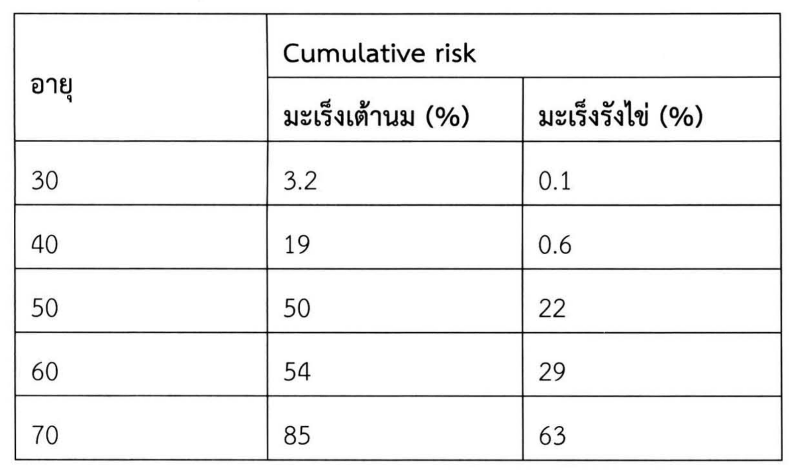

> **Caption (verbatim):** ตารางที่ 10 แสดง cumulative risks ของมะเร็งเต้านมและรังไข่ในผู้ที่มีความผิดปกติของยีน BRCA136
> **Text in image (verbatim):** อายุ · Cumulative risk · มะเร็งเต้านม (%) · มะเร็งรังไข่ (%) · 30 · 3.2 · 0.1 · 40 · 19 · 0.6 · 50 · 50 · 22 · 60 · 54 · 29 · 70 · 85 · 63
> **Description:** Table with a two-row merged header: the first column "อายุ" spans both header rows; the header "Cumulative risk" spans the two right columns, which are sub-headed "มะเร็งเต้านม (%)" and "มะเร็งรังไข่ (%)". Five data rows by age: 30 → 3.2 and 0.1; 40 → 19 and 0.6; 50 → 50 and 22; 60 → 54 and 29; 70 → 85 and 63. Both risks rise with age. Saved as an image because of the merged header cells.
> **Identifiers in image:** none

**ตารางที่ 11 Estimated cumulative risks ของมะเร็งเต้านมอีกข้าง (contralateral breast cancer ; CBC)36**

| อายุ | มะเร็งเต้านมอีกข้าง (%) |
| --- | --- |
| 30-39 | 33 |
| 40-49 | 50 |
| 50-59 | 60 |
| 60-69 | 65 |

<!-- p.290 (printed 276) -->
จากการคำนวณพบว่า RR ต่อการเกิดมะเร็งเต้านมอีกข้างเทียบกับประชากรทั่วไปลดลงตามอายุคือ ในช่วงอายุน้อยกว่า 40 ปี มี RR 200 ในช่วงอายุ 60-69 ปี มี RR 15 เท่าของประชากรทั่วไป

Hartman AR, et al.37 ศึกษาโอกาสการตรวจพบความผิดปกติของยีน BRCA ในกลุ่มมะเร็งเต้านม Triple negative breast cancer (TNBC) 199 คน อายุมากกว่า 18 ปี โดยมี median age ที่ 54 ปี โดยจำแนกเป็นกลุ่มที่มีประวัติครอบครัว ที่จัดเป็นกลุ่มเพิ่มความเสี่ยง คือ มีมะเร็งเต้านมอายุน้อยกว่า 50 ปี หรือมะเร็งรังไข่ในทุกอายุที่เป็นญาติใกล้ชิด (1st, 2nd degree relative) ตรวจพบความผิดปกติของ BRCA 10.6% โดยกลุ่มที่มีประวัติครอบครัวไม่ชัดเจนตรวจพบความผิดปกติ 5.7% กลุ่มที่ไม่มีประวัติครอบครัวตรวจพบ 5.2% จำนวนที่ตรวจพบความผิดปกติของยีน (observed mutation) เปรียบเทียบกับการประมาณจาก Myriad Prevalence table (expected mutation) ในจำนวนที่ตรวจพบความผิดปกติต่อ BRCA ใน TNBC 10.6% เป็น BRCA1  6.5%, BRCA2 4% โดยกลุ่มที่ประวัติครอบครัวชัดเจน estimated mutation 28.3% เป็น BRCA1 21.7%, BRCA2  6.5% ในกลุ่มที่ประวัติครอบครัวไม่ชัดเจน estimated mutation 14.8% เป็น BRCA1 10.2%, BRCA2  4.6% เมื่อแบ่งตามอายุที่วินิจฉัยและประวัติครอบครัวในคนที่วินิจฉัยว่าเป็น TNBC อายุตั้งแต่ 50 ปีขึ้นไป ประวัติครอบครัวไม่ชัดเจน observed mutation 2.3% โดยที่ estimated mutation 2.2% ในคนที่ประวัติครอบครัวชัดเจน observed mutation 19%, estimated mutation 6.4% ในคนที่วินิจฉัยว่าเป็น TNBC อายุน้อยกว่า 50 ปี ที่มีประวัติครอบครัวไม่ชัดเจน observed mutation 9.1%, estimated mutation 4.7% ในคนที่วินิจฉัยอายุน้อยกว่า 50 ปี และมีประวัติครอบครัวที่ชัดเจน observed mutation 36%, estimated mutation 15.9% ซึ่ง TNBC มี mutation rate มากกว่ามะเร็งเต้านมชนิดอื่น 2-3 เท่า ใน TNBC ที่มีความผิดปกติของ BRCA2 จะเกิดมะเร็งเต้านมอายุมากกว่าในคนที่ BRCA1 ผิดปกติ การพิจารณาตรวจ BRCA1 และ BRCA2 ใน TNBC ที่อายุน้อยกว่า 60 ปี จะมี 10% ของคนอายุมากกว่า 60 ปี ที่มีความผิดปกติและไม่ได้ตรวจ เนื่องจากไม่เข้ากับข้อบ่งชี้

<!-- p.291 (printed 277) -->
เนื่องจากการตรวจทางพันธุกรรมมีราคาแพง ผลของการตรวจที่ผิดปกติมีแนวทางที่ต้องปฏิบัติตามมา ก่อนมีการตรวจจึงต้องมีการให้คำปรึกษาที่เป็นประโยชน์ที่ช่วยในการตัดสินใจในการตรวจ มีการคิดรูปแบบต่างๆ เพื่อช่วยในการประเมินผลการตรวจว่ามีโอกาสตรวจพบความผิดปกติมากน้อยเพียงใด เพื่อเป็นข้อมูลช่วยในการตัดสินใจรับการตรวจ ซึ่ง model แต่ละ model ใช้ข้อมูลแตกต่างกันและใช้วิธีทางสถิติในการคำนวณ

Parmigiani G, et al.38 ศึกษาการใช้ 7 models ได้แก่ BRCAPRO, Family History Assessment Tool (FHAT), Finnish, Myriad, National Cancer Institute (NCI), University of Pennsylvania (Penn) และ Yale University ในการประเมินความน่าจะเป็นในการตรวจพบความผิดปกติต่อ BRCA1 และ BRCA2 จาก genetic counseling clinics โดยที่ model ควรแยกระหว่างผลตรวจที่เป็นบวกและลบโดยใช้ c-statistic model ที่มี c-statistic 80% เป็น model ที่ค่อนข้างดีในการใช้ประเมินโอกาสตรวจพบหรือไม่พบความผิดปกติต่อ BRCA1 และ BRCA2 ซึ่งในจำนวน 7 models BRCAPRO มีการประเมินดีที่สุด แต่ทุก models ใช้แยกระหว่างผู้ที่อาจมีผลการตรวจบวกและลบได้ ซึ่งความแตกต่างเกิดขึ้นระหว่าง models และความแตกต่างของ model เดียวกัน แต่คนละ population ในจำนวนที่รับการตรวจ 3342 คน มีผลบวกต่อ BRCA1 332 คน (9.9%) ผลบวกต่อ BRCA2  156 คน (4.6%) คือผลบวกรวม 2 ยีน 14.5%

<!-- p.292 (printed 278) -->
**Guideline for genetic testing**

- ASCO
  1) Age onset of BC ≤50
  2) TNBC and age ≤60
  3) Two or more BC (synchronous, bilateral, MC)
  4) 1st degree relative with BC ≤50 yr
  5) Two relatives on same side of family with BC, Pancreatic cancer
  6) FH, or history of OC, fallopian cancer, primary peritoneal cancer
  7) Male breast cancer
  8) Know mutation carrier in family
- NCI
  1) Age onset of BC ≤50
  2) BC in both breasts
  3) BC and OC
  4) Multiple breast cancers in family
  5) Male BC
  6) Ashkenazi Jewish ethnicity
  7) Know mutation carrier in family
- NICE
  1) 1st degree relative with BC age <40 years
  2) Male BC
  3) 1st degree relative with breast cancer at age <50 years
  4) Two 1st degree relatives or one 1st degree and one second degree relative with BC
  5) 1st or 2nd degree relative with BC, OC
  6) Three 1st or second degree relative with BC
  7) Know mutation carrier in family
- **Austria guideline**
  1) One case of breast cancer before age 35
  2) Two case of breast cancer, at least one of these before and 50\*
  3) Three cases of breast cancer before age 60\*
  4) One case of breast cancer and one case of ovarian cancer
  5) Two cases of ovarian cancer
  6) One case of male breast cancer
  7) Patient with TNBC before age 60 ; if a therapeutic consequence is considered in TNBC patients irrespective of age
  8) Patient with epithelial ovarian cancer\*\*
  9) Presence of BRCA1 or 2 mutation in the family

  \*Bilateral breast cancer counts for two cases of breast cancer

  \*\*This recommendation is also pertinent to patients with cancer of the fallopian tube and primary peritoneal cancer

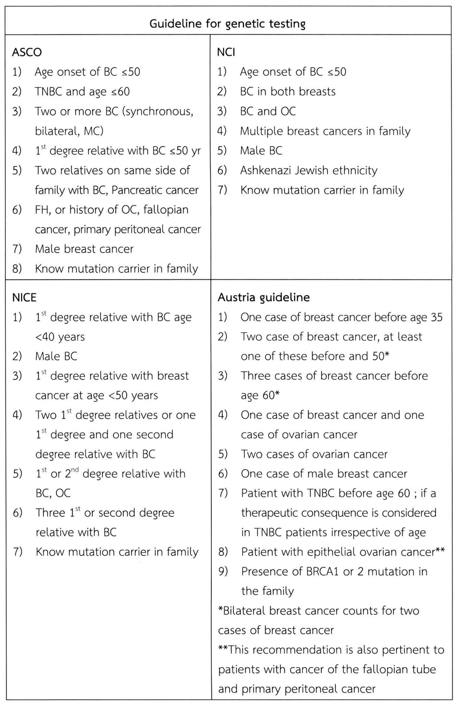

> **Caption (verbatim):** none
> **Text in image (verbatim):** Guideline for genetic testing · ASCO · 1) Age onset of BC ≤50 · 2) TNBC and age ≤60 · 3) Two or more BC (synchronous, bilateral, MC) · 4) 1st degree relative with BC ≤50 yr · 5) Two relatives on same side of family with BC, Pancreatic cancer · 6) FH, or history of OC, fallopian cancer, primary peritoneal cancer · 7) Male breast cancer · 8) Know mutation carrier in family · NCI · 1) Age onset of BC ≤50 · 2) BC in both breasts · 3) BC and OC · 4) Multiple breast cancers in family · 5) Male BC · 6) Ashkenazi Jewish ethnicity · 7) Know mutation carrier in family · NICE · 1) 1st degree relative with BC age <40 years · 2) Male BC · 3) 1st degree relative with breast cancer at age <50 years · 4) Two 1st degree relatives or one 1st degree and one second degree relative with BC · 5) 1st or 2nd degree relative with BC, OC · 6) Three 1st or second degree relative with BC · 7) Know mutation carrier in family · Austria guideline · 1) One case of breast cancer before age 35 · 2) Two case of breast cancer, at least one of these before and 50* · 3) Three cases of breast cancer before age 60* · 4) One case of breast cancer and one case of ovarian cancer · 5) Two cases of ovarian cancer · 6) One case of male breast cancer · 7) Patient with TNBC before age 60 ; if a therapeutic consequence is considered in TNBC patients irrespective of age · 8) Patient with epithelial ovarian cancer** · 9) Presence of BRCA1 or 2 mutation in the family · *Bilateral breast cancer counts for two cases of breast cancer · **This recommendation is also pertinent to patients with cancer of the fallopian tube and primary peritoneal cancer
> **Description:** Full-page boxed table with no table number. A title row "Guideline for genetic testing" spans the full width; below it the box is divided into a 2 × 2 grid of cells, each listing numbered criteria for genetic testing from one guideline: top-left ASCO (8 criteria), top-right NCI (7 criteria), bottom-left NICE (7 criteria), bottom-right Austria guideline (9 criteria followed by two footnotes marked * and ** that explain the asterisks in criteria 2, 3 and 8). Saved as an image because the box layout (spanning title row and grid of list cells) does not fit a Markdown table.
> **Identifiers in image:** none

<!-- p.293 (printed 279) -->
## แนวทางการปฏิบัติเมื่อผลการตรวจมีความผิดปกติต่อ BRCA

เนื่องจากความเสี่ยงต่อการเป็นมะเร็งเต้านมและรังไข่สูง โดยความผิดปกติของ BRCA1 มี life time risk ต่อการเกิดมะเร็งเต้านม 70-86%, มะเร็งรังไข่ 42-63% ความผิดปกติจาก BRCA2 มีโอกาสเกิดมะเร็งเต้านม 84% มะเร็งรังไข่ 27% จึงควรมีการแนะนำผู้ป่วยในแนวทางการป้องกันหรือเฝ้าระวัง ซึ่งมีข้อควรพิจารณาดังนี้

- การเฝ้าระวัง
- การผ่าตัดเต้านมในกรณีที่ไม่เคยเป็นมะเร็งเต้านม
- การผ่าตัดเต้านมป้องกันมะเร็งของอีกข้างเมื่อวินิจฉัยว่าพบมะเร็งเต้านมแล้ว
- การผ่าตัดรังไข่เพื่อป้องกันมะเร็งรังไข่และมะเร็งเต้านม

**ตารางที่ 12** Screening and Treatment Guidelines for Carriers of BRCA1 or BRCA2 Mutations

| Type of Screening or Therapy | NCCN (United States) | NICE (United Kingdom) | eviQ Cancer Treatments Online(Australia) |
| --- | --- | --- | --- |
| Mammography | Recommended annually at 30-75 yr of age, or younger if woman in family has received breast-cancer diagnosis before 25 yr of age and MRI is not available | Recommended for consideration annually at 30-39 yr of age ; recommended once yearly at 40-69 yr of age and every 3 yr at ≥70 yr of age | For BRCA1 carriers, recommended annually at 30-50 yr of age, with or without ultrasonography For BRCA2 carriers, recommended annually at 30-50 yr of age, with or without ultrasonography ; at >50 yr of age, mammography recommended annually, with or without ultrasonography, with clinical breast examination ; if diagnosis in family member <35 yr of age, may recommend individualized schedule |

<!-- p.294 (printed 280) -->
*(ตารางที่ 12 continued; the header row is not reprinted on this page and is repeated below from p.293)*

| Type of Screening or Therapy | NCCN (United States) | NICE (United Kingdom) | eviQ Cancer Treatments Online(Australia) |
| --- | --- | --- | --- |
| MRI | Recommended annually at 25-75 yr of age, but earlier if younger age of onset in any family member | Recommended annually at 30-49 yr of age unless breast density is high, in which case should be continued until 70 yr of age | For BRCA1 carriers, recommended annually at 30-50 yr of age, with or without ultrasonography For BRCA2 carriers, recommended annually at 30-50 yr of age, with or without ultrasonography ; at >50 yr of age, mammography recommended annually, with or without ultrasonography, with clinical breast examination ; if diagnosis in family member <35 yr oa age, individualized schedule may be recommended |
| Preventive mastectomy | No definitive guideline, but "degree of protection and risks" should be discussed | No definitive guideline, but discussions of potential benefits of surgery should take current age into account | If performed, recommended at ≤40 yr of age |
| Preventive oophorectomy | If performed, recommended between 35 and 40 yr of age | No guideline | If performed, recommended at ≤40 yr of age |
| Chemoprevention | No clear directive | Provision of tamoxifen recommended for women at high risk of breast cancer, but BRCA1 vs. BRCA2 status not discussed | Recommendation to consider with professional on individualized basis |

<!-- p.295 (printed 281) -->
การเฝ้าระวังในกรณีที่ผู้ตรวจพบความผิดปกติไม่ต้องการทำการผ่าตัดป้องกันมะเร็งเต้านมและรังไข่ เนื่องจากความเสี่ยงในการเกิดโรคสูง การใช้โปรแกรมการคัดกรองเหมือนประชากรทั่วไปทำให้ตรวจพบโรคเมื่อเป็นระยะหลังกว่าที่ควรจะเป็น โปรแกรมการคัดกรองของประชากรทั่วไปคือ เริ่มทำ screening mammography อายุ 40, 45 ปี ทุกปี (ในอเมริกา), เริ่มอายุ 50 ปี (ในยุโรป) และทำปีเว้นปีจนอายุ 70-72 ปี และทำ CBE (clinical breast examination) ทุกปี (ในอเมริกา) สำหรับการเฝ้าระวังในกลุ่มที่มีความผิดปกติต่อ BRCA1, 2 เริ่ม CBE อายุ 25 ปี ปีละ 2 ครั้ง ทำอัลตราซาวน์และ MRI อายุ 25 ปี ปีละครั้ง เริ่มทำ mammography อายุ 30 ปี โดยอาจทำทุก 12 เดือน พร้อม MRI หรือทำสลับกันทุก 6 เดือน อายุที่เริ่มตรวจด้วย US หรือ MRI และ CBE อาจน้อยกว่า 25 ปี โดยใช้อายุของคนในครอบครัวที่น้อยที่สุดที่เป็นมะเร็งและเริ่มทำการตรวจก่อนนั้น 5 ปี การใช้ MRI ร่วมด้วยเนื่องจาก mammography และ ultrasound มี sensitivity ในกลุ่มที่มีความผิดปกติของ BRCA เพียง 40% เทียบกับ MRI 81%39-42

มีการศึกษาหลายการศึกษาเกี่ยวกับการผ่าตัดป้องกันมะเร็งเต้านม Domchek SM, et al.43 ศึกษาการผ่าตัดป้องกัน Risk reducing mastectomy (RRM), risk reducing salpingo-oophorectomy (RRSO) เทียบกับกลุ่มที่ไม่ได้ทำผ่าตัด (control) โดยติดตามหลังผ่าตัด 3.65 ปี, 4.29 ปี ในกลุ่ม control โดย RRM 247 ราย ทำอายุเฉลี่ย 40 ปี ใน BRCA1, 42 ปีใน BRCA2 กลุ่ม control 1372 ราย ในกลุ่ม RRM ไม่พบมะเร็งเต้านม แต่กลุ่ม control พบ 7% ในกลุ่มที่ทำ RRM 70% ทำ RRSO ด้วย ในกลุ่ม control ทำ RRSO 57% สัดส่วนของความผิดปกติ BRCA1 มากกว่าในกลุ่มที่ทำ RRSO ร่วมด้วย คือ 67% BRCA1, 33% BRCA2 ในกลุ่มที่ทำ RRM เพียงอย่างเดียว BRCA1 57%, BRCA2 43% ในกลุ่มที่ทำ RRM พบ occult breast cancer 0.4% มี 939 ราย ทำ RRSO เทียบกับกลุ่ม control 1678 ราย โดยกลุ่มที่ทำ RRSO พบ BRCA1 73%, BRCA2 27% พบ occult ovarian cancer ในกลุ่มที่เป็นมะเร็งเต้านม 0.1% ในกลุ่มที่ไม่เป็นมะเร็งเต้านม 0.5%

กลุ่มที่ไม่เป็นมะเร็งเต้านมและทำ RRSO พบว่าลดโอกาสเกิดมะเร็งรังไข่ใน BRCA1 69% (HR 0.31) ใน BRCA2 ไม่พบมะเร็งรังไข่เทียบกับ control 3% ในผู้ป่วยมะเร็งเต้านมที่ทำ RRSO พบว่าลดการเกิดมะเร็งรังไข่ 85% (HR 0.15)

นอกจาก RRSO ลดมะเร็งรังไข่แล้วยังลดการเกิดมะเร็งเต้านมด้วย โดยลดการเกิดมะเร็งเต้านมใน BRCA1 37% (HR 0.63) กลุ่มที่ทำ RRSO พบมะเร็งเต้านม 14%

<!-- p.296 (printed 282) -->
เทียบกับกลุ่ม control 20% ใน BRCA2 ลดการเกิดมะเร็งเต้านม 63% (HR 0.36) พบมะเร็งเต้านม 7% เทียบกับ control 23% ในกลุ่ม BRCA1 ลดการเกิดมะเร็งเต้านม 49% (HR 0.51) ถ้าทำ RRSO ก่อนอายุ 50 ปี ถ้าทำ RRSO หลังอายุ 50 ปี ไม่ลดการเกิดมะเร็งเต้านม (HR 1.36) นอกจากนี้ ในกลุ่มที่เป็นมะเร็งเต้านมแล้ว RRSO ไม่ลดการเกิดมะเร็งเต้านมอีกข้าง (contralateral breast cancer (CBC)) อายุที่ทำ RRSO ในกลุ่มที่ไม่เป็นมะเร็งเต้านม 43 ปี (BRCA1 อายุ 42 ปี, BRCA2 อายุ 46 ปี) กลุ่มที่เป็นมะเร็งเต้านมทำ RRSO อายุ 47 ปี (BRCA1 อายุ 44 ปี, BRCA2 อายุ 49 ปี)

นอกจากผลการลดการเกิดมะเร็งแล้ว การลดอัตราการเสียชีวิตจากการทำ RRSO ก็มีส่วนสำคัญในการให้ข้อมูลเพื่อประโยชน์ในการตัดสินใจทำ พบว่า RRSO ในคนที่ไม่เป็นมะเร็งมาก่อน ลด mortality 55% (HR 0.45) ในกลุ่ม BRCA1 ลด 62% (HR 0.38) ในกลุ่ม BRCA2 ลด 48% (HR 0.52) ซึ่งในกลุ่ม BRCA2 การลด mortality ไม่แตกต่างอย่างมีนัยสำคัญ (อัตราการเสียชีวิตในกลุ่ม BRCA2 ไม่มากนัก) ในกลุ่มที่เป็นมะเร็งเต้านมก่อน RRSO ลด mortality 70% (HR 0.3) โดยลด breast cancer specific mortality HR 0.44, ovarian cancer specific mortality HR 0.24 ในกลุ่ม BRCA1 RRSO ลด breast cancer specific mortality HR 0.38, ovarian cancer specific mortality HR 0.25

Skytte AB44 ทำการศึกษาในผู้ที่มีความผิดปกติต่อ BRCA ที่ไม่เป็นมะเร็ง 307 ราย โดย 96 รายทำ RRM 251 เป็นกลุ่ม control พบว่าในกลุ่มที่ทำ RRM 70% ทำ RRSO ร่วมด้วย ในกลุ่มที่ไม่ทำ RRM 42% ทำ RRSO โดย 67% ทำ RRM อายุ <40 ปี ในกลุ่มที่ทำ RRM อายุที่ทำ RRSO 39 ปี กลุ่มที่ไม่ทำ RRM ทำ RRSO อายุ 43 ปี พบ occult breast cancer 1% เกิดมะเร็งเต้านมหลังทำ RRM 3 ราย ปีที่ 2, 5 และ 7 RRM เกิดมะเร็งเต้านม 0.8%/person-year, กลุ่ม control เกิด 1.7%/person-year BRCA1 พบมะเร็งเต้านม 1.1%/ปี หลังทำ RRM ทุกรายเป็น TNBC BRCA2 ไม่พบมะเร็งเต้านมหลังทำ RRM ลดมะเร็งเต้านม 61% (HR 0.3%)

Hanne MH45, et al. ทำการติดตามผู้ที่ทำ RRM 76 ราย และกลุ่ม control 63 ราย โดยทุกรายที่ทำ RRM มีการทำ CBE, mammography, MRI ภายใน 3 เดือนก่อนผ่าตัด ในกลุ่มที่ทำ RRM ทำ RRSO ร่วมด้วย 58% เทียบกับ 38% ในกลุ่ม control ติดตามหลังทำ RRM 2.9 ปี กลุ่ม control 3 ปี ไม่พบ occult breast cancer ในกลุ่ม RRM 65% ของคนที่ทำ RRM อายุน้อยกว่า 40 ปี 14% อายุน้อยกว่า 30 ปี อายุเฉลี่ยคือ 37 ปี

<!-- p.297 (printed 283) -->
โดยกลุ่ม RRM เป็น BRCA1 84% BRCA2 16% หลังทำ RRM ไม่พบมะเร็งเต้านม แต่กลุ่ม control พบ 2.5%/ปี cumulative risk ที่ 5 ปี คือ 24 ± 9% ในกลุ่ม surveillance พบ interval cancer 50%

Rebbeck TR, et al.46 ทำ RRM 105 ราย surveillance 378 ราย กลุ่ม RRM ทำ RRSO ร่วมด้วย 44% กลุ่ม surveillance ทำ RRSO 19% อายุที่ทำ RRM คือ 38 ปี ในกลุ่มที่ทำ RRSO, 35.4 ปี ในกลุ่มที่ทำเพียง RRM พบมะเร็งเต้านมในกลุ่ม RRM 1.9% เทียบกับ 48.7% ในกลุ่ม surveillance โดยกลุ่ม RRM ติดตามหลังผ่าตัด 5.5 ปี กลุ่ม surveillance 6.7 ปี ในกลุ่ม RRM เป็น BRCA1 78.4% BRCA2 21.6% การทำ RRM ร่วมกับ RRSO ลดการเกิดมะเร็งเต้านม 95% ถ้าทำเพียง RRM ลดการเกิดมะเร็งเต้านม 91% (HR 0.05 และ 0.09)

Kaas R47, et al. ติดตามหลังทำ RRM 147 ราย (BRCA1 68%, BRCA2 32%) โดยทำ RRSO ร่วมด้วย 54% อายุที่ทำ RRM ใน BRCA1 คือ 37.4 ปี BRCA2 39.6 ปี อายุที่ทำ RRM น้อยกว่า 40 ปี ใน BRCA1 62% BRCA2 57% พบ occult breast cancer 4% ใน BRCA1 และ 4.3% ใน BRCA2 ในกลุ่มที่ทำ RRSO พบ occult ovarian cancer 3.8% พบ ovarian cancer หลังทำ RRSO 1.2%

Ingham SL, et al.48 ศึกษา 691 ราย ที่ตรวจพบความผิดปกติของ BRCA1 และ 2 โดย 71 รายทำ RRM ในจำนวนนี้ 59% ทำ RRSO ร่วมด้วย ในกลุ่ม BRCA1 พบมะเร็งเต้านม 42% จากการ surveillance ไม่พบเลยใน RRM, พบ 14% ในกลุ่มที่ทำ RRSO และ 2.4% ในกลุ่มที่ทำทั้ง RRM, RRSO พบ occult breast cancer จากการทำ RRM 2.8% พบมะเร็งรังไข่ในกลุ่ม surveillance, RRM, RRSO และกลุ่มที่ทำทั้ง RRM และ RRSO คือ 11.9%, 3.4%, 3.4% และ 0% ตามลำดับ โดยพบ occult ovarian cancer 1% กลุ่ม BRCA1 ที่ surveillance เทียบกับ RRSO, RRM และทำทั้ง RRM และ RRSO มี mortality 18% เทียบกับ 2%, 0% และ 2.5% ตามลำดับ

ใน BRCA2 ที่ทำ surveillance เทียบกับ RRM, RRSO และทำทั้ง RRM และ RRSO เกิดมะเร็งเต้านม 45% เทียบกับ 3.4%, 19% และ 0% ตามลำดับ และพบ occult breast cancer 5.5% โดย mortality ระหว่างกลุ่ม surveillance, RRM, RRSO และทำทั้ง RRM และ RRSO คือ 13%, 0%, 6% และ 0% ตามลำดับ อายุเฉลี่ยที่เสียชีวิตในกลุ่ม surveillance เทียบกับกลุ่มที่ทำการผ่าตัด คือ 51.7 ปี และ 58.8 ปี ตามลำดับ

<!-- p.298 (printed 284) -->
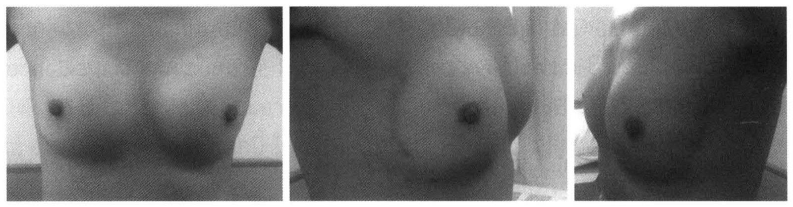

> **Caption (verbatim):** รูปที่ 9 RRM reconstruction with implant
> **Text in image (verbatim):** none
> **Description:** Three grayscale clinical photographs side by side of a woman's chest after risk reducing mastectomy (RRM) with implant reconstruction, cropped from below the neck to the lower chest (no face shown). Left: frontal view of both reconstructed breasts with nipples present and symmetric rounded contour. Middle: oblique view showing one reconstructed breast with nipple and rounded projection. Right: lateral view of a reconstructed breast showing its projection and nipple. No arrows or labels.
> **Identifiers in image:** none

**ตารางที่ 13** แสดงอัตราการมีชีวิตเมื่อ 10 และ 20 ปี

|  | 10 year-survival (%) | 20 year-survival (%) | HR |
| --- | --- | --- | --- |
| RRM + RRSO | 98.3 | 98.3 | 0.14 |
| RRSO | 98.2 | 98.2 | 0.22 |
| RRM | 98.1 | 98.1 | 0.25 (N5) |
| Surveillance | 84.3 | 75.5 |  |
| BRCA1 RRM, RRSO | 98.9 | 98.9 | 0.12 |
| BRCA2 RRM, RRSO | 98 | 98 | 0.34 |
| BRCA1 Surveillance | 81.2 | 72.8 |  |
| BRCA2 Surveillance | 87.2 | 78.4 |  |

Heemskerk-Gerritsen BAM, et al.49 ติดตามกลุ่ม surveillance 358 ราย และกลุ่มที่ทำ RRM 212 ราย เป็น BRCA1 74% BRCA2 26% อายุที่ทำ RRM 34 ปี ใน BRCA1 และ 37 ปี ใน BRCA2 กลุ่ม RRM ทำ RRSO ร่วมด้วย 54% กลุ่ม surveillance 38% อายุที่ทำ RRSO 40 ปี ในกลุ่มที่ทำ RRM และ 47 ปี ในกลุ่ม surveillance พบมะเร็งเต้านม 16% ในกลุ่ม surveillance 0% ในกลุ่ม RRM พบ occult breast cancer 2.8% โดยมี 10 year breast cancer free survival 100% ใน RRM เทียบกับ 74% ในกลุ่ม surveillance การทำ RRM ลด mortality 71% (HR 0.29) ในกลุ่ม surveillance BRCA1 พบมะเร็งเต้านม 20% BRCA2 1% โดยเป็นระยะ 0-1 72% และ 100% ตามลำดับ พบ TNBC ใน BRCA1 64% BRCA2 17% interval cancer พบใน BRCA1 10% BRCA2 0%

<!-- p.299 (printed 285) -->
**ตารางที่ 14** Risk Reducing Mastectomy (RRM) for women with BRCA1, BRCA2 mutation

|  | RRM No / control | Age at RRM (year) | Occult BC | RRM and RRSO | BC incidence | Outcome (survival, mortality) |
| --- | --- | --- | --- | --- | --- | --- |
| Domchek SM43 | 247/1372 BRCA1 67% BRCA2 33% | BRCA1, 40 BRCA2, 42 | 0.4% | 70% (control 57%) | 0% (control 7%) |  |
| Skytte AB44 | 96/112 BRCA1 69% | 67% age <40 | 1% | 70% (control 42%) | 0.8% / person year (control 1.7% HR 0.39) |  |
| Hanne HM45 | 76/63 BRCA1 84% | 37 | 0% | 58% (control 38%) | 0% (control 24% in 5 yr) |  |
| Rebbeck TR46 | 105/378 BRCA1 78.4% | 38 |  | 44% (control 19%) | 1.9% (control 48.7%) HR RRSO 0.05, RRSO 0.09 |  |
| Kaas R47 | 147 BRCA1 68% | BRCA1, 40 BRCA2, 47 | 3.8% | 54% |  |  |
| Ingham SL48 | 126/457 BRCA1 56% | BRCA1, 34.4 BRCA2, 37.4 | 3.9% BRCA1, 2.8% BRCA2, 5.5% | 59% (BRCA1) 47% (BRCA2) | 1.6% (control 44.2%) | 20 yr survival RRM 98.1% (NS) HR 0.25 RRM+RRSO 98.3% HR 0.14 |
| Heemskerk-Gerritsen BA49 | 212/358 | BRCA1, 34 BRCA2, 37 | 2.8% | 54% (control 38%) | 0% (control 16%) | BC-mortality HR 0.29 |

<!-- p.300 (printed 286) -->
**ตารางที่ 15** Risk Reducing Salpingo-Oophorectomy (RRSO) for women with BRCA1, BRCA2 mutation

|  | RRSO | Age at RRSO (year) | Occult OC | OC in cadence | BC incidence | Outcome (survival, mortality) |
| --- | --- | --- | --- | --- | --- | --- |
| Domchek SM43 | 939/1678 BRCA1 73% | BRCA1, 42 BRCA2, 46 | 0.4% | 2% (control 6%) HR 0.31 | 14% (control 20%) HR 0.51 (before age 50) | BC-specific mortality HR 0.44 OC-specific mortality HR 0.24 |
| Kaas R47 | 80 | BRCA1, 40.9 BRCA2, 47 | 3.8% | 1.2% |  |  |
| Ingham SL48 | 176/457 BRCA1 55.6% | 34.4±4.77 | 0.57% | 1.1% (control 8.3%) | 16.7% (1.5% RRM) | 20yr-survival 98.2% HR 0.22 |
| Kauff ND50 | 509/283 BRCA1 64% | 47.1 |  | 0.6% (control 4.2%) HR 0.12 | 3.1% (control 9.5%) HR 0.53 |  |

## อุบัติการณ์ของ CBC ใน BRCA1, 2 mutation และประโยชน์ของ CPM (Contralateral Prophylactic Mastectomy)

อุบัติการณ์ขึ้นกับประวัติครอบครัว ในกรณีมี 1st degree relative เป็นมะเร็งเต้านมอายุน้อยกว่า 40 ปี การเกิด CBC ที่ 25 ปี ของ BRCA1 คือ 62.9% BRCA2 63% ถ้า 1st degree เป็นมะเร็งเต้านมอายุน้อยกว่า 50 ปี BRCA1 และ BRCA2 จะพบ CBC 19% และ 16.7% ตามลำดับ51 อายุเมื่อวินิจฉัยว่าเป็นมะเร็งเต้านมช่วยบอกโอกาสเกิด CBC ถ้าเป็นก่อน 30 ปี เกิด CBC 61% เป็นหลัง 50 ปี เกิด CBC 19% ถ้าเป็นมะเร็งเต้านมอายุน้อยกว่า 50 ปี และมี 1st degree relative เป็นมะเร็งเต้านมอายุน้อยกว่า 50 ปี 0, 1 และ ≥2 คน จะมี CBC ที่ 15 ปี คือ 33.4%, 39.1% และ 49.7% ตามลำดับ52
