# เต้านม (The Breast) — part 2 of 3

## Contents of this file
- การดำเนินโรคและผลการรักษามะเร็งเต้านมใน BRCA1, 2 mutation (p.301)
- การวินิจฉัยมะเร็งเต้านม (p.302)
  - Mammography (p.309)
  - Ultrasonography (p.310)
  - MRI (p.321)
- BI-RADS categories (p.322)
- การผ่าตัดมะเร็งเต้านมในอดีต (p.328)
- การเริ่มนำ sentinel lymph node biopsy มาใช้กับต่อมน้ำเหลือง internal mammary และภาวะแทรกซ้อน (p.334)
- ความเปลี่ยนแปลงของ staging ของ breast cancer จากอดีตถึงปัจจุบัน (p.335)
- ผลของการประเมินต่อมน้ำเหลือง IMN ต่อการรักษา (p.336)
- ผลการรักษาเมื่อมีการวินิจฉัยการกระจายไปต่อมน้ำเหลือง internal mammary ในปัจจุบัน ซึ่งมีการใช้รังสีรักษาและเคมีบำบัดมากขึ้นเทียบกับในอดีต (p.336)
- การผ่าตัดรักษามะเร็งเต้านม (p.338)

<!-- p.301 (printed 287) -->
การทำ CPM ลด mortality HR 0.5253 ในคนที่มี CBC จะเพิ่ม mortality HR 2.17 บางการศึกษารายงานการลด mortality ขึ้นอยู่กับการทำ RRSO HR 0.23 การทำ CPM ไม่ลด mortality แต่ถ้าทำร่วมกับ RRSO HR 0.12 (Sig.)54 โดย CPM ลดการเกิด CBC (0.6%-1% เทียบกับ 33%-46%)53, 54

การใช้ tamoxifen ช่วยลดการเกิด CBC ใน BRCA1 OR 0.5 BRCA2 0.42 แต่ผลการป้องกันของ tamoxifen ในคนที่ทำ RRSO ร่วมด้วย ไม่ชัดเจน (OR 0.83)55

มีการศึกษาถึง life expectancy (LE) gains ในผู้ที่เป็นมะเร็งเต้านมระยะแรก อายุ 30 ปี ที่ได้รับ tamoxifen พบ LE 0.4-1.3 ปี, RRSO 0.2-1.8 ปี, CPM 0.6-2.1 ปี56

## การดำเนินโรคและผลการรักษามะเร็งเต้านมใน BRCA1, 2 mutation

Brekelmans CTM, et al.57 ศึกษาผู้ที่เป็นมะเร็งเต้านมที่มี BRCA1 mutation 223 ราย BRCA2 mutation 103 ราย และ sporadic case 311 ราย พบว่า screening mammography วินิจฉัย BRCA1, 2 ได้ 17% และ 15% ตามลำดับ ใน sporadic case 38% วินิจฉัยโดย mammography ขนาดของก้อนไม่แตกต่างกัน โดยประมาณ 2.2-2.5 เซนติเมตร ใน BRCA1 ไม่พบการกระจายไปต่อมน้ำเหลือง 63% BRCA2 43% พบ grade III ใน BRCA1 88% BRCA2 65%, CBC BRCA1 และ 2 คือ 3.1%/ปี ใน non-BRCA mutation 1%/ปี และใน sporadic 0.7%/ปี ใน BRCA1 และ 2 พบมะเร็งรังไข่ 0.7%/ปี ใน non BRCA mutation พบ 0.1%/ปี

**ตารางที่ 16** เปรียบเทียบผลการรักษามะเร็งเต้านม

|  |  | **BRCA1** | **BRCA2** | **Non-BRCA mutation** | **Sporadic** |
| --- | --- | --- | --- | --- | --- |
| 10-year (%) | BCT LR | 16 | 17 | 15 | 21 |
|  | CBC | 25 | 20 | 6 | 5 |
|  | DOFS | 60 | 61 | 61 | 50 |
|  | BCSS | 62 | 68 | 70 | 59 |

<!-- p.302 (printed 288) -->
โดย BRCA2 มี tumor characteristics ไม่แตกต่างจาก non-BRCA และ sporadic case ยกเว้นมี CBC มากกว่า ปัจจัยที่มีผลต่อ BC-specific survival ใน BRCA mutation คือ tumor stage, adjuvant chemotherapy, ER status, RRSO

โดยสรุปแล้ว ในประชากรทั่วไปจะตรวจพบ BRCA1, 2 mutation 0.1-0.3% ข้อบ่งชี้ในการตรวจของแต่ละประเทศมีความใกล้เคียงกันคือ อาศัยประวัติครอบครัว models ต่างๆ ก็ช่วยในการประเมินผลการตรวจ ซึ่งช่วยในการให้คำแนะนำโดยการประเมินความเป็นไปได้ในการตรวจพบ >10% ในแต่ละ models จะช่วยเลือกจำนวนที่จำเป็นในการตรวจ เนื่องจากค่าใช้จ่ายค่อนข้างสูง แต่ผลการตรวจที่เป็นลบมีข้อเสียเพียงเสียค่าใช้จ่าย แต่ช่วยในการลดความกังวลในกรณีตรวจครอบคลุมทุกยีน ก็ไม่จำเป็นต้องทำการ surveillance ทำ screening เหมือนประชากรทั่วไป เนื่องจากความเสี่ยงต่อการเกิดมะเร็งเต้านมไม่แตกต่างจากประชากรทั่วไป ในกลุ่มที่ผลเป็นบวกควรแนะนำทางเลือก เช่น surveillance, RRM, RRSO ซึ่งช่วยลดอุบัติการณ์และอัตราการเสียชีวิตจากมะเร็งเต้านมและรังไข่

## การวินิจฉัยมะเร็งเต้านม

ประกอบด้วยการซักประวัติตรวจร่างกาย การส่งตรวจทางรังสีวินิจฉัย และการตรวจชิ้นเนื้อ การซักประวัติเพื่อประเมินปัจจัยเสี่ยง ว่าเป็นกลุ่มที่มีปัจจัยเสี่ยงเท่าคนทั่วไปหรือมากกว่า ซึ่งมีผลต่อการเลือกส่งตรวจทางรังสีวินิจฉัย เช่น การซักประวัติ และอาศัยการคำนวณปัจจัยเสี่ยงโดย breast cancer risk assessment tool แล้วพบว่ามี life time risk มากกว่า 20% ก็ควรส่งตรวจ MRI เพิ่มเติมเนื่องจากมี sensitivity ดีกว่า mammography และ ultrasonography โดยทั่วไปมะเร็งเต้านมถ้าแบ่งตามประวัติครอบครัวเป็น sporadic breast cancer 65-75% Familial breast cancer 20-30% กลุ่ม familial breast cancer คือกลุ่มที่มีประวัติครอบครัวไม่ชัดเจน และตรวจ genetic testing แล้ว negative กลุ่มสุดท้ายคือ กลุ่ม Hereditary breast cancer 5-10% ของ breast cancer คือประวัติครอบครัวชัดเจนและตรวจ genetic testing positive ซึ่งประมาณ 80% มีความผิดปกติของ BRCA1 (โครโมโซมที่ 17), BRCA2 (โครโมโซมที่ 13) ที่เหลือเป็น Syndrome เช่น P53 (Li – Fraumeni syndrome) ประมาณ 1% และ syndrome อื่นๆ อีกน้อยกว่า 1% ถ้าซักประวัติแล้วเป็นกลุ่ม sporadic การตรวจและรักษามะเร็งก็ทำตามขั้นตอนแต่ถ้ามีประวัติครอบครัวอาจต้องพิจารณาเรื่อง genetic testing การป้องกันมะเร็งเต้านมอีกข้าง และการป้องกันหรือตรวจมะเร็งที่อวัยวะอื่นที่อาจพบร่วมด้วยในความผิดปกติของ gene นั้น

<!-- p.303 (printed 289) -->
การตรวจร่างกายเพื่อวินิจฉัยมะเร็งเต้านมหรือเรียกว่า clinical breast examination (CBE) มีประโยชน์เพื่อวินิจฉัยเบื้องต้นว่าลักษณะที่พบเหมือนมะเร็งหรือไม่ นอกจากนี้ยังพบว่า 2-4% ของผู้ที่ตรวจไม่พบความผิดปกติใน mammography หรือ ultrasonography อาจตรวจพบมะเร็งเต้านมได้จากการทำ CBE สำหรับ breast self examination (BSE) ซึ่งทำโดยผู้ป่วยเองยังไม่พบว่าสามารถวินิจฉัยมะเร็งเต้านมได้ในระยะเริ่มต้นเท่าการตรวจ CBE และ mammography ซึ่งโดยทั่วไปก้อนที่ผู้ป่วยคลำพบและมาพบแพทย์มักจะมากกว่า 2 เซนติเมตร แต่ก้อนที่ทำ CBE มักจะมีขนาดน้อยกว่า 2 เซนติเมตร

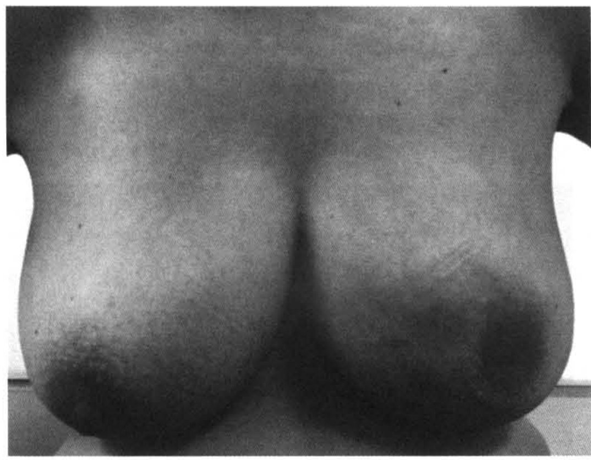

> **Caption (verbatim):** **รูปที่ 10** ท่านั่งดูขนาดเต้านม, ระดับหัวนมไม่เท่ากันและมี nipple retraction
> **Text in image (verbatim):** none
> **Description:** Black-and-white clinical photograph, frontal view of a woman's chest in the sitting position, from the upper chest to below the breasts (no face shown). Both breasts are large and pendulous. The two breasts and nipple-areola complexes sit at different levels; the right side of the image shows a breast whose lower half is darker in tone with fine skin creases above it, and its nipple is not seen projecting (consistent with the caption's nipple retraction). Illustrates inspection of breast size, nipple level asymmetry and nipple retraction.
> **Identifiers in image:** none

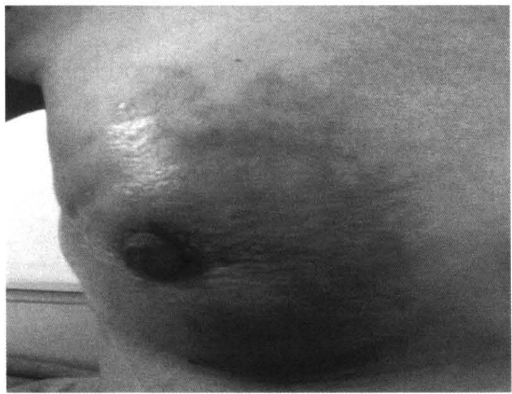

> **Caption (verbatim):** **รูปที่ 11** Nipple retraction, peaud’ orange, skin redness > %30 (inflammatory breast cancer)
> **Text in image (verbatim):** none
> **Description:** Black-and-white close-up clinical photograph of one breast seen obliquely from the side. The skin over most of the breast is darker (corresponding to the redness in the caption) with a mottled, pitted texture (peau d'orange) and a shiny area in the upper part; the nipple is flattened/drawn in (retracted) with skin folds running from it. Illustrates the caption's features of inflammatory breast cancer: nipple retraction, peau d'orange and skin redness over more than 30% of the breast.
> **Identifiers in image:** none

<!-- p.304 (printed 290) -->
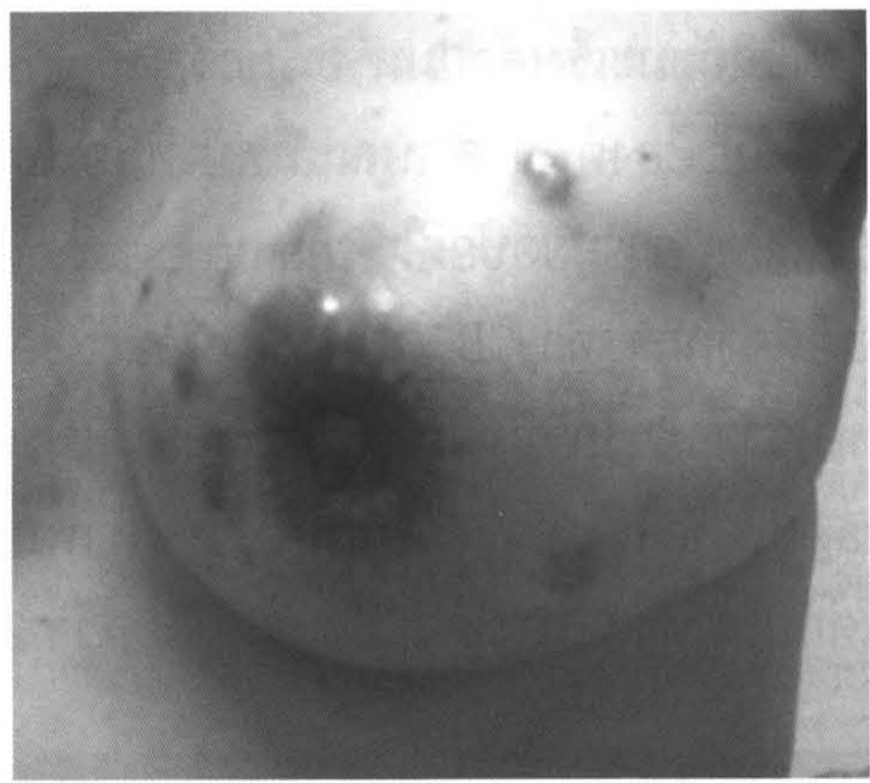

> **Caption (verbatim):** **รูปที่ 12** Nipple retraction, satellite nodules
> **Text in image (verbatim):** none
> **Description:** Black-and-white clinical photograph of one breast seen from the front and slightly below, with a strong light reflection in the upper part. The nipple-areola area is a large dark irregular patch with no projecting nipple (retracted). Several small dark spots/nodules are scattered in the skin around it, at the upper left edge, along the left lower border of the breast and one below-right of the areola (the satellite nodules of the caption). A small raised bright spot is seen in the upper skin of the breast.
> **Identifiers in image:** none

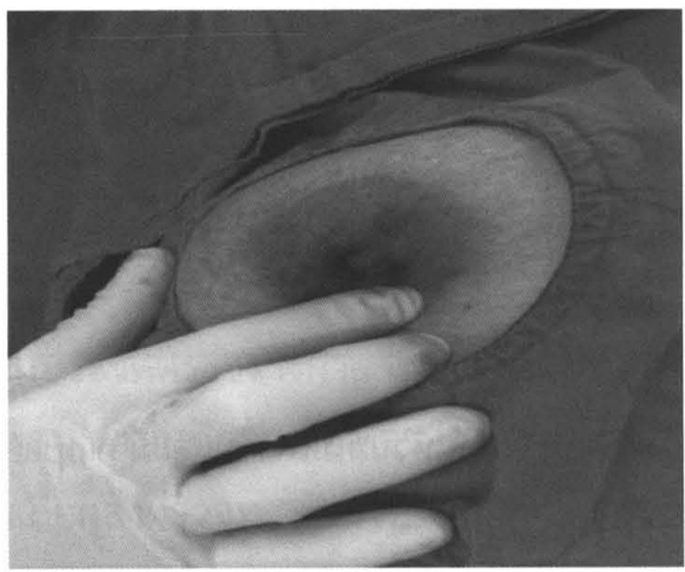

> **Caption (verbatim):** **รูปที่ 13** กดบริเวณ quadrant ที่มี lesion จะพบ bloody nipple discharge
> **Text in image (verbatim):** none
> **Description:** Black-and-white clinical photograph of a breast exposed through an opening in a dark drape/gown. An examiner's hand (fingers spread, coming from the lower left) presses on the lower part of the breast below the areola, demonstrating compression of the quadrant containing the lesion to elicit nipple discharge. The areola is a darker area at the centre of the exposed breast; no discharge is clearly distinguishable in the black-and-white photo.
> **Identifiers in image:** none

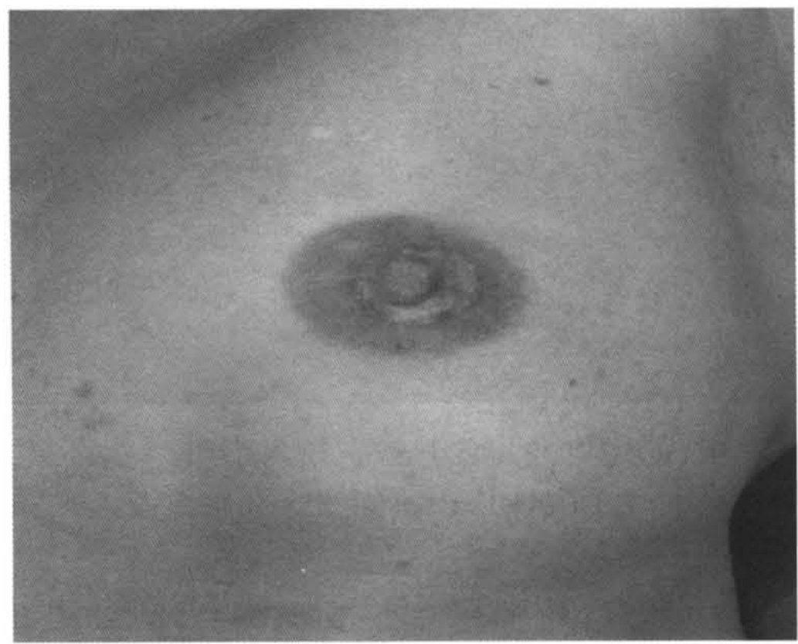

> **Caption (verbatim):** **รูปที่ 14** Scaly nipple areolar (Paget’s disease of nipple)
> **Text in image (verbatim):** none
> **Description:** Black-and-white close-up clinical photograph of the chest skin centred on one nipple-areola complex. The areola is an oval darker area; the nipple at its centre has a paler, rough, scaly/crusted surface with a light rim around it, illustrating the scaly nipple-areola change of Paget's disease of the nipple as stated in the caption. Surrounding breast skin appears otherwise unremarkable.
> **Identifiers in image:** none

<!-- p.305 (printed 291) -->
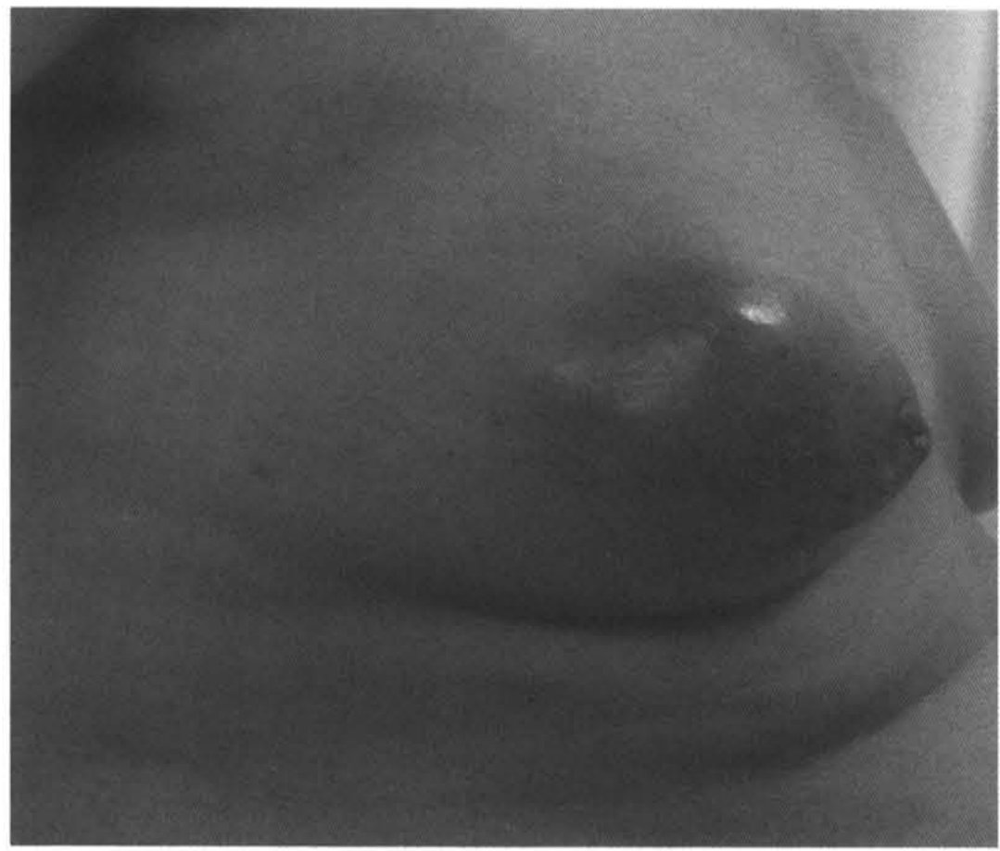

> **Caption (verbatim):** **รูปที่ 15** breast cancer ก้อนลักษณะคล้าย breast abscess
> **Text in image (verbatim):** none
> **Description:** Black-and-white close-up clinical photograph of one breast seen obliquely from the side. The central/outer part of the breast bulges as a darker, smooth, swollen, shiny mass with a light reflection near its top; the nipple sits at the right edge of the swelling. The appearance resembles an inflamed abscess, illustrating (per the caption) a breast cancer presenting as a mass that looks like a breast abscess.
> **Identifiers in image:** none

การตรวจเต้านมเริ่มจากการดูในท่านั่ง ดูขนาดเต้านม 2 ข้าง ระดับของหัวนม 2 ข้างว่าเท่ากันหรือไม่ สีผิวหนังและลักษณะผิวหนังว่ามีสีแตกต่างจากอีกข้างคือ ชมพู, แดง หรือมีตุ่มขึ้น มีลักษณะหนาหรือมีจุดเล็กๆ คล้ายผิวส้ม (peaud ’orange) ลักษณะหัวนมว่ามี nipple discharge หรือไม่ สีอะไร ซึ่งสีที่อาจเกี่ยวเนื่องกับมะเร็งคือ serous หรือ bloody nipple discharge ลักษณะ nipple areolar ว่ามี scaly, eczematous eruption หรือไม่ ซึ่งเป็นลักษณะของ Paget’s disease of the nipple ซึ่งอาจคลำได้ก้อนในเต้านมร่วมด้วยหรือไม่ก็ได้ และมักเกี่ยวเนื่องกับ DCIS หรือ invasive cancer การดู skin retraction ทำโดยให้ผู้ป่วยโน้มตัวไปข้างหน้าขณะที่ยกแขน ถ้าก้อนดึงรั้งผิวหนังก็จะเห็นว่าบริเวณนั้นยุบกว่าบริเวณอื่น

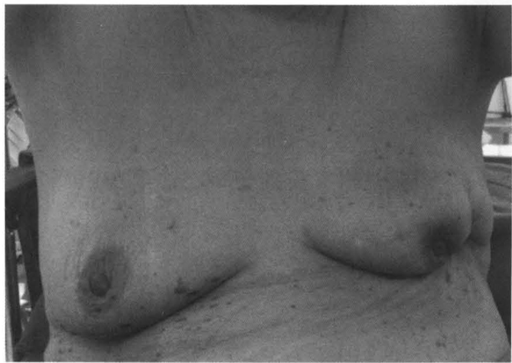

> **Caption (verbatim):** **รูปที่ 16** การดูท่านั่งยกแขนโน้มตัวไปข้างหน้าพบ Skin retraction
> **Text in image (verbatim):** none
> **Description:** Black-and-white clinical photograph, frontal view of a woman's chest (from below the neck to the upper abdomen) sitting with arms raised and leaning forward. The breast on the left of the image hangs lower and shows an indentation/puckering of the skin on its lower inner aspect with a dark linear crease, and its nipple points downward and inward; the breast on the right of the image hangs with a smooth contour. Scattered small skin spots are visible on the chest. Illustrates skin retraction demonstrated by the arms-raised, leaning-forward position.
> **Identifiers in image:** none

<!-- p.306 (printed 292) -->
การคลำควรคลำท่านอน เนื่องจากเต้านมอยู่แนบผนังทรวงอกที่สุด breast tissue หนาแน่นที่สุดบริเวณ upper outer quadrant การหนุน 15 องศา ช่วยให้คลำ quadrant นี้ชัดขึ้น การที่ breast tissue บริเวณนี้หนาแน่นที่สุดจึงพบว่า 50% ของมะเร็งเต้านมพบที่ upper outer quadrant บริเวณ quadrant อื่นพบประมาณ 10-15% ในแต่ละ quadrant การคลำให้คลำเป็น bimanual ทีละ quadrant และ central คือใต้ nipple areolar ควรใช้มือหนึ่ง fix เต้านมไว้เนื่องจาก fibroadenoma เวลาคลำก้อนอาจกลิ้งได้ ในขณะคลำ quadrant นั้นถ้าไม่ใช้มือ fix ก้อนอาจเคลื่อนไปอีก quadrant ทำให้คลำไม่พบ มือที่คลำควรใช้ปลายนิ้ว 4 นิ้ว ในการคลำเพื่อดูลักษณะก้อนว่า consistency เป็นอย่างไร เช่น cystic, firm หรือ hard, margin เป็น well-defined หรือ ill-defined มี tenderness, fix to chest wall หรือ skin หรือไม่ การคลำต่อมน้ำเหลืองทำในท่านั่งให้ผู้ป่วยนั่งวางมือบนมือของผู้ตรวจไม่ให้เกร็ง ใช้มือขวาคลำ axilla ข้างซ้าย มือซ้ายคลำ axilla ข้างขวา โดยคลำชิด chest wall ไล่ไปจนใต้ต่อ pectoralis minor และคลำบริเวณ posterior ของ axilla ก็จะเป็นการตรวจ level 1 และ 2 คลำบริเวณใต้ clavicle เป็นการตรวจ level 3 หรือ apical group (infraclavicular) และคลำ supraclavicular เพื่อบอก clinical staging

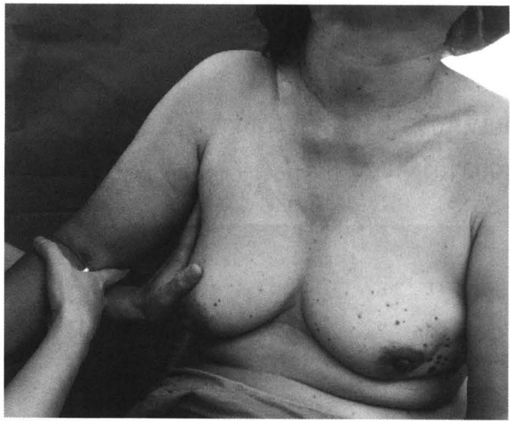

> **Caption (verbatim):** **รูปที่ 17** การตรวจ axillary lymph node level I, II ข้างขวา
> **Text in image (verbatim):** none
> **Description:** Black-and-white clinical photograph of a seated woman, chest exposed, seen from the front-right (only the chin/neck and upper torso visible, no facial features). Her right arm is held out to the side and supported by the examiner's hand at the forearm/elbow, so the arm is relaxed, while the examiner's other hand reaches into the right axilla with the fingers against the chest wall, demonstrating palpation of axillary lymph nodes level I and II on the right side. Multiple small dark spots are scattered over the skin of the breasts, more around the left breast and areola.
> **Identifiers in image:** none

<!-- p.307 (printed 293) -->
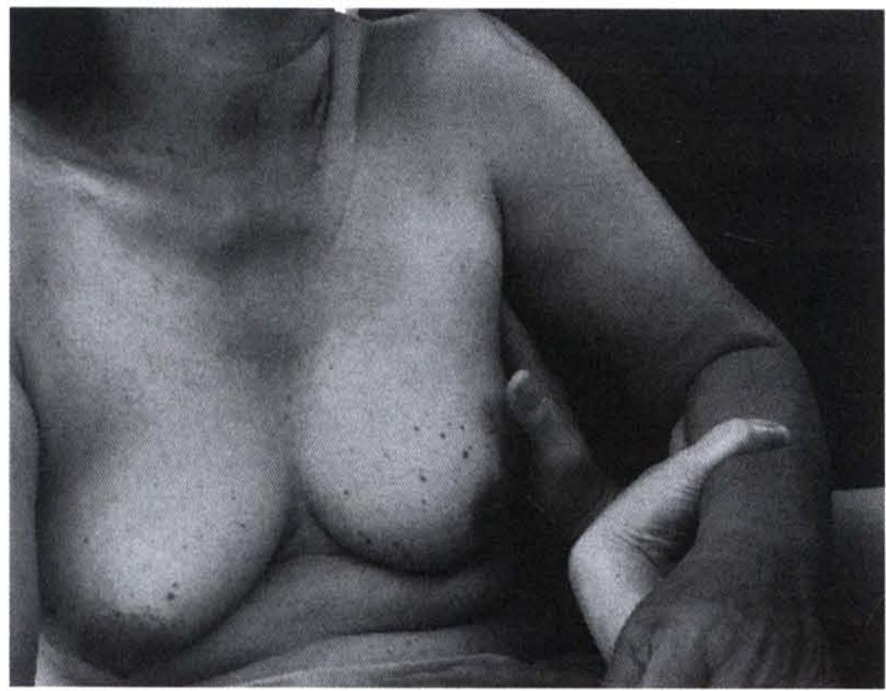

> **Caption (verbatim):** **รูปที่ 18** การตรวจ axillary lymph node level I,II ข้างซ้าย
> **Text in image (verbatim):** none
> **Description:** Black-and-white clinical photograph of a seated woman, chest exposed, seen from the front (neck to upper abdomen, no face). Her left arm is bent and rests on the examiner's supporting hand/forearm at the lower right of the image, keeping the arm relaxed, while the examiner's other hand is placed with the fingers up into the left axilla against the lateral chest wall, demonstrating palpation of axillary lymph nodes level I and II on the left. Scattered small dark spots are seen on the skin of the breasts.
> **Identifiers in image:** none

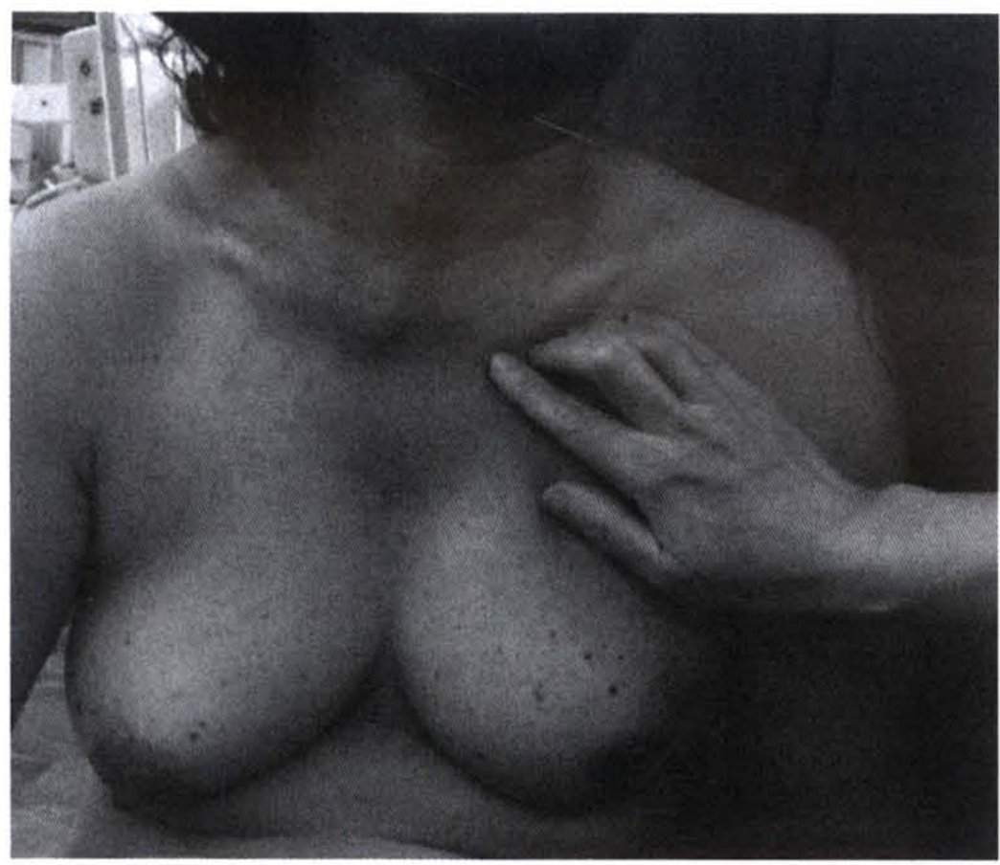

> **Caption (verbatim):** **รูปที่ 19** การตรวจ infraclavicular lymph node (Level III ข้างซ้าย)
> **Text in image (verbatim):** none
> **Description:** Black-and-white clinical photograph of the same seated woman from the front (chin in shadow at the top edge, no facial features visible; hospital equipment in the background at upper left). The examiner's hand, coming from the right side of the image, lies flat with the fingertips just below the left clavicle on the upper chest, demonstrating palpation of the infraclavicular (level III) lymph nodes on the left side.
> **Identifiers in image:** none

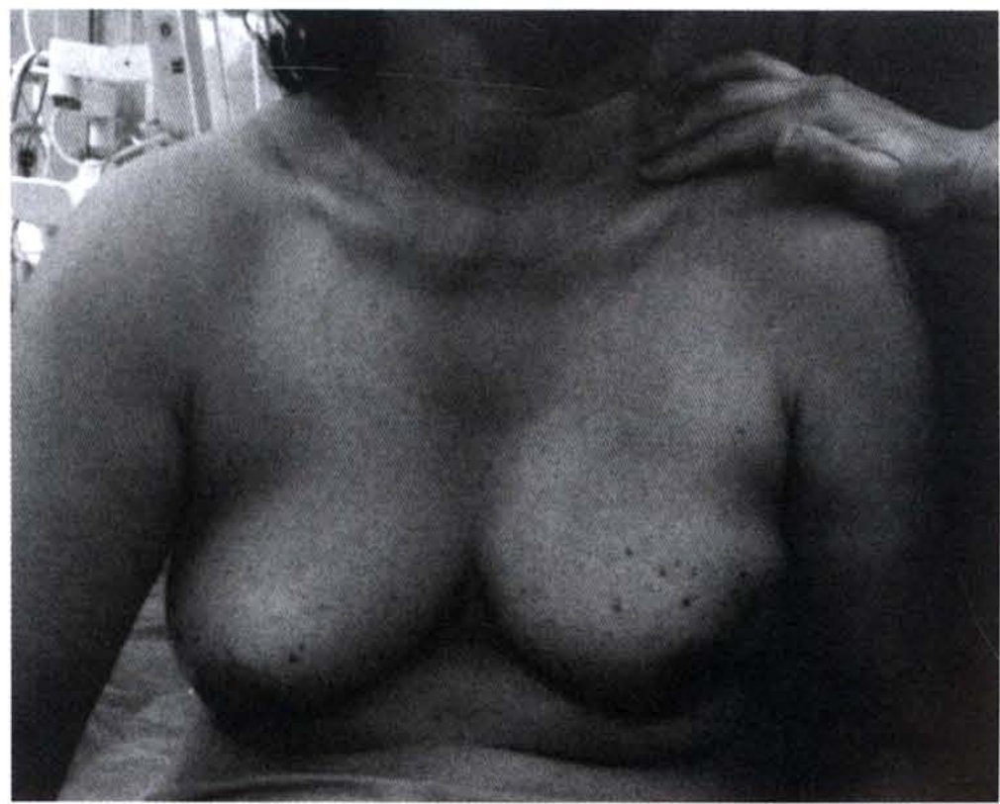

> **Caption (verbatim):** **รูปที่ 20** การตรวจ supraclavicular lymph node
> **Text in image (verbatim):** none
> **Description:** Black-and-white clinical photograph of the same seated woman from the front (chin in shadow at the top edge, no facial features visible; equipment in the background at upper left). The examiner's hand rests over the top of the patient's left shoulder with the fingers curled over the supraclavicular fossa above the clavicle, demonstrating palpation of the supraclavicular lymph nodes.
> **Identifiers in image:** none

<!-- p.308 (printed 294) -->
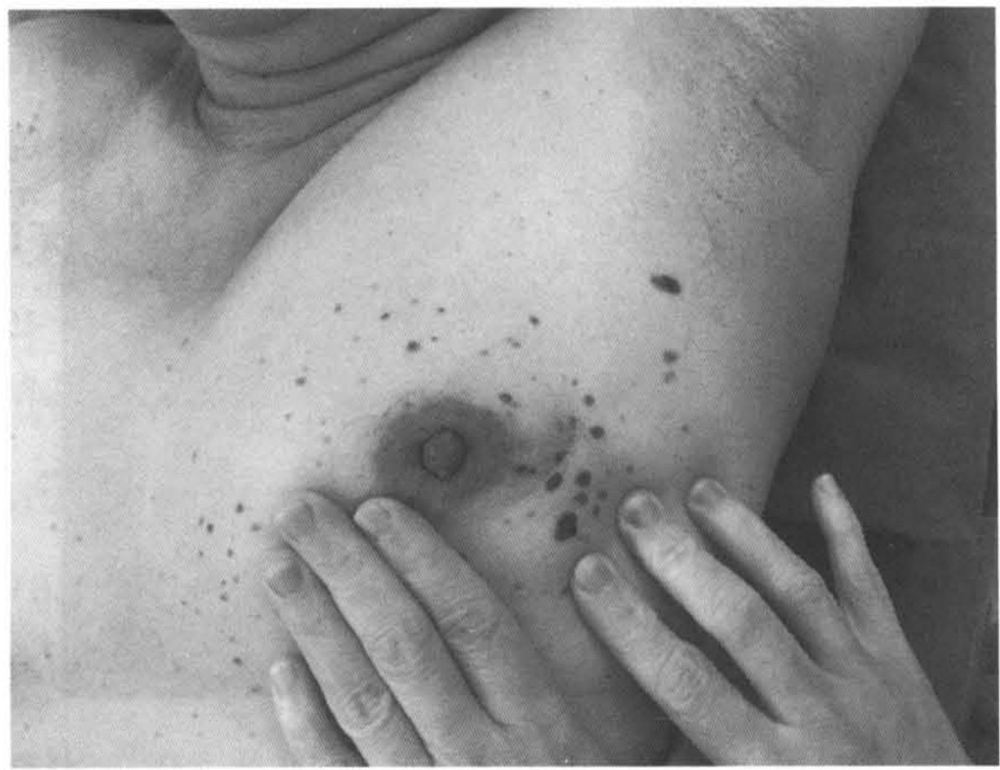

> **Caption (verbatim):** **รูปที่ 21** การคลำเต้านมท่านอน ใช้ Bimannual
> **Text in image (verbatim):** none
> **Description:** Black-and-white clinical photograph of a woman lying supine with the arm raised above the head, seen close up over one breast and the axilla (no face). The examiner's two hands are placed side by side with fingertips flat on the lower part of the breast below the nipple-areola complex, demonstrating bimanual palpation of the breast in the supine position. Numerous small dark spots/nodules are scattered over the breast skin around and lateral to the areola.
> **Identifiers in image:** none

Clinical staging คือการประเมิน T (tumor size) และ N (nodal status) ด้วยการตรวจร่างกายและ imaging การวินิจฉัยมะเร็งเต้านมปกติใช้ mammography ในคนอายุมากกว่า 30 ปี ถ้า breast tissue density มากอาจทำ ultrasonography ร่วมด้วยเพื่อเพิ่ม sensitivity ในคนอายุน้อยกว่า 30 ปี วินิจฉัยด้วย ultrasonography

การวินิจฉัยด้วย mammography มีความเปลี่ยนแปลงจากอดีตคือ จาก film mammography เป็น digital mammography การดูลักษณะต่างๆ เพื่อบอกโอกาสว่าจะเป็นมะเร็งมากน้อยเพียงใด ซึ่งมีการจัดแบ่งโดย America College of Radiology โดยเริ่มมีการรายงานตาม Breast Imaging Reporting and data system (BI-RADS) ซึ่งเริ่มปี ค.ศ. 1993 สำหรับ mammography ต่อมาปี คศ. 1995 และ 1998 มีการทบทวน BI-RADS สำหรับ mammography ปี ค.ศ. 2003 เริ่มมี BI-RADS ของ ultrasonography และ MRI เพื่อให้มีแนวทางในการรายงานผลสำหรับรังสีแพทย์และเป็นแนวทางสำหรับศัลยแพทย์ในการพิจารณาร่วมกับประวัติและตรวจร่างกายว่าจะทำการพิสูจน์ชิ้นเนื้อหรือตรวจติดตาม

<!-- p.309 (printed 295) -->
ปี ค.ศ. 2013 (fifth edition) มีการรายงาน BI-RADS 58, 59 สำหรับ mammography, ultrasonography และ MRI ซึ่งมีความเปลี่ยนแปลงจากเดิมบ้าง

### Mammography

1. Density แบ่งเป็น fatty, fibroglandular density ,heterogeneous density และ extremely density

2. Mass : shape แบ่งเป็น oval, round, irregular: margin แบ่งเป็น circumscribed, obscured, microlobulated, indistinct, spiculated

3. Calcification ลักษณะ benign คือ rim, round, skin, vascular, coarse, popcorn

   ลักษณะที่อาจจะเป็นมะเร็งคือ coarse heterogeneous มีโอกาสเป็นมะเร็ง 13% amorphous 27%, fine pleomorphic 50%, fine linear branching 78%

   การเรียงตัวของ calcification แบ่งเป็น diffuse, segmental, regional, linear, group โดย group คือการมี calcification อย่างน้อย 5 ในปริมาณ 1 เซนติเมตร

4. การดู architectural distortion

5. การดูลักษณะอื่น เช่น asymmetry ซึ่งพบเป็นมะเร็งได้ 12.8% ในการทำ screening และ 26.7% เมื่อทำการตรวจติดตาม การดู dilated duct, intramammary lymph node

6. Associated features เช่น skin retraction, nipple retraction, skin thickening, trabecular thickening, axillary adenopathy

7. Location บอกตำแหน่ง laterality, quadrant, depth และเป็น BI–RADS ที่เริ่มมีการรายงาน tumor distance from nipple การรายงานตำแหน่งอาจไม่ตรงกันในแต่ละ imaging ขึ้นอยู่กับท่าที่ทำ เช่น mammography ทำท่ายืน ultrasonography ทำท่านอนหงาย, MRI ทำท่านอนคว่ำ

<!-- p.310 (printed 296) -->
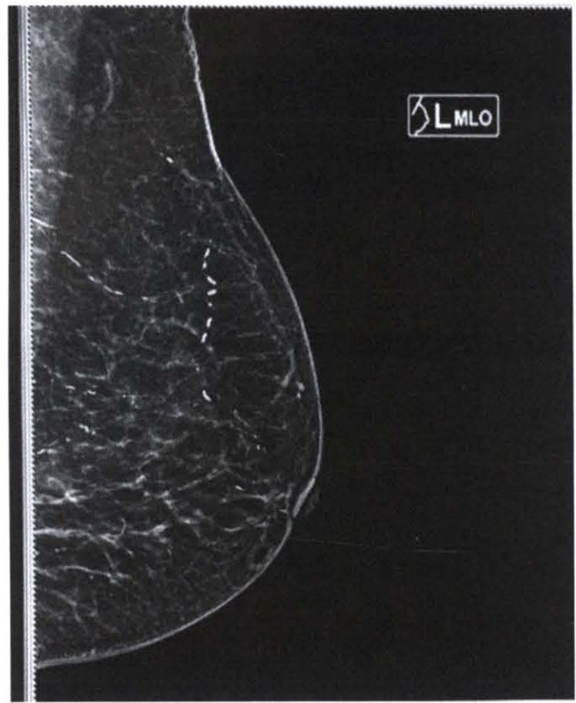

> **Caption (verbatim):** **รูปที่ 22** Vascular calcification
> **Text in image (verbatim):** L MLO
> **Description:** Mammogram of the left breast, mediolateral oblique (MLO) view, with the label "L MLO" and a small breast-outline icon at upper right; the breast faces right on a black background, with the pectoral/chest-wall side at the left edge. The breast shows a fatty background with a fine network of fibroglandular strands. Running vertically through the central breast is a dotted/beaded line of small bright linear calcifications in a tubular, track-like pattern, with further short segments of similar calcification above and below, illustrating vascular calcification as stated in the caption.
> **Identifiers in image:** none

### Ultrasonography

1. Tissue composition, fat, fibroglandular, homogeneous back ground echotexture หรือ heterogeneous background echotexture

2. Masses ดู shape ; oval, round, irregular

   margin ; circumscribed, indistinct, angular, microlobulated, spiculated

   orientation ; parallel, not parallel

3. Echo pattern ; complex cystic solid, heterogeneous, anechoic, hypoechoic, isoechoic, hyperechoic

4. Associated features ; architectural distortion, edema, duct change, skin thickening, skin retraction

5. Calcification ; in mass, outside mass, intraductal

6. Vascularity : absent, internal, in rim.

<!-- p.311 (printed 297) -->
7. Elasticity : low, intermediate, hard

8. ลักษณะอื่นๆ ; Microcyst, complicated cyst, intramammary lymph node, axillary lymph node, foreign body, implant, post surgical fluid collection, fat necrosis,

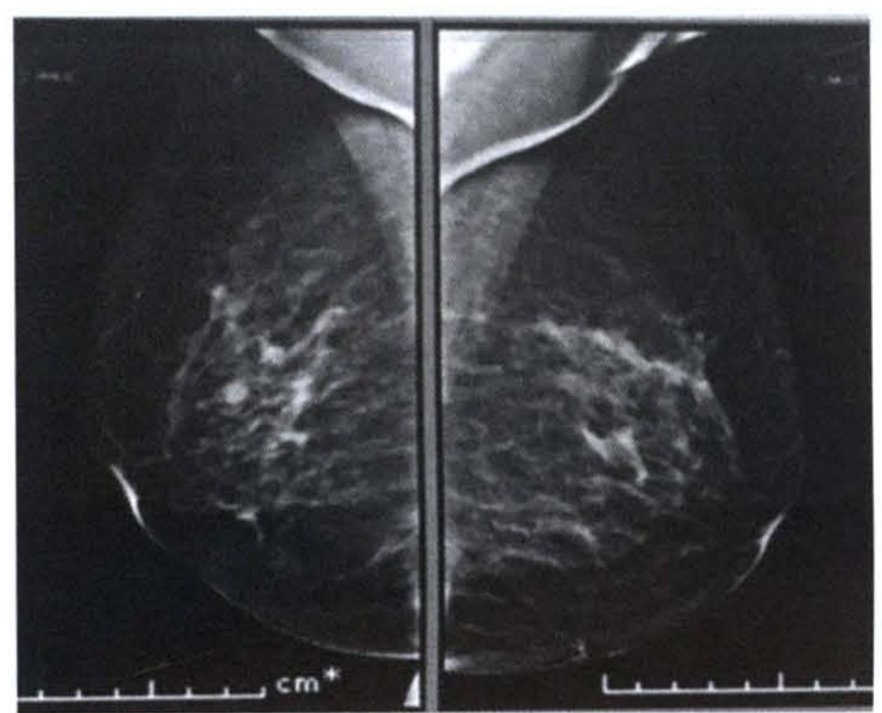

> **Caption (verbatim):** รูปที่ 23.1 Mediolateral oblique (MLO) — (group caption) รูปที่ 23 Scattered fibroglandular density both breasts. ACR BI-RADS 1 Negative
> **Text in image (verbatim):** cm* · (small illegible view labels in the upper corners)
> **Description:** Screening mammogram, mediolateral oblique (MLO) views of both breasts displayed back to back (mirror image), separated by a vertical grey bar. Each view shows the breast with the pectoralis muscle as a bright triangular band at the upper inner part and scattered strands of fibroglandular tissue on a fatty background; no dominant mass is evident. A centimetre scale bar runs along the bottom edge of each image. The book labels the pair as scattered fibroglandular density, ACR BI-RADS 1 Negative.
> **Identifiers in image:** none

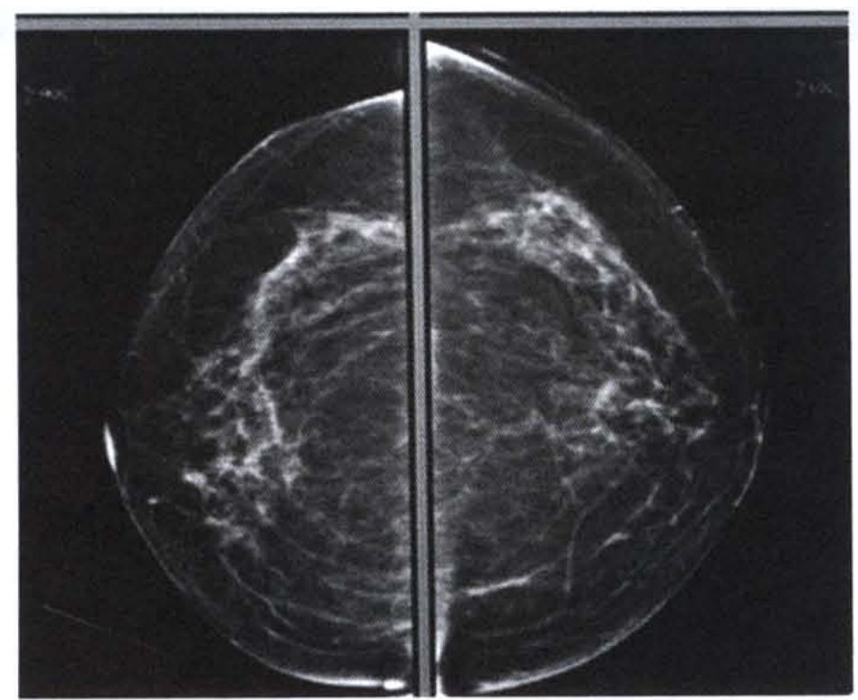

> **Caption (verbatim):** รูปที่ 23.2 Craniocaudal (CC) — (group caption) รูปที่ 23 Scattered fibroglandular density both breasts. ACR BI-RADS 1 Negative
> **Text in image (verbatim):** (small illegible view labels in the upper corners)
> **Description:** Screening mammogram, craniocaudal (CC) views of both breasts displayed back to back, chest walls meeting at the central vertical bar, forming a roughly circular composite. Scattered fibroglandular tissue strands are seen through both breasts on a fatty background; no dominant mass is evident. Same patient/series as รูปที่ 23.1; the book classifies it as scattered fibroglandular density, ACR BI-RADS 1 Negative.
> **Identifiers in image:** none

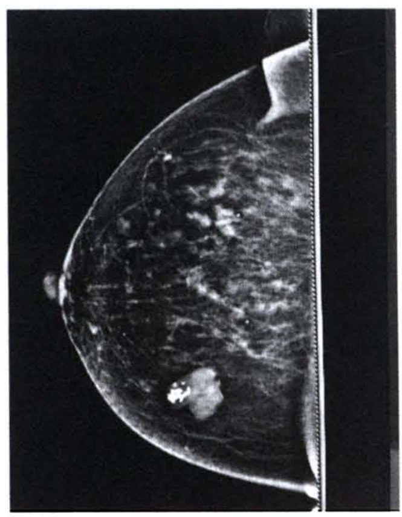

> **Caption (verbatim):** รูปที่ 24.1 Circumscribed isodense mass with internal popcorn calcifications in right lower inner quadrant. — (group caption) รูปที่ 24 BI-RADS 2
> **Text in image (verbatim):** none
> **Description:** Mammogram, single view of one breast (nipple pointing left, chest wall at right edge). In the lower part of the breast there is a well-circumscribed oval mass of similar density to glandular tissue, containing coarse, very bright clustered ("popcorn") calcifications at its left side. Scattered fibroglandular tissue elsewhere. Book classifies as BI-RADS 2 (benign).
> **Identifiers in image:** none

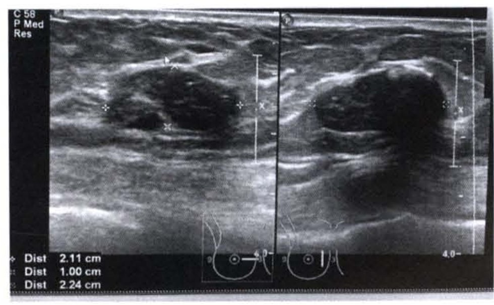

> **Caption (verbatim):** รูปที่ 24.2 A 2.1 x 1 x 2.2 cm circumscribed hypoechoic nodule with macrocalcification in right inner mid part, likely involuted fibroadenoma. — (group caption) รูปที่ 24 BI-RADS 2
> **Text in image (verbatim):** C 58 · P Med · Res · Dist 2.11 cm · Dist 1.00 cm · Dist 2.24 cm · 4.0
> **Description:** Breast ultrasound, dual-panel display of two orthogonal planes of the same lesion. Each panel shows an oval, circumscribed hypoechoic nodule in the breast tissue with caliper markers (+ and ×) measuring it; the left panel shows a more heterogeneous internal echo, the right panel shows a darker nodule with posterior shadowing beneath it. Body-marker pictograms of the breast with probe position are at the bottom of each panel. Measurements listed at lower left: 2.11 cm, 1.00 cm, 2.24 cm. Depth marker 4.0. Book describes it as likely involuted fibroadenoma, BI-RADS 2.
> **Identifiers in image:** none

<!-- p.312 (printed 298) -->
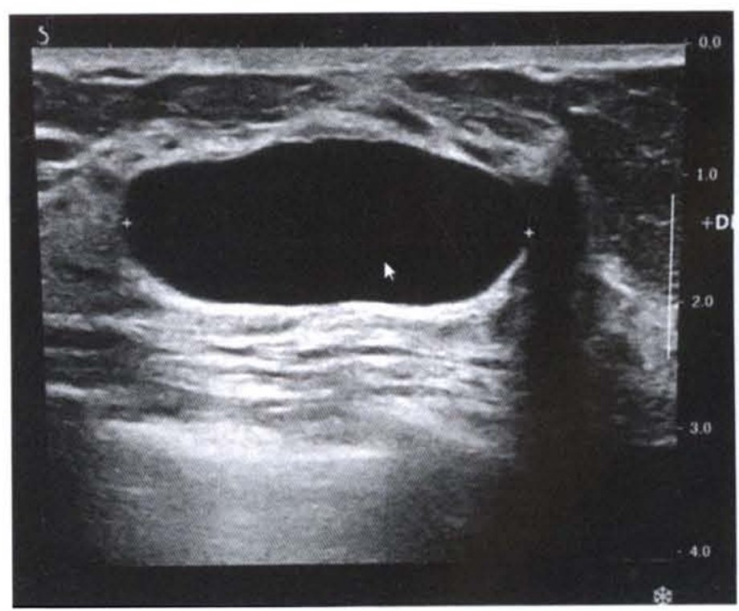

> **Caption (verbatim):** รูปที่ 25.1 Cyst BI-RADS 2
> **Text in image (verbatim):** S · 0.0 · 1.0 · 2.0 · 3.0 · 4.0 · +D (cut off at the right edge)
> **Description:** Breast ultrasound, single grey-scale image. A large oval, sharply circumscribed, anechoic (completely black) lesion lies in the superficial breast tissue, with caliper markers (+) at its left and right margins and a cursor arrow inside it; there is posterior acoustic enhancement (brighter band) beneath it. Depth scale 0.0-4.0 (cm) along the right side. The book labels it a cyst, BI-RADS 2.
> **Identifiers in image:** none

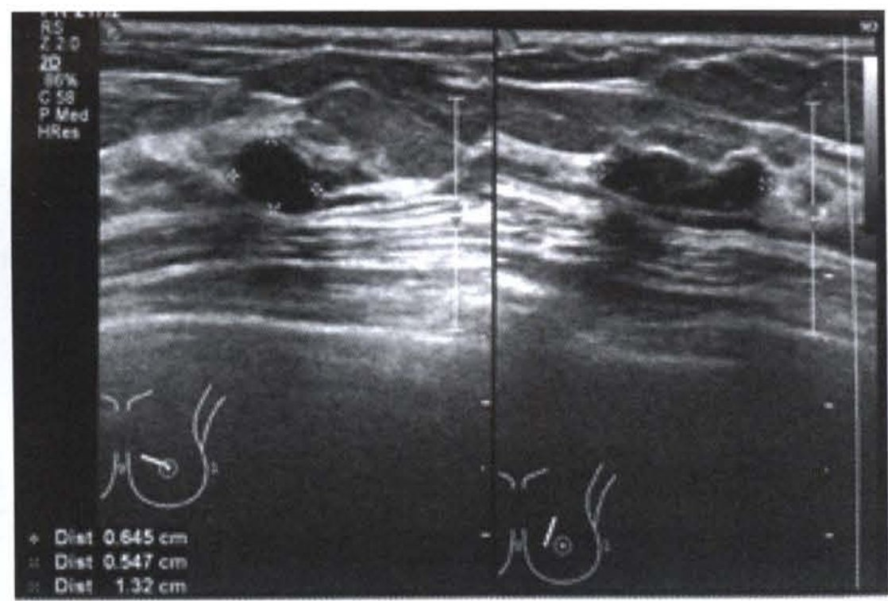

> **Caption (verbatim):** รูปที่ 25.2 A 0.6 x 0.7 x 1.3 cm circumscribed oval-shaped hypoechoic nodule at upper inner quadrant. BI-RADS 3
> **Text in image (verbatim):** RS · Z 2.0 · 2D · 86% · G 58 · P Med · HRes · Dist 0.645 cm · Dist 0.547 cm · Dist 1.32 cm (top line of the parameter list cut off)
> **Description:** Breast ultrasound, dual-panel display showing two orthogonal planes of the same lesion. Left panel: a small oval, circumscribed hypoechoic nodule with caliper markers around it; right panel: the nodule in the perpendicular plane appearing elongated and slightly lobulated (longer axis), with calipers. Body-marker pictograms of the breast with probe orientation lines are in the lower part of each panel. Measurements 0.645 cm, 0.547 cm and 1.32 cm listed at lower left. The book classifies it as BI-RADS 3.
> **Identifiers in image:** none

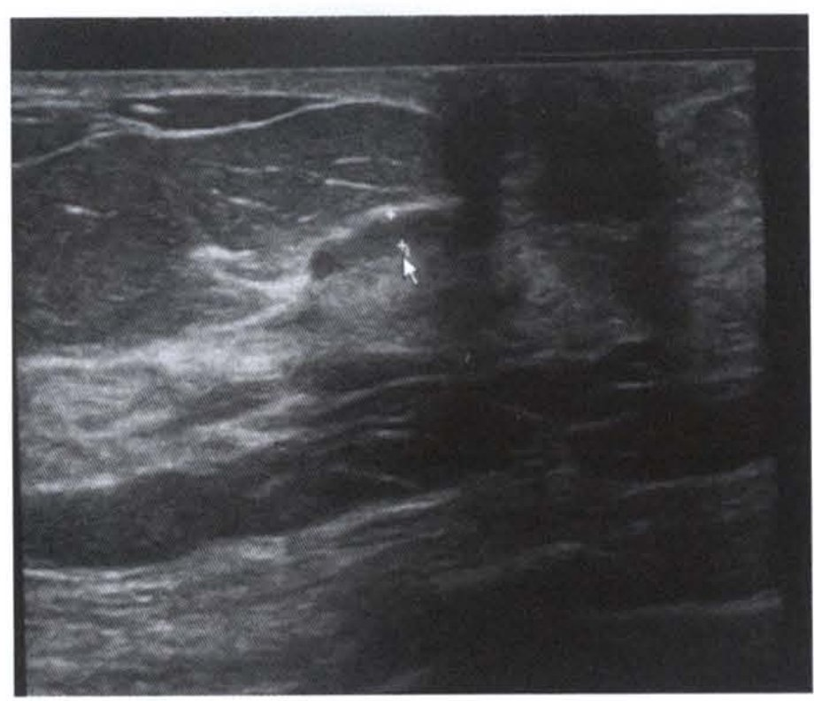

> **Caption (verbatim):** รูปที่ 26.1 Prominent left subareolar duct with internal echo — (group caption) รูปที่ 26 ACR BIRADS : 4a Low suspicion for malignancy (Intraductal papilloma)
> **Text in image (verbatim):** none
> **Description:** Breast ultrasound of the left subareolar region. A tubular hypoechoic dilated duct runs obliquely in the centre, containing a small echogenic internal focus, marked with a caliper (+) and a cursor arrow. A dark vertical shadow band (from the nipple region) is seen on the right half of the image. The book's overall diagnosis for รูปที่ 26 is ACR BIRADS 4a, intraductal papilloma.
> **Identifiers in image:** none

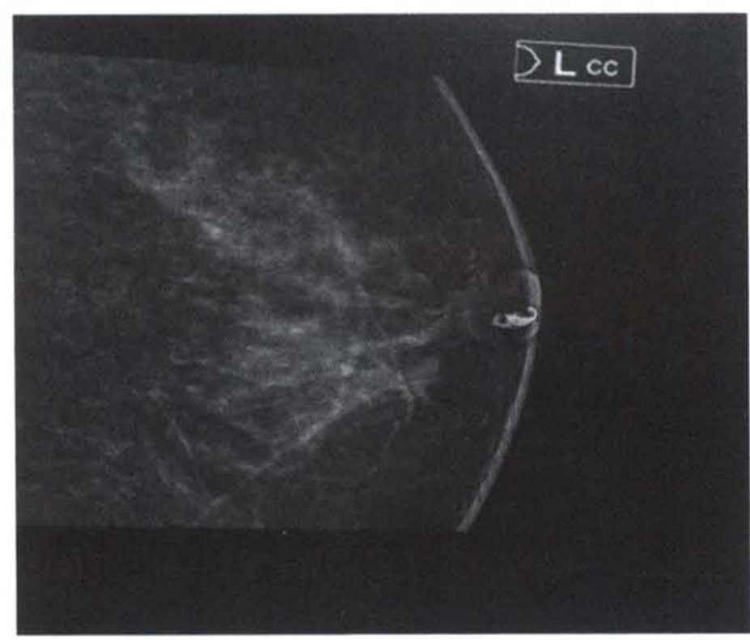

> **Caption (verbatim):** รูปที่ 26.2 Left ductography : A few small lobulated intraductal filling defects at left major subareolar duct, measuring overall about 0.6x0.3 cm, which causes abrupt truncation of the aforementioned duct. — (group caption) รูปที่ 26 ACR BIRADS : 4a Low suspicion for malignancy (Intraductal papilloma)
> **Text in image (verbatim):** L CC
> **Description:** Left craniocaudal (L CC) mammographic ductogram (contrast injected into a duct via the nipple). The breast is oriented with the nipple at right; a bright contrast-filled segment is seen just behind the nipple in the subareolar duct, with a small curved contrast density at the nipple. The surrounding fibroglandular tissue appears as faint reticular strands. The caption describes small lobulated filling defects in the left major subareolar duct (about 0.6x0.3 cm) causing abrupt truncation of the duct.
> **Identifiers in image:** none

<!-- p.313 (printed 299) -->
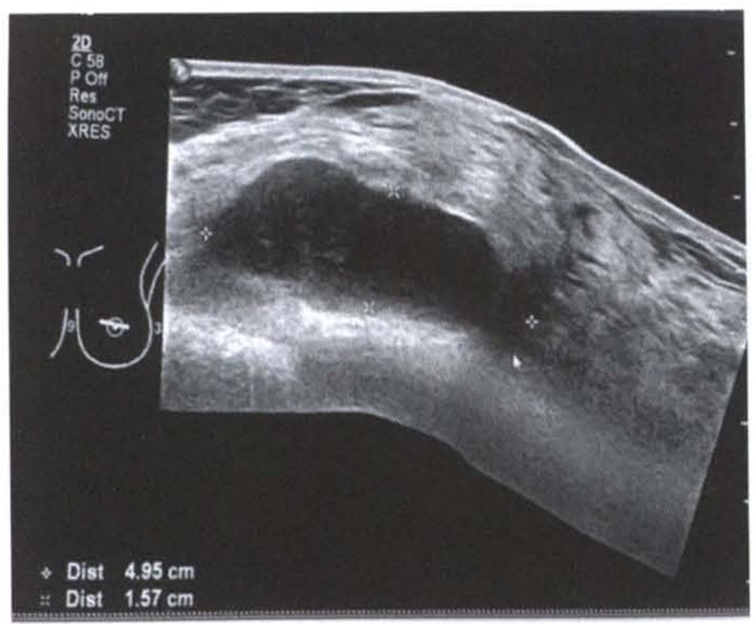

> **Caption (verbatim):** รูปที่ 27.1 A 1.5 x 4.7 x 5.0 cm lobulated heterogeneous hypoechoic mass at left inner mid subareolar — (group caption) รูปที่ 27 ACR BI-RADS : 4b, Moderate suspicious for malignancy (Pathological diagnosis : Benign Phyllodes tumor)
> **Text in image (verbatim):** 2D · C 58 · P Off · Res · SonoCT · XRES · 9 · 3 · Dist 4.95 cm · Dist 1.57 cm
> **Description:** Breast ultrasound (extended/curved field of view). A large, lobulated, heterogeneous hypoechoic mass occupies the upper-middle part of the image beneath the skin, with caliper markers (+ and ×) measuring its length and thickness. A breast body-marker pictogram with probe position (labels 9 and 3 o'clock) is at the left. Measurements 4.95 cm and 1.57 cm at lower left. Pathological diagnosis per book: benign phyllodes tumor (ACR BI-RADS 4b).
> **Identifiers in image:** none

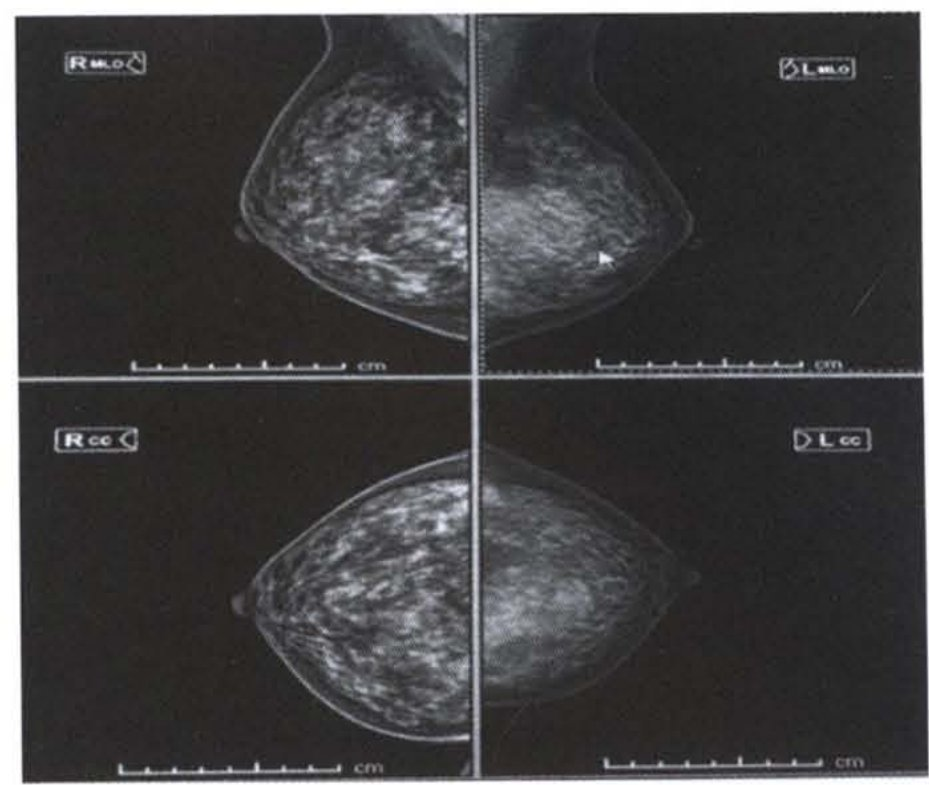

> **Caption (verbatim):** รูปที่ 27.2 A large circumscribed heterogeneous isodense mass on mammography — (group caption) รูปที่ 27 ACR BI-RADS : 4b, Moderate suspicious for malignancy (Pathological diagnosis : Benign Phyllodes tumor)
> **Text in image (verbatim):** R MLO · L MLO · R CC · L CC · cm (scale bars under each view)
> **Description:** Four-view screening mammogram in a 2 × 2 layout: right and left MLO views on top, right and left CC views below, each with a centimetre scale bar. Both breasts are dense with heterogeneous fibroglandular tissue; the left breast contains a large, rounded, circumscribed area of soft-tissue density (isodense, heterogeneous) occupying much of the breast, with a cursor arrow on it in the L MLO view. Pathological diagnosis per book: benign phyllodes tumor.
> **Identifiers in image:** none

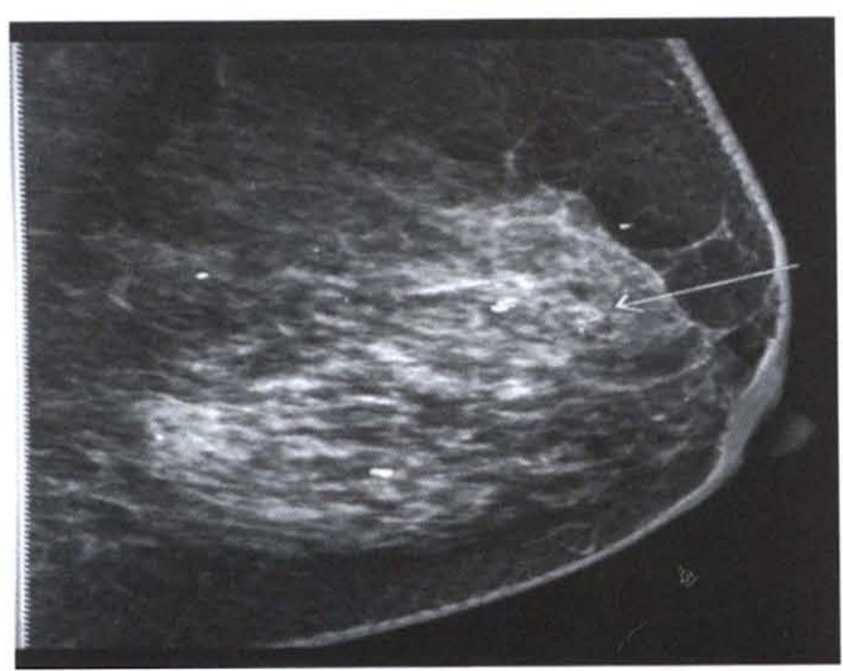

> **Caption (verbatim):** รูปที่ 28.1 Intervel increased in number of mixed punctate and amorphous microcalcifications and developing of some linear shape, in segmental distribution at left upper outer quadrant — (group caption) รูปที่ 28 ACR BI-RADS 4b (DCIS)
> **Text in image (verbatim):** none
> **Description:** Mammogram, magnified/single view of the left breast (nipple at right). Dense fibroglandular tissue fills the central breast; a long thin arrow from the right points to a region of fine calcifications in the fibroglandular tissue behind the nipple area. A few small, bright, coarse benign-appearing calcifications are scattered elsewhere. Book diagnosis: ACR BI-RADS 4b (DCIS).
> **Identifiers in image:** none

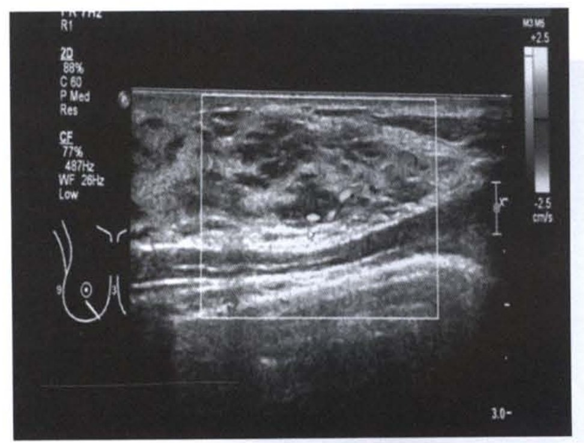

> **Caption (verbatim):** รูปที่ 28.2 A 0.9 x 2.4 x 1.9 cm Focal thickened duct at right lower inner quadrant with internal vascularity, corresponding to area of a group of coarse heterogeneous microcalcifications at right lower inner quadrant — (group caption) รูปที่ 28 ACR BI-RADS 4b (DCIS)
> **Text in image (verbatim):** R1 · 2D · 88% · C 60 · P Med · Res · CF · 77% · 487Hz · WF 26Hz · Low · +2.5 · -2.5 · cm/s · 9 · 3 · 3.0 (top line of parameter list cut off)
> **Description:** Breast ultrasound with a colour-flow (Doppler) box outlined over the region of interest (reproduced in greyscale). Within the box there is a heterogeneous area of hypoechoic and echogenic tissue (thickened duct) with small bright foci representing flow signal/internal vascularity. Colour velocity scale bar ±2.5 cm/s at upper right, body-marker pictogram at left, depth marker 3.0 at lower right.
> **Identifiers in image:** none

<!-- p.314 (printed 300) -->
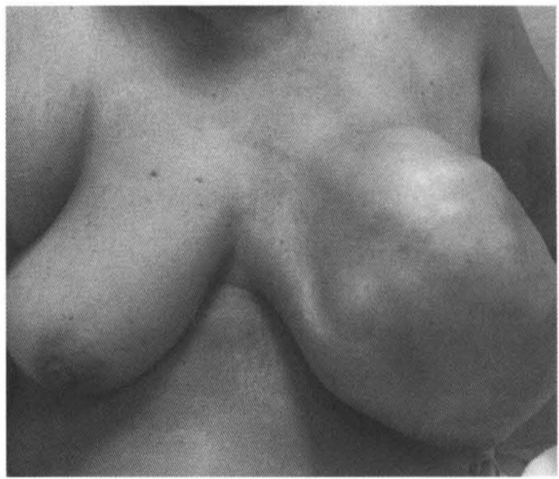

> **Caption (verbatim):** รูปที่ 28.3 — (group caption) รูปที่ 28.5-28.3 ACR BI-RADS : 4b (Malignant Phyllodes)
> **Text in image (verbatim):** none
> **Description:** Black-and-white clinical photograph of a woman's anterior chest from the lower neck to below the breasts (face not shown). The left breast (viewer's right) is markedly enlarged, globular and distorted by a large underlying mass with a smooth, stretched, shiny skin surface and lobulated bulges; the right breast appears normal in contour. Book diagnosis for the series: malignant phyllodes (ACR BI-RADS 4b).
> **Identifiers in image:** none

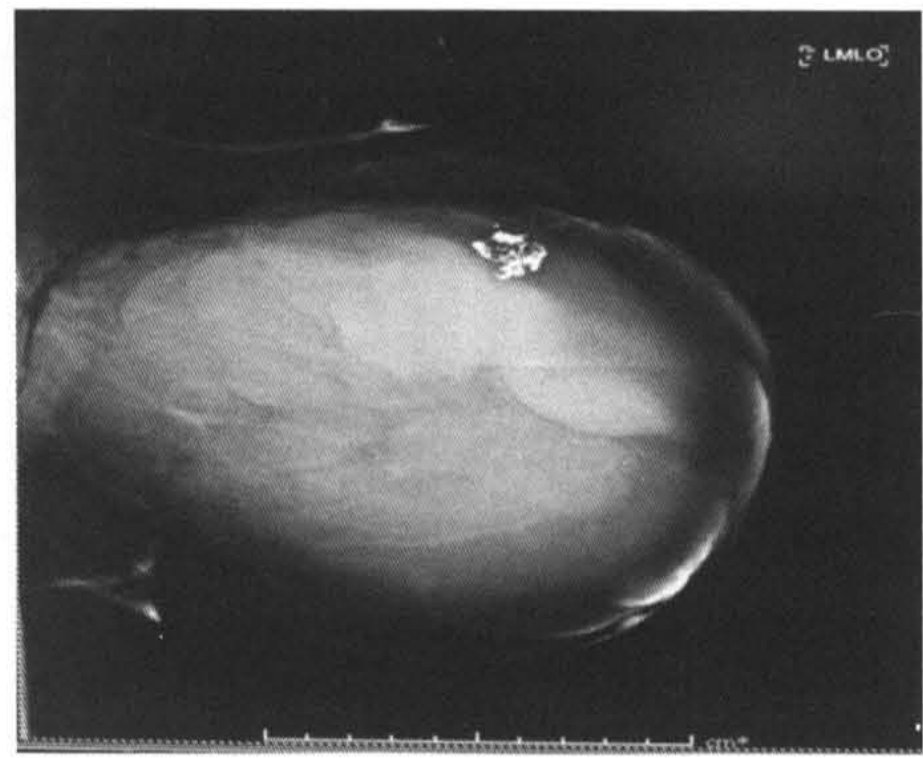

> **Caption (verbatim):** รูปที่ 28.4 Fibroglandular density. A huge circumscribed hyperdense mass is occupying entire left breast. A popcorn calcification is seen in left upper outer quadrant. — (group caption) รูปที่ 28.5-28.3 ACR BI-RADS : 4b (Malignant Phyllodes)
> **Text in image (verbatim):** LMLO · cm (scale bar along the bottom)
> **Description:** Left MLO mammogram (LMLO), image rotated so the breast is horizontal. A huge oval, well-circumscribed, dense (bright) mass fills almost the whole breast, with internal lobulated subtle density variations. A cluster of coarse, very bright "popcorn" calcification lies at the upper margin of the mass. A centimetre scale bar runs along the bottom.
> **Identifiers in image:** none

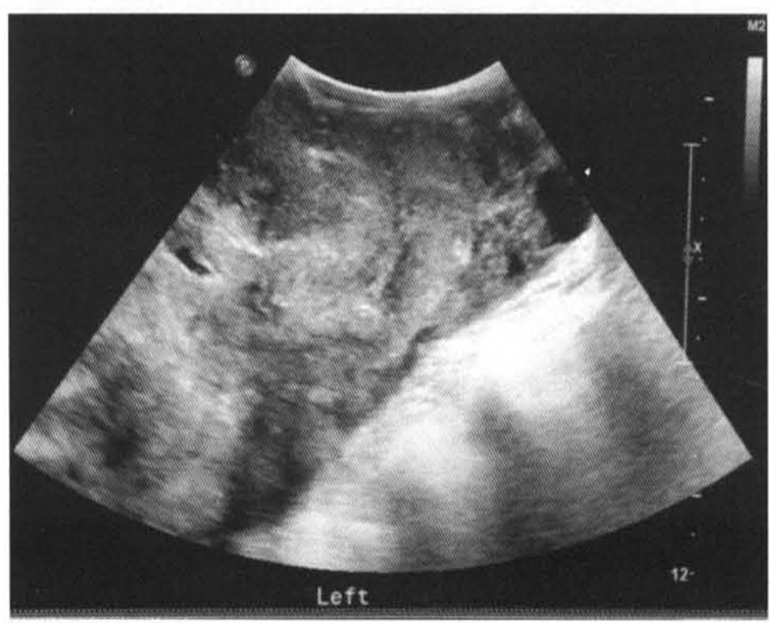

> **Caption (verbatim):** รูปที่ 28.5 A 16.3 x 1 .16 x 8.2 cm heterogeneous hypoechoic mass with internal cystic spaces and increased vascularity occupying entire — (group caption) รูปที่ 28.5-28.3 ACR BI-RADS : 4b (Malignant Phyllodes)
> **Text in image (verbatim):** M2 · Left · 12
> **Description:** Breast ultrasound with a curvilinear (sector-shaped) field of view, labelled "Left". The sector is filled by a large heterogeneous mass of mixed echogenicity with small dark anechoic cystic spaces (e.g. near the upper right margin and left side); deeper areas show brighter echoes and shadowing. A depth scale with caliper marker at right, depth 12 at the bottom right, greyscale bar at upper right (M2).
> **Identifiers in image:** none

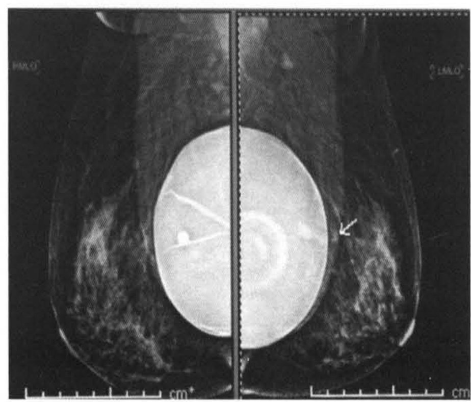

> **Caption (verbatim):** รูปที่ 28.6 Heterogeneously dense fibroglandular tissue. Evidence of bilateral subpectoral saline prostheses.There is newly seen a circumscribed isodense nodule at left upper part. — (group caption) รูปที่ 28.5-28.3 ACR BI-RADS : 4b (Malignant Phyllodes)
> **Text in image (verbatim):** RMLO · LMLO · cm (scale bars under each view)
> **Description:** Bilateral MLO mammograms displayed back to back (RMLO left, LMLO right). Each breast contains a large oval, uniformly bright implant (saline prosthesis) lying behind the glandular tissue, with the two implant images meeting at the central divider; a valve/fold line is visible within the implants. Heterogeneously dense fibroglandular tissue surrounds the implants inferiorly. A small white arrow at the edge of the left implant points to a small circumscribed isodense nodule. Centimetre scale bars along the bottom.
> **Identifiers in image:** none

<!-- p.315 (printed 301) -->
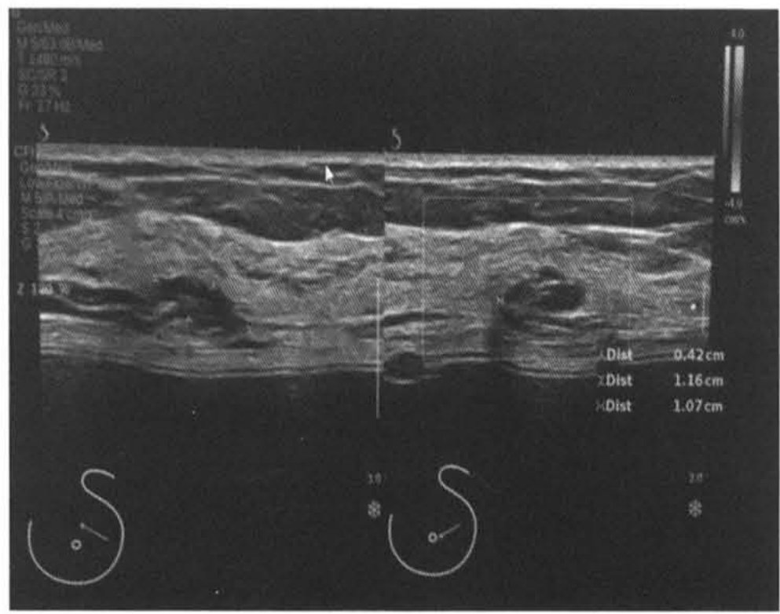

> **Caption (verbatim):** รูปที่ 28.7 Newly seen a 0.6 x 1.2 x 0.9 cm partial circumscribed nodule with peripheral vascularity at left upper outer quadrant abutting pectoralis muscle. — (group caption) รูปที่ 28.7-28.6 ACR BI-RADS 4b (Sclerosing adenosis)
> **Text in image (verbatim):** Dist 0.42 cm · Dist 1.16 cm · Dist 1.07 cm · 3.0 · 3.0 · 4.0 · -4.0 · cm/s (small machine-parameter text at upper and middle left, too blurred to read)
> **Description:** Breast ultrasound, dual-panel display. Both panels show the skin and subcutaneous layers at top, breast tissue, and the pectoralis muscle as a deeper horizontal band. In each panel a small, partly circumscribed, oval hypoechoic nodule lies deep in the breast tissue just above/against the muscle layer; the right panel has a Doppler colour box (shown in greyscale) around the nodule and a velocity scale bar (4.0 / -4.0 cm/s) at upper right. Measurements 0.42 cm, 1.16 cm, 1.07 cm at lower right. Breast pictograms with probe position at the bottom of each panel. Book diagnosis for this series: sclerosing adenosis, ACR BI-RADS 4b.
> **Identifiers in image:** none

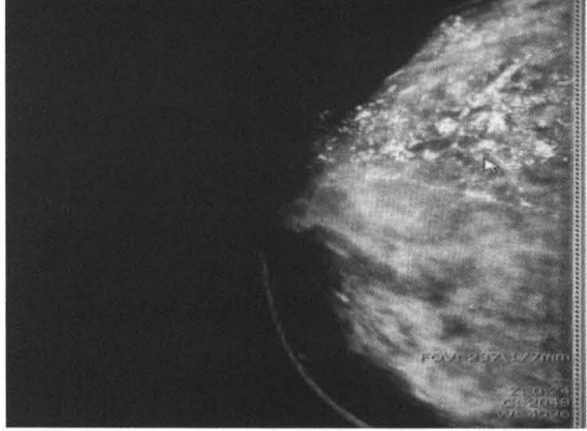

> **Caption (verbatim):** รูปที่ 29.1 Numerous clustered pleomorphic calcifications and linear branching microcalcification in right lower outer
> **Text in image (verbatim):** FOV: 237\177mm · Z: 0.24 · C: 2048 · W: 4096 (partly blurred)
> **Description:** Mammogram of the right breast (single view, chest wall at the right edge, breast projecting to the left). Dense fibroglandular tissue with numerous small, bright clustered calcifications of varying shape, and linear branching forms, concentrated in the upper part of the displayed breast; a cursor arrow marks the area. A thin curved line (skin fold/marker) lies along the lower left breast contour. Identifier label (ID number and date) at the top right cropped out.
> **Identifiers in image:** none

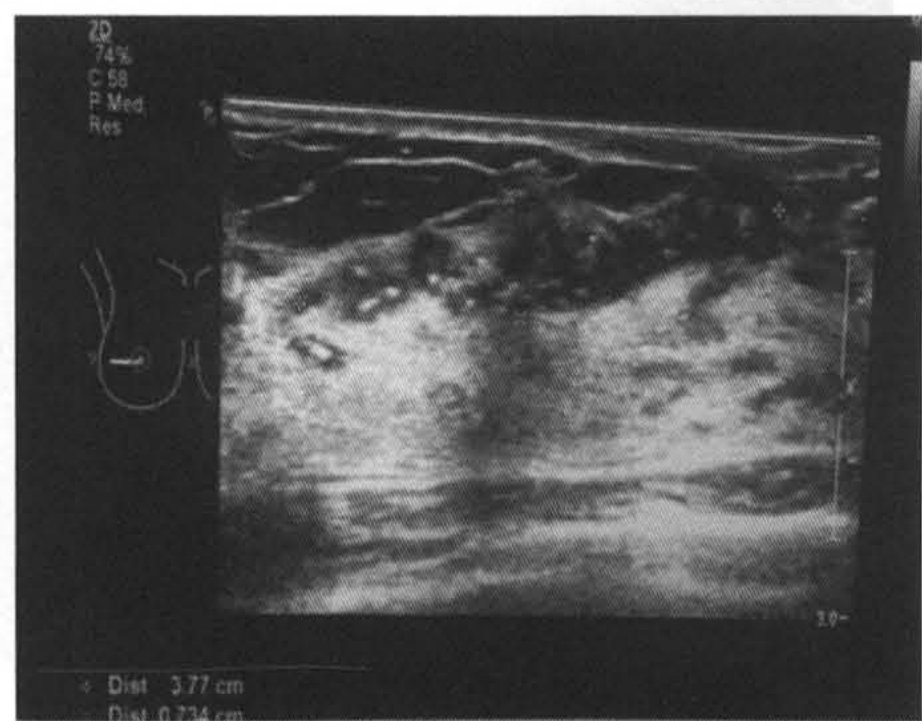

> **Caption (verbatim):** รูปที่ 29.2 A 3.8 x 7 .0 x 1.5 cm prominent duct with internal calcification without internal vascularity at right  lower outer periareolar region
> **Text in image (verbatim):** 2D · 74% · C 58 · P Med · Res · 3.0 · Dist 3.77 cm · Dist 0.734 cm
> **Description:** Breast ultrasound of the right periareolar region. Beneath the skin there is a heterogeneous, mixed-echogenicity area with tubular hypoechoic duct structures containing small bright echogenic foci (calcifications), with some posterior shadowing in the centre. Breast pictogram with probe position at left, depth marker 3.0 at lower right, measurements 3.77 cm and 0.734 cm at lower left. Software toolbar strip at the bottom edge cropped out.
> **Identifiers in image:** none

<!-- p.316 (printed 302) -->
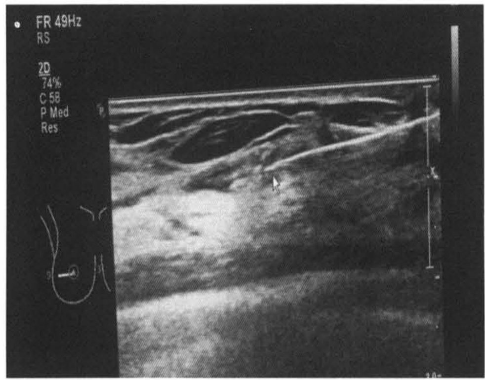

> **Caption (verbatim):** รูปที่ 29.3 Core biopsy with a 14G biopsy needle was introduced into the target lesion under ultrasonographic guidance. — (group caption) รูปที่ 29.3-29.1 BI-RADS 4c (DCIS)
> **Text in image (verbatim):** FR 49Hz · RS · 2D · 74% · C 58 · P Med · Res
> **Description:** Breast ultrasound during an ultrasound-guided core needle biopsy. A straight, bright echogenic line (the biopsy needle) enters obliquely from the upper right and extends toward the heterogeneous target area in the breast tissue, where a cursor arrow is placed. Skin and subcutaneous fat lobules lie superficially. Breast pictogram with probe position at left; depth scale with caliper bar at right. Book diagnosis for this series: DCIS, BI-RADS 4c.
> **Identifiers in image:** none

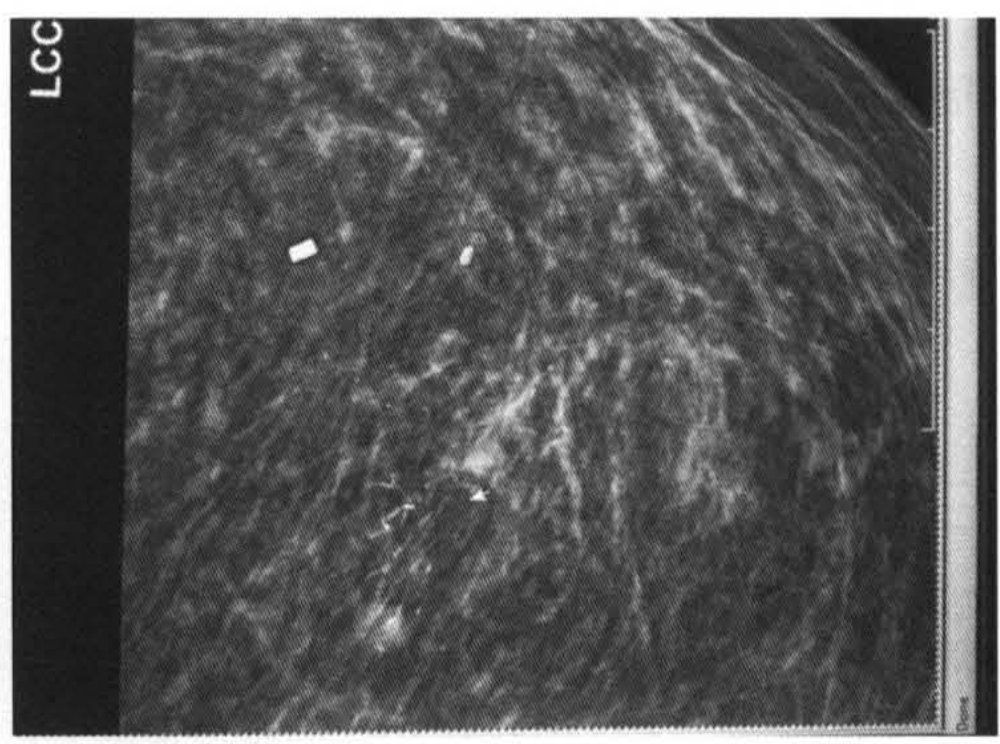

> **Caption (verbatim):** รูปที่ 30.1 และ รูปที่ 30.2 There is a small ill-defined isodense nodule associated with segmental distribution of fine linear branching microcalcifications at left upper inner quadrant.
> **Text in image (verbatim):** LCC
> **Description:** Left craniocaudal (LCC) mammogram, enlarged view of part of the breast. Fibroglandular tissue strands radiate across the image; near the centre-lower part there is a small, faint ill-defined density with fine, thin, linear branching bright calcifications, indicated by a small white arrowhead. Two small bright rectangular/oval marker-like densities lie in the upper left part of the image.
> **Identifiers in image:** none

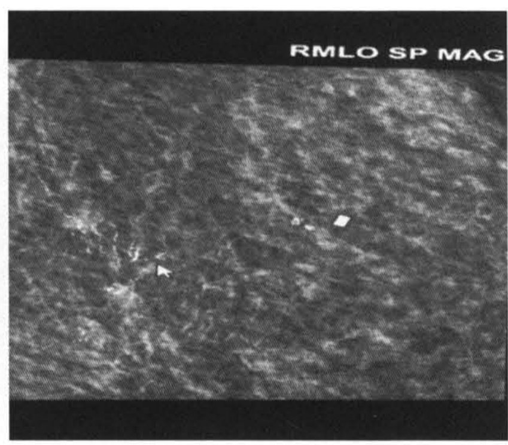

> **Caption (verbatim):** รูปที่ 30.1 และ รูปที่ 30.2 There is a small ill-defined isodense nodule associated with segmental distribution of fine linear branching microcalcifications at left upper inner quadrant.
> **Text in image (verbatim):** RMLO SP MAG
> **Description:** Spot magnification mammographic view (labelled "RMLO SP MAG" in the image). Dense fibroglandular background with a small cluster of fine, linear and branching bright calcifications in the left-centre, marked by a white cursor arrowhead; a small bright diamond-shaped density and a few dots lie to the right of centre.
> **Identifiers in image:** none

<!-- p.317 (printed 303) -->
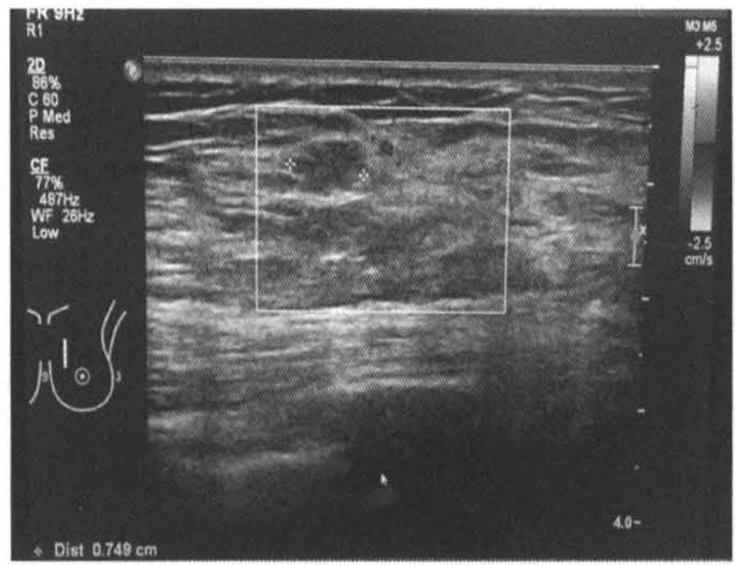

> **Caption (verbatim):** รูปที่ 30.3 A 0.6 x 0.5 x 0.7 cm irregular hypoechoic nodule at left upper inner quadrant, corresponding with a small isodense nodule in mammogram. — (group caption) รูปที่ 30.3-30.1 ACR BI-RADS 5 (IDC)
> **Text in image (verbatim):** FR 9Hz · R1 · 2D · 86% · C 60 · P Med · Res · CF · 77% · 487Hz · WF 26Hz · Low · M3 M5 · +2.5 · -2.5 · cm/s · 9 · 3 · 4.0 · Dist 0.749 cm
> **Description:** Breast ultrasound with a colour-Doppler box (shown in greyscale) outlined over the superficial breast tissue. Inside the box, near its upper part, a small irregular hypoechoic nodule is marked by caliper points (+), measuring 0.749 cm. Breast pictogram with probe position at left (labels 9 and 3), velocity scale ±2.5 cm/s at upper right, depth 4.0 at lower right. Book diagnosis for รูปที่ 30.1-30.3: IDC, ACR BI-RADS 5.
> **Identifiers in image:** none

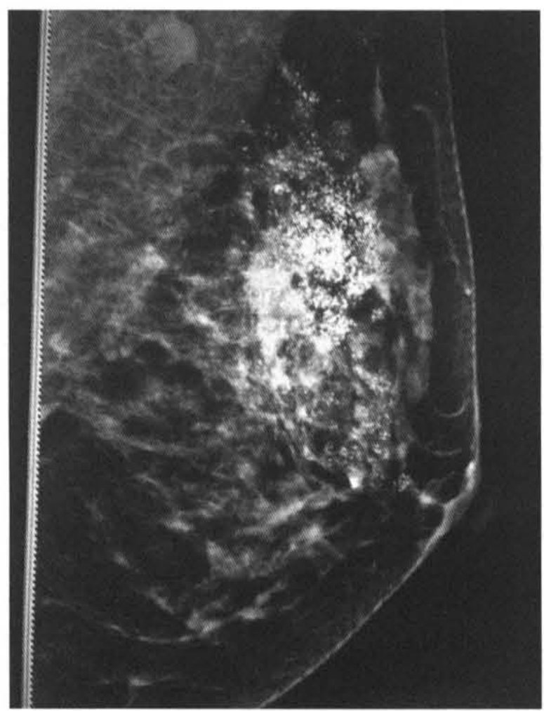

> **Caption (verbatim):** รูปที่ 31.1 และ รูปที่ 31.2 There is numerous clustered pleomorphic calcifications and linear branching microcalcifications in left upper outerquadrant in segmental distribution.There is evidence of extension of these calcifications along some Cooper's ligament in outer part and ductal extension to left subareolar region. — (group caption) รูปที่ 31.2-31.1 BI-RADS 5 (IDC with extensive DCIS)
> **Text in image (verbatim):** none
> **Description:** Mammogram of the left breast (chest wall at left edge, nipple pointing right), one of two views. A large area in the central/upper breast is filled with innumerable bright, clustered, pleomorphic and linear branching calcifications in a segmental (wedge-shaped) distribution, extending toward the subareolar region. Surrounding breast shows heterogeneous fibroglandular tissue.
> **Identifiers in image:** none

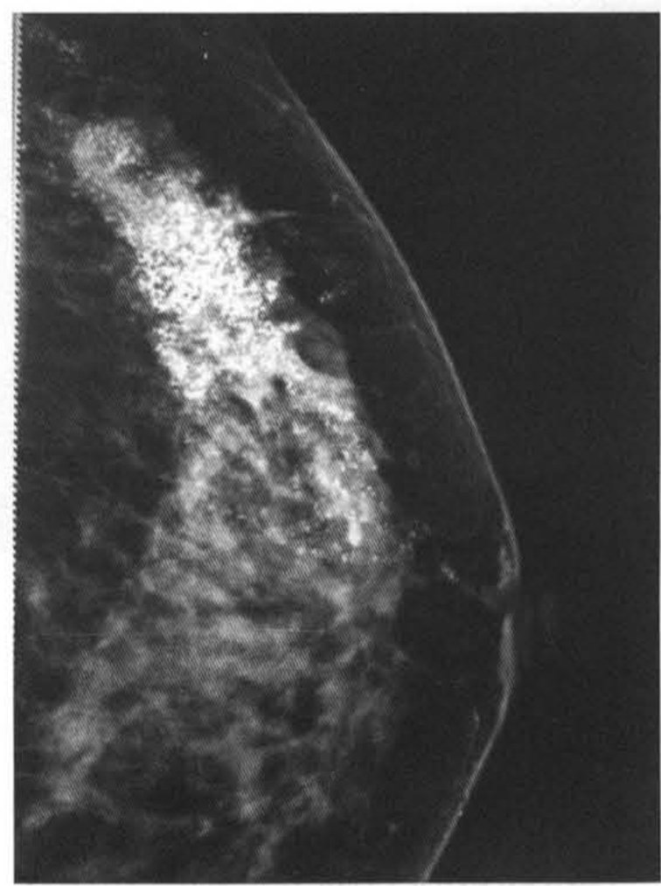

> **Caption (verbatim):** รูปที่ 31.1 และ รูปที่ 31.2 There is numerous clustered pleomorphic calcifications and linear branching microcalcifications in left upper outerquadrant in segmental distribution.There is evidence of extension of these calcifications along some Cooper's ligament in outer part and ductal extension to left subareolar region. — (group caption) รูปที่ 31.2-31.1 BI-RADS 5 (IDC with extensive DCIS)
> **Text in image (verbatim):** none
> **Description:** Second mammographic view of the left breast (chest wall at left edge, nipple at right). A band of dense, innumerable bright pleomorphic and linear branching calcifications runs obliquely from the upper (deep) breast down toward the nipple region in a segmental distribution, with fainter calcifications extending further inferiorly. Book diagnosis: IDC with extensive DCIS, BI-RADS 5.
> **Identifiers in image:** none

<!-- p.318 (printed 304) -->
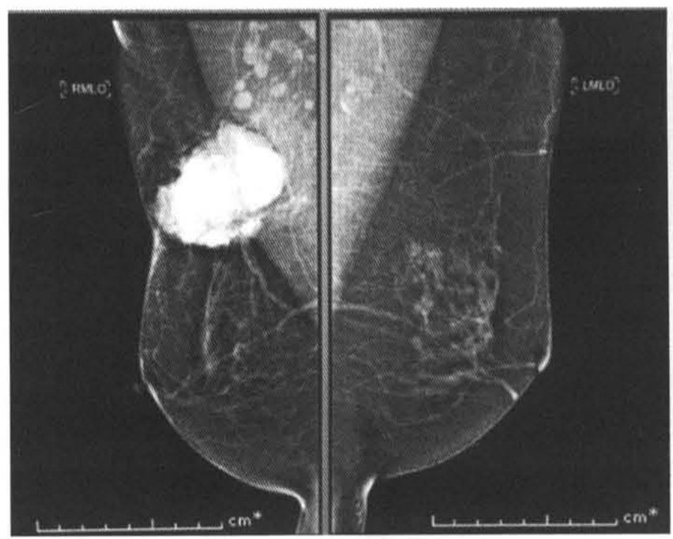

> **Caption (verbatim):** รูปที่ 32.1 และ รูปที่ 32.2 An irregular shape hyperdense mass with spiculated margin at right upper outer quadrant contained few macrocalcification with overlying skin thickening and retraction
> **Text in image (verbatim):** RMLO · LMLO · cm* · cm*
> **Description:** Bilateral MLO mammograms displayed back to back (RMLO left, LMLO right), each with a centimetre scale bar. In the right breast, in the upper part near the pectoralis/axillary region, there is a large, very dense (bright white), irregular mass; several small rounded densities (nodes) lie above it in the axillary region. The left breast shows scattered fibroglandular tissue without a comparable mass.
> **Identifiers in image:** none

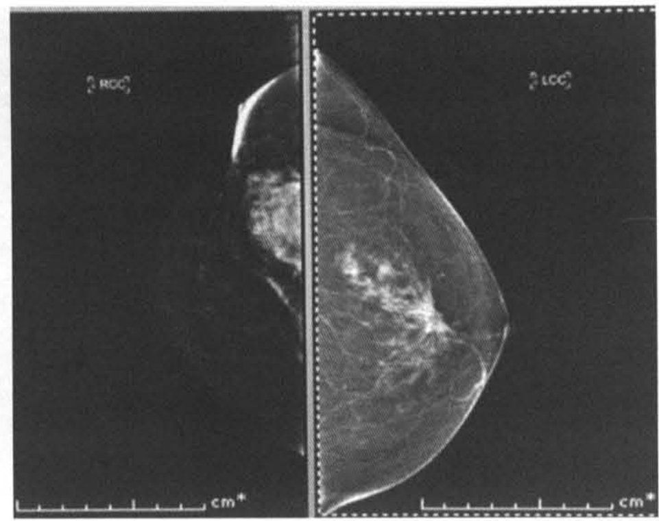

> **Caption (verbatim):** รูปที่ 32.1 และ รูปที่ 32.2 An irregular shape hyperdense mass with spiculated margin at right upper outer quadrant contained few macrocalcification with overlying skin thickening and retraction
> **Text in image (verbatim):** RCC · LCC · cm* · cm*
> **Description:** Bilateral CC mammograms displayed back to back (RCC left, LCC right) with centimetre scale bars. The right breast in CC view appears smaller and distorted, with a dense area and a thickened, retracted skin contour; the left breast shows a normal rounded contour with scattered fibroglandular tissue.
> **Identifiers in image:** none

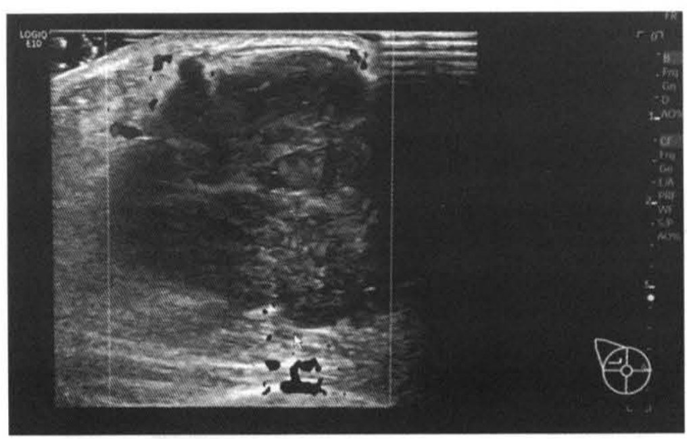

> **Caption (verbatim):** รูปที่ 32.3 A 5.3 x 4.1 x 3.0 cm hypervascular heterogeneous irregular hypoechoic mass with indistinct margin and microlobulations as well as overlying skin involvement at right upper outer quadrant suspicious pectoralis muscle involvement
> **Text in image (verbatim):** LOGIQ E10 · FR · B · Frq · Gn · D · AO% · CF · Frq · Gn · L/A · PRF · WF · S/P · AO% · 1 · 2 (small machine-parameter labels along the right side, partly blurred)
> **Description:** Breast ultrasound with a colour-Doppler box (shown in greyscale) occupying most of the field. A large, irregular, heterogeneous hypoechoic mass with indistinct, microlobulated margins fills the box beneath the skin; dark blobs representing colour flow signals (vascularity) are seen at its upper margin and at the lower part of the image. A probe-position pictogram is at lower right.
> **Identifiers in image:** none

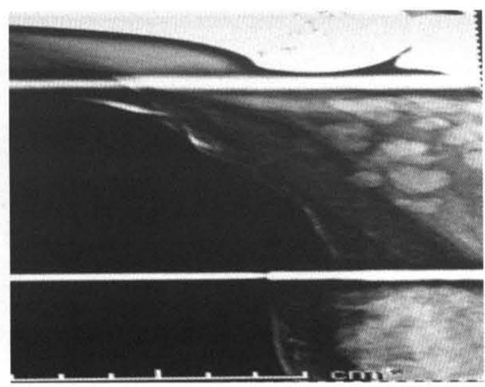

> **Caption (verbatim):** รูปที่ 32.4 Several enlarged right axillary nodes are observed.
> **Text in image (verbatim):** cm (scale bar along the bottom)
> **Description:** Magnified mammographic view of the right axillary region (image rotated, compression paddle edges seen as horizontal bright lines). Multiple rounded and oval densities (enlarged lymph nodes) cluster in the axillary soft tissue at the right part of the image. Centimetre scale along the bottom edge.
> **Identifiers in image:** none

<!-- p.319 (printed 305) -->
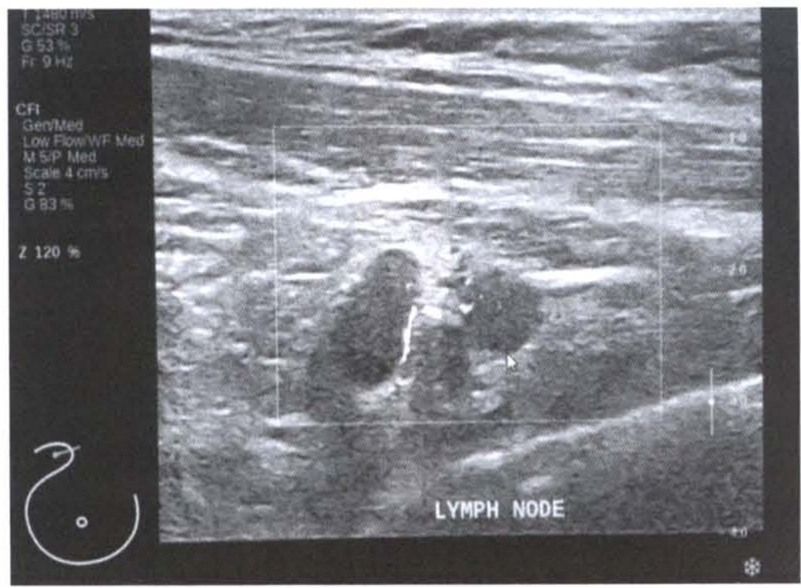

> **Caption (verbatim):** รูปที่ 32.5 Several enlarged right axillary nodes with loss of fatty hilar are detected.
> **Text in image (verbatim):** SC/SR 3 · G 53 % · Fr 9 Hz · CFI · Gen/Med · Low Flow/WF Med · M 5/P Med · Scale 4 cm/s · S 2 · G 83 % · Z 120 % · LYMPH NODE · 1.0 · 2.0 · 3.0 · 4.0 (top parameter line cut off)
> **Description:** Ultrasound of the right axilla with a colour-flow box (shown in greyscale) outlined in the centre. Within it, several oval, enlarged, uniformly hypoechoic lymph nodes lie clustered together without a visible echogenic fatty hilum; a bright linear flow signal runs through one node. Labelled "LYMPH NODE" at the bottom; body-marker pictogram at lower left; depth scale 1.0-4.0 at right.
> **Identifiers in image:** none

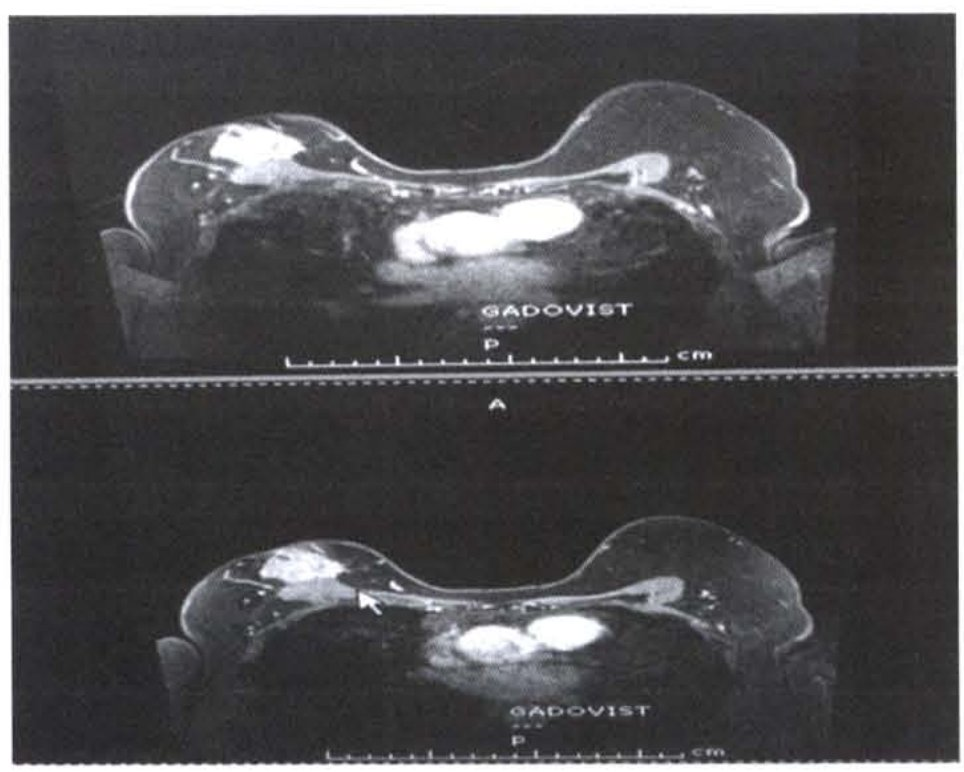

> **Caption (verbatim):** รูปที่ 32.6 และ รูปที่ 32.7 MRI after neoadjuvant chemotherapy. Interval decrased size of the malignant mass at right upper outer quadrant. Overall mass now is measured about 4 x 2.8 x 5.2 cm (AP x TR x V dimension ) from initially 6.1 x 6.5 x 6 cm (from prior US study). It still involves adjacent skin and pectoralis major muscle, causing skin retraction. (Mixed type II and III enhancement patterns) — (group caption) รูปที่ 32.7-32.1 BI-RADS 6 (Proven IDC)
> **Text in image (verbatim):** GADOVIST · P · A · cm (scale bars) · GADOVIST · P
> **Description:** Two axial (transverse) contrast-enhanced (Gadovist) fat-suppressed MRI slices of both breasts in prone position, stacked vertically. In the breast on the viewer's left (patient's right) there is a bright enhancing lobulated mass in the outer breast near the skin, with skin thickening/retraction; in the lower slice a white arrow points to its posterior extent toward the pectoralis muscle. The heart (bright) is seen centrally behind the breasts. The other breast shows no comparable enhancing mass. Centimetre scale bars under each slice.
> **Identifiers in image:** none

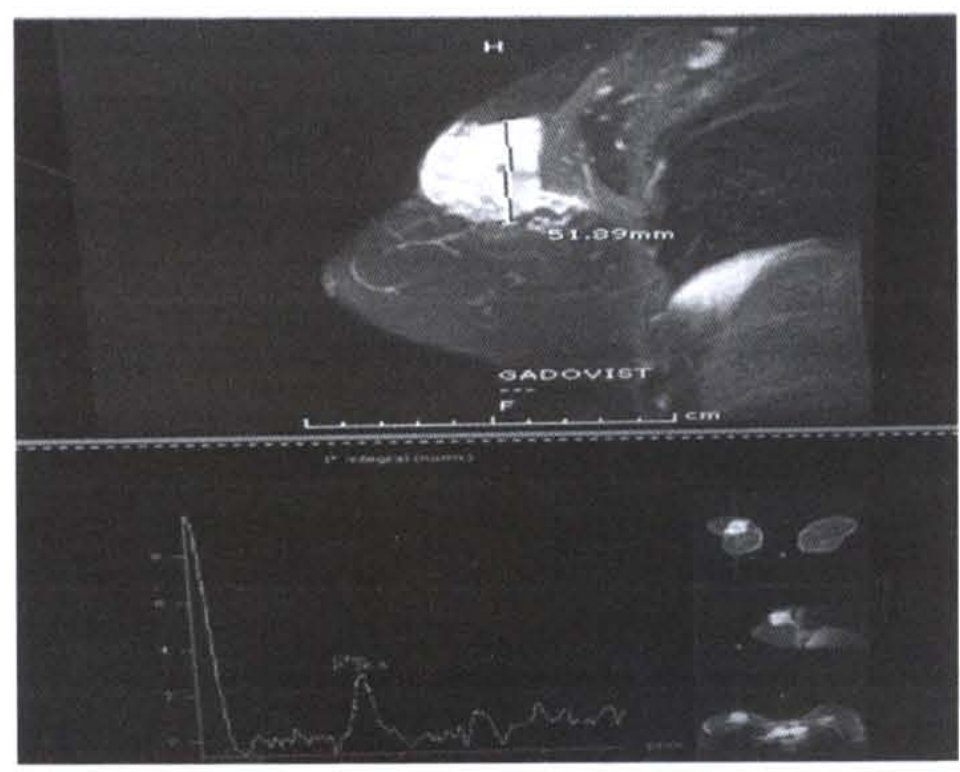

> **Caption (verbatim):** รูปที่ 32.6 และ รูปที่ 32.7 MRI after neoadjuvant chemotherapy. Interval decrased size of the malignant mass at right upper outer quadrant. Overall mass now is measured about 4 x 2.8 x 5.2 cm (AP x TR x V dimension ) from initially 6.1 x 6.5 x 6 cm (from prior US study). It still involves adjacent skin and pectoralis major muscle, causing skin retraction. (Mixed type II and III enhancement patterns) — (group caption) รูปที่ 32.7-32.1 BI-RADS 6 (Proven IDC)
> **Text in image (verbatim):** H · 51.89mm · GADOVIST · F · cm (small curve-axis labels illegible)
> **Description:** Upper panel: sagittal contrast-enhanced (Gadovist) MRI of the right breast showing a large, brightly enhancing mass in the upper breast abutting the chest wall, with a vertical measurement line labelled 51.89 mm. Lower panel: a signal-intensity/time kinetic curve graph (left) with a tall initial spike followed by lower, fluctuating values, and small thumbnail images (right) showing the region of interest on axial slices. Caption states mixed type II and III enhancement patterns.
> **Identifiers in image:** none

<!-- p.320 (printed 306) -->
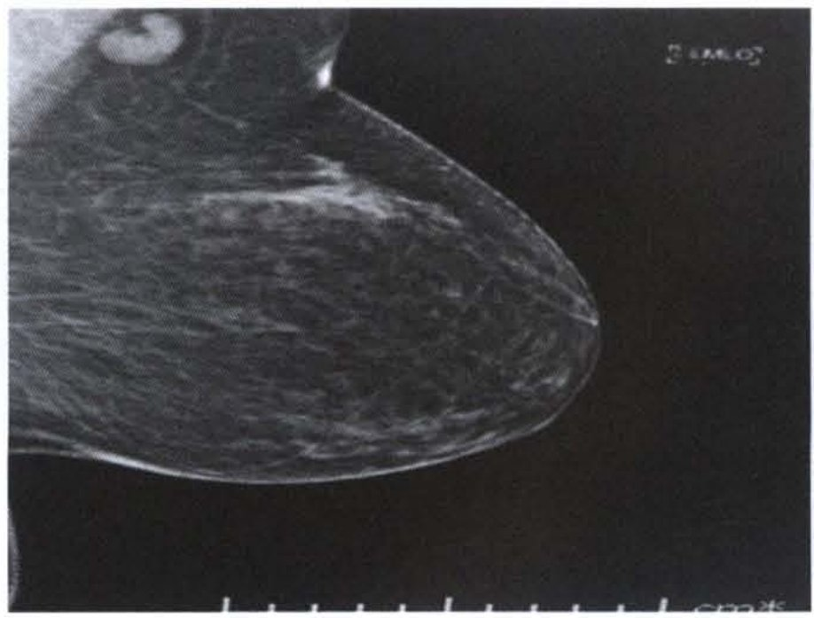

> **Caption (verbatim):** รูปที่ 33.1 There is no significant change of a group of punctate microcalcifications at left upper outer quadrant. No discrete mass or architectural distortion is seen. Increased size of a left axillary node with thickened cortex is seen. — (group caption) รูปที่ 33 ACR BIRADS : 4 (Occult breast cancer)
> **Text in image (verbatim):** LMLO · cm* (scale bar along the bottom)
> **Description:** Left MLO mammogram (rotated so the breast points to the right). Heterogeneous fibroglandular tissue fills the breast with no discrete mass or distortion; at the upper left corner (axillary region) a rounded, dense lymph node with a central lucency is visible over the pectoralis muscle. Centimetre scale bar along the bottom.
> **Identifiers in image:** none

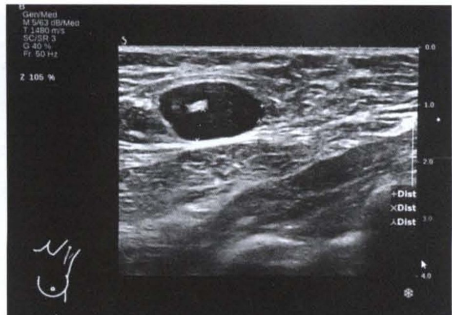

> **Caption (verbatim):** รูปที่ 33.2 Increased size of a 1.8 x 1.1 cm (previously 1.1x-0.6cm) left axillary node with thickened cortex. — (group caption) รูปที่ 33 ACR BIRADS : 4 (Occult breast cancer)
> **Text in image (verbatim):** B · Gen/Med · M 5/63 dB/Med · T 1480 m/s · SC/SR 3 · G 40 % · Fr 50 Hz · Z 105 % · 0.0 · 1.0 · 2.0 · 3.0 · 4.0 · +Dist · ×Dist · ⅄Dist
> **Description:** Ultrasound of the left axilla. An oval lymph node in the superficial soft tissue has a thick, uniformly hypoechoic cortex surrounding a small, bright echogenic central hilum, with caliper markers at its margins. Depth scale 0.0-4.0 at right; body-marker pictogram of the left breast/axilla at lower left. Small illegible probe-label text at the bottom left edge cropped out.
> **Identifiers in image:** none

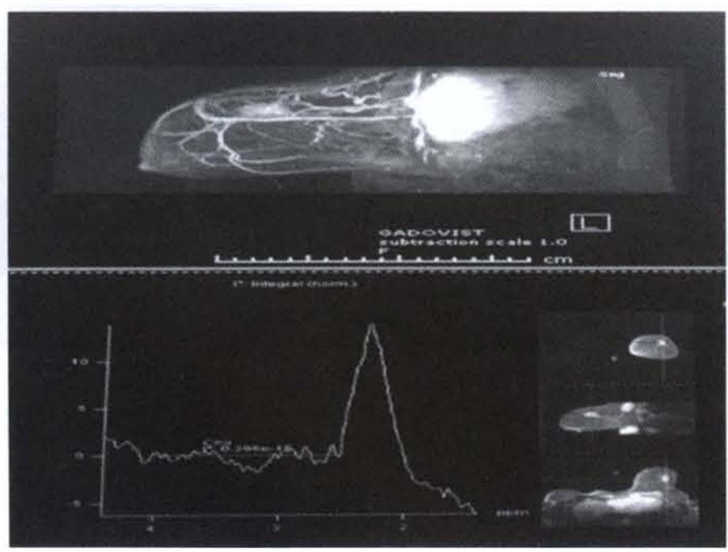

> **Caption (verbatim):** รูปที่ 33.3 There is focal non-mass enhancement at left upper outer quadrant. Kinetic curve assessment reveals mixed patterns ( type I %84.5, type II %7.5, and type III %8.0) — (group caption) รูปที่ 33 ACR BIRADS : 4 (Occult breast cancer)
> **Text in image (verbatim):** GADOVIST · subtraction scale 1.0 · F · cm · L · 10 · 5 · 0 · -5 · 4 · 3 · 2 · ppm (other small labels illegible)
> **Description:** Upper panel: contrast-enhanced subtraction MRI (maximum-intensity-type projection) of the left breast in a sagittal/lateral orientation, showing enhancing vessels branching through the breast and a bright, focal enhancing area toward the chest-wall side. Lower panel: a curve graph (x axis labelled in ppm, values 4 to 2; y axis -5 to 10) with a flat baseline and a single tall peak, beside three small thumbnail images of the breast with the sampled region.
> **Identifiers in image:** none

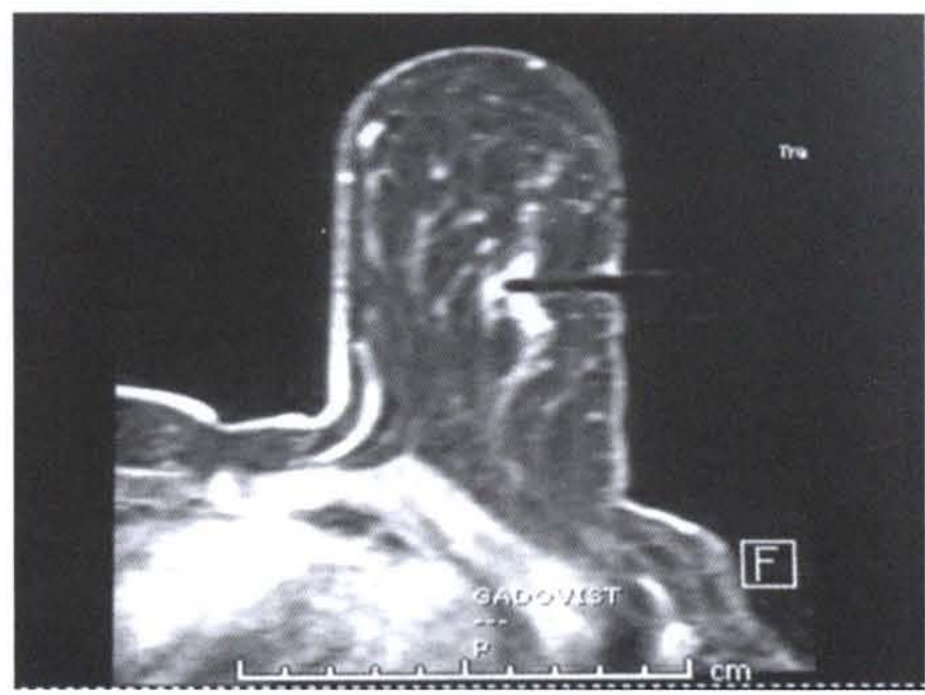

> **Caption (verbatim):** รูปที่ 33.4 Tissue diagnosis under MRI guidance (False negative by mammography and US) — (group caption) รูปที่ 33 ACR BIRADS : 4 (Occult breast cancer)
> **Text in image (verbatim):** Tra · F · GADOVIST · P · cm
> **Description:** Axial (Tra) contrast-enhanced (Gadovist) MRI of one breast in the prone biopsy position (breast hanging down, chest wall at the bottom). A dark straight linear artifact (the biopsy needle/obturator) enters horizontally from the right and its tip reaches a small area of enhancement in the central breast. A centimetre scale bar runs along the bottom.
> **Identifiers in image:** none

<!-- p.321 (printed 307) -->
### MRI

1. Fibro glandular tissue รายงานเหมือน mammography คือ entirely fat, scattered, heterogeneous, extreme density

2. background enhancement, minimal, mild, moderate, marked, symmetry, asymmetry

3. Masses ; oval, round, irregular 
   Margin ; circumscribed, not circumscribed (irregular spiculate)

4. Non mass enhancement ; focal, linear, segmental, multiple : internal enhancement ; heterogeneous, homogeneous, clumped, cluster ring.

5. Associated finding ; nipple retraction, invasion, skin retraction, invasion (directed invasion, inflammatory), pectoralis major invasion, chest wall invasion, axillary lymphadenopathy, architectural distortion

6. Location, depth, quadrant

7. Kinetic curve ; initial phase (slow, medium, fast) ; delayed phase (persistent, plateau, wash out)

8. ลักษณะอื่นๆ ; postoperative collection, signal void จาก foreign body, clips, implant.

ลักษณะ mammography BI-RADS 5 เช่น ill-defined, spiculate mass, linear branching pleomorphic calcification, skin or nipple retraction

ลักษณะ ultrasonography BI-RADS 5 เช่น irregular mass with spiculated margin, hypoechoic heterogeneous pattern complex cystic with irregular solid component

ลักษณะ MRI BI-RADS 5 เช่น irregular-shaped mass with spiculated margin, heterogeneous enhancement (rim pattern), pectoralis muscle or chest wall invasion, high initial contrast uptake with washout

<!-- p.322 (printed 308) -->
phenomenon, ลักษณะเฉพาะของ DCIS คือ segmental distribution of abnormal clumped enhancement

BI-RADS ของ mammography ultrasonography และ MRI ให้ score เหมือนกันคือ 0-6 ตาม finding ของแต่ละ imaging อาจให้ score ต่างกัน แม้ว่าเป็น lesion เดียวกัน เช่น mammography อาจให้ BI-RADS 3 MRI อาจให้เป็น BI-RADS 5

| **Fifth Edition** |
| --- |
| Category 0 : Incomplete-need additional imaging evaluation and/or prior mammograms for comparison |
| Category 1 : Negative |
| Category 2 : Benign |
| Category 3 : Probably benign |
| Category 4 : Suspicious A. Low suspicion for malignancy B. Moderate suspicion for malignancy C. High suspicion for malignancy |
| Category 5 : Highly suggestive of malignancy |
| Category 6 : Known biopsy-proven malignancy |

## BI-RADS categories

1. BI-RADS 0 : incomplete evaluation ต้องการการเปรียบเทียบกับการทำครั้งก่อนหรือต้องการทำ imaging อื่นเพิ่ม

2. BI-RADS 1 : negative examination

3. BI-RADS 2 : benign finding เช่น simple cysts, intramammary lymph nodes, implants, stable post-surgical changes, stable fibroadenoma, fatty lobule การวินิจฉัย cyst โดย ultrasonography มีความแม่นยำ 100% ถ้าขนาดมากกว่า 5 มิลลิเมตร ขนาดเล็กกว่านี้อาจแยกยากระหว่าง solid nodule หรือ complicated cyst

<!-- p.323 (printed 309) -->
4. BI-RADS 3 : Probably benign โอกาสเป็นมะเร็ง 0-2% solid mass ตรวจตามติด 4-6 เดือน 1 ครั้ง หลังจากนั้นปีละครั้งจนครบ 2 ปี microcalcification ตรวจติดตาม 6 เดือน และทุกปีจนครบ 2 ปี ถ้า lesion เหมือนเดิม ก็เปลี่ยนเป็น BI-RADS 2 ถ้ามีความเปลี่ยนแปลง ก็ต้องทำ biopsy

5. BI-RADS 4 : suspicion for malignancy ซึ่งแบ่งเป็น

   BI-RADS 4a : low suspicion for malignancy มีโอกาสเป็นมะเร็ง 3-10%

   BI-RADS 4b : moderate suspicion for malignancy มีโอกาสเป็นมะเร็ง 10-50%

   BI-RADS 4c : high suspicion for malignancy มีโอกาสเป็นมะเร็ง 50-94% ซึ่ง BI-RADS4

ควรพิจารณา biopsy ในกรณี BI-RADS 4a, 4b ที่ biopsy ผลเป็น fibroadenoma, complicated cyst ร่วมกับประวัติตรวจร่างกายที่คิดถึงมะเร็งเต้านมน้อย อาจพิจารณาตรวจติดตามด้วย imaging ที่พบ แต่กรณี biopsy เป็น papillary lesion, ADH จำเป็นต้องทำ excisional biopsy เนื่องจากการทำ core needle biopsy อาจ underestimate คือ ตรวจไม่พบมะเร็ง

6. BI-RADS 5 : highly suggestive for malignancy มีโอกาสเป็นมะเร็ง >95% จำเป็นต้อง biopsy

7. BI-RADS 6 : Histologically proven malignancy

เมื่อซักประวัติการตรวจร่างกาย และ imaging study เข้าได้กับมะเร็งเต้านม ก็จะทำการพิสูจน์ชิ้นเนื้อ ในกรณีที่ซักประวัติและตรวจร่างกายสงสัยมะเร็งเต้านมแต่ Mammography และ Ultrasonography เป็น BI-RADS 1, 2, 3 อาจพิจารณาส่งตรวจ MRI หรือพิสูจน์ชิ้นเนื้อ เนื่องจากการตรวจร่างกายพบมะเร็งเต้านมได้ 2-4% ในกรณี negative imaging study จำเป็นต้องทำการพิสูจน์ชิ้นเนื้อ แม้ว่า MRI จะ negatives หรือกรณีไม่สามารถทำ MRI ได้ โดยทั่วไป sensitivity ของ MRI อยู่ที่ 98-99 %

<!-- p.324 (printed 310) -->
การพิสูจน์ชิ้นเนื้อมีหลายวิธี

- Fine needle aspiration (FNA)
- Core needle biopsy (CNB)
- Vacuum-assisted biopsy (VAB)
- Needle-guided wide excision (NGWE)

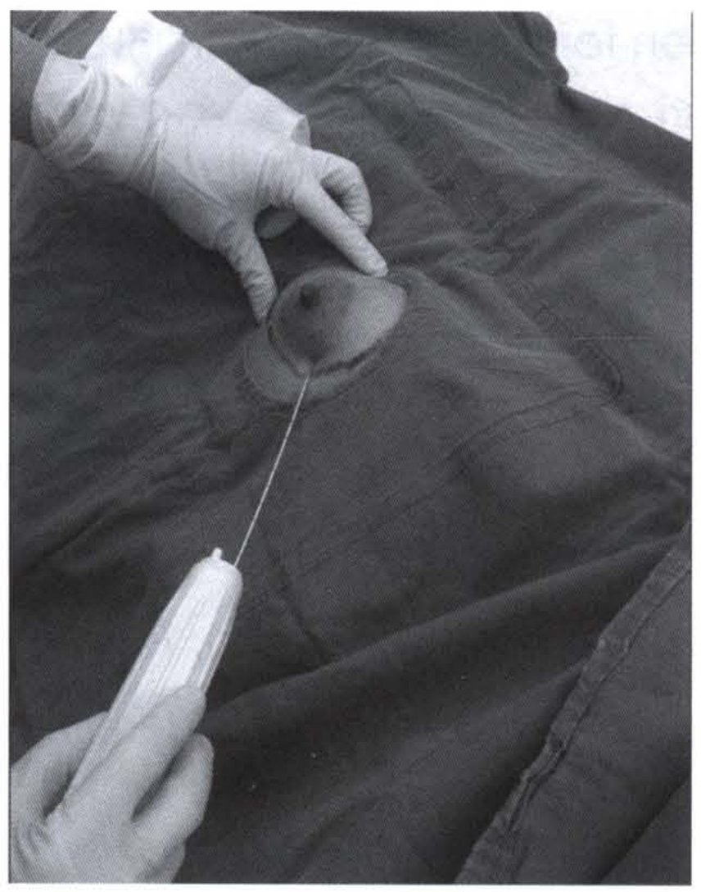

> **Caption (verbatim):** **รูปที่ 34.1** และ **รูปที่ 34.2**Core needle biopsy (CNB)
> **Text in image (verbatim):** none
> **Description:** Black-and-white clinical photograph (left image of the pair, รูปที่ 34.1). A breast is exposed through an opening in a dark surgical drape, with the nipple-areola visible at the centre. One gloved hand at the top presses/stabilises the breast near the areola with the fingers, while a second gloved hand at the lower left holds a pen-shaped biopsy gun whose long thin needle is inserted into the breast just below the areola. No face is shown.
> **Identifiers in image:** none

> **Caption (verbatim):** **รูปที่ 34.1** และ **รูปที่ 34.2**Core needle biopsy (CNB)
> **Text in image (verbatim):** none
> **Description:** Black-and-white photograph (right image of the pair, รูปที่ 34.2) on a dark background: a white rectangular card/paper strip carrying three thin, elongated, dark tissue cores laid vertically side by side (the core needle biopsy specimens). To the right lies a long thin biopsy needle placed vertically.
> **Identifiers in image:** none

> **Caption (verbatim):** **รูปที่ 34.3** Needle-guided wide excision (NGWE)
> **Text in image (verbatim):** none
> **Description:** Radiograph (specimen-type X-ray image, black background) showing a bright localisation wire entering from the top centre and ending in a double-hooked (anchor-shaped) tip. Around the hooked tip there is a faint, ill-defined cloud of soft-tissue density with a few small clustered bright (calcific) densities next to the wire, illustrating the wire-localised lesion in needle-guided wide excision.
> **Identifiers in image:** none

<!-- p.325 (printed 311) -->
FNA ใช้เข็ม 22-guage ต่อกับ 10-ml syringe ใช้ negative pressure ดูดขณะเคลื่อนเข็มภายในก้อน การทำ core-needle biopsy (CNB) คือใช้เข็ม 14-guage ซึ่งได้ชิ้นเนื้อขนาดใหญ่กว่า หรือการใช้ vacuum-assisted biopsy (VAB) (8-10 guage) ทำ biopsy ได้ 4-36 ชิ้น ใช้ในการเอาก้อน fibroadenoma 3 เซนติเมตร ออกโดยไม่ต้องผ่าตัด

| **Cytology reporting** | **Cytology reporting** | **Core biopsy reporting** | **Core biopsy reporting** |
| --- | --- | --- | --- |
| C1 | Unsatisfactory | B1 | Unsatisfactory/normal tissue only |
| C2 | Benign | B2 | Benign |
| C3 | Atypia probably benign | B3 | Benign, but of uncertain malignant potential |
| C4 | Suspicious of malignancy | B4 | Suspicious of malignancy |
| C5 | Malignant | B5 | Malignant B5a Noninvasive cancer B5b invasive cancer B5c Cancer of nonassessable invasiveness |

> **Caption (verbatim):** none
> **Text in image (verbatim):** Cytology reporting · Core biopsy reporting · C1 · Unsatisfactory · C2 · Benign · C3 · Atypia probably benign · C4 · Suspicious of malignancy · C5 · Malignant · B1 · Unsatisfactory/normal tissue only · B2 · Benign · B3 · Benign, but of uncertain malignant potential · B4 · Suspicious of malignancy · B5 · Malignant · B5a Noninvasive cancer · B5b invasive cancer · B5c Cancer of nonassessable invasiveness
> **Description:** Untitled boxed table with two merged header cells: "Cytology reporting" spanning the left two columns and "Core biopsy reporting" spanning the right two columns. Left side lists cytology categories C1–C5 with their meanings; right side lists core biopsy categories B1–B5 with their meanings, B5 (Malignant) being subdivided into B5a, B5b and B5c. In the printed layout the C and B rows are not horizontally aligned (the text lines wrap differently); the Markdown version pairs each C category with the B category of the same number. Saved because of the merged header cells.
> **Identifiers in image:** none

การทำ CNB ได้ประโยชน์กว่าการทำ FNA เนื่องจากสามารถแยกระหว่าง invasive หรือ in situ สามารถตรวจ immunohistochemistry เพื่อบอก prognosis ของโรคได้ ช่วยในการวางแผนการรักษาในกรณีต้องได้รับ neoadjuvant therapy

การพิจารณาเลือกวิธี biopsy ขึ้นอยู่กับ sensitivity, specificity underestimation sensitivity ขึ้นอยู่กับการวินิจฉัย ถ้าเป็น clinical presentation คือคลำพบก้อน FNA และ CNB sensitivity ใกล้เคียงกันคือ FNA 95% CNB 95-99%60, 61 ในกรณีที่ตรวจพบจาก screening sensitivity ของ FNA 50-82%, CNB 75-93%60-63 การตรวจพบโดย screening ด้วย Ultrasonography sensitivity ของ Ultrasound guided FNA และ CNB คือ 86% และ 93% ตามลำดับ61 ถ้าทำ stereotactic guided sensitivity ของ FNA และ CNB คือ 72% และ 92% ตามลำดับ specificity ของ FNA และ CNB ใน nonpalpable lesion คือ 99%62

<!-- p.326 (printed 312) -->
การตรวจพบโดย screening มักเป็น lesion ขนาดเล็ก ซึ่งทำให้ CNB มักมี sensitivity ดีกว่า FNA และมี Unsatisfied sample คือได้ tissue ไม่เพียงพอหรือไม่ตรง lesion ที่จะวินิจฉัยน้อยกว่า FNA โดย FNA มี Unsatisfied sample 15-35% CNB 0-5%60, 61, 63 นอกจากนี้ต้องพิจารณา underestimation เช่น ผลเป็น ADH แต่มี DCIS หรือ invasive cancer ใน lesion ซึ่งจะพบได้โดยการทำ excisional biopsy โดย Underestimation ของ ADH 21-50%64-66 DCIS พบ underestimation คือมี invasive cancer 25-43%67-70

การรายงานผล FNA และ CNB แบ่งเป็นกลุ่มตามลักษณะที่พบ เช่น ได้ tissue ไม่พอก็จะเป็น C1, B1 (หรือได้ normal breast tissue ใน CNB) และวินิจฉัย Malignant ใน C5, B5 ตาม NHSBSP (National Health Service Breast Screening Programme, UK)71 criteria เพื่อเป็นแนวทางในการวินิจฉัยร่วมกันระหว่างศัลยแพทย์ รังสีแพทย์ และพยาธิแพทย์ในการลงความเห็นว่าจะตรวจติดตาม หรือทำ excision biopsy ในรายที่ผลไม่ใช่ C5 และ B5

อาการที่มา พบน้อยกว่าการคลำก้อนพบคือ การมี nipple discharge โดย serous หรือ bloody nipple discharge อาจเป็นอาการของมะเร็งเต้านม การวินิจฉัยใช้การตรวจร่างกายโดยกดบริเวณ 4 quadrant ทีละ quadrant ถ้า lesion อยู่บริเวณ quadrant ไหน ก็จะมี nipple discharge ออก เวลากดถ้าไม่ออกเลยก็กดบริเวณ nipple areolar ดูลักษณะสี multiple หรือ single duct การตรวจเพิ่มเติมคือ ultrasonography อาจพบ dilated duct ที่มี nodule การสั่ง ductography ก็ช่วยวินิจฉัยตำแหน่งของโรคได้ ถ้าไม่พบอาจส่ง MRI ซึ่งช่วยวินิจฉัย occult lesion ได้ เมื่อพบ lesion ถ้าทำ CNB ได้ผล papillary lesion จำเป็นต้องทำ excision lesion เพื่อวินิจฉัย intraductal papilloma หรือ invasive cancer โดยการทำ Microdochectomy ใช้ probe ตามรูที่มี discharge อาจทำร่วมกับ ultrasound marked lesion เพื่อการ excision ที่ตรงกับ pathological duct

<!-- p.327 (printed 313) -->

> **Caption (verbatim):** **รูปที่ 35** การทำ microdochectomy ใน case bloody nipple discharge
> **Text in image (verbatim):** none
> **Description:** Three black-and-white intraoperative photographs side by side showing the steps of microdochectomy. Left: the nipple, with a fine lacrimal-type probe inserted into the discharging duct orifice at its tip (probe handle at the lower left), and a periareolar incision held open with instruments/retractors beside the nipple. Middle: close-up of the opened wound with the dissected duct being lifted with forceps and retracted with instruments. Right: the excised duct specimen, an elongated strip of tissue, lying on a drape and held with forceps.
> **Identifiers in image:** none

มะเร็งเต้านมแบ่งตามลักษณะเซลล์ คือ invasive ductal carcinoma ซึ่งพบมากที่สุดคือ 80% ของมะเร็งเต้านม invasive lobular carcinoma พบ 10% นอกจากนี้เป็น medullary carcinoma, mucinous carcinoma, papillary carcinoma และ tubular carcinoma, Paget's disease of the nipple มีอาการบริเวณ nipple areolar โดยมี chronic eczema บางครั้งเป็นแผล ซึ่งมักจะมี DCIS อยู่ในเต้านมนั้น อาจคลำก้อนได้หรือไม่ได้ ถ้าคลำก้อนในเต้านมข้างนั้นได้ มักพบว่ามี invasive cancer ร่วมด้วย การวินิจฉัยทำโดยการตัดชิ้นเนื้อบริเวณ nipple areolar (Full thickness biopsy)

การจัด stage ของมะเร็งเต้านมแบ่งเป็น clinical staging คือ การใช้ตรวจร่างกาย และ imaging study และ pathologic staging โดยแบ่งตาม T, N, M การให้ staging สำหรับ neoadjuvant treatment เติม yc T (clinical T), yp T (pathologic T), yc N (clinical N), yp N (pathologic N) โดย AJCC edition ที่ 872 มีความเปลี่ยนแปลงคือการใช้ grade ของ Tumor แบ่งเป็น grade 1, 2, 3 HER2 status positive หรือ negative และ ER PR status positive หรือ negative ใช้ร่วมกับ TNM ในการจัด stage ซึ่งมีผลทั้งลดหรือเพิ่ม stage TNM เดิมใน edition ที่ 7 มีประโยชน์ในการบอก prognosis และการวางแผนการรักษา

การรักษามะเร็งเต้านมมีความเปลี่ยนแปลงจากอดีตจนถึงปัจจุบัน ด้วยจุดประสงค์ให้ได้ผลการรักษาที่ดีขึ้น ซึ่งเปรียบเทียบจากอัตราการมีชีวิตอยู่โดยรวม (overall survival) หรืออัตราการมีชีวิตอยู่โดยปราศจากโรค (disease free survival) การรักษาที่เปลี่ยนแปลงไปเนื่องจากการศึกษาวิจัยมากมาย โดยเฉพาะการวิจัยในระดับโมเลกุล ทำให้เข้าใจการดำเนินของโรคได้ดีขึ้นจากเดิมซึ่งเข้าใจว่ามะเร็งเต้านมเป็นโรคเฉพาะที่ จึงมีการทำผ่าตัดเต้านมแบบ Radical Mastectomy (RM) ซึ่ง William Stewert Halsted ได้บรรยายไว้ใน ค.ศ. 189473 แต่เนื่องจากเมื่อติดตามการรักษาแล้วพบว่า แม้ว่าทำผ่าตัดอย่างมากก็ตาม ยังมีผู้

<!-- p.328 (printed 314) -->
ป่วยเสียชีวิตจากมะเร็งเต้านมจากการกลับเป็นซ้ำที่เดิมและการแพร่กระจายไปอวัยวะอื่น การเข้าใจการดำเนินของโรค ประกอบกับวิวัฒนาการของเทคโนโลยีทำให้มีการนำการฉายรังสีและการใช้ยาเคมีบำบัด ซึ่ง Bonadonna ได้รายงานไว้ในปี ค.ศ. 197674 นับจากนั้นมาเคมีบำบัดก็มีบทบาทในการรักษามะเร็งเต้านม เนื่องจากความรู้ความเข้าใจได้เปลี่ยนไปจากโรคที่เข้าใจว่าเป็นเฉพาะที่ เป็นโรคที่สามารถแพร่กระจายไปยังอวัยวะต่างๆ ได้

นอกจากความเปลี่ยนแปลงในการรักษาโดยการใช้เคมีบำบัด การพัฒนาในการใช้รังสีรักษาก็เป็นปัจจัยต่อความเปลี่ยนแปลงของการผ่าตัดเต้านม เนื่องจากการใช้รังสีรักษาช่วยควบคุมโรคเฉพาะที่คือ บริเวณเต้านม, ผนังทรวงอก และต่อมน้ำเหลือง axilla และบริเวณอื่น เช่น internal mammary, infraclavicular และ supraclavicular lymph nodes แต่การใช้รังสีรักษาก็ไม่อาจควบคุมโรคได้ดีถ้าการผ่าตัดหลงเหลือรอยโรคไว้ Halsted เป็นศัลยแพทย์คนหนึ่งในยุคนั้นที่คิดว่าควรจะทำการเลาะต่อมน้ำเหลืองบริเวณอื่น เช่น supraclavicular, internal mammary หลังจากนั้นมีการนำการฉายรังสีเพื่อกำจัดมะเร็งบริเวณต่อมน้ำเหลือง intesnal mammary และอีกหลายรายงานเกี่ยวกับการเลาะต่อมน้ำเหลืองบริเวณ internal mammary ในปี ค.ศ. 1956 Owen H Wangensteen75 ได้รายงานการผ่าตัด super-radical mastectomy เนื่องจากพบว่ายังมีการกลับเป็นซ้ำบริเวณ internal mammary lymph node, supraclavicular lymph node แม้ว่าจะทำ radical mastectomy แล้วก็ตาม

การศึกษาถึงการแพร่กระจายของต่อมน้ำเหลืองอื่นนอก axilla เช่น internal mammary มีมาตั้งแต่ก่อนปี ค.ศ. 1950 แต่ยังไม่มีการทำกันมากนัก หลังจากปี ค.ศ. 1950 มีรายงานการผ่าตัด extended radical mastectomy โดย Jerome A Urban76 คือการเลาะต่อมน้ำเหลือง internal mammary (IMN) นอกเหนือจากการทำ radical mastectomy และพบการกระจายไปต่อมน้ำเหลือง internal mammary ซึ่งเปลี่ยน staging และการรักษา ปัจจุบันมีการนำ sentinel lymph node biopsy มาใช้วินิจฉัยการกระจายไป internal mammary lymph node ได้เช่นกัน โดยการผ่าตัดไม่มากเท่าการทำ extended radical mastectomy

## การผ่าตัดมะเร็งเต้านมในอดีต

Radical mastectomy คือการผ่าตัดเต้านมออกทั้งหมด รวมทั้งกล้ามเนื้อ pectoralis major, minor, โดยตัดผิวหนังออกเป็นบริเวณกว้าง รวมทั้ง fascia ของส่วนบนของกล้ามเนื้อ

<!-- p.329 (printed 315) -->
rectus, serratus magnus, subscapularis, latissimus dorsi และ teres major รวมทั้งเลาะต่อมน้ำเหลืองบริเวณ axilla ทั้ง 3 ระดับ (level I ถึง III) ซึ่งรายงานโดย William Stewart Halsted ในปี ค.ศ. 1894 ด้วยความเข้าใจการดำเนินโรคของมะเร็งเต้านมว่าเป็นโรคเฉพาะที่และการกระจายไปอวัยวะต่างๆ ผ่านทางผิวหนัง และต่อมน้ำเหลืองไม่ได้ผ่านทางเส้นเลือด ดังนั้นการผ่าตัดให้มากพอเท่านั้นที่จะทำให้มีโอกาสหายได้ การทำ Radical Mastectomy จะทำการผ่าตัดบริเวณเต้านมและผิวหนังเป็นบริเวณกว้างโดยมักจะต้องปิดด้วย flap หรือ skin graft มักใช้ skin graft มากกว่า เนื่องจากทำได้เร็วและภาวะแทรกซ้อนน้อย แต่แม้ว่าจะทำการผ่าตัดอย่างมากแล้วก็ยังพบว่าเกิดโรคกลับเป็นซ้ำได้อีก ในปี ค.ศ. 1898 Halsted WS77 ทำการผ่าตัด Radical Mastectomy รวมทั้งการเลาะต่อมน้ำเหลืองบริเวณ supraclavicular 232 ราย โดยติดตามการรักษาพบว่า 25% ไม่พบมะเร็งกระจายไปต่อมน้ำเหลือง แต่พบการแพร่กระจายของโรค 23.4% ในเวลาที่แตกต่างกัน ผู้ป่วย 44 ราย ในจำนวน 119 ราย ที่ทำการเลาะต่อมน้ำเหลือง supraclavicular พบมะเร็งกระจายบริเวณต่อมน้ำเหลืองทั้ง 2 ระดับ ในกลุ่มที่ไม่มีมะเร็งกระจายไปต่อมน้ำเหลืองกับกลุ่มที่มีมะเร็งกระจายไปต่อมน้ำเหลืองที่ axilla แต่เพียงอย่างเดียว มี overall survival (>3 years follow up) 75% และ 24.5% ตามลำดับ กลุ่มที่มีมะเร็งกระจายไปต่อมน้ำเหลือง axilla และ supraclavicular มี overall survival เพียง 7% แม้ว่าการผ่าตัดจะมากกว่าการทำ Radical Mastectomy แต่ก็ยังแนะนำให้ทำในรายที่คลำพบต่อมน้ำเหลืองที่คอโตและสามารถตัดได้ หรือกรณีที่ทำผ่าตัดแล้วพบว่ามีการกระจายไปต่อมน้ำเหลืองบริเวณ mid และ apex ของ axilla โดยเลาะต่อมน้ำเหลืองที่คอจนถึงระดับ carotid bifurcation อัตราตายจากการผ่าตัดในกลุ่มที่ทำการเลาะต่อมน้ำเหลือง supraclavicular ร่วมกับ radical mastectomy คือ 3% ในกลุ่มที่ทำเพียง radical mastectomy คือ 0.88% แม้ว่าผลการรักษาในกลุ่มที่มีมะเร็งกระจายไปทั้ง axilla และ supraclavicular ไม่ดีก็ตาม แต่เนื่องจากยังไม่มีการรักษาอื่นที่สามารถใช้ร่วมกันได้ในขณะนั้น เช่น การฉายแสงและเคมีบำบัด การทำ RM ร่วมกับการเลาะต่อมน้ำเหลือง supraclavicular จึงยังเป็นการผ่าตัดสำหรับมะเร็งเต้านมอยู่ระยะหนึ่ง ประโยชน์ของการทำผ่าตัดและเลาะต่อมน้ำเหลืองมากกว่าที่ axilla คือ ช่วยบอกการพยากรณ์โรคได้ดีขึ้น จึงเป็นที่มาของการผ่าตัดเลาะต่อมน้ำเหลืองหรือการฉายแสงบริเวณอื่นนอก axilla เช่น internal mammary ในเวลาต่อมา

<!-- p.330 (printed 316) -->
ในช่วงปลายของปี ค.ศ. 1940 การเลาะต่อมน้ำเหลืองที่มากกว่าการทำ Radical Mastectomy มีรายงานในหลายสถาบัน โดยในปี พ.ศ. 1949 Owen H Wangensteen รายงานการทำ super-radical mastectomy ในช่วงแรกทำเป็น 2 ระยะ คือ ทำการเลาะต่อมน้ำเหลืองเพิ่มเติมหลังจากการทำ radical mastectomy 4-6 สัปดาห์ ถ้าต่อมน้ำเหลือง axilla พบการแพร่กระจายของมะเร็ง หรือในรายที่มะเร็งอยู่บริเวณด้านในของเต้านม โดยแผลผ่าตัดเริ่มจากบริเวณ thyroid cartilage ผ่านบริเวณ sternum ถึง intercostals space ที่ 4 และตัด sternum เพื่อเลาะต่อมน้ำเหลือง supraclavicular ตั้งแต่ขอบบนของ thyroid cartilage จนถึง mediastinum โดยเลาะต่อมน้ำเหลืองออกจาก brachial plexus, subclavian vessels, great vessels บริเวณ anterior และ superior mediastinum, pleura, fat และต่อมน้ำเหลืองบริเวณ internal mammary จนถึง intercostals space ที่ 5 โดยพบการกระจายของมะเร็งไปต่อมน้ำเหลืองนอก axilla 58% พบไปที่ต่อมน้ำเหลือง internal mammary มากกว่า supraclavicular ตำแหน่งของก้อนทางด้านในพบมะเร็งกระจายไปต่อมน้ำเหลือง internal mammary มากกว่าก้อนทางด้านนอกของเต้านม (64% เทียบกับ 39%) เป็นการผ่าตัดที่ทำเป็นบริเวณกว้าง อัตราตายจากการผ่าตัด 12.5% จึงทำให้ไม่เป็นที่นิยม มี 5-year survival เพียง 17% เนื่องจากทำในรายที่เป็น advanced breast cancer

Jerome A Urban76 พบว่าผู้ป่วยมะเร็งเต้านมระยะที่หนึ่งจำนวนหนึ่งเสียชีวิตจากการแพร่กระจายของมะเร็ง และพบว่า 70% ของ chest wall recurrence หลังจากทำ radical mastectomy เกิดบริเวณ parasternum ในปี ค.ศ. 195278 จึงรายงานการผ่าตัด Extended-Radical Mastectomy (ERM) โดยทำในผู้ป่วยมะเร็งเต้านมระยะที่ 1 และ 2 ในรายที่ก้อนอยู่บริเวณตรงกลางและด้านในของเต้านม การเลาะต่อมน้ำเหลือง internal mammary เริ่มจากการตัดกล้ามเนื้อ pectoralis major ระหว่าง sternum และ clavicle ซึ่งจะพบซี่โครงซี่แรก ด้านล่างตัดบริเวณกล้ามเนื้อ anterior rectus จะพบซี่โครงที่หก หลังจากนั้นตัดกล้ามเนื้อ intercostals และ pleura บริเวณช่องซี่โครงที่ 1 ตัดและผูก internal mammary vessels บริเวณขอบล่างของกระดูกซี่โครงที่ 1 และทำเหมือนกันบริเวณช่องกระดูกซี่โครงที่ 5 เพื่อตัดและผูก vessels บริเวณขอบบนของกระดูกซี่โครงที่ 6 หลังจากนั้นตัด sternum ประมาณ 1 เซนติเมตร และตัดกระดูกซี่โครงถัดจาก costochondral junction ของกระดูกซี่โครงที่ 2 ถึง 5 ต่อมน้ำเหลือง internal mammary ก็จะเป็นชิ้นเดียวกับเต้านมและกล้ามเนื้อ pectoralis ผนังทรวงอกปิดด้วย fascia lata ช่องทรวงอกระบายด้วยท่อระบาย 2 วัน ไม่มีผู้ป่วยเสียชีวิตจากการผ่าตัด

<!-- p.331 (printed 317) -->

> **Caption (verbatim):** **รูปที่ 36** การทำ ERM โดยเลาะ IMN ออกไปพร้อมกับ IMA, ตัด rib ถัดจาก costochondral junction รวมเป็นชิ้นเดียวกับเต้านมและ pectoralis muscle (B = breast, L = lung, R = 2nd rib, M = pectoralis muscle)
> **Text in image (verbatim):** M · R · B · L
> **Description:** Hand-drawn pencil illustration of an operative field for extended radical mastectomy (ERM), viewed from above, with the skin flaps held open by multiple retraction sutures around the wound edge. Upper part: a dark band of muscle labelled M (pectoralis muscle). Left: a rounded mass labelled B (breast). Centre: a vertical en bloc segment of chest wall with transected ribs; the upper cut rib is labelled R (2nd rib), and a longitudinal vessel bundle (internal mammary vessels/nodes) runs vertically along it. Right of this segment the chest wall is opened, exposing the lung labelled L inside the thoracic cavity. Lower part: intact ribs and intercostal muscles below the resected segment, with fatty tissue at the margins of the wound.
> **Identifiers in image:** none

มีการศึกษามากมายที่บ่งบอกว่าการทำ ERM ให้ผลการรักษาที่ดีกว่า RM ในช่วงนั้นก็มีการศึกษาเปรียบเทียบระหว่างการทำ ERM และการผ่าตัดที่น้อยกว่านั้น ร่วมกับการใช้การฉายแสง เช่น การศึกษาโดย Kaae S และ Johansen H79 ในปี ค.ศ. 1951-ค.ศ. 1956 โดยการศึกษา random ระหว่างการทำ ERM และ Simple Mastectomy (SM) ร่วมกับการฉายแสง โดยวิธีของ McWhirter โดยไม่ทำการเลาะต่อมน้ำเหลืองบริเวณที่ฉายแสง ประกอบด้วย ต่อมน้ำเหลืองบริเวณ axilla, supraclavicular และบริเวณผนังทรวงอก รวมถึงต่อมน้ำเหลือง internal mammary พบว่า, 5-year survival rate ที่ไม่แตกต่างกัน คือ ในกลุ่ม ERM 69%, กลุ่ม SM ร่วมกับการฉายแสง 67%

แม้ว่าจะมีการศึกษาที่พยายามใช้การฉายแสงแทนการเลาะต่อมน้ำเหลือง แต่ผลการรักษาก็ยังไม่ดีเท่ากับการผ่าตัด หรือได้ผลเท่ากันในการติดตามระยะสั้น จึงยังมีการเลาะต่อมน้ำเหลือง internal mammary ในหลายสถาบันซึ่งเปลี่ยนระยะของโรค การพยากรณ์โรค เช่น การทำ ERM โดย Cody HS และ Urban J80 (ค.ศ. 1965-ค.ศ. 1978) เมื่อติดตามหลังผ่าตัด 10 ปี พบว่า ในผู้ป่วยที่ต่อมน้ำเหลือง axilla ไม่มีการแพร่กระจาย แต่มีการกระจายไปต่อมน้ำเหลือง internal mammary มีความเสี่ยงต่อการเกิดโรคซ้ำ

<!-- p.332 (printed 318) -->
หรือตายมากกว่ากลุ่มที่ไม่มีการกระจายไปต่อมน้ำเหลือง internal mammary ถึง 2 เท่า และพบว่าในผู้ป่วยที่มีโรคระยะ T1N0 พบมีการกระจายไปต่อมน้ำเหลือง internal mammary 19.6% ซึ่งผู้ป่วยกลุ่มนี้อาจไม่ได้รับ systemic adjuvant therapy ถ้าทำการประเมินเพียงต่อมน้ำเหลือง axilla

นับตั้งแต่มีการใช้เคมีบำบัด การทำผ่าตัดรักษามะเร็งเต้านมมีแนวโน้มที่จะทำการตัดและเลาะต่อมน้ำเหลืองที่ลดลงจากการทำ ERM และ RM ในช่วงแรก เป็น MRM ในช่วงหลัง การศึกษาใน ค.ศ. 1965-ค.ศ. 167881 โดยการทำผ่าตัดที่ลดลงไม่ทำให้ผลการรักษาที่แย่ลง กลับพบว่าในช่วง 5 ปีหลัง 10-year disease free survival เพิ่มขึ้น 11% เทียบกับช่วง 5 ปีแรก แต่เนื่องจากช่วง 5 ปีหลังของการศึกษา จำนวนผู้ป่วยระยะ T1N0 เพิ่มขึ้นจากช่วงแรกและมีการใช้เคมีบำบัดถึง 19% เทียบกับที่ไม่ได้ใช้เลยในช่วงแรก และแนวโน้มการฉายแสงก็ลดลงตามระยะของโรคที่พบระยะแรกมากขึ้น แต่อย่างไรก็ตามในช่วง ค.ศ. 1975-ค.ศ. 1978 ซึ่งเป็นช่วงที่มีการใช้เคมีบำบัดมากขึ้น ผู้ป่วย 53% ยังคงทำการผ่าตัด RM หรือ ERM การผ่าตัดมีความสำคัญในการกำจัดโรคเฉพาะที่และช่วยในการเลือกการรักษาเพิ่มเติม เช่น การฉายแสง ซึ่งจะทำการฉายแสงบริเวณ internal mammary และ supraclavicular เมื่อมีการกระจายไปต่อมน้ำเหลือง axilla โดยเฉพาะ levels II และ III, ก้อนขนาดใหญ่, ก้อนอยู่ด้านใน และพบการกระจายของมะเร็งที่ต่อมน้ำเหลือง internal mammary

Veronesi U82 ได้ทำการศึกษาถึงผลการผ่าตัดต่อการรักษามะเร็งเต้านมใน ค.ศ. 1964-ค.ศ. 1968 จำนวน 737 ราย โดย randomize ระหว่าง RM และ ERM (ทำ RM ร่วมกับเลาะ IMN ระหว่าง intercostals space ที่ 1-4, internal mammary vessels และ pleura ส่วนที่ติดกันออก) โดยมะเร็งในระยะ T1-3aN0-1 และไม่มีการได้รับ adjuvant therapy ใดๆ และติดตามการรักษาที่นานกว่า การศึกษาของ Peterson CG คือ 30 ปี พบว่า overall survival ไม่แตกต่างกัน โดยมะเร็งเต้านมเป็นสาเหตุการตาย 71% แต่การเลาะ IMN ช่วยบอก prognosis คือ annual death rate ในกลุ่มที่ไม่มีมะเร็งกระจายต่อมน้ำเหลือง 0.031, กลุ่มที่พบการกระจาย IMN 0.055, กลุ่มที่กระจายไปต่อมน้ำเหลือง axilla 0.077 และกลุ่มที่พบการกระจายทั้ง 2 ที่ annual death rate ที่ 0.163 IMN จึงช่วยบอก prognosis และมีประโยชน์ในการพิจารณาให้ adjuvant therapy (ตารางที่ 2)

<!-- p.333 (printed 319) -->
**ตารางที่ 17** อัตราการรอดชีวิตจำแนกตามการพบมะเร็งแพร่กระจายที่ IMN, AN

| การศึกษา (ปี ค.ศ.) | จำนวนผู้ป่วย | ระยะเวลาติดตามการรักษา (ปี) | DFS (%) AN- / IMN- | DFS (%) AN- / IMN+ | DFS (%) AN+ / IMN- | DFS (%) AN+ / IMN+ | DFS (%) All | OS (%) AN- / IMN- | OS (%) AN- / IMN+ | OS (%) AN+ / IMN- | OS (%) AN+ / IMN+ | OS (%) All |
| --- | --- | --- | --- | --- | --- | --- | --- | --- | --- | --- | --- | --- |
| Urban JA83 (1971) | 500 | 5 | 80 | 53 | 62 | 43 | 65.4 | 87 | 64 | 68 | 54 | 7.34 |
| Urban JA83 (1971) | 500 | 10 | 72 | 52 | 53 | 20 | 54 | 75 | 52 | 53 | 21 | 52.5 |
| Livingston SF84 (1974) | 583 | 5 | 85 | 53 | 52 | 32 | 68 | 89 | 60 | 61 | 50 | 75 |
| Livingston SF84 (1974) | 583 | 10 | 78 | 38 | 50 | 17 | 60 | 82 | 38 | 54 | 17 | 63 |
| Valagussa P85 (1978) | 716 | 5 | 80 | 57 | 54 | 13 |  | 84 | 64 | 67 | 28 |  |
| Valagussa P85 (1978) | 716 | 10 | 73 | 50 | 44 | 0 |  | 79 | 50 | 56 | 3.5 |  |
| Veronesi U86 (1985) | 1119 | 10 | 72.8 | 51.9 | 47.2 | 24.9 |  | 80.4 | 53 | 54.6 | 30 |  |
| Cody HS80 (1995) | 195 | 5 | 81.6 | 65.9 | 67.8 | 46.2 | 71.3 | 88.8 | 70.2 | 85.1 | 61.1 | 81.9 |
| Cody HS80 (1995) | 195 | 10 | 74.4 | 53.9 | 59.3 | 41.8 | 63.9 | 81.3 | 58.5 | 73.4 | 53 | 72.8 |
| Sugg SL87 (2000) | 286 | 10 | 84 | 28 | 61 | 26 |  |  |  |  |  |  |
| Sugg SL87 (2000) | 286 | 15 | 81 | 28 | 50 | 23 |  |  |  |  |  |  |
| Sugg SL87 (2000) | 286 | 20 | 76 | 28 | 46 | 23 |  |  |  |  |  |  |
| Veronesi U88 (2008) | 663 | 5 | 91 | 67 | 73 | 84 |  | 97 | 92 | 91 | 96 |  |

หมายเหตุ: AN = Axillary Nodes, IMN = Internal Mammary Nodes 
\+ = พบการกระจายของมะเร็งที่ต่อมน้ำเหลือง, - = ไม่พบการกระจายของมะเร็งที่ต่อมน้ำเหลือง 
DFS = Disease Free Survival, OS = Overall Survival

> **Caption (verbatim):** **ตารางที่ 17** อัตราการรอดชีวิตจำแนกตามการพบมะเร็งแพร่กระจายที่ IMN, AN
> **Text in image (verbatim):** การศึกษา (ปี ค.ศ.) · จำนวนผู้ป่วย · ระยะเวลาติดตามการรักษา (ปี) · DFS (%) · OS (%) · AN- / IMN- · AN- / IMN+ · AN+ / IMN- · AN+ / IMN+ · All · Urban JA83 (1971) · Livingston SF84 (1974) · Valagussa P85 (1978) · Veronesi U86 (1985) · Cody HS80 (1995) · Sugg SL87 (2000) · Veronesi U88 (2008) · หมายเหตุ: AN = Axillary Nodes, IMN = Internal Mammary Nodes · + = พบการกระจายของมะเร็งที่ต่อมน้ำเหลือง, - = ไม่พบการกระจายของมะเร็งที่ต่อมน้ำเหลือง · DFS = Disease Free Survival, OS = Overall Survival (all cell values as transcribed in the table above)
> **Description:** Image of the printed table (saved because it has merged cells). Columns: study (year), number of patients, follow-up duration (years), then two grouped column blocks, DFS (%) and OS (%), each subdivided into AN-/IMN-, AN-/IMN+, AN+/IMN-, AN+/IMN+ and All. Each study name and patient-number cell spans its follow-up rows (2 rows for Urban, Livingston, Valagussa and Cody; 3 rows for Sugg at 10, 15, 20 years; 1 row for Veronesi 1985 and 2008). Several "All" cells, and all OS cells for Sugg SL, are empty. A notes row at the bottom spans the full width.
> **Identifiers in image:** none

แม้ว่าการเลาะต่อมน้ำเหลือง internal mammary จะมีความสำคัญในการบอกพยากรณ์ของโรค แต่ในขณะนั้น adjuvant therapy ยังไม่ได้ผลที่ดี ผลการ ERM จึงไม่แตกต่างจาก RM ทำให้มีการทำผ่าตัด ERM น้อยลงมากและไม่ได้เป็นการผ่าตัดรักษามะเร็งเต้านมตั้งแต่ ค.ศ. 1980s mortality ของการผ่าตัด RM และ ERM ไม่แตกต่างกัน โดย RM มี mortality 0-0.88%, ERM มี mortality 0-1%

<!-- p.334 (printed 320) -->
## การเริ่มนำ sentinel lymph node biopsy มาใช้กับต่อมน้ำเหลือง internal mammary และภาวะแทรกซ้อน

แม้ว่าการผ่าตัด ERM จะไม่เป็นที่นิยมในช่วงหลัง ค.ศ. 1980s แต่ความสนใจต่อการเลาะ IMN ยังคงมีอยู่ เนื่องจาก adjuvant therapy ที่ดีขึ้นทั้งเทคนิคการฉายแสงและเคมีบำบัดที่เริ่มใช้มากขึ้นหลัง ค.ศ. 1970 นอกจากนี้ยังมี hormonal และ target therapy จึงมีความหวังว่าการเลือกผู้ป่วยที่มีการพยากรณ์โรคไม่ดีจากการเลาะ IMN ผู้ป่วยอาจได้รับการรักษาที่เปลี่ยนแปลงไปจากการพบการแพร่กระจายของมะเร็งที่ IMN เช่น ในกรณีที่ไม่พบการแพร่กระจายสู่ axillary lymph node ผู้ป่วยจะได้รับการรักษาเพิ่มขึ้นทั้ง systemic therapy และ radiation และในกรณีที่พบการแพร่กระจายสู่ axillary lymph node ร่วมกับ IMN ผู้ป่วยอาจได้รับเคมีบำบัดที่เปลี่ยนแปลงไปเนื่องจากเป็นกลุ่มที่การพยากรณ์โรคแย่กว่าพบการกระจายสู่ต่อมน้ำเหลืองที่ใดที่หนึ่งและยังได้รับการฉายแสงในตำแหน่ง IMN เพิ่มขึ้นด้วย ตั้งแต่ช่วงกลางของ ค.ศ. 1990s เป็นต้นมา ได้มีการศึกษาการทำ sentinel lymph node ของ IMN นอกเหนือจาก axillary lymph node ด้วย เพื่อศึกษาถึงความเป็นไปได้ในการให้การรักษาที่เหมาะสมในผู้ป่วยกลุ่มที่มีการแพร่กระจายของมะเร็งที่ IMN เพื่อผลการรักษาที่ดีขึ้น

การทำ sentinel lymph node biopsy ของ internal mammary chain เป็นการทำผ่าตัดขั้นตอนเดียวกับการผ่าตัดรักษามะเร็งเต้านมและการทำ sentinel lymph node biopsy ของ axillary lymph node โดยข้อบ่งชี้คือ clinical staging T1-3N0 โดย axilla SLNB อาจใช้ dye หรือ radioisotope 99 mTc –nanocalloid ซึ่งมี false regative ซึ่งมี false negative และ nonvisualized รวมกันไม่เกิน 10%

> **Caption (verbatim):** **รูปที่ 37.1** และ **รูปที่ 37.2** sentinel lymph node biopsy axillary lymph node
> **Text in image (verbatim):** none
> **Description:** Black-and-white intraoperative photograph (left image of the pair, รูปที่ 37.1) of an open surgical wound with skin edges retracted by metal retractors; the exposed area shows dark, irregular fatty/glandular tissue in the wound bed, with surgical drapes around the field and the blades of a retractor/instrument at the lower right.
> **Identifiers in image:** none

> **Caption (verbatim):** **รูปที่ 37.1** และ **รูปที่ 37.2** sentinel lymph node biopsy axillary lymph node
> **Text in image (verbatim):** none
> **Description:** Black-and-white close-up intraoperative photograph (right image of the pair, รูปที่ 37.2) of the deeper dissection field, showing lobulated dark tissue with many small bright light reflections, and thin linear structures (fine strands/instruments) crossing the field horizontally.
> **Identifiers in image:** none

<!-- p.335 (printed 321) -->
การฉีด 99 mTc-nanocolloid มีหลายวิธี ได้แก่ subdermal, subcutaneous, peritumoral, intratumoral พบว่าการฉีด subdermal และ subcutaneous tissue พบการระบายไป IMN น้อย การฉีดโดย intratumoral และ peritumoral injection จึงใช้สำหรับการหา IMN chain โดยขนาด radioactivity ตั้งแต่ 53-370 MBq

> **Caption (verbatim):** **รูปที่ 38** การหา IMN โดย sentinel lymph node biopsy (S = skin incision ถัดจากขอบ sternum, L = lung, straight arrow = internal mammary vessels, curve arrow = internal mammary nodes)
> **Text in image (verbatim):** S
> **Description:** Black-and-white intraoperative close-up photograph of a small skin incision beside the sternal edge, with the wound held open by metal retractors at the top right and bottom and a gloved fingertip with a fine instrument at the top. The letter S marks the skin incision edge at the left, where yellowish fatty tissue lines the wound. Deep in the wound, a white straight arrow (pointing up and to the right from the lower left) indicates the internal mammary vessels, and a white curved arrow just to its right indicates the internal mammary nodes. No "L" label is visible in the photograph although the caption defines L = lung.
> **Identifiers in image:** none

## ความเปลี่ยนแปลงของ staging ของ breast cancer จากอดีตถึงปัจจุบัน

จากการผ่าตัดในอดีตซึ่งพบว่าการแพร่กระจายของมะเร็งที่ IMN มีพยากรณ์โรคเหมือนกับการพบเพียงการกระจายที่ต่อมน้ำเหลืองรักแร้ และการพยากรณ์โรคจะแย่ที่สุดเมื่อพบการแพร่กระจายทั้ง 2 ที่ มีผลต่อ staging ของมะเร็งเต้านม โดย AJCC 3rd edition (ค.ศ. 1989) ได้บรรจุการตรวจพบมะเร็งที่ IMN ให้อยู่ใน pN3 (pathologic nodal status) ซึ่งจัดผู้ป่วยอยู่ใน stage III B และเมื่อมีการนำ sentinel lymph node มาประเมิน IMN ใน AJCC 6th edition (American joint committee on cancer) (ปี ค.ศ. 2003) ก็บรรจุการตรวจพบ microscopic metastasis ที่ IMN โดยการตรวจ sentinel lymph node ไว้ที่ pN1b ซึ่งจัดผู้ป่วยอยู่ใน stage II a การประเมินต่อมน้ำเหลืองนอก axilla มีความสำคัญต่อการจัด staging มาเป็นเวลานานแล้วตั้งแต่อดีตจนปัจจุบัน

<!-- p.336 (printed 322) -->
## ผลของการประเมินต่อมน้ำเหลือง IMN ต่อการรักษา

การประเมินว่ามีการแพร่กระจายไปต่อมน้ำเหลือง IMN ในอดีต คือ การทำ ERM พบว่าการพยากรณ์โรคไม่ดีเนื่องจากยังไม่มีเคมีบำบัดที่ให้ผลการรักษาที่ดีเท่าปัจจุบัน แม้ว่าจะทำการฉายแสงบริเวณ IMN, axilla, supraclavicular ก็ตาม

การประเมินด้วยการทำ sentinel lymph node และพบการกระจายไปต่อมน้ำเหลือง IMN มีผลต่อการเปลี่ยนแปลงการรักษา 7-29%88-92 ซึ่งการฉายแสงเป็นการรักษาที่เปลี่ยนแปลงสำคัญ คือ ถ้าพบมะเร็งที่ IMN ก็จะทำการฉายแสงบริเวณ IMN และอาจเปลี่ยนแปลงการให้เคมีบำบัด เนื่องจากเมื่อพบมะเร็งที่ต่อมน้ำเหลือง axilla และ IMN พร้อมกันจะมีการพยากรณ์โรคที่แย่กว่าพบที่ใดที่หนึ่ง หรือเปลี่ยนแปลงจากการไม่ได้เคมีบำบัดเป็นได้รับเคมีบำบัดในกลุ่มที่ไม่พบการกระจายไปต่อมน้ำเหลือง axilla แต่พบที่ IMN

## ผลการรักษาเมื่อมีการวินิจฉัยการกระจายไปต่อมน้ำเหลือง internal mammary ในปัจจุบัน ซึ่งมีการใช้รังสีรักษาและเคมีบำบัดมากขึ้นเทียบกับในอดีต

บทบาทของการฉายแสงมีตั้งแต่อดีต เมื่อ ERM เป็นการผ่าตัดเพื่อหวังผลให้ผู้ป่วยมีชีวิตที่ยืนยาวในขณะที่ยังไม่มีเคมีบำบัดที่ให้ผลที่ดี แต่เนื่องจากเป็นการผ่าตัดที่มีภาวะแทรกซ้อนและมีอัตราเสียชีวิตจากการผ่าตัดในบางรายงาน Johansen H (1951-1957)93 จึงศึกษาเปรียบเทียบ (randomized study) ระหว่างการผ่าตัด ERM และการทำ simple mastectomy ร่วมกับการฉายแสงบริเวณ axilla, บริเวณคอ (supraclavicular), ผนังทรวงอก (chest wall) และบริเวณ internal mammary โดยไม่เลาะต่อมน้ำเหลือง ผู้ป่วยทั้ง 2 กลุ่มไม่ได้รับเคมีบำบัด หรือการรักษาด้วยฮอร์โมน กลุ่มที่ทำ simple mastectomy ร่วมกับการฉายแสง 219 ราย, กลุ่มที่ทำ ERM 206 ราย เมื่อทำการติดตามเป็นเวลา 50 ปี พบว่าอัตราการมีชีวิต (overall-survival), อัตราการมีชีวิตโดยปราศจากโรค (recurrent free survival) และอัตราการเสียชีวิตจากมะเร็งเต้านม (Cause Specific Survival (CSS)) ไม่แตกต่างกันระหว่าง 2 กลุ่ม และมะเร็งเต้านมยังเป็นสาเหตุของการเสียชีวิต จนถึง 20-25 ปี หลังจากการผ่าตัด การศึกษานี้เป็นการศึกษาเปรียบเทียบระหว่างวิธีการรักษาเฉพาะที่ โดยปราศจากผลของการรักษาทางเคมีบำบัดและฮอร์โมน ซึ่งแสดงให้เห็นว่าการผ่าตัดที่ไม่เลาะต่อมน้ำเหลืองเลยให้ผลการรักษาเท่ากับการผ่าตัดที่เลาะต่อมน้ำเหลือง

<!-- p.337 (printed 323) -->
axilla, บริเวณคอ (supraclavicular) และ internal mammary แต่ต้องทำการฉายแสงบริเวณต่อมน้ำเหลืองดังกล่าวร่วมด้วย

บทบาทของการฉายแสงในช่วงที่เริ่มมีการให้ adjuvant therapy เช่น เคมีบำบัดและการรักษาด้วยฮอร์โมนได้มีรายงานถึงการทำ MRM ร่วมกับการให้ฮอร์โมนหรือเคมีบำบัด เปรียบเทียบ (randomized study) ระหว่าง 2 กลุ่มที่ได้ฉายแสงบริเวณผนังทรวงอก, axilla, IMN, supraclavicular พบว่า ในกลุ่มที่ทำ MRM ร่วมกับการฉายแสง มี local recurrence น้อยกว่าและมี survival ที่ดีกว่า94-96 ในการศึกษาปัจจุบัน เมื่อการผ่าตัดรักษามะเร็งเต้านมประกอบด้วยการทำผ่าตัดเก็บเต้านม (Breast Conservative Surgery) และการผ่าตัดตัดเต้านม (Modified Radical Mastectomy) ซึ่ง sentinel lymph node biopsy มีบทบาทในการประเมินต่อมน้ำเหลืองในกรณีที่ตรวจไม่พบการแพร่กระจายก่อนผ่าตัด (clinical node negative) และได้ใช้ในการประเมินต่อมน้ำเหลือง internal mammary โดย Veronesi U88 พบว่าสามารถตรวจพบ sentinel lymph node ของ IMN ได้ 40% และในกลุ่มนี้พบมีมะเร็งแพร่กระจาย 11% และ IMN ในกลุ่มที่ไม่สามารถตรวจพบ sentinel lymph node (no visualization) ก็ทำการหา IMN จากช่องซี่โครงที่ 2 ถ้าก้อนอยู่ด้านในด้านบน (upper-inner quadrant) หรือหาจากช่องซี่โครงที่ 3 ถ้าก้อนอยู่ด้านในด้านล่าง (lower-inner quadrant) พบมะเร็งที่ IMN 9.8% ไม่แตกต่างจากกลุ่มที่ใช้สารทึบรังสีเป็นตัวช่วยหา (radioguided) และในกลุ่มที่พบมะเร็งแพร่กระจายใน IMN ก็ทำการฉายแสงบริเวณดังกล่าว เมื่อติดตามการรักษาพบว่า 5-year overall survival ในกลุ่มที่ไม่พบการกระจายไปต่อมน้ำเหลืองทั้ง 2 ที่ คือ 97% เมื่อพบการกระจายเฉพาะต่อมน้ำเหลือง axilla คือ 91% เมื่อพบการกระจายต่อมน้ำเหลือง IMN คือ 92% และเมื่อพบการกระจายทั้ง 2 กลุ่ม คือ 96% ซึ่งแสดงว่าแม้การพบการกระจายที่ต่อมน้ำเหลือง IMN จะบอกพยากรณ์โรคที่ไม่ดี เมื่อได้รับการฉายแสงกลับมี 5-year overall survival ที่ใกล้เคียงกับกลุ่มที่ไม่พบมะเร็งแพร่กระจายไปต่อมน้ำเหลืองทั้งสองแห่ง แต่เนื่องจากยังเป็นการติดตามการรักษาระยะสั้น ผลในระยะยาวควรติดตามว่ามีประโยชน์จากการประเมินต่อมน้ำเหลือง IMN และทำการฉายแสงในรายที่มีมะเร็งแพร่กระจายหรือไม่ ผลของการฉายแสงบริเวณดังกล่าวมีภาวะแทรกซ้อนที่สำคัญคือ ปอดอักเสบ (pneumonitis), fibrosis ของปอด, การลดการทำงานของปอด, ผลต่อหลอดเลือดและกล้ามเนื้อหัวใจ ซึ่งการติดตามผลในระยะสั้นยังไม่พบภาวะแทรกซ้อนของหัวใจที่เพิ่มขึ้น แต่พบ lung fibrosis, pneumonitis มากกว่าอีกกลุ่มที่ไม่ได้รับการฉายแสง (4.3% เทียบกับ 1.3%, P<0.0001) แต่ไม่ได้มี performance status ที่แย่ลง97

<!-- p.338 (printed 324) -->
## การผ่าตัดรักษามะเร็งเต้านม

การรักษามะเร็งเต้านมแตกต่างจากการรักษามะเร็งชนิดอื่น เนื่องจากเป็นอวัยวะที่มีส่วนสำคัญต่อการดำรงชีวิตของสตรีคือ ผลทางด้านภาพลักษณ์ ซึ่งมีส่วนในการพิจารณาการรักษา แต่เป้าหมายหลักยังคงต้องเน้นที่จุดประสงค์ในการหายจากโรค ไม่เกิดการเป็นซ้ำ จุดประสงค์เรื่องภาพลักษณ์มีความสำคัญแต่ควรคิดถึงเป็นลำดับ 2 ในบางกรณี เช่น ตรวจพบโรคในระยะเริ่มต้น การรักษาให้บรรลุทั้ง 2 จุดประสงค์สามารถทำได้ แต่บางกรณีการรักษาให้หายขาดจากโรคอาจมีผลทางภาพลักษณ์ที่ไม่น่าพึงพอใจ เนื่องจากตรวจพบไม่ใช่ระยะเริ่มต้น (stage I, II)

ในอดีตการผ่าตัดรักษามะเร็งเต้านม คือการผ่าตัดเต้านมออกทั้งเต้านม และเลาะต่อมน้ำเหลืองออก (modified radical mastectomy, MRM) ซึ่งทำในยุคที่ไม่มีการรักษา systemic อื่น และเมื่อติดตามไปพบว่ายังมีผู้ป่วยที่กลับเป็นซ้ำจำนวนมาก แม้ว่าทำการตัดเต้านมหมดแล้ว ต่อมาช่วงปี ค.ศ. 1970 เริ่มมีการรักษาด้วย chemotherapy จึงเกิดการผ่าตัดด้วยวิธีเก็บเต้านม (BCT, breast conserving therapy) ซึ่งในระยะนั้นยังเฝ้าติดตามผลการรักษาระหว่างการผ่าตัดเต้านมออกและการผ่าตัดแบบเก็บเต้านม เพื่อให้ได้วิธีการรักษาที่เป็นมาตรฐาน มีงานวิจัยแบบ Randomized control trial (RCT) ใหญ่อยู่ 4 รายงาน ซึ่งมีรายละเอียดในการคัดเลือกผู้ป่วยและวิธีการรักษาแตกต่างกันใน 4 รายงานนี้ และจากการเฝ้าติดตามเป็นเวลาอย่างน้อย 20 ปี ทั้ง 4 รายงานพบว่า การมีชีวิตรอด (overall survival) ระหว่าง MRM และ BCT เท่ากัน แต่การกลับเป็นซ้ำของโรคพบใน BCT มากกว่า MRM ในบางรายงาน Trials ดังกล่าว ได้แก่ Milan I, NSABP : B-06, EORTC และ DBCG-82TM

Milan Trial98 เริ่มปี ค.ศ. 1973-1980 จำนวนผู้ป่วย 701 คน โดยมีอายุ <70 ปี, Pathological T1, Clinical N0 เพื่อทำ RCT โดยกลุ่มหนึ่งทำ BCT โดยการทำ quadrantectomy และทำ whole breast radiotherapy รวมทั้ง boost บริเวณก้อน อีกกลุ่มทำ Radical mastectomy โดยไม่ได้รับ radiotherapy ทั้ง 2 กลุ่ม ทำ Axillary lymph node dissection (AXLND) หลังการผ่าตัดผู้ป่วยที่มีการกระจายของมะเร็งไปต่อมน้ำเหลืองจะได้รับ chemotherapy คือ cyclophosphamide, methotrexate, fluorouracil ไม่มีผู้ป่วยได้รับ Tamoxifen ในการศึกษานี้ จากการติดตามเป็นเวลา 20 ปี พบว่าอัตราการเสียชีวิตจากมะเร็งเต้านมไม่แตกต่างกัน คือ ในกลุ่ม BCT 26.1% และกลุ่ม Radical mastectomy 24.3% แต่พบว่ามีความแตกต่างกันอย่างมีนัยสำคัญใน cumulative local recurrence ใน BCT 8.8% ในกลุ่ม Radical mastectomy 2.3%
