# เต้านม (The Breast) — part 3 of 3

## Contents of this file
- Adjuvant treatment (p.359)
  - Radiation therapy (p.360)
- ผลการรักษามะเร็งเต้านม (p.360)
- เอกสารอ้างอิง (p.362)

<!-- p.339 (printed 325) -->
Trial ที่ 2 คือ NSABP : B-0699 (National Surgical Adjuvant Breast and Bowel Project) ซึ่งศึกษาระหว่างปี ค.ศ. 1976-1984 มีผู้ป่วย 1,851 คน ที่มีขนาดก้อนน้อยกว่าหรือเท่ากับ 4 เซนติเมตร, staging N0, 1 ทำการศึกษา RCT โดยกลุ่ม BCT ทำการผ่าตัดก้อนและเต้านมที่ไม่มีโรคออกโดยรอบให้ได้ free microscopic margin และได้ Adjuvant radiotherapy whole breast โดยไม่ทำการ Boost บริเวณก้อน กลุ่มที่ทำ MRM ไม่ได้รับ Adjuvant radiotherapy ทั้ง 2 กลุ่ม ทำการเลาะต่อมน้ำเหลือง (Axillary lymph node dissection, AXLND) หลังจากติดตามการรักษา 20 ปี พบว่า ไม่มีความแตกต่างกันของ overall survival (OS) ในกลุ่ม MRM มี OS 47% กลุ่ม BCT 46% แต่พบว่า radiotherapy ลดการเกิด local recurrent จาก 39.2% ในกลุ่ม BCT ที่ไม่ได้ radiotherapy เป็น 14.3% ในกลุ่ม BCT ที่ได้รับ radiotherapy พบ local recurrence ในกลุ่ม MRM 10.2% ซึ่ง local recurrence ที่พบภายหลัง 10 ปี ในกลุ่ม MRM มีเพียง 7% แต่ในกลุ่ม BCT พบ local recurrence (LR) หลัง 10 ปี 29% ของ local recurrence ทั้งหมด ดังนั้นการบอกผลการรักษาจะต้องติดตามเป็นระยะเวลานาน เนื่องจากการรักษาที่แตกต่างกันมีรูปแบบของการกลับเป็นซ้ำในระยะที่ต่างกัน

Trial ที่ 3 คือ EORTC100 (European Organization for Research and Treatment of Cancer) ทำการศึกษาในช่วงปี ค.ศ. 1980-1986 มีผู้ป่วย 868 คน มี Clinical staging I, II โดยกลุ่มที่ทำ BCT จะทำการผ่าตัดก้อนออกโดยมีเนื้อเต้านมที่ไม่เป็นโรค (gross margin 1 เซนติเมตร) ทั้ง 2 กลุ่ม ทำ AXLND และได้ adjuvant radiotherapy whole breast และ boost บริเวณก้อน ทั้ง 2 กลุ่มจะมีการให้ radiotherapy บริเวณ parasternum ถ้าก้อนอยู่บริเวณ central หรือ medial พบว่า 10 year overall survival ไม่แตกต่างกัน คือ กลุ่ม MRM 66.1% กลุ่ม BCT 65.2% แต่ 10-year locoregional recurrence (LRR) แตกต่างกัน คือ กลุ่ม BCT พบ 19.7% กลุ่ม MRM พบ 12.2% (Hazard ratio 1.64) และพบว่า LRR และ distant metastasis (DM) ในกลุ่ม MRM พบภายหลัง 5 ปี เพียง 20% แต่กลุ่ม BCT พบ 40.8% ซึ่งแสดงให้เห็นว่ามีรูปแบบการกลับเป็นซ้ำในระยะเวลาที่ต่างกันระหว่าง BCT และ MRM จึงต้องใช้เวลาในการติดตามเพื่อให้ได้อัตราการกลับเป็นซ้ำที่ถูกต้อง

Trial ที่ 4 คือ DBCG-82TM101 (Danish Breast Cancer Cooperative Group) ทำการศึกษาในช่วง ค.ศ. 1983-1989 มีผู้ป่วย 905 ราย ทำการวิเคราะห์ 793 ราย โดยไม่กำหนด stage T หรือ N ในกลุ่ม BCT ตัดก้อนให้ได้ gross margin และให้ adjuvant

<!-- p.340 (printed 326) -->
radiotherapy whole breast และ boost บริเวณก้อนทั้ง 2 กลุ่ม ทำ AXLND กลุ่ม BCT และ MRM ที่เป็น high risk คือ T >5 cm หรือ T4 ต่อมน้ำเหลืองมีการกระจาย จะได้รับ radiotherapy บริเวณ supraclavicular, infraclavicular, IMN และ axillary (และ chest wall สำหรับ MRM) หลังการติดตาม 20 ปี LR ใน BCT 6% ในกลุ่ม mastectomy 6.9% ซึ่งไม่แตกต่างกันอย่างมีนัยสำคัญ เช่นเดียวกับ OS 64% ของ LR ในกลุ่ม BCT พบภายใน 5 ปี ในกลุ่ม mastectomy พบ 76% ภายใน 5 ปี

Trial ที่ศึกษาระหว่างการทำ BCT และ MRM ที่เล็กกว่า 4 trials ที่กล่าวมาคือ NCI (National Cancer Institute)102 ศึกษาระหว่างปี ค.ศ. 1979-1987 มีผู้ป่วย 237 ราย ขนาด pathological Tumor (pT1, 2) <5 เซนติเมตร Clinical lymph node positive หรือ negative โดยกลุ่ม BCT ทำการผ่าตัดก้อนเพื่อให้ได้ gross margin 1 เซนติเมตร adjuvant radiotherapy และ boost บริเวณก้อน นอกจากนี้ ทั้ง 2 กลุ่มได้ radiotherapy เพิ่มบริเวณ supraclavicular ถ้าพบ axillary lymph node positive หรือ extracapsular extension และบริเวณ internal mammary lymph node ถ้า axillary lymph node positive หรือก้อนอยู่บริเวณ medial ทั้งสองกลุ่มทำ AXLND ผู้ป่วยรายที่ axillary lymph node positive จะได้รับ chemotherapy anthracyclin base, บางรายได้ Tamoxifen หลังจากติดตาม 25.7 ปี พบว่า overall survival (OS) ไม่แตกต่างกัน โดย MRM มี OS 43.8% BCT มี OS 37.9% แต่ cumulative incidence of local recurrence (LR) แตกต่างกันอย่างมีนัยสำคัญ คือ MRM พบ 0.9% BCT พบ cumulative LR 21.9%

หลังจากการศึกษาดังกล่าวมีการติดตามมาเป็นระยะเวลานานก็พบว่า ผลการรักษาเป็นไปในแนวทางเดียวกันคือ overall survival ไม่แตกต่างกัน แต่บางรายงานพบว่า local recurrence (LR) ในกลุ่ม BCT มากกว่า MRM ซึ่งการตรวจพบ LR ในกลุ่ม BCT จะพบช้ากว่าคือ เกือบ 30% พบหลังจากการรักษามากกว่า 10 ปี แต่กลุ่ม MRM พบระยะหลัง <10% ของ LR ใน MRM ทั้งหมด

<!-- p.341 (printed 327) -->
**ตารางที่ 18** เปรียบเทียบการศึกษา RCT ระหว่าง MRM และ BCT

| การศึกษา | ปี | จำนวน | Staging (cT, pT) | การผ่าตัด | Margin | RT boost | median follow up time (year) | LR (%) M vs BCT |
| --- | --- | --- | --- | --- | --- | --- | --- | --- |
| Milan(98) | 1973-1980 | 701 | pT1, cN0 | Halsted M vs quadrantectomy |  | 10 Gy | 20 | 2.3 vs 8.8 |
| NSABP:B-06(99) | 1976-1984 | 1851 | ≤4 cm, N0 | Total M vs Lumpectomy | Free microscopic | - | 20 | 10.2 vs 14.3 |
| EORTC(100) | 1980-1986 | 868 | Stage I, II | MRM vs Lumpectomy | Gross margin 1 cm | 25 Gy | 13.4 | 9.8 vs 19.7 |
| DBCG-82TM(101) | 1983-1989 | 793 | Any T, N | MRM vs Lumpectomy | Gross margin 1 cm | 10-25 Gy | 20 | 6.9 vs 6 |

AXLND ทำทุกการศึกษา, M = Mastectomy, pT = pathological T, cT = clinical T

การพัฒนา chemotherapy เช่น กลุ่ม Taxane และ target therapy เช่น Trastuzumab ทำให้ผลการรักษาดีขึ้นในช่วงหลัง แต่เนื่องจากการรักษาโดยวิธี BCT เป็นที่ยอมรับกันแล้ว ในระยะหลังที่มีการรักษาทาง systemic แบบใหม่ จึงมีรายงานการเปรียบเทียบการใช้ยาชนิดใหม่ว่ามีผลแตกต่างกันหรือไม่ในการผ่าตัด BCT เปรียบเทียบกับ MRM น้อยในกลุ่ม early stage breast cancer แต่จะมีในกลุ่มที่ทำการให้ neoadjuvant chemotherapy เพื่อลดขนาดก้อนและเปรียบเทียบระหว่าง BCT หรือ MRM ซึ่งจะกล่าวต่อไป

การมียา systemic therapy ชนิดใหม่จึงอาจมีผลต่อการรักษาแบบ BCT, MRM ที่แตกต่างจากอดีต เช่น การเกิด LR ของ BCT อาจลดลงในช่วงแรก แต่อาจพบ LR ในการติดตามที่ยาวนานขึ้น และเนื่องจากพบว่าการเปรียบเทียบระหว่าง BCT และ MRM ใน trials แรกๆ ผู้ป่วยที่ทำ MRM ส่วนใหญ่ไม่ได้รับ post mastectomy radiotherapy (PMRT) จึงทำให้ในบางรายงานพบว่า MRM มี LR มากกว่า BCT การศึกษาในช่วงหลังจึงหาปัจจัยที่เพิ่ม LR ในกลุ่ม MRM ที่มี 1-3 lymph nodes positive เพื่อคัดกรองในการให้ PMRT เพื่อให้มี LR น้อยลง

Sharma R et al.103 ได้มีการศึกษาติดตามผู้ป่วย 1,019 ราย ที่ทำ MRM เป็นเวลา 7.47 ปี (ค.ศ. 1997-2002) โดยทำ AXLND 694 ราย 78.8% มีขนาดก้อน T1 26.2% มี lymph node positive ทั้งหมดไม่ได้รับ PMRT, 76.9% ได้รับ adjuvant chemotherapy

<!-- p.342 (printed 328) -->
หรือ hormonal therapy พบ locoregional recurrence (LRR) 2.3% โดย 52% ที่พบ LRR มี distant metastasis (DM) ร่วมด้วย โดยพบว่าอายุ ≤40 มีผลต่อ LRR ที่มากกว่าอายุ >40 ปี คือที่ 10-year LRR อายุ ≤40 ปี เทียบกับอายุ >40 ปี มี 11.3% และ 1.5% ตามลำดับ

เมื่ออายุ ≤40 ปี ร่วมกับ stage T1 N0 พบว่า 10-year LRR 9.3%, อายุ ≤40 ปี และ stage T2 N0 มี 10-year LRR 18.6% อายุน้อยมี Hazard ratio ต่อการเกิด LRR 2.14 นอกจากนี้ ยังพบว่าจำนวนของ lymph node positive ก็มีผลต่อ LRR คือ 10-year LRR ในกลุ่ม lymph node negative และกลุ่ม lymph node positive 2 nodes มี LRR แตกต่างกันอย่างมีนัยสำคัญ คือ 2.1% และ 7.9% ตามลำดับ และ stage II B (T2N1) มี LRR มากกว่า stage I, II A อย่างมีนัยสำคัญคือ มี LRR 9.7%, 2% และ 2.4% ตามลำดับ เมื่อศึกษา disease free survival พบว่า อายุ ≤40 ปี (hazard ratio 1.68) stage มากกว่า stage I (hazard ratio 5.63) และ grade ที่สูง (hazard ratio 2.79) มีผลต่อ DFS ที่ลดลง โดยอายุ ≤40 ปี มี 10-year DFS 74% เทียบกับกลุ่มที่อายุ >40 ปี คือ 92%, stage II B เทียบกับ stage I มี 10-year DFS 81.5% เทียบกับ 94.2% ตามลำดับ และ grade 1 มี 10-year DFS 100% เทียบกับ 87% ใน grade 3 โดยสรุปในการศึกษานี้ปัจจัยที่มีผลต่อ LRR คือ อายุ ≤40 ปี, lymph node positive 2 nodes, stage II B (T2N1) ซึ่งปัจจัยเหล่านี้มีผลต่อ DFS เช่นกัน

จากการศึกษาในปี ค.ศ. 2000-2007 ในการให้ PMRT ในกลุ่ม positive lymph node 1-3 nodes โดยให้ PMRT 98 ราย และไม่ให้ PMRT104 271 ราย ในกลุ่ม PMRT ได้ 45-50 Gy บริเวณ chest wall, supraclavicular และ 10 Gy boost บริเวณ scar ทั้ง 2 กลุ่มได้ทำ AXLND กลุ่มที่ไม่ได้ PMRT ได้ adjuvant chemotherapy 79% เป็น anthracycline 65% และ taxane 55% ในกลุ่มที่มี HER2 positive ได้รับ transtuzumab 42%, hormonal therapy ใช้ aromatase inhibitor หรือร่วมกับ tamoxifen 54% ซึ่งการรักษาทาง systemic ใช้ยากลุ่มใหม่แตกต่างกับการศึกษาก่อนหน้านี้ กลุ่มที่ได้รับ PMRT มี stage T1-2 61% เทียบกับกลุ่มที่ไม่ได้รับ PMRT คือมี T1-2 97%, พบ positive 2-3 nodes ในกลุ่มที่ได้และไม่ได้ PMRT 63% และ 38% ตามลำดับ นอกจากนี้ กลุ่มที่ได้ PMRT มี positive margin 8% แต่ในกลุ่มที่ไม่ได้รับ PMRT ไม่มี positive margin แม้ว่าระยะตั้งต้นของกลุ่มที่ได้ PMRT จะมากกว่า แต่พบว่าในกลุ่มที่ได้ PMRT มี 5-year LRR 0% แต่กลุ่มที่ไม่ได้รับ PMRT พบ 8.9% ปัจจัยที่มีผลต่อ LRR คือ extracapsular extension (Hazard ratio 4.3) และ grade 3 (Hazard ratio 3.6)

<!-- p.343 (printed 329) -->
Troung PT, et al.105 ศึกษาผู้ป่วยที่มี stage T1-T2 และ 1-3 positive lymph nodes ระหว่างปี ค.ศ. 1989-1997 ศึกษาปัจจัยที่มีผลต่อ LRR ในผู้ป่วย 821 ราย ที่ไม่ได้ PMRT ทุกรายทำ MRM โดยมี Median 10 lymph nodes ได้ adjuvant chemotherapy 21.7% ร่วมกับ hormonal therapy (tamoxifen) 15.1% โดยสองในสามเป็น anthracyclin ไม่มีรายใดได้ taxane, ได้รับ adjuvant hormonal therapy 57.1% เมื่อติดตาม 7.7 ปี พบ LRR 15.1%, 10-year estimate isolated LRR 12.7%, รวมกับ DM 15.9% ปัจจัยที่มีผลต่อ LRR คือ อายุ <45 ปี (HR 3.44), positive lymph node >25% (HR 2.00), estrogen negative (HR 2.02), Medial location (HR 2.46) ในกลุ่มอายุ <45 ปี เทียบกับ ≥45 ปี มี LRR 22.8% และ 10.8% ตามลำดับ พบ LRR ร่วมกับ DM 29.3% และ 13.7% ตามลำดับ ถ้าอายุ <45 ปี ร่วมกับ positive lymph node >25% เทียบกับ <25% มี LRR 47.6% และ 18.5% ตามลำดับ ในกลุ่มที่อายุ ≥45 ปี ร่วมกับ positive lymph node >25% พบ LRR 20.6% เทียบกับ 8.7% ในกลุ่มที่ positive <25%

นอกจากการศึกษา LRR หลังการทำ MRM แล้วยังมีการศึกษา LRR ในผู้ป่วยที่ทำ BCT เพื่อหาปัจจัยที่มีผลต่อ LRR และผลของ LRR ต่อ overall survival ในผู้ป่วยที่ negative lymph node ที่เข้าร่วมในการศึกษา106 NSABP-B-13, B-14, B-19, B-20 และ B-23 ซึ่งทำ RCT โดยทำ BCT ร่วมกันได้หรือไม่ได้ systemic therapy ซึ่งส่วนใหญ่เริ่มศึกษาในปี ค.ศ. 1981-1988 ใน B-23 เป็นการศึกษาในปี ค.ศ. 1991 เป็นการศึกษาเดียวที่ใช้ anthracyclin สำหรับ systemic therapy เทียบกับ systemic therapy อื่น ผู้ป่วย 3,799 รายที่ทำ BCT, AXLND โดย negative lymph node, negative margin และได้ adjuvant radiotherapy 50 Gy ที่ whole breast อยู่ใน stage T1, 67% พบ LR 9%, regional recurrent 2% โดยในกลุ่ม LR พบภายใน 5 ปี 37% ภายใน 10 ปี 68% กลุ่ม regional recurrent พบภายใน 5 ปี 72.7% ภายใน 10 ปี 92.2% อายุเป็นปัจจัยที่พบ LR ที่แตกต่างกันคือ อายุ ≤49 ปี, อายุ 50-59 ปี และอายุ ≥60 ปี พบ LR 9.6%, 5.8% และ 5.6% ตามลำดับ adjuvant systemic therapy ลด LR โดยพบว่ากลุ่ม placebo, tamoxifen, chemotherapy และกลุ่ม chemotherapy ร่วมกับ tamoxifen พบ LR 12.3%, 6.7%, 6.4% และ 6.8% ตามลำดับ regional recurrence prognosis แย่กว่าพบว่า 5-year distant disease free interval ในกลุ่มนี้ 27.8% แต่กลุ่ม LR 66.9% 5-year overall survival 34.9% เทียบกับ 76.6% ในกลุ่ม LR ในกลุ่ม estrogen receptor negative (ER-) มี HR สำหรับ mortality แย่กว่ากลุ่ม positive ทั้ง LR คือ 4.49 เทียบกับ 2.32 และกลุ่ม regional recurrence คือ 19.84 เทียบกับ 6.43 (ER+)

<!-- p.344 (printed 330) -->
ระยะเวลาระหว่างการผ่าตัดครั้งแรกและการเกิด recurrence มีผลต่อ overall survival (OS) โดยถ้า LR ในเวลา ≤24 เดือน, ≤60 เดือน, หรือ >60 เดือน มี 5-year OS 38.9%, 61.4% และ 87.7% ตามลำดับในกลุ่ม regional recurrence ก็เช่นเดียวกัน พบ 5-year OS 19.5%, 29.7% และ 49.1% ตามลำดับ

เมื่อมี chemotherapy ที่ดีขึ้น เริ่มมีการทำ BCT ใน stage III โดยให้ neoadjuvant chemotherapy และทำ BCT ตามด้วย adjuvant chemotherapy และ RT จากการติดตามผู้ป่วย 340 ราย พบว่ามีปัจจัยที่อาจจำแนกผู้ป่วยที่ได้ neoadjuvant chemotherapy ก่อน BCT เป็นกลุ่มที่มี LR มากหรือน้อย โดยใช้ MDAPI107 (M.D. Anderson Prognostic Index) ได้แก่ clinical lymph node ก่อนได้ neoadjuvant chemotherapy N0-1, N2-3 เท่ากับ 0 และ 1 แต้มตามลำดับ, lymphovascular invasion ถ้ามีให้ 1 แต้ม, pathologic tumor size >2 เซนติเมตร ให้ 1 แต้ม และ pathologic multifocal ให้ 1 แต้ม ติดตามเป็นเวลา 63 เดือน 96% มี clinical stage II, III โดยแบ่งเป็นกลุ่ม low risk (PI ; 0-1) intermediate risk (PI ; 2) และ high risk (PI ; 3-4) พบว่า LRR-free survival rate 94%, 83% และ 58% ตามลำดับ (P <0.001)

นอกจากนี้ยังมีการใช้ PI ในการประเมิน LRR ของการทำ mastectomy หรือ BCT หลัง neoadjuvant chemotherapy108 กลุ่มที่ทำ BCT 331 ราย mastectomy 484 ราย, ได้ adjuvant chemotherapy 77% ใน BCT, 95% ใน mastectomy, กลุ่ม BCT ได้ RT และ boost โดยบางรายได้ RT บริเวณ supraclavicular และ internal mammary กลุ่ม mastectomy ได้ RT chest wall, scar, supraclavicular และ internal mammary กลุ่ม BCT มี stage II B-III C 72% mastectomy มี 99% ในกลุ่มที่ทำ mastectomy มี stage มากกว่ากลุ่ม BCT พบว่า 10-year LRR ใน BCT 12%, กลุ่ม mastectomy 9% โดยเมื่อแยกตาม prognostic index (PI) พบว่า 10-year LRR ระหว่าง mastectomy และ BCT ใน PI 0, 1, 2, 3 หรือ 4 คือ 4% และ 5%, 7% และ 9%, 12% และ 28%, 19% และ 61% ตามลำดับ ซึ่งใน PI 3 หรือ 4 แต้ม mastectomy ลด mortality (HR 0.29) เมื่อเทียบกับ BCT อย่างมีนัยสำคัญ แต่เนื่องจากระยะการติดตามการรักษายังไม่ยาวนัก LRR อาจแตกต่างจากนี้เมื่อติดตามการรักษาที่ยาวนานขึ้น

หลังจากศึกษาการประเมิน LRR โดยใช้ PI หลังจากได้ neoadjuvant chemotherapy ใน BCT และ mastectomy ในปี ค.ศ. 2001-2005 ศึกษาใน BCT 224 ราย และ mastectomy ร่วมกับ PMRT 327 ราย109 โดยมีความแตกต่างที่ทำ AXLND เฉพาะราย

<!-- p.345 (printed 331) -->
ที่ clinical positive ถ้า clinical lymph node negative ทำ sentinel lymph node biopsy (SLNB) neoadjuvant chemotherapy เป็นกลุ่ม anthracyclin หรือ taxane ได้ adjuvant chemotherapy ถ้ายังได้ไม่ครบ 19% ใน BCT, 28% ใน mastectomy, hormonal therapy 54% ใน BCT, 68% ใน mastectomy ในกลุ่ม BCT มี margin free 93% กลุ่ม mastectomy 97% กลุ่ม mastectomy stage สูงกว่าคือมี stage III 55%, BCT มี 23% ได้ RT เหมือนการศึกษาก่อนนี้ ในกลุ่ม mastectomy พบ residual T > 2cm 56%, BCT 26%, positive 4-9 lymph nodes ใน BCT เทียบกับ mastectomy 13% และ 30% ตามลำดับ, positive ≥10 nodes 5% และ 19% ตามลำดับ 5-year LRR ในกลุ่ม BCT เทียบกับ mastectomy ที่มี PI 3-4 คือ 32% และ 6% ตามลำดับ แม้ว่าจะมีปัจจัยที่ทำให้ prognosis ไม่ดีมากกว่า เช่น LVI พบ 63% ใน mastectomy แต่พบเพียง 38% ใน BCT 5-year disease specific survival ใน mastectomy มากกว่า BCT คือ 88% เทียบกับ 76% โดยสรุปคือ BCT ให้ผลการรักษาในกลุ่มที่มี stage III ไม่ดีเท่า mastectomy แม้ว่าได้ neoadjuvant chemotherapy และทำการผ่าตัดได้ margin free แต่ยังมี LRR มากกว่าทำ mastectomy

การศึกษาผลของ LRR ภายหลังการทำ BCT และ mastectomy มีความสำคัญ เพื่อให้ทราบถึงผลที่ตามมาภายหลังการเกิด LRR ซึ่งจะทำให้การพิจารณาการรักษาในการวินิจฉัยครั้งแรกในผู้ป่วยแต่ละรายให้เหมาะสม เพื่อลดการเกิด LRR Fodor J110 ทำการศึกษาผลของ isolated LRR (ILRR) หลังการทำ BCT 415 ราย, mastectomy 894 ราย ใน stage I, II ปี ค.ศ. 1983-1987 พบว่ามี ILRR 9.5% โดยพบ 48 เดือน หลังการรักษาและติดตามหลังการเกิด ILRR 165 เดือน พบว่าในกลุ่ม mastectomy 61% เสียชีวิต 10-year CSS ขึ้นอยู่กับ staging ของ lymph node ตำแหน่งและขนาดของการเกิด ILRR และระยะเวลาระหว่างการรักษาและ ILRR โดยกลุ่มที่มี positive lymph node มี 10-year CSS 21% เทียบกับกลุ่มที่ negative lymph node 68%, การเกิดที่ scar ที่เดียว มี 10-year CSS 66% ถ้า negative lymph node ร่วมกับการพบเพียงที่ scar มี 10-year CSS 85% ในกลุ่มที่ขนาดของ ILRR มาก ไม่สามารถทำผ่าตัดได้ (inoperable) พบว่า 10-year CSS 0% เทียบกับกลุ่ม operable 51% ในกลุ่ม BCT 38% เสียชีวิต 10-year CSS ขึ้นอยู่กับอายุ, ชนิดของ ILRR (true recurrence, TR ; new primary ; NP), ขนาดของ ILRR และระยะเวลาที่เกิด ILRR โดยพบว่า BCT ในกลุ่มอายุ ≤40 ปี เทียบกับ >40 ปี มี 10-year CSS 38% และ 71%, การเกิด TR เทียบกับ NP มี 54% และ 88% ตามลำดับ, ถ้าอายุมากกว่า 40 ปี ร่วมกับ NP มี 10-year CSS ดีที่สุดคือ 92%, การเกิด

<!-- p.346 (printed 332) -->
ILRR แบบ inoperable เทียบกับ operable มี 10-year CSS 0% และ 66% ตามลำดับ, ขนาดของ ILRR ที่ผ่าตัดได้น้อยกว่า 2 เซนติเมตร เทียบกับมากกว่า 2 เซนติเมตร มี 10-year CSS 81% และ 32% ตามลำดับ การเกิด LRR ครั้งที่ 2 พบได้ 27% ในระยะเวลา 28 เดือนหลังจาก ILRR ครั้งแรก 10-year survival ในกลุ่มที่ไม่มี LRR เทียบกับกลุ่มที่มี LRR ครั้งที่ 2 คือ 72% และ 27% ตามลำดับ LRR ครั้งที่ 2 พบหลัง mastectomy 36% หลัง BCT 22% แสดงให้เห็นว่าการเกิด LRR มีผลต่อการเสียชีวิต เนื่องจากจะพบ DM ตามมา

เมื่อมีการศึกษาในทางยีนสามารถแบ่งกลุ่มตาม molecular subtype เพื่อช่วยบอก prognosis ของโรค และเป็น predictor ต่อการรักษา ได้แก่ luminal A (ER+, PR+, HER2-), luminal B (ER+, PR+, HER2+), HER2 (ER-, PR-, HER2+) และ basal (ER-, PR-, HER2-) ซึ่งกลุ่มที่มี prognosis ดีที่สุดคือ luminal A, กลุ่มที่ตอบสนองต่อ chemotherapy ดีกว่ากลุ่มอื่นคือ ER-, high grade แต่การตรวจทาง molecular ยังนำมาใช้ในทางปฏิบัติไม่ได้เนื่องจากราคาแพงและใช้เวลานาน การแบ่ง biological subtype ซึ่งตรวจโดย immunohistochemistry (IHC) หรือ in situ hybridization (ISH) แบ่ง subtype โดยสัมพันธ์กับการตรวจทาง molecular คือ luminal A เป็นกลุ่มที่มี ER-relate genes มากกว่ากลุ่ม luminal B กลุ่ม luminal B มี proliferative genes มากกว่า มีการศึกษาในการใช้ subtype ซึ่งตรวจโดย IHC หรือ ISH เพื่อบอก prognosis ของมะเร็งเต้านม

การศึกษา LRR หลังการผ่าตัด BCT, mastectomy แบ่งตาม receptor subtype111 พบว่า 12,592 ราย มี luminal subtype 77.5%, HER2+ 7.5%, Triple negative (TN) 15% พบว่า ในกลุ่มที่ไม่ใช่ TN มี LRR น้อยกว่ากลุ่ม TN โดยใน BCT มี RR 0.49 ใน mastectomy RR 0.66 ในกลุ่ม BCT luminal subtype มี LRR ต่ำกว่ากลุ่มอื่นคือ เทียบกับ HER2+, TN แล้วมี RR 0.34 และ 0.38 ตามลำดับ กลุ่ม HER2+ เทียบกับ TN มี RR 1.44 ในกลุ่ม mastectomy luminal A มี LRR ต่ำที่สุดคือ เทียบกับ luminal B, HER2+ และ TN มี RR ต่อ LRR 0.59, 0.58 และ 0.51 ตามลำดับ กลุ่ม HER2+ เทียบกับ TN RR 0.91 โดยกลุ่ม luminal B ไม่แตกต่างกับ HER2+ และ TN การทำ mastectomy เทียบกับ BCT ในกลุ่ม TN ผลไม่แตกต่างกัน แต่กลุ่ม luminal, HER2+ mastectomy มี LRR น้อยกว่า BCT คือ มี RR 0.74 และ 0.32 ตามลำดับ แต่การศึกษานี้กลุ่มที่ได้ systemic trastuzumab มีเพียง 6% ของกลุ่มที่ HER2+

<!-- p.347 (printed 333) -->
อีกการศึกษาที่ใช้ receptor subtype ในการบอกความแตกต่างของ LRR หลังการทำ mastectomy ใน early stage ระหว่างปี ค.ศ. 2000-2006 โดยมีผู้ป่วย 819 ราย112 ไม่ได้รับ neoadjuvant, ไม่ได้รับ PMRT negative margin 96.6% ติดตาม 58 เดือน พบว่ามี luminal A 70%, luminal B 7% HER2+ 6.2% TN 11.5% กลุ่ม HER2+ ได้ trastuzumab 25% พบ LVI มากที่สุดในกลุ่ม HER2+ คือ 94.12% luminal A ได้ chemotherapy น้อยกว่ากลุ่มอื่นคือ 40.94% เทียบกับ 70% 5-year LRR 2.5% โดย LRR ตาม subtype คือ luminal A 1%, HER2+ 2%, luminal B 6.5% และ TN 10.9% ในกลุ่มที่ TN และมี LVI มี 5-year LRR 29.7% เทียบกับกลุ่มที่ไม่มี LVI 9.23%, TN ร่วมกับ positive lymph node พบ 5-year LRR 23.4% เทียบกับ 7.8% ในกลุ่มที่ negative lymph node เมื่อใช้ receptor subtype และปัจจัยอื่นพบว่า ปัจจัยที่มีผลต่อ LRR คือ positive ≥4 nodes (HR 23.4), TN (HR3.87), positive 1-3 nodes (HR 4.75), luminal B (HR 4.26), อายุ <50 ปี (HR 3.23)

<!-- p.348 (printed 334) -->
**ตารางที่ 19** ปัจจัยที่มีผลต่อ LR ใน Mastectomy และ BCT

| การศึกษา | ปี | จำนวน | M, BCT | AXLND, SLNB | Stage | 10-year LRR (%) |
| --- | --- | --- | --- | --- | --- | --- |
| Sharma R103 | 1997-2002 | 1019 | M | AXLND | I, II | age ≤40 vs age >40 11.3 vs 1.5 (age <40 + T1N0 = 9.3%) (age <40 + T2N0 = 18.6%) LN+ vs LN- 7.9 vs 2.1 Stage I, IIA, IIB 2, 2.4, 9.7 |
| Truong PT105 | 1989-1997 | 821 | M | AXLND | T1-2, N+ 1-3 | age <45, ≥45 22.8 vs 10.8 (age <45 + LN + >25% = 47.6%) (age ≥45 + LN + >25% = 20.6%) LN + >25% HR 2.0 ER - HR 2.02 Medial location HR 2.46 |
| Tendulkar RD104 | 2000-2007 | 369 | M | AXLND | N+ 1-3 | ECE HR 4.3 Grade 3 HR 3.6 PMRT + vs – 0% vs 8.9% (5-year LR) |
| Anderson SJ106 | 1981-1988 | 3799 | BCT | AXLND | T1N0 (margin-) | age <49 9.6% 50-59 5.8% Placebo, TAM, CMT, CMT+TAM 12.3%, 6.7%, 6.4%, 6.8% |
| Lowery AJ111 | 2001-2010 | 12592 | BCT |  |  | Luminal A, B vs HER2+ RR 0.34 Luminal A, B vs TN RR 0.38 |
| Lowery AJ111 | 2001-2010 | 12592 | M |  |  | Luminal A vs B, HER2+, TN RR = 0.59, 0.58, 0.51 M vs BCT luminal A, B RR 0.74 M vs BCT HER2+ RR 0.32 |
| Dominici LS112 | 2000-2006 | 819 | M |  |  | 5-year LR Luminal A 1% HER2+ 2% Luminal B 6.5% TN 10.9% TN + LVI 28.7% TN + LN + 23.4% |

M = Mastectomy, HR = Hazard ratio, RR = Relative risk

TAM = Tamoxifen, CMT = Chemotherapy, TN = Triple negative, ECE = Extracapsular extension, UF = Unifocal

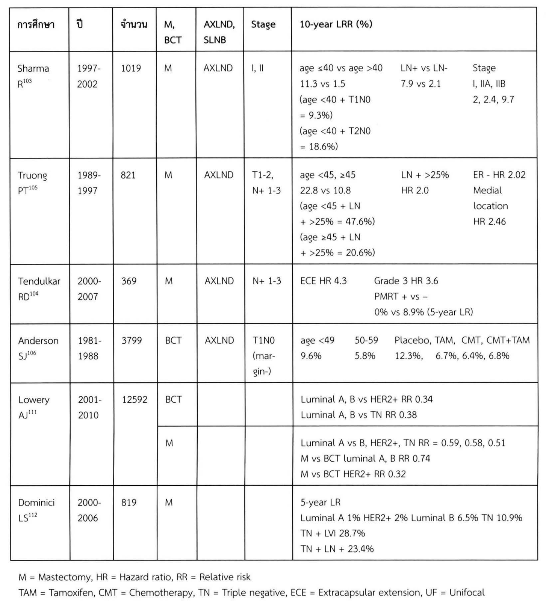

> **Caption (verbatim):** ตารางที่ 19 ปัจจัยที่มีผลต่อ LR ใน Mastectomy และ BCT
> **Text in image (verbatim):** การศึกษา · ปี · จำนวน · M, BCT · AXLND, SLNB · Stage · 10-year LRR (%) · Sharma R103 · 1997-2002 · 1019 · M · AXLND · I, II · age ≤40 vs age >40 · 11.3 vs 1.5 · (age <40 + T1N0 = 9.3%) · (age <40 + T2N0 = 18.6%) · LN+ vs LN- · 7.9 vs 2.1 · Stage · I, IIA, IIB · 2, 2.4, 9.7 · Truong PT105 · 1989-1997 · 821 · M · AXLND · T1-2, N+ 1-3 · age <45, ≥45 · 22.8 vs 10.8 · (age <45 + LN + >25% = 47.6%) · (age ≥45 + LN + >25% = 20.6%) · LN + >25% · HR 2.0 · ER - HR 2.02 · Medial location · HR 2.46 · Tendulkar RD104 · 2000-2007 · 369 · M · AXLND · N+ 1-3 · ECE HR 4.3 · Grade 3 HR 3.6 · PMRT + vs – · 0% vs 8.9% (5-year LR) · Anderson SJ106 · 1981-1988 · 3799 · BCT · AXLND · T1N0 (margin-) · age <49 · 9.6% · 50-59 · 5.8% · Placebo, TAM, CMT, CMT+TAM · 12.3%, 6.7%, 6.4%, 6.8% · Lowery AJ111 · 2001-2010 · 12592 · BCT · Luminal A, B vs HER2+ RR 0.34 · Luminal A, B vs TN RR 0.38 · M · Luminal A vs B, HER2+, TN RR = 0.59, 0.58, 0.51 · M vs BCT luminal A, B RR 0.74 · M vs BCT HER2+ RR 0.32 · Dominici LS112 · 2000-2006 · 819 · M · 5-year LR · Luminal A 1% HER2+ 2% Luminal B 6.5% TN 10.9% · TN + LVI 28.7% · TN + LN + 23.4% · M = Mastectomy, HR = Hazard ratio, RR = Relative risk · TAM = Tamoxifen, CMT = Chemotherapy, TN = Triple negative, ECE = Extracapsular extension, UF = Unifocal
> **Description:** Image of a ruled table with 7 columns (study, years, number of patients, mastectomy or BCT, axillary procedure, stage, 10-year LRR results) and 6 studies, followed by two lines of abbreviation footnotes. Merged cells: the Lowery AJ row spans two sub-rows (study name, years 2001-2010 and number 12592 are shared), split into a BCT sub-row and an M sub-row, each with its own results; their AXLND/SLNB and Stage cells are empty, as are those of Dominici LS. Within the last column the results are laid out in side-by-side sub-columns: for Sharma R, three groups (age ≤40 vs >40 with 11.3 vs 1.5 and the age + T1N0/T2N0 figures; LN+ vs LN- 7.9 vs 2.1; Stage I, IIA, IIB 2, 2.4, 9.7); for Truong PT, three groups (age <45, ≥45 22.8 vs 10.8 and the age + LN >25% figures; LN + >25% HR 2.0; ER - HR 2.02 and Medial location HR 2.46); for Tendulkar RD, ECE HR 4.3 beside Grade 3 HR 3.6 / PMRT + vs – 0% vs 8.9% (5-year LR); for Anderson SJ, age <49 9.6%, 50-59 5.8%, and Placebo, TAM, CMT, CMT+TAM 12.3%, 6.7%, 6.4%, 6.8%. Saved as a figure because of the merged cells and internal sub-column layout.
> **Identifiers in image:** none

นอกจากการศึกษาการใช้ receptor subtype ในการประเมิน LRR ใน early stage แล้วยังมีการศึกษาใน stage II B-III C ที่ทำ mastectomy 582 ราย113 ซึ่งได้รับ systemic therapy ที่พัฒนาขึ้น ทำ AXLND 98.3% และได้ PMRT ทุกราย ผู้ป่วยส่วนใหญ่ได้ neoadjuvant chemotherapy ซึ่งมี anthracyclin, taxane หรือ platinum, มี HER2+ 23% ในจำนวนนี้ได้ tratuzumab 86% TN พบ 29.6% ติดตามหลังการรักษา 44.7% 5-year OS 84%, 5-year LRR 6.2% กลุ่มที่ ER- มี LRR มากกว่า ER+ คือ 8.6% และ

<!-- p.349 (printed 335) -->
4.4, ER+, PR+ เทียบกับ ER+, PR- มี LRR 3.4% และ 7.8% ตามลำดับ, HER2+ มี LRR 1.7% เทียบกับ HER2- 7.8% TN มี LRR มากที่สุดเทียบกับกลุ่มอื่นคือ 11.8% เทียบ 3.9% (HR 3.69) การที่กลุ่ม HER2+ มี LRR น้อย เนื่องจากเกือบทั้งหมดที่ HER2+ ได้ trastuzumab

การศึกษาของ receptor subtype ต่อ LRR ใน advanced breast cancer 595 ราย ปี ค.ศ. 1997-2005114 ทุกรายได้รับ neoadjuvant therapy แต่ไม่ได้ trastuzumab chemotherapy เป็นกลุ่ม anthracyclin 98%, taxane 84% ทำ BCT โดย free margin (≥2 มิลลิเมตร) AXLND ทำในรายที่มี clinical positive lymph node และได้ adjuvant RT และ boost บริเวณ tumor bed, ในรายที่มี residual positive lymph node, stage III, อายุน้อย, residual T >2 เซนติเมตร, มี LVI เมื่อแบ่งตาม receptor subtype พบ hormonal receptor HR +/ HER2- 52%, HR +/ HER2- 9%, HR -/ HER2+ 7%, TN 32% ติดตามการรักษา 64 เดือน 5-year LRR free survival 97%, 95%, 86.5% และ 89.5% ตามลำดับ พบ grade 3 ในกลุ่ม HR -/ HER2+ และ TN มากที่สุดคือ 93% และ 89% ตามลำดับ pCR ในกลุ่ม HR +/ HER2- น้อยที่สุดคือ 9% กลุ่ม HR +/ HER2+, HR -/ HER2+ และ TN คือ 18%, 36% และ 38% ตามลำดับ ถ้าไม่ได้ pCR ในกลุ่ม HR -/ HER2 และ TN มี LRR free survival ลดลง เช่นเดียวกับกลุ่ม positive lymph node <4 nodes LRR free survival มากกว่ากลุ่ม positive ≥4 nodes ใน HR -/ HER2+ จาก 89% เป็น 67% กลุ่ม TN จาก 91% เป็น 56% จากการศึกษานี้พบว่าปัจจัยที่มีผลต่อ LRR free survival คือ TN (HR 5.7), HR +/ HER2+ (HR 5.7), positive ≥4 nodes (HR 2.9), pCR (HR 0.22)

หลังจากการศึกษาการทำ BCT เทียบกับ mastectomy ใน stage I, II ซึ่งเริ่มเมื่อประมาณ ค.ศ. 1970 ผ่านมา 40 ปี พบว่าการรักษามีความเปลี่ยนแปลงเมื่อเวลาผ่านไป โดยในระยะแรกมีการทำ BCT มากขึ้น ต่อมาเริ่มมีการทำ mastectomy เพิ่มขึ้น เช่น ในการศึกษาในช่วง ปี ค.ศ. 1998-2011 จาก SEER program115 (Surveillance, Epidemiology and End Results) ใน stage T0-2, N0-2 และ M0 ผู้ป่วย 1,216,820 ราย ทำ BCT 64.5% mastectomy 35.5% พบว่าการทำ mastectomy เพิ่มขึ้น 34% จากปี ค.ศ. 2003-2011 เพิ่มมากขึ้นหลังปี ค.ศ. 2006 โดยอายุน้อยทำ mastectomy มากกว่าโดยไม่ขึ้นกับ stage T แต่อายุมากกว่าจะทำ mastectomy มากกว่า เมื่อ T >2 cm นอกจากนี้ปัจจัยอื่นคือ negative lymph node ทำ mastectomy เพิ่ม 38% (odds ratio 1.38), T0 mastectomy เพิ่ม 200% (odds ratio 2.05) การทำ reconstruction ในกลุ่มที่ทำ

<!-- p.350 (printed 336) -->
mastectomy ก็เพิ่มขึ้นจาก 11.6% ในปี ค.ศ. 1998 เป็น 36.4% ในปี ค.ศ. 2011 การทำ bilateral mastectomy ในผู้ป่วยที่มีโรคข้างเดียว (unilateral disease) ก็เพิ่มขึ้นจาก 1.9% เป็น 11.2% ซึ่ง reconstruction ใน bilateral mastectomy ก็เพิ่มขึ้นจาก 36.9% เป็น 57.2% พบว่า T และ N มีผลต่อการเลือกการผ่าตัด คือ T1 จะทำ BCT 70% แต่ละทำลดลงใน T2 คือ BCT 50% ใน N0 ทำ BCT 66.7% ใน N1-2 ทำ 42.2%

อีกการศึกษาที่เกี่ยวกับแนวโน้มการทำ mastectomy และ BCT โดยใช้ National Cancer Data Base (NCDB) ของอเมริกา116 ในปี ค.ศ. 1998-2011 มีผู้ป่วย 1,856,702 ราย โดยมี stage 0, I, II พบว่า 60% T<2 เซนติเมตร, 79.5% N0 การทำ mastectomy ลดลงจาก 459/1,000 ในปี ค.ศ. 1998 ต่ำที่สุดในปี ค.ศ. 2005 เป็น 361/1,000 หลังจากนี้ขึ้นเป็น 403/1,000 ในปี ค.ศ. 2011 ในช่วงปี ค.ศ. 1998-2005 มีการทำ BCT เพิ่มขึ้นจาก 540 เป็น 639/1,000 การทำ unilateral mastectomy (UM) ลดลงจาก 437 เป็น 306/1,000 หลังจากปี ค.ศ. 2005 การทำ BCT ลดลง 2% ต่อปี (637 เป็น 597/1,000) การทำ contralateral prophylactic mastectomy (CPM) เพิ่มขึ้น จากปี ค.ศ. 2005 ถึง 2011 ทำ CPM จาก 54 เป็น 110/1,000 และ UM ลดลงจาก 306 เป็น 284/1,000 การทำ immediate reconstruction ใน UM เพิ่มขึ้นจาก 10% เป็น 27% ในปี ค.ศ. 1998 ถึง ค.ศ. 2011 เช่นเดียวกับการทำ immediate reconstruction ใน CPM จาก 37% เป็น 57% ปัจจัยที่ทำ CPM คือ อายุน้อย, การทำ reconstruction, T0 (DCIS) ปัจจัยที่ทำให้ทำ UM คือ T>5 เซนติเมตร, DCIS และ positive lymph node

แม้ว่าการทำ BCT ใน early breast cancer ในยุคที่มี systemic therapy ที่พัฒนาขึ้น แต่ LR ก็ยังมากกว่า mastectomy และถ้าก้อนขนาดใหญ่เทียบกับขนาดเต้านมแล้ว โดยเฉพาะคนไทยที่มีขนาดเต้านมเล็กกว่าคนยุโรปหรืออเมริกามาก การทำ BCT อาจไม่ได้ cosmetic outcome ที่ดี ในปี ค.ศ. 1991 Toth รายงานการทำ Skin Sparing Mastectomy (SSM) ซึ่งมีทั้งผู้ป่วยที่ไม่เป็นมะเร็งและผู้ป่วยมะเร็งเต้านม หลังจากนั้นมีรายงานอีกหลายรายงานที่มีการติดตามผลเป็นเวลานาน พบว่าการทำ SSM มีความปลอดภัยเท่าเทียมกับ mastectomy ในแง่ของ LR โดยที่ไม่ต้องได้รับ radiotherapy แต่จะต้องเป็นกลุ่มคนไข้ที่มี stage Tis, T1-2, N0 การที่ได้ผลในแง่ของ LR เท่าเทียมกับ mastectomy เนื่องจากเป็นการผ่าตัดที่เอาต่อมน้ำเหลืองออกเกือบทั้งหมดรวมทั้ง nipple areolar complex เหลือเพียงผิวหนังและทำการเสริมสร้าง (immediate reconstruction) โดยมีหลายวิธี ได้แก่ TRAM flap (Transverse Rectus Abdominis Muscle), LD flap

<!-- p.351 (printed 337) -->
(Latissimus Dorsi Flap), การใส่ implant เพียงอย่างเดียว (submuscular implant) หรือการทำ LD flap ร่วมกับ implant ซึ่งการเลือกวิธีใดขึ้นอยู่กับขนาดเต้านมและรูปร่างของผู้ป่วย โดยแต่ละวิธีมีข้อดีข้อเสียแตกต่างกัน การใส่แต่ implant มีข้อดีคือ ทำง่าย ไม่มีแผลผ่าตัดเพิ่ม แต่มีข้อจำกัดถ้าขนาดเต้านมใหญ่ การใส่ใต้กล้ามเนื้อทำได้จำกัด ถ้าเต้านมขนาดใหญ่และ TRAM flap ไม่เพียงพอ การทำ LD flap ร่วมกับ implant ก็ได้ cosmetic outcome ที่ดี ข้อเสียของการใส่ implant คือการเกิด capsular contracture โดยเฉพาะในกรณีที่ต้องได้รับ radiotherapy

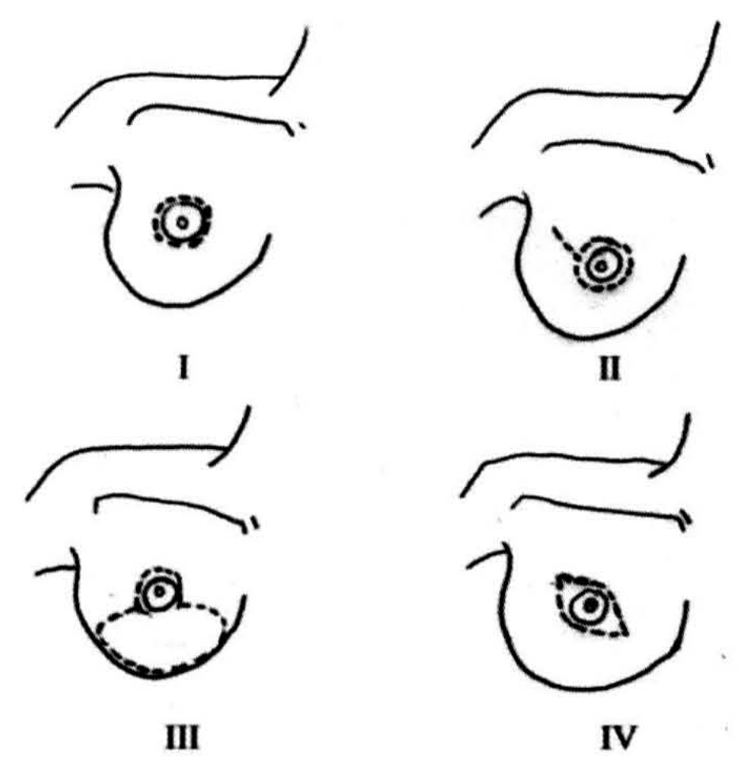

> **Caption (verbatim):** **รูปที่ 39** แผลผ่าตัด Skin-Sparing Mastectomy (I = Periareolar, II = Tennis Racquet, III = Reduciton, IV = Modified Ellipse)
> **Text in image (verbatim):** I · II · III · IV
> **Description:** Black-and-white line drawing in a 2 × 2 grid, each panel showing the same simple outline of a breast with the nipple-areola (concentric circles) and the arm/axillary contour above it; the planned skin incision is drawn as a dashed line. Panel I (top left): a dashed circle immediately around the areola only (periareolar). Panel II (top right): a dashed circle around the areola with a short dashed straight line extending from it obliquely upward and outward toward the axilla (tennis racquet shape). Panel III (bottom left): a small dashed circle around the areola joined below to a large dashed ellipse occupying the lower part of the breast (reduction pattern). Panel IV (bottom right): a dashed elliptical/lens-shaped outline around the areola, tapering to a point laterally (modified ellipse).
> **Identifiers in image:** none

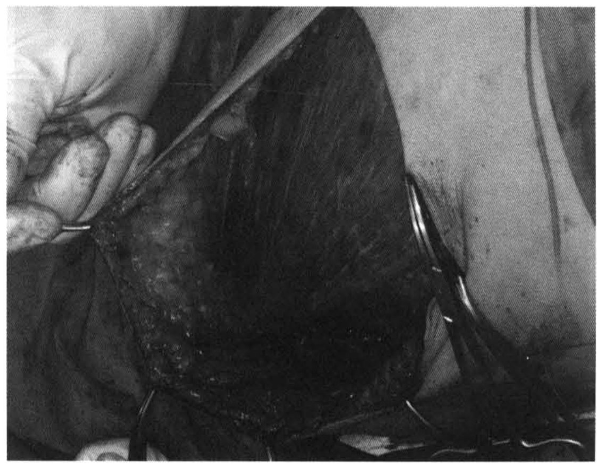

> **Caption (verbatim):** **รูปที่ 40** IDC T3N2 : Mastectomy
> **Text in image (verbatim):** none
> **Description:** Black-and-white intraoperative photograph of a mastectomy. A gloved hand at upper left holds and retracts the edge of a raised skin flap; the dark, roughly triangular area in the centre is the exposed operative field/chest wall beneath the elevated flap, with whitish specks over its lower left part. Several curved metal surgical clamps (haemostats) grasp the flap edges on the right and at the bottom. The patient's skin and drapes surround the field at the right and bottom.
> **Identifiers in image:** none

<!-- p.352 (printed 338) -->
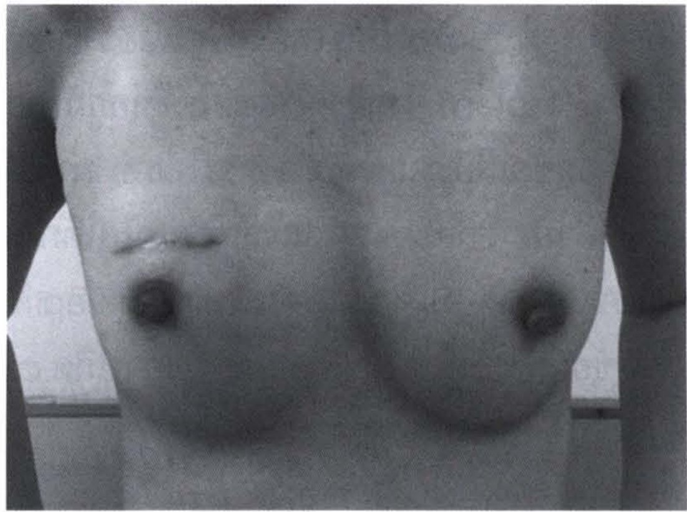

> **Caption (verbatim):** **รูปที่ 41** IDC T1N0 : NSM with implamt
> **Text in image (verbatim):** none
> **Description:** Black-and-white clinical photograph, frontal view of a female chest from just below the chin to the upper abdomen, arms at the sides. A short, slightly curved horizontal healed scar lies on the breast at the image left, just above and medial to the nipple-areola; both nipple-areola complexes are present. The two breasts are of broadly similar size and contour, the image-left breast appearing slightly rounder/higher. No face is shown.
> **Identifiers in image:** none

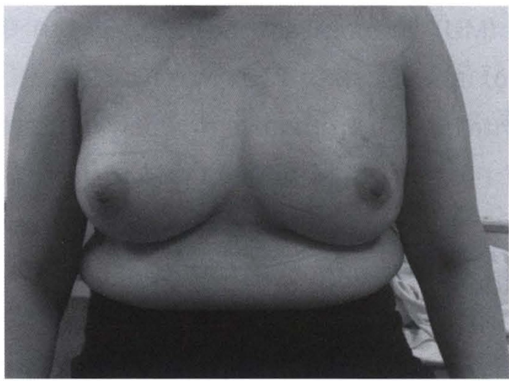

> **Caption (verbatim):** **รูปที่ 42** DCIS : NSM with LD flap and implamt
> **Text in image (verbatim):** none
> **Description:** Black-and-white clinical photograph, frontal view of a female chest and upper abdomen with arms at the sides and dark clothing below the waist. Both breasts have their nipple-areola complexes and look broadly symmetrical in size and shape; no obvious scar is visible on the front of the chest in this view. No face is shown.
> **Identifiers in image:** none

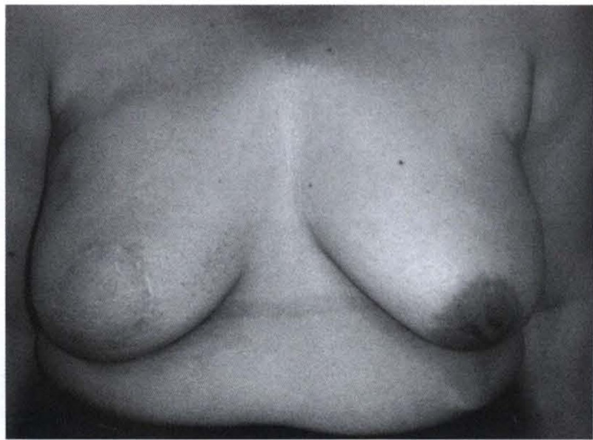

> **Caption (verbatim):** **รูปที่ 43** หลังผ่าตัด SSM และ immediate reconstruction 1 ปี T2 N1 มี fat necrosis บริเวณด้านบนของ TRAM flap
> **Text in image (verbatim):** none
> **Description:** Black-and-white clinical photograph, frontal view of a female chest and upper abdomen. The breast at the image left is the reconstructed breast: it has no nipple-areola complex, and a faint short vertical scar/irregularity is seen on its central-lower part; a faint horizontal line crosses the lower abdomen/infra-mammary region. The breast at the image right is the native breast with its nipple-areola complex, and is somewhat more ptotic. The two breasts are of similar overall volume. No face is shown.
> **Identifiers in image:** none

<!-- p.353 (printed 339) -->
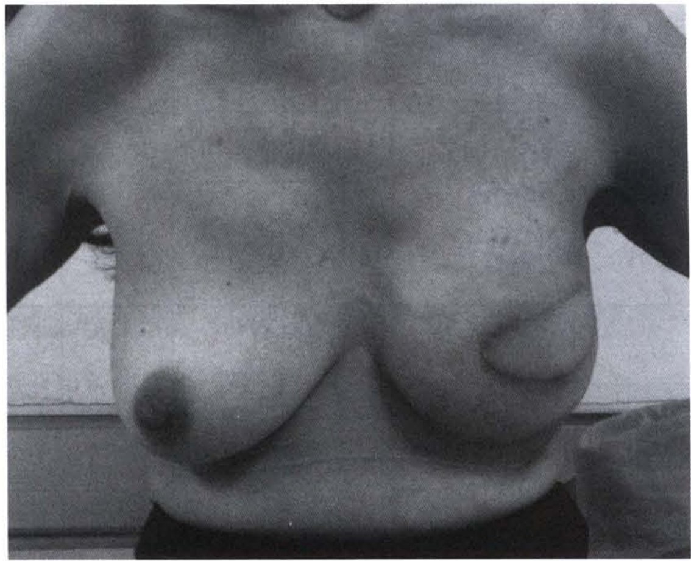

> **Caption (verbatim):** **รูปที่ 44** Stage T2N0 ทำ SSM immediate reconstruction ด้วย LD flap และ implant
> **Text in image (verbatim):** none
> **Description:** Black-and-white clinical photograph, frontal view of a female chest with hands on the hips. The breast at the image left is the native breast with its nipple-areola complex and is ptotic. The breast at the image right is the reconstructed breast: it has no nipple-areola complex, and an oval/elliptical skin island with a raised, well-demarcated border is seen on its lower outer part (the transferred flap skin paddle). The reconstructed breast sits slightly higher and is rounder than the native breast. No face is shown.
> **Identifiers in image:** none

การทำ reconstruction ด้วย autologous tissue มีข้อดีคือ ได้ cosmetic outcome ที่ดี มีลักษณะเหมือนธรรมชาติ ถ้าได้รับ radiotherapy จะมีผลต่อ cosmetic outcome น้อยกว่าการใส่ implant อย่างเดียว แต่มีข้อเสียขึ้นกับชนิดของ flap คือ ภาวะแทรกซ้อนที่เกิดบริเวณ donor site เช่น ภาวะแทรกซ้อนของ LD flap คือ seroma, แรงของข้อไหล่จะลดลง ซึ่งคนที่เป็นนักกีฬาพุ่งหลาว, นักเทนนิส หรือคนพิการที่ต้องนั่งรถเข็นและใช้แขนในการเคลื่อนไหวของรถเข็นจะไม่เหมาะในการทำ LD flap ภาวะแทรกซ้อนของ TRAM flap คือ abdominal wall hernia, fat necrosis

<!-- p.354 (printed 340) -->
**ตารางที่ 20** ผลการรักษามะเร็งเต้านมด้วยวิธี SSM

| ผู้ทำการศึกษา | ปีที่ตีพิมพ์ | จำนวน | ระยะเวลาติดตามการรักษา (เดือน) | Local recurrent (%) Stage 0 | Local recurrent (%) Stage I | Local recurrent (%) Stage II | Local recurrent (%) Stage III | Local recurrent (%) Stage IV | หมายเหตุ |
| --- | --- | --- | --- | --- | --- | --- | --- | --- | --- |
| Newman117 | 1998 | 372 | 50 |  |  |  |  |  | Stage I, II LR 6.2 |
| Slavin118 | 1998 | 51 | 45 | 3 | 7 | 21 |  |  |  |
| Laronga119 | 1999 | 286 | 59 |  |  |  |  |  | Stage 0-II LR 6 |
| Kroll120 | 1999 | 114 | 72 |  |  |  |  |  | Stage I, II LR 7 |
| Simmons121 | 1999 | 77 | 20 | 0 | 0 | 14 |  |  |  |
| Medina-Franco122 | 2002 | 173 | 73 | 0 | 8.3 | 11.1 |  |  |  |
| Carlson123 | 2003 | 565 | 65 | 0.6 | 3 | 10.4 | 11.1 | 5.5 |  |
| Spiegel124 | 2003 | 221 | 92 | 0 |  |  |  |  | Stage I, II LR 5-6% |
| Gerber125 | 2003 | 134 | 59 |  |  |  |  |  | Stage I, II LR 5.4% |
| Fersis126 | 2004 | 60 | 52 |  |  |  |  |  | Stage I, II LR 6.6% |
| Greenway127 | 2005 | 225 | 49 |  |  |  |  |  | Stage 0-II LR 1.7% |
| Downes128 | 2005 | 38 | 53 |  |  |  | 8 |  |  |
| Meretoja129 | 2007 | 70 | 3 | 3 | 7 | 13 |  |  |  |

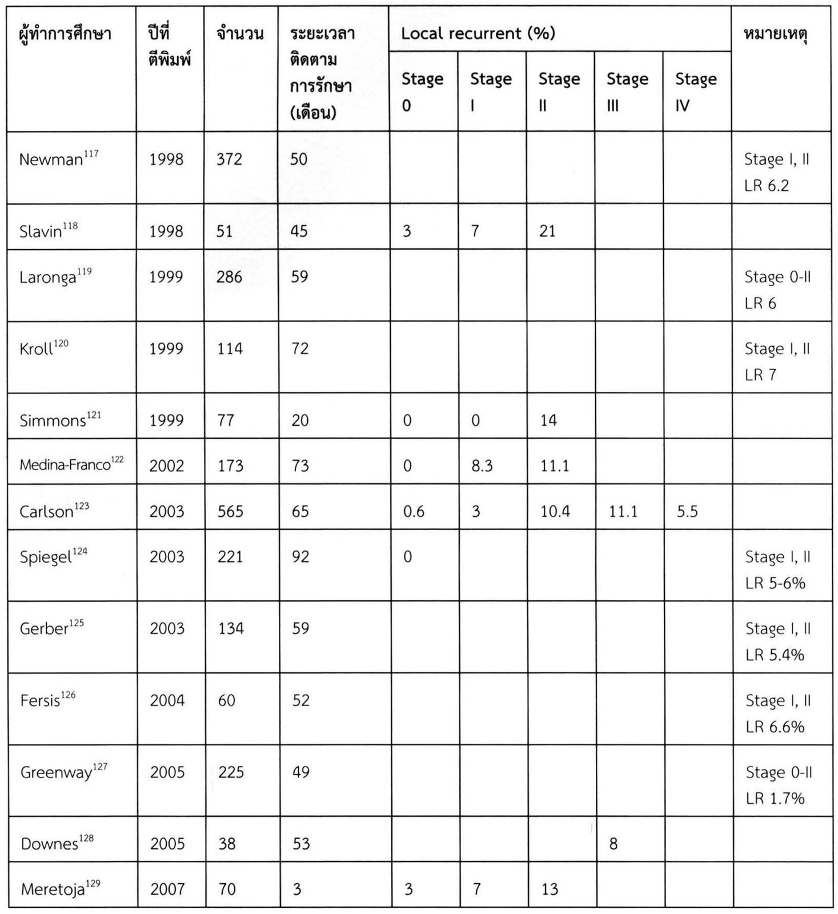

> **Caption (verbatim):** **ตารางที่ 20** ผลการรักษามะเร็งเต้านมด้วยวิธี SSM
> **Text in image (verbatim):** ผู้ทำการศึกษา · ปีที่ตีพิมพ์ · จำนวน · ระยะเวลาติดตามการรักษา (เดือน) · Local recurrent (%) · Stage 0 · Stage I · Stage II · Stage III · Stage IV · หมายเหตุ · Newman117 · 1998 · 372 · 50 · Stage I, II LR 6.2 · Slavin118 · 1998 · 51 · 45 · 3 · 7 · 21 · Laronga119 · 1999 · 286 · 59 · Stage 0-II LR 6 · Kroll120 · 1999 · 114 · 72 · Stage I, II LR 7 · Simmons121 · 1999 · 77 · 20 · 0 · 0 · 14 · Medina-Franco122 · 2002 · 173 · 73 · 0 · 8.3 · 11.1 · Carlson123 · 2003 · 565 · 65 · 0.6 · 3 · 10.4 · 11.1 · 5.5 · Spiegel124 · 2003 · 221 · 92 · 0 · Stage I, II LR 5-6% · Gerber125 · 2003 · 134 · 59 · Stage I, II LR 5.4% · Fersis126 · 2004 · 60 · 52 · Stage I, II LR 6.6% · Greenway127 · 2005 · 225 · 49 · Stage 0-II LR 1.7% · Downes128 · 2005 · 38 · 53 · 8 · Meretoja129 · 2007 · 70 · 3 · 3 · 7 · 13
> **Description:** Image of the printed ruled table (saved because of its two-level header). Columns: investigator (with reference number), year of publication, number of patients, follow-up duration in months, then a merged header "Local recurrent (%)" spanning five sub-columns Stage 0, Stage I, Stage II, Stage III and Stage IV, and a final remarks column (หมายเหตุ). 13 studies from 1998 to 2007 are listed. Studies that did not report stage-specific local recurrence leave the stage cells blank and give a pooled figure in the remarks column (e.g. Newman Stage I, II LR 6.2; Greenway Stage 0-II LR 1.7%). Downes has a single value, 8, in the Stage III column. Carlson is the only row with values in all five stage columns (0.6, 3, 10.4, 11.1, 5.5).
> **Identifiers in image:** none

ในช่วงใกล้เคียงกับการทำ SSM ประมาณ ค.ศ. 1995 เป็นต้นมา เริ่มมีการทำ Nipple Sparing Mastectomy (NSM) โดยกลุ่มที่เหมาะสมเหมือนกับกลุ่มที่ทำ SSM แต่จะมีการพิจารณาเพิ่มเติมในเรื่องของ Nipple Areolar Complex (NAC) involvement โดยดูจากปัจจัยต่างๆ ที่มีผลต่อ NAC involvement เพื่อเลือกกลุ่มที่มีโอกาส ไม่มี NAC involvement ซึ่งปัจจัยเหล่านี้มีทั้ง clinical staging และ pathologic result รวมทั้ง imaging study ซึ่งแม้ว่าพิจารณาจากปัจจัยต่างๆ ว่าเหมาะสมในการทำ NSM แล้วก็ตาม

<!-- p.355 (printed 341) -->
ในขณะผ่าตัดก็จะมีการทำ frozen section เมื่อพบว่ามี NAC involvement ก็จะไม่เก็บ NAC ในกลุ่มที่ frozen section negative แต่ผล permanent positive ก็จะต้องทำการผ่าตัด NAC ออก

โอกาสมีการทำ NAC involvement ในกลุ่มที่การตรวจร่างกายไม่พบรอยโรคประมาณ 5.6-39%130-136 โดยทั่วไป NAC involvement (รวมกลุ่มที่ clinical positive และ negative) ประมาณ 5.6-50%130-140 ในกลุ่มที่พบ NAC involvement มี clinical positive 26-61%131, 137-140 และพบเป็น invasive 35-50%133, 134, 137, 139

การใช้ imaging ช่วยในการวางแผนการรักษา เช่น การพบ MC การพบขนาดที่ใหญ่เมื่อเทียบกับขนาดเต้านม และการพบ NAC+ เป็นกรณีที่ไม่ควรทำ BCT, NSM Biacchiardi CP136 ทำการศึกษาในผู้ป่วย 525 ราย โดยทุกคนทำ mammography, ultrasonography และ MRI พบว่า sensitivity ของ US ร่วมกับ mammography คือ 76.4% mammography วินิจฉัยได้ในขณะที่ US negative 13.3% US วินิจฉัยได้แต่ mammography negative 10.3% PE มี sensitivity 57.5% MRI ให้การวินิจฉัยต่างจาก mammography และ US 27.4% ซึ่งเปลี่ยนแปลงการผ่าตัด 22.5% โดยมี false positive 77.1% MC/MF ตรวจพบด้วย MRI เพียงอย่างเดียว 46% โดยในจำนวนที่เปลี่ยนแปลงการผ่าตัดในกลุ่ม BCT ทำ double lumpectomy, wider excision ซึ่งเข้าได้กับผล pathology 71.9% กลุ่มที่เปลี่ยนเป็น mastectomy พบว่า 97.6% ทำเนื่องจาก MRI ผลสอดคล้องกับ pathology นอกจากนี้ ในกลุ่ม ILC จะพบ cohtralateral breast cancer มากกว่า IDC (9.5% เทียบกับ 2.1%) และการผ่าตัดเต้านมอีกข้างมีผลสอดคล้องกับผล pathology 95%

แม้ว่าจะมีการใช้ปัจจัยต่างๆ รวมทั้ง imaging ในการประเมินโอกาสการมี NAC+ เพื่อเลือกผู้ป่วยที่เหมาะสมในการทำ NSM แต่ในขณะทำผ่าตัดการทำ frozen section ช่วยในการวินิจฉัย NAC+ ซึ่งถ้ามีก็ไม่สามารถเก็บ NAC โดยพบว่า sensitivity 38-92%141, 142 false negative 1.3-8.6%142, 143 ซึ่งเมื่อผล permanent ออกมาเป็น NAC+ ก็จะทำการผ่าตัดเพื่อเอา NAC ออก นอกจากนี้ Frozen section ยังมี false positive 3.1%142 ซึ่งเป็นการเอา NAC ออกในกลุ่มที่อาจเก็บ areolar ได้ แต่การใช้ frozen section ช่วยลดจำนวนครั้งการผ่าตัด คือไม่ต้องรอ permanent เพื่อมาทำการเอา NAC ออกทีหลัง

<!-- p.356 (printed 342) -->
**ตารางที่ 21** การเลือกผู้ป่วยสำหรับทำ NSM131-134, 137-139

| ปัจจัย | กรณีที่เหมาะสม (% NAC+) | กรณีที่ไม่เหมาะสม (% NAC+) |
| --- | --- | --- |
| T | T1 (7-25%) | T2, T3 (20-70%) |
| AXLN | negative (7-30%) | positive (16-56%) |
| TND | >4 (10-15%) | ≤4 cm (30-80%) |
| MC/UF | UF (9.3%) | MC (42%) |
| Grade | grade 1 (6%) | grade 3 (32%) |
| LVI | negative (10-18%) | positive (33-43%) |
| HER2 | negative (10-19%) | positive (18-47%) |

T = Tumor, AXLN = Axillary lymph node, TND = Tumor-to-nipple distance, MC = Multicentric, UF = Unifocal,

LVI = Lymphovascular invasive

การเลือกผู้ป่วยในการทำ NSM ที่เหมาะสม คือ T1N0, TND >4 เซนติเมตร ไม่มี MC, grade 1, 2, ไม่มี LVI, HER2- เพื่อที่จะได้กรณีที่มีโอกาส NAC- และสามารถเก็บ NAC ได้ แต่หลายปัจจัยอาจประเมินไม่ได้แน่นอนก่อนทำการผ่าตัด เนื่องจากการตรวจร่างกายและ imaging ยังแม่นยำไม่เท่าผลทางพยาธิวิทยา เช่น ขนาดก้อน, AXLN, MC รวมทั้งผล false negative ของ NAC จาก frozen section ทำให้การเลือกผู้ป่วยที่ไม่เหมาะสมอาจจะต้องทำการผ่าตัด 2 ครั้ง เนื่องจาก NAC+ จากผล permanent

<!-- p.357 (printed 343) -->
**ตารางที่ 22** ผลการรักษาด้วยการ NSM

| การศึกษา | ปี | จำนวน | Median follow up time (months) | RT (%) | LRR (%) | NAC recurrence (%) | NAC thickness (mm) | NAC necrosis (%) |
| --- | --- | --- | --- | --- | --- | --- | --- | --- |
| Benediktsson KP142 | 1988-1994 | 216 | 156 | yes 21.7 no 78.2 | 8.5 28.4 | 8.9 8.9 | 5 | NR |
| Petit JY143 | 2002-2007 | 1001 | 20 | 100 | 1.4 | 0 | NR | 3.5 |
| Gerber B144 | 1994-2000 | 60 | 101 | 27 | 10 | 1.67 | NR | NR |
| de Alcantara Filho P145 | 2000-2010 | 157 | 10.8 | NR | NR | 0 | 5 | 0.2 |
| Kim It J146 | 2001-2006 | 152 | 60 | 5.3 | 2 | 1.3 | 2 | 9.6 |
| Spear SL147 | 1989-2010 | 99 | 30 | NR | NR | 0 | NR | 2 |
| Boneti C148 | 1998-2010 | 281 | 25+18.8 | NR | 4.6 | 0 | 7 | 0.7 |
| Jensen JA149 | 1997-2008 | 127 | 60.2 | 16 | 0 | 0 | <2 | 0 |

NR = not report

การเลือกผู้ป่วยทำ NSM นอกจากพิจารณาเรื่องโอกาสการมี NAC+ แล้ว ต้องพิจารณาโอกาสเกิด NAC necrosis ด้วย ซึ่งในหลายรายงานมีเกณฑ์การเลือกผู้ป่วยแตกต่างกัน แต่โดยรวมมักพิจารณาว่าไม่มี ptosis breast, breast ที่ขนาดใหญ่มาก, สูบบุหรี่, มีโรคอ้วน และเป็นเบาหวาน เนื่องจากปัจจัยเหล่านี้มีผลต่อภาวะแทรกซ้อนของ skin flap การเลือก incision ก็แตกต่างกัน โดยทั่วไปมี periareolar incision, horizontal radial incision, inferior radial incision, inferolateral inframammary fold incision, previous scar incision ซึ่งการเลือก incision ใดขึ้นอยู่กับความชำนาญของศัลยแพทย์ ซึ่งเมื่อทำแล้วพบ NAC necrosis ในวิธีที่เลือกน้อยกว่าวิธีอื่น

<!-- p.358 (printed 344) -->
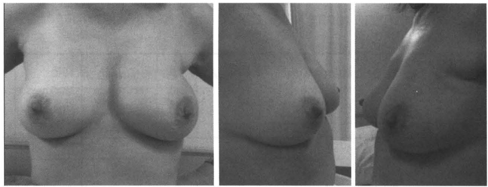

> **Caption (verbatim):** **รูปที่ 45** Stage T1N0 ทำ BCT ไม่มี LR
> **Text in image (verbatim):** none
> **Description:** Three black-and-white clinical photographs side by side of the same female chest after breast-conserving treatment, hands on the hips. Left: frontal view showing both breasts with nipple-areola complexes, of broadly similar size, shape and level; no obvious deformity is seen. Middle: oblique view of the chest showing the breast contour and nipple from the side. Right: lateral/oblique view from the other side, darker exposure, showing the breast profile. No face is shown.
> **Identifiers in image:** none

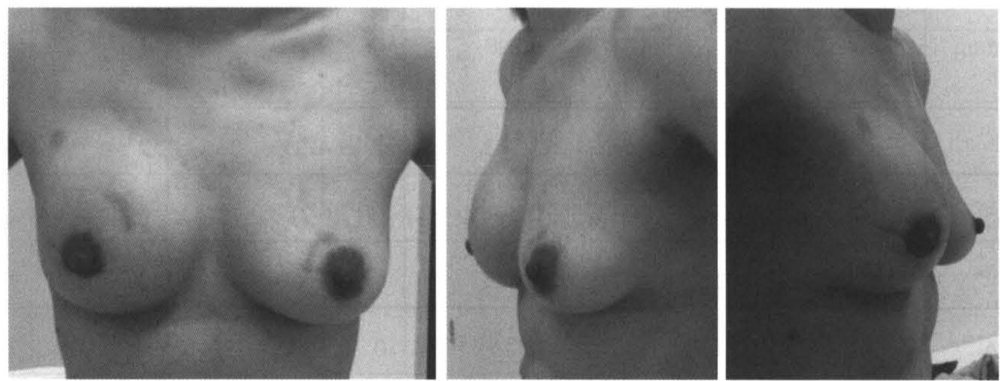

> **Caption (verbatim):** **รูปที่ 46** Stage T1N1 ทำ NSM immediate reconstruction ด้วย total submuscular implant
> **Text in image (verbatim):** none
> **Description:** Three black-and-white clinical photographs side by side of the same female chest after nipple-sparing mastectomy with implant reconstruction. Left: frontal view; both nipple-areola complexes are preserved. On the breast at the image left a curved healed scar runs from the upper inner aspect of the areola upward and outward, and a short curved scar is seen at the upper outer edge of the areola of the breast at the image right; the two breasts are of similar size and roundness. Middle: oblique view showing both breasts with rounded upper-pole contour and preserved nipples. Right: oblique view from the other side, showing the breast profile with projecting nipples. No face is shown.
> **Identifiers in image:** none

หลังจากมีการทำ SSM และ NSM เพิ่มขึ้นอย่างชัดเจนตั้งแต่ปี ค.ศ. 2000 การผ่าตัดเต้านมมีความเปลี่ยนแปลงอย่างต่อเนื่องเมื่อมีการใช้ acellular dermal matrix (ADM) ซึ่งทำมาจากผิวหนัง (split-thickness skin graft) ผ่านขบวนการด้วย sodium chloride, sodium deoxycolate เพื่อกำจัด cell เหลือเพียง dermal collagen matrix เพื่อลดปฏิกิริยา (antigenicity, rejection response) ซึ่งอาจทำมาจากผิวหนังคน, หมู, วัว เมื่อนำมาใช้ในการ reconstruction จะมี recellularization, revascularization และ integration กับเนื้อเยื่อของผู้ป่วย ซึ่งขบวนการนี้จะเกิดภายใน 7 วัน และเพิ่มขึ้นเรื่อยๆ จนถึงวันที่ 14 แต่บางรายงานอาจใช้เวลานานกว่านี้ เริ่มมีการใช้ในการทำ breast reconstruction ตั้งแต่ปี ค.ศ. 2005150 ซึ่งอาจทำเป็น one-stage คือใส่ limpant เลย หรือ two-stage คือ ใช้ tissue expander ก่อน แล้วจึงใช้ implant ข้อดีของ ADM151-154 คือ

<!-- p.359 (printed 345) -->
1. ทำให้ได้ inferolateral coverage implant สามารถใส่ implant ได้ขนาดใหญ่ ในกรณีทำ NSM, SSM เนื่องจากการใช้ fascia ของ serratus anterior และ rectus abdominis muscle มีข้อจำกัดในขนาดของ implant

2. ช่วยลด exposure ต่อ implant ถ้ามี skin necrosis หรือ breakdown, ลด implant migration, เพิ่มความหนาระหว่างผิวหนังและ implant, ลด visibility และ palpability ต่อ implant

3. สามารถจัดแต่ง inframmamary และ lateral mammary fold ได้

4. สามารถทำ one-stage reconstruction ได้ ถ้ามี skin flap พอ

5. ในกรณีทำ two-stage ช่วยลดจำนวนครั้งในการทำ expansion

6. เกิดภาวะแทรกซ้อนน้อย แม้ในกรณีที่ได้รับ radiotherapy

หลังจากเริ่มมีการใช้ ADM มากขึ้น พบว่าแนวโน้มการทำ mastectomy เพิ่มขึ้น รวมทั้ง contralateral prophylactic mastectomy (CPM) และมีแนวโน้มการทำ reconstruction ด้วย autologous tissue ลดลง โดยพบว่าในการทำ SSM และ NSM ในระยะหลังในบางรายงานใช้ ADM 50-80% โดยมีผู้ป่วยเป็นกลุ่ม phophylaxis (bilateral) และ therapeutic เกือบเท่าๆ กัน134,148,151-156 ผลการทำ reconstruction ด้วย ADM พบว่ามีภาวะแทรกซ้อนน้อย ได้แก่ implant loss 1.3-10%, infection 0.2-11%, skin necrosis 1-3%, implant exposure 0.2-3%, seroma 1-10% และในกรณีได้ radiotherapy พบว่า capsular contracture พบ 0-20% ถ้าใช้ ADM แต่พบได้สูงถึง 15-100% ในกรณีที่ไม่ได้ใช้ ADM

## Adjuvant treatment

ข้อบ่งชี้สำหรับ **adjuvant chemotherapy** คือ lymph node involvement, tumor มากกว่า 1 เซนติเมตร ใน กลุ่ม node negative ขนาดมากกว่า 0.5 เซนติเมตร ที่มี prognostic factor ที่ไม่ดี เช่น high grade, lymphovascular invasion, HER-2/neu overexpression และ negative hormonal receptor

<!-- p.360 (printed 346) -->
**Adjuvant endocrine** therapy ใช้สำหรับ hormonal receptor-positive ซึ่งใน premenopausal ใช้ tamoxifen 5 ปี ใน postmenopausal ใช้ aromatase inhibitor 5 ปี ลดการเกิด recurrence ได้ดีกว่า tamoxifen กรณีที่ hormonal positive, lymph node negative, ขนาด T1 การพิจารณาว่าควรได้ chemotherapy หรือไม่ อาจใช้ Prognostic factors ช่วย เช่น high grade, lymphovascular invasion หรือใช้ 21-gene recurrence score assay ซึ่งถ้า score น้อยกว่า 11 เป็นกลุ่ม low risk ประโยชน์ที่ได้จาก chemotherapy น้อย

### Radiation therapy

ใน early stage breast cancer (stage I, II A) ถ้าทำ mastectomy ไม่ต้องได้ adjuvant radiotherapy กรณีที่ทำ BCT ต้องได้รับ adjuvant radiotherapy ทุกราย เพื่อลด locoregional recurrence

กรณีที่ทำ mastectomy จะได้ adjuvant radiotherapy ถ้าขนาดก้อนมากกว่า 5 เซนติเมตร, lymph node positive มากกว่า 3 หรือ premenopause ที่ lymph node positive 1-3 โดยจะฉายแสงบริเวณ Chest wall และ supraclavicular เพื่อลดการกลับมาเป็นซ้ำ

## ผลการรักษามะเร็งเต้านม

ผลการรักษามะเร็งเต้านมขึ้นกับระยะของโรคและ subtype ของมะเร็งจากสถิติ อเมริกาปี ค.ศ. 2012-20161 พบ localized diseascs 62% Regioral (lymph node involvement) 30%, distant metastasis 6% และ unknown 2%

<!-- p.361 (printed 347) -->
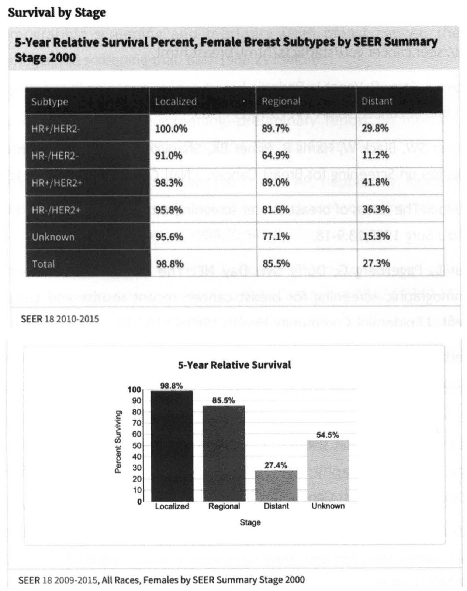

> **Caption (verbatim):** none
> **Text in image (verbatim):** Survival by Stage · 5-Year Relative Survival Percent, Female Breast Subtypes by SEER Summary Stage 2000 · Subtype · Localized · Regional · Distant · HR+/HER2- · 100.0% · 89.7% · 29.8% · HR-/HER2- · 91.0% · 64.9% · 11.2% · HR+/HER2+ · 98.3% · 89.0% · 41.8% · HR-/HER2+ · 95.8% · 81.6% · 36.3% · Unknown · 95.6% · 77.1% · 15.3% · Total · 98.8% · 85.5% · 27.3% · SEER 18 2010-2015 · 5-Year Relative Survival · 100 · 90 · 80 · 70 · 60 · 50 · 40 · 30 · 20 · 10 · 0 · Percent Surviving · 98.8% · 85.5% · 27.4% · 54.5% · Localized · Regional · Distant · Unknown · Stage · SEER 18 2009-2015, All Races, Females by SEER Summary Stage 2000
> **Description:** Screenshot-style reproduction of SEER statistics with the heading "Survival by Stage", in two panels. Upper panel: a table titled "5-Year Relative Survival Percent, Female Breast Subtypes by SEER Summary Stage 2000" with a dark header row (Subtype, Localized, Regional, Distant) and dark first column; rows HR+/HER2- (100.0%, 89.7%, 29.8%), HR-/HER2- (91.0%, 64.9%, 11.2%), HR+/HER2+ (98.3%, 89.0%, 41.8%), HR-/HER2+ (95.8%, 81.6%, 36.3%), Unknown (95.6%, 77.1%, 15.3%), Total (98.8%, 85.5%, 27.3%); source line "SEER 18 2010-2015". Lower panel: vertical bar chart "5-Year Relative Survival", y-axis "Percent Surviving" 0 to 100 in steps of 10, x-axis "Stage" with four bars: Localized 98.8% (darkest), Regional 85.5%, Distant 27.4%, Unknown 54.5% (lightest); survival is highest for localized and lowest for distant disease. Source line "SEER 18 2009-2015, All Races, Females by SEER Summary Stage 2000". Faint show-through text from the reverse side of the paper is visible in the background and is not part of the figure.
> **Identifiers in image:** none

**Survival by Stage**

**5-Year Relative Survival Percent, Female Breast Subtypes by SEER Summary Stage 2000**

| Subtype | Localized | Regional | Distant |
| --- | --- | --- | --- |
| HR+/HER2- | 100.0% | 89.7% | 29.8% |
| HR-/HER2- | 91.0% | 64.9% | 11.2% |
| HR+/HER2+ | 98.3% | 89.0% | 41.8% |
| HR-/HER2+ | 95.8% | 81.6% | 36.3% |
| Unknown | 95.6% | 77.1% | 15.3% |
| Total | 98.8% | 85.5% | 27.3% |

SEER 18 2010-2015

SEER 18 2009-2015, All Races, Females by SEER Summary Stage 2000

โดยสรุป การรักษา early stage breast cancer (stage I, II) มีทางเลือกในการผ่าตัดหลายวิธีตามวิวัฒนาการของการรักษา ทั้งทาง systemic therapy และการใช้ biomaterial เริ่มจาก mastectomy, BCT, SSM, NSM และการใช้ ADM ในการ reconstruction แต่การจะเลือกผู้ป่วยให้เหมาะสมต้องเน้นเป้าหมายหลัก oncologic safety คือ การหายจากโรค (cure) คือ เลือกวิธีที่ LR น้อย และ cosmetic outcome เป็นเป้าหมายรอง ซึ่งวิธีการเลือกผู้ป่วยให้ได้ cosmetic outcome ที่ดีมีปัจจัยหลายอย่างดังที่กล่าวมาแล้ว แต่ในผู้ป่วยที่มีแนวโน้มว่าต้องได้ RT ควรเลือกทำ delay reconstruction เนื่องจากผลของ RT ทำให้ได้ cosmetic outcome ที่ไม่ดี

<!-- p.362 (printed 348) -->
## เอกสารอ้างอิง

1. http://seer.cancer.gou/statfacts/html/breast.html
2. Shapiro S, Strax P, Venet L. Periodic breast cancer screening in reducing mortality from breast cancer. JAMA 1971;215:1777-85.
3. Fletcher SW, Black W, Harris R, Rimer BK, Shapiro S. Report of the International Workshop on Screening for Breast Cancer. J Natl Cancer Inst 1993;85:1644-56.
4. Shapiro S. The status of breast cancer screening: a quarter of a century of research. World J Surg 1989;13:9-18.
5. Tabar L, Fagerberg G, Duffy SW, Day NE. The Swedish two county trial of mammographic screening for breast cancer: recent results and calculation of benefit. J Epidemiol Community Health 1989;43:107-14.
6. Roberts MM, Alexander FE, Anderson TJ, Chetty U, Donnan PT, Forrest P, et al. Edinburgh trial of screening for breast cancer: mortality at seven years. Lancet 1990;335:241-6.
7. Frisell J, Eklund G, Hellström L, Lidbrink E, Rutqvist LE, Somell A. Randomized study of mammography screening--preliminary report on mortality in the Stockholm trial. Breast Cancer Res Treat 1991;18:49-56.
8. Miller AB, Baines CJ, To T, Wall C. Canadian National Breast Screening Study: 1. Breast cancer detection and death rates among women aged 40 to 49 years. CMAJ 1992;147:1459-76.
9. Miller AB, Baines CJ, To T, Wall C. Canadian National Breast Screening Study: 2. Breast cancer detection and death rates among women aged 50 to 59 years. CMAJ 1992;147:1477-88.
10. Armstrong K, Eisen A, Weber B. Assessing the risk of breast cancer. N Engl J Med 2000;342:564-71.
11. www.cancer.gov/bcrisktool.
12. Tabár L, Vitak B, Chen TH, Yen AM, Cohen A, Tot T, et al. Swedish two-county trial: impact of mammographic screening on breast cancer mortality during 3 decades. Radiology 2011;260:658-63.

<!-- p.363 (printed 349) -->
13. Andersson I, Aspegren K, Janzon L, Landberg T, Lindholm K, Linell F, et al. Mammographic screening and mortality from breast cancer: the Malmö mammographic screening trial. BMJ 1988;297:943-8.
14. Frisell J, Eklund G, Hellström L, Lidbrink E, Rutqvist LE, Somell A. Randomized study of mammography screening--preliminary report on mortality in the Stockholm trial. Breast Cancer Res Treat 1991;18:49-56.
15. Alexander FE, Anderson TJ, Brown HK, Forrest AP, Hepburn W, Kirkpatrick AE, et al. The Edinburgh randomised trial of breast cancer screening: results after 10 years of follow-up. Br J Cancer 1994;70:542-8.
16. Shapiro S, Venet W, Strax P, Venet L, Roeser R. Ten- to fourteen-year effect of screening on breast cancer mortality. J Natl Cancer Inst 1982;69:349-55.
17. Day NE, Williams DR, Khaw KT. Breast cancer screening programmes: the development of a monitoring and evaluation system. Br J Cancer 1989;59:954-8.
18. Hofvind S, Bjurstam N, Sørum R, Bjørndal H, Thoresen S, Skaane P. Number and characteristics of breast cancer cases diagnosed in four periods in the screening interval of a biennial population-based screening programme. J Med Screen 2006;13:192-6.
19. Fracheboud J, de Koning HJ, Beemsterboer PM, Boer R, Verbeek AL, Hendriks JH, et al. Interval cancers in the Dutch breast cancer screening programme. Br J Cancer 1999;81:912-7.
20. 16-year mortality from breast cancer in the UK Trial of Early Detection of Breast Cancer. Lancet 1999;353:1909-14.
21. Dean PB, Pamilo M. Screening mammography in Finland--1.5 million examinations with 97 percent specificity. Mammography Working Group, Radiological Society of Finland. Acta Oncol 1999;38:47-54.
22. Bjurstam N, Björneld L, Warwick J, Sala E, Duffy SW, Nyström L, et al. The Gothenburg Breast Screening Trial. Cancer 2003;97:2387-96.
23. Nelson HD, Tyne K, Naik A, Bougatsos C, Chan BK, Humphrey L. Screening for breast cancer: an update for the U.S. Preventive Services Task Force. Ann Intern Med 2009;151:727-W242.

<!-- p.364 (printed 350) -->
24. Tabar L, Yen MF, Vitak B, Chen HH, Smith RA, Duffy SW. Mammography service screening and mortality in breast cancer patients: 20-year follow-up before and after introduction of screening. Lancet 2003;361:1405-10.
25. Hofvind S, Ursin G, Tretli S, Sebuødegård S, Møller B. Breast cancer mortality in participants of the Norwegian Breast Cancer Screening Program. Cancer 2013;119:3106-12.
26. Dean PB, Pamilo M. Screening mammography in Finland--1.5 million examinations with 97 percent specificity. Mammography Working Group, Radiological Society of Finland. Acta Oncol 1999;38:47-54.
27. McEvoy MP, Coopey SB, Mazzola E, Buckley J, Belli A, Polubriaginof F, et al. Breast Cancer Risk and Follow-up Recommendations for Young Women Diagnosed with Atypical Hyperplasia and Lobular Carcinoma In Situ (LCIS). Ann Surg Oncol 2015;22:3346-9.
28. Zagouri F, Liakou P, Bartsch R, Peccatori FA, Tsigginou A, Dimitrakakis C, et al. Discrepancies between ESMO and NCCN breast cancer guidelines: An appraisal. Breast 2015;24:513-23.
29. Fisher B, Costantino JP, Wickerham DL, Cecchini RS, Cronin WM, Robidoux A, et al. Tamoxifen for the prevention of breast cancer: current status of the National Surgical Adjuvant Breast and Bowel Project P-1 study. J Natl Cancer Inst 2005;97:1652-62.
30. Vogel VG, Costantino JP, Wickerham DL, Cronin WM, Cecchini RS, Atkins JN, et al. Update of the National Surgical Adjuvant Breast and Bowel Project Study of Tamoxifen and Raloxifene (STAR) P-2 Trial: Preventing breast cancer. Cancer Prev Res (Phila) 2010;3:696-706.
31. Visvanathan K, Chlebowski RT, Hurley P, Col NF, Ropka M, Collyar D, et al. American society of clinical oncology clinical practice guideline update on the use of pharmacologic interventions including tamoxifen, raloxifene, and aromatase inhibition for breast cancer risk reduction. J Clin Oncol 2009;27:3235-58.
32. Domchek SM, Friebel TM, Singer CF, Evans DG, Lynch HT, Isaacs C, et al. Association of risk-reducing surgery in BRCA1 or BRCA2 mutation carriers with cancer risk and mortality. JAMA 2010;304:967-75.

<!-- p.365 (printed 351) -->
33. Easton DF,Pharoah PD,Antoniou AC,Tischkowitz,Tavtigian SV,Nathanson KL,et al. Gene-panel sequencing and the prediction of breast-cancer risk.N Engl J Med.2015:372:2243-57
34. Newman B, Austin MA, Lee M, King MC. Inheritance of human breast cancer: evidence for autosomal dominant transmission in high-risk families. Proc Natl Acad Sci U S A 1988;85:3044-8.
35. Ford D, Easton DF, Stratton M, Narod S, Goldgar D, Devilee P, et al. Genetic heterogeneity and penetrance analysis of the BRCA1 and BRCA2 genes in breast cancer families. The Breast Cancer Linkage Consortium. Am J Hum Genet 1998;62:676-89.
36. Easton DF, Ford D, Bishop DT. Breast and ovarian cancer incidence in BRCA1-mutation carriers. Breast Cancer Linkage Consortium. Am J Hum Genet 1995;56: 265-71.
37. Hartman AR, Kaldate RR, Sailer LM, Painter L, Grier CE, Endsley RR, et al. Prevalence of BRCA mutations in an unselected population of triple-negative breast cancer. Cancer 2012;118:2787-95.
38. Parmigiani G, Chen S, Iversen ES Jr, Friebel TM, Finkelstein DM, Anton-Culver H, et al. Validity of models for predicting BRCA1 and BRCA2 mutations. Ann Intern Med 2007;147:441-50.
39. Sardanelli F, Podo F. Breast MR imaging in women at high-risk of breast cancer. Is something changing in early breast cancer detection? Eur Radiol 2007;17:873-87.
40. Warner E, Plewes DB, Hill KA, Causer PA, Zubovits JT, Jong RA, et al. Surveillance of BRCA1 and BRCA2 mutation carriers with magnetic resonance imaging, ultrasound, mammography, and clinical breast examination. JAMA 2004;292:1317-25.
41. Riedl CC, Ponhold L, Flöry D, Weber M, Kroiss R, Wagner T, et al. Magnetic resonance imaging of the breast improves detection of invasive cancer, preinvasive cancer, and premalignant lesions during surveillance of women at high risk for breast cancer. Clin Cancer Res 2007;13:6144-52.

<!-- p.366 (printed 352) -->
42. Riedl CC, Luft N, Bernhart C, Weber M, Bernathova M, Tea MK, et al. Triple-modality screening trial for familial breast cancer underlines the importance of magnetic resonance imaging and questions the role of mammography and ultrasound regardless of patient mutation status, age, and breast density. J Clin Oncol 2015;33:1128-35.
43. Domchek SM, Friebel TM, Singer CF, Evans DG, Lynch HT, Isaacs C, et al. Association of risk-reducing surgery in BRCA1 or BRCA2 mutation carriers with cancer risk and mortality. JAMA 2010;304:967-75.
44. Skytte AB, Crüger D, Gerster M, Laenkholm AV, Lang C, Brøndum-Nielsen K, et al. Breast cancer after bilateral risk-reducing mastectomy. Clin Genet 2011;79:431-7.
45. Meijers-Heijboer H, van Geel B, van Putten WL, Henzen-Logmans SC, Seynaeve C, Menke-Pluymers MB, et al. Breast cancer after prophylactic bilateral mastectomy in women with a BRCA1 or BRCA2 mutation. N Engl J Med 2001;345:159-64.
46. Rebbeck TR, Friebel T, Lynch HT, Neuhausen SL, van 't Veer L, Garber JE, et al. Bilateral prophylactic mastectomy reduces breast cancer risk in BRCA1 and BRCA2 mutation carriers: the PROSE Study Group. J Clin Oncol 2004;22:1055-62.
47. Kaas R, Verhoef S, Wesseling J, Rookus MA, Oldenburg HS, Peeters MJ, et al. Prophylactic mastectomy in BRCA1 and BRCA2 mutation carriers: very low risk for subsequent breast cancer. Ann Surg 2010;251:488-92.
48. Ingham SL, Sperrin M, Baildam A, Ross GL, Clayton R, Lalloo F, et al. Risk-reducing surgery increases survival in BRCA1/2 mutation carriers unaffected at time of family referral. Breast Cancer Res Treat 2013;142:611-8.
49. Heemskerk-Gerritsen BA, Menke-Pluijmers MB, Jager A, Tilanus-Linthorst MM, Koppert LB, Obdeijn IM, et al. Substantial breast cancer risk reduction and potential survival benefit after bilateral mastectomy when compared with surveillance in healthy BRCA1 and BRCA2 mutation carriers: a prospective analysis. Ann Oncol 2013;24:2029-35.
50. Kauff ND, Domchek SM, Friebel TM, Robson ME, Lee J, Garber JE, et al. Risk-reducing salpingo-oophorectomy for the prevention of BRCA1- and BRCA2-associated breast and gynecologic cancer: a multicenter, prospective study. J Clin Oncol 2008;26:1331-7.

<!-- p.367 (printed 353) -->
51. Graeser MK, Engel C, Rhiem K, Gadzicki D, Bick U, Kast K, et al. Contralateral breast cancer risk in BRCA1 and BRCA2 mutation carriers. J Clin Oncol 2009;27:5887-92.
52. Metcalfe K, Gershman S, Lynch HT, Ghadirian P, Tung N, Kim-Sing C, et al. Predictors of contralateral breast cancer in BRCA1 and BRCA2 mutation carriers. Br J Cancer 2011;104:1384-92.
53. Metcalfe K, Gershman S, Ghadirian P, Lynch HT, Snyder C, Tung N, et al. Contralateral mastectomy and survival after breast cancer in carriers of BRCA1 and BRCA2 mutations: retrospective analysis. BMJ 2014;348:g226.
54. van Sprundel TC, Schmidt MK, Rookus MA, Brohet R, van Asperen CJ, Rutgers EJ, et al. Risk reduction of contralateral breast cancer and survival after contralateral prophylactic mastectomy in BRCA1 or BRCA2 mutation carriers. Br J Cancer 2005;93:287-92.
55. Gronwald J, Tung N, Foulkes WD, Offit K, Gershoni R, Daly M, et al. Tamoxifen and contralateral breast cancer in BRCA1 and BRCA2 carriers: an update. Int J Cancer 2006;118:2281-4.
56. Schrag D, Kuntz KM, Garber JE, Weeks JC. Life expectancy gains from cancer prevention strategies for women with breast cancer and BRCA1 or BRCA2 mutations. JAMA 2000;283:617-24.
57. Brekelmans CT, Tilanus-Linthorst MM, Seynaeve C, vd Ouweland A, Menke-Pluymers MB, Bartels CC, et al. Tumour characteristics, survival and prognostic factors of hereditary breast cancer from BRCA2-, BRCA1- and non-BRCA1/2 families as compared to sporadic breast cancer cases. Eur J Cancer 2007;43:867-76.
58. Rao AA, Feneis J, Lalonde C, Ojeda-Fournier H. A Pictorial review of changes in the BI-RADS fifth edition. Radiographics 2016;36:623-39.
59. Balleyguier C, Ayahi S, Van Nguyen K, Vanel D, Dromain C, Sigal R. BIRADSTM classification in mammography. Eur J Radiol 2007;61:192-4.
60. Leifland K, Lagerstedt U, Svane G. Comparison of stereotactic fine needle aspiration cytology and core needle biopsy in 522 non-palpable breast lesions. Acta Radiol 2003;44:387-91.
61. Lieske B, Ravichandran D, Wright D. Role of fine-needle aspiration cytology and core biopsy in the preoperative diagnosis of screen-detected breast carcinoma. Br J Cancer 2006;95:62-6.

<!-- p.368 (printed 354) -->
62. Barra AA, Gobbi H, de L Rezende CA, Gouvêa AP, de Lucena CE, Reis JH, et. al. A comparision of aspiration cytology and core needle biopsy according to tumor size of suspicious breast lesions. Diagn Cytopathol 2008;36:26-31.
63. Shannon J, Douglas-Jones AG, Dallimore NS. Conversion to core biopsy in preoperative diagnosis of breast lesions: is it justified by results?. J Clin Pathol 2001;54:762-5.
64. Salagean ED, Slodkowska E, Nofoch-Mozes S, Hanna W, Parra-Herran C, Lu FI. Atypical ductal hyperplasia on core needle biopsy: development of a predictive model stratifying carcinoma upgrade risk on excision. Breast J 2019;25:56-61.
65. Chen LY, Hu J, Tsang JYS, Lee MA, Ni YB, Chan SK, et.al. Diagnostic upgrade of atypical ductal hyperplasia of the breast based on evaluation of histopathological features and calcification on core needle biopsy. Histopathology 2019;75:1-9.
66. Rosenfield Darling ML, Smith DN, Lester SC, Kaelin C, Selland DL, Denison CM, et. al. Atypical ductal hyperplasia and ductal carcinoma in situ as revealed by large-core needle breast biopsy: results of surgical excision. AJR 2000;175:1341-6.
67. Li J, Song Y, Xu S, Wang J, Huang H, Ma W, et. al. Predicting underestimation of ductal carcinoma in situ: a comparison between radiomics and conventional approaches. Int J Comput Assist Radiol Surg 2019;14:709-721.
68. Shi B, Grimm LJ, Mazurowski MA, Baker JA, Marks JR, King LM. Can occult invasive disease in ductal carcinoma in situ be predicted using computer-extracted mammographic features?. Acad Radiol 2017;24:1139-1147.
69. Park HS, Park S, Cho J, Park JM, Kim SI, Park BW. Risk predictors of underestimation and the need for sentinel node biopsy in patients diagnosed with ductal carcinoma in situ by preoperative needle biopsy. J Surg Oncol 2013;107:388-92.
70. Goyal A, Douglas-Jones A, Monypenny I, Sweetland H, Stevens G, Mansel RE. Is there a role of sentinel lymph node biopsy in ductal carcinoma in situ?: analysis of 587 cases. Breast Cancer Res Treat 2006;98:311-4.
71. Pagni F1, Bosisio FM, Salvioni D, Colombo P, Leone BE, Bella CD. Application of the British National Health Service Breast Cancer Screening Programme classification in 226 breast core needle biopsies: correlation with resected specimens. Ann Diagn Pathol 2012;16:112-8.

<!-- p.369 (printed 355) -->
72. Ascc Cancer staging Manual .8thed.NY: Springer Internatianal Publishing:2016.

73. Halsted WS. The Results of Operations for the Cure of Cancer of the Breast Performed at the Johns Hopkins Hospital from June, 1889, to January, 1894. Ann Surg 1894;20:497-555.

74. Bonadonna G, Brusamolino E, Valagussa P, Rossi A, Brugnatelli L, Brambilla C, et al. Combination chemotherapy as an adjuvant treatment in operable breast cancer. N Engl J Med 1976;294:405-10.

75. Wangensteen OH, Lewis FJ, Arhelger SW. The extended or super-radical mastectomy for carcinoma of the breast. Surg Clin North Am 1956;36:1051-63.

76. Urban JA. Radical excision of the chest wall for mammary cancer. Cancer 1951;4:1263-85.

77. Halsted WS. The Results of Radical Operations for the Cure of Carcinoma of the Breast. Ann Surg 1907;46:1-19.

78. Urban JA, Baker HW. Radical mastectomy in continuity with en bloc resection of the internal mammary lymph-node chain; a new procedure for primary operable cancer of the breast. Cancer 1952;5:992-1008.

79. Kaae S, Johansen H. Simple mastectomy plus postoperative irradiation by the method of McWhirter for mammary carcinoma. Ann Surg 1963;157:175-9.

80. Cody HS 3rd, Urban JA. Internal mammary node status: a major prognosticator in axillary node-negative breast cancer. Ann Surg Oncol 1995;2:32-7.

81. Cody HS 3rd, Laughlin EH, Trillo C, Urban JA. Have changing treatment patterns affected outcome for operable breast cancer? Ten-year follow-up in 1288 patients, 1965 to 1978. Ann Surg 1991;213:297-307.

82. Veronesi U, Marubini E, Mariani L, Valagussa P, Zucali R. The dissection of internal mammary nodes does not improve the survival of breast cancer patients. 30-year results of a randomised trial. Eur J Cancer 1999;35:1320-5.

83. Urban JA. Significant of internal mammary lymph node metastases in breast cancer. Am J Roentgen 1971;1:130-6.

84. Livingston SF, Arlen M. The extended extrapleural radical mastectomy: its role in the treatment of carcinoma of the breast. Ann Surg 1974;179:260-5.

<!-- p.370 (printed 356) -->
85. Valagussa P, Bonadonna G, Veronesi U. Patterns of relapse and survival following radical mastectomy. Analysis of 716 consecutive patients. Cancer 1978;41:1170-8.

86. Veronesi U, Cascinelli N, Greco M, Bufalino R, Morabito A, Galluzzo D, et al. Prognosis of breast cancer patients after mastectomy and dissection of internal mammary nodes. Ann Surg 1985;202:702-7.

87. Sugg SL, Ferguson DJ, Posner MC, Heimann R. Should internal mammary nodes be sampled in the sentinel lymph node era? Ann Surg Oncol 2000;7:188-92.

88. Veronesi U, Arnone P, Veronesi P, Galimberti V, Luini A, Rotmensz N, et al. The value of radiotherapy on metastatic internal mammary nodes in breast cancer. Results on a large series. Ann Oncol 2008;19:1553-60.

89. Coombs NJ, Boyages J, French JR, Ung OA. Internal mammary sentinel nodes: ignore, irradiate or operate? Eur J Cancer 2009;45:789-94.

90. Estourgie SH, Tanis PJ, Nieweg OE, Valdés Olmos RA, Rutgers EJ, Kroon BB. Should the hunt for internal mammary chain sentinel nodes begin? An evaluation of 150 breast cancer patients. Ann Surg Oncol 2003;10:935-41.

91. van der Ent FW, Kengen RA, van der Pol HA, Povel JA, Stroeken HJ, Hoofwijk AG. Halsted revisited: internal mammary sentinel lymph node biopsy in breast cancer. Ann Surg 2001;234:79-84.

92. Madsen E, Gobardhan P, Bongers V, Albregts M, Burgmans J, De Hooge P, et al. The impact on post-surgical treatment of sentinel lymph node biopsy of internal mammary lymph nodes in patients with breast cancer. Ann Surg Oncol 2007;14:1486-92.

93. Johansen H, Kaae S, Jensen MB, Mouridsen HT. Extended radical mastectomy versus simple mastectomy followed by radiotherapy in primary breast cancer. A fifty-year follow-up to the Copenhagen Breast Cancer randomised study. Acta Oncol 2008;47:633-8.

94. Ragaz J, Jackson SM, Le N, Plenderleith IH, Spinelli JJ, Basco VE, et al. Adjuvant radiotherapy and chemotherapy in node-positive premenopausal women with breast cancer. N Engl J Med 1997;337:956-62.

<!-- p.371 (printed 357) -->
95. Overgaard M, Jensen MB, Overgaard J, Hansen PS, Rose C, Andersson M, et al. Postoperative radiotherapy in high-risk postmenopausal breast-cancer patients given adjuvant tamoxifen: Danish Breast Cancer Cooperative Group DBCG 82c randomised trial. Lancet 1999;353:1641-8.

96. Overgaard M, Hansen PS, Overgaard J, Rose C, Andersson M, Bach F, et al. Postoperative radiotherapy in high-risk premenopausal women with breast cancer who receive adjuvant chemotherapy. Danish Breast Cancer Cooperative Group 82b Trial. N Engl J Med 1997;337:949-55.

97. Matzinger O, Heimsoth I, Poortmans P, Collette L, Struikmans H, Van Den Bogaert W, et al. Toxicity at three years with and without irradiation of the internal mammary and medial supraclavicular lymph node chain in stage I to III breast cancer (EORTC trial 22922/10925). Acta Oncol 2010;49:24-34.

98. Veronesi U, Cascinelli N, Mariani L, Greco M, Saccozzi R, Luini A, et al. Twenty-year follow-up of a randomized study comparing breast-conserving surgery with radical mastectomy for early breast cancer. N Engl J Med 2002;347:1227-32.

99. Fisher B, Anderson S, Bryant J, Margolese RG, Deutsch M, Fisher ER, et al. Twenty-year follow-up of a randomized trial comparing total mastectomy, lumpectomy, and lumpectomy plus irradiation for the treatment of invasive breast cancer. N Engl J Med 2002;347:1233-41.

100. van Dongen JA, Voogd AC, Fentiman IS, Legrand C, Sylvester RJ, Tong D, et al. Long-term results of a randomized trial comparing breast-conserving therapy with mastectomy: European Organization for Research and Treatment of Cancer 10801 trial. J Natl Cancer Inst 2000;92:1143-50.

101. Blichert-Toft M, Nielsen M, Düring M, Møller S, Rank F, Overgaard M, et al. Long-term results of breast conserving surgery vs. mastectomy for early stage invasive breast cancer: 20-year follow-up of the Danish randomized DBCG-82TM protocol. Acta Oncol 2008;47(4):672-81.

102. Simone NL, Dan T, Shih J, Smith SL, Sciuto L, Lita E, et al. Twenty-five year results of the national cancer institute randomized breast conservation trial. Breast Cancer Res Treat 2012;132:197-203.

<!-- p.372 (printed 358) -->
103. Sharma R, Bedrosian I, Lucci A, Hwang RF, Rourke LL, Qiao W, et al. Present-day locoregional control in patients with t1 or t2 breast cancer with 0 and 1 to 3 positive lymph nodes after mastectomy without radiotherapy. Ann Surg Oncol 2010;17:2899-908.

104. Tendulkar RD, Rehman S, Shukla ME, Reddy CA, Moore H, Budd GT, et al. Impact of postmastectomy radiation on locoregional recurrence in breast cancer patients with 1-3 positive lymph nodes treated with modern systemic therapy. Int J Radiat Oncol Biol Phys 2012;83:e577-81.

105. Truong PT, Olivotto IA, Kader HA, Panades M, Speers CH, Berthelet E. Selecting breast cancer patients with T1-T2 tumors and one to three positive axillary nodes at high postmastectomy locoregional recurrence risk for adjuvant radiotherapy. Int J Radiat Oncol Biol Phys 2005;61:1337-47.

106. Anderson SJ, Wapnir I, Dignam JJ, Fisher B, Mamounas EP, Jeong JH, et al. Prognosis after ipsilateral breast tumor recurrence and locoregional recurrences in patients treated by breast-conserving therapy in five National Surgical Adjuvant Breast and Bowel Project protocols of node-negative breast cancer. J Clin Oncol 2009;27:2466-73.

107. Chen AM, Meric-Bernstam F, Hunt KK, Thames HD, Outlaw ED, Strom EA, et al. Breast conservation after neoadjuvant chemotherapy. Cancer 2005;103:689-95.

108. Huang EH, Strom EA, Perkins GH, Oh JL, Chen AM, Meric-Bernstam F, et al. Comparison of risk of local-regional recurrence after mastectomy or breast conservation therapy for patients treated with neoadjuvant chemotherapy and radiation stratified according to a prognostic index score. Int J Radiat Oncol Biol Phys 2006;66:352-7.

109. Akay CL, Meric-Bernstam F, Hunt KK, Grubbs EG, Bedrosian I, Tucker SL, et al, Evaluation of the MD Anderson Prognostic Index for local-regional recurrence after breast conserving therapy in patients receiving neoadjuvant chemotherapy. Ann Surg Oncol 2012;19:901-7.

110. Fodor J, Major T, Polgár C, Orosz Z, Sulyok Z, Kásler M. Prognosis of patients with local recurrence after mastectomy or conservative surgery for early-stage invasive breast cancer. Breast 2008;17:302-8.

<!-- p.373 (printed 359) -->
111. Lowery AJ, Kell MR, Glynn RW, Kerin MJ, Sweeney KJ. Locoregional recurrence after breast cancer surgery: a systematic review by receptor phenotype. Breast Cancer Res Treat 2012;133:831-41.

112. Dominici LS, Mittendorf EA, Wang X, Liu J, Kuerer HM, Hunt KK, et al. Implications of constructed biologic subtype and its relationship to locoregional recurrence following mastectomy. Breast Cancer Res 2012;14:R82.

113. Panoff JE, Hurley J, Takita C, Reis IM, Zhao W, Sujoy V, et al. Risk of locoregional recurrence by receptor status in breast cancer patients receiving modern systemic therapy and post-mastectomy radiation. Breast Cancer Res Treat 2011;128:899-906.

114. Caudle AS, Yu TK, Tucker SL, Bedrosian I, Litton JK, Gonzalez-Angulo AM, et al. Local-regional control according to surrogate markers of breast cancer subtypes and response to neoadjuvant chemotherapy in breast cancer patients undergoing breast conserving therapy. Breast Cancer Res 2012;14:R83.

115. Kummerow KL, Du L, Penson DF, Shyr Y, Hooks MA. Nationwide trends in mastectomy for early-stage breast cancer. JAMA Surg 2015;150:9-16.

116. Albornoz CR, Matros E, Lee CN, Hudis CA, Pusic AL, Elkin E, et al. Bilateral Mastectomy versus Breast-Conserving Surgery for Early-Stage Breast Cancer: The Role of Breast Reconstruction. Plast Reconstr Surg 2015;135:1518-26.

117. Newman LA, Kuerer HM, Hunt KK, Kroll SS, Ames FC, Ross MI, et al. Presentation, treatment, and outcome of local recurrence after skin-sparing mastectomy and immediate breast reconstruction. Ann Surg Oncol 1998;5:620-6.

118. Slavin SA, Schnitt SJ, Duda RB, Houlihan MJ, Koufman CN, Morris DJ, et al. Skin-sparing mastectomy and immediate reconstruction: oncologic risks and aesthetic results in patients with early-stage breast cancer. Plast Reconstr Surg 1998;102: 49-62.

119. Laronga C, Kemp B, Johnston D, Robb GL, Singletary SE. The incidence of occult nipple-areola complex involvement in breast cancer patients receiving a skin-sparing mastectomy. Ann Surg Oncol 1999;6:609-13.

120. Kroll SS, Khoo A, Singletary SE, Ames FC, Wang BG, Reece GP, et al. Local recurrence risk after skin-sparing and conventional mastectomy: a 6-year follow-up. Plast Reconstr Surg 1999;104:421-5.

<!-- p.374 (printed 360) -->
121. Simmons RM, Fish SK, Gayle L, La Trenta GS, Swistel A, Christos P, et al. Local and distant recurrence rates in skin-sparing mastectomies compared with non-skin-sparing mastectomies. Ann Surg Oncol 1999;6:676-81.

122. Medina-Franco H, Vasconez LO, Fix RJ, Heslin MJ, Beenken SW, Bland KI, et al. Factors associated with local recurrence after skin-sparing mastectomy and immediate breast reconstruction for invasive breast cancer. Ann Surg 2002;235: 814-9.

123. Carlson GW, Styblo TM, Lyles RH, Bostwick J, Murray DR, Staley CA, et al. Local recurrence after skin-sparing mastectomy: tumor biology or surgical conservatism? Ann Surg Oncol 2003;10:108-12.

124. Spiegel AJ, Butler CE. Recurrence following treatment of ductal carcinoma in situ with skin-sparing mastectomy and immediate breast reconstruction. Plast Reconstr Surg 2003;111:706-11.

125. Gerber B, Krause A, Reimer T, Müller H, Küchenmeister I, Makovitzky J, et al. Skin-sparing mastectomy with conservation of the nipple-areola complex and autologous reconstruction is an oncologically safe procedure. Ann Surg 2003;238:120-7.

126. Fersis N, Hoenig A, Relakis K, Pinis S, Wallwiener D. Skin-sparing mastectomy and immediate breast reconstruction: incidence of recurrence in patients with invasive breast cancer. Breast 2004;13:488-93.

127. Greenway RM, Schlossberg L, Dooley WC. Fifteen-year series of skin-sparing mastectomy for stage 0 to 2 breast cancer. Am J Surg 2005 ;190:933-38.

128. Downes KJ, Glatt BS, Kanchwala SK, Mick R, Fraker DL, Fox KR, et al. Skin-sparing mastectomy and immediate reconstruction is an acceptable treatment option for patients with high-risk breast carcinoma. Cancer 2005;103:906-13.

129. Meretoja TJ, Rasia S, von Smitten KA, Asko-Seljavaara SL, Kuokkanen HO, Jahkola TA. Late results of skin-sparing mastectomy followed by immediate breast reconstruction. Br J Surg 2007;94:1220-5.

130. Andersen JA, Pallesen RM. Spread to the nipple and areola in carcinoma of the breast. Ann Surg 1979;189:367-72.

<!-- p.375 (printed 361) -->
131. Wertheim U, Ozzello L. Neoplastic involvement of nipple and skin flap in carcinoma of the breast. Am J Surg Pathol 1980;4:543-9.

132. Morimoto T, Komaki K, Inui K, Umemoto A, Yamamoto H, Harada K, et al. Involvement of nipple and areola in early breast cancer. Cancer 1985 May 15;55:2459-63.

133. Santini D, Taffurelli M, Gelli MC, Grassigli A, Giosa F, Marrano D, et al. Neoplastic involvement of nipple-areolar complex in invasive breast cancer. Am J Surg 1989;158:399-403.

134. Brachtel EF, Rusby JE, Michaelson JS, Chen LL, Muzikansky A, Smith BL, et al. Occult nipple involvement in breast cancer: clinicopathologic findings in 316 consecutive mastectomy specimens. J Clin Oncol 2009;27:4948-54.

135. Laronga C, Kemp B, Johnston D, Robb GL, Singletary SE. The incidence of occult nipple-areola complex involvement in breast cancer patients receiving a skin-sparing mastectomy. Ann Surg Oncol 1999;6:609-13.

136. Biacchiardi PC, Brizzi D, Genta F, Zanon E, Camanni M, Deltetto F. Breast cancer preoperative staging: does contrast-enhanced magnetic resonance mammography modify surgery? Int J Breast Cancer 2011; 2011:757234.

137. Lagios MD, Gates EA, Westdahl PR, Richards V, Alpert BS. A guide to the frequency of nipple involvement in breast cancer. A study of 149 consecutive mastectomies using a serial subgross and correlated radiographic technique. Am J Surg 1979;138:135-42.

138. Lüttges J, Kalbfleisch H, Prinz P. Nipple involvement and multicentricity in breast cancer. A study on whole organ sections. J Cancer Res Clin Oncol 1987;113:481-7.

139. Weidong Li, Shuling Wang, Xiaojing Guo, Ronggang Lang, Yu Fan, Feng Gu, et al. Nipple involvement in breast cancer: retrospective analysis of 2323 consecutive mastectomy specimens. Int J Surg Pathol 2011;19:328-34.

140. Billar JA, Dueck AC, Gray RJ, Wasif N, Pockaj BA. Preoperative predictors of nipple-areola complex involvement for patients undergoing mastectomy for breast cancer. Ann Surg Oncol 2011;18:3123-8.

<!-- p.376 (printed 362) -->
141. Luo D, Ha J, Latham B, Ingram D, Connell T, Hastrich D, et al. The accuracy of intraoperative subareolar frozen section in nipple-sparing mastectomies. Ochsner J 2010;10:188-92.

142. Benediktsson KP, Perbeck L. Survival in breast cancer after nipple-sparing subcutaneous mastectomy and immediate reconstruction with implants: a prospective trial with 13 years median follow-up in 216 patients. Eur J Surg Oncol 2008;34:143-8.

143. Petit JY, Veronesi U, Orecchia R, Rey P, Martella S, Didier F, et al. Nipple sparing mastectomy with nipple areola intraoperative radiotherapy: one thousand and one cases of a five years experience at the European institute of oncology of Milan (EIO). Breast Cancer Res Treat 2009;117:333-8.

144. Gerber B, Krause A, Dieterich M, Kundt G, Reimer T. The oncological safety of skin sparing mastectomy with conservation of the nipple-areola complex and autologous reconstruction: an extended follow-up study. Ann Surg 2009;249: 461-8.

145. de Alcantara Filho P, Capko D, Barry JM, Morrow M, Pusic A, Sacchini VS. Nipple-sparing mastectomy for breast cancer and risk-reducing surgery: the Memorial Sloan-Kettering Cancer Center experience. Ann Surg Oncol 2011;18: 3117-22.

146. Kim HJ, Park EH, Lim WS, Seo JY, Koh BS, Lee TJ, et al. Nipple areola skin-sparing mastectomy with immediate transverse rectus abdominis musculocutaneous flap reconstruction is an oncologically safe procedure: a single center study. Ann Surg 2010;251:493-8.
