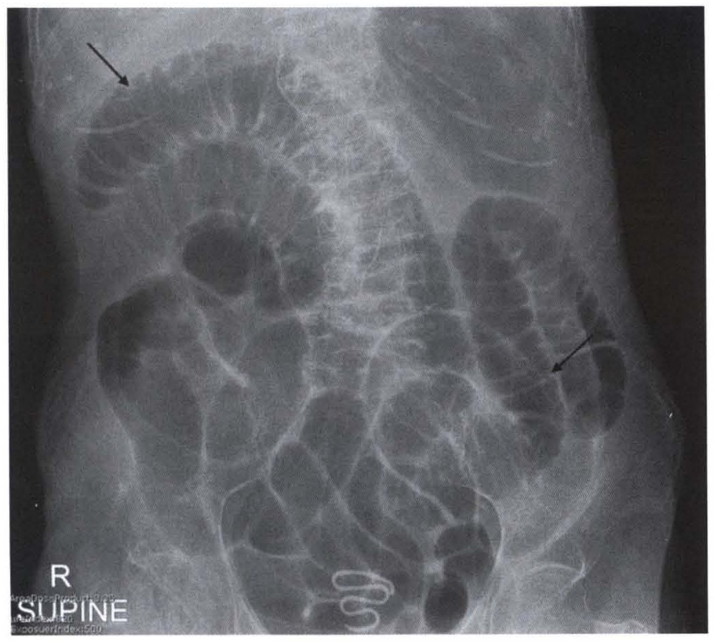
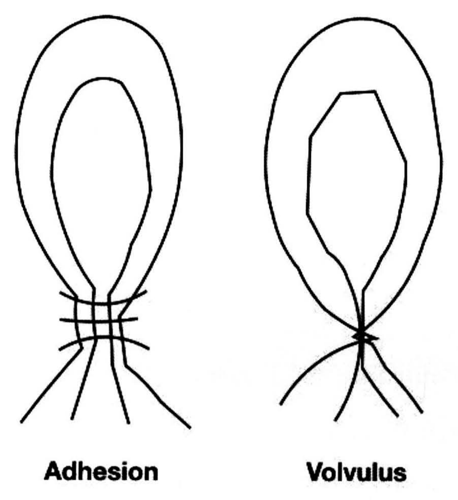
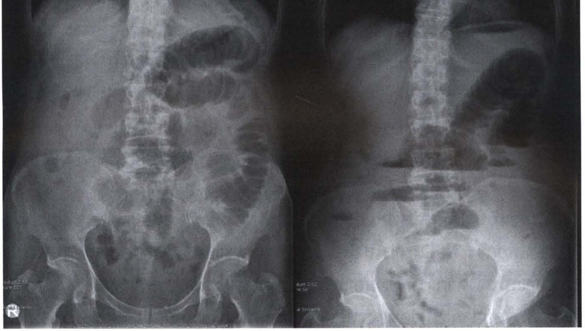
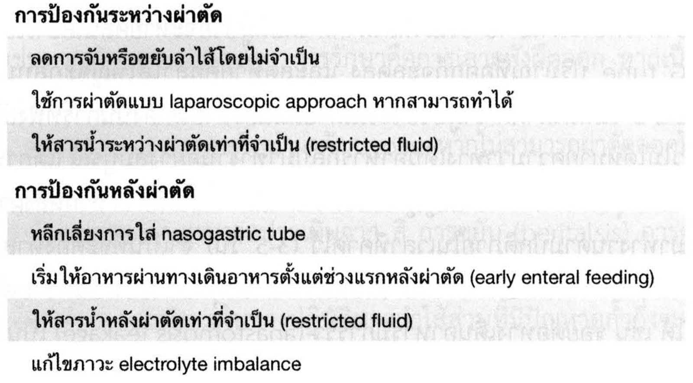
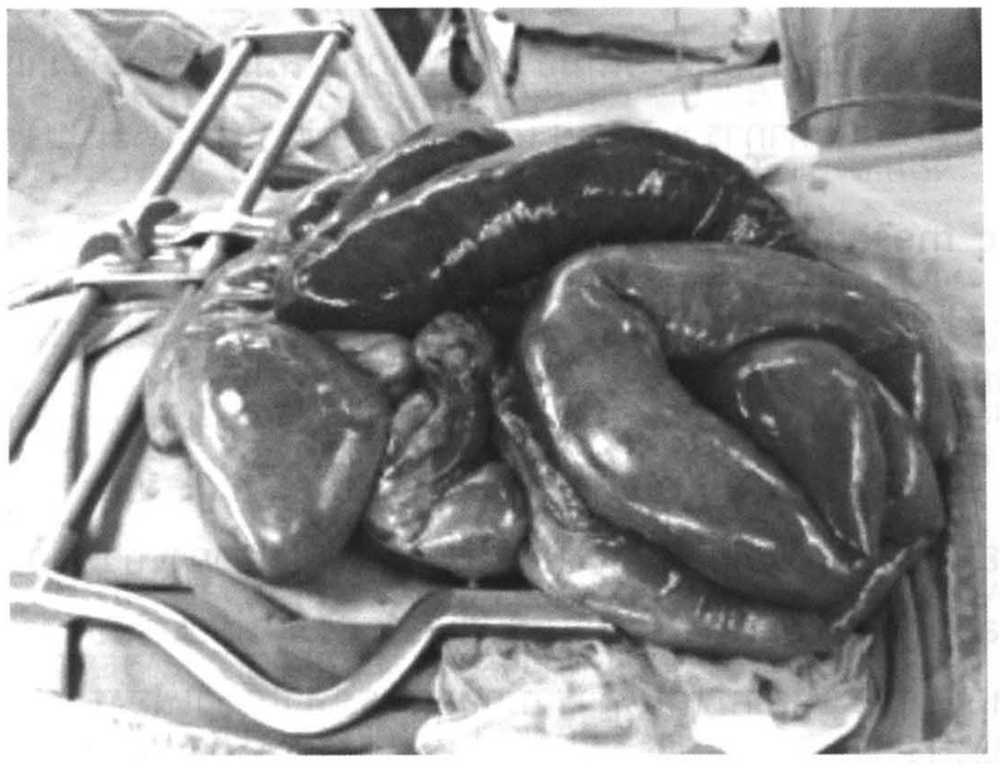

# ลำไส้เล็ก (Small intestine)

## Contents of this file
- Anatomy (p.378)
- Small bowel obstruction (p.379)
  - Pathophysiology (p.380)
  - Clinical presentation (p.381)
  - Evaluation (p.382)
  - Therapy (p.384)
  - Conservative treatment (p.384)
  - Surgery (p.386)
- Ileus (p.386)
  - Etiology (p.387)
  - Diagnosis (p.387)
  - Therapy (p.387)
- Crohn’s disease (p.388)
  - Pathology (p.388)
  - Clinical presentation (p.389)
  - Therapy (p.389)
- Enterocutaneous fistula (p.389)
  - Clinical presentation (p.390)
  - Therapy (p.390)
- Small bowel neoplasm (p.391)
  - Clinical presentation (p.392)
  - Therapy (p.392)
- Radiation enteritis (p.393)
  - Pathophysiology (p.393)
  - Clinical presentation (p.394)
  - Therapy (p.394)
- Meckel’s diverticulum (p.394)
  - Pathophysiology (p.394)
  - Clinical presentation (p.395)
  - Therapy (p.395)
- Mesenteric ischemia (p.396)
- Short bowel syndrome (p.398)
  - Pathophysiology (p.399)
  - Medical therapy (p.399)
  - Surgery (p.400)
- เอกสารอ้างอิง (p.400)

<!-- p.377 (printed none) -->
**ลำไส้เล็ก**

**Small intestine**

เมธี สุธีรศานต์

<!-- p.378 (printed 364) -->
**ลำไส้เล็ก**

**Small intestine**

เมธี สุธีรศานต์

## Anatomy

ลำไส้เล็กเป็นอวัยวะที่มีลักษณะเป็นท่อ เริ่มตั้งแต่ pylorus จนถึง cecum ความยาวในคนที่มีชีวิต อยู่ที่ 4-6 เมตร ประกอบด้วย 3 ส่วนคือ duodenum, jejunum และ ileum ส่วนแรกสุดคือ duodenum เป็นส่วนที่อยู่ใน retroperitoneum เริ่มตั้งแต่ pylorus โดยมี pyloric vein of Mayo เป็น external landmark ที่สำคัญ และยาวไปจนถึงรอยต่อระหว่าง duodenum กับ jejunum ซึ่งมี ligament of Treitz เป็นตัวแบ่ง ส่วน jejunem กับ ileum นั้นอยู่ภายใน peritoneal cavity ซึ่งถูกขึงไว้กับ retroperitoneum โดย mesentery ของตัวมันเอง ตำแหน่งที่แยก ileum ออกจาก cecum คือ ileocecal (IC) valve แต่ไม่มี landmark ที่ใช้แยก jejunum กับ ileum ออกจากกันแต่ทั้งสองมีลักษณะที่แตกต่างกันดังนี้

1. ขนาดของ jejunum ใหญ่กว่า ileum
2. เส้นเลือด (vascular arcade) ของ jejunum มีน้อยกว่า ileum
3. mucosal fold ของ jejunum มีมากกว่า ileum
4. Peyer’s patch ของ ileum มีมากกว่า jejunum

mucosal fold ของลำไส้เล็กมีชื่อเรียกเฉพาะว่า plica circulares หรือ valvular conniventes ซึ่งสามารถเห็นได้ด้วยตาเปล่าระหว่างผ่าตัด หรือสามารถเห็นจากการตรวจทางรังสีวิทยาได้ ซึ่งสามารถใช้แยกว่าเป็นลำไส้เล็กหรือลำไส้ใหญ่ได้ เนื่องจากลำไส้ใหญ่ไม่มี fold ลักษณะนี้ รูปที่ 1

<!-- p.379 (printed 365) -->

> **Caption (verbatim):** **รูปที่ 1** ลูกศรชี้แสดง mucosal fold ของลำไส้เล็ก (plica circulares หรือ valvular conniventes)
> **Text in image (verbatim):** R · SUPINE · (tiny burned-in exposure-parameter text at lower left, largely illegible; legible fragments "AreaDoseProduct" and "ExposureIndex:500")
> **Description:** Plain abdominal radiograph, supine AP view, marker "R" at the lower left (patient's right). Multiple gas-filled, dilated loops of small bowel fill most of the abdomen. Thin lines crossing the full width of the bowel lumen (mucosal folds / plica circulares, valvular conniventes) are visible in the loops. Two black arrows point to these folds: one in the upper right of the image (patient's right upper abdomen), pointing down-right onto a dilated loop with closely spaced folds; one on the left-centre of the image side (patient's left mid abdomen), pointing down-left onto a loop with folds crossing the lumen. The spine is faintly seen in the midline. A coiled tubular structure is visible over the lower pelvis.
> **Identifiers in image:** none

duodenum ได้เลือดมาเลี้ยงจาก celiac axis และ superior mesenteric artery ส่วน jejunum และ ileum นั้นได้จาก superior mesenteric artery เลือดดำจะไหลกลับทาง superior mesenteric vein เข้าสู่ portal vein เข้าสู่ตับต่อไป lymphatic drainage จะรวมกันทาง mesenteric lymph node เข้าสู่ cisterna chyli ตามด้วย thoracic duct และสุดท้ายเข้าสู่ subclavian vein ข้างซ้าย ส่วน parasympathetic nerve มาจาก vagus nerve และ sympathetic nerve มาจาก splanchnic nerve

## Small bowel obstruction

ภาวะลำไส้เล็กอุดตันเป็นความผิดปกติทางศัลยกรรมที่พบบ่อยที่สุดของลำไส้เล็ก โดยสาเหตุที่พบบ่อยที่สุดคือ เกิดจากพังผืด (adhesions หรือ bands) ภายในช่องท้อง (ซึ่งเกือบทั้งหมดเกิดจากการผ่าตัดช่องท้อง) คิดเป็นกว่า 75% ของสาเหตุทั้งหมด รองลงมา

<!-- p.380 (printed 366) -->
คือเกิดจากไส้เลื่อนบริเวณช่องท้อง ที่พบบ่อยคือไส้เลื่อนบริเวณขาหนีบ (groin hernia) สามารถแบ่งสาเหตุของภาวะลำไส้เล็กอุดตันออกเป็น 3 กลุ่มด้วยกัน คือ

1. Intraluminal cause เช่น foreign bodies, gallstones หรือ meconium
2. Intramural cause เช่น tumors, stricture จาก Crohn’s disease
3. extrinsic cause เช่น adhesion, hernia หรือ carcinomatosis

### Pathophysiology

เมื่อมีการอุดตันของลำไส้เล็กเกิดขึ้น จะเกิดการสะสมของก๊าซและของเหลวภายในลำไส้เล็กบริเวณเหนือต่อตำแหน่งที่มีการอุดตัน โดยก๊าซที่สะสมจะมาจากอากาศที่กลืนเข้าไปและบางส่วนจะมีการผลิตภายในลำไส้เองด้วย ส่วนของเหลวจะมาจากอาหารและน้ำที่กินเข้าไปและจากสารคัดหลั่งจากทางเดินอาหาร (gastrointestinal secretion) ลำไส้จะมีการบีบตัว (peritalsis) เพิ่มขึ้นเพื่อที่จะดันก๊าซและของเหลวผ่านตำแหน่งที่อุดตันไปให้ได้ ทำให้เกิดอาการปวดท้องแบบ colicky pain เมื่อการสะสมของก๊าซและของเหลวมากขึ้นเรื่อยๆ ทำให้ลำไส้เล็กมีการขยายขนาด (bowel distention) และความดันภายใน (intraluminal pressure) และบริเวณผนังของลำไส้ (intramural pressure) สูงขึ้น เมื่อความดันสูงมากพอจะทำให้เลือดไม่สามารถเข้ามาเลี้ยงลำไส้ได้ นำมาสู่การเกิดการเน่าตายของลำไส้ (intestinal ischemia) ซึ่งเรียกภาวะนี้ว่า strangulated bowel obstruction ทำให้เกิดการแตกทะลุของลำไส้ตามมาได้ (intestinal perforation)

หากการอุดตันไม่มากพอ ก๊าซและของเหลวภายในลำไส้อาจสามารถผ่านจุดอุดตันไปได้บางส่วน (partial small bowel obstruction) ทำให้การเกิด intestinal ischemia ช้ากว่าการอุดตันแบบ complete small bowel obstruction

นอกจากนี้ยังมีลักษณะการอุดตันชนิดที่เรียกว่า closed-loop obstruction ซึ่งมีลักษณะการอุดตัน 2 จุด เช่น สาเหตุจากการบิดหมุนของขั้วลำไส้ (volvulus) ซึ่งจะทำให้ความดันภายในลำไส้เพิ่มขึ้นอย่างรวดเร็ว ทำให้เกิด strangulation ได้อย่างรวดเร็วได้ รูปที่ 2

<!-- p.381 (printed 367) -->

> **Caption (verbatim):** **รูปที่ 2** closed-loop obstruction จาก adhesion และ volvulus
> **Text in image (verbatim):** Adhesion · Volvulus
> **Description:** Black-and-white line drawing of two side-by-side schematic bowel loops, each drawn as a long oval loop (outer and inner wall lines) whose two limbs come together at the bottom. Left, labelled "Adhesion": the two limbs of the loop run parallel at the neck and are crossed by three curved horizontal lines (bands) that constrict both limbs at the same level, so the loop is obstructed at two points (one on each limb) by the band; below the band the limbs fan out into four diverging lines. Right, labelled "Volvulus": the two limbs of the loop cross over and twist around each other at a single point at the base of the loop (the walls converge to a twisted knot-like point), and below the twist the lines diverge again into four lines. Both drawings illustrate a closed loop of bowel shut off at both ends.
> **Identifiers in image:** none

### Clinical presentation

อาการของลำไส้อุดตันประกอบด้วย 4 อาการหลัก (four cardinal signs/symptoms) ได้แก่

1. อาการปวดท้องแบบ colicky (colicky abdominal pain)
2. คลื่นไส้ อาเจียน (nausea/vomiting)
3. ท้องอืด (abdominal distention)
4. ไม่ถ่ายไม่ผายลม (obstipation)

โดยภาวะลำไส้เล็กอุดตันไม่จำเป็นที่จะต้องมีทุกอาการครบก็ได้ และอาการแต่ละอย่างสามารถบอกรายละเอียดของการอุดตันได้ เช่น อาการปวดท้องและคลื่นไส้อาเจียนมักเด่นในผู้ป่วยที่การอุดตันอยู่ค่อนไปทาง proximal กลับกันอาการท้องอืดและไม่ถ่ายไม่ผายลมมักเด่นในการอุดตันที่ distal ลักษณะของอาเจียนถ้ามีความข้นและมีกลิ่นที่เหม็น (feculent vomiting) บ่งบอกว่าการอุดตันเกิดขึ้นนานและมักมีตำแหน่งที่ distal เป็นต้น

<!-- p.382 (printed 368) -->
นอกจากนี้การที่ผู้ป่วยสามารถถ่ายหรือผายลมได้อยู่หลังจากเริ่มมีอาการเกิน 6-12 ชั่วโมง แสดงว่าการอุดตันน่าจะเป็น partial obstruction อาการแสดงที่สำคัญคือเสียงลำไส้จะมีลักษณะ hyperactive bowel sound ในช่วงแรก ถ้าไม่ได้รับการรักษาในช่วงท้ายจะกลายเป็น hypoactive bowel sound

หากการอุดตันมีลักษณะเป็น strangulated obstruction อาการปวดท้องจะมีความรุนแรงมาก ตรวจร่างกายอาจจะมีไข้ ชีพจรเต้นเร็ว ตรวจบริเวณช่องท้องจะพบ localized tender และอาจมี guarding ได้ ซึ่งบ่งบอกว่าผู้ป่วยจำเป็นต้องได้รับการผ่าตัดฉุกเฉิน

### Evaluation

เป้าหมายในการประเมินผู้ป่วยลำไส้อุดตันมีอยู่ 5 ข้อคือ

1. ผู้ป่วยมีภาวะลำไส้อุดตันจริงหรือไม่
2. สาเหตุของการอุดตันคืออะไร
3. ตำแหน่งของการอุดตันอยู่ที่ไหน
4. การอุดตันเป็น partial หรือ complete
5. มีภาวะแทรกซ้อนของการอุดตัน ได้แก่ strangulation หรือ perforation เกิดขึ้นหรือยัง

การตอบคำถามทั้งห้าข้อนี้เพื่อจะนำไปสู่การพิจารณาเลือกการดูแลรักษาผู้ป่วยให้เหมาะสม โดยข้อมูลเกือบทั้งหมดสามารถได้จากการซักประวัติ การตรวจร่างกาย และการส่งตรวจทางห้องปฏิบัติการและทางรังสีวิทยาเบื้องต้น เช่น การซักประวัติต้องมีการซักถึงประวัติการผ่าตัดช่องท้องในอดีตซึ่งบ่งถึงสาเหตุการอุดตันจาก adhesion หรือประวัติเกี่ยวกับความผิดปกติในช่องท้อง เช่น ประวัติมะเร็งในช่องท้อง หรือการตรวจร่างกายก็ต้องมีการตรวจหาแผลเป็นของการผ่าตัดช่องท้อง หรือการหาไส้เลื่อนโดยเฉพาะบริเวณขาหนีบซึ่งอาจละเลยในการตรวจร่างกาย

การส่งตรวจทางรังสีวิทยาเบื้องต้นที่สามารถใช้ในการยืนยันและวินิจฉัยภาวะลำไส้เล็กอุดตันคือ film acute abdomen series ซึ่งประกอบด้วย 1) chest ในท่า upright 2) abdomen ในท่า supine 3) abdomen ในท่า upright โดยลักษณะที่เป็น triad ของภาวะลำไส้เล็กอุดตันคือ ลำไส้เล็กขยายตัว (>3 ซม.) ลักษณะ air-fluid level ในท่า

<!-- p.383 (printed 369) -->
upright และ ไม่เห็น air ในลำไส้ใหญ่ รูปที่ 3 ความไว (sensitivity) ของการตรวจชนิดนี้ในการวินิจฉัยภาวะลำไส้เล็กอุดตันอยู่ที่ 70-80% แต่ความจำเพาะ (specificity) ค่อนข้างต่ำ เนื่องจากภาวะ ileus และภาวะลำไส้ใหญ่อุดตัน (colonic obstruction) สามารถมีลักษณะที่เหมือนกับภาวะลำไส้เล็กอุดตันได้ นอกจากนี้การตรวจชนิดนี้สามารถให้ผลลบลวง (false negative) ได้ ในกรณีที่ตำแหน่งที่อุดตันอยู่มาทาง proximal มากๆ หรือภาวะ closed-loop obstruction ซึ่งในตำแหน่งลำไส้ที่อุดตันมีของเหลวอยู่เต็ม (fluid-filled bowel loop) ทำให้ไม่เห็นลำไส้ที่ขยายตัวในภาพได้

> **Caption (verbatim):** **รูปที่ 3** film acute abdomen series ในผู้ป่วยลำไส้เล็กอุดตัน
> **Text in image (verbatim):** (on the printed page, above the right panel: "R" · "Upright" — this strip was cropped out with the identifier labels) · (tiny burned-in exposure-parameter text at lower left of each panel, truncated at the panel edge; legible fragments "oduct:2.68", "ure:107", "duct:2.62", "re:58", "Systems") · R (circular logo, lower left of left panel)
> **Description:** Two plain abdominal radiographs side by side, AP view, from the same patient. Left panel (abdomen, supine film): multiple dilated gas-filled small bowel loops in the central and left upper abdomen, with folds crossing the lumen, stacked in a step-like arrangement; little gas in the expected course of the colon; spine and pelvis visible. Right panel (abdomen, upright film, labelled "Upright" on the page): dilated small bowel loops in the left upper and mid abdomen with several horizontal air-fluid levels at different heights across the mid abdomen (gas above, fluid below, horizontal interfaces). Together the films show dilated small bowel, air-fluid levels on the upright film and little or no colonic gas, the triad described in the text. Burned-in hospital name/date labels at the top of each panel cropped out (identifier label cropped out).
> **Identifiers in image:** none

ปัจจุบันการตรวจทางรังสีวิทยาที่ได้รับความนิยมมากขึ้นคือ computed tomographic (CT) scan โดยลักษณะที่พบในภาวะลำไส้เล็กอุดตัน คือ มีลักษณะลำไส้ที่ขยายตัวด้านที่ proximal ต่อตำแหน่งที่อุดตัน และลำไส้ที่แฟบด้านที่ distal ต่อจุดที่อุดตัน และสามารถเห็นลักษณะของ closed-loop obstruction ได้และหากมีภาวะแทรกซ้อน เช่น strangulation หรือ perforation นั้น CT scan สามารถวินิจฉัยได้อย่างแม่นยำ นอกจากนี้ยังสามารถบอกสาเหตุของการอุดตันได้ค่อนข้างแม่นยำ แต่อย่างไรก็ตามการทำ CT scan ก็มีข้อเสียคือ การใช้ intravenous contrast ซึ่งอาจทำให้เกิดภาวะไตวาย หรือแพ้สารทึบแสงได้ มีราคาแพง รวมถึงไม่สามารถทำได้ทันทีในทุกสถานพยาบาล ซึ่งอาจทำให้การรักษาผู้ป่วยล่าช้าได้หากรอการทำ CT scan ก่อน ดังนั้นการเลือกใช้ CT scan จึงจำเป็นต้องพิจารณาในผู้ป่วยเป็นรายๆ ไป รวมถึงดูบริบทของแต่ละสถานพยาบาลร่วมด้วย

<!-- p.384 (printed 370) -->
### Therapy

ในผู้ป่วยลำไส้เล็กอุดตันทุกรายจะมีการขาดของ intravascular volume จากการกินได้น้อย อาเจียน รวมถึงการรั่วของ fluid เข้าไปอยู่ใน bowel wall และ lumen ดังนั้นต้องมีการประเมินความรุนแรง (degree of dehydration) และให้ fluid resuscitation ในผู้ป่วยทุกราย และต้องมีการติดตามหลังจาก resuscitaion ผู้ป่วยเป็นระยะด้วย โดยการติดตามโดยดูจากปริมาณ urine output เป็นสิ่งที่ได้รับความนิยมในทางปฏิบัติ โดยอาจต้องมีการใส่ Foley’s catheter ในกรณีที่ต้องการติดตามใกล้ชิด หรืออาจจำเป็นต้อง admit ผู้ป่วยเข้าใน intensive care unit (ICU) ในบางราย โดยเฉพาะผู้ป่วยสูงอายุ หรือผู้ที่มีโรคประจำตัวรุนแรง

การงดน้ำงดอาหารผู้ป่วย (NPO) และการใส่ nasogastric (NG) tube เพื่อ decompress ก๊าซและของเหลวออกมา เพื่อช่วยลดอาการท้องอืด อาเจียน และโอกาสการเกิด aspiration โดยเฉพาะในระหว่างดมยาสลบในกรณีที่ต้องรักษาด้วยการผ่าตัด

### Conservative treatment

การรักษาแบบ conservative treatment หรือ nonoperative management คือการรักษาโดยการ NPO การใส่ NG tube เพื่อ decompress และ resuscitation ผู้ป่วย หลังจากนั้นจึงทำการติดตามอาการอย่างใกล้ชิด หากประสบความสำเร็จ อาการของผู้ป่วยจะดีขึ้น โดยอาการปวดท้องจะลดลง ไม่มีคลื่นไส้อาเจียน สามารถถ่ายและผายลมได้ในที่สุด หรือการรักษาอาจจะล้มเหลว (failed conservative treatment) ได้ ซึ่งอาการของผู้ป่วยอาจไม่ดีขึ้นในเวลาที่ควรจะเป็นหรือแย่ลงระหว่างการติดตามอาการก็ได้ และต้องจบลงด้วยการผ่าตัดในที่สุด

ข้อบ่งชี้ของการรักษาด้วยวิธี conservative treatment ได้แก่

1. Partial small bowel obstruction จาก adhesion
2. Early postoperative small bowel obstruction
3. Small bowel obstruction จาก Crohn’s disease
4. Small bowel obstruction จากภาวะ carcinomatosis peritoneii

<!-- p.385 (printed 371) -->
ในกรณีของภาวะลำไส้เล็กอุดตันจาก adhesion นั้น เป็นที่ยอมรับกันว่าหากเป็นการอุดตันแบบ partial นั้นการรักษาหลักคือ conservative treatment ซึ่งส่วนใหญ่กว่า 80% สามารถดีขึ้นได้โดยไม่ต้องผ่าตัด แต่หากการอุดตันเป็นแบบ complete นั้น โดยทั่วไปเชื่อกันว่าควรนำไปผ่าตัดให้เร็วที่สุดเพื่อลดความเสี่ยงของการเกิด strangulation ซึ่งจะนำมาสู่อัตราการเสียชีวิตที่มากขึ้น จนมีคำกล่าวที่เชื่อกันในหมู่ศัลยแพทย์มานานว่า “the sun should never rise and set on a complete bowel obstruction” หมายความว่าหากคนไข้มาถึงโรงพยาบาลตอนกลางวันก็ไม่ควรรอจนพระอาทิตย์ตก ควรนำคนไข้ไปผ่าตัดรักษาให้เสร็จก่อน หรือหากคนไข้มาโรงพยาบาลตอนกลางคืนก็ไม่ควรรอจนพระอาทิตย์ขึ้นเช่นเดียวกัน แต่ในปัจจุบันซึ่ง CT scan เข้ามามีบทบาทในการวินิจฉัยภาวะ closed-loop obstruction หรือภาวะ strangulation ได้ในกรณีที่อาการและอาการแสดงไม่สามารถบอกได้ชัดเจน ทำให้ปัจจุบันหากคิดว่าผู้ป่วยยังไม่มีภาวะแทรกซ้อนของภาวะลำไส้เล็กอุดตัน แม้ว่าการอุดตันจะเป็นแบบ complete ก็ตามก็อาจจะสามารถรักษาคนไข้แบบ conservative treatment ก่อนได้ และหากไม่ดีขึ้นจึงค่อยนำคนไข้ไปรักษาด้วยการผ่าตัด โดยระยะเวลาของการรักษาแบบ conservative นั้น โดยทั่วไปยอมรับกันที่ 48 ชั่วโมง หากอาการไม่ดีขึ้นจึงค่อยพิจารณานำคนไข้ไปผ่าตัด แต่หากสงสัยภาวะ strangulation เกิดขึ้นก่อนต้องรีบนำคนไข้ไปผ่าตัดโดยไม่ต้องรอจนครบ 48 ชั่วโมง

ช่วง early postoperative คือช่วงเวลา 30 วันหลังผ่าตัดช่องท้องนั้น สามารถเกิดภาวะลำไส้เล็กอุดตันได้ตั้งแต่ 0.7-9% โดยพบมากในการผ่าตัดภายในอุ้งเชิงกราน เช่น colorectal surgery การอุดตันเกือบทั้งหมดจะเป็นจาก adhesion มักมีลักษณะเป็น partial และไม่เกิดภาวะ strangulation ตามมา รวมถึงในช่วงหลังผ่าตัด 1-2 สัปดาห์ไปแล้วพังผืดในช่องท้องจะมีลักษณะที่หนาแน่น (dense adhesion) หากเข้าไปผ่าตัดมีโอกาสที่จะเกิดการบาดเจ็บต่อลำไส้ได้ ดังนั้นหลักการรักษาจึงเป็นการรักษาแบบ conservative treatment ซึ่งอาจเพิ่มระยะเวลาออกไปถึง 3-4 สัปดาห์ได้ ซึ่งมักประกอบด้วยการ NPO การใส่ NG tube เพื่อ decompress และการให้ total parenteral nutrition (TPN) และรอจนกว่าภาวะลำไส้อุดตันจะดีขึ้นเอง แต่หากมีลักษณะของ peritonitis ซึ่งบ่งถึงการมี strangulation ควรรีบนำผู้ป่วยไปผ่าตัด

ผู้ป่วยที่มีภาวะ carcinomatosis peritoneii และมีภาวะลำไส้เล็กอุดตันนั้นมักจะมีพยากรณ์โรคที่ไม่ดี รวมถึงตำแหน่งของการอุดตันอาจจะมีหลายตำแหน่งทำให้การรักษามักจะเป็นในลักษณะของ conservative treatment เนื่องจากการนำผู้ป่วยไปผ่าตัด

<!-- p.386 (printed 372) -->
มักจะมีภาวะแทรกซ้อน โดยเฉพาะภาวะ enterocutaneous fistula ทำให้ผู้ป่วยมีคุณภาพชีวิตที่แย่ลงได้ หรืออาจเสียชีวิตได้ แต่ในบางกรณีผู้ป่วยอาจได้ประโยชน์หรือมีคุณภาพชีวิตที่ดีขึ้นจากการผ่าตัด palliative resection หรือ bypass หรือการทำ decompressive gastrostomy ได้ ดังนั้นการตัดสินใจเลือกวิธีการรักษาควรเลือกโดยใช้ข้อมูลของผู้ป่วยแต่ละคน รวมถึงความคาดหวังจากการรักษาเป็นปัจจัยในการเลือกวิธีรักษา

### Surgery

การผ่าตัดสำหรับภาวะลำไส้เล็กอุดตันนั้น มีความแตกต่างกันตามแต่สาเหตุของการเกิด เช่นหากเกิดจาก adhesion การรักษาคือการเลาะพังผืดออก หากเป็นไส้เลื่อนก็คือการดึงลำไส้กลับมาตำแหน่งปกติและทำการซ่อมไส้เลื่อน หรือหากเป็นจากเนื้องอกก็คือการผ่าตัดออก (resection) หรือทำผ่าตัด bypass หากไม่สามารถผ่าตัดออกได้ เป็นต้น นอกจากนี้ระหว่างผ่าตัดต้องทำการตรวจดูลำไส้ส่วนที่อุดตันด้วยว่าเน่าตาย (non-viable) หรือยัง โดยในการประเมินสามารถประเมินจาก สี การขยับ (peritalsis) การคลำชีพจร marginal artery บริเวณ mesentery หรือใช้ doppler ultrasound ตรวจดูชีพจรของลำไส้ร่วมด้วยได้ อย่างไรก็ตามในทางปฏิบัติหากลำไส้ส่วนที่มีปัญหาดูก้ำกึ่งระหว่างยังมีชีวิตอยู่หรือเน่าตายแล้วมีความยาวค่อนข้างสั้น มักทำการตัดทิ้งไป และทำการต่อลำไส้เข้าหากันไปเลย แต่หากลำไส้ส่วนที่ก้ำกึ่งมีความยาวค่อนข้างมาก หากตัดทิ้งไปผู้ป่วยอาจมีปัญหาเรื่อง short bowel syndrome ตามมาได้ มักจะทำการแก้ไขปัญหาสาเหตุของลำไส้อุดตันอย่างเดียวและเก็บลำไส้ไว้ก่อน หลังจากนั้นจึงทำการผ่าตัดเปิดท้องอีกครั้งห่างจากการผ่าตัดครั้งแรก 24-48 ชั่วโมง เพื่อเข้าไปประเมินลำไส้อีกครั้ง (second look operation) หากลำไส้เน่าตายชัดเจนจึงทำการตัดลำไส้ส่วนนั้นทิ้งไป

## Ileus

ภาวะ ileus หรือ pseudo-obstruction เป็นกลุ่มอาการที่เกิดจากลำไส้ไม่ขยับตัวตามปกติ ซึ่งจะมีอาการคล้ายกับภาวะลำไส้อุดตันได้ ปกติแล้ว ileus จะมีลักษณะที่เป็นเพียงชั่วคราวและจะหายเป็นปกติหากได้รับการแก้ไขสาเหตุแล้ว แต่หากผู้ป่วยมีลักษณะเป็นอย่างยาวนานและเรื้อรัง โดยที่ไม่มีสาเหตุชัดเจนอาจต้องนึงถึงกลุ่มโรคของ intestinal dysmotility

<!-- p.387 (printed 373) -->
### Etiology

สาเหตุของภาวะ ileus มีหลายสาเหตุด้วยกันดังตารางที่ โดยสาเหตุที่พบบ่อย ได้แก่ การผ่าตัดช่องท้อง ภาวะติดเชื้อ ภาวะ electrolyte imbalance และยา จะเห็นได้ว่าผู้ป่วยทางศัลยกรรมโดยเฉพาะผู้ป่วยที่ได้รับการผ่าตัดช่องท้องมีปัจจัยเสี่ยงที่จะมีโอกาสเกิดภาวะ ileus ค่อนข้างมาก ภายหลังการผ่าตัดช่องท้องนั้นโดยปกติแล้วจะเกิดภาวะ ileus ชั่วคราวอยู่แล้ว โดยที่ลำไส้เล็กจะเริ่มกลับมาทำงานก่อนที่ประมาณ 24 ชั่วโมงหลังผ่าตัด ซึ่งจะทราบได้จากการฟังเสียงลำไส้ (active bowel sound) และตามมาด้วยกระเพาะอาหารที่ประมาณ 48 ชั่วโมงหลังผ่าตัด โดยที่ผู้ป่วยจะหายคลื่นไส้อาเจียน หากมีการใส่ NG tube ปริมาณที่ออกก็จะลดลง และสุดท้ายคือลำไส้ใหญ่จะกลับมาทำงานที่ประมาณ 3-5 วันหลังผ่าตัด ซึ่งผู้ป่วยจะเริ่มผายลมและถ่ายได้ ดังนั้นการที่ฟังเสียงลำไส้ทำงานแล้วไม่ได้หมายความว่าทางเดินอาหารกลับมาทำงานอย่างสมบูรณ์ แต่การที่ผู้ป่วยผายลมหรือถ่ายอุจจาระน่าจะเป็นสัญญาณบอกว่าลำไส้ทำงานได้ดีกว่า หากหลังผ่าตัดลำไส้ยังไม่กลับมาทำงานตามปกติภายในเวลาที่คาดไว้ (3-5 วัน) จำเป็นที่จะต้องหาสาเหตุอื่นและแก้ไขเพื่อให้ลำไส้กลับมาทำงาน โดยเฉพาะสาเหตุที่อาจเป็นอันตรายต่อผู้ป่วยถึงแก่ชีวิตได้ เช่น รอยต่อทางเดินอาหารมีการรั่ว (anastomosis leakage) เป็นต้น

### Diagnosis

อาการของภาวะ ileus จะมีความคล้ายคลึงกับภาวะลำไส้เล็กอุดตัน โดยเฉพาะตำแหน่ง distal small bowel obstruction หรือลำไส้ใหญ่อุดตัน แต่สิ่งที่แตกต่างคือ bowel sound จะมีลักษณะ absent หรือ hypoactive bowel sound ในผู้ป่วยที่อาการชัดเจนและมีสาเหตุที่อธิบายได้ก็สามารถวินิจฉัยได้ไม่ยากนัก แต่ในกรณีของผู้ป่วยหลังผ่าตัดช่องท้องนั้น การตรวจทางรังสีวิทยาโดยเฉพาะ CT scan มักมีความจำเป็นเพื่อที่จะหาภาวะ intraabdominal collection/abscess หรือการแยกกับภาวะ early postoperative bowel obstruction ซึ่งมีแนวทางการรักษาที่แตกต่างกัน

### Therapy

ประกอบด้วยการจำกัดอาหารและน้ำ หากผู้ป่วยมีอาการคลื่นไส้อาเจียน ท้องอืดมากอาจจำเป็นต้องใส่ NG tube เพื่อ decompress การให้ intravenous fluid จนกระทั่งอาการดีขึ้น และอาจจำเป็นต้องให้สารอาหารทางหลอดเลือด (parenteral nutrition) หากต้องงดน้ำงดอาหารเป็นเวลานาน และที่สำคัญคือต้องมีการหาสาเหตุและแก้ไขสาเหตุร่วมด้วยเสมอ

<!-- p.388 (printed 374) -->
เนื่องจากภาวะ postoperative ileus เป็นภาวะที่พบได้บ่อย และทำให้ผู้ป่วยต้องนอนโรงพยาบาลนานขึ้น ดังนั้นการป้องกันหรือการลดระยะเวลาการเกิด ileus จึงเป็นสิ่งที่ควรกระทำในผู้ป่วยทุกรายที่ได้รับการผ่าตัดช่องท้อง วิธีการลดการเกิด postoperative ileus แสดงดังตารางที่ 1

**ตารางที่ 1 ตารางแสดงวิธีการป้องกันหรือลดการเกิดภาวะ postoperative ileus ในผู้ป่วยที่ได้รับการผ่าตัดช่องท้อง**

| ช่วงเวลา | วิธีการ |
| --- | --- |
| **การป้องกันระหว่างผ่าตัด** | ลดการจับหรือขยับลำไส้โดยไม่จำเป็น |
| **การป้องกันระหว่างผ่าตัด** | ใช้การผ่าตัดแบบ laparoscopic approach หากสามารถทำได้ |
| **การป้องกันระหว่างผ่าตัด** | ให้สารน้ำระหว่างผ่าตัดเท่าที่จำเป็น (restricted fluid) |
| **การป้องกันหลังผ่าตัด** | หลีกเลี่ยงการใส่ nasogastric tube |
| **การป้องกันหลังผ่าตัด** | เริ่มให้อาหารผ่านทางเดินอาหารตั้งแต่ช่วงแรกหลังผ่าตัด (early enteral feeding) |
| **การป้องกันหลังผ่าตัด** | ให้สารน้ำหลังผ่าตัดเท่าที่จำเป็น (restricted fluid) |
| **การป้องกันหลังผ่าตัด** | แก้ไขภาวะ electrolyte imbalance |

> **Caption (verbatim):** **ตารางที่ 1** ตารางแสดงวิธีการป้องกันหรือลดการเกิดภาวะ postoperative ileus ในผู้ป่วยที่ได้รับการผ่าตัดช่องท้อง
> **Text in image (verbatim):** การป้องกันระหว่างผ่าตัด · ลดการจับหรือขยับลำไส้โดยไม่จำเป็น · ใช้การผ่าตัดแบบ laparoscopic approach หากสามารถทำได้ · ให้สารน้ำระหว่างผ่าตัดเท่าที่จำเป็น (restricted fluid) · การป้องกันหลังผ่าตัด · หลีกเลี่ยงการใส่ nasogastric tube · เริ่มให้อาหารผ่านทางเดินอาหารตั้งแต่ช่วงแรกหลังผ่าตัด (early enteral feeding) · ให้สารน้ำหลังผ่าตัดเท่าที่จำเป็น (restricted fluid) · แก้ไขภาวะ electrolyte imbalance
> **Description:** Single-column table with no column headers. Two bold group headings, "การป้องกันระหว่างผ่าตัด" (intraoperative prevention) followed by three indented rows, and "การป้องกันหลังผ่าตัด" (postoperative prevention) followed by four indented rows. Rows alternate between grey-shaded and white backgrounds. (The column headers "ช่วงเวลา" / "วิธีการ" in the Markdown table above were added only to make the table structure; they are not printed in the book.) Faint show-through text from the reverse page is visible in the grey bands.
> **Identifiers in image:** none

## Crohn’s disease

เป็นโรคอักเสบเรื้อรังซึ่งสามารถปรากฏอาการที่บริเวณลำไส้เล็กได้ โดยเฉพาะที่บริเวณ ileum ไม่ทราบสาเหตุที่ชัดเจน ลักษณะการอักเสบจะเป็นทุกชั้นของลำไส้ (transmural) และมีลักษณะเป็น skip lesion พบมากทางประเทศฝั่งตะวันตก พบได้น้อยในประเทศไทย

### Pathology

ลำไส้ส่วนที่เป็นโรคจะมีการบวม ตีบ แข็ง ผิว serosa อาจมีท่อน้ำเหลืองพองเป็นเส้นสีขาว ตัว mesentery จะหนาและขึ้นมาคลุมบริเวณลำไส้ (fat wrapping) ผนัง mucosa และ submucosa บวม มีแผลเป็นลักษณะร่อง (fissure) แผลเหล่านี้ลึกลงไปเป็นหนองได้ และแผลเหล่านี้อาจมีหลายแผลต่อกันเป็นลักษณะขนานกันตามยาวของลำไส้ (longitudinal axis) ซึ่งทำให้เกิดลักษณะทางกายวิภาคหรือทางรังสีวิทยาที่เรียกว่า cobblestone appearance หากเป็นรุนแรงอาจมีการอักเสบทำให้เกิด adhesion ทำให้ลำไส้ติดกันเป็นแผ่นแข็งหนา หรืออาจทะลุเกิดเป็นหนอง หรือมี fistula ต่อถึงกันได้ หรืออาจมีลักษณะของการตีบของทางเดินอาหารได้ (stricture)

<!-- p.389 (printed 375) -->
### Clinical presentation

ผู้ป่วยจะมีการดำเนินโรคที่เรื้อรัง  มีอาการรุนแรงสลับกับช่วงเวลาที่ไม่มีอาการเลย อาการสำคัญของโรคที่ลำไส้เล็กคือ ปวดท้อง ท้องอืด ถ่ายเหลว น้ำหนักลด มีไข้ หรืออาจมีอาการของภาวะแทรกซ้อน  ซึ่งอาจแบ่งกลุ่มอาการออกเป็นกลุ่มที่มีลักษณะลำไส้ตีบ (stricture) คือมีอาการของลำไส้อุดตันซึ่งมักเป็นลักษณะ partial หรือกลุ่มที่มีลักษณะของหนองหรือ fistula ในช่องท้อง ซึ่งจะมีอาการของการติดเชื้อ เช่น ปวดท้องรุนแรง ไข้สูง ซึ่งอาจต้องวินิจฉัยแยกโรคกับภาวะทางศัลยกรรมที่พบบ่อย เช่น ไส้ติ่งอักเสบให้ได้

### Therapy

ปัจจุบันการรักษายังเป็นการรักษาเพื่อควบคุมอาการและผ่าตัดเมื่อมีภาวะแทรกซ้อน

1. Medical therapy มีจุดมุ่งหมายเพื่อลดอาการและควบคุมอาการ ยาที่ใช้ ได้แก่ sulphasalazine, corticosteroid และ azathioprine ส่วนช่วงที่มีอาการอาจให้ผู้ป่วยงดน้ำงดอาหารชั่วคราว ใส่ NG tube ให้ parenteral nutrition ควบคุมอาการท้องเสียด้วย cholestryramine อาจให้ยาปฏิชีวนะหากมี blind loop syndrome ร่วมด้วย

2. Surgery การผ่าตัดทำเมื่อมีภาวะแทรกซ้อน ได้แก่ ลำไส้อุดตันที่ไม่สามารถรักษาด้วยยาได้ abscess/fistula หรือ blind loop syndrome โดยตัดลำไส้ที่สร้างปัญหาออกและนำปลายที่ดีมาต่อกัน ไม่นิยมทำ bypass เนื่องจากส่วนที่เป็น blind loop มักสร้างปัญหาต่อไป  การผ่าตัดมีภาวะแทรกซ้อนเกิดขึ้นได้โดยเฉพาะการรั่วของรอยต่อลำไส้หากนำลำไส้ส่วนที่เป็นโรคมาต่อกัน หรือหากผ่าตัดหลายครั้งอาจเกิดปัญหา short bowel syndrome ได้

## Enterocutaneous fistula

นิยามของ fistula คือ “abnormal communication between two epithelial surface” ดังนั้น enterocutaneous fistula หมายถึง การที่มีรอยต่อผิดปกติระหว่างทางเดินอาหารกับผิวหนัง ซึ่งกว่า 80% เกิดจากภาวะแทรกซ้อนจากการผ่าตัด เช่น รอยต่อลำไส้มีการรั่ว เป็นต้น ส่วน enterocutaneous fistula ที่เกิดขึ้นเองโดยที่ไม่ได้เกี่ยวข้องกับการผ่าตัด โดยทั่วไปเกิดจาก Crohn’s disease หรือมะเร็งทางเดินอาหารภายในช่องท้องที่มีการลุกลามมายังผิวหนัง

<!-- p.390 (printed 376) -->
ผลกระทบของ intestinal fistula นั้นขึ้นกับตำแหน่งที่เกิด fistula เช่น หากตำแหน่ง fistula  เกิดบริเวณส่วนต้นของลำไส้เล็กทำให้อาหารไม่สามารถผ่านลำไส้ส่วนปลายได้ ทำให้เกิดภาวะ dehydration และ electrolyte imbalance รวมทั้ง malabsorption ได้ หรือหากลักษณะ fistula เป็น internal fistula เช่น enterovesicle fistula สามารถทำให้เกิดการติดเชื้อทางเดินปัสสาวะซ้ำๆ ได้ สารคัดหลั่งหรือน้ำย่อยที่ออกมาจากทางเดินอาหาร หากสัมผัสกับผิวหนังสามารถระคายเคือง และทำให้เกิดบาดแผลและการติดเชื้อตามมาได้

fistula ส่วนใหญ่มีแนวโน้มที่จะปิดหรือหายไปเองได้  นอกเสียจากมีปัจจัยที่ยับยั้งการหายเอง ได้แก่ ภาวะทุพโภชนาการ การติดเชื้อ ลำไส้ที่เกิด fistula มีลักษณะเป็น inflammatory bowel disease เป็นมะเร็งหรือได้รับการฉายแสงมาก่อน ลำไส่ส่วนที่ distal มีการอุดตัน fistula tract สั้นกว่า 2 เซนติเมตร มีสิ่งแปลกปลอมบริเวณ fistula และ fistula tract มีการเกิด epithelialization

### Clinical presentation

intestinal fistula ที่เกิดตามหลังการผ่าตัดมักมีอาการหลังผ่าตัดประมาณ 5-10 วัน ได้แก่ มีไข้ ปวดท้อง ท้องอืด มีภาวะ ileus แผลผ่าตัดมีการติดเชื้อ และตามมาด้วยมี intestinal content ออกมาทางบาดแผลผ่าตัด การทำ CT scan พร้อม oral contrast เพื่อวินิจฉัยสามารถเห็น contrast รั่วออกมานอกลำไส้ได้ และยังสามารถใช้หา intraabdominal collection หรือ abscess เพื่อทำการระบายได้ด้วย ในบางกรณีการทำ CT scan ไม่สามารถให้รายละเอียดตำแหน่ง fistula ของทางเดินอาหารได้ สามารถทำการตรวจ small bowel follow through หรือ fistulogram เพื่อหาตำแหน่งของ fistula ได้

### Therapy

หลักการรักษา intestinal fistula ควรจะดำเนินการตามลำดับขั้นตอนดังนี้

1. Stabilization ประกอบด้วยการ resuscitation ได้แก่ การให้ intravenous fluid เนื่องจากผู้ป่วยกลุ่มนี้จะมีภาวะ dehydration และ electrolyte imbalance จากการสูญเสีย intestinal content ตามด้วยการให้สารอาหารซึ่งมักจะต้องเริ่มด้วยการให้ทาง parenteral nutrition นอกจากนี้สิ่งที่สำคัญอีกคือการควบคุมการติดเชื้อด้วยการให้ยาปฏิชีวนะและหากมี intraabdominal collection หรือ abscess ต้องประกอบด้วยการระบายหนองด้วยซึ่งมักเป็นการทำ percutaneous drainage การปกป้องผิวหนัง

<!-- p.391 (printed 377) -->
บริเวณรูออกของ fistula ก็มีความสำคัญเช่นเดียวกัน โดยทั่วไปมักใช้อุปกรณ์การดูแลของ ostomy มาประยุกต์ใช้

2. Investigation คือการประเมินลักษณะทางกายวิภาคของ fistula ได้แก่ ตำแหน่งของรอยต่อระหว่างทางเข้าและทางออกที่แน่นอน ขนาด ความยาว เนื่องจากสามารถใช้ทำนายและเลือกวิธีรักษาได้ โดยใช้การตรวจทางรังสีวิทยาชนิดต่างๆ ดังที่ได้กล่าวมาแล้ว

3. Decision การตัดสินใจเลือกวิธีการรักษาว่าจะรักษาโดยวิธี conservative treatment หรือการผ่าตัด และระยะเวลาโดยเฉพาะการรักษาโดยการผ่าตัดว่าจะตัดสินใจที่จะผ่าตัดเมื่อไร โดยทั่วไปมักจะตัดสินใจผ่าตัดเมื่อระยะเวลารักษาด้วย conservative treatment ไปแล้ว 3 เดือนขึ้นไป

4. Definitive treatment การผ่าตัดแก้ไข intestinal fistula จำเป็นที่ต้องทำการตัดต่อลำไส้ส่วนที่เป็น fistula เนื่องจากการเย็บซ่อมรู fistula มักจบลงด้วยการเป็นซ้ำและมักเป็นการผ่าตัดที่มีความท้าทาย เนื่องจากในช่องท้องมักมี adhesion ที่มีลักษณะหนาแน่นและปริมาณมาก และควรจะต้องทำการเลาะออกทั้งหมดเพื่อให้เห็นถึงลักษณะทางกายวิภาคในช่องท้องทั้งหมดและป้องกันไม่ให้มีภาวะ distal obstruction ซึ่งจะทำให้เกิดการรั่วของรอยต่อลำไส้และการเป็นซ้ำของ fistula ได้

5. Rehabilitation ผู้ป่วย intestinal fistula ส่วนใหญ่ต้องพักอยู่ในโรงพยาบาลและบางรายมีลักษณะกึ่ง bed-ridden เนื่องจากมักจะมีสาย catheter ต่างๆ หลายสายและอาจมีภาวะติดเชื้อซึ่งไม่สามารถควบคุมได้ในเวลาอันสั้น  ดังนั้นการฟื้นฟูทั้งก่อนและหลังผ่าตัด หรือตลอดเวลาที่ทำการรักษาแบบ conservative treatment จึงมีความสำคัญ เช่น การฟื้นฟูด้านการหายใจ การเสริมความแข็งแรงของกล้ามเนื้อส่วนต่างๆ เป็นต้น

## Small bowel neoplasm

ลำไส้เล็กมีปริมาณ mucosa ที่คิดเป็น 90% ของทางเดินอาหารทั้งหมด แต่พบมะเร็งเพียง 1.1-2.4% ของมะเร็งทางเดินอาหารทั้งหมด เนื้องอกของลำไส้เล็กส่วนใหญ่เป็นเนื้องอกชนิด benign คือประมาณ 30-50% ประกอบด้วย adenoma, lipoma, hematoma และ hemangioma ส่วนเนื้องอกชนิด malignancy พบได้น้อยเมื่อเทียบกับมะเร็งที่ทางเดินอาหารส่วนอื่น โดยพบชนิด adenocarcinoma มากที่สุดคือ 35-50% รองลงมาคือ carcinoid tumor 20-40% และ lymphoma 10-15% ปัจจุบันพบเนื้องอก

<!-- p.392 (printed 378) -->
mesenchymal cell ชนิด gastrointestinal stromal tumor (GIST) เพิ่มมากขึ้น 10-15% นอกจากนี้ยังสามารถพบมะเร็งที่ metastasis หรือ local invasion จากมะเร็งที่ตำแหน่งอื่นๆ ได้

### Clinical presentation

อาการที่พบได้บ่อยที่สุดคือ obstruction โดยมักเริ่มจาก partial obstruction และเมื่อขนาดของเนื้องอกใหญ่ขึ้นจึงทำให้อาการรุนแรงขึ้นจน complete obstruction หรืออาจเริ่มด้วย complete obstruction ได้โดยกลไกของ intussussception โดยมีเนื้องอกเป็น leading point อาการที่พบรองลงมาคือ bleeding ตรวจร่างกายอาจคลำได้ก้อนหากก้อนมีขนาดใหญ่ อาจตรวจพบ melena จากการตรวจทวารหนัก

เนื้องอกแต่ละตำแหน่งอาจมีอาการที่ต่างกัน เช่น adenocarcinoma บริเวณ duodenum อาจทำให้เกิดตาเหลืองตัวเหลือง carcinoid tumor อาจทำให้เกิด carcinoid syndrome ได้ 20-25% อาการของ carcinoid syndrome ได้แก่ ท้องเสีย flushing ความดันตก ชีพจรเต้นเร็ว lymphoma อาจทำให้เกิดลำไส้อุดตันหรือลำไส้ทะลุก็ได้

### Therapy

ในกรณีที่เป็นเนื้องอกชนิด benign ที่มีอาการ การรักษาคือการผ่าตัดออกหรือ endoscopic removal ในกรณีของเนื้องอกชนิด malignant ที่เป็น adenocarcinoma การรักษาคือผ่าตัดออก โดยต้องทำ regional lymphadenectomy ร่วมด้วย หากเป็นที่บริเวณ duodenum อาจจำเป็นต้องผ่าตัด pancreaticoduodenectomy

carcinoid tumor การรักษาคือการผ่าตัดเอาเนื้องอกออกให้หมด และทำ regional lymphadenectomy ร่วมด้วย ตัว carcinoid tumor อาจพบ multiple lesion ได้ถึง 30% ดังนั้นต้องทำการสำรวจช่องท้องว่าตัวเนื้องอกมีหลายตำแหน่งหรือไม่ก่อนที่จะเริ่มผ่าตัด หากพบว่ามีการกระจายของเนื้องอกการทำ debulking tumor พบว่าได้ประโยชน์ทั้งในแง่ของอัตราการรอดชีวิตและการบรรเทาอาการของ carcinoid syndrome

Lymphoma หากเป็นเพียงตำแหน่งเดียวควรผ่าตัด segmental resection แต่หากเป็นการแพร่กระจาย การรักษาควรเป็นการให้ยาเคมีบำบัด ยกเว้นตัวเนื้องอกมีภาวะลำไส้อุดตันหรือทะลุ

<!-- p.393 (printed 379) -->
GIST การรักษาคือการผ่าตัด segmental resection โดยไม่จำเป็นต้องทำ lymphadenectomy

ส่วนมะเร็งตำแหน่งอื่นที่ metastatis มายังลำไส้เล็ก หากมีภาวะลำไส้อุดตัน ควรผ่าตัด segmental resection หรือ bypass

## Radiation enteritis

การฉายแสง (radiation therapy) ถือเป็นการรักษาที่เป็นการรักษาหลัก และการรักษาเสริมในมะเร็งหลายชนิดในช่องท้อง เช่น มะเร็งปากมดลูก มะเร็งเยื่อบุโพรงมดลูก มะเร็งรังไข่ มะเร็งกระเพาะปัสสาวะ มะเร็งต่อมลูกหมาก มะเร็งลำไส้ตรง เป็นต้น ผลข้างเคียงที่สำคัญคือ radiation enteritis ซึ่งแบ่งได้ 2 ประเภทคือ acute radiation enteritis ซึ่งพบได้ถึง 75% ของผู้ป่วยที่ได้รับการฉายแสง แต่จะเป็นแค่ชั่วคราวเท่านั้น และ chronic radiation enteritis พบได้ 5-15% แต่ไม่สามารถหายเองได้

### Pathophysiology

การฉายแสงทำให้เซลล์ตายได้จากกระบวนการ apoptosis ที่เกิดจากอนุมูลอิสระไปเหนี่ยวนำให้ DNA ถูกทำลาย และจะมีผลต่อเซลล์ที่แบ่งตัวอย่างรวดเร็ว ดังนั้นลำไส้เล็กจึงเกิดผลกระทบได้ง่ายกว่าอวัยวะอื่นในช่องท้อง ผลทางพยาธิวิทยาที่เกิดขึ้นคือ จะมีเซลล์อักเสบชนิด leucocyte และ plasma cell เข้าไปบริเวณ crypt และ villi มีลักษณะสั้นลง หากเป็นชนิดที่รุนแรง เยื่อบุลำไส้จะเกิดการลอกตัว (sloughing) แผล (ulcer) และเลือดออก (hemorrhage) ได้ ปริมาณรังสีที่ทำให้เกิด radiation enteritis คืออย่างน้อย 4500 cGy ขึ้นไป ปัจจัยเสี่ยงที่ทำให้มีโอกาสเกิดเยอะขึ้นคือ ปัจจัยที่ทำให้เลือดไปเลี้ยงที่ลำไส้ไม่เพียงพอ ได้แก่ atherosclerotic risk ต่างๆ เช่น เบาหวาน ความดันโลหิตสูง เส้นเลือดหัวใจตีบ หรือการที่มี adhesion ยึดให้ลำไส้ไม่สามารถขยับตัวได้

ในทางกลับกันหากเป็น chronic enteritis จะมีลักษณะของ progressive occlusive vasculitis ทำให้เกิด chronic ischemia และ fibrosis ที่มีผลต่อทุกชั้นของลำไส้ไม่เฉพาะ mucosa ซึ่งจะนำมาสู่การเกิดการตีบ (stricture) การเป็นหนอง (abscess) หรือ fistula

<!-- p.394 (printed 380) -->
### Clinical presentation

Acute radiation enteritis ประกอบด้วย คลื่นไส้ อาเจียน ท้องเสีย ปวดท้องบีบๆ ซึ่งอาการมักจะเป็นในช่วงที่ฉายแสง และเมื่อหยุดการฉายแสงอาการจะค่อยๆ ดีขึ้นเอง ส่วน chronic enteritis มักใช้เวลาในการเกิดนานกว่าคือภายใน 2 ปี หลังจากฉายแสง ได้แก่ ท้องเสีย partial small bowel obstruction คลื่นไส้ อาเจียน ปวดท้อง malabsorption น้ำหนักลด หรือมาด้วยเรื่องของ abscess หรือ fistula ได้

### Therapy

เนื่องจาก aute enteritis เป็นภาวะที่หายเองได้ ดังนั้นการรักษาคือการรักษาแบบประคับประคอง เช่น การให้ยาแก้คลื่นไส้อาเจียน การให้ IV fluid มีส่วนน้อยที่อาการรุนแรงจนต้องหยุดการฉายแสง ส่วน chronic enteritis นั้น การรักษาค่อนข้างท้าทาย หากอาการเป็นเพียง partial obstruction การรักษามักเป็นแบบประคับประคอง เช่น การให้ยาลดอาการท้องเสีย การให้อาหารที่มีกากน้อยหรืองดอาหารแล้วให้ parenteral nutrition เป็นครั้งคราว แต่หากมีข้อบ่งชี้ที่ชัดเจน เช่น complete obstruction หรือ fistula เป้าหมายของการผ่าตัดคือการตัดลำไส้ส่วนที่มีปัญหาและต่อลำไส้ส่วนที่ปกติเข้าหากัน แต่ในทางปฏิบัติการแยกระหว่าง radiated กับ non-radiated bowel อาจทำได้ยาก ทำให้การต่อลำไส้อาจเกิดการรั่วได้ นอกจากนี้การทำผ่าตัด bypass ในผู้ป่วยที่ลำไส้อุดตันและในช่องท้องมี adhesion ที่รุนแรงก็เป็นอีกทางเลือกของการผ่าตัดได้

## Meckel’s diverticulum

มีอุบัติการณ์ประมาณ 2% อยู่ที่ ileum ห่างจาก IC valve ประมาณ 2 ฟุต ยาวไม่เกิน 2 นิ้ว เป็น true diverticulum เพราะมีผนังลำไส้ครบทุกชั้น เกิดจากส่วนของ vitelline duct ที่ยังคงเหลืออยู่ ภายใน diverticulum อาจจะมีเนื้อเยื่อบุของกระเพาะอาหารหรือตับอ่อนอยู่

### Pathophysiology

Meckel’s diverticulum เกิดจากการที่ vitelline หรือ omphalomesenteric duct ยังคงเหลืออยู่ ซึ่งทำให้เกิดความผิดปกติได้หลายอย่าง เช่น Meckel’s diverticulum, omphalomesenteric fistula, enterocyst หรือ fibrous band เชื่อมระหว่างลำไส้กับสะดือ ตัว left vitelline artery อาจจะไม่หายไปด้วยทำให้มี band ที่ขึงระหว่าง

<!-- p.395 (printed 381) -->
diverticulum กับ ileal mesentery เรียกว่า mesodiverticular band

Meckel’s diverticulum สามารถทำให้เกิดเลือดออกได้จากการเกิด ulcer บริเวณ ileum ที่อยู่ติดกันจากการที่มีกรดหลั่งจากเนื้อเยื่อบุกระเพาะอาหารบริเวณ diverticulum นอกจากนี้ยังสามารถทำให้เกิดลำไส้อุดตันได้จาก

1. volvulus จาก fibrous band ที่ขึงระหว่างลำไส้กับสะดือ
2. ลำไส้มีการลอดผ่าน mesodiverticular band ทำให้ถูกรัดได้
3. intussusception โดยมี diverticulum เป็น leading point
4. stricture จากการที่มี chronic diverticulitis

Meckel’s diverticulum สามารถเข้าไปอยู่ภายใน groin hernia ได้ ซึ่งอาจทำให้เกิด incarceration หรือลำไส้อุดตันได้ เรียกว่า Littre’s hernia

### Clinical presentation

โดยทั่วไป Meckel’s diverticulum จะไม่มีอาการ อุบัติการณ์ของการเกิดอาการอยู่ที่ 4-6% โดยที่อาการที่พบบ่อย ได้แก่ bleeding, obstruction และ diverticulitis โดยในเด็กพบ bleeding มากที่สุดและจะลดลงเมื่ออายุมากขึ้น ส่วนผู้ใหญ่พบ obstruction มากที่สุด Meckel’s diverticulitis อาจจะมีอาการคล้ายกับ acute appendicitis ได้

### Therapy

ในผู้ป่วยที่มีอาการ obstruction หรือ diverticulitis รักษาโดยการผ่าตัด diverticulectomy พร้อมกับการนำเอา fibrous band ออกไปด้วย แต่หากเป็น bleeding จำเป็นต้องตัดเอา ileum ส่วนที่อยู่ข้างเคียงออกไปด้วย เพื่อนำเอา ileal ulcer ที่เป็นตำแหน่งที่เลือดออกออกไปด้วย

แต่หากเป็นการพบ Meckel’s diverticulum ที่ไม่มีอาการโดยบังเอิญ (incidental finding) เช่น พบระหว่างการผ่าตัดชนิดอื่น การรักษายังคงเป็นที่ถกเถียงกันอยู่ทั้งในแง่การไม่ทำอะไร หรือผ่าตัดออกไปเลย หรือแม้แต่เลือกตัดออกในบางกรณี ได้แก่ ผู้ป่วยอายุน้อยกว่า 50 ปี diverticulum มี band ติดอยู่ด้วย diverticulum มี ectopic tissue อยู่ หรือการที่ diverticulum ยาวกว่า 2 เซนติเมตร เนื่องจากมีโอกาสที่จะมีอาการได้ในอนาคต แต่ยังคงไม่มีหลักฐานทางวิชาการที่มายืนยันได้ชัดเจนว่าวิธีไหนดีกว่ากัน

<!-- p.396 (printed 382) -->
## Mesenteric ischemia

ลักษณะผู้ป่วย mesenteric ischemia มีสองกลุ่มอาการด้วยกัน คือ acute mesenteric ischemia และ chronic mesenteric ischemia

**Acute mesenteric ischemia** มีลักษณะพยาธิสภาพอยู่ 4 กลุ่มด้วยกัน คือ

1. Arterial emboli สาเหตุที่พบบ่อยที่สุดของ acute mesenteric ischemia (50%)
2. Arterial thrombosis
3. NOMI (Non-occlusive mesenteric ischemia)
4. Venous thrombosis

Emboli ส่วนใหญ่มีต้นกำเนิดจากหัวใจ  ซึ่งมักพบในคนไข้กลุ่มที่เป็นหัวใจเต้นผิดจังหวะชนิด atrial fibrillation โดย emboli ที่มาจากหัวใจมักมาอุดตันที่ superior mesenteric artery (SMA) ที่บริเวณปลายต่อ origin ของ middle colic artery ซึ่งมีลักษณะที่ต่างจากการอุดตันที่เกิดจาก thrombosis ที่ตำแหน่งอุดตันมักอยู่บริเวณ origin ของ SMA โดยเกิดจากกระบวนการของ atherosclerosis ส่วน NOMI เป็นผลจากภาวะ vasospam ของ mesenteric vessel จากการใช้ยากลุ่ม vasopressor ทำให้มีเลือดมาเลี้ยงส่วนปลาย คือลำไส้เล็กไม่เพียงพอซึ่งมักพบในผู้ป่วยกลุ่ม critically-ill ส่วน mesenteric venous thrombosis มักเกิดในผู้ป่วยที่มีภาวะ hypercoagulable state ทำให้เกิด thrombosis ใน superior mesenteric vein ทุกพยาธิสภาพจะทำให้ลำไส้ขาดเลือดและเน่าตายหากไม่ได้รับการรักษา ซึ่งลำไส้เล็กเป็นอวัยวะที่เน่าตายอย่างรวดเร็วหากขาดเลือดมาเลี้ยงภายใน 6 ชั่วโมง (รูปที่ 4)

<!-- p.397 (printed 383) -->

> **Caption (verbatim):** **รูปที่ 4** ลักษณะลำไส้ที่เน่าตายจาก acute mesenteric ischemia
> **Text in image (verbatim):** none
> **Description:** Black-and-white intraoperative photograph taken during open abdominal surgery. Several dilated loops of small bowel lie exteriorised on surgical drapes, held by a metal self-retaining retractor frame visible at the left and bottom of the field. The bowel loops appear uniformly dark, swollen and shiny, consistent with the caption's description of bowel that has become necrotic from acute mesenteric ischemia; a coiled loop occupies the right half of the image and another elongated dark loop crosses the upper middle. Gauze is visible at the lower edge and operating-room equipment in the background.
> **Identifiers in image:** none

ลักษณะอาการทางคลินิกตอนเริ่มต้นที่เป็นลักษณะเฉพาะของ acute mesenteric ischemia คือ “severe abdominal pain disproportion to physical findings” โดยอาการปวดที่ผู้ป่วยรับรู้จะมีลักษณะเป็นเหมือน colicky pain แม้ว่าโดยกลไกการเกิดจะไม่ใช่ก็ตาม และตำแหน่งจะอยู่ที่กลางช่องท้อง อาจมีอาการอื่นร่วมด้วยคือ คลื่นไส้ อาเจียน หรือถ่ายเหลว ส่วนการตรวจร่างกายในช่วงเริ่มต้นมักไม่มีอาการแสดงที่ผิดปกติ แต่เมื่อลำไส้มีการเน่าตายเกิดขึ้น จะตรวจพบ ท้องอืด peritonitis และหากตรวจทวารหนักอาจพบถ่ายมีเลือดปนร่วมด้วย

การวินิจฉัยที่เป็นมาตรฐานในอดีตคือการทำ conventional angiography แต่ในปัจจุบัน CT angiography ซึ่งมีความรวดเร็วและความแม่นยำในการตรวจมากขึ้น จึงเข้ามาเป็นการตรวจที่เป็นมาตรฐานแทนที่ แต่ในทางปฏิบัตินั้น ผู้ป่วยที่มาโรงพยาบาลมักจะมีภาวะลำไส้เน่าตายแล้ว ซึ่งจะตรวจพบ peritonitis สัญญาณชีพไม่คงที่ ทำให้ไม่สามารถหรือไม่มีเวลาไปตรวจทางรังสีวิทยาได้ มักจะนำผู้ป่วยไปผ่าตัด explore laparotomy เลย

การรักษาหลักคือการผ่าตัด ซึ่งขึ้นกับสาเหตุของการขาดเลือด เช่น ภาวะ emboli รักษาโดยการทำ embolectomy ภาวะ thrombosis รักษาโดยการทำ surgical bypass หรือ endarterectomy ส่วนภาวะ NOMI การรักษาหลักคือการลดการใช้ยา vasopressor หรือใช้ยากลุ่มอื่นในการดูแลผู้ป่วยแทน และภาวะ venous thrombosis การรักษาหลัก

<!-- p.398 (printed 384) -->
คือการให้ยากลุ่ม anticoagulants แต่หากผู้ป่วยมีภาวะลำไส้เน่าตายแล้วจำเป็นต้องทำการตัดลำไส้ส่วนที่เน่าตายแล้วออกด้วยเสมอ  หรือหากลำไส้มีภาวะก้ำกึ่งว่าเน่าตายหรือยังสามารถปิดหน้าท้องและทำการ second look operation เพื่อประเมินอีกครั้งได้

**Chronic mesenteric ischemia** นั้นมีลักษณะที่แตกต่างจาก acute เนื่องจากมี collateral circulation ที่ทำให้ไม่เกิดภาวะลำไส้เน่าตาย แต่จะเริ่มมีอาการหากมีการตีบของเส้นเลือดแดงหลักที่มาเลี้ยงลำไส้เกิน 2 ใน 3 เส้น ได้แก่ celiac axis, superior mesenteric artery และ inferior mesenteric artery

ลักษณะอาการทางคลินิกมีลักษณะค่อยเป็นค่อยไป คือ อาการปวดท้องหลังมื้ออาหาร (postprandial abdominal pain) ทำให้ผู้ป่วยมีลักษณะไม่ยอมกินอาหาร (food fear) และน้ำหนักลด  อาการเหล่านี้ทำให้การวินิจฉัยผู้ป่วยทำได้ช้าเนื่องจากมักจะได้รับการตรวจหาโรคที่พบได้บ่อยกว่า เช่น intraabdominal malignancy เป็นต้น

การรักษาคือการทำผ่าตัด surgical bypass หรือ interventional revascularization

## Short bowel syndrome

การผ่าตัดตัดลำไส้ (intestinal resection) หากถูกตัดออกเป็นปริมาณมากอาจทำให้เกิดภาวะที่เรียกว่า short bowel syndrome ได้ โดยนิยามของภาวะนี้หมายถึงการที่มีลำไส้ไม่เพียงพอทำให้ไม่สามารถดูดซึมสารอาหารทั้ง macronutrient และ micronutrient ได้อย่างเพียงพอ หรืออาจใช้นิยามตามความยาวของลำไส้ที่เหลืออยู่คือน้อยกว่า 200 เซนติเมตร ในผู้ใหญ่

ในผู้ใหญ่สาเหตุของ short bowel syndrome ได้แก่ acute mesenteric ischemia หรือมะเร็ง ซึ่งมักเป็นการผ่าตัดลำไส้ออกเป็นปริมาณมากภายในครั้งเดียว ส่วน Crohn’s disease มักจะโดนผ่าตัดลำไส้ออกหลายครั้งจนในที่สุดจึงจบลงด้วยภาวะ short bowel syndrome ส่วนในผู้ป่วยเด็กภาวะ intestinal atresia, intestinal volvulus หรือ necrotizing enterocolitis จะเป็นสาเหตุที่ทำให้เกิด short bowel syndrome ในผู้ป่วยเด็ก

<!-- p.399 (printed 385) -->
### Pathophysiology

การเหลือลำไส้เล็กน้อยกว่า 50-80% ของความยาวลำไส้เล็กทั้งหมดจะเริ่มทำให้เกิดภาวะ short bowel syndrome แต่นอกจากความยาวของลำไส้แล้วยังมีปัจจัยอื่นที่มีผลต่อการเกิดด้วย ได้แก่

1. การที่ยังเหลือลำไส้ใหญ่ที่ปกติอยู่ด้วย จะทำให้โอกาสเกิด short bowel syndrome ลดลง เนื่องจากลำไส้ใหญ่ทำหน้าที่ดูดซึม fluid และ electrolyte กลับ และสามารถดูดซึมสารอาหารกลุ่ม short chain fatty acid ได้ด้วย

2. การที่ยังมี ileocecal (IC) valve อยู่ สามารถลดการเกิด short bowel syndrome ได้จากการที่ IC valve สามารถ delay เวลาของการลำเลียงอาหารได้ และเพิ่มเวลา contact time ของสารอาหารกับ small bowel mucosa

3. ลำไส้เล็กส่วนที่เหลือหากเป็นลำไส้ที่ไม่ปกติ เช่น ลำไส้ที่เคยโดนฉายแสง (radiated bowel) มีโอกาสเกิด short bowel syndrome มากกว่าลำไส้เล็กที่ปกติ

4. ส่วนของลำไส้เล็กที่เหลืออยู่หากเป็น jejunum มีโอกาสเกิด short bowel syndrome มากกว่า ileum เนื่องจาก ileum มีความสามารถในการดูดซึม bile salt และ B12

ในช่วง 1-2 ปี หลังถูกตัดลำไส้เล็กออกเป็นปริมาณมาก ลำไส้จะมีกระบวนการที่เรียกว่า intestinal adaptation ซึ่งประกอบด้วยการลดความถี่และปริมาณของ peritalsis เพิ่มความสามารถของการดูดซึมอาหาร ซึ่งอาจทำให้ผู้ป่วยสามารถ wean off จาก TPN ได้ นอกจากนี้ช่วง 1-2 ปีแรกจะเกิดภาวะ hypergastrinemia ซึ่งทำให้เกิด hyperacid secretion ที่กระเพาะอาหารนำมาสู่การดูดซึมอาหารที่แย่ลงอีก

### Medical therapy

ในช่วง 1-2 ปีแรกการ titrate ระหว่าง TPN และ enteral nutrition เพื่อให้ผู้ป่วยสามารถ wean off จาก TPN ให้ได้ โดยใช้ยากลุ่มต่างๆ เช่น proton pump inhibitor เพื่อลดภาวะ gastric acid secretion ยากลุ่ม antimotility หรือแม้แต่การให้ octreotide เพื่อลด GI secretion เนื่องจากหากผู้ป่วยต้องกลายเป็น TPN independence จะมีความเสี่ยงต่อการเสียชีวิตจากภาวะ catheter sepsis และ cholestatic liver cirrhosis ได้

<!-- p.400 (printed 386) -->
### Surgery

การผ่าตัดกลุ่มที่ไม่ใช่การทำ intestinal transplantation นั้น มีเป้าหมายเพื่อเพิ่มระยะเวลาที่อาหารผ่านลำไส้เล็ก เช่น การทำ segmental reversal, colonic interposition between small bowel segment, small bowel valve construction หรือ electric pacing of small bowel เป็นต้น หรือเป้าหมายเพื่อเพิ่มความยาวของลำไส้ส่วนที่เหลือ (lengthening operation) เช่น longitudinal intestinal lengthening and tailoring (LILT) procedure หรือ serial transverse enteroplasty procedure (STEP) เป็นต้น

ผู้ป่วยกลุ่มที่ได้รับ TPN เป็นเวลานานจะมีภาวะแทรกซ้อนที่สำคัญคือ cholestatic liver cirrhosis และ recurrent catheter sepsis ซึ่งจะทำให้เสียชีวิตได้ ดังนั้นหากมีภาวะ liver cirrhosis ร่วมด้วยการผ่าตัด combined liver และ small bowel transplantation จึงเป็นอีกทางเลือกในการรักษา หรือหากยังไม่มี liver cirrhosis ก็สามารถทำ intestinal transplantation alone ได้ อย่างไรก็ตามการผ่าตัด intestinal transplantation ในปัจจุบันยังคงมีภาวะแทรกซ้อนอยู่มากและมีอัตราการรอดชีวิตที่ต่ำ เมื่อเทียบกับ solid organ transplantation อื่นๆ

## เอกสารอ้างอิง

1. Brunicardi, F C (ed.). Schwartz’s Principles of Surgery 11th edition. New York: McGraw-Hill, Health Pub. Division, 2019.
2. Townsend, C. M (ed) . Sabiston textbook of surgery 20th edition: The biological basis of modern surgical practice. Philadelphia, PA: Elsevier Saunders, 2017.
