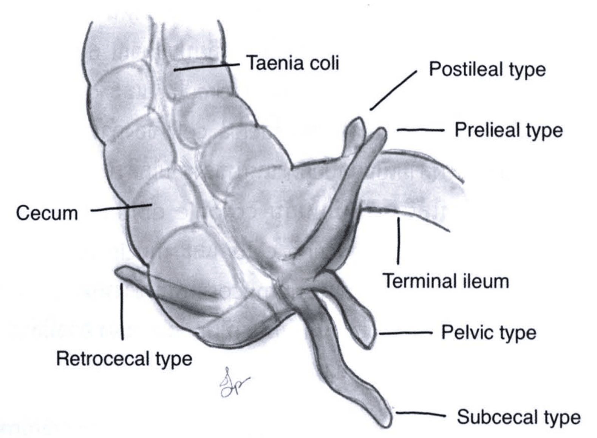
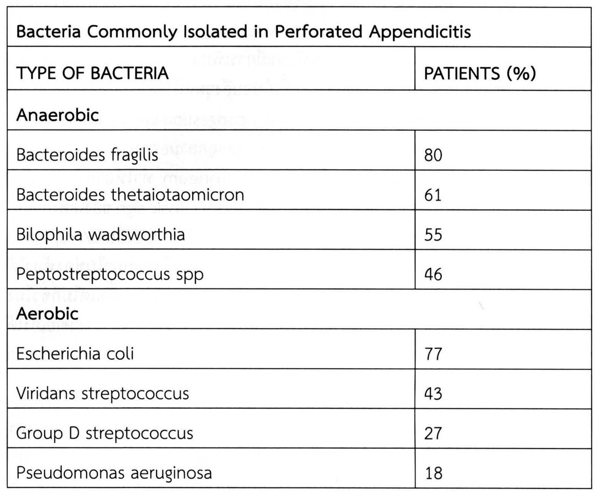
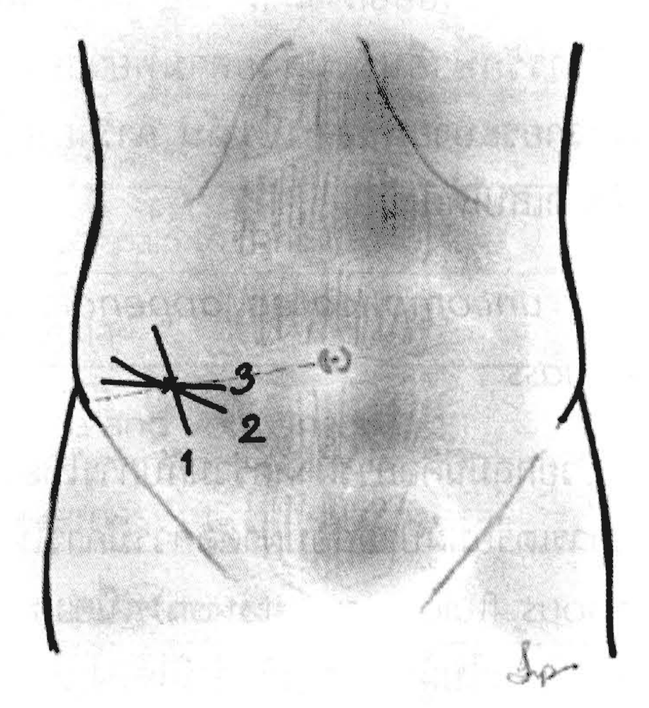

# โรคของไส้ติ่ง (The Vermiform Appendix)

## Contents of this file
- บทนำ (p.402)
- Anatomy & Embryology (p.402)
- โรคไส้ติ่งอักเสบฉับพลัน (Acute appendicitis) (p.404)
- พยาธิสรีรวิทยา (Pathophysiology) (p.404)
- อาการทางคลินิก (Clinical Presentation) (p.406)
- ประวัติ (History) (p.406)
- การตรวจร่างกาย (Physical examination) (p.408)
- การวินิจฉัยแยกโรค (Differential diagnosis) (p.409)
- การตรวจวินิจฉัยโรคเพิ่มเติม (Investigation) (p.411)
- การตรวจทางห้องปฏิบัติการ (Laboratory studies) (p.411)
- การตรวจทางรังสีวิทยา (Radiologic studies) (p.412)
- Alvarado scoring system (p.413)
- ความรุนแรงของโรค (Severity) (p.415)
- การรักษาไส้ติ่งอักเสบ (Treatment of appendicitis) (p.415)
- เนื้องอกของไส้ติ่ง (Appendiceal neoplasm) (p.418)
- Carcinoid tumor (Neuroendocrine tumors; NETs) (p.418)
- Appendiceal Mucocele (mucinous neoplasm of appendix) (p.419)
- Adenocarcinoma of appendix (p.421)
- เอกสารอ้างอิง (p.421)

<!-- p.401 (printed none) -->
**โรคของไส้ติ่ง**

**The Vermiform Appendix**

ฐิติพร ชอบอาภรณ์

<!-- p.402 (printed 388) -->
**โรคของไส้ติ่ง**

**The Vermiform Appendix**

ฐิติพร ชอบอาภรณ์

## บทนำ

ไส้ติ่งเป็นอวัยวะปลายตันขนาดเล็ก ปลายด้านหนึ่งต่อเข้ากับลำไส้ใหญ่ส่วน cecum ในอดีตยังไม่ทราบหน้าที่ชัดเจนของไส้ติ่ง แต่ปัจจุบันมีหลักฐานสนับสนุนว่าไส้ติ่งมีส่วนร่วมในการพัฒนาระบบภูมิคุ้มกันและเนื้อเยื่อน้ำเหลืองของทางเดินอาหาร แม้จะมีขนาดเล็กและบทบาทหน้าที่ไม่ชัดเจน แต่ไส้ติ่งถือว่ามีความสำคัญอย่างมากในวงการแพทย์ เนื่องจากไส้ติ่งอักเสบเป็นสาเหตุของการผ่าตัดฉุกเฉินในช่องท้องมากที่สุดทั่วโลก นอกจากนี้อาการและอาการแสดงของไส้ติ่งอักเสบยังนับเป็นตัวอย่างและต้นแบบสำคัญในการเรียนการสอนของโรคทางศัลยกรรม รวมทั้งการผ่าตัดไส้ติ่งก็มักเป็นการผ่าตัดใหญ่ลำดับแรกที่ถูกฝึกฝนในการเรียนต่อเฉพาะทางด้านศัลยกรรม

แม้ว่าปัจจุบันจะมีความก้าวหน้าทางเทคโนโลยีที่ใช้ในการวินิจฉัยโรคไปมาก ทำให้สามารถวินิจฉัยโรคได้แม่นยำมากขึ้น แต่การวินิจฉัยโรคของไส้ติ่งโดยอาศัยการผสมผสานระหว่างประวัติและตรวจร่างกาย รวมถึงผลการตรวจทางห้องปฏิบัติการ เพื่อนำไปสู่การวินิจฉัยแยกโรคได้อย่างถูกต้องและตัดสินใจรักษาผู้ป่วยได้อย่างทันท่วงทียังคงนับเป็นความท้าทายของศัลยแพทย์ทุกคนและนับเป็นตัวอย่างที่ชัดเจนของการใช้ศาสตร์และศิลป์ในการรักษาโรค

## Anatomy & Embryology

ไส้ติ่งเป็นอวัยวะขนาดเล็กซึ่งเจริญยื่นออกมาจากลำไส้ส่วน midgut อยู่ติดกับ lieum และ cecum ตั้งแต่ตัวอ่อนอายุ 8 สัปดาห์ จากนั้นมีการเจริญเติบโตจนขนาดยาวขึ้นและมีการหมุนเคลื่อนย้ายตามอวัยวะต่างๆ ในช่องท้องไปทางด้าน medial จนในที่สุดจะหยุด

<!-- p.403 (printed 389) -->
อยู่ที่ด้านขวาล่างของช่องท้อง โดยเป็นอวัยวะที่มีปลายด้านหนึ่งตัน และปลายเปิดอีกด้านต่อเข้ากับ cecum ในผู้ใหญ่ไส้ติ่งมีขนาดยาวโดยเฉลี่ยประมาณ 6-9 เซนติเมตร ผนังของไส้ติ่งประกอบด้วยกล้ามเนื้อ 2 ชั้น คือ inner circular และ outer longitudinal โดย outer longitudinal layer จะต่อจาก taenia coli ของลำไส้ใหญ่ จึงสามารถใช้จุดบรรจบของ Taenia coli ทั้งสามเป็นจุดบอกตำแหน่งของฐานไส้ติ่ง (base of appendix) ได้ ส่วนเยื่อบุผนังภายในรูของไส้ติ่งจะเหมือนกับ colonic epithelium ประกอบด้วย columnar epithelium, neuroendocrine cells และ mucin producing globlet cell และยังพบ lymphoid tissue ในชั้น submucosa ค่อนข้างหนาแน่น เป็นหลักฐานสนับสนุนว่า ไส้ติ่งซึ่งแต่เดิมในอดีตเชื่อว่าไม่ได้มีหน้าที่เฉพาะเจาะจง อาจมีส่วนร่วมในการพัฒนาด้านระบบภูมิคุ้มกันของทางเดินอาหาร

ตำแหน่งการวางตัวของไส้ติ่งส่วนต้นค่อนข้างแน่นอน คือ อยู่ด้าน posteromedial ของ cecum แต่ส่วนปลายของไส้ติ่งมีความแตกต่างในแต่ละบุคคล โดยส่วนใหญ่แล้วประมาณร้อยละ 60-70 ไส้ติ่งมักวางอยู่ในตำแหน่งด้านหลังของ cecum (retrocecal type) ในอุ้งเชิงกรานประมาณร้อยละ 20 และวางตัวในตำแหน่งอื่นอีกร้อยละ 5 ได้แก่ preileal (1%), postileal (0.5-1%), paracecal (2%), subcecal (1.5%), retroperitoneum (1%) (ดังรูปที่ 1)

ไส้ติ่งมีเส้นเลือดหลักมาเลี้ยงจาก appendiceal artery ซึ่งเป็นแขนงของ ileocolic artery ทอดตัวมาตาม mesoappendix ผ่านทางด้านหลังของ terminal ileum มีทางเดินน้ำเหลืองเทเข้าสู่ ileocecal nodes ไปตามแขนงของ appendiceal artery ส่วนระบบประสาทอัตโนมัติมาเลี้ยงโดยเส้นประสาท superior mesenteric plexus (sympathetic) และ vagus nerve (parasympathetic)

<!-- p.404 (printed 390) -->

> **Caption (verbatim):** **รูปที่ 1** แสดงการวางตัวและตำแหน่งของไส้ติ่ง
> **Text in image (verbatim):** Taenia coli · Postileal type · Prelieal type · Cecum · Terminal ileum · Retrocecal type · Pelvic type · Subcecal type
> **Description:** Shaded pencil drawing of the cecum and the start of the ascending colon (haustrated bowel running upward), with the terminal ileum entering from the right. A label line marks a taenia coli running along the colon ("Taenia coli") and another marks the cecum ("Cecum"). Several alternative positions of the appendix are drawn arising from the base of the cecum, each labelled: "Retrocecal type" — appendix passing behind the cecum, its tip showing at the lower left; "Postileal type" and "Prelieal type" (spelled so in the image) — two appendices pointing upward past the terminal ileum, one behind and one in front of it; "Pelvic type" — a short appendix hanging downward and to the right; "Subcecal type" — a long appendix running downward below the cecum. "Terminal ileum" labels the small bowel coming in from the right. A small artist's signature is drawn below the cecum.
> **Identifiers in image:** none

## โรคไส้ติ่งอักเสบฉับพลัน (Acute appendicitis)

การผ่าตัดไส้ติ่งมีการรายงานความสำเร็จครั้งแรกในปี 1735 โดยศัลยแพทย์ชาวฝรั่งเศสชื่อว่า Claudius Amyand โดยรายงานการพบ fecal fistula จากไส้ติ่งในถุงของไส้เลื่อนในเด็กชายอายุ 11 ปี ไส้ติ่งอักเสบเป็นโรคที่พบได้บ่อย อุบัติการณ์การเกิดโรคตลอดช่วงชีวิตอยู่ที่ 8.6% ในผู้ชาย และ 6.7% ในผู้หญิง โดยพบบ่อยที่สุดในช่วงอายุ 20-30 ปี การวินิจฉัยโรคและรักษาโรคไส้ติ่งอักเสบตั้งแต่ในระยะเริ่มแรกสามารถลดการเกิดภาวะแทรกซ้อนและการเสียชีวิตซึ่งอาจมีโอกาสเกิดขึ้นได้ในกรณีไส้ติ่งอักเสบแตก

## พยาธิสรีรวิทยา (Pathophysiology)

สาเหตุของไส้ติ่งอักเสบเกิดจากการอุดตันของช่องว่างภายในรูของไส้ติ่ง (luminal obstruction) โดยเกิดได้จากหลายสาเหตุ ได้แก่ fecalith, lymphoid hyperplasia, fibrosis, neoplasm, parasite, foreign bodies, ingested barium โดยในเด็กมักเกิดจาก lymphoid hyperplasia ส่วนในผู้ใหญ่มักเกิดจาก fecalith เมื่อมีการอุดตันภายใน lumen ส่วนต้น จะทำให้เกิดภาวะ closed loop obstruction ทำให้ความดันภายในรู

<!-- p.405 (printed 391) -->
ของไส้ติ่งเพิ่มสูงขึ้น เนื่องจากยังมีการหลั่งสารคัดหลั่งตามปกติแต่ไม่สามารถระบายออกไปได้ จึงเกิดการกระตุ้นเส้นประสาทภายในช่องท้องขึ้น ก่อให้เกิดอาการปวดท้องบริเวณรอบสะดือ ไม่สามารถระบุตำแหน่งได้ชัดเจน (visceral pain) และพบมีอาการคลื่นไส้อาเจียนร่วมด้วยได้ ในช่วงแรกของการอุดตันจะมีการเพิ่มจำนวนของแบคทีเรียในรูของไส้ติ่งอย่างรวดเร็ว เมื่อความดันในไส้ติ่งสูงมากขึ้นไปจนถึงจุดหนึ่งจะทำให้เลือดไม่สามารถหมุนเวียนเข้าไปในไส้ติ่งได้ ทำให้เกิดภาวะ vascular congestion และเกิดภาวะขาดเลือดของไส้ติ่งตามมา หากการขาดเลือดเป็นตลอดทุกชั้นและลุกลามออกมาจนถึงชั้น serosa (transmural necrosis) จะกระตุ้น parietal peritoneum ทำให้อาการปวดท้องย้ายตำแหน่งไปยังด้านขวาล่าง (migratory pain) ซึ่งนับเป็น classic sign ของไส้ติ่งอักเสบ หากไม่ได้รับการรักษาในที่สุดจะเกิดการแตกทะลุของไส้ติ่งได้ (perforated/ ruptured appendicitis) ทำให้มีการแพร่กระจายของแบคทีเรียในไส้ติ่งออกมาในช่องท้องได้ ระยะเวลาตั้งแต่มีการอักเสบจนถึงไส้ติ่งแตกทะลุ มีความหลากหลายตั้งแต่ไม่กี่ชั่วโมงไปจนถึงเป็นวันได้ นอกจากนี้ในบางกรณีไส้ติ่งอักเสบที่อาการไม่รุนแรงอาจจะหายเองได้ หรือเป็นๆ หายๆ ซ้ำหลายครั้ง เมื่อผ่าตัดไส้ติ่งออกและนำไปตรวจทางพยาธิวิทยาพบว่าไส้ติ่งหนาและแข็งเป็น scar ได้

เมื่อไส้ติ่งมีการแตกทะลุส่งผลให้เกิดอาการแสดงได้แตกต่างกัน โดยหากมีการแพร่กระจายของหนองหรือเศษอุจจาระในช่องท้องอย่างอิสระ จะเกิดภาวะ diffuse peritonitis ซึ่งนำไปสู่การติดเชื้อในช่องท้องและในกระแสเลือดอย่างรุนแรงจนกระทั่งนำไปสู่การเสียชีวิตได้ แต่หากมีเนื้อเยื่อหรืออวัยวะภายในช่องท้อง เช่น small bowel, omentum เป็นต้น มาห่อหุ้มไส้ติ่งส่วนที่แตกทะลุไว้ ไม่ให้มีการแพร่กระจายของสิ่งสกปรกในช่องท้อง อาจจะทำให้เกิดภาวะฝีหนองในช่องท้อง (appendiceal abscess) หรือก้อนจากการอักเสบของไส้ติ่ง (appendiceal phlegmon) ซึ่งทำให้ผู้ป่วยอาจจะไม่มีอาการติดเชื้อรุนแรง แต่จะมาด้วยอาการก้อนในช่องท้องบริเวณด้านขวาล่างได้

ในการวินิจฉัยไส้ติ่งอักเสบควรตระหนักไว้เสมอว่า ผู้ป่วยอาจจะมาด้วยอาการที่แตกต่างกันได้ ขึ้นกับแต่ละช่วงเวลาของการดำเนินโรคตามพยาธิสรีรวิทยา

<!-- p.406 (printed 392) -->
**ตารางที่ 1** ชนิดของเชื้อก่อโรคในโรคไส้ติ่งอักเสบแตก

**Bacteria Commonly Isolated in Perforated Appendicitis**

| TYPE OF BACTERIA | PATIENTS (%) |
| --- | --- |
| **Anaerobic** |  |
| Bacteroides fragilis | 80 |
| Bacteroides thetaiotaomicron | 61 |
| Bilophila wadsworthia | 55 |
| Peptostreptococcus spp | 46 |
| **Aerobic** |  |
| Escherichia coli | 77 |
| Viridans streptococcus | 43 |
| Group D streptococcus | 27 |
| Pseudomonas aeruginosa | 18 |

> **Caption (verbatim):** **ตารางที่ 1** ชนิดของเชื้อก่อโรคในโรคไส้ติ่งอักเสบแตก
> **Text in image (verbatim):** Bacteria Commonly Isolated in Perforated Appendicitis · TYPE OF BACTERIA · PATIENTS (%) · Anaerobic · Bacteroides fragilis · 80 · Bacteroides thetaiotaomicron · 61 · Bilophila wadsworthia · 55 · Peptostreptococcus spp · 46 · Aerobic · Escherichia coli · 77 · Viridans streptococcus · 43 · Group D streptococcus · 27 · Pseudomonas aeruginosa · 18
> **Description:** Image of the printed table (saved because it has merged cells). A title row "Bacteria Commonly Isolated in Perforated Appendicitis" spans both columns; below it the column headers "TYPE OF BACTERIA" and "PATIENTS (%)". Two group rows spanning both columns, "Anaerobic" and "Aerobic", each followed by four organisms with the percentage of patients: anaerobic — Bacteroides fragilis 80, Bacteroides thetaiotaomicron 61, Bilophila wadsworthia 55, Peptostreptococcus spp 46; aerobic — Escherichia coli 77, Viridans streptococcus 43, Group D streptococcus 27, Pseudomonas aeruginosa 18.
> **Identifiers in image:** none

## อาการทางคลินิก (Clinical Presentation)

## ประวัติ (History)

ปวดท้องเป็นอาการหลักของโรคไส้ติ่งอักเสบ มักเริ่มจากปวดทั่วบริเวณกลางท้อง (periumbilical pain) บางครั้งอาจจะมีปวดบีบเป็นพักๆ ได้ ซึ่งเป็นลักษณะอาการปวดของ visceral pain โดยส่วนมากหลังจากปวดท้องสักพักแล้ว ผู้ป่วยมักมีอาการเบื่ออาหาร คลื่นไส้ อาเจียน ท้องผูกหรือถ่ายเหลวร่วมด้วยได้ ซึ่งเป็นอาการที่เกิดจากการกระตุ้นระบบประสาทอัตโนมัติของลำไส้ อาการปวดท้องบริเวณกลางท้องมักมีอาการนานประมาณ 1-12 ชั่วโมง โดยเฉลี่ยประมาณ 4-6 ชั่วโมง ต่อมาอาการปวดจึงย้ายมาปวดด้านขวาล่างของช่องท้อง (somatic pain) ร่วมกับอาจจะมีไข้ต่ำๆ ได้ แต่เนื่องจากตำแหน่งของไส้ติ่งนั้นอาจจะแตกต่างกันได้ในแต่ละคน อาจทำให้อาการปวดท้องไม่อยู่ตำแหน่งขวาล่างเสมอไป

<!-- p.407 (printed 393) -->
เช่น retrocecal type อาจจะปวดด้านหลังหรือบั้นเอวขวา pelvic type อาจปวดบริเวณหัวหน่าวหรือในอุ้งเชิงกรานได้ นอกจากนี้ภาวะ malrotation อาจจะทำให้ตำแหน่งที่ปวดย้ายไปอยู่ด้านขวาบนหรือด้านซ้ายได้เช่นกัน

ลำดับของอาการนับว่ามีความสำคัญมากในการวินิจฉัยโรคไส้ติ่งอักเสบ หากซักประวัติได้ตามลำดับดังที่กล่าวมาถือเป็น classic หรือ typical presentation ของไส้ติ่งอักเสบ คือมีโอกาสสูงมากที่จะเป็นไส้ติ่งอักเสบ แต่หากลำดับผิดปกติ หรือตำแหน่งอาการปวดไม่ใช่ด้านขวาล่างถือเป็น “atypical presentation” ซึ่งหมายถึงต้องคำนึงว่ามีโอกาสจะไม่ใช่โรคไส้ติ่งอักเสบและต้องคำนึงถึงโรคอื่นเพิ่มเติม ตัวอย่างเช่น มีอาการอาเจียนหลายครั้งนำมาก่อนค่อยปวดท้อง หรือมีไข้นำมาก่อนแล้วจึงปวดท้อง อาจจะต้องสงสัยภาวะลำไส้อักเสบจากการติดเชื้อ หรืออาหารเป็นพิษ เป็นต้น นอกจากนี้สิ่งที่ต้องคำนึงเสมอในการวินิจฉัยไส้ติ่งอักเสบคือ ผู้ป่วยอาจจะมาด้วยอาการที่มิใช่ classic presentation ได้เสมอ เช่น มีอาการปวดบั้นเอวหรือปวดหัวหน่าวคล้ายติดเชื้อในทางเดินปัสสาวะ มีอาการคล้ายลำไส้เล็กอุดตันจากมีหนองขังอยู่ระหว่างลำไส้จากภาวะไส้ติ่งแตก เป็นต้น การวินิจฉัยโรคไส้ติ่งอักเสบในกรณีที่ผู้ป่วยมาด้วยอาการ atypical presentation ได้นั้น จำเป็นต้องมี high index of suspicious เสมอ เพื่อให้ส่งตรวจเพิ่มเติมได้อย่างเหมาะสมและนำไปสู่การวินิจฉัยแยกโรคได้อย่างถูกต้องแม่นยำและทันท่วงที

ผู้ป่วยบางรายอาจจะมาตรวจหลังจากอาการปวดท้องหลายวันหรือเป็นสัปดาห์ (delayed presentation) ทำให้อาการที่มาพบแพทย์นั้นอาจจะแตกต่างกันไปได้ โดยเฉพาะในประชากรบางกลุ่มควรให้ความระมัดระวังเป็นกรณีพิเศษเนื่องจากอาจจะมีข้อจำกัดในการซักประวัติ เช่น ผู้สูงอายุ เด็ก ผู้ป่วยอัมพาตส่วนล่าง ผู้ป่วยที่มีความบกพร่องด้านการรับรู้ เป็นต้น อาการที่อาจนำมาพบแพทย์ในระยะหลังได้ เช่น ไข้สูง ซึมลง หอบเหนื่อย คลำได้ก้อนทางหน้าท้อง เป็นต้น สำหรับคนทั่วไปส่วนมากมักมีอาการปวดท้องคล้ายไส้ติ่งนำมาก่อน จากนั้นอาการปวดท้องดีขึ้นแต่ไม่หายสนิท หรือคลำได้ก้อนที่หน้าท้องจึงมาพบแพทย์

ในผู้ป่วยสตรีวัยเจริญพันธุ์ควรซักประวัติทางนรีเวชเพิ่มเติม ได้แก่ ประวัติประจำเดือนครั้งสุดท้าย ประวัติการตั้งครรภ์และการคุมกำเนิด ประวัติของระดูขาว เป็นต้น เพราะโรคทางนรีเวชหลายโรคอาจมาด้วยอาการคล้ายไส้ติ่งโดยเฉพาะ pelvic appendicitis ได้

<!-- p.408 (printed 394) -->
## การตรวจร่างกาย (Physical examination)

การตรวจร่างกายในกรณีสงสัยไส้ติ่งอักเสบถือว่ามีความสำคัญยิ่ง อาจจะนำไปสู่การวินิจฉัยโรคได้ ผู้ป่วยที่มีภาวะไส้ติ่งอักเสบแบบไม่ซับซ้อน (uncomplicated appendicitis) มักไม่มีไข้ หรือมีไข้ต่ำๆ ประมาณ 38 องศาเซลเซียสได้ อาจมีอาการขาดน้ำเล็กน้อย ชีพจรมักปกติหรือเร็วเล็กน้อย หากมีไข้สูงมากหรือชีพจรเร็วมากมักพบในกรณีไส้ติ่งเน่าหรือแตก (gangrenous/ ruptured appendicitis) ผู้ป่วยไส้ติ่งอักเสบส่วนใหญ่มักชอบนอนนิ่งๆ ไม่อยากขยับตัว หรือชันเข่าขวาขึ้นเพราะทำให้รู้สึกปวดน้อยลง หากขอให้ผู้ป่วยขยับตัวก็มักจะขยับตัวช้าอย่างระมัดระวัง

การตรวจทางหน้าท้องมักตรวจพบการกดเจ็บ และการเกร็งของกล้ามเนื้อหน้าท้อง (involuntary guarding) บริเวณด้านขวาล่าง ส่วนใหญ่มักกดเจ็บใกล้กับตำแหน่งของ McBurney’s point ซึ่งคือตำแหน่งบริเวณ 1 ใน 3 ทางด้านนอกของเส้นสมมติที่ลากจาก Anterior superior iliac spine ไปยัง umbilicus อีกทั้งยังสามารถตรวจพบ rebound tenderness ร่วมด้วยได้ การเกร็งกล้ามเนื้อหน้าท้องมากน้อยเพียงใดมักขึ้นกับความรุนแรงของการอักเสบของไส้ติ่งในขณะนั้น โดยอาจจะตรวจพบการกดเจ็บและเกร็งเฉพาะที่ (localized peritonitis) หรือทั่วไปของช่องท้อง (generalized peritonitis) หากตรวจพบการกดเจ็บและการแข็งเกร็งของหน้าท้องทั่วทั้งท้อง อาจเป็นลักษณะที่บ่งชี้ว่าไส้ติ่งแตกแล้ว ในผู้ป่วยตั้งครรภ์ที่สงสัยไส้ติ่งอักเสบอาจตรวจร่างกายได้ยาก เนื่องจากไส้ติ่งอาจไม่อยู่ในตำแหน่งปกติ เพราะมดลูกมีการขยายตัวมากขึ้น อาจทำให้ดันไส้ติ่งเคลื่อนตัวขึ้นไปทางด้านศีรษะมากขึ้นตามอายุครรภ์ที่เพิ่มขึ้น

นอกจากนี้มีการตรวจร่างกายที่จำเพาะซึ่งเป็นอาการแสดงที่บ่งถึงไส้ติ่งอักเสบ ดังแสดงในตารางที่ 2 แต่ความสำคัญน่าจะอยู่ที่การบ่งชี้ว่ามีภาวะ localized peritonitis บริเวณขวาล่างของช่องท้องมากกว่าความจำเพาะเจาะจงกับโรคไส้ติ่งอักเสบ หากตรวจไม่พบอาจจะไม่ได้หมายถึงผู้ป่วยไม่ได้เป็นไส้ติ่งอักเสบ อย่างไรก็ตามการตรวจดังกล่าวยังถือว่ามีประโยชน์ในผู้ป่วยที่สงสัยไส้ติ่งอักเสบ หากผลเป็นบวกอาจจะช่วยสนับสนุนการวินิจฉัยโรคมากขึ้น

การตรวจที่สำคัญอีกประการในผู้ป่วยที่สงสัยไส้ติ่งอักเสบคือการตรวจทางทวารหนัก (Digital rectal examination) อาจมีอาการกดเจ็บหรือคลำก้อนได้ในช่องเชิงกราน โดยเฉพาะกรณีทีไส้ติ่งเป็น pelvic type อีกทั้งในผู้ป่วยเพศหญิงอาจช่วยแยกโรคทางนรีเวช

<!-- p.409 (printed 395) -->
ในช่องเชิงกรานได้อีกด้วย หากผู้ป่วยมีอาการปวดท้องมาหลายวัน การตรวจร่างกายอาจจะต้องมุ่งความสนใจในการตรวจหาก้อนบริเวณด้านขวาล่างของช่องท้องเป็นพิเศษ เนื่องจากมีผลในการตัดสินใจเลือกแนวทางการรักษาดังจะกล่าวต่อไป

**ตารางที่ 2** อาการแสดงจำเพาะ ซึ่งบ่งถึงโรคไส้ติ่งอักเสบ

| Sign | Interpretation | Descriptions |
| --- | --- | --- |
| Dunphy’s sign | Inflammation involving the parietal peritoneum | Increased pain with coughing or other movement |
| Rovsing’s sign | Localized peritoneal inflammation in the right lower quadrant | Lower left quadrant palpation induces right lower quadrant pain |
| Obturator sign | Pelvic appendicitis | Pain on internal rotation of the right hip |
| Iliopsoas sign | Retrocecal appendicitis | Pain on extension of right hip |

## การวินิจฉัยแยกโรค (Differential diagnosis)

อาการและอาการแสดงของไส้ติ่งอักเสบจำเป็นต้องมีการวินิจฉัยแยกโรคกับภาวะอื่นอีกหลายโรคร่วมด้วยเสมอ โดยต้องคำนึงขึ้นกับช่วงอายุและเพศของผู้ป่วยเป็นองค์ประกอบ ดังตัวอย่างเช่น

<u>ในเด็ก</u>

- Acute mesenteric lymphadenitis มักพบในเด็ก เกิดตามหลังการติดเชื้อทางเดินหายใจส่วนบน ซึ่งเป็นภาวะที่หายเองได้ ไม่ต้องผ่าตัด

- Acute gastroenteritis อาจจะเกิดได้จากการติดเชื้อไวรัสหรือแบคทีเรีย มักมีอาการปวดท้อง กดเจ็บได้ แต่มักไม่มี leukocytosis

<!-- p.410 (printed 396) -->
- Meckel’s diverticulitis มักมีอาการปวดท้องเป็นๆ หายๆ นำมาก่อน และอาจมีประวัติ LGIB ร่วมด้วย

- Intussusception มักมีอาการอาเจียนเด่นร่วมกับถ่ายเป็นมูกปนเลือด (currant jelly stool)

<u>ในผู้ใหญ่</u>

- Cecal diverticulitis การอักเสบของกระเปาะยื่นของลำไส้ใหญ่ด้านขวา ซึ่งตำแหน่งอยู่ใกล้กับไส้ติ่งทำให้เกิดอาการปวดท้องที่คล้ายกับไส้ติ่งอักเสบมาก และอาจแยกจากไส้ติ่งได้ยากจากประวัติและการตรวจร่างกาย

- Peptic ulcer perforation กระเพาะอาหารทะลุทำให้มีน้ำย่อยหรือเศษอาหารมาขังอยู่บริเวณด้านขวาล่างทำให้เกิดอาการคล้ายไส้ติ่งอักเสบได้

- Acute ileitis มักมีอาการปวดท้องบีบๆ และถ่ายเหลวนำมาก่อน

- Crohn’s disease

- Ureteric stone มักมีอาการปวดบั้นเอวร้าวลงไปขาหนีบร่วมกับมีเม็ดเลือดแดงในปัสสาวะ

- Urinary tract infection มักมีอาการปัสสาวะแสบขัด ปวดหลัง และอาจมีไข้สูงหนาวสั่นร่วมด้วย

<u>ในสตรีวัยเจริญพันธุ์</u>

- Acute pelvic inflammatory disease มักมีประวัติตกขาวกลิ่นเหม็น สีผิดปกติ ตรวจร่างกายพบ cervical motion tenderness/ adnexal tenderness ร่วมด้วย

- Ovarian cyst with complication มักมีอาการปวดท้องน้อยขึ้นมาฉับพลัน โดยไม่มีอาการของระบบทางเดินอาหารร่วมด้วย อาจมีประวัติเคยตรวจพบถุงน้ำในรังไข่มาก่อนร่วมด้วย

- Ectopic pregnancy มักมีประวัติขาดประจำเดือน ร่วมกับ positive urinary pregnancy test แต่ตรวจ ultrasound ไม่พบตัวอ่อนในโพรงมดลูก

- Mittel-Schmerz (mid-menstrual cycle pain)

<!-- p.411 (printed 397) -->
<u>ในผู้สูงอายุ</u>

- Diverticulitis ผู้สูงอายุอาจมี sigmoid colon ซึ่งยืดขยายจนไปวางตัวอยู่ด้านขวาของช่องท้องได้ เมื่อมีการอักเสบของกระเปาะยื่นของลำไส้ใหญ่จึงมีอาการคล้ายไส้ติ่งอักเสบได้

- Intestinal obstruction มักมีอาการอื่นของลำไส้อุดตันร่วมด้วย ได้แก่ คลื่นไส้อาเจียน ไม่ถ่าย ไม่ผายลม ท้องอืด เป็นต้น

- Cecal carcinoma มักมีอาการขับถ่ายผิดปกตินำมาก่อนหลายสัปดาห์หรือเป็นเดือน อาจคลำได้ก้อนทางหน้าท้องหรือมีโลหิตจางจากการขาดธาตุเหล็กร่วมด้วย อาการปวดฉับพลันที่นำมาพบแพทย์อาจเกิดจากก้อนมีการแตกทะลุหรือก่อให้เกิดลำไส้อุดตันได้

## การตรวจวินิจฉัยโรคเพิ่มเติม (Investigation)

## การตรวจทางห้องปฏิบัติการ (Laboratory studies)

การแปลผลตรวจทางห้องปฏิบัติการต้องทำอย่างระมัดระวัง ควรใช้เพื่อช่วยสนับสนุนการวินิจฉัยโรค ซึ่งได้มาจากการซักประวัติตรวจร่างกายมากกว่าการใช้เพื่อยืนยันหรือแยกโรคออกไปอย่างสิ้นเชิง

โดยทั่วไปประมาณ 90% ของผู้ป่วยมักตรวจพบปริมาณเม็ดเลือดขาวสูงขึ้น (leukocytosis) ตั้งแต่ 10,000 cells/mm3 เป็นต้นไป และเป็นชนิด Polymorphonuclear เด่น แต่หากปริมาณเม็ดเลือดขาวมากกว่า 17,000 cells/mm3 อาจบ่งชี้ว่ามีภาวะไส้ติ่งอักเสบรุนแรงเริ่มมีการเน่าหรือแตกของไส้ติ่ง อย่างไรก็ดีพบว่าผู้ป่วยอีกร้อยละ 10 อาจพบปริมาณเม็ดเลือดอยู่ในระดับปกติได้ การตรวจปัสสาวะ (urinalysis) เพื่อใช้แยกโรคนิ่วในทางเดินปัสสาวะและการติดเชื้อในทางเดินปัสสาวะได้ กล่าวคือไส้ติ่งอักเสบมักตรวจไม่พบเม็ดเลือดขาวหรือเม็ดเลือดแดงในปัสสาวะ แต่ในบางครั้งอาจจะมีเม็ดเลือดขาวได้บ้าง เนื่องจากไส้ติ่งอยู่ใกล้กับท่อไตหรือกระเพาะปัสสาวะ เมื่อมีการอักเสบจึงอาจมีเม็ดเลือดขาวปนออกมาในปัสสาวะได้ โดยไม่มีการอักเสบติดเชื้อในทางเดินปัสสาวะ นอกจากนี้ควรเก็บปัสสาวะเพื่อตรวจหาการตั้งครรภ์ในผู้ป่วยหญิงวัยเจริญพันธุ์ทุกรายเพื่อแยกโรคที่อาจเป็นภาวะแทรกซ้อนจากการตั้งครรภ์ได้

<!-- p.412 (printed 398) -->
## การตรวจทางรังสีวิทยา (Radiologic studies)

การส่งตรวจทางรังสีวิทยาไม่ได้จำเป็นต้องส่งตรวจในผู้ป่วยทุกราย หากประวัติตรวจร่างกายและผลการตรวจทางห้องปฏิบัติการเข้าได้กับโรคไส้ติ่งอักเสบแล้ว อาจจะไม่จำเป็นต้องส่งตรวจเพิ่มเติม ปัจจุบันความก้าวหน้าทางเทคโนโลยีมากขึ้นทำให้มีทางเลือกที่ใช้ตรวจวินิจฉัยได้ถูกต้องแม่นยำมากขึ้น

- <u>Plain film abdomen</u> ไม่ค่อยช่วยในการวินิจฉัยไส้ติ่งอักเสบ ยกเว้นพบว่ามี calcified fecalith อยู่บริเวณด้านขวาล่างอาจช่วยทำให้สงสัยว่าโอกาสเป็นไส้ติ่งอักเสบได้ ส่วนภาวะ pneumoperitoneum พบได้น้อย หากพบลักษณะดังกล่าวอาจจะต้องมองหาภาวะอื่นๆ เช่น peptic ulcer perforation, ruptured diverticulitis ร่วมด้วย

- <u>Ultrasonography</u> ในอดีตนับว่าเป็นเครื่องมือสำคัญในการช่วยวินิจฉัยโรคไส้ติ่งอักเสบ ปัจจุบันลดบทบาทลงหลังจากมีการใช้ CT scan อย่างกว้างขวางมากขึ้น แต่ในประเทศที่กำลังพัฒนา การตรวจด้วย ultrasound อาจจะมีบทบาทสำคัญอยู่ เพราะสามารถเข้าถึงได้ง่ายกว่า ค่าใช้จ่ายถูกกว่า โดยมีความไวอยู่ที่ร้อยละ 78-83 ความจำเพาะอยู่ที่ร้อยละ 83-93 ข้อดีคือ ทำได้รวดเร็ว ราคาไม่แพง ไม่ต้องเสี่ยงต่อสารทึบรังสี ทำในหญิงตั้งครรภ์ได้ นอกจากวินิจฉัยไส้ติ่งอักเสบแล้วยังสามารถแยกโรคทางนรีเวชได้ด้วย ข้อเสียคือ หากมองไม่เห็นไส้ติ่งก็ไม่สามารถวินิจฉัยได้ คนที่มีหน้าท้องหนามากหรือลมในลำไส้เยอะอาจมองเห็นได้ไม่ชัด การตรวจด้วย ultrasound เป็น operator dependent ปัจจุบันนิยมทำในผู้ป่วยเด็ก ผู้ใหญ่ที่มีผนังหน้าท้องไม่หนามาก หรือในหญิงที่กำลังหรือสงสัยว่าตั้งครรภ์อยู่เพื่อลดโอกาสโดนรังสีเอกซเรย์

  ลักษณะที่บ่งว่าเป็นไส้ติ่งอักเสบ ได้แก่

  - non-compressible blinded end tubular structure
  - diameter 6 mm or greater in anteroposterior direction
  - presence of appendicolith (60%)
  - thickening wall of appendix with periappendiceal fluid
  - sonographic tenderness

<!-- p.413 (printed 399) -->
- <u>Computed tomography (CT) scanning</u> เป็นการตรวจมาตรฐาน (gold standard) ในการวินิจฉัยไส้ติ่งอักเสบในปัจจุบัน เนื่องจากมีความถูกต้องแม่นยำสูง มีความไวร้อยละ 90-100 และความจำเพาะร้อยละ 91-99 ในกรณีที่ไม่สามารถวินิจฉัยโรคได้ชัดเจนจากประวัติ ตรวจร่างกายและการตรวจทางห้องปฏิบัติการได้ พบว่าการทำ CT scan สามารถลดอัตราการผ่าตัดที่ไม่จำเป็น (negative appendectomy) ลงได้

  ลักษณะที่บ่งว่าเป็นไส้ติ่งอักเสบ ได้แก่

  - thickened, inflamed appendix with surrounding “stranding”
  - greater than 7 mm in diameter with a thickened, inflamed wall
  - mural enhancement or “target sign”

  นอกจากนี้หากตรวจร่างกายคลำพบก้อนทางหน้าท้องในกรณีมี delayed presentation ควรพิจารณาส่งตรวจ CT scan เพิ่มเติมเพื่อใช้ยืนยันการวินิจฉัยโรคและวางแผนการรักษา

- <u>Magnetic resonance imaging (MRI)</u> ปัจจุบันมีที่ใช้ในผู้ป่วยที่ต้องการหลีกเลี่ยงรังสี เช่น ผู้ป่วยตั้งครรภ์ ผู้ป่วยเด็ก ข้อดีคือ มีความไวสูงถึงร้อยละ 96 ความจำเพาะร้อยละ 96 ไม่จำเป็นต้องฉีดสารทึบรังสี ข้อเสียคือ ราคาสูงมาก ไม่สามารถแปลผลได้โดยแพทย์ทั่วไปซึ่งไม่ใช่รังสีแพทย์

## Alvarado scoring system

การวินิจฉัยโรคไส้ติ่งอักเสบโดยใช้เพียงประวัติ การตรวจร่างกายและผลการตรวจทางห้องปฏิบัติการเพียงอย่างเดียว พบว่ามีอัตราการผ่าตัดไส้ติ่งซึ่งมีลักษณะปกติ (negative appendectomy) ได้สูงถึงร้อยละ 10 ในผู้ชาย และร้อยละ 20 ในผู้หญิง อย่างไรก็ตามในอดีตนั้นการผ่าตัดไส้ติ่งซึ่งปกตินั้นสามารถยอมรับได้มากกว่าการรักษาโรคไส้ติ่งอักเสบที่ช้าเกินไป (delayed diagnosis) จนเกิดภาวะแทรกซ้อนที่รุนแรงตามมา แต่ในปัจจุบันความเจริญก้าวหน้าทางการแพทย์ที่มากขึ้น ทำให้มีความพยายามลดอัตราผ่าตัดที่ไม่จำเป็นลง โดยอาศัยการตรวจทางรังสีวิทยาเพิ่มเติม แต่การส่งตรวจทางรังสีวิทยาที่เป็นมาตรฐานของการวินิจฉัยไส้ติ่งอักเสบในปัจจุบันคือ CT scan มีรายงานพบว่า

<!-- p.414 (printed 400) -->
เพิ่มความเสี่ยงของการเกิดมะเร็งจึงไม่เหมาะสมที่จะส่งตรวจในผู้ป่วยทุกราย ที่สงสัยไส้ติ่งอักเสบ จึงเป็นที่มาของการคิดค้นระบบการให้คะแนน (scoring system) โดยอาศัยปัจจัยต่างๆ มาเป็นองค์ประกอบเพื่อวินิจฉัยโรคไส้ติ่งอักเสบได้แม่นยำมากยิ่งขึ้น และสามารถพิจารณาส่งตรวจเพิ่มเติมได้อย่างสมเหตุสมผลมากขึ้น

ระบบการให้คะแนนของโรคไส้ติ่งอักเสบในปัจจุบันมีหลายแบบ เช่น Alvarado score, Appendicitis inflammatory response score (AIR score) เป็นต้น แต่ระบบซึ่งเป็นที่รู้จักกันอย่างกว้างขวางคือ Alvarado score (MANTRELS) ได้รับการนำเสนอครั้งแรกในปี 1986 โดยนายแพทย์ Alfredo Alvarado อย่างไรก็ดีตั้งแต่อดีตจนถึงปัจจุบันมีการศึกษาพบว่าการใช้ Alvarado score สามารถลดอัตราการผ่าตัดในรายที่ไม่ได้เป็นไส้ติ่งอักเสบได้เหลือ 10.3% โดยหากคิดคะแนนได้มากกว่าหรือเท่ากับ 7 มีโอกาสสูงมากที่จะเป็นไส้ติ่งอักเสบ คะแนน 5-6 มีโอกาสปานกลางที่จะเป็นไส้ติ่งอักเสบ ควรพิจารณารับตัวไว้สังเกตอาการในโรงพยาบาลหรือส่งตรวจเพิ่มเติมทางรังสีวิทยาตามความเหมาะสม เช่น Ultrasound, CT scan เป็นต้น คะแนน 1-4 มีโอกาสน้อยมากที่จะเป็นไส้ติ่งอักเสบ

**ตารางที่ 3** Alvarado score (MANTRELS)

|  | **Factors** | **Score** |
| --- | --- | --- |
| **Symptoms** | **M**igratory pain to right iliac fossa | 1 |
|  | **A**norexia | 1 |
|  | **N**ausea and vomiting | 1 |
| **Signs** | **T**enderness at right iliac fossa | 2 |
|  | **R**ebound tenderness | 1 |
|  | **E**levated temperature | 1 |
| **Laboratory** | **L**eukocytosis | 2 |
|  | **S**hift to the left of neutrophils | 1 |
| **TOTAL** |  | 10 |

<!-- p.415 (printed 401) -->
## ความรุนแรงของโรค (Severity)

โรคไส้ติ่งอักเสบแบ่งชนิดตามพยาธิสภาพของโรคและความรุนแรงได้เป็น 3 กลุ่ม คือ

- Uncomplicated appendicitis ได้แก่ Acute inflamed appendicitis, Acute suppurative appendicitis,
- Complicated appendicitis with mass ได้แก่ Acute gangrenous appendicitis, Perforated appendicitis
- Complicated appendicitis with mass ได้แก่ Appendiceal phlegmon, Appendiceal abscess มักพบในกรณีที่ผู้ป่วยมาตรวจช้าจนเกิดภาวะไส้ติ่งแตก ทำให้เนื้อเยื่อโดยรอบพยายามมาจำกัดการอักเสบให้อยู่เฉพาะที่จึงเกิดเป็นก้อนได้

## การรักษาไส้ติ่งอักเสบ (Treatment of appendicitis)

การรักษาหลักของไส้ติ่งอักเสบคือการผ่าตัดเพื่อตัดไส้ติ่งออก (Appendectomy) แต่อาจต้องพิจารณาวิธีการรักษาอื่นร่วมด้วยตามพยาธิสภาพและความรุนแรงของไส้ติ่งอักเสบ เช่น การใส่สายระบายหนอง เป็นต้น การรักษาไส้ติ่งอักเสบสามารถแบ่งตามพยาธิสภาพของไส้ติ่งอักเสบได้ดังนี้

- *Treatment of uncomplicated appendicitis and complicated appendicitis without mass*

การรักษาหลักของผู้ป่วยกลุ่มนี้คือการผ่าตัดร่วมกับการให้ยาปฏิชีวนะตามพยาธิสภาพที่พบจากการผ่าตัด โดยการเตรียมผู้ป่วยก่อนผ่าตัดควรมีการให้สารน้ำทางหลอดเลือดดำอย่างเพียงพอ (intravenous fluid resuscitation) เนื่องจากผู้ป่วยกลุ่มนี้มักมีอาการขาดน้ำอยู่พอสมควร โดยเฉพาะในผู้ป่วยที่สงสัยว่ามีไส้ติ่งเน่าหรือแตก นอกจากนี้ผู้ป่วยไส้ติ่งอักเสบทุกคนควรได้รับ broad spectrum antibiotic อย่างน้อย 1 ครั้ง ภายในเวลา 30 นาที ก่อนลงแผลผ่าตัด เพื่อป้องกันการติดเชื้อของแผลหลังผ่าตัด ในกรณีที่เป็น acute inflamed appendicitisและ acute suppurative appendicitis ไม่จำเป็นต้องให้ยาปฏิชีวนะต่อหลังผ่าตัด แต่หากเป็น acute gangrenous หรือ perforated appendicitis ควรได้รับยาปฏิชีวนะต่อในช่วงหลังผ่าตัดจนกระทั่งไม่มีไข้ ไม่มีอาการปวดท้องอย่างน้อย 48 ชั่วโมง หลังจากนั้นเปลี่ยนเป็นยากินได้จนครบ 7 วัน ยาปฏิชีวนะที่เลือกใช้ต้อง

<!-- p.416 (printed 402) -->
ครอบคลุม gram negative bacteria และ anaerobe โดยกลุ่มยาปฏิชีวนะซึ่งเป็นที่นิยมได้แก่ Third generation cephalosporin หรือ Quinolone ร่วมกับ Metronidazole หรือ Piperacillin-tazobactam alone

สำหรับระยะเวลาที่เหมาะสมการผ่าตัด ควรทำโดยเร็วที่สุดเท่าที่เป็นไปได้หลังจากเตรียมผู้ป่วยให้มีความพร้อมภายหลังการวินิจฉัยไส้ติ่งอักเสบ เพื่อลดโอกาสเกิดภาวะไส้ติ่งแตกและการติดเชื้อในกระแสโลหิต เชื่อว่าหลังจากมีอาการปวดท้องจากไส้ติ่งอักเสบแล้ว ไส้ติ่งส่วนใหญ่มักจะแตกภายใน 24 ชั่วโมง

ปัจจุบันการผ่าตัดสามารถทำได้ 2 วิธี คือ การผ่าตัดเปิดทางหน้าท้อง (open appendectomy) และการผ่าตัดส่องกล้อง (laparoscopic appendectomy) โดยการผ่าตัดเปิดทางหน้าท้องจะทำการจัดท่าผู้ป่วยแบบนอนหงาย (supine position) ลงแผลผ่าตัดบริเวณด้านขวาล่างของช่องท้อง ตรงตำแหน่ง McBurney’s point ซึ่งมีวิธีการเปิดแผลได้หลายรูปแบบทั้ง Grid iron, Lanz และ Rocky Davis incision ดังรูปที่ 2

> **Caption (verbatim):** **รูปที่ 2** แสดงตำแหน่งการลงแผลผ่าตัด appendectomy 1=Gridiron incision, 2=Lanz incision, 3=Rocky-David incision
> **Text in image (verbatim):** 1 · 2 · 3
> **Description:** Shaded line drawing of the front of the abdomen (anterior view, from the lower chest/costal margins down to the groin creases), with the umbilicus in the centre. A faint dotted line runs from the umbilicus toward the anterior superior iliac spine on the side shown at the viewer's left (the patient's right lower quadrant). Three short straight incision lines are drawn crossing at one point on this line: line 1 is oblique and nearly vertical, running from upper-lateral to lower-medial (Gridiron incision); line 2 is oblique, running from upper-lateral down toward medial at a shallower angle (Lanz incision); line 3 is nearly horizontal/transverse (Rocky-David incision). The numbers 1, 2 and 3 label the lower end of line 1, the medial end of line 2 and the medial end of line 3 respectively. A small artist's signature is at the lower right; faint show-through text from the reverse page is visible in the shading.
> **Identifiers in image:** none

<!-- p.417 (printed 403) -->
ส่วนการผ่าตัดส่องกล้อง มีข้อดีกว่าแบบเปิดหน้าท้องคือ แผลผ่าตัดมีโอกาสติดเชื้อน้อยกว่า ปวดแผลน้อยกว่า ระยะเวลาในการนอนโรงพยาบาลน้อยกว่า ทำได้ง่ายกว่าในกรณีผู้ป่วยมีรูปร่างอ้วนหรือผนังหน้าท้องหนา อีกทั้งสามารถอาจช่วยวินิจฉัยและรักษาโรคอื่นได้โดยไม่ต้องเปิดแผลใหญ่ ข้อเสียคือ มีโอกาสเกิดฝีหนองในช่องท้องมากกว่าแบบเปิดเล็กน้อยในบางการศึกษา อีกทั้งต้องอาศัยความชำนาญด้านการผ่าตัดส่องกล้องของศัลยแพทย์

- *Treatment of complicated appendicitis with mass*

ในอดีตการผ่าตัดเป็นการรักษาหลักเช่นเดียวกับไส้ติ่งอักเสบทั่วไป แต่จากการศึกษาต่างๆ พบว่าการรักษาโดยการไม่ผ่าตัด (non operative management) การให้ยาปฏิชีวนะร่วมกับ percutaneous drainage อาจจะเหมาะสมกว่าการรักษาโดยการผ่าตัด เนื่องจากการผ่าตัดทันทีในผู้ป่วยกลุ่มนี้อาจมีภาวะแทรกซ้อนหลังผ่าตัดได้สูงถึง 20-30% เช่น failure to identify appendix, intraabdominal abscess, enterocutaneous fistula, unnecessary extension of operation (ileocecectomy/Right hemicolectomy) เป็นต้น เนื่องจากปฏิกิริยาการอักเสบและเปราะบางของเนื้อเยื่อใกล้เคียงโดยรอบไส้ติ่ง ดังนั้นในปัจจุบันการรักษาที่เหมาะสมในผู้ป่วยกลุ่มนี้คือ การรับไว้รักษาตัวในโรงพยาบาล การให้สารน้ำให้เพียงพอ (fluid resuscitation) การให้ยาปฏิชีวนะ (Broad spectrum antibiotic) การใส่สายระบายหนอง (percutaneous drainage) ในกรณีที่เป็น appendiceal abscess นั้นอาจจะพิจารณาทำได้ในกรณีที่โพรงหนองมีขนาดใหญ่มาก และไม่ตอบสนองต่อยาปฏิชีวนะ โดยหลังจากรับตัวผู้ป่วยไว้ในโรงพยาบาลควรตรวจติดตามสัญญาณชีพ สังเกตอาการและอาการแสดงทางหน้าท้องอย่างใกล้ชิด ส่วนใหญ่ผู้ป่วยจะมีอาการดีขึ้นภายใน 24-48 ชั่วโมง โดยดูจากอาการปวดท้องหรือไข้ลดลง ผู้ป่วยส่วนใหญ่มากกว่าร้อยละ 90 มักรักษาด้วยวิธีการไม่ผ่าตัดได้สำเร็จ แต่หากผู้ป่วยมีอาการแย่ลงก็ต้องพิจารณานำผู้ป่วยไปผ่าตัดแบบฉุกเฉิน หากผู้ป่วยอาการดีขึ้นควรรักษาด้วยวิธีการไม่ผ่าตัดต่อไปด้วยการให้ยาปฏิชีวนะต่อเนื่องจนครบ 7-10 วัน

ในอดีตหลังจากการรักษาโดยการไม่ผ่าตัดในผู้ป่วยกลุ่มนี้มักแนะนำให้นัดผู้ป่วยมาผ่าตัดไส้ติ่งออกภายหลังที่ระยะเวลา 6 สัปดาห์ หลังอาการอักเสบหาย เรียกการผ่าตัดแบบนี้ว่า “Interval appendectomy” แต่ในปัจจุบันยังเป็นที่ถกเถียงกันว่าควรทำหรือไม่ (controversy) เนื่องจากมีการศึกษาพบว่าการรักษาแบบไม่ผ่าตัดมีโอกาสเกิดไส้ติ่งอักเสบซ้ำเพียงประมาณร้อยละ 8-10 เท่านั้น โดยส่วนใหญ่จะเป็นซ้ำในช่วง 6 เดือนแรก

<!-- p.418 (printed 404) -->
จึงแนะนำให้ตรวจติดตามอาการและทำการผ่าตัดเมื่อผู้ป่วยมีอาการซ้ำ (recurrent appendicitis) อย่างไรก็ตามมีรายงานพบว่าในผู้ป่วยที่มีอายุมากกว่า 40 ปี มีโอกาสพบเนื้องอกของไส้ติ่งได้มากถึงร้อยละ 16 จากการทำผ่าตัด interval appendectomy รวมถึงอาจจะเป็นอาการเริ่มแรกของ Colonic cancer ของตำแหน่ง cecum ได้ ดังนั้นจึงแนะนำให้ทำการตรวจเพิ่มเติมด้วยการทำ Barium enema หรือ Colonoscopy ในผู้ป่วยทุกรายที่จะทำการตรวจติดตามหลังการรักษาด้วยวิธีไม่ผ่าตัดสำเร็จแล้ว

## เนื้องอกของไส้ติ่ง (Appendiceal neoplasm)

เนื้องอกของไส้ติ่งเป็นโรคที่พบได้ไม่บ่อยนัก คิดเป็นสัดส่วนเพียงร้อยละ 0.4-1 ของเนื้องอกทางเดินอาหารทั้งหมด จากการศึกษาพบเนื้องอกของไส้ติ่งประมาณร้อยละ 0.7-1.7 ของชิ้นเนื้อไส้ติ่งที่ได้รับการผ่าตัดออก โดยผู้ป่วยมากกว่าร้อยละ 50 มักมาด้วยอาการไส้ติ่งอักเสบ ส่วนน้อยที่อาจบังเอิญตรวจพบจากการตรวจเพิ่มเติมจากโรคอื่นๆ เนื้องอกของไส้ติ่งนั้นมีหลากหลายชนิด มีตั้งแต่เนื้องอกชนิดไม่ร้ายแรง (benign) ไปจนถึงมะเร็ง (malignant) เนื้องอกชนิดที่พบได้บ่อยที่สุดคือ Carcinoid tumor ซึ่งพบได้มากกว่าร้อยละ 50 รองลงมาคือ mucinous adenocarcinoma, colonic-type adenocarcinoma และ adenocarcinoids (globlet cell carcinoid) ตามลำดับ โดย carcinoid มีการพยากรณ์โรคดีที่สุด

## Carcinoid tumor (Neuroendocrine tumors; NETs)

เดิมในอดีตชื่อ Carcinoid tumor เป็นที่นิยมอย่างกว้างขวาง แต่ปัจจุบันนิยมเรียกว่า neuroendocrine tumors (NETs) มากกว่า จัดเป็นเนื้องอกที่พบได้บ่อยที่สุดของไส้ติ่ง พบได้เป็นสัดส่วนร้อยละ 0.3-0.9 ของชิ้นเนื้อไส้ติ่งที่ตัดออกมา และคิดเป็นสัดส่วนถึงร้อยละ 20-30 ของ NETs ที่พบในทางเดินอาหารทั้งหมด เป็นเนื้องอกที่มีการเจริญมาจาก subepithelial neuroendocrine cell ซึ่งพบได้มากบริเวณส่วนปลายของไส้ติ่งทำให้ไม่ค่อยก่อให้การอุดตันรูภายในของไส้ติ่งและนำไปสู่การอักเสบ NETs เป็นเนื้องอกที่มีลักษณะเป็นก้อนแข็งปานกลาง หน้าตัดสีเหลือง

NETs ของไส้ติ่งส่วนใหญ่มักไม่ค่อยแสดงอาการ และตรวจพบโดยบังเอิญจากการผ่าตัดไส้ติ่ง ดังนั้นจึงควรส่งตรวจทางพยาธิวิทยาทุกครั้งในการผ่าตัดไส้ติ่ง โดยมักพบการแพร่

<!-- p.419 (printed 405) -->
กระจายไปต่อมน้ำเหลืองได้บ่อย แต่แพร่กระจายไปตับได้น้อยกว่า NETs ของอวัยวะอื่นๆ อีกทั้งก่อให้เกิดอาการ Carcinoid syndrome ได้น้อย

การตรวจทางรังสีวิทยาอาจจะตรวจพบก้อนหรือระบุตำแหน่งของก้อนได้ยาก เนื่องจากไส้ติ่งมักมีขนาดเล็ก และเนื้องอกชนิดนี้มักอยู่ส่วนปลายของไส้ติ่ง อาจพบลักษณะที่บ่งถึงไส้ติ่งอักเสบโดยไม่เห็นก้อนที่เป็นสาเหตุได้ ในกรณีวินิจฉัยโรคได้ควรส่งตรวจ colonoscopy ทุกราย เนื่องจากพบว่ามี Synchronous หรือ metachronous lesion ในลำไส้ใหญ่ได้เกือบครึ่งหนึ่ง

การรักษา NETs ของไส้ติ่ง ขึ้นกับปัจจัยหลัก 2 ประการคือ ขนาดและตำแหน่งของเนื้องอก

- เนื้องอกขนาดเล็กกว่า 1 เซนติเมตร สามารถรักษาด้วยการผ่าตัด simple appendectomy เนื่องจากมีโอกาสแพร่กระจายไปยังต่อมน้ำเหลืองและอวัยวะอื่นน้อยมาก
- เนื้องอกขนาด 1-2 เซนติเมตร ปัจจุบันยังไม่มีข้อสรุปที่แน่นอนว่าควรผ่าตัด Appendectomy หรือ Right hemicolectomy ให้พิจารณาปัจจัยอื่นประกอบด้วย
- เนื้องอกขนาดใหญ่เกิน 2 เซนติเมตร อาจมีโอกาสแพร่กระจายไปยังต่อมน้ำเหลืองและอวัยวะอื่นได้ จึงควรทำการผ่าตัดลำไส้ใหญ่ด้านขวาออก (Right hemicolectomy)
- ข้อบ่งชี้อื่นๆ ของการผ่าตัด Right hemicolectomy ได้แก่ high proliferative index, mesoappendiceal invasion, metastatic mesoappendiceal lymph node, positive margin, เนื้องอกอยู่บริเวณส่วนโคนของไส้ติ่งซึ่งชิดกับ cecum ทำให้ไม่สามารถผ่าตัดเนื้องอกได้ทั้งหมดจากการผ่าตัดไส้ติ่งเพียงอย่างเดียว

## Appendiceal Mucocele (mucinous neoplasm of appendix)

เป็นเนื้องอกไส้ติ่งที่สามารถเป็นได้ทั้ง benign และ malignant โดยเนื้องอกชนิดนี้จะมีการอุดตันของรูภายในไส้ติ่งส่วนต้นทำให้มีเมือกสะสมอยู่ในรูของไส้ติ่งส่งผลให้ไส้ติ่งขยายขนาดใหญ่ขึ้น โดยสามารถแบ่งชนิดของ appendiceal mucocele ตามลักษณะทางพยาธิวิทยาได้ดังนี้

<!-- p.420 (printed 406) -->
1) Retention cyst เกิดจากการอุดตันเรื้อรังของไส้ติ่งจากสาเหตุอื่นโดยที่ epithelial lining ยังปกติ
2) Mucosal hyperplasia เกิดจากการมี epithelial hyperplasia จากการอุดตันเรื้อรังของไส้ติ่ง
3) Cystadenoma เกิดจากมี adenomatous epithelail lining ทำให้มีการอุดตันของไส้ติ่ง พบร้อยละ 60
4) Cystadenocarcinoma เกิดจากมี invasive adenocarcinoma แล้วทำให้เกิดการอุดตันของไส้ติ่ง ไม่สามารถแยกจาก cystadenoma ด้วยตาเปล่าได้ พบได้ร้อยละ 10

อาการแสดงของ appendiceal mucocele อาจจะมีได้ตั้งแต่ไม่แสดงอาการ เจอโดยบังเอิญจากการส่งตรวจหรือผ่าตัดด้วยสาเหตุอื่น คลำพบก้อนบริเวณท้องด้านขวาล่าง ปวดท้องด้านขวาล่างฉับพลันหรือเรื้อรัง อาการของไส้ติ่งอักเสบ หรืออาการของการแตกทะลุของเนื้องอกทำให้เกิดการแพร่กระจายของเยื่อเมือกในช่องท้อง ซึ่งทำให้เกิดภาวะที่เรียกว่า “Pseudomyxoma peritonei” ซึ่งเกิดได้จากทั้ง Cystadenoma และ Cystadenocarcinoma ดังนั้นข้อควรระวังที่สำคัญระหว่างการผ่าตัดในกรณีสงสัย appendiceal mucocele คือ หลีกเลี่ยงการแตกทะลุหรือรั่วของเยื่อเมือกออกมาในช่องท้อง

การวินิจฉัยโรคก่อนผ่าตัดรักษามีผลต่อการวางแผนการผ่าตัด แต่ทำได้ไม่ง่ายนักเพราะโรคนี้ไม่มีลักษณะจำเพาะที่ชัดเจนในช่วงระยะแรก การส่งตรวจเพิ่มเติมที่มีประโยชน์คือ Ultrasound และ CT scan เพื่อประเมินลักษณะของก้อน และภาวะ pseudomyxoma peritonei

การรักษา mucocele ขึ้นกับผลตรวจทางพยาธิวิทยาเป็นหลัก หากเป็นชิ้นเนื้อไม่ร้ายแรง ได้แก่ retention cyst, mucosal hyperplasia และ cystadenoma สามารถรักษาด้วยการผ่าตัดไส้ติ่งซึ่งต้องตัด mesoappendix ทั้งหมดด้วย เพื่อนำไปตรวจหาการแพร่กระจายไปยังต่อมน้ำเหลือง (standard appendectomy with complete resection of mesoappendix) หากเป็นชิ้นเนื้อร้ายแรง คือ cystadenocarcinoma ต้องทำการผ่าตัด Right hemicolectomy

ในระหว่างการผ่าตัดไส้ติ่งหรือลำไส้ใหญ่ต้องทำการสำรวจภายในช่องท้องอย่างละเอียดเพื่อมองหา mucinous content ซึ่งอาจมีการกระจายอยู่ในช่องท้องจากการรั่วซึมหรือมี

<!-- p.421 (printed 407) -->
รอยแตกจากไส้ติ่งซึ่งปิดไปแล้ว หากเจอ mucinous content บ่งถึงว่าตัวโรคได้มีการแพร่กระจายไปในเยื่อบุช่องท้องแล้ว (peritoneal involvement) อาจจะจำเป็นต้องพิจารณาการผ่าตัด cytoreductive surgery with hyperthermic intraperitoneal chemotherapy (CRS with HIPEC) เพิ่มเติมภายหลัง หากพบ mucinous content ควรส่งไปตรวจเพื่อหาว่ามี epithelial cell หรือไม่ และควรบันทึกรายละเอียดของ mucinous content ที่พบโดยละเอียดว่าอยู่ส่วนใดของช่องท้องบ้าง เนื่องจากเป็นข้อมูลสำคัญหากจำเป็นต้องผ่าตัดเพิ่มเติมในภายหลัง

## Adenocarcinoma of appendix

เป็นโรคเนื้องอกของไส้ติ่งที่พบได้ไม่บ่อย แบ่งออกตามลักษณะทางพยาธิวิทยาได้เป็น 3 กลุ่มคือ mucinous adenocarcinoma, colonic adenocarcinoma และ adenocarcinoid อาการแสดงที่พบได้บ่อยคือ ภาวะไส้ติ่งอักเสบ และมักมีโอกาสแตกทะลุอย่างรวดเร็ว หรืออาจมาด้วยมีก้อนหรือน้ำในช่องท้อง การรักษาคือการผ่าตัดลำไส้ใหญ่ด้านขวาออก (Right hemicolectomy)

## เอกสารอ้างอิง

1. Bryan Richmond. The appendix. In: Townsend CM, editors. SabistonTextbook of Surgery : the Biological Basis of Modern Surgical Practice. 20th ed. Philadelphia, PA: Elsevier; 2017. P 1296-1311.
2. Fadi S Dahdaleh, David Hiedt, Kiran K Turaga. The appendix. In: Brunicardi FC, editors. Schwartz’s principles of surgery. 11th ed. New York: McGraw-Hill Medical;2019. P1331-1343
3. Robert E Condon. The vermiform appendix. In: Williams NS, editors. Bailey & Love’s short practice of surgery. 27thed. Boca Raton, FL: CRC Press; 2018. P1199-1214.
4. Jeffrey B Matthews, Richard A Hodin. Acute abdomen and appendix. In: Mulholland MW,editors. Greenfield’s Surgery : Scientific Principles and Practice. 5thed. Philadelphia, PA :Lippincott Williams & Wilkins; 2011. P1199-1211.

<!-- p.422 (printed none) -->
*[blank page]*
