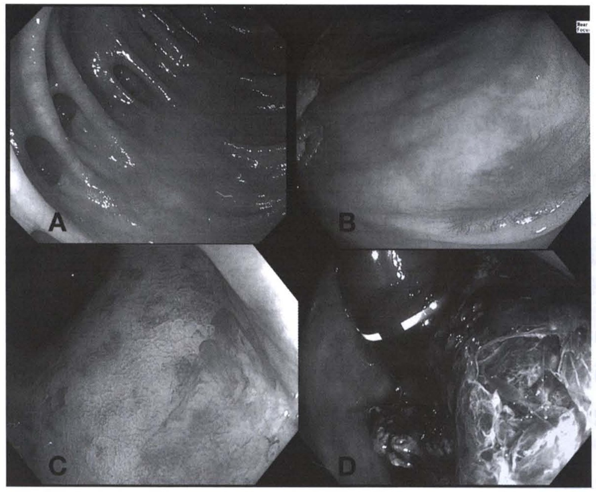
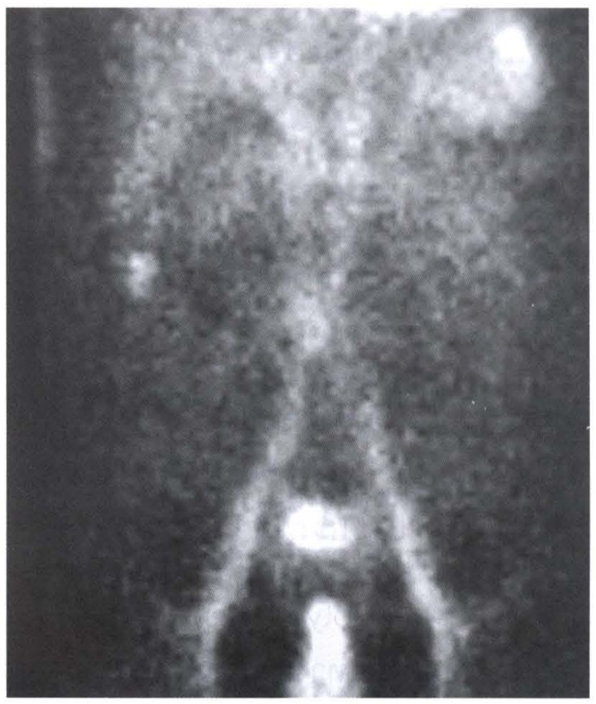
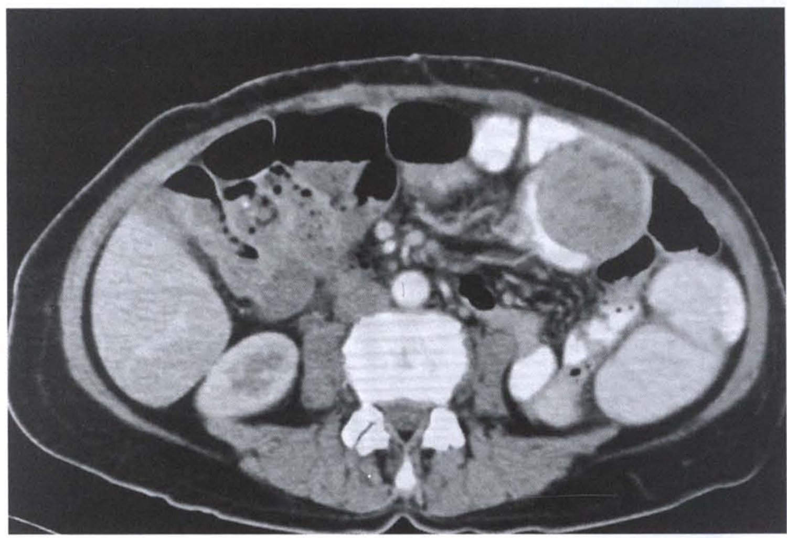
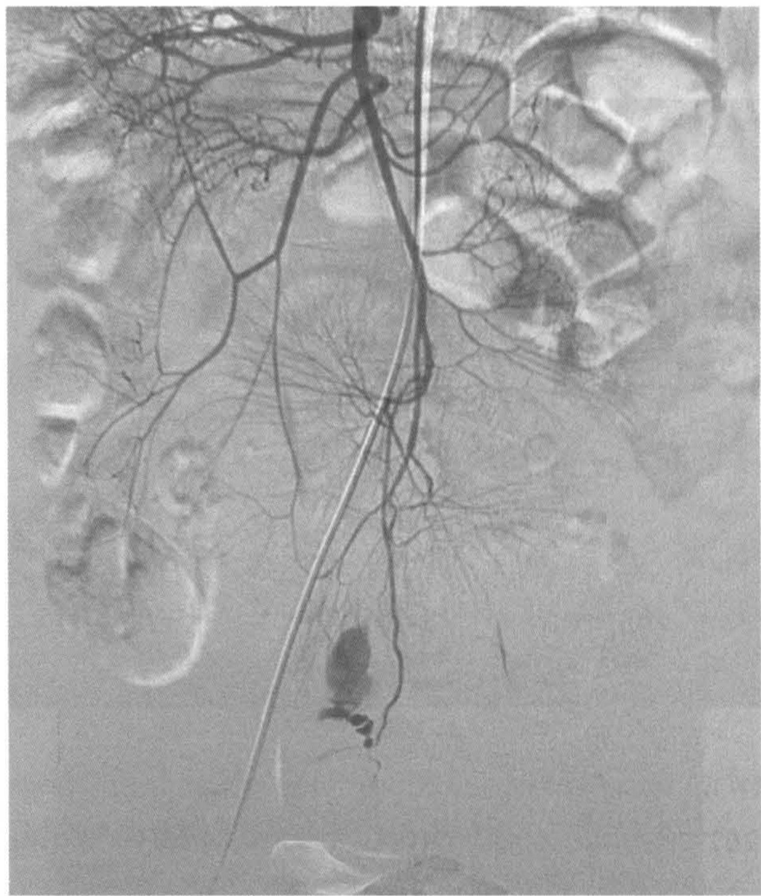
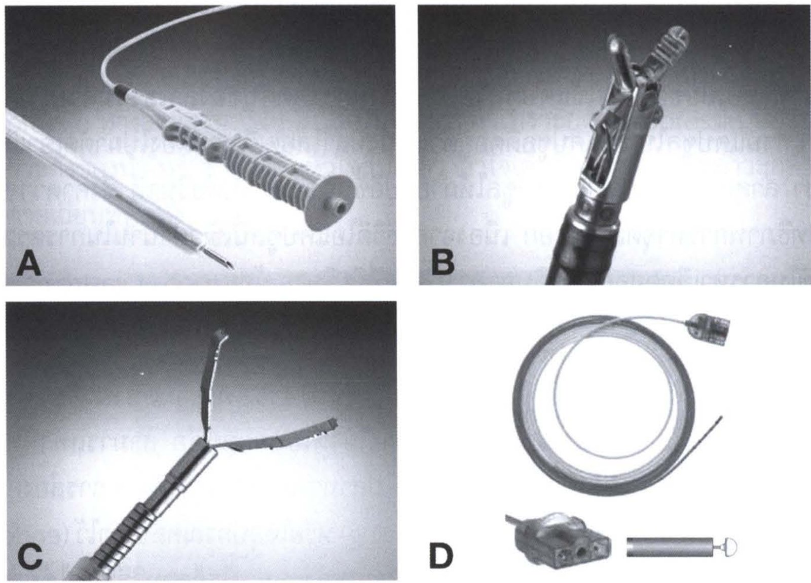
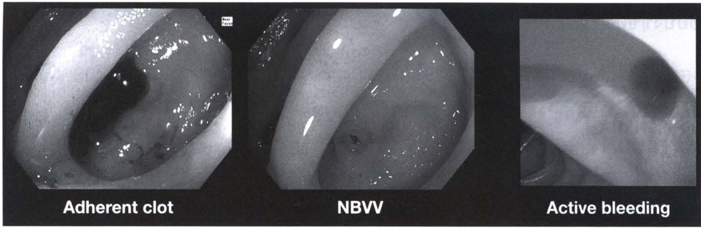
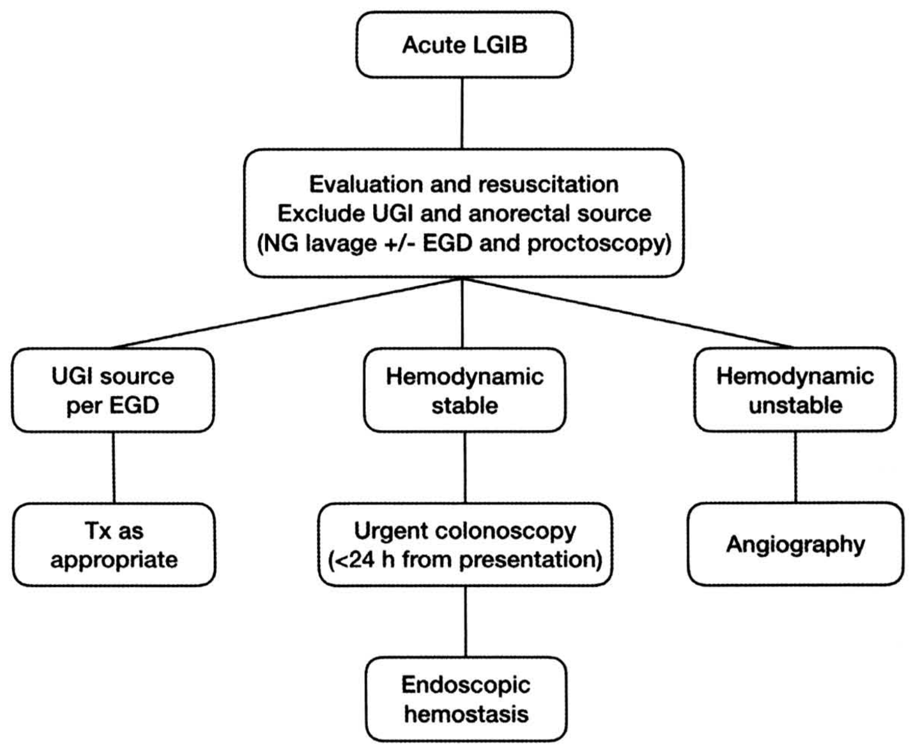

# ภาวะเลือดออกจากทางเดินอาหารส่วนล่าง (Lower Gastrointestinal Hemorrhage)

## Contents of this file
- บทนำ (p.424)
- การประเมินและตรวจรักษาผู้ป่วยแรกรับ (Evaluation and resuscitation) (p.425)
- อาการและอาการแสดง (Symptoms and signs) (p.425)
- สาเหตุของเลือดออกจากทางเดินอาหารส่วนล่าง (p.426)
  - โรคกระเปาะลำไส้ใหญ่ (Diverticular disease) (p.428)
  - โรคหลอดเลือดเจริญผิดปกติ (Angiodysplasia) (p.429)
  - โรคลำไส้ตรงอักเสบจากการฉายแสง (Radiation proctitis) (p.429)
  - โรคลำไส้ใหญ่อักเสบจากการขาดเลือด (Ischemic colitis) (p.430)
  - โรคมะเร็งลำไส้ใหญ่ (Colorectal cancer) (p.430)
  - เลือดออกจากแผลตัดติ่งเนื้อลำไส้ใหญ่ (Postpolypectomy bleeding) (p.430)
  - โรคลำไส้อักเสบเรื้อรัง (Inflammatory bowel disease) (p.430)
- การวินิจฉัย (p.431)
  - การส่องกล้องตรวจลำไส้ใหญ่ (Colonoscopy) (p.431)
  - การถ่ายภาพทางเวชศาสตร์นิวเคลียร์ (Radionucleotide scintigraphy) (รูปที่ 2) (p.432)
  - การทำเอกซเรย์คอมพิวเตอร์ (Computed tomography angiography) (รูปที่ 3) (p.433)
  - การฉีดสารทึบรังสีในหลอดเลือด (Angiography) (รูปที่ 4) (p.433)
  - การหาจุดเลือดออกในลำไส้เล็ก (Localization of small bowel bleeding) (p.434)
- การรักษา (p.435)
  - การหยุดเลือดโดยการส่องกล้องลำไส้ใหญ่ (Endoscopic bleeding control) (p.435)
- การผ่าตัด (p.437)
  - ข้อบ่งชี้ของการผ่าตัด (p.438)
  - วิธีการผ่าตัด (p.438)
- สรุป (p.439)
- เอกสารอ้างอิง (p.439)

<!-- p.423 (printed none) -->
**ภาวะเลือดออกจากทางเดินอาหารส่วนล่าง**

**Lower Gastrointestinal Hemorrhage**

สุกิจ ภัทรเจียรพันธุ์

สุภกิจ ขมวิลัย

<!-- p.424 (printed 410) -->
**ภาวะเลือดออกจากทางเดินอาหารส่วนล่าง**

**Lower Gastrointestinal Hemorrhage**

สุกิจ ภัทรเจียรพันธุ์

สุภกิจ ขมวิลัย

## บทนำ

ภาวะเลือดออกจากทางเดินอาหารส่วนล่างพบได้บ่อย โดยที่ 30-40% ของภาวะเลือดออกจากทางเดินอาหารเกิดจากทางเดินอาหารส่วนล่าง(1) ในอดีตคำนิยามของภาวะเลือดออกจากทางเดินอาหารส่วนล่าง คือ ตำแหน่งที่มีเลือดออกตั้งแต่ ligament of Treitz ลงไป แต่ในปัจจุบันได้เปลี่ยนคำนิยามโดยใช้ตำแหน่งที่มีเลือดออกตั้งแต่ ileocecal valve ลงไปแทน(2) เนื่องจากพบว่า ภาวะเลือดออกจาก ligament of Trietz จนถึง ileocecal valve หรือที่เรียกว่า middle gastrointestinal hemorrhage นั้นมีการดำเนินโรคและวิธีรักษาแตกต่างจากภาวะเลือดออกจากทางเดินอาหารส่วนล่างค่อนข้างมาก

แม้ว่าภาวะเลือดออกจากทางเดินอาหารส่วนล่างมักหยุดได้เอง แต่ผู้ป่วยกลุ่มนี้มักมีอายุมาก มีโรคประจำตัวหลายอย่าง จึงอาจมีภาวะแทรกซ้อนและเสียชีวิตถ้าไม่ได้รับการรักษาที่เหมาะสม อาการผู้ป่วยที่มาคือ ถ่ายอุจจาระเป็นเลือดแดง ซึ่งอาจเป็นสีแดงสด (bright red) หรือสีน้ำตาลแดง (maroon) ขึ้นกับสาเหตุ

หลักในการรักษาผู้ป่วยที่มาด้วยเลือดออกจากทางเดินอาหารส่วนล่าง คือ

1. ให้สารน้ำหรือเลือดอย่างเหมาะสมเพื่อให้สัญญาณชีพกลับมาปกติ (adequate resuscitation)
2. หาตำแหน่งของเลือดที่ออก (identify the source of hemorrhage)
3. หยุดเลือดที่ออก (bleeding control)

<!-- p.425 (printed 411) -->
## การประเมินและตรวจรักษาผู้ป่วยแรกรับ (Evaluation and resuscitation)

ในการดูแลรักษาผู้ป่วยที่มีภาวะเลือดออกจากทางเดินอาหารส่วนล่าง ต้องเริ่มจากประเมินสัญญาณชีพต่างๆ ได้แก่ ความดันโลหิต การเต้นของหัวใจ ทางเดินหายใจ (airway) การหายใจ (ventilation) และต้องแก้ไขภาวะที่ร่างกายขาดน้ำ (hypovolemia) จากการเสียเลือดในปริมาณมาก ด้วยการให้สารน้ำที่พอเพียงอย่างรวดเร็ว ต้องตรวจค่าความเข้มข้นเลือด (complete blood count, CBC) การทำงานของไต (creatinine, electrolytes) รวมถึงประเมินการแข็งตัวของเลือดต่างๆ (prothrombin time, partial thromboplastin time, bleeding time) และจองเลือดเพื่อนำเลือดมาให้ ถ้ามีระดับฮีโมโกลบินน้อยกว่า 9 กรัมต่อเดซิลิตรในผู้ป่วยที่มีโรคหัวใจ และ 7 กรัมต่อเดซิลิตรในผู้ป่วยทั่วไป(2) โดยในขณะที่ resuscitate ผู้ป่วยควรซักประวัติและตรวจร่างกายไปพร้อมๆ กัน

## อาการและอาการแสดง (Symptoms and signs)

ประวัติที่สำคัญคือ ระยะเวลาที่มีเลือดออก (duration) เลือดที่ออกเป็นแบบฉับพลัน (acute) หรือเรื้อรัง (chronic) ปริมาณเลือดที่ออก ความถี่ของการถ่ายเป็นเลือด อาการเวียนศีรษะหน้ามืด (anemic symptom) ซึ่งบ่งบอกว่ามีการเสียเลือดมาก สีของอุจจาระเป็นสีแดงสดหรือแดงดำ ซึ่งจะทำให้พอทราบตำแหน่งที่เลือดออกคร่าวๆ ได้ ถ้ามีอาการปวดท้องร่วมจะทำให้คิดถึง โรคลำไส้อักเสบเรื้อรัง (inflammatory bowel disease) โรคลำไส้ใหญ่อักเสบจากการขาดเลือด (ischemic colitis) และโรคมะเร็งลำไส้ใหญ่มากขึ้น อย่างไรก็ตามเลือดที่ออกจากก้อนเนื้องอก มะเร็งลำไส้ใหญ่มักจะไม่ได้ออกปริมาณมากจนเกิดภาวะช็อก ประวัติอื่นๆ ที่ต้องถาม ได้แก่ โรคประจำตัวที่สำคัญ เช่น โรคหัวใจ โรคตับ ยาที่รับประทานประจำ เช่น aspirin, NSAIDS, anticoagulants และยาความดัน beta-blocker ที่ทำให้ชีพจรช้าและบดบังภาวะช็อก ประวัติ การผ่าตัดในอดีต ประวัติการฉายแสงบริเวณช่องท้องและอุ้งเชิงกราน และประวัติการส่องกล้องกระเพาะอาหารและลำไส้ใหญ่ในอดีต

การตรวจร่างกายเริ่มจากการดูสัญญาณชีพว่ามีภาวะช็อกจากการเสียเลือดหรือไม่ นอกจากนี้ การตรวจหาภาวะ orthostatic hypotension คือ การเปรียบเทียบ

<!-- p.426 (printed 412) -->
ความดันโลหิตในท่านั่งและนอน หลังจากเปลี่ยนจากท่านอนเป็นนั่ง ภายใน 3 นาที ถ้ามีการลดลงของความดัน systolic มากกว่า 20 มม.ปรอท หรือความดัน diastolic มากกว่า 10 มม.ปรอท แสดงว่าผู้ป่วยมีภาวะนี้ซึ่งแปลว่า ผู้ป่วยมีการเสียเลือดมากกว่า 20% ของปริมาณเลือดในร่างกายทั้งหมด(3)

การตรวจท้องให้เริ่มจากดูว่ามีท้องอืดหรือไม่ ดูแผลเป็นที่เคยผ่าตัด หาอาการแสดงของโรคตับเรื้อรัง (chronic liver stigmata) คือ ตัว ตาเหลือง หลอดเลือดดำโป่งพองที่หน้าท้อง (caput medusae) และฝ่ามือแดงสองข้าง (palmar erythema) ซึ่งจะทำให้คิดถึงโรคเลือดออกจากเส้นเลือดดำโป่งพอง (variceal bleeding) หลังจากนั้นคลำหาจุดกดเจ็บ คลำหน้าท้องว่ามีก้อนหรือไม่ ต่อมาให้ตรวจบริเวณรอบรูทวารว่ามีแผลหรือไม่ (anal fissure) ถ้าไม่มีแผลให้ตรวจทวารหนักด้วยนิ้วมือ (digital rectal examination) ซึ่งมีความสำคัญให้ข้อมูลหลายอย่าง เช่น ถ้าลักษณะของเลือดเป็นสีแดงสดตำแหน่งเลือดที่ออกน่าจะเป็นบริเวณทวารหนักหรือลำไส้ใหญ่ส่วนปลาย ถ้าเลือดเป็นสีดำ (melena) แสดงว่าเลือดที่ออกเป็นจากกระเพาะอาหารหรือลำไส้เล็กส่วนต้นและต้องมีเลือดออกอย่างน้อย 50 มล. นอกจากนี้อาจตรวจได้เนื้องอกหรือแผลที่ลำไส้ตรงส่วนล่าง หลังจากนั้นให้ตรวจเพิ่มเติมโดยใช้ proctoscopy เพื่อดูบริเวณขอบทวารว่ามีเลือดออกจากริดสีดวงหรือไม่

ถ้าผู้ป่วยมีอาการที่อาจบ่งถึงภาวะเลือดออกในกระเพาะอาหารหรือลำไส้เล็กส่วนต้น เช่น ถ่ายเป็นเลือดแดงร่วมกับมีภาวะช็อกหรือถ่ายเป็นสีดำ ต้องตรวจเพิ่มเติมโดยการใส่สายสวนกระเพาะอาหารเพื่อล้าง (NG tube lavage) ดูว่าเลือดออกจากทางเดินอาหารส่วนบนหรือไม่ โดยถ้าล้างได้เลือดในกระเพาะอาหาร ควรต้องพิจารณาตรวจ esophagogastroduodenoscopy (EGD) เพื่อหาสาเหตุและหยุดเลือด ถ้าล้างได้น้ำดีและไม่พบเลือด โอกาสที่เลือดออกจากทางเดินอาหารส่วนบนพบน้อยเพียง 2%(4) การล้างได้น้ำดีแปลว่า pylorus เปิด ไม่มีเลือดออกมาจาก duodenum ส่วนในกรณีถ้าล้างไม่ได้น้ำดีหรือเลือด จะยังไม่สามารถตัดภาวะเลือดออกจากลำไส้เล็กส่วนต้นได้ ต้องตรวจ EGD ต่อไป

## สาเหตุของเลือดออกจากทางเดินอาหารส่วนล่าง

Gralnek และคณะ(5) ได้รวบรวมข้อมูลจากรายงานทางการแพทย์ พบสาเหตุของภาวะเลือดออกจากทางเดินอาหารส่วนล่างสามารถเกิดจากพยาธิสภาพต่างๆ ดังตารางที่ 1

<!-- p.427 (printed 413) -->
**ตารางที่ 1** สาเหตุของภาวะเลือดออกจากทางเดินอาหารส่วนล่าง(5)

| **Cause** | **Percentage of cases** |
| --- | --- |
| Diverticulosis | 30-65 |
| Ischemic colitis | 5-20 |
| Hemorrhoids | 5-20 |
| Colorectal polyps or neoplasm | 2-15 |
| Angiodysplasia | 5-10 |
| Postpolypectomy bleeding | 2-7 |
| Inflammatory bowel disease | 3-5 |
| Infectious colitis | 2-5 |
| Stercoral ulceration | 0-5 |
| Colorectal varices | 0-3 |
| Radiation proctopathy | 0-2 |
| NSAID-induced colopathy | 0-2 |
| Dieulafoy’s lesion | Rare |

การศึกษาข้อมูลย้อนหลังของหน่วยศัลยศาสตร์ลำไส้ใหญ่และทวารหนัก โรงพยาบาลจุฬาลงกรณ์ ตั้งแต่ 1 มกราคม พ.ศ. 2551 ถึง 31 ธันวาคม พ.ศ. 2561 มีผู้ป่วยเป็นภาวะเลือดออกจากทางเดินอาหารส่วนล่างที่นอนโรงพยาบาลและรับการส่องกล้องลำไส้ใหญ่ทั้งหมด 327 คน พบว่าเกิดจากสาเหตุต่างๆ ดังตารางที่ 2

<!-- p.428 (printed 414) -->
**ตารางที่ 2** สาเหตุของภาวะเลือดออกจากทางเดินอาหารส่วนล่างในโรงพยาบาลจุฬาลงกรณ์ (พ.ศ. 2551-2561)

| **Cause** | **Percentage of cases** |
| --- | --- |
| Diverticulosis | 31 |
| Radiation proctopathy | 8.2 |
| Hemorrhoids | 7.9 |
| Colorectal neoplasm | 6.9 |
| Ischemic colitis | 6.7 |
| Postpolypectomy bleeding | 6 |
| Other colitis | 5.4 |
| Upper gastrointestinal bleeding | 3.3 |
| Colorectal polyps | 3 |
| Angiodysplasia | 2.1 |
| Anal fissure | 1.5 |
| Small bowel bleeding | 1.2 |
| Dieulafoy’s lesion | 0.9 |
| Solitary rectal ulcer syndrome | 0.9 |
| Ileal ulcer | 0.9 |

ซึ่งจะขอกล่าวถึงโรคต่างๆ เหล่านี้ที่สามารถทำให้เลือดออกโดยสังเขปดังนี้

### โรคกระเปาะลำไส้ใหญ่ (Diverticular disease)

โรคกระเปาะลำไส้ใหญ่เกิดจากการที่มีแรงดันจากในลำไส้ใหญ่ดันเยื่อบุลำไส้ (mucosa) ผ่านชั้นกล้ามเนื้อของลำไส้ (muscularis propria) ออกไป ซึ่งมักจะเกิดบริเวณที่มีเส้นเลือดแดง

<!-- p.429 (printed 415) -->
vasa recta แทงผ่านกล้ามเนื้อเข้ามาเลี้ยงเยื่อบุผิวลำไส้ใหญ่พอดี (รูปที่ 1A) โดยในคนปกติที่มีอายุ 80 ปี จะตรวจพบกระเปาะลำไส้ใหญ่มากถึง 60% แต่มีเพียง 15% เท่านั้นที่จะมีภาวะเลือดออกจากกระเปาะลำไส้ใหญ่นี้(6) การที่มีเลือดออกจากกระเปาะลำไส้ใหญ่เกิดจากมีการเสียดสี ถลอกที่บริเวณคอหรือยอดของกระเปาะลำไส้ใหญ่ ซึ่งเป็นตำแหน่งของเส้นเลือดแดง vasa recta พอดี ส่วนใหญ่เลือดที่ออกจากกระเปาะลำไส้ใหญ่นั้นแม้จะมีปริมาณมากและผู้ป่วยมักมีภาวะช็อกร่วมด้วย แต่มักหยุดได้เองถึง 80% และมีโอกาสที่จะมีเลือดออกซ้ำได้ประมาณ 25%(7) ปัจจัยเสี่ยงต่อภาวะเลือดออกจากกระเปาะลำไส้ใหญ่ ได้แก่ การใช้ยา NSAIDs การใช้ยาละลายลิ่มเลือดและโรคความดันโลหิตสูง(8)

### โรคหลอดเลือดเจริญผิดปกติ (Angiodysplasia)

คือการที่หลอดเลือดที่อยู่ในชั้นใต้เยื่อบุลำไส้ใหญ่มีการขยายตัวมากกว่าปกติ (รูปที่ 1B) สาเหตุจากเมื่ออายุมากขึ้นจะเกิดการอุดตันของหลอดเลือดดำใต้เยื่อบุลำไส้ใหญ่ทำให้หูรูดในหลอดเลือดฝอย (precapillary sphincter) ทำงานผิดปกติเกิดการขยายตัวของหลอดเลือดและมีการสร้างหลอดเลือดเล็กๆ เชื่อมกันระหว่างหลอดเลือดแดงและดำ มักเกิดในลำไส้ใหญ่ฝั่งขวาและมีหลายตำแหน่ง(9) คนไข้อาจมาพบแพทย์ด้วยอาการเลือดออกปริมาณน้อยเรื้อรัง (occult bleeding) จนถึงถ่ายเป็นเลือดแดง ปัจจัยเสี่ยง ที่ทำให้เลือดออก ได้แก่ อายุมาก ผู้ป่วยที่มีความผิดปกติในระบบต่างๆ หลายระบบ มีรอยโรคหลายตำแหน่ง และการใช้ยาละลายลิ่มเลือด(10)

### โรคลำไส้ตรงอักเสบจากการฉายแสง (Radiation proctitis)

โอกาสการเกิดลำไส้ตรงอักเสบหลังการฉายแสงบริเวณอุ้งเชิงกรานพบได้ประมาณ 5-20% ของผู้ป่วยที่เข้ารับการฉายแสง(11) ซึ่งการฉายแสงทำให้หลอดเลือดแดงเล็กอักเสบและอุดตัน มีการสร้างหลอดเลือดแดงใหม่ขึ้นมา แต่หลอดเลือดแดงใหม่นี้จะมีผนังที่อ่อนแอ หลอดเลือดแตกและเลือดออกง่าย (รูปที่ 1C) ผู้ป่วยอาจมีอาการปวดหน่วงก้นหรือถ่ายเป็นมูกร่วมด้วย อาจมีการตีบหรือเน่าตายของลำไส้ตรงหากมีการอักเสบที่รุนแรง การส่องกล้องลำไส้ใหญ่เป็นวิธีวินิจฉัยและรักษาได้ดีที่สุด โดยอาจพบลำไส้ตรงมีหลอดเลือดแดงเล็กๆ ปริมาณมาก ลำไส้บวม เป็นแผล หรือตีบตัน(12)

<!-- p.430 (printed 416) -->
### โรคลำไส้ใหญ่อักเสบจากการขาดเลือด (Ischemic colitis)

เลือดที่ออกเกิดจากการที่มีเลือดกลับไปเลี้ยงลำไส้ใหญ่หลังจากมีการขาดเลือด (reperfusion) ทำให้มีการหลุดลอกของเยื่อบุลำไส้ เกิดแผล หรือเน่าตายของลำไส้ใหญ่ การขาดเลือดของลำไส้ใหญ่มักเกิดบริเวณ “water-shed” คือ ตรงที่เป็นรอยต่อของหลอดเลือด 2 เส้นที่มาเลี้ยง ได้แก่ บริเวณ splenic flexure ที่เรียกว่า “Griffith’s point” และบริเวณ rectosigmoid colon เรียกว่า “Sudeck’s point” ส่วนใหญ่เลือดที่ออกจะมีปริมาณไม่เยอะมากและจะมีอาการปวดท้องร่วมด้วย ถ้าตรวจช่องท้องจะพบมีจุดกดเจ็บ(13)

### โรคมะเร็งลำไส้ใหญ่ (Colorectal cancer)

ลักษณะเลือดที่ออกขึ้นอยู่กับตำแหน่งของมะเร็งลำไส้ใหญ่ ถ้าเป็นลำไส้ใหญ่ฝั่งขวามักมีเลือดออกปริมาณน้อย เรื้อรัง (occult blood loss) แต่ถ้าเป็นลำไส้ใหญ่ฝั่งซ้ายหรือลำไส้ตรงจะถ่ายเป็นเลือดแดง ส่วนใหญ่เลือดที่ออกจากก้อนมะเร็งจะมีปริมาณไม่มาก การที่มีเลือดออกปริมาณมากจนช็อกพบน้อยมาก อย่างไรก็ตามยังมีมะเร็งลำไส้ใหญ่ชนิดอื่นๆ ที่มีเส้นเลือดมาเลี้ยงมาก เช่น Gastrointestinal Stromal Tumor (GIST) (รูปที่ 1D) แม้พบน้อยแต่ก็เป็นสาเหตุทำให้เลือดออกได้เช่นกัน

### เลือดออกจากแผลตัดติ่งเนื้อลำไส้ใหญ่ (Postpolypectomy bleeding)

โอกาสเกิดน้อยมากประมาณ 1% ของการตัดติ่งเนื้อลำไส้ใหญ่ อย่างไรก็ตามเนื่องจากจำนวนผู้ป่วยที่เข้ารับการส่องกล้องเพื่อคัดกรองมะเร็งลำไส้ใหญ่มีปริมาณมากขึ้น การตัดติ่งเนื้อจึงมีจำนวนผู้ป่วยที่มากขึ้น ทำให้รายงานจำนวนผู้ป่วยที่มีเลือดออกจากแผลตัดติ่งเนื้ออาจสูงถึง 8% ของผู้ป่วยภาวะเลือดออกจากทางเดินอาหารส่วนล่างทั้งหมด(14)

### โรคลำไส้อักเสบเรื้อรัง (Inflammatory bowel disease)

ผู้ป่วยมักมาด้วยอาการถ่ายเป็นเลือด โดยส่วนใหญ่จะไม่ได้มีเลือดออกมากจนช็อก มีเพียง 6% ที่เลือดออกมากจนต้องนอนโรงพยาบาล(15) ในประเทศไทยพบโรคกลุ่มนี้น้อยมาก ถ้าพบจะเป็นโรคลำไส้อักเสบเป็นแผลเรื้อรัง (ulcerative colitis)

<!-- p.431 (printed 417) -->

> **Caption (verbatim):** **รูปที่ 1** โรคที่เป็นสาเหตุในภาวะเลือดออกจากทางเดินอาหารส่วนล่าง (A) โรคกระเปาะในลำไส้ใหญ่ (B) โรคหลอดเลือดเจริญผิดปกติ (C) โรคลำไส้ตรงอักเสบจากการฉายแสง (D) โรคมะเร็งลำไส้ใหญ่ชนิด Gastrointestinal Stromal Tumor (GIST)
> **Text in image (verbatim):** A · B · C · D · Near Focus (small endoscope status text, top right corner of panel B, partly cut off)
> **Description:** Four grayscale colonoscopic (endoscopic) photographs arranged in a 2 × 2 grid, each with the octagonal endoscope-view frame. (A, top left) Colonic lumen with circular haustral folds; several dark round/oval openings (diverticular orifices) are seen in the colonic wall along the left and upper part of the image, with shiny light reflections on the mucosa — diverticula of the colon. (B, top right) Close view of colonic mucosa showing a flat area of irregular, patchy, slightly mottled vascular pattern — angiodysplasia. (C, bottom left) Rectal mucosa with a diffuse granular surface and multiple irregular darker patches and fine vessels — radiation proctitis. (D, bottom right) A large lobulated mass with a whitish, irregular, fibrinous/necrotic-looking surface and prominent vessels occupying the right half of the view, with dark blood/clot near its base at the lower centre — Gastrointestinal Stromal Tumor (GIST).
> **Identifiers in image:** none

## การวินิจฉัย

วิธีการตรวจหาจุดเลือดออกทางเดินอาหารส่วนล่างมีหลายวิธี คือ colonoscopy, radionucleotide scintigraphy, computed tomography angiography และ angiography ซึ่งจะกล่าวรายละเอียดในแต่ละวิธีต่อไป

### การส่องกล้องตรวจลำไส้ใหญ่ (Colonoscopy)

การส่องกล้องลำไส้ใหญ่เป็นหัตถการที่มีประสิทธิภาพสูงสุด ทั้งในเรื่องการวินิจฉัยสาเหตุของเลือดออกและยังสามารถให้การรักษาได้ทันที(4, 16) ในปัจจุบันแนะนำให้ทำการเตรียมลำไส้ใหญ่โดยให้ดื่มน้ำผสม polyethylene glycol (PEG) 2-4 ลิตร ก่อนการส่องกล้องผู้ป่วยที่มีภาวะเลือดออกจากทางเดินอาหารส่วนล่างทุกราย เพราะสามารถมองเห็นความผิดปกติได้ชัดเจน และสามารถให้การรักษาที่เหมาะสม โดยสามารถให้การวินิจฉัยได้สูงถึง 91%(17) โดยทั่วไปแนะนำให้ทำการส่องกล้องภายใน 24 ชั่วโมงหลังจาก

<!-- p.432 (printed 418) -->
ทำการประเมินและ resuscitate ผู้ป่วย การส่องกล้องเร็ว (urgent colonoscopy) จะเพิ่มโอกาสการพบสาเหตุของเลือดออกและลดระยะเวลานอนโรงพยาบาลลง(18, 19)

### การถ่ายภาพทางเวชศาสตร์นิวเคลียร์ (Radionucleotide scintigraphy) (รูปที่ 2)

การตรวจนี้โดยทั่วไปมีอยู่ 2 วิธี คือ การใช้ 99mTc-sulfur colloid และ 99mTc-labeled RBCs โดย 99mTc-sulfur colloid จะถูกกำจัดจากร่างกายเร็วกว่าโดยมี half-life เพียง 2 นาที ในผู้ป่วยที่ตับทำงานปกติ ในขณะที่ 99mTc-labeled RBCs จะอยู่ในกระแสเลือดนานกว่า ในกรณีที่ตรวจไม่พบเลือดออกในครั้งแรกแล้วมีเลือดออกซ้ำในภายหลัง สามารถนำผู้ป่วยกลับมาทำเอกซเรย์ซ้ำได้ใน 24 ชั่วโมง ซึ่งเหมาะในการใช้วินิจฉัยภาวะเลือดออกจากทางเดินอาหารส่วนล่าง ซึ่งตามธรรมชาติโรคมักมีเลือดออกเป็นๆ หายๆ (intermittent bleeding) นอกจากนี้ 99mTc-labeled RBCs ยังมีความไวในการวินิจฉัยจุดเลือดออกมากกว่า 99mTc-sulfur colloid(20, 21) วิธีนี้สามารถตรวจพบได้ถ้าเลือดออกมีปริมาณมากกว่า 0.1 มล. ต่อนาที ข้อดีคือ ไม่มีอันตรายต่อผู้ป่วย สามารถทำซ้ำได้ถ้ามีเลือดออกซ้ำ ข้อเสียคือ ไม่สามารถให้การรักษาได้ มักใช้เป็นวิธีตรวจเบื้องต้นเพื่อบอกตำแหน่งคร่าวๆ ก่อนทำ angiography เพื่อให้การรักษา

> **Caption (verbatim):** **รูปที่ 2** การถ่ายภาพทางเวชศาสตร์นิวเคลียร์ (Radionucleotide scintigraphy) โดยผู้ป่วยรายนี้ พบจุดเลือดออกที่บริเวณ hepatic flexure
> **Text in image (verbatim):** none
> **Description:** Grayscale planar nuclear-medicine (scintigraphy) image of the abdomen and pelvis, displayed with tracer activity as white on a dark background. A large bright area of activity is at the upper right corner of the image, with diffuse mottled activity across the upper abdomen. Linear bands of activity run down the midline and diverge in an inverted-Y pattern into the pelvis (consistent with the major vessels). A bright oval area of activity is in the lower centre of the pelvis, with another bright area below it at the bottom centre between two dark rounded regions. A small, discrete focus of increased activity is seen on the left side of the image at about mid-height, separate from the other structures; the caption states that this patient's bleeding point was found at the hepatic flexure. No markers, arrows or labels are shown.
> **Identifiers in image:** none

<!-- p.433 (printed 419) -->
### การทำเอกซเรย์คอมพิวเตอร์ (Computed tomography angiography) (รูปที่ 3)

ในปัจจุบันเทคโนโลยีการทำเอกซเรย์คอมพิวเตอร์มีการพัฒนาไปมาก การทำเอกซเรย์คอมพิวเตอร์ชนิดละเอียด 64 แถว ทำให้สามารถตัดได้เร็วและได้รูปที่มีความละเอียดชัดมากขึ้น สามารถดูจุดที่เลือดออกได้ดี อีกทั้งยังสามารถบอกชนิดพยาธิสภาพที่ทำให้เลือดออกอีกด้วย โดยสามารถตรวจพบจุดเลือดออกที่มีปริมาณมากกว่า 0.3 มล. ต่อนาทีได้(22) โดยมีความไวในการหาจุดเลือดออก 91-92% ถ้าเลือดออกอยู่ และความไวจะลดลงเป็น 45-47% ถ้าเลือดออกเป็นๆ หายๆ(23) เพราะเหตุนี้ในผู้ป่วยที่ไม่มีข้อห้ามในการทำเอกซเรย์คอมพิวเตอร์ เช่น ไตวายหรือแพ้สารทึบรังสี ปัจจุบันจึงนิยมทำเอกซเรย์คอมพิวเตอร์มากกว่า 99mTc-labeled RBCs

> **Caption (verbatim):** รูปที่ 3 การทำเอกซเรย์คอมพิวเตอร์ (Computed tomography angiography) โดยผู้ป่วยรายนี้พบเนื้องอกที่ลำไส้เล็ก jejunum เป็นสาเหตุที่ทำให้เลือดออก
> **Text in image (verbatim):** none
> **Description:** Axial contrast-enhanced CT image of the abdomen at the level of the lower poles of the kidneys and a lumbar vertebra. Both kidneys are seen posteriorly beside the spine, the contrast-filled aorta lies anterior to the vertebral body, and multiple bowel loops fill the abdomen, some gas-filled (black) anteriorly and some containing bright oral/intravenous contrast. In the left upper part of the image (patient's left anterior abdomen) there is a large round soft-tissue mass with a bright contrast rim/crescent along its medial-inferior border, among jejunal loops; per the caption this is a tumour of the jejunum that was the source of bleeding. No arrows or labels.
> **Identifiers in image:** none

### การฉีดสารทึบรังสีในหลอดเลือด (Angiography) (รูปที่ 4)

การทำ angiography สามารถตรวจพบเลือดออกที่มีปริมาณมากกว่า 0.5-1 มล. ต่อนาทีได้(24) โดยการทำ angiography เริ่มจากการใส่สายสวนเส้นเลือดเข้าทางเส้นเลือดแดง femoral หรือ brachial และสวนเข้าไปในเส้นเลือดแดง inferior mesenteric artery, superior mesenteric artery และ celiac axis แล้วฉีดสีหาจุดเลือดออก ข้อเสียคือ อาจมีภาวะแทรกซ้อนบริเวณเส้นเลือดที่ใส่สายสวน และอาจเกิดภาวะไตวายจากการฉีดสารทึบรังสี ข้อดีคือ เมื่อเจอจุดเลือดออกจะสามารถใส่สายสวนเข้าไปในเส้นเลือดขนาดเล็กที่

<!-- p.434 (printed 420) -->
ไปเลี้ยงจุดเลือดออก (superselective angiography) แล้วอุดเส้นเลือด (embolization) ด้วย gelfoam, microcoil และ polyvinyl alcohol particles วิธีนี้สามารถหยุดเลือดสำเร็จ 50-100% และมีโอกาสเลือดออกซ้ำ 22-24%25, 26) ภาวะแทรกซ้อนที่อาจพบคือ ลำไส้เน่าขาดเลือดหรือตีบหลังการอุดเส้นเลือด ซึ่งพบได้น้อยลงหลังจากมีการใช้วิธี superselective embolization ส่วนการหยุดเลือดวิธีดั้งเดิมคือ การให้ vasopressin ทางสายสวน ปัจจุบันไม่เป็นที่นิยมแล้วเพราะยา vasopressin นี้อาจทำให้เกิดภาวะคั่งของน้ำในร่างกาย เกิดหัวใจล้มเหลว หัวใจเต้นผิดจังหวะ และภาวะกล้ามเนื้อหัวใจตายเฉียบพลันได้(27)

> **Caption (verbatim):** รูปที่ 4 การฉีดสารทึบรังสีในหลอดเลือด (Angiography) โดยผู้ป่วยรายนี้พบเลือดออกบริเวณกระเปาะของลำไส้เล็ก (Meckel's diverticulum)
> **Text in image (verbatim):** none
> **Description:** Frontal (AP) digital subtraction mesenteric angiogram of the mid and lower abdomen. A catheter runs obliquely from the lower part of the image up to the main mesenteric artery at the top centre; the artery and its branches (arcades to small bowel and colon) are opacified as dark vessels on a grey background, with faint outlines of bowel gas and the pelvic bones. In the lower centre of the image a long branch ends in a dark oval blush/pooling of contrast with a few small dark contrast collections beneath it, representing the bleeding site, which per the caption is at a Meckel's diverticulum. No arrows or labels.
> **Identifiers in image:** none

### การหาจุดเลือดออกในลำไส้เล็ก (Localization of small bowel bleeding)

ในกรณีที่ผู้ป่วยถ่ายเป็นเลือดอยู่ตลอดโดยที่ส่องกล้องทั้งกระเพาะอาหารและลำไส้ใหญ่แล้วปกติดี ต้องมีการส่งตรวจเพื่อหาจุดเลือดออกจากลำไส้เล็กเพิ่มเติม ซึ่งมีทั้ง

<!-- p.435 (printed 421) -->
การใช้เอกซเรย์ คอมพิวเตอร์ การใช้แคปซูลวิดีโอ (video capsule endoscopy) หรือการส่องกล้องลำไส้เล็กด้วยกล้องสองบอลลูน (double balloon enteroscopy)

การใช้แคปซูลวิดีโอและการส่องกล้องลำไส้เล็กด้วยกล้องสองบอลลูนมีประสิทธิภาพในการหาจุดเลือดออก 55-65%(23) โดยทั่วไปวิดีโอแคปซูลนี้จะถ่ายรูป 2 รูปต่อวินาที ข้อเสียของการใช้แคปซูลวิดีโอคือถ้ามีการอุดตันของลำไส้ร่วมด้วย หลังจากรับประทานแคปซูลไป ถ้าแคปซูลติดอยู่ตำแหน่งที่ลำไส้อุดตัน จะต้องไปผ่าตัดเอาแคปซูลออกมา ล่าสุดได้มีการพัฒนาแคปซูลให้ถ่ายรูปถี่ขึ้นถึง 35 รูปต่อวินาที ซึ่งคาดว่าจะเพิ่มประสิทธิภาพการหาจุดเลือดออก เนื่องจากวิธีวิดีโอแคปซูลนี้ใช้เวลานานในการตรวจ จึงนิยมใช้ในการหาเลือดออกทางเดินอาหารเรื้อรังที่มีปริมาณน้อย (occult gastrointestinal bleeding) ไม่ใช่กรณีที่เลือดออกเป็นปริมาณมาก (massive gastrointestinal bleeding)

การส่องกล้องลำไส้เล็กด้วยกล้องสองบอลลูนเป็นวิธีที่ทำยากต้องอาศัยแพทย์ที่มีความชำนาญ แต่มีข้อดีเมื่อเปรียบเทียบกับการใช้วิดีโอบอลลูนคือ สามารถทำหัตถการหยุดเลือดได้เลยถ้าเจอจุดที่เลือดออก หรือแม้ไม่สามารถหยุดเลือดได้ผ่านการส่องกล้องก็สามารถฉีดสีเพื่อทำเครื่องหมายที่ลำไส้ (tattooing) หรือใช้อุปกรณ์คลิปเอาไว้ (endoclip) เพื่อช่วยบอกตำแหน่งเมื่อไปทำการผ่าตัดในภายหลัง อย่างไรก็ตามวิธีนี้ทำได้ยากมากถ้าเลือดที่ออกมีปริมาณมาก (massive gastrointestinal bleeding) เช่นกัน

## การรักษา

การรักษาภาวะเลือดออกจากทางเดินอาหารส่วนล่างสามารถทำได้หลายวิธี ทั้งด้วยการทำ angiography with embolization ที่ได้กล่าวไปแล้ว การหยุดเลือดโดยการส่องกล้องลำไส้ใหญ่ (endoscopic bleeding control) และการผ่าตัดซึ่งจะใช้เป็นทางเลือกสุดท้าย ปัจจัยสำคัญที่ควรนำมาประกอบการตัดสินใจเลือกวิธีหยุดเลือด ได้แก่ ตำแหน่งเลือดที่ออก พยาธิสภาพที่เป็นสาเหตุของเลือดออก และความสามารถของบุคลากรและอุปกรณ์ที่มีในโรงพยาบาลนั้นๆ

### การหยุดเลือดโดยการส่องกล้องลำไส้ใหญ่ (Endoscopic bleeding control)

ในปัจจุบันมีเครื่องมือในการหยุดเลือดผ่านการส่องกล้องหลายชนิด (รูปที่ 5) การจะเลือกใช้เครื่องมืออะไรนั้นขึ้นกับพยาธิสภาพที่เป็นสาเหตุของเลือดออกเป็นสำคัญ วิธีการหยุดเลือดต่างๆ ได้แก่ การฉีดอีพิเนฟรินในชั้นใต้เยื่อบุลำไส้ (submucosal injection of epinephrine)

<!-- p.436 (printed 422) -->
การใช้คลิปหยุดเลือด (endoscopic clip) การจี้ไฟฟ้า (electrocauterization) การจี้ด้วยก๊าซอาร์กอน (argon plasma coagulation) และการใช้ผงหยุดเลือด (hemospray)

> **Caption (verbatim):** รูปที่ 5 เครื่องมือในการหยุดเลือดผ่านการส่องกล้อง (A) เข็มเพื่อใช้ฉีดอีพิเนฟริน (B) Coaggrasper ใช้จี้ไฟฟ้า (C) คลิป (D) สายใช้จี้ด้วยก๊าซอาร์กอน (ได้รับอนุญาตให้ใช้รูปจากบริษัท Olympus Thailand Co. Ltd. และ ERBE Thailand Co. Ltd.)
> **Text in image (verbatim):** A · B · C · D
> **Description:** Four-panel composite of product photographs of endoscopic haemostasis devices on grey gradient backgrounds. (A) Endoscopic injection needle: a long flexible catheter with a ribbed handle/hub and luer connector at one end, and alongside it the distal tip of a transparent sheath with a fine needle protruding. (B) Coaggrasper: close-up of the distal tip of a metal grasping forceps with two serrated jaws open, used for electrocautery. (C) Endoscopic clip: a metal clip with two long prongs opened in a Y shape, extending from the end of a metal delivery catheter. (D) Argon plasma coagulation probe: a long thin probe coiled in a circle with a connector plug at one end and a black tip at the other, plus below it a separate connector unit and a cylindrical filter/adaptor piece. Each panel is labelled with a bold letter in the lower left corner.
> **Identifiers in image:** none

การหยุดเลือดที่ออกจากกระเปาะลำไส้ใหญ่ (diverticular bleeding) จะทำในกรณีเจอ bleeding stigmata คือก้อนเลือดติด (adherent clot) เส้นเลือดเปลือยที่ไม่ได้มีเลือดออก (nonbleeding visible vessel, NBVV) หรือเจอเลือดออกอยู่ (active bleeding) (รูปที่ 6) ถ้าเจอเลือดออกอยู่นิยมใช้การฉีดอีพิเนฟรินในชั้นใต้เยื่อบุลำไส้ โดยให้เจือจางสารอีพิเนฟรินเป็น 1 ต่อ 20,000 แล้วฉีดที่ชั้นใต้เยื่อบุลำไส้โดยรอบ 4 จุด จุดละ 1 มล. หลังจากฉีดเลือดที่ออกจะช้าลงหรือหยุดไป ให้คลิปที่กระเปาะลำไส้ต่อเพื่อหยุดเลือด การฉีดอีพิเนฟรินในชั้นใต้เยื่อบุลำไส้อย่างเดียวโดยไม่คลิปต่อจะทำให้มีเลือดออกซ้ำสูง(28) ไม่ควรใช้จี้ไฟฟ้าในกรณีเลือดออกจากกระเปาะลำไส้ใหญ่เพราะมีความเสี่ยงลำไส้ใหญ่ทะลุได้

<!-- p.437 (printed 423) -->

> **Caption (verbatim):** รูปที่ 6 ลักษณะที่แสดงว่ามีเลือดออกจากกระเปาะลำไส้ใหญ่ (bleeding stigmata)
> **Text in image (verbatim):** Adherent clot · NBVV · Active bleeding · [unclear: Near Focus] (tiny on-screen endoscope label, top right of first panel)
> **Description:** Three colonoscopic images side by side on a black background, each labelled underneath. Left, "Adherent clot": a colonic lumen with mucosal folds and a dark clot adherent at the opening of a diverticulum in the centre of the view. Middle, "NBVV" (nonbleeding visible vessel): smooth colonic mucosa with a small dark punctate spot (the visible vessel) at a diverticular site in the lower centre, without active bleeding. Right, "Active bleeding": a close-up view with a dark round diverticular orifice at upper right and blood/fluid in the field, representing active bleeding. No arrows.
> **Identifiers in image:** none

ถ้าเลือดออกจากหลอดเลือดเจริญผิดปกติ (angiodysplasia) จะต้องฉีดน้ำเพื่อยกชั้นเยื่อบุลำไส้ขึ้นมาก่อนแล้วจี้ไฟฟ้าที่หลอดเลือด หลังจากนั้นให้คลิปปิดแผล การที่ฉีดน้ำให้เยื่อบุลำไส้ยกขึ้นมาจากชั้นกล้ามเนื้อลำไส้ก่อนจี้จะช่วยลดโอกาสลำไส้ใหญ่ทะลุจากการจี้ได้

กรณีเลือดออกจากการอักเสบของลำไส้ตรงหลังการฉายแสง (radiation proctitis) การรักษาที่ดีที่สุดคือ การจี้ด้วยก๊าซอาร์กอน (Argon Plasma Coagulator, APC) ซึ่งจะเป็นการจี้โดยที่ตัวปลายสายส่งก๊าซอาร์กอนไม่สัมผัสกับเยื่อบุลำไส้ (noncontact thermal therapy) และความลึกของการจี้จะไม่เกิน 3 มม. ทำให้มีความปลอดภัยสูง(2)

ในปัจจุบันมีการหยุดเลือดด้วยวิธีใหม่ คือ การใช้ผงหยุดเลือด (hemospray) ซึ่งเป็นผงที่ดูดน้ำได้และกระตุ้นกลไกการหยุดเลือดของร่างกาย (clotting cascade) สามารถใช้ในกรณีเลือดออกปริมาณมากได้(29) ซึ่งวิธีนี้มักใช้ในกรณีที่หยุดเลือดด้วยวิธีอื่นแล้วไม่สำเร็จ อย่างไรก็ตามการศึกษายังมีน้อยและมักเป็นรายงานที่จำนวนผู้ป่วยไม่มาก

## การผ่าตัด

ในปัจจุบันมีความก้าวหน้าในเรื่องการส่องกล้องลำไส้ใหญ่และรังสีวิทยามาก จึงมักสามารถหาตำแหน่งเลือดออกและหยุดเลือดได้โดยไม่ต้องผ่าตัด อย่างไรก็ตามการผ่าตัดยังมีความสำคัญในกรณีที่ไม่สามารถหยุดเลือดด้วยวิธีการส่องกล้องหรือการฉีดสารทึบรังสีในหลอดเลือด ซึ่งพบได้น้อยมาก และมักเป็นเลือดออกจากเนื้องอกมะเร็งลำไส้ใหญ่ โดยก่อนการผ่าตัดต้องทราบตำแหน่งที่เลือดออกจึงจะสามารถวางแผนผ่าตัดได้อย่างมั่นใจ

<!-- p.438 (printed 424) -->
### ข้อบ่งชี้ของการผ่าตัด

กรณีที่ไม่สามารถหยุดเลือดด้วยวิธีการส่องกล้องหรือการฉีดสารทึบรังสีในหลอดเลือดได้

### วิธีการผ่าตัด

ในปัจจุบันการจะนำคนไข้ที่มีภาวะเลือดออกทางเดินอาหารส่วนล่างไปผ่าตัดจะต้องทราบตำแหน่งของเลือดออกก่อน หากไม่ทราบตำแหน่งจุดเลือดออกจะมีความเสี่ยงสูงที่จะมีเลือดออกซ้ำหลังผ่าตัดแบบ blind colectomy โดยมีรายงานพบเลือดออกซ้ำหลังการทำ blind subtotal colectomy ประมาณ 20% และ blind segmental colectomy ประมาณ 33% ซึ่งมีอัตราการเสียชีวิตสูงถึง 30% ถ้ามีเลือดออกซ้ำ(30)

ในอดีตมีการแนะนำวิธีผ่าตัดในกรณีที่ไม่ทราบจุดที่เลือดออก โดยให้จัดผู้ป่วยอยู่ในท่า lithotomy เพราะจะสามารถรีดเลือดออกทวารหนักได้ และยังเป็นช่องทางทำ intraoperative colonoscopy ให้ลงแผลตามยาวหน้าท้องกว้างตาม midline ตรวจอวัยวะในช่องท้องอย่างละเอียด ตั้งแต่กระเพาะอาหารถึงทวารหนัก ถ้าพบพยาธิสภาพอธิบายเลือดออกได้ก็ให้ผ่าตัดตามความเหมาะสม ถ้าไม่พบให้ดูว่าเลือดออกจากตำแหน่งใดโดยดูจากเลือดที่อยู่ในลำไส้ เช่น ถ้าเห็นเลือดตั้งแต่ในลำไส้เล็กก็คาดว่าเลือดจะออกมาจากลำไส้เล็กและควรทำ intraoperative endoscopy เพื่อดูพยาธิสภาพที่ทำให้เลือดออก แต่ถ้าเห็นเลือดเฉพาะในลำไส้ใหญ่จะทำ intraoperative colonoscopy ถ้าพบพยาธิสภาพก็สามารถตัดต่อลำไส้ส่วนนั้นๆ ถ้าไม่พบพยาธิสภาพอะไรในอดีตจะแนะนำให้ทำ blind subtotal colectomy ซึ่งมีความเสี่ยงที่เลือดออกซ้ำดังที่ได้กล่าวไว้

อย่างไรก็ตามจากประสบการณ์ของหน่วยลำไส้ใหญ่และทวารหนัก โรงพยาบาลจุฬาลงกรณ์ การส่องกล้องลำไส้ใหญ่และการตรวจทางรังสีวิทยา สามารถให้การวินิจฉัยสาเหตุของเลือดที่ออกจากทางเดินอาหารส่วนล่างได้ถึง 93.6% มีเพียง 6.4% ที่ไม่พบสาเหตุภาวะเลือดออกเกือบทั้งหมดสามารถหยุดได้โดยการส่องกล้องลำไส้ใหญ่ ไม่มีผู้ป่วยรายใดที่จำเป็นต้องไปผ่าตัดโดยไม่ทราบจุดเลือดออกก่อนผ่าตัดเลย นอกจากนี้ในผู้ป่วยที่ไม่พบสาเหตุของภาวะเลือดออก สุดท้ายแล้วเลือดหยุดได้เองทั้งหมด โดยสรุปในปัจจุบันแทบไม่มีคนไข้ภาวะเลือดออกจากทางเดินอาหารส่วนล่างที่จำเป็นต้องมาผ่าตัดหยุดเลือดเลย เกือบทั้งหมดสามารถหยุดเลือดโดยการส่องกล้องลำไส้ใหญ่ และไม่ควรนำคนไข้ไปผ่าตัดโดยไม่ทราบจุดเลือดออก

<!-- p.439 (printed 425) -->
## สรุป

ภาวะเลือดออกจากทางเดินอาหารส่วนล่างเกิดจากหลายสาเหตุ หลักสำคัญคือต้อง 1) resuscitate ผู้ป่วยให้ดี 2) หาจุดเลือดออกให้พบด้วยเครื่องมือต่างๆ คือ การส่องกล้องลำไส้ใหญ่ การทำเอกซเรย์คอมพิวเตอร์ การถ่ายภาพทางเวชศาสตร์นิวเคลียร์ และการฉีดสารทึบรังสีในหลอดเลือด ศัลยแพทย์ควรมีความเข้าใจข้อดี ข้อด้อย และข้อจำกัดของวิธีตรวจดังกล่าว จึงจะสามารถเลือกวิธีได้เหมาะสม 3) เลือกใช้เครื่องมือหยุดเลือดให้เหมาะสม ซึ่งปัจจุบันโดยส่วนใหญ่หยุดเลือดได้โดยการส่องกล้องเกือบทั้งหมด ดังแผนภูมิที่ 1 แสดงแนวทางการรักษาผู้ป่วยภาวะเลือดออกจากทางเดินอาหารส่วนล่าง

> **Caption (verbatim):** แผนภูมิที่ 1 แสดงแนวทางการรักษาผู้ป่วยภาวะเลือดออกจากทางเดินอาหารส่วนล่าง
> **Text in image (verbatim):** Acute LGIB · Evaluation and resuscitation · Exclude UGI and anorectal source · (NG lavage +/- EGD and proctoscopy) · UGI source per EGD · Hemodynamic stable · Hemodynamic unstable · Tx as appropriate · Urgent colonoscopy (<24 h from presentation) · Angiography · Endoscopic hemostasis
> **Description:** Top-down flowchart of rounded boxes joined by plain lines (no arrowheads). Acute LGIB → Evaluation and resuscitation / Exclude UGI and anorectal source / (NG lavage +/- EGD and proctoscopy), which branches into three columns: (left) UGI source per EGD → Tx as appropriate; (middle) Hemodynamic stable → Urgent colonoscopy (<24 h from presentation) → Endoscopic hemostasis; (right) Hemodynamic unstable → Angiography.
> **Identifiers in image:** none

## เอกสารอ้างอิง

1. Peery AF, Crockett SD, Barritt AS, Dellon ES, Eluri S, Gangarosa LM, et al. Burden of Gastrointestinal, Liver, and Pancreatic Diseases in the United States. Gastroenterology 2015;149:1731-41 e3.

<!-- p.440 (printed 426) -->
2. Strate LL, Gralnek IM. ACG Clinical Guideline: Management of Patients With Acute Lower Gastrointestinal Bleeding. Am J Gastroenterol 2016;111:459-74.
3. Freeman R. Clinical practice. Neurogenic orthostatic hypotension. N Engl J Med 2008;358:615-24.
4. Vernava AM, 3rd, Moore BA, Longo WE, Johnson FE. Lower gastrointestinal bleeding. Dis Colon Rectum 1997;40:846-58.
5. Gralnek IM, Neeman Z, Strate LL. Acute Lower Gastrointestinal Bleeding. N Engl J Med 2017;376:e50.
6. Cheskin LJ, Bohlman M, Schuster MM. Diverticular disease in the elderly. Gastroenterol Clin North Am 1990;19:391-403.
7. McGuire HH, Jr. Bleeding colonic diverticula. A reappraisal of natural history and management. Ann Surg 1994;220:653-6.
8. Yamada A, Sugimoto T, Kondo S, Ohta M, Watabe H, Maeda S, et al. Assessment of the risk factors for colonic diverticular hemorrhage. Dis Colon Rectum 2008;51:116-20.
9. Diggs NG, Holub JL, Lieberman DA, Eisen GM, Strate LL. Factors that contribute to blood loss in patients with colonic angiodysplasia from a population-based study. Clin Gastroenterol Hepatol 2011;9:415-20; quiz e49.
10. Saperas E, Videla S, Dot J, Bayarri C, Lobo B, Abu-Suboh M, et al. Risk factors for recurrence of acute gastrointestinal bleeding from angiodysplasia. Eur J Gastroenterol Hepatol 2009;21:1333-9.
11. Buchi K. Radiation proctitis: therapy and prognosis. JAMA 1991;265:1180.
12. Kennedy GD, Heise CP. Radiation colitis and proctitis. Clin Colon Rectal Surg 2007;20:64-72.
13. Scharff JR, Longo WE, Vartanian SM, Jacobs DL, Bahadursingh AN, Kaminski DL. Ischemic colitis: spectrum of disease and outcome. Surgery 2003;134:624-9; discussion 9-30.
14. Bounds BC, Kelsey PB. Lower gastrointestinal bleeding. Gastrointest Endosc Clin N Am 2007;17:273-88, vi.

<!-- p.441 (printed 427) -->
15. Pardi DS, Loftus EV, Jr., Tremaine WJ, Sandborn WJ, Alexander GL, Balm RK, et al. Acute major gastrointestinal hemorrhage in inflammatory bowel disease. Gastrointest Endosc 1999;49:153-7.
16. Green BT, Rockey DC, Portwood G, Tarnasky PR, Guarisco S, Branch MS, et al. Urgent colonoscopy for evaluation and management of acute lower gastrointestinal hemorrhage: a randomized controlled trial. Am J Gastroenterol 2005;100:2395-402.
17. Bollinger E, Raines D, Saitta P. Distribution of bleeding gastrointestinal angioectasias in a Western population. World J Gastroenterol 2012;18:6235-9.
18. Jensen DM, Machicado GA, Jutabha R, Kovacs TO. Urgent colonoscopy for the diagnosis and treatment of severe diverticular hemorrhage. N Engl J Med 2000;342:78-82.
19. Strate LL, Syngal S. Timing of colonoscopy: impact on length of hospital stay in patients with acute lower intestinal bleeding. Am J Gastroenterol 2003;98:317-22.
20. Bunker SR, Lull RJ, Tanasescu DE, Redwine MD, Rigby J, Brown JM, et al. Scintigraphy of gastrointestinal hemorrhage: superiority of 99mTc red blood cells over 99mTc sulfur colloid. AJR Am J Roentgenol 1984;143:543-8.
21. Siddiqui AR, Schauwecker DS, Wellman HN, Mock BH. Comparison of technetium-99m sulfur colloid and in vitro labeled technetium-99m RBCs in the detection of gastrointestinal bleeding. Clin Nucl Med 1985;10:546-9.
22. Kuhle WG, Sheiman RG. Detection of active colonic hemorrhage with use of helical CT: findings in a swine model. Radiology 2003;228:743-52.
23. Raphaeli T, Menon R. Current treatment of lower gastrointestinal hemorrhage. Clin Colon Rectal Surg 2012;25:219-27.
24. Baum S, Rosch J, Dotter CT, Ring EJ, Athanasoulis C, Waltman AC, et al. Selective mesenteric arterial infusions in the management of massive diverticular hemorrhage. N Engl J Med 1973;288:1269-72.
25. Yi WS, Garg G, Sava JA. Localization and definitive control of lower gastrointestinal bleeding with angiography and embolization. Am Surg 2013;79:375-80.
26. Gillespie CJ, Sutherland AD, Mossop PJ, Woods RJ, Keck JO, Heriot AG. Mesenteric embolization for lower gastrointestinal bleeding. Dis Colon Rectum 2010;53:1258-64.

<!-- p.442 (printed 428) -->
27. Darcy M. Treatment of lower gastrointestinal bleeding: vasopressin infusion versus embolization. J Vasc Interv Radiol 2003;14:535-43.
28. Rustagi T, McCarty TR. Endoscopic management of diverticular bleeding. Gastroenterol Res Pract 2014;2014:353508.
29. Holster IL, Brullet E, Kuipers EJ, Campo R, Fernandez-Atutxa A, Tjwa ET. Hemospray treatment is effective for lower gastrointestinal bleeding. Endoscopy 2014;46:75-8.
30. Drapanas T, Pennington DG, Kappelman M, Lindsey ES. Emergency subtotal colectomy: preferred approach to management of massively bleeding diverticular disease. Ann Surg 1973;177:519-26.
