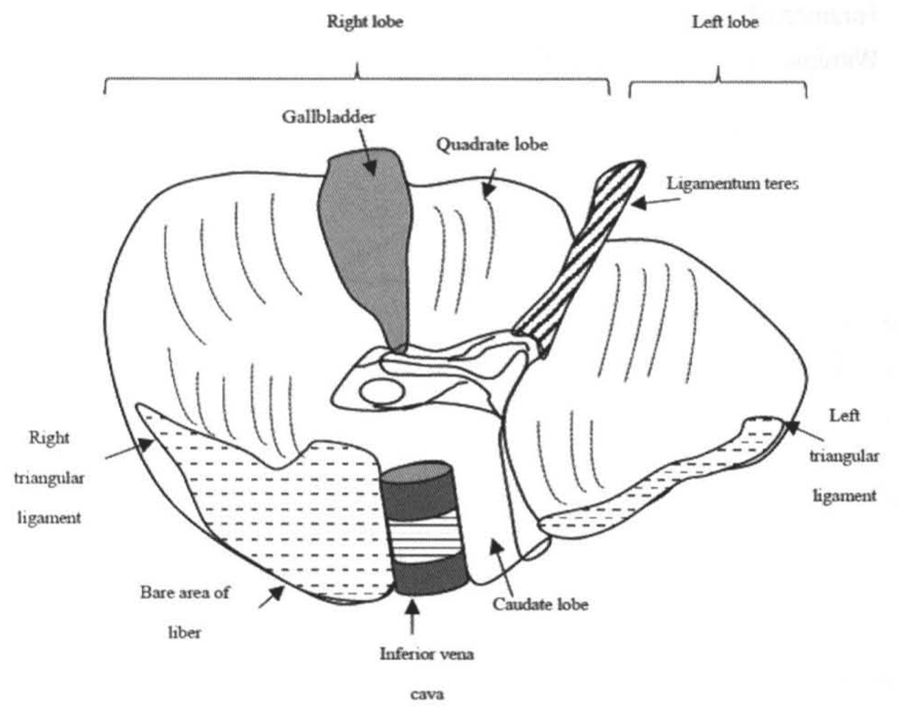
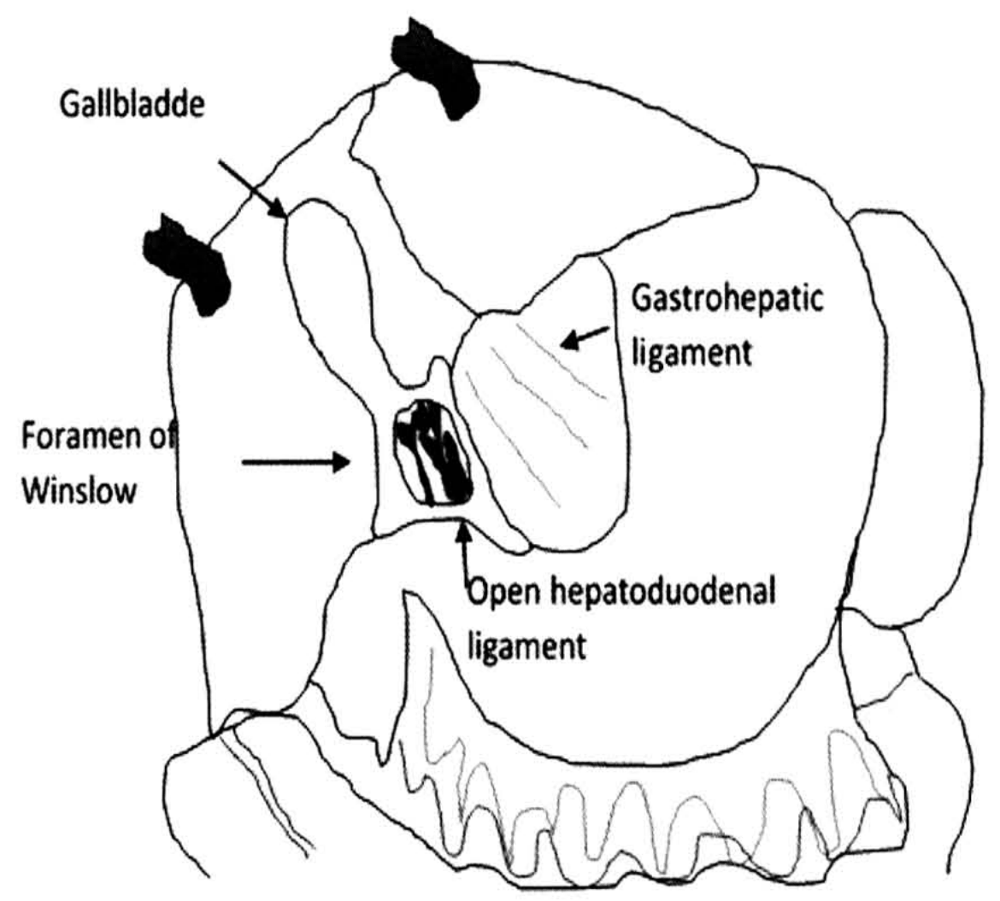
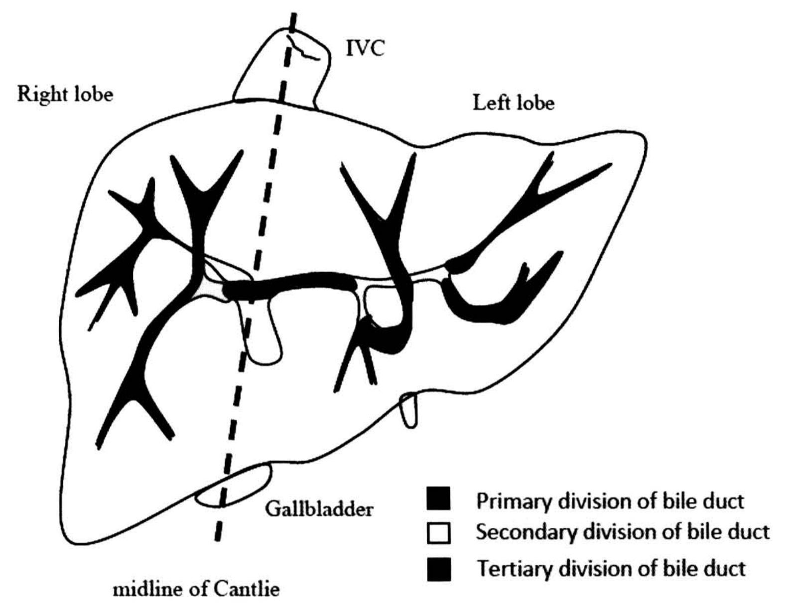
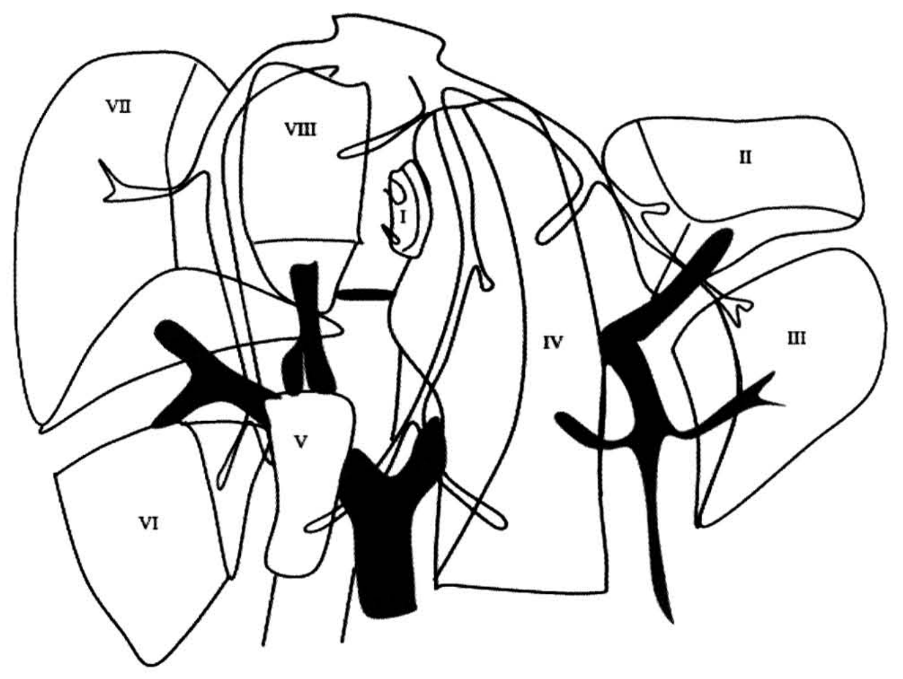
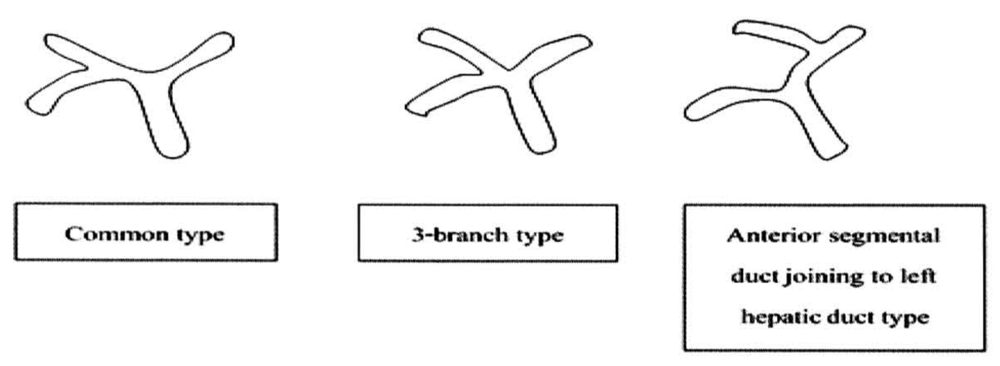
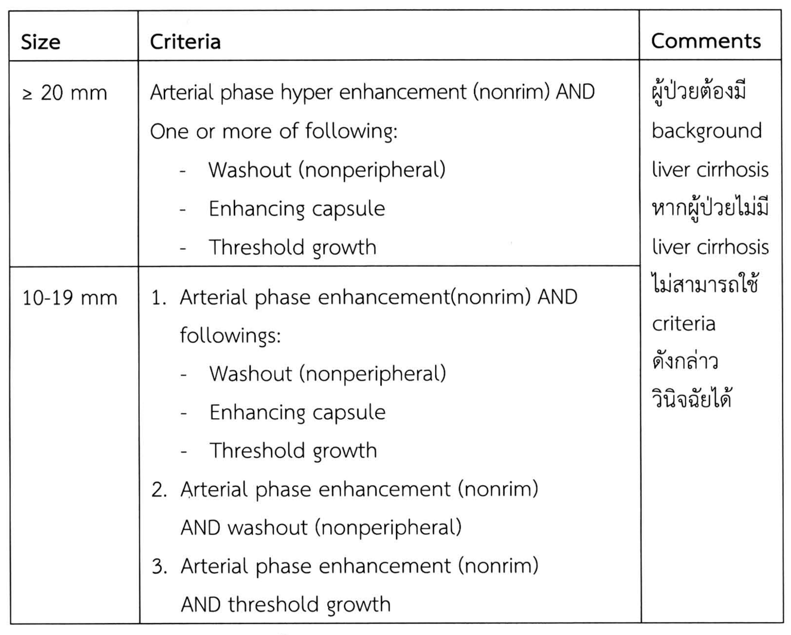
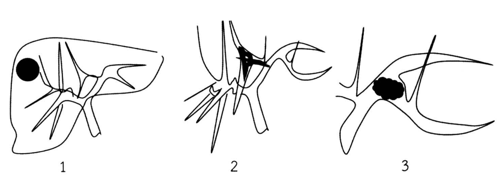

# ตับ (Liver)

## Contents of this file
- บทนำ (p.444)
- กายวิภาค (p.444)
- Segmental liver anatomy (p.446)
- หน้าที่ของตับ (p.450)
- Liver function test (p.453)
  - การตรวจอื่นๆ ได้แก่ (p.455)
- การตรวจทางรังสีวิทยา (p.456)
- การติดเชื้อของตับ (Liver infection/ abscess) (p.459)
  - *ฝีในตับที่เกิดจากเชื้อแบคทีเรีย (pyogenic liver abscess)* (p.459)
  - *ฝีในตับที่เกิดจากเชื้ออะมีบา (Amebic liver abscess)* (p.461)
- เนื้องอกของตับ (p.463)
- Liver cyst (p.463)
- 1. Retention cyst แบ่งตามลักษณะของซีสต์ได้เป็น 2 อย่าง คือ (p.463)
  - 1.1 Solitary cyst (p.463)
  - 1.2 Polycystic liver disease (p.463)
- 2. Hydatid Cyst (p.464)
- 3. Neoplastic cyst/ Biliary cystadenoma (p.465)
- Benign liver tumor (p.466)
- 1. Adenoma (p.466)
- 2. Focal nodular hyperplasia (FNH) (p.466)
- 3. Hemangioma (p.467)
- Malignant liver tumor (p.467)
- 1. Primary malignant neoplasm (p.468)
  - *Hepatocellular carcinoma* (p.468)
  - *Intrahepatic cholangiocarcinoma* (p.472)
    - Classification and mode of spreading (p.473)
      - Mass-forming (p.473)
      - Periductal infiltrating (p.474)
      - Intraductal growth (p.474)
    - *อาการ/ อาการแสดง* (p.474)
    - *การวินิจฉัย* (p.475)
      - Laboratory test (p.475)
      - Imaging finding (p.475)
        - *<u>ultrasound</u>* (p.475)
        - *<u>CT scan (triple phase)</u>* (p.475)
    - *การรักษา* (p.476)
      - Hepatic resection (p.476)
      - *Adjuvant therapy* (p.476)
- 2. Metastatic neoplasms (p.476)
  - *มะเร็งลำไส้ใหญ่ที่แพร่กระจายมาที่ตับ (colorectal liver metastasis)* (p.477)
  - *Neuroendocrine metastases* (p.477)
- เอกสารอ้างอิง (p.478)

<!-- p.443 (printed none) -->
**ตับ**

**Liver**

เอธยา วรสิทธา

<!-- p.444 (printed 430) -->
**ตับ**

**Liver**

เอธยา วรสิทธา

## บทนำ

ตับเป็นอวัยวะที่มีขนาดใหญ่ที่สุดในช่องท้อง และมีเลือดมาเลี้ยงถึง 2 ระบบซึ่งแตกต่างจากอวัยวะอื่นๆ ในช่องท้อง นอกจากนี้ตับยังมีหน้าที่ต่างๆ มากมาย โดยเฉพาะกระบวนการ metabolism ของร่างกาย โรคที่เกิดขึ้นภายในเนื้อตับ นอกจากจะส่งผลกระทบต่อการทำงานของตับแล้วยังมีผลกระทบต่ออวัยวะอื่นๆ รวมไปถึงความผิดปกติของกระบวนการ metabolism ของร่างกายด้วย ในที่นี้จะกล่าวถึงโรคตับที่เกี่ยวข้องกับทางศัลยกรรม

## กายวิภาค1, 2

ตับเป็นอวัยวะ (solid organ) ที่มีขนาดใหญ่ที่สุดในช่องท้อง มีน้ำหนักประมาณ 1.5 กิโลกรัมในผู้ใหญ่ ตับวางอยู่บริเวณช่องท้องด้านขวาบน และถูกปกป้องโดยผนังทรวงอก ตำแหน่งโดยทั่วไปตับอยู่บริเวณใต้ราวนมขวาประมาณช่องซี่โครงที่ 4 ลงมาถึงขอบของกระดูกซี่โครง (costal margin) บริเวณตรงกลางของ midclavicular line ตับถูกห่อหุ้มโดยเยื่อบุช่องท้องที่เรียกว่า Glisson’s capsule ด้านบนของตับติดกับกะบังลมซ้ายและขาว ขณะที่ด้านล่างของตับติดกับกระเพาะอาหาร, ลำไส้เล็กส่วนต้นและลำไส้ใหญ่ สำหรับ Glisson’s capsule นั้นจะห่อหุ้มโครงสร้างของ portal triad (ประกอบด้วยหลอดเลือดแดง hepatic, หลอดเลือดดำ portal และท่อน้ำดี) ขณะที่เข้าสู่ตับ บริเวณด้านหลังของตับจะติดกับไตขวาและต่อมหมวกไตข้างขวา ตับส่วนกลีบซ้ายที่เรียก lateral segment ถูกแยกออกจากตับส่วนที่เหลือ โดย falciform ligament และ ligamentum teres hepatis หรือ round liganment ซึ่งเป็นส่วน vestigial remnant ของหลอดเลือดดำ umbilical และเป็นตำแหน่งภายนอกที่ใช้ในการหาหลอดเลือดดำ portal ข้างซ้าย

<!-- p.445 (printed 431) -->
นอกจากนี้ยังมี vestigial remnant ของ ductus venosus ที่เรียก ligamentum venosum (Arantius’ ligament) ที่ยึดระหว่างหลอดเลือดดำ portal ข้างซ้ายไปสู่หลอดเลือดดำ hepatic ข้างซ้ายซึ่งเป็นตำแหน่งที่แยก lateral segment ออกจาก caudate lobe (รูปที่ 1 )

> **Caption (verbatim):** **รูปที่ 1** Anatomy: inferior surface of the liver with classic functional anatomy
> **Text in image (verbatim):** Right lobe · Left lobe · Gallbladder · Quadrate lobe · Ligamentum teres · Right triangular ligament · Left triangular ligament · Bare area of liber · Inferior vena cava · Caudate lobe
> **Description:** Black-and-white line drawing of the inferior (visceral) surface of the liver. Two brackets across the top divide the organ into "Right lobe" (wide bracket over the larger left-hand part of the drawing) and "Left lobe" (narrow bracket over the right-hand part). The gallbladder is drawn as a grey-shaded elongated sac on the undersurface of the right lobe, with an arrow labelled "Gallbladder". Just to its right, an arrow labelled "Quadrate lobe" points to the area between the gallbladder and the ligamentum teres. A striped cord labelled "Ligamentum teres" runs obliquely from the free edge down to the hilum, separating the quadrate lobe from the left lobe. At the hilum there is a structure with an oval opening (portal structures). Along the posterior edge, a dash-hatched area on the right is labelled "Bare area of liber" (arrow from below) and its lateral edge "Right triangular ligament" (arrow from the left); a dash-hatched strip on the far right edge of the left lobe is labelled "Left triangular ligament". A cylindrical vessel with dark-shaded ends and horizontal stripes, labelled "Inferior vena cava" (arrow from below), sits posteriorly between the bare area and the "Caudate lobe", which is indicated by an arrow pointing to the small area immediately to the right of the IVC in the drawing, below the hilum.
> **Identifiers in image:** none

ส่วนถุงน้ำดีอยู่บริเวณทางด้านล่างของตับ โดยตับถูกยึดติดกับช่องท้องด้วย triangular ligament ทั้งซ้ายและขวา (รูปที่ 2 ) ถัดจากบริเวณถุงน้ำดีมาทางซ้ายจะมี hepatoduodenal ligament หรือ porta hepatis ซึ่งประกอบไปด้วย hepatic artery, portal vein และ common bile duct ด้านหลังของ hepatoduodenal ligament ทางด้านขวามีช่องที่สามารผ่านเข้าไปใน lesser sac ได้ เรียกช่องนี้ว่า foramen of Winslow หรือ epiploic foramen ซึ่งเราสามารถทำการหนีบ hepatoduodenal ligament ผ่านทางช่องนี้ด้วยมือหรือ vascular clamp เพื่อลดเลือดที่เข้าไปเลี้ยงตับ (inflow control) ขณะทำผ่าตัดตับหรือในการห้ามเลือดที่ออกจากตับในเคส trauma เรียกวิธีนี้ว่า Pringle maneuver นอกจากนี้ บริเวณตับทางด้านซ้ายยังถูกยึด โดย gastrohepatic omentum ซึ่งมีแขนงของ hepatic จากเส้นประสาท vagus และอาจจะมีหลอดเลือดแดง hepatic ข้างซ้ายร่วมอยู่ได้1

<!-- p.446 (printed 432) -->

> **Caption (verbatim):** **รูปที่ 2** in situ liver hilar anatomy
> **Text in image (verbatim):** Gallbladde · Gastrohepatic ligament · Foramen of Winslow · Open hepatoduodenal ligament
> **Description:** Simple black-and-white line drawing of the liver in situ, viewed from below/front with the liver edge retracted upward by two black retractor tips at the top. An arrow labelled "Gallbladde" points to an elongated oval structure (the gallbladder) on the left side of the drawing. In the centre, an arrow labelled "Foramen of Winslow" (from the left) points to the opening just left of a small oval containing dark contents (the opened hepatoduodenal ligament); an arrow labelled "Open hepatoduodenal ligament" points up to the lower edge of this oval. To the right of it, a lightly hatched sheet is labelled "Gastrohepatic ligament" (arrow from the right). The stomach occupies the right-hand portion of the drawing, and wavy loops along the bottom represent bowel/omentum below.
> **Identifiers in image:** none

## Segmental liver anatomy

- <u>Classic functional anatomy : definition of the sectors and segments</u>

ในปลายศตวรรษที่ 19 ตับแบ่งออกเป็นตับกลีบซ้าย, กลีบขวา, quadrate lobe และ caudate lobe (รูปที่ 1)3 แต่จากความรู้พื้นฐานทาง embryology และลักษณะกายวิภาคของหลอดเลือดทำให้มีการศึกษามากมายเกิดขึ้นในช่วงศตวรรษที่ 20 เช่น Cantlie พบว่าตับแบ่งออกเป็น 2 ส่วน โดยอาศัยเส้นแบ่งที่ลากจากฐานของถุงน้ำดี ไปยัง fossa ของ inferior vena cava (IVC)4 หรือการศึกษาของ Healey และ Schroy ที่อาศัยกายวิภาคของท่อน้ำดี โดยที่ท่อน้ำดีด้านขวาและด้านซ้ายเลี้ยงเนื้อตับบริเวณเดียวกันกับ portal vein ข้างขวาและซ้ายทำให้ตับถูกแบ่งออกเป็นตับซีก (lobe) ขวา และซ้าย โดย lobar fissure ซึ่งตรงกับ midline of Cantlie นอกจากนี้ท่อน้ำดีด้านขวาจะแบ่งย่อย (secondary division) ออกเป็น anterior และ posterior segment ที่ right segmental fissure และท่อน้ำดีด้านซ้ายจะแบ่งย่อยเป็น medial และ lateral segment ที่ left segmental fissure ซึ่งตรงกับบริเวณของ umbilical fissure สำหรับ third division ของท่อน้ำดีจะรับน้ำดีจากส่วนของตับที่เรียกว่า area3 (รูปที่ 3)

<!-- p.447 (printed 433) -->

> **Caption (verbatim):** **รูปที่ 3** Healey and Schroy classification : bile duct division
> **Text in image (verbatim):** IVC · Right lobe · Left lobe · Gallbladder · midline of Cantlie · Primary division of bile duct · Secondary division of bile duct · Tertiary division of bile duct
> **Description:** Black-and-white line drawing of the liver seen from the front, with the IVC drawn as a short tube emerging from the top border. A thick dashed line labelled "midline of Cantlie" runs obliquely from the IVC at the top down through the gallbladder (a small oval at the inferior border, labelled "Gallbladder"), dividing the liver into "Right lobe" (left side of the drawing) and "Left lobe" (right side of the drawing). The intrahepatic bile ducts are drawn as a branching tree: a thick black horizontal trunk near the hilum, with outlined (white) connecting segments and thick black branching ducts radiating into each lobe — two main branching systems in the right lobe and several branches in the left lobe, including one curving toward the left lateral portion. A small outlined structure hangs below the hilum and another small loop at the inferior border of the left lobe. Legend at lower right: black square = "Primary division of bile duct"; white (outlined) square = "Secondary division of bile duct"; black square = "Tertiary division of bile duct" (primary and tertiary symbols are both printed solid black).
> **Identifiers in image:** none

อย่างไรก็ดีการศึกษากายวิภาคของตับ โดย Couinaud ซึ่งอาศัยการเรียงตัวของ portal vein เป็นที่ยอมรับกันอย่างแพร่หลาย ซึ่งในบทความนี้ segment ของตับหมายความถึง segment ที่ถูกแบ่งโดย third division ของ portal vein ตาม Couinaud classification3, 4

Couinaud ได้แบ่งตับออกเป็นหน่วยย่อยต่างๆ โดยอาศัยการแบ่งตัวของ portal vein (portal segmentation) โดยที่ portal vein จะอยู่บริเวณส่วนกลางของเนื้อตับที่ถูกแบ่ง ในขณะที่ hepatic vein จะอยู่ที่บริเวณขอบเขตของเนื้อตับที่ถูกแบ่งซึ่งเรียกว่า portal fissures (scissurae) primary division ของ portal vein จะแบ่งตับออกเป็นตับกลีบขวาและซ้าย (right and left hemiliver) โดยแนว (plane) ที่ใช้ในการแบ่งคือ main portal fissure ซึ่งจะมี middle hepatic vein วางตัวอยู่ secondary division ของ portal vein ข้างขวาจะแบ่งเป็น anterior และ posterior portal vein ซึ่งแบ่งตับกลีบขวาออกเป็น anterior sector และ posterior sector โดยอาศัย right portal fissure ซึ่งมี right hepatic vein วางตัวอยู่ ขณะที่ secondary division ของ portal vein ข้างซ้ายจะแบ่งเป็น umbilical portion ของ portal vein และแขนงที่ไปเลี้ยงตับส่วน posterolateral part (segment II) โดยอาศัย left portal fissure ซึ่งมี left hepatic vein วางตัวอยู่ ซึ่งแตกต่างจาก secondary division ที่แบ่งโดย Healey และ

<!-- p.448 (printed 434) -->
Schroy tertiary division ของตับด้านขวาจะแบ่งเป็น segment โดย anterior sector ประกอบด้วย segment V, VIII posterior sector ประกอบด้วย segment VI, VII ตับด้านซ้ายจะแบ่งเป็น segment II, III และ IV ตามลำดับ ส่วนของ caudate lobe เรียกเป็น segment I3, 4 (รูปที่ 4)

> **Caption (verbatim):** **รูปที่ 4** Liver segmentation
> **Text in image (verbatim):** VII · VIII · I · II · IV · III · V · VI
> **Description:** Black-and-white "exploded" line drawing of the liver showing the Couinaud segments as separated blocks, each labelled with a Roman numeral, together with an unlabelled solid black branching vessel tree and unlabelled outlined (white) tubular branches. On the left (right liver) are segment VII (upper left), segment VI (lower left), segment VIII (upper centre-left) and segment V (lower centre-left, a narrow block). Segment I (caudate) is a small oval near the centre top, next to the IVC region. Segment IV is a tall central block, and on the right (left liver) are segment II (upper right) and segment III (lower right). The black trunk rises from the bottom centre and divides into a branch with black sub-branches toward segments V–VIII and a branch curving to the right with sub-branches toward segments II, III and IV. The outlined tubular branches run between the segments up toward the top of the drawing.
> **Identifiers in image:** none

<u>Principle variations of the portal pedicle</u>

Portal pedicle ประกอบด้วยโครงสร้าง 3 อย่าง ได้แก่ portal vein, hepatic artery และ bile duct เรียงตัวอยู่ภายใน fibrous sheath ที่เรียกว่า Glisson sheath สำหรับ portal vein โดยเฉพาะข้างซ้ายมี variation น้อยมาก4, 5 อย่างไรก็ดี portal vein ข้างขวามี variation มากกว่า4 portal vein branching ที่บริเวณ hilum แบ่งออกได้เป็น 3 ประเภทใหญ่ๆ 4-6 คือ common type พบประมาณ 74-84%, three-branch type พบ 8-12% และ left-branch type พบ 9-17% (รูปที่ 5)

<!-- p.449 (printed 435) -->

> **Caption (verbatim):** **รูปที่ 5** Portal vein variation
> **Text in image (verbatim):** Common type · 3-branch type · Anterior segmental duct joining to left hepatic duct type
> **Description:** Three simple outline drawings of a branching tubular vessel at the hilum, side by side, each with a boxed label beneath. Left ("Common type"): a single trunk from below divides into two branches (a Y shape). Middle ("3-branch type"): the trunk divides at one point into three branches (trifurcation). Right ("Anterior segmental duct joining to left hepatic duct type"): the trunk divides into two branches, and one upper branch arises from the left-going branch rather than at the main bifurcation.
> **Identifiers in image:** none

สำหรับ bile duct นั้น hepatic duct ซ้ายและขวามารวมกันที่บริเวณ hilum เป็นชนิดที่พบบ่อยที่สุดพบประมาณ 53-72% variation ของ bile duct ที่เกิดขึ้นมีตั้งแต่ posterior sector duct รวมกับ left hepatic duct (9-27%), three-branch type (7-14%) และ anterior sector duct รวมกับ left hepatic duct 6-9%7

hepatic artery มี variation ค่อนข้างมาก (33-45%)5 ที่พบบ่อย คือ left hepatic artery มาจาก left gastric artery พบ 25% และ right hepatic artery มาจาก superior mesenteric artery (SMA) พบถึง 17%6

Lymphatic drainage ของตับ เริ่มจาก lymph ที่สร้างจากตับระบายไปยัง perisinusoidal space of Disse และ periportal clefts of Mall ไปยังทางเดินน้ำเหลืองที่ใหญ่ขึ้นและเข้าสู่ hilar cystic duct lymph node (Calot’s triangle node) ลงมายัง common bile duct, hepatic artery, retropancreatic และ celiac lymph node ส่วนทางด้านบนจะมีการระบายน้ำเหลืองไปทาง cardiophrenic nodes ซึ่งทางเดินของน้ำเหลืองเหล่านี้เป็นแหล่งที่อาจมีการแพร่กระจายของมะเร็งในตับได้ โดยเฉพาะมะเร็งท่อน้ำดี

**ลักษณะทาง microscopic ของตับ**2 ประกอบขึ้นจากหน่วยเล็กๆ รูป 6 เหลี่ยม (acinar unit) คือ hepatic lobules แต่ละ lobule ประกอบด้วย hepatocyte ซึ่งเรียงตัวกันเป็น cord และ sinusoid ที่ล้อมรอบ central hepatic venule เอาไว้ โดยที่มี afferent portal venule hepatic arteriole และ bile ductile วิ่งขนานเข้าไปกับแนวทางเซลล์ตับ

<!-- p.450 (printed 436) -->
เซลล์ของตับมีหลายชนิด ได้แก่

1. Hepatocyte ทำหน้าที่เกี่ยวกับ metabolism ที่สำคัญและยังทำหน้าที่หลั่งสารต่างๆ hepatocyte ยังมีความสามารถที่จะงอกได้อย่างรวดเร็วหลังจากตัดตับออกไปบางส่วน หรือเซลล์ตับถูกทำลายจากสาเหตุใดก็ตาม โดยอาศัยวิธี hypertrophy และ hyperplasia

2. Endothelial cell ใน sinusoid ทำหน้าที่ช่วยในการกรองสารต่างๆ

3. Kupffer’s cell เป็น macrophage ที่อยู่ใน sinusoid เป็นแหล่ง reticuloendothelial (RE) system ที่สำคัญของร่างกาย

4. เซลล์อื่นๆ เช่น lipocyte, fibroblast, neuron และ bile duct cell

ส่วนริมของ hepatic lobule ที่ชนกันเรียกว่า portal triad ประกอบด้วยแขนงของ portal vein, hepatic artery (ให้เลือดไหลผ่าน hepatocyte และ sinusoid ไปยัง central hepatic vein) และแขนงของ bile ductule (น้ำดีถูกสร้างจาก hepatocyte ไหลออกลงสู่ bile canaliculi, bile ductile และ bile duct ตามลำดับ)

## หน้าที่ของตับ1, 8

ตับเป็นอวัยวะที่ทำงานร่วมกับระบบอื่นๆ โดยเกี่ยวข้องกับ สรีรวิทยา-กายวิภาค ดังต่อไปนี้

1. ระบบไหลเวียน (circulatory system)

ตับเป็นอวัยวะที่มีเลือดมาเลี้ยง 2 ระบบ คือ hepatic artery (25%) และ portal vein (75%) ซึ่งเลือดจาก portal vein นี้เองที่นำสารอาหารที่ได้จากการดูดซึมของลำไส้เล็กมาใช้ในกระบวนการ metabolism ของร่างกาย นอกจากนี้หลอดเลือดที่นำเลือดไปเลี้ยงสู่ตับยังมีเส้นประสาทและหลอดน้ำเหลืองวิ่งคู่กันไปด้วย ปริมาณของเลือดที่มาเลี้ยงตับถูกควบคุมด้วยระบบ autoregulation โดยมี sinusoid เป็นตัว primary regulators จากการรับรู้ปริมาณเลือดที่เพิ่มขึ้นหรือลดลงจากการหดและขยายตัวของ endothelial cells, Kupffer cells และ hepatic stellate cells นอกจากนี้ endogenous factor ต่างๆ เช่น glucagon, histamine, bradykinine, prostaglandins, nitric oxide และ gut hormones หลายชนิดมีส่วนในการควบคุมปริมาณเลือดที่มาที่ตับด้วยเช่นกัน

<!-- p.451 (printed 437) -->
เลือดที่เข้าไปยังตับจากสองระบบจะมีการปรับขึ้นลงเพื่อทดแทนกัน เช่น หากปริมาณเลือดที่เข้าทาง hepatic artery เพิ่มขึ้น เลือดที่เข้าทาง portal vein ก็จะลดลง อย่างไรก็ตามหาก portal vein อุดตัน ปริมาณเลือดที่เข้าไปทาง hepatic artery ไม่สามารถเพิ่มขึ้นได้มากพอที่จะเลี้ยงเนื้อตับ ทำให้เกิดตับส่วนที่เลี้ยงด้วย portal vein ที่อุดตันนั้นฝ่อไป

2. ทางเดินน้ำดี (Biliary passage)

ทางเดินน้ำดีนี้เริ่มจาก Golgi apparatus ที่อยู่ติดกับ microvilli ของท่อน้ำดีขนาดเล็ก (bile canaliculi) และมาสิ้นสุดที่ท่อน้ำดีทำหน้าที่เป็นช่องทางออกของสารต่างๆ ที่ถูกสร้างขึ้นที่ตับรวมไปถึง bilirubin, cholesterol และยาที่ถูกทำลาย ตับสร้างน้ำดีออกมาประมาณ 1500 mL ต่อวัน โดยประมาณ 80% หลั่งออกจาก hepatocytes ถุงน้ำดีทำหน้าที่เป็น reservoir ของน้ำดี และเป็นที่พักเก็บน้ำดีในระหว่างที่อดอาหาร (fasting state) ถุงน้ำดีจะดูดซึมน้ำกลับ ทำให้น้ำดีเข้มข้นขึ้นและหลั่งเมือก (mucin) ออกมาด้วย หลังจากถูกกระตุ้นด้วยอาหาร ร่างกายจะหลั่ง cholecystokinin ทำให้ถุงน้ำดีบีบตัว และ sphincter of Oddi คลายตัวหลั่งน้ำดีลงไปสู่ลำไส้เล็กส่วนต้น

Primary bile salts ที่สร้างจากตับ ได้แก่ cholic acid และ chenodeoxycholic acid เมื่อถูกหลั่งลงมาในลำไส้ จะถูกแบคทีเรียในลำไส้ย่อยกลายเป็น secondary bile acids (deoxycholic acid และ lithocolic acid) 90% ของ Bile acid จะถูกดูดซึมกลับเข้าสู่ลำไส้เล็ก เพื่อกลับไปสู่ portal venous system อีกครั้ง โดยมีการดูดซึมแบบ passive ที่ jejunum และ active ที่ ileum Bile acid ที่ถูกดูดซึมกลับไปจะสกัดที่ตับและหลั่งออกมาสู่ทางเดินน้ำดีอีกครั้ง Bile acids ที่ไม่ถูกดูดซึมกลับจะขับออกมาทางอุจจาระ เรียกการดูดซึมกลับของ bile acid นี้ว่า enterohepatic circulation ซึ่งมีประโยชน์ในการกำจัด cholesterol ส่วนเกิน และดูดกลับเฉพาะ bile salt มาใช้ใหม่ นอกจากนี้ bile salts ยังมีบทบาทในการดูดซึมไขมันในอาหาร วิตามินและยาที่ละลายในไขมัน

3. เกี่ยวข้องกับ bilirubin metabolism

Bilirubin เกิดจากการทำลายของ heme จากเม็ดเลือดแดง 80% จาก heme-containing enzymes 20% Bilirubin ในกระแสเลือดจะจับกับ albumin เป็น bilirubin-albumin complex และเข้าสู่ sinusoid ของตับ และแยกจาก albumin ที่ space of Disse Bilirubin อิสระจะดูดซึมเข้าไปในเซลล์ hepatocyte และ conjugate กับ gulcuronic acid กลายเป็น conjugated bilirubin ซึ่งจะหลั่งออกไปทาง bile canalicular และออกสู่

<!-- p.452 (printed 438) -->
ลำไส้ เมื่อถูก decojugate จาก bacteria ในลำไส้ กลายเป็น urobilinogen จะถูกดูดซึมกลับเข้าไปทาง enterohepatic circulation ส่วนน้อยของ urobilinogen จะถูกขับออกทางปัสสาวะ

4. ระบบ reticuloendothelial system (RE system)

60% ของ cell ที่พบในเนื้อตับเป็นส่วนประกอบที่สำคัญของ RE system ซึ่งประกอบด้วย Kupffer cell และ endothelial cell ทำลายเชื้อแบคทีเรีย โดยเฉพาะเชื้อที่มาในหลอดเลือดดำ portal

5. เกี่ยวข้องกับ Metabolism ของคาร์โบไฮเดรต

ตับเป็นแหล่งสะสม glucose และ glycogen ที่สำคัญ และมีหน้าที่ในการเพิ่มปริมาณน้ำตาลในเลือดผ่านกระบวนการ gluconeogenesis และ glycogenolysis

6. เกี่ยวข้องกับ Metaboliasm ของไขมัน

ตับเป็นแหล่งสร้าง fatty acid, triglycerides เพื่อสะสมหรือส่งต่อ รวมทั้งเป็นแหล่งสลายไขมันด้วย β-oxidation เพื่อให้ได้ ATP และ ketone bodies เนื่องจากตับเป็นแหล่ง metabolism ที่สำคัญของไขมันนี้เอง ที่ทำให้การเกิดการสะสมของไขมันที่ตับ ซึ่งหากมากจนเกินไปทำให้เกิดภาวะ steatosis และอาจเกิดการอักเสบเรื้อรัง เรียกว่า steatohepatitis ซึ่งมีความเสี่ยงในการเกิดเป็นตับแข็งต่อไปได้ ภาวะที่ทำให้เสี่ยงเกิด hepatic steatosis ได้แก่ เบาหวาน, การใช้สเตียรอยด์, การอดอาหาร, โรคอ้วน, แอลกอฮอล์ และการให้ยาเคมีบำบัดบางชนิด

7. เกี่ยวข้องกับ Metabolism ของโปรตีน

ตับเกี่ยวข้องกับการเก็บสะสมและนำโปรตีนไปเปลี่ยนเป็นพลังงาน ซึ่งจะได้ amnonia, glutamine, glutamate และ aspartate เป็นผลผลิต ไนโตรเจนที่เหลือจะผ่าน urea cycle ในตับ และขับออกในปัสสาวะ นอกจากนี้ ตับยังมีหน้าที่จัดการกับกรดอะมิโนส่วนเกินโดยเปลี่ยนเป็นน้ำตาล, ketone bodies หรือไขมัน

แม้ว่ากรดอะมิโนส่วนใหญ่จะมี metabolism ในตับ แต่กลุ่มที่เป็น branch-chain amino acid จะถูก catabolize ที่กล้ามเนื้อเป็นหลัก ซึ่งน่าจะใช้ได้อย่างปลอดภัยในกลุ่มผู้ป่วยที่มีการทำงานของตับผิดปกติ

<!-- p.453 (printed 439) -->
นอกจากนี้ตับยังมีหน้าที่หลักในการสร้างโปรตีนที่ทำหน้าที่ต่างๆ ในร่างกาย ได้แก่ สร้าง albumin, โปรตีนที่เกี่ยวข้องกับการขนส่งทองแดงและเหล็ก, proinflammatory cytokines ต่างๆ เป็นต้น

8. เกี่ยวข้องกับ metabolism ของวิตามินที่ละลายในไขมัน A, D, E, K โดยช่วยให้วิตามินเหล่านี้ดูดซึมมาพร้อมกับ bile acides และยังเป็นแหล่งเก็บสะสมวิตามิน A อีกด้วย ส่วนวิตามิน B ตับมีส่วนในการเปลี่ยนวิตามินเหล่านี้เป็น active coenzymes, เปลี่ยนเป็น storage metabolites และใช้ในกระบวนการ enterohepatic circulation

9. Coagulation

ตับมีบทบาทสำคัญในการสร้าง coagulation factor, fibrinolytic components รวมทั้ง plasma regulatory proteins of coagulation และ fibrinolysis นอกจากนี้ยังมีส่วนในการดูดซึมวิตามิน K ซึ่งเป็นสารที่สำคัญต่อการสร้าง coaulation factor ต่างๆ ได้แก่ factor II, VII, IX และ X ในผู้ป่วยที่เป็นโรคตับ นอกจากจะมีเกล็ดเลือดต่ำจากม้ามโตแล้ว มักจะมี vitamin K deficiency, coagulopathy และเสี่ยงต่อการเกิด hypercoagulation ด้วย จากการขาดโปรตีนในกลุ่ม fibrinolytic components

10. เกี่ยวข้องกับ metabolism ของยาและสารพิษต่างๆ โดยผ่านทาง Phase I reaction ด้วย cytochrome P450 system และ phase II reactions เพื่อลดความเป็นพิษ หรือเปลี่ยนสารดังกล่าวเป็น inactive metabolite

11. Regeneration

ตับมีความสามารถพิเศษอย่างหนึ่งคือ สามารถเพิ่มปริมาตรขึ้นมาได้เมื่อจำเป็น เช่น หลังการผ่าตัดตับ หรือเกิด toxic liver injury ความสามารถในการเพิ่มปริมาตรดังกล่าวเป็น hyperplastic response ของเซลล์ทุกชนิดในตับ

## Liver function test1, 2, 8

เป็นการตรวจดูความผิดปกติของการทำงานของตับว่ามีมากน้อยเพียงใด โดยไม่สามารถบอกพยาธิสภาพ หรือการทำงานที่เหลืออยู่ (functional reserve) ของตับได้ ไม่มีการตรวจใดชนิดเดียวที่จะบอกได้ถูกต้อง ต้องอาศัยการตรวจหลายอย่าง บางครั้งจำเป็นต้องตรวจซ้ำ การตรวจมีทั้งการให้ผลบวก และผลลบเทียมประมาณ 10%

<!-- p.454 (printed 440) -->
1. โปรตีน

ตับเป็นแหล่งสร้างโปรตีนที่สำคัญของร่างกาย ได้แก่ albumin, fibrinogen, prothrombin และ coagulation factor ต่างๆ ตับเป็นที่เดียวที่สร้าง albumin ถ้าค่า albumin ต่ำลง (น้อยกว่า 2.5g/dl) โดยที่ไม่มีการสูญเสียออกไปทางใดแสดงว่าการทำงานของตับเสียไปมาก อย่างไรก็ตาม ระดับ albumin ไม่ได้เป็นตัวชี้วัดที่ดีของการมี acute hepatic dysfunction เนื่องจาก albumin มีค่าครึ่งชีวิตนานถึง 15-20 วัน และมีปัจจัยอื่นๆ ที่เกี่ยวข้อง เช่น ภาวะทุพโภชนาการ, การทำงานของไต, protein-losing enteropathy หรือการแปรปรวนของระดับฮอร์โมน

2. คาร์โบไฮเดรต และไขมัน

ตับเป็นแหล่งสำคัญในกระบวนการของ glycogenesis, glycogen storage, glycogenolysis และการเปลี่ยน galactose เป็น glucose ดังนั้น ภาวะผิดปกติของโรคตับก็ย่อมส่งผลกระทบต่อกระบวนการเหล่านี้ เช่น ภาวะเบาหวานที่ดีขึ้นในผู้ป่วย hemochromatosis บ่งบอกถึงการมีเนื้องอกเกิดขึ้น, ภาวะน้ำตาลในเลือดต่ำในผู้ป่วยที่มีการทำงานของตับบกพร่องมากๆ

ตับยังมีหน้าที่สร้าง phospholipids, cholesterol และ cholesterol ester ในผู้ป่วยที่มีภาวะโรคตับ (parenchymal disease) จะมีปริมาณของ cholesterol และ cholesterol ester ลดลงในขณะที่ภาวะอุดกั้นของทางเดินน้ำดี จะมี cholesterol เพิ่มขึ้น

3. เอ็นไซม์

เอ็นไซม์ที่ใช้กันมากในการตรวจค้นหาเกี่ยวกับโรคตับ ได้แก่ serum transminase ซึ่งได้แก่ SGOT (AST) และ SGPT (ALT), serum alkaline phosphatase

*Serum transaminase*

SGOT (serum glutamic oxalacetic transaminase) นอกจากจะพบในตับและยังพบได้ในกล้ามเนื้อหัวใจ, กล้ามเนื้อลาย, ไต, ตับอ่อน ในขณะที่ SGPT (serum glutamic pyruric transaminase) จะพบในตับเป็นส่วนใหญ่ อาจจะพบในกล้ามเนื้อหัวใจบ้าง ในภาวะที่มี acute hapatocellular damage จะมีค่าเพิ่มขึ้นทั้ง SGOT และ SGPT ส่วนในภาวะท่อน้ำดีอุดตันค่า transaminase จะไม่เพิ่มขึ้นยกเว้นในรายที่มีเซลล์ตับถูกทำลายร่วมด้วย

<!-- p.455 (printed 441) -->
*Serum alkaline phosphatase*

ค่าที่สูงขึ้นร่วมกับค่า transaminase ที่ไม่เพิ่มขึ้น บ่งชี้ถึงการอุดตันในท่อน้ำดีมากกว่า แต่ค่า alkaline phosphatare ยังสูงขึ้นได้ในภาวะ cholestatic jaundice, hepatitis, ก้อนในเนื้อตับ (space occupying lesions = SOL), infiltrative lesion, granulomatous lesion และ osteoblastic activity 5-nucleotidase, gamma glutamyltransferase แปลผลคล้ายกับค่าของ alkaline phosphatase เพียงแต่ว่าเอ็นไซม์ทั้ง 2 ตัวไม่ได้รับผลมาจากกระดูกหรือลำไส้ ค่าทั้ง 2 ตัวจะเพิ่มขึ้นในรายที่เกิดท่อน้ำดีอุดตัน

4. ปัจจัยการแข็งตัวของเลือด

ในภาวะโรคตับ ทำให้เกิดความผิดปกติของการแข็งตัวของเลือดได้ 2 กลไก คือ ในภาวะท่อน้ำดีอุดตัน (obstructive jaundice) มีการดูดซึมของวิตามิน K ลดลง ทำให้การสร้าง prothrombin ลดลง ในขณะที่ภาวะ hepatocellular dysfunction ตับไม่สามารถสร้าง prothrombin ได้ ดังนั้นถ้าเจาะเลือดค่า prothrombin time (PT) จะพบว่า ในรายที่มีการอุดตันของท่อน้ำดี ค่า PT จะยาวขึ้น แต่จะกลับสู่เป็นค่าปกติเมื่อร่างกายได้รับวิตามิน K ขณะที่ hepatocellular dysfunction ค่า PT ที่ยาวขึ้นจะไม่ตอบสนองต่อการให้วิตามิน K

ในภาวะตับแข็งผู้ป่วยจะมีเลือดออกง่ายผิดปกติ เนื่องมาจากการสร้างปัจจัยการแข็งตัวของเลือดที่ลดลงแล้ว ยังเกิดจากภาวะ fibrinolysis ที่เพิ่มขึ้น เนื่องจากมีการสร้าง fibrinolytic inbibitor ลดลงหรือการกำจัด plasminogen activator ที่ลดลง

### การตรวจอื่นๆ ได้แก่

- alpha-fetoprotein (AFP) ค่าสูงขึ้นมากในมะเร็งตับชนิด hepotocellular carcinoma แต่พบสูงได้บ้างในขณะที่ตับงอก หลังผ่าตัดหรืออุบัติภัย
- serum iron, total iron-binding capacity และ serum ferritin ใน haemochromatosis
- serum copper, urinary copper, serum ceruloplasmin ใน Wilson’s disease
- Alpha-1-antitrypsin ในโรค Alpha-1-antitrypsin deficiency
- Antimitochondrial Ab, antinuclear Ab, anti-smooth muscle Ab และ liver membrane Ab ในโรค primary biliary cirrhosis และ chronic active hepatitis

<!-- p.456 (printed 442) -->
- Dye excretion ได้แก่
  i. Indocyanine green (ICG) clearance เป็นการตรวจ metabolic capacity และ functional hepatic perfusion
  ii. Sulphobromophthalein (bromosulphthalein) clearance เป็นการตรวจ functional hepatic perfusion

ทั้งคู่เป็นการตรวจชนิด quantitative liver function test เนื่องจากการตรวจค่า LFT ธรรมดาอาจให้ผลปกติในคนไข้ที่การทำงานของตับเสียไปมากแล้ว ในทางกลับกันในรายที่ค่า LFT ผิดปกติ คนไข้อาจมีตับที่ยังทำงานได้ค่อนข้างดี การตรวจแบบ quantitative นี้อาศัยหลัก 2 ประการคือ

1. ในการตรวจ synthetic capacity คือ เมื่อเราให้สารตัวใดตัวหนึ่งเข้าไปแล้ววัดค่า substrate ใหม่ที่ถูกสร้างขึ้นมาจากตับ เช่น antipyrine clearance, aminopyrine breath test และ MEGX test เป็นต้น

2. เป็นการตรวจ clearance function ซึ่งขึ้นกับ hepatic perfusion และ metabolic capacity โดยวัดจำนวนสารที่ตับสามารถขับออกจากกระแสโลหิตได้ในหน่วยเวลาหนึ่ง สัมพันธ์กับปริมาณความเข้มข้นของสารนั้นในเลือดที่ไปยังตับ เช่น ICG clearance เป็นต้น

## การตรวจทางรังสีวิทยา

ตับเป็นอวัยวะที่ได้รับการตรวจทางรังสีมากที่สุดในการประเมินความผิดปกติทางช่องขวาด้านบน โดยเฉพาะอย่างยิ่ง การตรวจความผิดปกติของถุงน้ำดี ข้อบ่งชี้ในการตรวจทางรังสีวิทยาของตับ ยังประกอบด้วย การเฝ้าระวังหรือตรวจวินิจฉัยก้อนที่ตับ ซึ่งถือเป็นการตรวจที่สำคัญทั้งในแง่การวินิจฉัยและการประเมินการรักษา นอกจากนี้ การตรวจรังสีวิทยายังช่วยในการประเมินการปลูกถ่ายตับแบบ living donor ด้วย

การตรวจทางรังสีวิทยาที่ใช้ในการตรวจความผิดปกติมีอยู่หลายวิธี โดยมี Sensitivity, invasiveness (including radiation exposure), cost และ availability ดังสรุปในตารางที่ 19

<!-- p.457 (printed 443) -->
**ตารางที่ 1** factors for imaging decisions

| Imaging modality | Sensitivity | Invasiveness | Cost | Availability |
| --- | --- | --- | --- | --- |
| Ultrasonography | +++ | 0 | + | ++++ |
| Nuclear medicine | ++ | + | ++ | ++++ |
| CT | ++++ | ++ | +++ | ++++ |
| MRI | ++++ | 0 | ++++++ | ++ |

1. Ultrasonography

Ultrasound เป็นวิธี non-invasive imaging ที่ทำกันมากที่สุด Ultrasound สามารถแยก cystic ออกจาก solid liver mass ได้ค่อนข้างดี1 อย่างไรก็ดี sensitivity ของ ultrasound ในการตรวจค้นพบ HCC ในผู้ป่วย end stage liver disease มีเพียง 50%10 นอกจากนี้ยังใช้ ultrasound ในการเฝ้าติดตามการเปลี่ยนแปลงขนาดของ benign liver tumor เช่น hemangioma หรือ focal nodular hyperplasia11

ข้อดีของ ultrasound คือ ราคาถูก, มีเครื่องมือใช้กันแพร่หลาย, ผู้ป่วยไม่ได้รับรังสี ข้อจำกัดของ ultrasound คือ เป็น operator dependence, ความลำบากในการ orientation ภาพ, คนไข้อ้วนหรือมีแผลบริเวณช่องท้องด้านขวาบนทำให้การแปลผลและการตรวจเป็นไปด้วยความลำบากยากยิ่งขึ้น9

2. CT scan

ปัจจุบันวิวัฒนาการทางด้านเทคโนโลยีดีขึ้นมาก ทำให้การตรวจด้วย CT scan ถูกพัฒนาขึ้นมาจนเป็น spiral CT scan ซึ่งสามารถตรวจช่องท้องด้านบนภายในเวลา 20-30 วินาที นอกจากนี้การทำ dynamic CT scan (arterial, portal, delayed enhancement phase) ช่วยบ่งบอกถึง etiology ของ liver mass ได้9-12 เช่น เนื้องอกที่มี enhancement ใน arterial phase (focal hypervascular tesion) ได้แก่ hepatocellular carcinoma, hepatic adenoma, focal nodular hyperplasia, hemangioma และ Liver metastasis บางชนิด ลักษณะของ arterial enhancement สามารถบ่งบอกถึงลักษณะของเนื้องอกได้

<!-- p.458 (printed 444) -->
3. MRI

MRI เป็นเครื่องมือในการตรวจที่ดีในการแยก cavernous hemangioma ออกจาก liver tumor อื่นๆ ถึง 95% ของผู้ป่วย นอกจากนี้ MRI ยังตรวจพบ metastatic islet cell, carcinoid, melanoma และ thyroid tumor ได้ดีกว่า CT scan ที่สำคัญในกรณีที่ HCC พบร่วมกับภาวะตับแข็ง ภาวะดังกล่าวนี้ MRI จะตรวจพบเนื้องอกได้ดีกว่า CT scan เพราะสามารถแยก fatty infiltration และ regenerating nodule ได้ดีกว่า11 MRI ยังสามารถแยก cystic fluid ได้ รวมไปถึงบอกได้ว่าเลือดที่ออกเป็น acute, subacute หรือ chronic blood9

4. Liver scintigraphy

Radionuclide scan จะตรวจค้นพบก้อนที่ตับได้ เมื่อเนื้องอกมีขนาดอย่างน้อย 2-2.5 ซม.9, 11 มีเทคนิคของการ scan หลายวิธีที่นิยมทำกัน คือ 99mTc sulfur colloid scan ซึ่งจะถูก uptake โดย Kupffer cell และ radiolabeled RBC scan โดยที่ FNH มีส่วนประกอบของ Kupffer cell ซึ่งก้อนที่ตับอย่างอื่นไม่มี ดังนั้น การทำ sulfur colloid scan จะเห็นร่องรอยของโรคเป็น isointense หรือ hyperintense เมื่อเปรียบเทียบกับเนื้อตับที่อยู่รอบๆ อย่างไรก็ดี 30% ของ FNH ผล scan อาจเป็น hypodense เนื่องจากมี vascular thrombosis หรือ abnormal vascular supply11, 13 สำหรับ radiolabeled RBC scan ใช้ในการวินิจฉัย cavernous hemangioma ยิ่งถ้าใช้ร่วมกับ single photon emission computed tomography (SPECT) จะทำให้มี sensitivity และ specificity ในการตรวจ hemangioma ที่มีขนาดมากกว่า 2 ซม. สูงถึง 90-95%13 RBC scan อาจให้ผลลวงลบได้ถ้ามีพยาธิสภาพ fibrosis หรือ thrombosis ของก้อน13

5. PET scan (Positron Emission Tomography)

การตรวจด้วย PET scan เป็นการตรวจหามะเร็งว่ามีการแพร่กระจายตามส่วนต่างๆ ของร่างกายหรือไม่ หลักการของการตรวจด้วยวิธีนี้คือ เซลล์มะเร็งจะมีการใช้สารอาหาร (ในการตรวจนี้ใช้ 18 F-fluorodeaxyglucose CFDG) มากกว่าเซลล์ปกติ เมื่อฉีด FDG เข้าไปในตัวคนไข้ และทำการ scan ผู้ป่วยทั้งตัวที่ใดของร่างกายที่มีการใช้พลังงานมาก (ซึ่งส่วนใหญ่เป็นเซลล์มะเร็ง) จะมีการดูดซึม FDG เข้าไปในบริเวณนั้นมากจะเห็นบริเวณนั้นเป็น hot area เกิดขึ้น ดังนั้นการตรวจด้วย PET scan จึงถือเป็นการตรวจ metabolic imaging ของก้อนมะเร็ง ปัจจุบันมีการนำ PET scan ร่วมไปกับการทำ CT scan ที่เรียกว่า PET CT scan ทำให้ทราบถึงตำแหน่งของก้อนมะเร็งได้ดี2

<!-- p.459 (printed 445) -->
6. การเจาะก้อนที่ตับ (Biopsy)

การเจาะก้อนที่ตับเพื่อนำมาตรวจทางพยาธิวิทยานั้นสามารถบอกได้ว่าก้อนที่ตับนั้นเป็นอะไร อย่างไรก็ดี วิธีการดังกล่าวค่อนข้าง invasive และมีภาวะแทรกซ้อนได้ เช่น อาการปวด อาการตกเลือดภายในช่องท้อง14, ในรายที่เป็นเนื้อมะเร็ง อาจมีการกระจายของเนื้องอกตามแนวของเข็มที่เจาะได้14 ดังเช่นการศึกษาของ Takamori และคณะ15 ที่พบมีการกระจายของเนื้องอกตามแนวของเข็มที่เจาะในผู้ป่วย Hepatocellular carcinoma สูงถึง 5.1%

นอกจากนี้บางครั้งเซลล์ที่ได้ก็ไม่สามารถแยกโรคได้ โดยเฉพาะอย่างยิ่งการแยกโรค well differentiated hepatocellular carcinoma ออกจากเซลล์ตับที่ปกติ, focal nodular hyperplasia และ hepatic adenoma14, 16

ในปัจจุบันการเจาะก้อนที่ตับตรวจมีความจำเป็นลดลง เนื่องจากการตรวจอาการทางคลินิก ร่วมกับ tumor marker และการตรวจทางรังสีวิทยาอื่นๆ มีความแม่นยำในการวินิจฉัยก้อนที่ตับสูง17 จึงอาจทำในกรณีที่ไม่สามารถวินิจฉัยด้วยวิธีอื่นๆ ได้ ก้อนดังกล่าวไม่สามารถผ่าตัดได้ หรือการได้ผลทางพยาธิวิทยามีผลต่อการตัดสินใจให้การรักษา

## การติดเชื้อของตับ (Liver infection/ abscess)

การเกิดการติดเชื้อที่ตับเกิดขึ้นได้ยากมาก ถึงแม้ว่าจะมีเชื้อแบคทีเรียผ่านไปที่ตับทางหลอดเลือดดำพอร์ตัลก็ตาม ตับเป็นแหล่ง RE system ที่สำคัญของร่างกาย และเป็นด่านที่คอยทำลายเชื้อโรค อย่างไรก็ดีถ้าปริมาณเชื้อโรคที่เข้าสู่ร่างกายมากกว่าความสามารถของตับในการควบคุมก็สามารถทำให้เกิดการติดเชื้อเกิดขึ้นจนเป็นฝีในที่สุด ฝีที่ตับแบ่งได้เป็น 2 กลุ่มใหญ่คือ ฝีในตับที่เกิดขึ้นจากเชื้อแบคทีเรีย (pyogenic liver abscess) และฝีในตับที่เกิดจากเชื้ออะมีบา (amebic liver abscess)2

### *ฝีในตับที่เกิดจากเชื้อแบคทีเรีย (pyogenic liver abscess)*1, 2

ในอดีตฝีในตับชนิดนี้เกิดขึ้นในผู้ป่วยไส้ติ่งอักเสบที่ไม่ได้รับการรักษาจนเกิดภาวะ pylephlebitis ขึ้น (pylephlebitis หมายถึง การอักเสบของหลอดเลือดดำพอร์ตัล) ในปัจจุบันสาเหตุส่วนใหญ่เกิดจาก

- Ascending biliary tract infection พบบ่อยที่สุด อาจเกิดจากนิ่วในท่อน้ำดีร่วม, ท่อน้ำดีตีบตัน, มะเร็งท่อน้ำดี เป็นต้น เชื้อที่พบมักเป็น gram negative (E.coli, Proteus,

<!-- p.460 (printed 446) -->
Klebsiella) Generalized septicemia ผ่านทาง hepatic artery พบรองลงมา เชื้อมักเป็น gram positive cocci (Staphyllococus, Hemolytic streptococcus) เชื้อผ่านทาง portal vein (Pylephlebitis) เช่น เป็นไส้ติ่งอักเสบ ชนิดรุนแรง, diverticulitis เป็นต้น มักเป็นเชื้อ anaerobe (Bacteroides)

- Direct extension เช่น จากหนองใต้กะบังลม, หนองในช่องเยื่อหุ้มปอด, แผลถูกยิงหรือแทงทะลุจากภายนอกจากสะดือ เช่น ในทารกแรกเกิดติดเชื้อมาทาง umbilical vein ซึ่งต่อเข้ากับ left portal vein ไม่ทราบสาเหตุประมาณร้อยละ 20

*อาการ/ อาการแสดง*

- ไข้สูงแบบ picket fence มักจะพบอาการหนาวสั่น, เหงื่อออกมาก, เบื่ออาหาร, คลื่นไส้อาเจียน
- ตรวจร่างกายพบว่าตับโต (30-60%) และมีอาการกดเจ็บที่ตับ (50%)
- อาการตาเหลืองตัวเหลืองขึ้นกับสาเหตุแต่ส่วนใหญ่ไม่ค่อยพบอาการดังกล่าว

*การตรวจทางห้องปฏิบัติการ*

- พบเม็ดเลือดขาวสูง 18,000-20,000 เซลล์/มม.3
- 50% ของผู้ป่วยจะมีภาวะซีด
- เพาะเชื้อจากเลือดขึ้นเพียง 40% ของผู้ป่วย
- ตรวจหน้าที่ของตับจะพบมี alkaline phosphatase ขึ้นสูง แต่ไม่มีความจำเพาะต่อโรค

*การตรวจทางรังสีวิทยา*

- เอกซเรย์พบกะบังลมข้างขวายกสูงและไม่ขยับ, costophrenic angle และ cardioprenic angle ข้างขวาหายไป, ในผู้ป่วยบางรายอาจเห็น air fluid level ได้
- การตรวจด้วยอัลตราซาวน์ จะพบลักษณะฝีเป็นก้อนถุงน้ำ (cystic mass) ที่มีลักษณะเป็น complex septation หลายๆ อัน หรือมีลักษณะของของเหลวเป็นแบบ inhomogeneous fluid characteristic เมื่อตรวจพบก้อนที่มีลักษณะเข้าได้กับฝีในตับ

<!-- p.461 (printed 447) -->
จากอัลตราซาวน์ ด้วยเอกซเรย์คอมพิวเตอร์ของตับ ซึ่งมีความแม่นยำในการตรวจฝีในตับมากกว่า 90% ลักษณะความผิดปกติที่ตรวจพบจากเอกซเรย์คอมพิวเตอร์จะเห็นเป็น complex hypoderse mass ที่มี peripheral enhancement

*การรักษา*

การให้ยาปฏิชีวนะให้ตรงกับเชื้อโดยเจาะดูดหนอง ย้อมดูชนิดของแบคทีเรีย และนำหนองไปเพาะเชื้อโรค เชื้อโรคที่พบบ่อยในฝีในตับชนิดนี้ ได้แก่ E.coli, Klebsiella pneumoniae, anaerobic bacteria การให้ยาฉีดนั้นให้ยานานประมาณ 2 สัปดาห์ร่วมกับรับประทานยาต่อทางปาก 1 เดือน นอกจากการให้ยาปฏิชีวนะแล้วมีความจำเป็นที่จะต้องมีการระบายหนองออก โดยทั่วไปนิยมใช้การใช้เข็มดูดเจาะเอาหนองออก ซึ่งอาจจะใส่ท่อระบายคาไว้ โดยเฉพาะอย่างยิ่งกลุ่มที่มี complex abscess หรือหนองที่มีลักษณะเหนียวข้น ซึ่งการรักษาร่วมกันทั้ง 2 วิธีทำให้มีอัตราความสำเร็จของการรักษาสูงถึง 80-90% ของผู้ป่วย

การรักษาโดยการผ่าตัดระบายหนองออก ทำเมื่อรักษาด้วยวิธีดังกล่าวข้างต้นแล้วไม่ได้ผล หรือมีรอยโรคอื่นในช่องท้องที่ต้องได้รับการผ่าตัดแก้ไข เช่น ในท่อน้ำดี ในบางกรณีถ้าฝีที่เป็นเป็นหลายตำแหน่งในตับข้างใดข้างหนึ่ง อาจจะพิจารณาตัดตับในกรณีที่รักษาด้วยวิธีอื่นแล้วไม่ได้ผล

อัตราตายร้อยละ 7.5-20 ขึ้นกับโรคเดิมที่คนไข้เป็นอยู่ก่อน, อายุมาก, multiple abscess เบาหวาน, immunocompromised host การรักษาด้วยยาปฏิชีวนะเพียงอย่างเดียวมีอัตราตายถึง 50%

อนึ่ง ควรมีการตรวจหาโรคในช่องท้องที่เป็นสาเหตุของการเกิด liver abscess โดยเฉพาะโรคนิ่วในถุงน้ำดี และโรคของลำไส้ใหญ่ เช่น diverticulitis, Crohn’s disease หรือสาเหตุทาง systemic อื่นๆ เช่น subacute bacterial endocarditis, infected indwelling catheters เป็นต้น และให้การรักษาร่วมกัน

### *ฝีในตับที่เกิดจากเชื้ออะมีบา (Amebic liver abscess)*

เกิดจากเชื้อ Entamaeba histolytica ซึ่งปนเปื้อนมาในอาหารพบมากในวัยกลางคนเป็นในผู้ชายมากกว่าผู้หญิง 9 เท่า ในขณะที่ amebic dysentery พบในทั้งสองเพศเท่าๆ กัน

<!-- p.462 (printed 448) -->
กลไกการเกิดโรคนั้นเกิดจากเชื้อเข้าจากลำไส้ใหญ่ผ่านมาทางกระแสเลือดใน portal vein เข้าสู่ตับมักจะเป็นที่บริเวณ upper และ posterior ของตับซีกขวา เชื้ออะมีบาจะเพิ่มจำนวนขึ้น ทำให้เกิด liquefaction necrosis เฉพาะที่ ดังนั้นจึงมักพบฝีก้อนเดียว (ร้อยละ 70-90) ลักษณะหนองเป็นสีกะปิ (anchovy paste) ซึ่งเกิดจากเซลล์ตับที่ตายผสมกับเม็ดเลือดขาวและเม็ดเลือดแดง ในบางรายหนองมีสีเขียวเนื่องจากมีน้ำดีปน ประมาณ 50% จะมีเชื้อแบคทีเรียปนเป็นกลุ่ม Staphylococci, Streptococci และ E.coli อาจพบตัวอะมีบาที่ผนังของโพรงฝีได้ ผนังของโพรงฝีจะบางและมี granulation แต่ไม่มี fibrosis

*อาการ/ อาการแสดง :*

- ไข้ แต่ไม่สูงเท่าในพวกฝี pyogenic ยกเว้นมีการติดเชื้อแบคทีเรียร่วมด้วย
- เจ็บบริเวณตับ อาจมีปวดร้าวไปถึงไหล่ขวา ในผู้ใหญ่ 30-50% มีประวัติท้องเสียนำมาก่อน ในเด็กอาจมีถ่ายเป็นมูกเลือด

*การตรวจทางห้องปฏิบัติการ :*

- การตรวจเลือดพบเม็ดเลือดขาวเพิ่มมากขึ้น ยกเว้นในรายที่เป็นเรื้อรัง เม็ดเลือดขาวจะไม่สูงมากแต่จะพบภาวะซีดแทน
- พบตัวอะมีบาในอุจจาระเพียงร้อยละ 15
- การตรวจหน้าที่ของตับ อาจพบ alkaline phaphatase สูงขึ้นเล็กน้อย แต่ไม่ช่วยในการวินิจฉัยโรค
- Indirect hemagglutination test ให้ผลบวกเป็นส่วนใหญ่ (titer > 1:128)
- Sigmoidoscopy อาจพบแผลที่ลำไส้ใหญ่ ถ้าทำการตรวจชิ้นเนื้ออาจพบตัวอะมีบาได้
- อัลตราซาวน์ หรือ CT scan นอกจากจะตรวจพบฝียังช่วยบอกตำแหน่งของโพรงฝีด้วย

*การรักษา*1

การรักษาประกอบด้วยยาฆ่าเชื้ออะมีบาร่วมการระบายหนองออกเมื่อมีข้อบ่งชี้ใช้ยา metronidazole ขนาด 750 มก. ทานวันละ 3 ครั้ง นาน 7-10 วัน 90-95% ของผู้ป่วยจะตอบสนองการรักษาและอาการดีขึ้นใน 3-5 วัน แต่ระยะเวลาที่ฝีจะหายสนิทนั้นประมาณ

<!-- p.463 (printed 449) -->
30-300 วัน ขึ้นกับขนาดของฝีในวินิจฉัย การเจาะหนองออกทำการเจาะดูดหนองออก (aspiration) หรือการวางสายระบายควรทำก็ต่อเมื่อให้ยาฆ่าเชื้ออะมีบาแล้วอาการคนไข้ยังไม่ดีขึ้น ในรายที่สงสัยว่ามีการติดเชื้อ pyogenic ร่วมด้วย หรือก้อนอยู่ใต้ตับซ้ายและมีโอกาสแตกเข้าไปใน pericardium

## เนื้องอกของตับ

1. Liver cyst
2. Benign liver tumor
3. Malignant liver tumor

## Liver cyst1, 2

แบ่งเป็น 1. Nonparasitic cyst ได้แก่ blood และ degenerative cyst, dermoid cyst, lymphatic cyst, endothelial cyst, retention cyst, proliferative cyst (cystadenoma) 2. Parasitic cysts ได้แก่ hydatid cyts

อุบัติการณ์พบร้อยละ 0.15 ในการตรวจศพและร้อยละ 1 จากการตรวจด้วย CT scan พบในผู้หญิงมากกว่าผู้ชาย อายุที่พบประมาณ 40-70 ปี ในที่นี้จะกล่าวถึง cyst ที่พบได้บ่อย

## 1. Retention cyst แบ่งตามลักษณะของซีสต์ได้เป็น 2 อย่าง คือ

### 1.1 Solitary cyst

Solitary cyst หรือ simple cyst ลักษณะของ cyst ส่วนใหญ่มักเป็นข้างขวา, น้ำภายในใส, มีความดันภายในซีสต์ต่ำ บางครั้งน้ำอาจมีสีเหลือง/ น้ำตาลเพราะเนื้อตับตาย คนไข้ส่วนใหญ่ไม่ค่อยมีอาการ ยกเว้นในรายที่ cyst มีขนาดใหญ่ อาจมีอาการปวดจุกแน่นท้องบริเวณลิ้นปี่คลำได้ก้อน ในบางรายอาจมาด้วยอาการอิ่มเร็วทานได้น้อยเนื่องจาก cyst ไปกดกระเพาะอาหาร ผู้ป่วยบางรายอาจมาด้วยภาวะแทรกซ้อนของ cyst เช่น ก้อนแตก, เลือดออกหรือมีการบิดขั้วของ cyst

### 1.2 Polycystic liver disease

เป็นความผิดปกติทางพันธุกรรมแบบ autosomal dominant ซึ่งมักแสดงอาการในผู้ใหญ่ เป็นในผู้หญิงมากกว่า มีลักษณะเป็น honey comb ทั่วๆ ไป, อาจเป็นข้างเดียว

<!-- p.464 (printed 450) -->
คือ ข้างขวา อาจเป็นพร้อมกับอวัยวะอื่น เช่น polycystic kidney (ร้อยละ 52) polycystic cyst อาจเป็นสาเหตุ (พบน้อย) ของ portal hypertension อาจพบร่วมกับ atresia ของท่อน้ำดี cholangitis และ hemangioma

*อาการ/ อาการแสดง :*

- ซีสต์มักโตช้า ส่วนใหญ่ไม่มีอาการ มักจะตรวจพบโดยบังเอิญบางครั้งปวดเนื่องจากมีการบิด, เลือดออกภายใน, หรือมีการแตกของซีสต์
- ตรวจร่างกายอาจคลำพบก้อนที่ตับ, ไตอาจโตเพราะเป็น polycystic kidney ร่วมด้วย

*การตรวจทางห้องปฏิบัติการ :*

- การตรวจหน้าที่การทำงานของตับ มักจะปกติ
- การตรวจทาง imaging study ด้วย อัลตราซาวนด์ หรือ CT scan นอกจากจะวินิจฉัยแล้ว ยังบอกรายละเอียดของตำแหน่งและจำนวนของซีสต์

*การรักษา*1

ถ้าไม่มีอาการ ไม่ต้องรักษาในรายที่ก้อนโตมาก ในผู้ป่วยที่มีอาการ การรักษาทำได้ตั้งแต่การเจาะดูดน้ำออกเพียงอย่างเดียวซึ่งมีอัตราการกลับมาเป็นซ้ำสูง ปัจจุบันนิยมเจาะดูดน้ำออกร่วมไปกับการฉีดแอลกอฮอล์เข้าไปในก้อน ซึ่งมีความสำเร็จของการรักษาสูงถึง 90% ในผู้ป่วยบางรายอาจต้องได้รับการผ่าตัดทำ partial excision ของ cyst ผ่านทางวิธีการกล้องส่อง (laparoscopic unroof cyst) ซึ่งได้ผลสำเร็จประมาณ 90% อย่างไรก็ดี หากมีการสงสัยว่าถุงน้ำดังกล่าวอาจมีส่วนที่เป็นเนื้องอกร่วมด้วย ควรผ่าตัดด้วยการตัดถุงน้ำออกทั้งหมดด้วยการ enucleation หรือ formal hepatic resection

ใน polycystic cyst ที่มีอาการอาจทำ resection และ fenestration การดำเนินของโรคและการพยากรณ์โรคขึ้นกับโรคไตที่เป็นร่วมด้วยมากกว่า

## 2. Hydatid Cyst1, 8

Hydatid cyst disease เกิดจากการที่คนซึ่งเป็น intermediate host กินอุจจาระที่ปนเปื้อนไข่ของพยาธิ Echinococcus granulosus เข้าไป พยาธิดังกล่าวเป็นพยาธิ

<!-- p.465 (printed 451) -->
ตัวตืดในสุนัข เมื่อสุนัขถ่ายอุจจาระที่ปนเปื้อนไข่ของพยาธิลงไปในทุ่งหญ้าและถูกกินโดยสัตว์ต่างๆ ที่เป็น intermediate host เช่น แกะ, หมูและมนุษย์ ไข่ของพยาธิจะถูกย่อยเปลือกโดยน้ำย่อยในกระเพาะ ตัวอ่อนจะเจาะทะลุผนังลำไส้ไปตามกระแสเลือดของ portal system และฝังตัวที่ตับเกิดเป็นถุงน้ำในตับ 70% แต่อาจมีบางส่วนที่ผ่าน sinusoids ในตับไปสู่ systemic circulation และไปฝังตัวที่ปอด ม้าม สมอง หรือกระดูกแทน

Hydatid cyst ส่วนใหญ่เป็นก้อนเดี่ยวและมักเป็นข้างขวามักอยู่ที่ผิว ภายในเป็นน้ำใสซึ่งมีความดันสูงภายใน cyst การวินิจฉัยนอกจากจะอาศัยประวัติในถิ่นที่อยู่ที่มีการระบาดของโรคนี้ เช่น ในแถบยุโรปตอนใต้ ตะวันออกกลาง แล้วการตรวจเลือดด้วยวิธี ELISA สำหรับการ test echinococcal antigen ให้ผลบวกสูงถึง 85% ของผู้ป่วย ลักษณะเด่นที่เห็นจากเอกซเรย์สำหรับ cyst ชนิดนี้คือ การเห็นผนังซีสต์ที่มี 2 ชั้น ซึ่งแตกต่างผนังของ simple cyst ที่มีชั้นเดียว หรือมี ring-like calcification ที่ขอบ cyst (20-30%) และอาจพบถุงน้ำเล็กๆ (daughter cysts) รอบๆ ถุงน้ำขนาดใหญ่ ภาวะแทรกซ้อนของ cyst ชนิดนี้ประกอบด้วยการที่ cyst แตกเข้าไปในระบบทางเดินน้ำดี ซึ่งพบ 5-10%, อาจมี secondary infection กลายเป็นโพรงฝี หรือซีสต์อาจแตกเข้าไปในช่องท้องจนเกิดภาวะ peritonitis และ secondary echinococcosis ของเยื่อบุช่องท้องหรือแตกเข้าช่องปอดเกิด empyema, bronchopleural fistula

*การรักษา*

cyst ชนิดนี้ประกอบด้วยการกินยา albendazble เพื่อฆ่าเชื้อพยาธิ ร่วมกับการผ่าตัดซึ่งอาจทำได้ทั้ง laparoscopic หรือ open complete cyst removal โดยต้องมีการดูดน้ำออกและฉีดสารฆ่าพยาธิ เช่น hypertonic saline เข้าไปใน cyst ก่อน เพื่อป้องกันในกรณีที่ cyst แตกในช่องท้อง เนื่องจากอาจเกิด acute anaphylactic reaction หรือมีการฝังตัวของเชื้อไปในผนังช่องท้องได้ ในกรณีที่ถุงน้ำมีขนาดเล็ก ไม่มีอาการ และ/ หรือถุงน้ำมีหินปูนเกาะหนาแน่น อาจให้การรักษาด้วยยาเพียงอย่างเดียวได้

## 3. Neoplastic cyst/ Biliary cystadenoma

โดยทั่วไปมักโตช้า และเป็น benign แต่อาจกลายเป็นมะเร็งได้ (biliary cystadenocarcinoma) ผู้ป่วยส่วนใหญ่มักมาด้วยอาการปวดแน่นท้อง หรือคลำได้

<!-- p.466 (printed 452) -->
ก้อน biliary cystadenoma มักมีผนังหนา และอาจมีผนังกั้นแยกถุงน้ำเป็นส่วนๆ (septation) น้ำในถุงน้ำอาจมีความใสหรือข้นแตกต่างกันไป การรักษาที่สำคัญคือการผ่าตัด เอาเนื้องอกของถุงน้ำในเนื้อตับออก

## Benign liver tumor1, 8

## 1. Adenoma

พบบ่อยในผู้หญิงอายุ 30 ปีขึ้นไปอาจเกี่ยวข้องกับการใช้ยาคุมกำเนิดนานมากกว่า 5 ปี (estrogen), การตั้งครรภ์, เบาหวาน, glycogen storage-disease โดยทั่วไปมักเป็นก้อนเดี่ยวๆ อาจพบได้หลายก้อน ถ้ามีมากกว่า 10 ก้อน เรียกว่า adenomatosis ซึ่งพบได้ในทั้งเพศชายและหญิง เนื้องอกมักจะโตขึ้นและมีแนวโน้มที่จะมีเลือดออกในก้อนหรือมีการแตกของก้อน โดยเฉพาะอย่างยิ่งในผู้ป่วยที่ยังใช้ยาคุมกำเนิดหรือภาวะตั้งครรภ์ เนื้องอกชนิดนี้สามารถกลายไปเป็นมะเร็ง Hepatocellular carcinoma ได้โดยเฉพาะในพวก adenomatosis ลักษณะทาง gross pathology จะเห็นเป็นก้อนที่มีผนังหุ้ม สีแทนไปจนถึงน้ำตาลอ่อน เนื้อนิ่ม ลักษณะทาง histology ก้อน adenoma จะประกอบด้วย hepatocytes ที่ขนาดใหญ่ขึ้นหรือมี glycogen vacuole อยู่ในเซลล์ แต่ไม่มี bile duct gland และ Kupffer cells

การวินิจฉัย ลักษณะที่สำคัญคือการพบก้อนในผู้หญิงวัยเจริญพันธุ์ ที่มีประวัติการทานยาคุมกำเนิด ส่วนลักษณะจากการตรวจ CT จะพบ arterial enhancement และอาจมี iso-hypodensity ใน venous phase ซึ่งแยกได้ยากจาก Focal nodular hyperplasia (FNH) การทำ MRI scan โดยใช้ liver-specific contrast agents ซึ่งจะ uptake ใน normal hepatocyte จะสามารถช่วยแยก adenoma จาก FNH ได้ เนื่องจาก adenoma ไม่มี normal hepatocyte ในการรักษาคือการตัดเอาเนื้องอกออกเนื่องจากมีความเสี่ยงต่อการเป็นมะเร็ง และเสี่ยงต่อการเกิดแตกและมีเลือดออกในช่องท้อง โดยเฉพาะก้อนที่มีขนาดใหญ่ 4-5 เซนติเมตรขึ้นไป ในผู้ป่วยที่ทานยาคุมกำเนิด และมี adenoma ก้อนเล็กที่ไม่มีอาการ อาจให้ลองหยุดยาคุมกำเนิด และตรวจติดตามก่อนได้ อย่างไรก็ตาม แม้หยุดยาคุมแล้ว ก้อนก็ยังมีโอกาสโตขึ้นหรือแตกได้

## 2. Focal nodular hyperplasia (FNH)

เชื่อว่าเกิดจากการตอบสนองแบบ hyperplastic ต่อหลอดเลือดแดงที่ผิดปกติในตับ มักพบในหญิงวัยเจริญพันธุ์ เนื้องอกชนิดนี้ไม่เกี่ยวกับยาคุมกำเนิด ส่วนใหญ่ผู้ป่วยไม่มี

<!-- p.467 (printed 453) -->
อาการ อาจตรวจพบโดยบังเอิญจากการทำการตรวจทางรังสีที่ช่องท้องด้วยข้อบ่งชี้อื่น การตรวจด้วยวิธี CT scan จะพบก้อนขอบเขตชัดเจนที่มี central scar มี arterial enhancement และ isodensity ใน venous phase ถ้าทำ MRI โดยใช้ liver-specific contrast agent จะพบว่า uptake contrast เหมือนเนื้อตับข้างเคียง ลักษณะของก้อนที่สำคัญเป็นสี tan และมี central stellate scar เนื้องอกนี้มีโอกาสเกิดเลือดออก, แตก หรือขาดเลือดน้อยมาก และไม่กลายเป็นมะเร็ง ดังนั้น การรักษาแนะนำเฉพาะในรายที่มีอาการจากก้อนขนาดใหญ่ หรือไม่สามารถแยกจากโรคอื่นได้

## 3. Hemangioma

เป็นเนื้องอกชนิด benign ที่พบบ่อยที่สุดของตับ, มักเกิดบริเวณตับซีกขวาด้าน posterior, พบในผู้หญิงมากกว่าผู้ชาย ในก้อนจะประกอบไปด้วย endothelial-lined vascular spaces ขนาดใหญ่และเนื้อเยื่อ fibrous คั่นแต่ละส่วนโดยทั่วไปก้อนมักมีขนาดเล็กและไม่มีอาการ ในก้อนขนาดใหญ่อาจมีอาการจากการกดเบียดอวัยวะข้างเคียงหรือปวดจากการมีลิ่มเลือดอุดตันในก้อนเป็นๆ หายๆ เนื้องอกมีโอกาสแตกน้อยมาก ในผู้ป่วยบางรายอาจมีเกล็ดเลือดต่ำร่วมด้วยจาก consumptive coagulopathy เรียกว่า Kasabach-Merritt syndrome การวินิจฉัยเนื้องอกจากลักษณะที่เฉพาะใน CT scan MRI จะพบ peripheral nodular enhancement ใน arterial phase และ centripedal fill-in ของ contrast ใน venous และ delayed phase ไม่ควร biopsy เพราะอาจเกิดเลือดออก การรักษาในเด็กเล็กที่มีหัวใจวายจาก arteriovenous shunting อาจใช้ยา steroid, hepatic artery embolization หรือ ligation ในผู้ใหญ่จะผ่าตัดเฉพาะในรายที่มีอาการปวด, ก้อนโตเร็ว, ก้อนแตก หรือ Kasabach-Merritt syndrome โดยทำ liver resection หรือทำ enucleation

## Malignant liver tumor1, 8

มะเร็งที่เกิดขึ้นในเนื้อตับสามารถแบ่งออกเป็นกลุ่มใหญ่ๆ ได้ 2 กลุ่มคือ

- Primary malignant neoplasm เป็นมะเร็งที่เกิดจากเซลล์ภายในเนื้อตับ ซึ่งอาจเกิดจาก epithelial group เช่น hepatocellular carcinoma (HCC), intrahepatic cholangiocarcinoma (bile duct carcinoma) หรือเกิดจาก non-epithelial group เช่น sarcoma, mesenchymoma, infantile hemangioendothelioma

<!-- p.468 (printed 454) -->
- Secondary/ Metastatic malignant neoplasm เป็นมะเร็งที่แพร่กระจายมาที่ตับ เช่น มะเร็งลำไส้ใหญ่กระจายมาที่ตับ

## 1. Primary malignant neoplasm

### *Hepatocellular carcinoma*

เป็น primary malignant neoplasm ของตับที่พบได้บ่อยที่สุด พบในคนแอฟริกัน และเอเชียมากกว่า ทางยุโรปหรืออเมริกา พบในผู้ชายมากกว่าผู้หญิง 2-8 เท่า ปัจจัยเสี่ยงของการเกิดมะเร็งตับชนิดนี้ ได้แก่ ตับแข็งจากสาเหตุใดๆ, ไวรัสตับอักเสบ บี และ ซี, Non-alcoholic steatohepatitis (NASH), alcohol, Aflatoxin จากเชื้อรา Aspergillus flavus, Hemochromatosis, Alphal 1-antitrypsin deficiency, glycogen storage diseases, hypercitrullinemia, porphyrias, hereditary tyrosinemia, Wilson disease เป็นต้น18

การแพร่กระจายของเนื้องอก2

- centrifugal growth ทำให้มีการกดเนื้อเยื่อตับข้างเคียง
- parasinusoidal extension
- venous spread ซึ่งเป็นทางแพร่กระจายที่สำคัญและพบบ่อยอาจจะแพร่กระจายทาง portal vein หรือ hepatic vein
- distant metastasis: ปอด, กระดูก และ peritoneum โดย HCC พบมี metastasis ได้ 48-73%

*อาการ/ อาการแสดง*

- น้ำหนักลดและอ่อนเพลีย พบประมาณ 80% ของผู้ป่วย, 50% ของผู้ป่วยจะมีอาการปวดท้องแบบ dull, persistent บางรายอาจมาด้วยอาการของ decompensated cirrhosis พบ ascites มากขึ้น, เหลืองมากขึ้น, ซึมลง หรือมีเลือดออกในทางเดินอาหาร บางรายอาจมีไข้ไม่ทราบสาเหตุ
- ตรวจร่างกายอาจพบตับโต, คลำได้ก้อนที่ตับแต่กดไม่เจ็บ ตรวจพบ sign of chronic liver stigmata บางรายอาจพบตาเหลือง ตัวเหลือง เพราะก้อนลุกลามเข้าไปในท่อน้ำดี (bile duct tumor thrombus) แต่พบได้น้อย

<!-- p.469 (printed 455) -->
- ผู้ป่วยบางรายอาจมาด้วยอาการของอาการปวดท้องเฉียบพลันจากการที่ก้อนเนื้องอกแตก และมีเลือดออกในช่องท้อง ทำให้ความดันโลหิตต่ำ ซีดลง ท้องโตขึ้น

*การวินิจฉัยโรค*19

ใช้การตรวจภาพทางรังสี ได้แก่ multiphase CT (arterial, venous, delayed phase) หรือ multiphase MRI เป็นหลักในการวินิจฉัย HCC โดยหากมีลักษณะครบตาม criteria สามารถวินิจฉัยเป็น HCC ได้โดยไม่จำเป็นต้องอาศัยข้อมูลจาก tumor marker หรือการเจาะชิ้นเนื้อมาตรวจ ในปัจจุบัน นิยมใช้ The Liver Imaging Reporting and Data System (LI-RADS) criteria ในวินิจฉัย ซึ่งจะมีหลายระดับแบ่งตามโอกาสในการเป็น HCC โดย LI-RADS 5 หมายถึง definite HCC และมีโอกาสในการเป็น HCC สูงถึง 95-99% รายละเอียดของ LI-RADS 5 แสดงในตารางที่ 2

- Alfa-fetoprotein (AFP) อาจมีประโยชน์ในการช่วยวินิจฉัย แต่อาจให้ผลบวกลวงได้ในภาวะที่มีตับอักเสบ และอาจขึ้นได้ในโรคมะเร็งอื่นๆ เช่น intrahepatic cholangiocarcinoma หรือ colorectal liver metastasis นอกจากนี้ AFP อาจมีประโยชน์ในการใช้ติดตามหลังการรักษาเพื่อวินิจฉัยการกลับเป็นซ้ำของโรค8

นอกจากการวินิจฉัยก้อนที่ตับแล้ว ต้องมีการประเมินการทำงานของตับควบคู่ไปด้วยเสมอ เนื่องจากเป็นปัจจัยสำคัญที่ส่งผลต่อการเลือกวิธีการรักษา

*การตรวจคัดกรองโรคในกลุ่มเสี่ยง*19

ในผู้ใหญ่ที่เป็นโรคตับแข็งจากสาเหตุใดๆ ก็ตาม มีความเสี่ยงในการเกิด HCC ได้สูงที่สุด และควรได้รับการตรวจคัดกรองด้วยอัลตราซาวน์ตับ (พบ liver nodule ขนาด 1 cm ขึ้นไป) และ/ หรือ Alfa-fetoprotein (cut-off value > 20 ng/mL ถือว่าผลเป็นบวก) ทุก 6 เดือน ส่วนกลุ่มเสี่ยงที่น่าจะได้รับประโยชน์จากการตรวจคัดกรอง ได้แก่ Hepatitis B carriers ในคนเอเชีย เพศชายที่อายุ 40 ปีขึ้นไป และ 50 ปีขึ้นไปในเพศหญิง หรือ Hepatitis B carriers ที่มีประวัติครอบครัวเป็น HCC

<!-- p.470 (printed 456) -->
**ตารางที่ 2** แสดง LI-RADS 5 criteria

| **Size** | **Criteria** | **Comments** |
| --- | --- | --- |
| ≥ 20 mm | Arterial phase hyper enhancement (nonrim) AND One or more of following: - Washout (nonperipheral) - Enhancing capsule - Threshold growth | ผู้ป่วยต้องมี background liver cirrhosis หากผู้ป่วยไม่มี liver cirrhosis ไม่สามารถใช้ criteria ดังกล่าววินิจฉัยได้ |
| 10-19 mm | 1. Arterial phase enhancement(nonrim) AND followings: - Washout (nonperipheral) - Enhancing capsule - Threshold growth 2. Arterial phase enhancement (nonrim) AND washout (nonperipheral) 3. Arterial phase enhancement (nonrim) AND threshold growth | ผู้ป่วยต้องมี background liver cirrhosis หากผู้ป่วยไม่มี liver cirrhosis ไม่สามารถใช้ criteria ดังกล่าววินิจฉัยได้ |

> **Caption (verbatim):** ตารางที่ 2 แสดง LI-RADS 5 criteria
> **Text in image (verbatim):** Size · Criteria · Comments · ≥ 20 mm · Arterial phase hyper enhancement (nonrim) AND · One or more of following: · - Washout (nonperipheral) · - Enhancing capsule · - Threshold growth · 10-19 mm · 1. Arterial phase enhancement(nonrim) AND followings: · - Washout (nonperipheral) · - Enhancing capsule · - Threshold growth · 2. Arterial phase enhancement (nonrim) AND washout (nonperipheral) · 3. Arterial phase enhancement (nonrim) AND threshold growth · ผู้ป่วยต้องมี background liver cirrhosis หากผู้ป่วยไม่มี liver cirrhosis ไม่สามารถใช้ criteria ดังกล่าววินิจฉัยได้
> **Description:** Bordered three-column table (Size, Criteria, Comments) with two body rows. Row 1, size ≥ 20 mm: arterial phase hyperenhancement (nonrim) plus one or more of washout (nonperipheral), enhancing capsule, threshold growth. Row 2, size 10-19 mm: three numbered alternative criteria sets — (1) arterial phase enhancement (nonrim) plus washout, enhancing capsule, threshold growth; (2) arterial phase enhancement (nonrim) and washout (nonperipheral); (3) arterial phase enhancement (nonrim) and threshold growth. The Comments cell is a single merged cell spanning both rows, stating that the patient must have background liver cirrhosis and that without cirrhosis these criteria cannot be used for diagnosis. Saved as a figure because of the merged Comments cell (repeated in each row of the Markdown table above).
> **Identifiers in image:** none

Threshold growth = ก้อนโตขึ้น ≥ 50% ใน ≤ 6 เดือน

Washout หมายถึง การที่ contrast ถูกกำจัดออกจากตับใน venous/ delayed phase ทำให้เห็นก้อนเป็น hypodensity/ hypointensity เมื่อเทียบกับเนื้อตับข้างเคียง

*การรักษา*8, 19

การรักษา HCC มีความซับซ้อน ต้องพิจารณาทั้งความแข็งแรงของตัวผู้ป่วยเอง ปริมาณและขนาดของก้อนที่ตับ และสภาวะการทำงานของตับ เนื่องจากผู้ป่วยส่วนใหญ่มีตับแข็งและ portal hypertension ร่วมด้วย การรักษามะเร็งตับให้หายขาด (Curative treatment) ได้มี 3 วิธี ได้แก่

1. การผ่าตัด hepatic resection: หากสามารถทำได้ ผู้ป่วยจะมีอัตราการรอดชีวิตได้สูง โดยมีอัตราการรอดชีวิตที่ 5 ปี 11-75% และที่ 10 ปี 19-26% อย่างไรก็ตาม มีผู้ป่วยเพียง 10-20% เท่านั้นที่สามารถมาผ่าตัดได้ ส่วนหนึ่งเกิดจาก

<!-- p.471 (printed 457) -->
ภาวะตับแข็ง ทำให้ไม่สามารถผ่าตัดเนื้อตับออกได้มากนัก เพราะจะเสี่ยงต่อการเกิดตับวายหลังการผ่าตัด โดยทั่วไปผู้ป่วยที่มีตับแข็ง Child-Pugh class A ควรมีปริมาณตับเหลือหลังผ่าตัดอย่างน้อย 40% ส่วนผู้ป่วยตับแข็ง Child-Pugh class B หรือ C หรือมี portal hypertension (ascites, thrombocytopenia จาก hypersplenism) ไม่เหมาะสมสำหรับการผ่าตัด

2. Local ablation คือการทำลายเนื้องอกโดยใช้วิธีการต่างๆ เช่น ฉีด ethanol, จี้ด้วยคลื่นวิทยุ (Radiofrequency ablation; RFA) หรือจี้ด้วยคลื่นไมโครเวฟ (Microwave ablation; MWA) เป็นต้น โดยอาจใช้เข็มแทงจากผนังหน้าท้อง (percutaneous approach) หรือแทงไปที่ก้อนที่ตับโดยตรง (laparoscopic/ open approach) วิธีนี้เหมาะสมกับก้อนที่มีขนาดเล็กกว่า 3 เซนติเมตร และมีข้อจำกัดในกรณีที่ก้อนติดกับหลอดเลือด ทำให้ความร้อนที่ส่งไปที่ก้อนถูกพาออกไปตามกระแสเลือด ก้อนเนื้องอกจึงถูกทำลายได้ไม่ดีเท่าที่ควร จึงมีโอกาสกลับเป็นซ้ำได้สูง

3. Liver transplantation: ให้ผลการรักษาที่ดีมากโดยเฉพาะในผู้ป่วย HCC ระยะแรก เนื่องจากกำจัดภาวะตับแข็งเดิมของผู้ป่วยออกไปพร้อมกับเนื้องอกในคราวเดียวกัน อย่างไรก็ตาม การรักษาด้วยวิธีนี้มีข้อจำกัดเนื่องจากปัญหาการขาดแคลนอวัยวะที่จะนำมาปลูกถ่าย รวมทั้งผู้ป่วยที่ได้รับการปลูกถ่ายตับต้องได้รับยากดภูมิคุ้มกันไปตลอดชีวิต ซึ่งจะมีความเสี่ยงต่อการติดเชื้อ เกิดภาวะแทรกซ้อนจากยาต่างๆ และในบางราย ที่ HCC มีความรุนแรงมากเกินไป อาจมีการกลับเป็นซ้ำของโรคอย่างรวดเร็วหลังการปลูกถ่ายตับ จึงต้องมีการคัดเลือกผู้ป่วยที่เหมาะสม โดยทั่วไปมักอิงตามเกณฑ์ของ Milan criteria กล่าวคือ

   a. tumor จำนวนไม่เกิน 3 ก้อน แต่ละก้อนไม่เกิน 3 ซม.
   b. ไม่มีการแพร่กระจายของเนื้องอกออกนอกตับ
   c. ไม่มีการแพร่กระจายของเนื้องอกเข้าสู่หลอดเลือดดำของตับ

พบว่าผู้ป่วยที่มี tumor อยู่ในเกณฑ์ Milan criteria จะให้ผลการรักษาที่ดีโดยมีอัตราการอยู่รอดที่ 4 ปี สูงถึง 75% วิธีการนี้จึงเหมาะสมสำหรับผู้ป่วยตับแข็งที่มีเนื้องอกอยู่ในเกณฑ์ดังกล่าว ซึ่งไม่สามารถรักษาด้วยการผ่าตัดได้ เช่น Child-Pugh B/C หรือมี significant portal hypertension

<!-- p.472 (printed 458) -->
ในรายที่ไม่สามารถทำการรักษาโดย **curative treatment** ได้ อาจจะพิจารณาการรักษาวิธีอื่นๆ เพื่อควบคุมการเติบโตของเนื้องอก เช่น

1. Transarterial chemoembolization (TACE): เนื้องอกได้รับเลือดมาจาก hepatic artery เป็นหลัก ดังนั้นการอุดหลอดเลือดแดงที่ไปเลี้ยงเนื้องอก โดยใช้สารต่างๆ น่าจะทำให้ยับยั้งการเจริญเติบโตของเนื้องอกได้ อย่างไรก็ดีอัตราการอยู่รอดจากการรักษาวิธีนี้ไม่ดีมากนัก โดยมีอัตราการอยู่รอดเฉลี่ย 26 เดือน

2. Transarterial radioembolization (TARE): เป็นการฉีดสารกัมมันตรังสีเข้าไปอุดในหลอดเลือดแดง เช่น iodine-131 with Ethiodol หรือ yttrium-90 ใน glass microspheres เพื่อปล่อยรังสีทำลายเนื้องอกเฉพาะที่ ซึ่งมีการศึกษาพบว่าอาจช่วยลดอัตราการตายของผู้ป่วยเมื่อเทียบกับ การรักษาด้วย TACE

3. Targeted therapy: ยาสำคัญในกลุ่มนี้คือ sorafenib ซึ่งเป็น multikinase inhibitor ซึ่งจะยับยั้งการเจริญของเซลล์ มักใช้รักษาผู้ป่วยที่เป็นระยะลุกลาม มีการกระจายของโรคไปที่อวัยวะอื่น มีการลุกลามเข้าไปในหลอดเลือด หรือผู้ป่วยมีสภาวะร่างกายไม่เหมาะสมกับการผ่าตัด โดยมีอัตราการรอดชีวิตเฉลี่ยประมาณ 11 เดือน

### *Intrahepatic cholangiocarcinoma*

Cholangiocarinoma คือ adenocarcinoma ของท่อน้ำดี เกิดจากการเปลี่ยนแปลงเป็นเซลล์มะเร็งของเยื่อบุทางเดินน้ำดี หากเกิดในบริเวณ Bile duct confluence เรียกว่า hilar cholangiocarcinoma (Klastskin’s tumor) หากเกิดในตับ ห่างจาก bile duct confluence เกิด 2 เซนติเมตรขึ้นไปเรียกว่า Intrahepatic cholangiocarcinoma (ICC) เป็นมะเร็งที่พบบ่อยเป็นอันดับ 2 ของมะเร็งตับปฐมภูมิ รองจาก hepatocellular carcinoma อุบัติการณ์ทั่วโลกพบ ICC 0-26.8%20 (เฉลี่ย 10%) ของมะเร็งตับปฐมภูมิ สำหรับภาคตะวันออกเฉียงเหนือของประเทศไทยพบ ICC เป็นอันดับ 1 ของมะเร็งตับปฐมภูมิ มีผู้ป่วยใหม่ 300 คนต่อปี เป็นชาย:หญิง 1.8:1 และอยู่ในช่วงอายุ 45-64 ปี (ข้อมูลจาก ร.พ. ศรีนครินทร์ จ.ขอนแก่น)21 การพยากรณ์โรคไม่ค่อยดี เนื่องจากผู้ป่วยมักจะมารับการรักษาในระยะท้ายๆ ของโรค

<!-- p.473 (printed 459) -->
โรคหรือภาวะที่เป็นปัจจัยเสี่ยงต่อการเกิด ICC พอจะสรุปได้ดังนี้20

1. Chronic cholangitis จาก hepatolithiasis, Primary sclerosing cholangitis, พยาธิใบไม้ในตับ
2. Congenital biliary abnormalities and cysts

   Calori’s disease

   Congenital hepatic fibrosis

   Von Meyenburg’s complex (biliary microhamartoma)

3. Benign biliary tumor เช่น Papilloma (papillomatosis)
4. Thorotrast deposition

#### Classification and mode of spreading

Macroscopic classification22 ตาม the classification of primary liver cancer ของ the liver cancer study group of Japan แบ่งเป็น 3 type ดังนี้ ดังรูปที่ 6

> **Caption (verbatim):** **รูปที่ 6** Macroclassification ของ ICC
> **Text in image (verbatim):** 1 · 2 · 3
> **Description:** Black-and-white line drawing in three panels numbered 1, 2 and 3 from left to right, showing the three macroscopic types of ICC described in the text below (mass-forming, periductal infiltrating, intraductal growth). Panel 1: outline of the whole liver with the branching intrahepatic bile ducts drawn as tapering lines converging toward the hilum at the bottom centre; a solid round black mass sits in the liver parenchyma near the left edge of the drawing, separate from the ducts. Panel 2: close-up of the branching bile ducts (no liver outline); a black, irregular, spiky tumour shading lies along and around a duct near a branching point, following the duct walls. Panel 3: close-up of a large bile duct and its branches; a lobulated, cauliflower-like solid black mass lies within the duct lumen.
> **Identifiers in image:** none

##### Mass-forming

รูปร่างกลมขอบเขตชัดแยกจากเนื้อตับ มีแนวโน้มที่จะแพร่กระจายไปยังตับผ่านทาง portal system เกิดเป็น intrahepatic metastatic nodules เนื้องอกชนิดนี้บางครั้งแยกยากจาก metastatic tumor ที่มาจาก colon, rectum และ GI tract

<!-- p.474 (printed 460) -->
ตำแหน่งอื่นๆ อย่างไรก็ดี mass-forming type จะพบว่ามีการเพิ่มขึ้นของ serum CEA และ CA 19-9 ขณะที่ GI malignancy อื่นๆ จะสัมพันธ์กับ serum CEA ที่สูง โดยที่ CA19-9 ไม่สูง เมื่อเนื้องอกมีขนาดใหญ่ขึ้นอาจจะแทรกตัวผ่าน Glisson’s capsule ไปตาม lymphatic vessels ได้

##### Periductal infiltrating

หน้าตัดของก้อนจะเห็นเป็น whitish tumor ร่วมกับ diffuse infiltration ตามทางเดินน้ำดี บางครั้งจะแทรกไปตาม periductal connective tissue ใน bilio-vascular sheath หรือเนื้อตับ พบ hilar lymph node metastasis ได้บ่อยๆ periductal infiltrating type แบบ hilar type อาการจะคล้ายกับ Klatskin’s tumor โดยจะมีอาการเหลืองเช่นเดียวกัน แต่ hilar typeICC จะมีก้อนขนาดใหญ่เนื่องจากเป็นการกระจายมาจาก intrahepatic segmental สู่ hepatic hilum จึงมักจะเป็น advanced case

##### Intraductal growth

มีลักษณะ intraductal papillary และ/ หรือ granular growth เนื้องอกชนิดนี้มักมีการกระจายทาง mucosa (superficial spreading) หรือ intraductal tumor thrombus เนื้องอกชนิดนี้ไม่ค่อยมี vascular, lymphatic, perineural invasion หรือ extraductal extension

ในกรณีที่มีหลายลักษณะร่วมกัน ให้เรียกเป็นประเภทที่เด่นที่สุดก่อน แล้วตามด้วยประเภทที่รองลงมา เช่น mass-forming type + intraductal type เป็นต้น

การแบ่งแบบ Macroscopic tumor type เกี่ยวข้องกับการแพร่กระจายของก้อนเนื้องอก โดย mass-forming type จะสัมพันธ์กับการรุกล้ำเข้าเนื้อตับ periductal infiltrating type มี periportal invasion และ intraductal growth type จะมีการกระจายของเนื้องอกทาง intraductal part (superficial spreading) นอกจากนี้การแบ่งเนื้องอกแบบนี้ยังมีความสำคัญ ในแง่การทำนายการอยู่รอดหลังการรักษา โดย intraductal growth type มีผลการรักษาดีที่สุด

#### *อาการ/ อาการแสดง*

ส่วนใหญ่จะมาด้วยเรื่องปวดท้อง ปวดจุกแน่นท้อง 50-80% น้ำหนักลด 20% อ่อนเพลีย 15-20% เบื่ออาหาร 6-15% คลำได้ก้อนในท้อง 3-5% อาการเหลืองพบได้ 0-20%

<!-- p.475 (printed 461) -->
โดยเฉพาะอย่างยิ่งเนื้องอกแบบ hilar type intrahepatic cholangiocarcinoma, ในรายที่ไม่มีอาการ อาจจะมาด้วยตรวจร่างกายประจำปี เจาะเลือดพบการทำงานของตับผิดปกติ (alkaline phosphataseสูง) บางครั้งมาตรวจนิ่วในถุงน้ำดีแล้วเจอก้อนที่ตับ23

#### *การวินิจฉัย*

อาศัยประวัติ, การตรวจร่างกาย และการตรวจเพิ่มเติมอื่นๆ อีกดังนี้

##### Laboratory test24

- การเจาะเลือดตรวจค่า CEA พบว่าขึ้นสูงได้ 30% ของผู้ป่วย แต่ไม่จำเพาะกับโรค ICC
- การเจาะเลือดตรวจค่า CA 19-9 พบว่าขึ้นสูงได้ 85% ของผู้ป่วย ICC โดยค่า CA 19-9 ที่มากกว่า 100 U/ml จะมี sensitivity 67-89%, specificity 86%-98% CEA > 5.2 ng/ml ร่วมกับ CA19-9 > 180 U/ml มี sensitivity และ specificity 100%

##### Imaging finding25

###### *<u>ultrasound</u>*

ใน mass-forming type จะเห็นเป็น hypoechoic mass periductal-infiltrating type จะเห็นเป็นลักษณะ peripheral biliary dilatation ส่วน intraductal growth type จะเห็นเป็นลักษณะ marked biliary dilatation และ/ หรือ cystic lesion ดูขอบเขตยากเนื่องจากเนื้องอกสร้าง mucin และมี mucosal spread ของก้อนตามท่อทางเดินน้ำดี

###### *<u>CT scan (triple phase)</u>*

ใน mass-forming type จะเห็นก้อน enhanced ใน delayed phase ส่วน periductal-infiltrating จะเห็นเป็นก้อนขนาดเล็กอยู่ตรงกลางท่อน้ำดีในตับ และมีท่อน้ำดีส่วนปลายโต (peripheral segmental bile duct dilatation)

<!-- p.476 (printed 462) -->
นอกจากการตรวจด้วย ultrasonography และ CT scan แล้วยังสามารถทำการตรวจด้วย MRI ซึ่งมี positive predictive value 86% และ negative predictive value 98% ในการวินิจฉัย ICC

#### *การรักษา*18

##### Hepatic resection

การรักษาโดยวิธีการผ่าตัด ตัดเนื้องอกออกซึ่งจำเป็นต้องตัดตับออกนั้นเป็นวิธีการรักษาวิธีเดียวที่ทำให้คนไข้มีโอกาสอยู่รอดได้ โดยมีเป้าหมายคือ ผ่าตัดเนื้องอกออกให้หมด (R0 resection) อย่างไรก็ตาม การพยากรณ์โรคของผู้ป่วยมะเร็งท่อน้ำดีแย่กว่า HCC โดยมีอัตราการอยู่รอดที่ 5 ปีประมาณ 25-43% ในกรณีที่รักษาด้วยการผ่าตัดได้ R0 resection และไม่มีการแพร่กระจายไปที่ต่อมน้ำเหลือง

##### *Adjuvant therapy*

การให้ Chemotherapy หรือ radiation ยังมีบทบาทค่อนข้างน้อย และให้ผลการรักษาที่ไม่ดีนัก โดยมากมักให้ chemotherapy ในรายที่มีการแพร่กระจายไปต่อมน้ำเหลือง หรือในผู้ป่วยที่เป็น advanced disease ไม่สามารถผ่าตัดได้ หรือมีการแพร่กระจายไปที่อวัยวะอื่น

## 2. Metastatic neoplasms

เป็นมะเร็งของตับที่พบบ่อยที่สุด พบบ่อยกว่ามะเร็งปฐมภูมิถึง 20 เท่า ตับเป็นอวัยวะอันดับสองรองจากต่อมน้ำเหลืองที่มีการแพร่กระจายของมะเร็ง ร้อยละ 25-50 ของคนที่ตายจากมะเร็งจะมีมะเร็งแพร่กระจายมาที่ตับ การกระจายของเนื้องอกมาที่ตับมาได้หลายทาง ได้แก่ 1. portal vein 2. lymphatic system 3. hepatic artery 4. direct extension ระยะเวลาของการเกิดมะเร็งที่แพร่กระจายมาตับกับมะเร็งต้นกำเนิด มีรูปแบบได้ 3 วิธีคือ

1. Precocious metastasis หมายถึง มีมะเร็งกระจายไปที่ตับซึ่งปรากฏก่อนที่จะพบมะเร็งต้นกำเนิด เช่น carcinoid ของ ileum
2. Synchronous metastasis หมายถึง มะเร็งกระจายไปที่ตับ พบพร้อมกับมะเร็งที่เป็นต้นกำเนิด

<!-- p.477 (printed 463) -->
3. Metachronous metastasis หมายถึง มะเร็งกระจายไปที่ตับ พบหลังจากการรักษามะเร็งต้นกำเนิด เช่น ocular melanoma

โดยทั่วไปการเติบโตของมะเร็งทุติยภูมิจะเร็วกว่ามะเร็งต้นกำเนิดถึง 5 เท่า ชนิดของมะเร็งที่แพร่กระจายมาที่ตับได้บ่อย ได้แก่ มะเร็งของระบบทางเดินอาหารส่วนต้น, มะเร็งตับอ่อน มะเร็งของทางเดินปัสสาวะ, มะเร็งเต้านม, melanoma, มะเร็งระบบสืบพันธุ์สตรี, neuroendocrine tumor และ retroperitoneal sarcoma18

การพบมะเร็งที่แพร่กระจายมาที่ตับมักบ่งบอกถึงการกระจายของโรคทั่วร่างกาย และการให้การรักษาเฉพาะที่ เช่น การผ่าตัด มักไม่ได้ประโยชน์ในแง่ของอัตราการรอดชีวิต อย่างไรก็ตาม มีมะเร็งบางชนิดที่การให้การรักษาเฉพาะที่ร่วมกับการให้ยาเคมีบำบัดช่วยเพิ่มอัตราการรอดชีวิตของผู้ป่วยได้ เช่น มะเร็งลำไส้ใหญ่ที่แพร่กระจายมาที่ตับ

### *มะเร็งลำไส้ใหญ่ที่แพร่กระจายมาที่ตับ (colorectal liver metastasis)*

สาเหตุการตายที่สำคัญของผู้ป่วยที่เป็นมะเร็งลำไส้ใหญ่เกิดจากการแพร่กระจายของเนื้องอก (systemic metastasis) ซึ่งพบที่ตับได้ถึงร้อยละ 33-5025, 26 ผู้ป่วยที่เป็นโรคมะเร็งลำไส้ใหญ่ที่มีการแพร่กระจายมาที่ตับและไม่ได้รับการรักษา มีอัตราการรอดชีวิตโดยเฉลี่ยอยู่ที่ประมาณ 5-10 เดือน25, 27 และส่วนน้อยที่จะมีชีวิตอยู่รอดถึง 5 ปี25-27แต่ในผู้ป่วยที่สามารถผ่าตัดเอาเนื้องอกออกได้หมด ร่วมกับการให้ยาเคมีบำบัด อาจทำให้อัตราการรอดชีวิตเฉลี่ยสูงถึง 30-41 เดือน และมีอัตราการรอดชีวิตที่ 5 ปี สูงถึง 32%28 ในปัจจุบันเป็นที่ยอมรับกันว่าการผ่าตัดนั้นเป็นการรักษา colorectal liver metastasis ที่ดีที่สุดที่จะทำให้ผู้ป่วยมีชีวิตยืนยาวได้

### *Neuroendocrine metastases*8

Neuroendocrine tumor (NET) เป็นเนื้องอกที่เกิดจาก enterochromaffin-like cells เกิดขึ้นได้หลายอวัยวะ เช่น ตับอ่อน กระเพาะอาหาร ลำไส้เล็ก ลำไส้ใหญ่ หลอดลม เป็นต้น NET เป็นเนื้องอกที่โตช้า และมีการพยากรณ์โรคที่ดี บางชนิดสามารถสร้าง neuropeptides/ hormones ได้ ทำให้เกิดอาการจากการที่มีสารดังกล่าวมากเกินไป การรักษาเนื้องอกชนิดนี้จึงมีเป้าหมายเพื่อให้ผู้ป่วยมีคุณภาพชีวิตที่ดี มากกว่าการยืดอัตราการรอดชีวิต ในกรณีที่ NET กระจายมาที่ตับ หากสามารถผ่าตัดออกได้หมด ผู้ป่วยจะมีอัตราการรอดชีวิตที่ 5 ปี สูงถึง 50-75% แต่หากไม่สามารถผ่าตัดออกได้หมด ก็มีการให้ยาหลายกลุ่มที่ช่วยชะลอการเจริญของก้อน หรือลดอาการจากการหลั่ง hormone มากเกินไป

<!-- p.478 (printed 464) -->
เช่น long-acting somatostatin analogues และอาจพิจารณาการผ่าตัด (cytoreductive surgery) หากสามารถผ่าเนื้องอกออกให้ได้อย่างน้อย 90% ของทั้งหมด

## เอกสารอ้างอิง

1. David A. Geller JAG, Ronald W. Busuttil, Allan Tsung. Liver. In: Brunicardi F AD, Billiar TR, Dunn DL, Hunter JG, Kao LS., Matthews JB, Pollock RE., editor. Schwartz’s Principles of Surgery. 11 ed. New York: McGraw-Hill; 2019. p. 1346-93.
2. Sielaff TD CS. Liver. In: Brunicardi FC AD, Billiar TR, Dunn DL, Hunter JG, Pollock RE, editor. Schwartz’s Principle of Surgery. 8 ed. New York: McGraw-Hill; 2005. p. 1139-86.
3. Strasberg SM. Terminology of liver anatomy and liver resections: coming to grips with hepatic Babel. Journal of the American College of Surgeons. 1997;184(4): 413-34.
4. Delattre JF, Avisse C, Flament JB. Anatomic basis of hepatic surgery. The Surgical clinics of North America. 2000;80(1):345-62.
5. Kawarada Y, Das BC, Taoka H. Anatomy of the hepatic hilar area: the plate system. J Hepatobiliary Pancreat Surg. 2000;7(6):580-6.
6. Deshpande RR, Heaton ND, Rela M. Surgical anatomy of segmental liver transplantation. The British journal of surgery. 2002;89(9):1078-88.
7. Bartlett D, Fong Y, Blumgart LH. Complete resection of the caudate lobe of the liver: technique and results. The British journal of surgery. 1996;83(8):1076-81.
8. Vikas Dudeja YF. The Liver. In: Townsend CM. BR, Evers BM, Mattox KL., editor. Sabiston textbook of surgery: The biological basis of modern surgical practic. Philadelphia PA: Elsevier Saunders; 2017.
9. Bennett WF, Bova JG. Review of hepatic imaging and a problem-oriented approach to liver masses. Hepatology (Baltimore, Md). 1990;12(4 Pt 1):761-75.
10. Foster JH. Benign liver tumors. World journal of surgery. 1982;6(1):25-31.
11. Quinlan RM, Zuidema GD, B. W. Tumors of the liver. 512-25 p.
12. Horton KM, Bluemke DA, Hruban RH, Soyer P, Fishman EK. CT and MR imaging of

<!-- p.479 (printed 465) -->
benign hepatic and biliary tumors. Radiographics : a review publication of the Radiological Society of North America, Inc. 1999;19(2):431-51.

13. Rubin RA, Mitchell DG. Evaluation of the solid hepatic mass. The Medical clinics of North America. 1996;80(5):907-28.
14. Souto E, Gores GJ. When should a liver mass suspected of being a hepatocellular carcinoma be biopsied? Liver transplantation : official publication of the American Association for the Study of Liver Diseases and the International Liver Transplantation Society. 2000;6(1):73-5.
15. Takamori R, Wong LL, Dang C, Wong L. Needle-tract implantation from hepatocellular cancer: is needle biopsy of the liver always necessary? Liver transplantation : official publication of the American Association for the Study of Liver Diseases and the International Liver Transplantation Society. 2000;6(1):67-72.
16. Lise M, Pian PP, Nitti D, Miotto D, Balduino M, Bacchetti S, et al. Benign liver tumors in adults : Diagnosis and Management. Bil Pancr Surg. 1996;3 SRC - BaiduScholar: 89-97.
17. Torzilli G, Minagawa M, Takayama T, Inoue K, Hui AM, Kubota K, et al. Accurate preoperative evaluation of liver mass lesions without fine-needle biopsy. Hepatology (Baltimore, Md). 1999;30(4):889-93.
18. Christopher J. Sonnenday THW, Shawn J. Pelletier. Hepatic neoplasms. In: Greenfield LJ, Mulholland, Michael W., editor. Greenfield’s surgery :Scientific principles and practice. Philadelphia: Wolters Kulwer Health/Lippincott Williams & Wilkins; 2011.
19. Marrero JA, Kulik LM, Sirlin CB, Zhu AX, Finn RS, Abecassis MM, et al. Diagnosis, Staging, and Management of Hepatocellular Carcinoma: 2018 Practice Guidance by the American Association for the Study of Liver Diseases. Hepatology. 2018;68(2):723-50.
20. Shimonishi T, Sasaki M, Nakanuma Y. Precancerous lesions of intrahepatic cholangiocarcinoma. Journal of hepato-biliary-pancreatic surgery. 2000;7(6):542-50.
21. Uttaravichien T, Bhudhisawasdi V, Pairojkul C, Pugkhem A. Intrahepatic cholangiocarcinoma in Thailand. Journal of hepato-biliary-pancreatic surgery. 1999;6(2):128-35.

<!-- p.480 (printed 466) -->
22. Sano T, Kamiya J, Nagino M, Uesaka K, Kondo S, Kanai M, et al. Macroscopic classification and preoperative diagnosis of intrahepatic cholangiocarcinoma in Japan. Journal of hepato-biliary-pancreatic surgery. 1999;6(2):101-7.
23. Isaji S, Kawarada Y, Taoka H, Tabata M, Suzuki H, Yokoi H. Clinicopathological features and outcome of hepatic resection for intrahepatic cholangiocarcinoma in Japan. Journal of hepato-biliary-pancreatic surgery. 1999;6(2):108-16.
24. Khan SA, Davidson BR, Goldin R, Pereira SP, Rosenberg WM, Taylor-Robinson SD. Guidelines for the diagnosis and treatment of cholangiocarcinoma: consensus document. Gut. 2002;51:1-9.
25. Murata S, Moriya Y, Akasu T, Fujita S, Sugihara K. Resection of both hepatic and pulmonary metastases in patients with colorectal carcinoma. Cancer. 1998;83(6):1086-93.
26. Yoon SS, Tanabe KK. Surgical treatment and other regional treatments for colorectal cancer liver metastases. The oncologist. 1999;4(3):197-208.
27. Fong Y. Surgical therapy of hepatic colorectal metastasis. CA: a cancer journal for clinicians. 1999;49(4):231-55.
28. Stangl R, Altendorf-Hofmann A, Charnley RM, Scheele J. Factors influencing the natural history of colorectal liver metastases. Lancet (London, England). 1994;343(8910):1405-10.
