# มะเร็งลำไส้ใหญ่และทวารหนัก (Colorectal Cancer)

## Contents of this file
- อาการของโรค (p.483)
- การตรวจวินิจฉัยเพิ่มเติม (p.484)
- การรักษา (p.489)
- การผ่าตัด (p.492)
- การติดตามหลังการผ่าตัด (p.499)
- เอกสารอ้างอิง (p.500)

<!-- p.481 (printed none) -->
**มะเร็งลำไส้ใหญ่และทวารหนัก**

**Colorectal Cancer**

ชูชีพ สหกิจรุ่งเรือง

<!-- p.482 (printed 468) -->
**มะเร็งลำไส้ใหญ่และทวารหนัก**

**Colorectal Cancer**

ชูชีพ สหกิจรุ่งเรือง

มะเร็งลำไส้ใหญ่และทวารหนักเป็นโรคมะเร็งที่พบมากในประเทศภาคพื้นทวีปยุโรป ออสเตรเลีย และอเมริกา ในทวีปเอเชียประเทศที่พบได้มาก ได้แก่ เกาหลีใต้ ญี่ปุ่น และสิงคโปร์ ซึ่งจากสถิติในปี 2017 พบว่ามะเร็งลำไส้ใหญ่และทวารหนักเป็นสาเหตุการตายสูงเป็นอันดับที่สองของการตายด้วยโรคมะเร็งในโลก1 สำหรับในประเทศไทยพบว่ามีอุบัติการณ์ของโรคมะเร็งลำไส้ใหญ่และทวารหนักเพิ่มสูงขึ้นทุกปี โดยปัจจุบันเป็นโรคมะเร็งที่พบสูงเป็นอันดับที่สามทั้งในชายและหญิง2

สาเหตุของโรคมะเร็งมีปัจจัยจาก genetic factor ร่วมกับ epigenetic factor3 ก่อให้เกิดมะเร็งได้หลายกลไก (pathway) ตัวอย่างปัจจัย genetic factor ที่เกี่ยวข้องกับการเกิดมะเร็งผ่านกลไก adenoma-carcinoma pathway เช่น familial adenomatous polyposis (FAP) และการเกิดมะเร็งจากการสูญเสียหน้าที่ของ mismatch-repaired genes ทำให้เกิด microsatellite instability เช่น hereditary nonpolyposis colorectal cancer (HNPCC) หรือ Lynch syndrome ซึ่งสามารถถ่ายทอดทางกรรมพันธุ์ได้ (รูปที่ 1) สำหรับตัวอย่างของ epigenetic factor4 ได้แก่ aberrant DNA methylation, microRNAs, และ histone modifications ที่สามารถเหนี่ยวนำให้เกิดการเปลี่ยนแปลงเป็น polyp จนกลายเป็นมะเร็งทั้งใน traditional pathway (adenoma-carcinoma pathway) และ serrated neoplasia pathway ผ่าน KRAS, BRAF-directed pathway เป็นต้น นอกจากนั้นยังมีปัจจัยอื่นๆ ที่เพิ่มความเสี่ยงต่อการเกิดมะเร็ง ได้แก่ บุหรี่ เหล้า ความอ้วน การกินอยู่แบบประเทศที่มีรายได้สูง การไม่ออกกำลังกาย โรคเบาหวาน และโรคลำไส้อักเสบเรื้อรัง (inflammatory bowel diseases)5

<!-- p.483 (printed 469) -->
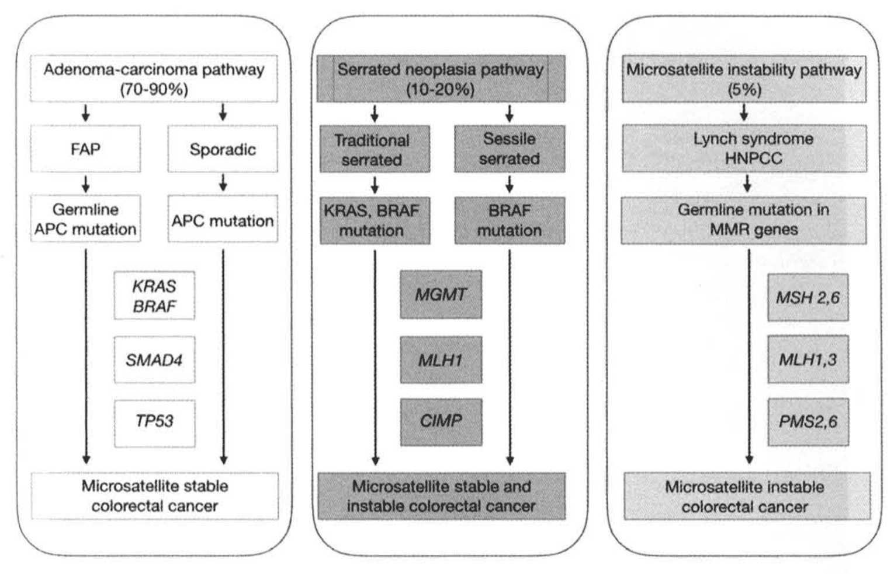

> **Caption (verbatim):** **รูปที่ 1** Carcinogenesis pathways in Colorectal cancer.
> **Text in image (verbatim):** Adenoma-carcinoma pathway (70-90%) · FAP · Sporadic · Germline APC mutation · APC mutation · KRAS BRAF · SMAD4 · TP53 · Microsatellite stable colorectal cancer · Serrated neoplasia pathway (10-20%) · Traditional serrated · Sessile serrated · KRAS, BRAF mutation · BRAF mutation · MGMT · MLH1 · CIMP · Microsatellite stable and instable colorectal cancer · Microsatellite instability pathway (5%) · Lynch syndrome HNPCC · Germline mutation in MMR genes · MSH 2,6 · MLH1,3 · PMS2,6 · Microsatellite instable colorectal cancer
> **Description:** Flowchart diagram in three side-by-side rounded panels, one per carcinogenesis pathway (left panel white boxes, middle panel dark grey boxes, right panel light grey boxes). Left panel: "Adenoma-carcinoma pathway (70-90%)" splits into two columns: FAP → Germline APC mutation, and Sporadic → APC mutation; each column then has a long downward arrow to "Microsatellite stable colorectal cancer"; between the two arrows are stacked italic gene boxes KRAS/BRAF, SMAD4, TP53 (genes acquired along the way). Middle panel: "Serrated neoplasia pathway (10-20%)" splits into Traditional serrated → KRAS, BRAF mutation, and Sessile serrated → BRAF mutation; both columns arrow down to "Microsatellite stable and instable colorectal cancer"; between the arrows are italic boxes MGMT, MLH1, CIMP. Right panel: "Microsatellite instability pathway (5%)" → Lynch syndrome HNPCC → Germline mutation in MMR genes → long arrow down to "Microsatellite instable colorectal cancer"; beside the arrow are italic boxes MSH 2,6, MLH1,3, PMS2,6. Flows: (1) Adenoma-carcinoma pathway (70-90%) → FAP → Germline APC mutation → [KRAS BRAF, SMAD4, TP53] → Microsatellite stable colorectal cancer; (2) Adenoma-carcinoma pathway (70-90%) → Sporadic → APC mutation → [KRAS BRAF, SMAD4, TP53] → Microsatellite stable colorectal cancer; (3) Serrated neoplasia pathway (10-20%) → Traditional serrated → KRAS, BRAF mutation → [MGMT, MLH1, CIMP] → Microsatellite stable and instable colorectal cancer; (4) Serrated neoplasia pathway (10-20%) → Sessile serrated → BRAF mutation → [MGMT, MLH1, CIMP] → Microsatellite stable and instable colorectal cancer; (5) Microsatellite instability pathway (5%) → Lynch syndrome HNPCC → Germline mutation in MMR genes → [MSH 2,6, MLH1,3, PMS2,6] → Microsatellite instable colorectal cancer.
> **Identifiers in image:** none

## อาการของโรค

อาการแสดงของโรคมะเร็งลำไส้ใหญ่และทวารหนัก ขึ้นอยู่กับระดับความรุนแรงของการอุดตันและตำแหน่งของมะเร็งลำไส้ใหญ่ กล่าวคือถ้าตำแหน่งของมะเร็งอยู่ส่วนต้นของลำไส้ใหญ่ ผู้ป่วยอาจจะไม่มีอาการเลยเนื่องจากอุจจาระในลำไส้ใหญ่ส่วนนี้ยังมีลักษณะเหลวและสามารถเคลื่อนตัวผ่านตำแหน่งมะเร็งลำไส้ที่ตีบแคบได้ จึงทำให้ผู้ป่วยมีอาการไม่ชัดเจน บางรายอาจมีแค่อาการจุกเสียดหลังทานอาหาร ทำให้แพทย์วินิจฉัยคลาดเคลื่อนว่าเป็นแค่โรคกระเพาะอาหารหรือนิ่วในถุงน้ำดี ผู้ป่วยบางรายอาจมาพบแพทย์เมื่อคลำพบก้อนขนาดใหญ่แล้วที่ช่องท้อง หรือมาด้วยอาการอ่อนเพลียจากการเสียเลือดเรื้อรังได้ แต่ถ้าตำแหน่งของเนื้องอกอยู่ที่บริเวณส่วนปลายของลำไส้ใหญ่ ผู้ป่วยจะสังเกตพบการขับถ่ายผิดปกติได้ง่ายกว่า ซึ่งในตำแหน่งนี้อุจจาระจะรวมตัวกันเป็นก้อน ทำให้ผู้ป่วยมีอาการถ่ายลำบาก สังเกตเห็นอุจจาระมีมูกเลือดปน หรืออาจมีอาการปวดเบ่งอยากถ่ายอุจจาระอยู่ตลอดเวลา (tenesmus) ถ้าตำแหน่งของมะเร็งอยู่ใกล้ทวารหนักมาก

ผู้ป่วยบางรายอาจมาด้วยภาวะลำไส้อุดตันฉุกเฉิน (รูปที่ 2) ซึ่งถือเป็นภาวะเร่งด่วนที่ต้องรีบรักษาเพราะมีโอกาสเกิดลำไส้ใหญ่แตกและเสียชีวิตได้ นอกจากนั้นผู้ป่วยบางรายอาจมาด้วยอาการแสดงของโรคมะเร็งที่มีการกระจายไปยังอวัยวะอื่นแล้ว เช่น กระจายไปตับอาจมาด้วยอาการอ่อนเพลีย ตาเหลือง คลำพบตับโต หรือถ้ากระจายไปที่ปอดมากจะมีอาการเหนื่อยได้

<!-- p.484 (printed 470) -->
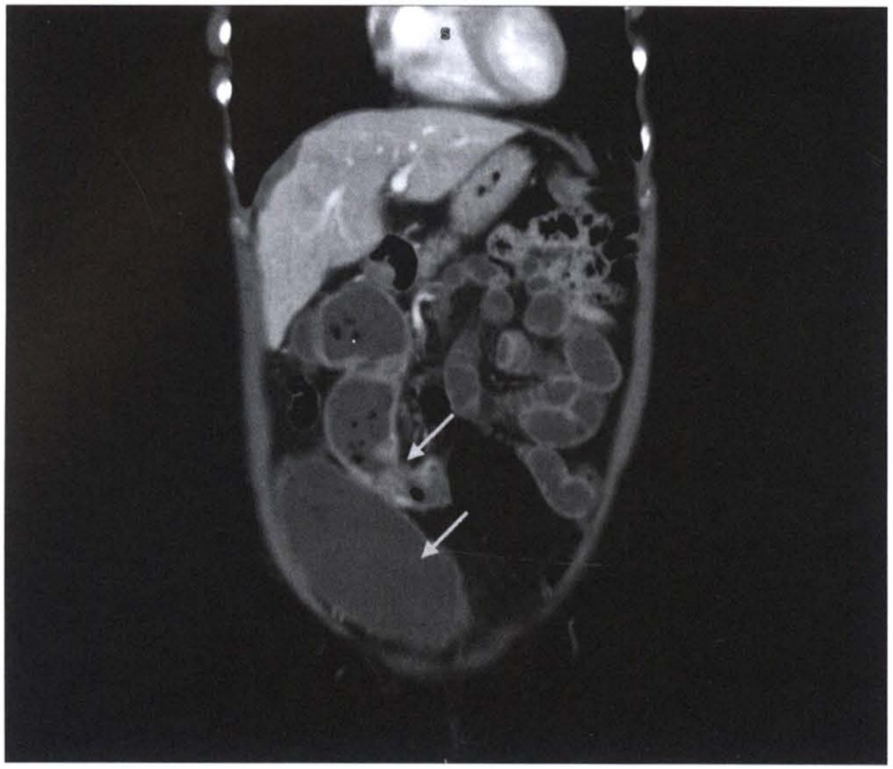

> **Caption (verbatim):** **รูปที่ 2** Obstructed transverse colon cancer (upper arrow) with cecal dilatation (lower arrow) on the coronal view of CT scan.
> **Text in image (verbatim):** none
> **Description:** Contrast-enhanced CT of the abdomen, coronal reformat. The heart is at the top centre (a tiny dark mark is visible within it), the liver occupies the upper left of the image (patient's right), and multiple fluid-filled, dilated bowel loops fill the abdomen. Two white arrows point down and to the left: the upper arrow points to a narrowed segment of colon at the site of the obstructing transverse colon cancer (per caption); the lower arrow points to a large, markedly distended, fluid-filled cecum in the right lower abdomen (cecal dilatation, per caption).
> **Identifiers in image:** none

## การตรวจวินิจฉัยเพิ่มเติม5, 6

การตรวจทวารหนักจะสามารถคลำพบก้อนมะเร็งได้ถ้าตำแหน่งของมะเร็งอยู่บริเวณส่วนปลายลำไส้ใหญ่ แต่ในกรณีที่ตรวจร่างกายไม่พบก้อน แพทย์ควรทำการตรวจเพิ่มเติมด้วยการส่องกล้องลำไส้ใหญ่ (colonoscopy) เพื่อเก็บชิ้นเนื้อ (biopsy) และระบุตำแหน่งที่ชัดเจนเพื่อการรักษาต่อไป (รูปที่ 3) โดยเฉพาะในรายที่ตรวจพบเนื้องอกขนาดเล็ก แพทย์ควรต้องทำการสักด้วยหมึกดำ (tattoo) (รูปที่ 4) เพื่อที่ขณะทำผ่าตัดจะสามารถมองเห็นสีหมึกจากภายนอกลำไส้ใหญ่ ทำให้สามารถผ่าตัดในตำแหน่งที่ถูกต้อง colonoscopy ยังมีประโยชน์ในการใช้ตรวจหาว่ามีเนื้องอกในตำแหน่งอื่นๆ อีกหรือไม่ (synchronous lesion) โดยปัจจุบันมีการพัฒนาใช้ narrow band imaging (NBI) และ chromoendoscopy ช่วยเพิ่มความแม่นยำในการตรวจวินิจฉัยได้ดีกว่าการใช้ white light นอกจากนั้นยังใช้ colonoscopy ในการรักษาตัดติ่งเนื้อในลำไส้ใหญ่ด้วยวิธี polypectomy ได้อีกด้วย (รูปที่ 5) ซึ่งปัจจุบันมีการพัฒนาเครื่องมือและเทคนิคไปมาก ทำให้สามารถตัดเนื้องอกที่มีขนาดใหญ่แต่ยังไม่ลุกลามเกินชั้น submucosa ผ่านกล้อง colonoscopy ได้ด้วยเทคนิค endoscopic submucosal dissection (ESD) (รูปที่ 6)

<!-- p.485 (printed 471) -->
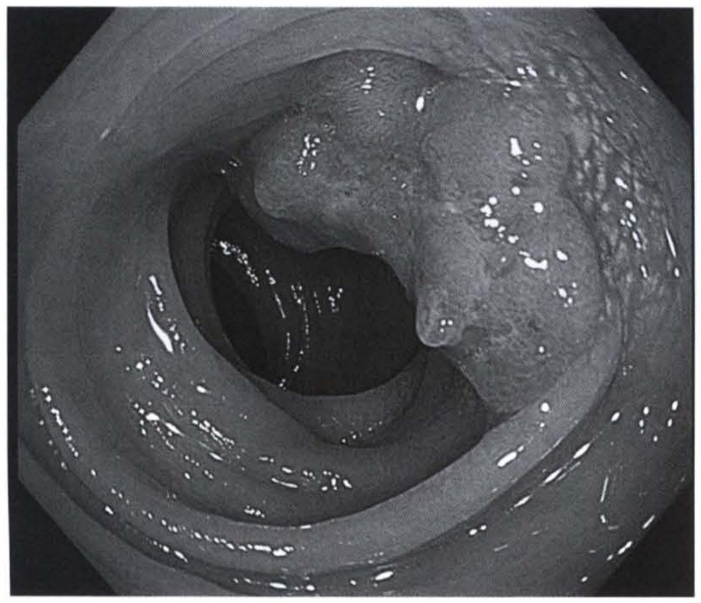

> **Caption (verbatim):** **รูปที่ 3** Colonoscopy revealed intraluminal colonic mass.
> **Text in image (verbatim):** none
> **Description:** Endoscopic (colonoscopic) photograph, octagonal field of view, greyscale print. The colonic lumen is seen as a dark opening in the centre-left, surrounded by circular mucosal folds. A lobulated, irregular mass with a nodular surface arises from the upper right wall and projects into the lumen, partly narrowing it (intraluminal colonic mass, per caption). Bright specks are light reflections from the moist mucosa.
> **Identifiers in image:** none

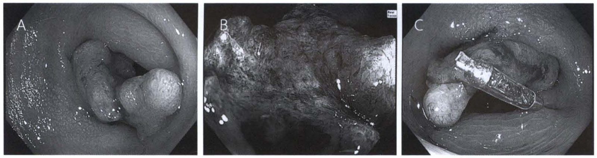

> **Caption (verbatim):** **รูปที่ 4** Management of early colon cancer. Corresponding photographs of T1 colorectal cancers with white light (a) and narrow band imaging (b) Lesion tattooing and clipping for tumor localization (c)
> **Text in image (verbatim):** A · B · C · [unclear: Near Focus]
> **Description:** Three colonoscopic photographs side by side, labelled A, B and C in their upper left corners (greyscale print). A: white-light view of a lumen with a lobulated, polypoid T1 colorectal cancer made of two rounded nodules projecting into the lumen from the wall. B: close-up narrow band imaging view of a lesion surface showing a dark, irregular mucosal/vascular pattern; a small endoscope on-screen label is in the upper right corner. C: the polypoid lesion with a metallic endoscopic clip applied next to it for tumour localization (per caption: lesion tattooing and clipping); the clip appears as a bright elongated object lying across the lesion.
> **Identifiers in image:** none

<!-- p.486 (printed 472) -->
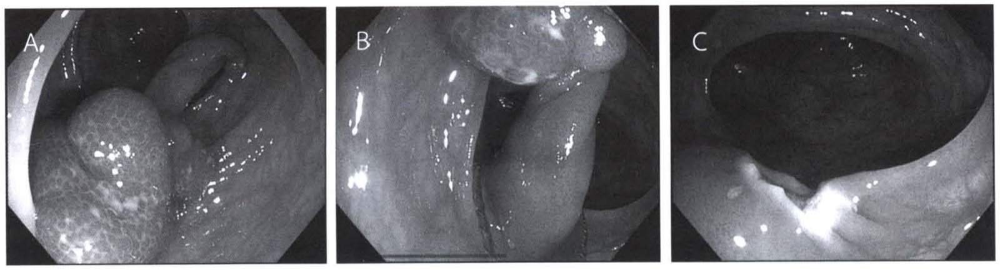

> **Caption (verbatim):** **รูปที่ 5** Colonoscopic polypectomy. Long stalk pedunculated polyp (a) Snare encircled at the stalk (b) Post polypectomy (c)
> **Text in image (verbatim):** A · B · C
> **Description:** Three colonoscopic photographs side by side, labelled A, B and C (greyscale print). A: a rounded polyp head with a fine pitted surface on a long stalk arising from the colonic wall (long stalk pedunculated polyp). B: the polyp head at the top with its long stalk running downward; a thin snare wire is seen encircling the stalk (snare encircled at the stalk). C: the colonic lumen after removal, with a small flat resection site/stalk remnant on the lower wall and no polyp remaining (post polypectomy).
> **Identifiers in image:** none

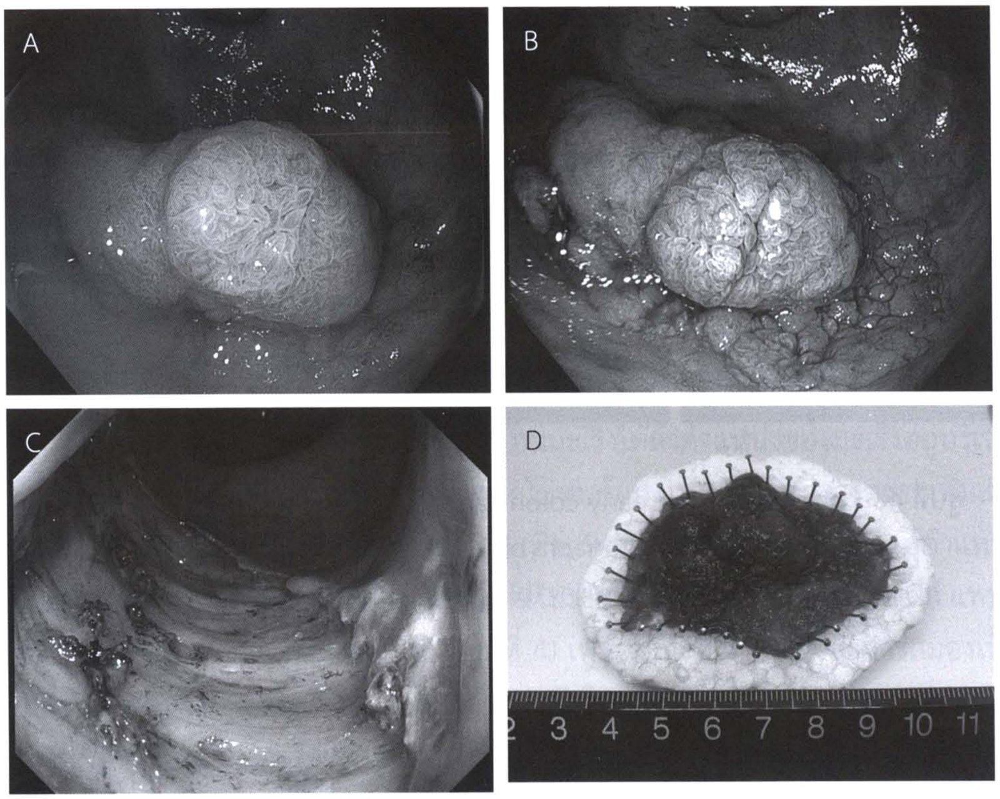

> **Caption (verbatim):** **รูปที่ 6** Endoscopic submucosal resection (ESD). Corresponding photographs of large sessile colonic polyp with white light (a) and chromoendoscopy with indigo carmine (b) Post ESD (c) Large sessile colonic polyp was pinned on foam (d)
> **Text in image (verbatim):** A · B · C · D · 2 · 3 · 4 · 5 · 6 · 7 · 8 · 9 · 10 · 11
> **Description:** Four photographs in a 2 × 2 grid (greyscale print). A (top left): colonoscopic white-light view of a large, broad-based (sessile) polyp with a lobulated, gyrus-like surface pattern on the colonic wall. B (top right): the same lesion after chromoendoscopy with indigo carmine dye, which highlights the surface pit pattern and the lesion margins. C (bottom left): colonoscopic view after ESD showing a wide, shallow mucosal defect with exposed submucosal base extending across the colonic wall, with a few small spots of blood and a raised margin. D (bottom right): the resected specimen, a large flat piece of tissue stretched and pinned with many pins around its edge onto white foam, photographed above a ruler with centimetre markings 2 to 11; the specimen spans roughly from the 4 to the 9 cm marks.
> **Identifiers in image:** none

<!-- p.487 (printed 473) -->
การตรวจทางรังสีวินิจฉัยเพื่อประเมินระยะของโรคด้วย chest and abdominal computerized tomography (CT) scan มีความจำเป็นเพื่อดูว่ามีการลุกลามไปยังอวัยวะใกล้เคียงหรือไม่ (local invasion) และประเมินการกระจายของโรค (metastasis) ซึ่งมะเร็งลำไส้ใหญ่และทวารหนักมีแบบแผนการกระจายของโรคที่ชัดเจน กล่าวคือ จะมีการกระจายไปที่ต่อมน้ำเหลืองที่อยู่รอบๆ หลอดเลือดใน mesentery ที่ไปเลี้ยงลำไส้ใหญ่ในตำแหน่งนั้นๆ ส่วนการแพร่กระจายไปอวัยวะอื่นมักพบที่ตับ (รูปที่ 7) และปอด (รูปที่ 8) โดยสามารถอธิบายการแพร่กระจายของมะเร็งผ่านหลอดเลือดดำ portal vein หรือ iliac vein สำหรับ rectal cancer มีการประเมินระยะของโรคโดยใช้ magnetic resonance imaging (MRI) scan ซึ่งถือเป็นมาตรฐานในปัจจุบันที่จะให้รายละเอียดเพื่อการวางแผนรักษาที่แม่นยำยิ่งขึ้น ซึ่งจะได้กล่าวถึงต่อไป นอกจากนั้นยังมีวิธีการตรวจทางรังสีวินิจฉัยด้วย PET/CT ซึ่งเป็นเครื่องมือทางเวชศาสตร์นิวเคลียร์ที่ใช้เทคโนโลยีร่วมกันของเครื่อง positron emission tomography (PET) และ CT scan สำหรับการประเมินการแพร่กระจายของโรคที่มีความแม่นยำสูงขึ้นอีกด้วย (รูปที่ 9)

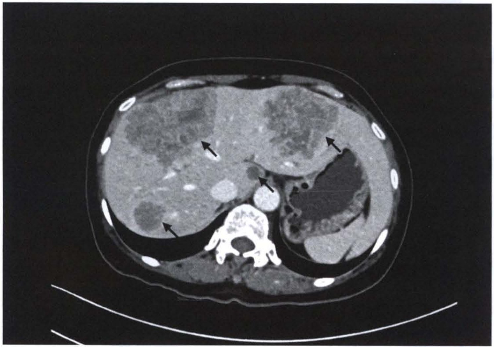

> **Caption (verbatim):** **รูปที่ 7** Multiple liver metastasis (arrow) on CT scan.
> **Text in image (verbatim):** none
> **Description:** Contrast-enhanced axial CT of the upper abdomen at the level of the liver dome and stomach, viewed from below (patient's right on image left). The liver is enlarged and contains several low-attenuation (darker) lesions: a large ill-defined lesion in the right lobe anteriorly, a large lesion in the left lobe, a smaller round lesion in the posterior right lobe, and a small lesion near the hilum. Four black arrows point to these lesions (multiple liver metastasis, per caption). The aorta, vertebral body, stomach with air and food content, and the spleen posteriorly are also visible. The curved lines below the body are the CT table.
> **Identifiers in image:** none

<!-- p.488 (printed 474) -->
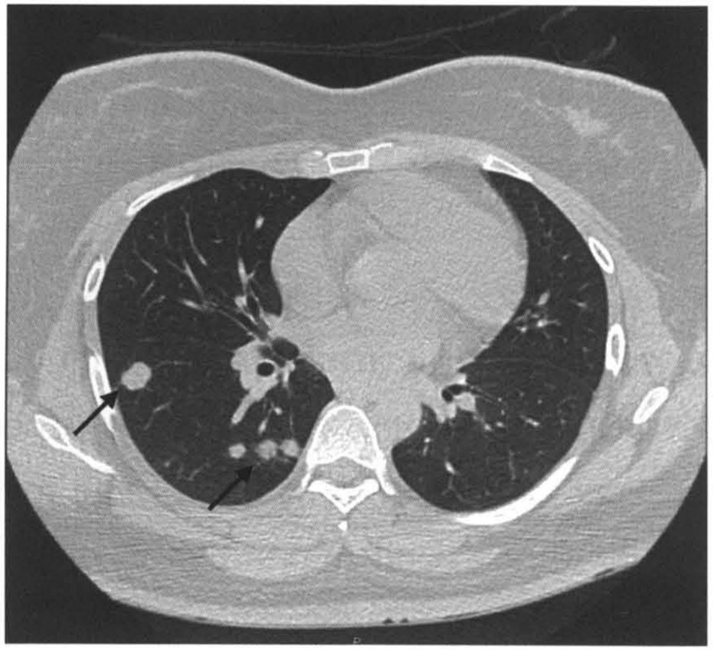

> **Caption (verbatim):** **รูปที่ 8** Multiple lung metastasis (arrow) on CT scan.
> **Text in image (verbatim):** none
> **Description:** Axial CT of the chest at the level of the heart and hila, shown in a lung window (patient's right on image left). Several small, round, well-defined soft-tissue nodules are seen in the right lung: one peripheral nodule in the lateral right lung and a cluster of small nodules in the posterior right lower lung near the spine. Two black arrows point to these nodules (multiple lung metastasis, per caption). The left lung shows normal vessels only in this slice. Heart, vertebra and chest wall are also visible.
> **Identifiers in image:** none

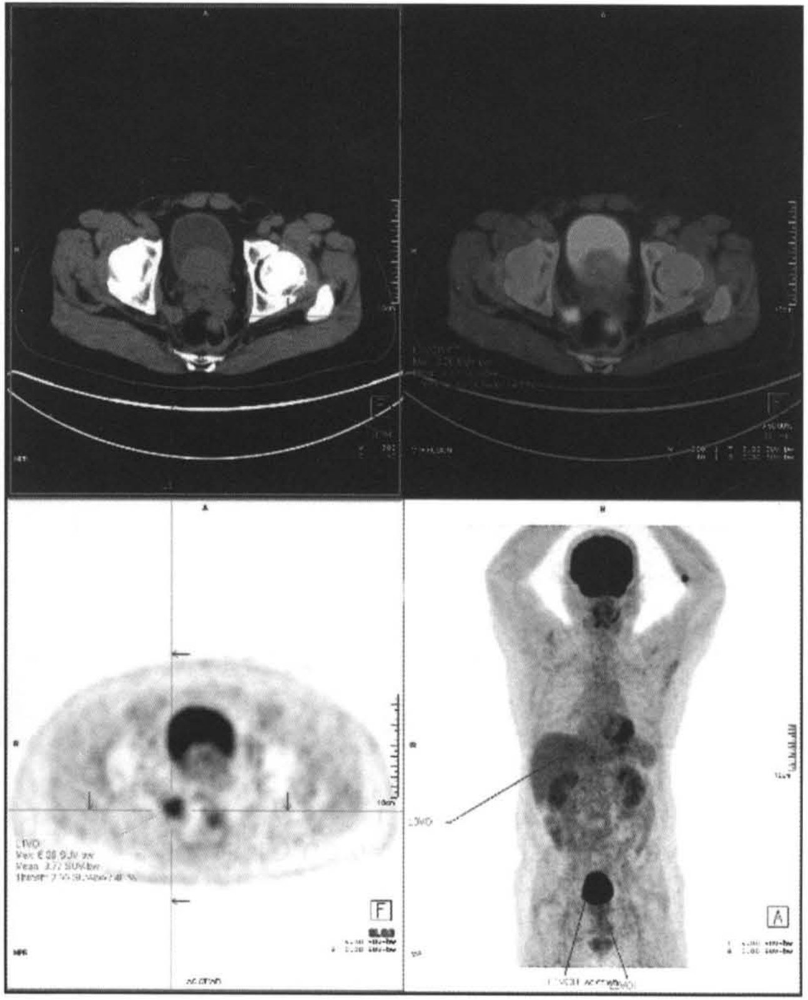

> **Caption (verbatim):** **รูปที่ 9** Positive fluorodeoxyglucose (FDG) uptake at the metastatic right internal iliac lymph node on positron emission tomography (PET) CT scan.
> **Text in image (verbatim):** A · R · F · A · [illegible small scanner annotations, measurement box beginning "L1VOI: Max [unclear: 6.08] SUV-bw · Mean [unclear: 3.72] SUV-bw · Thresh [illegible]" and window/scale values]
> **Description:** PET/CT display in four panels (2 × 2). Top left: axial non-contrast CT of the pelvis showing the bladder centrally, the iliac bones and the rectum posteriorly. Top right: the same axial slice as fused PET/CT, with a small bright focus in the right posterolateral pelvis beside the rectum (right internal iliac region) and tracer in the bladder. Bottom left: the matching axial PET image (inverted greyscale, uptake shown dark) with crosshairs centred on a small dark focus of FDG uptake posterior and to the right of the bladder (the metastatic right internal iliac lymph node, per caption), with a measurement annotation box at the lower left. Bottom right: anterior maximum-intensity-projection whole-body PET image with arms raised, showing dark areas of tracer uptake in the brain, the upper abdomen/kidney regions and a large rounded dark focus in the lower pelvis; pointer lines lead to small labels. Small scanner text in the panels is not legible; no patient name, ID or date is visible.
> **Identifiers in image:** none

<!-- p.489 (printed 475) -->
## การรักษา

ก่อนเริ่มทำการรักษา นอกจากจะต้องประเมินความพร้อมของผู้ป่วยและประเมินความเสี่ยงที่อาจเกิดขึ้นจากการผ่าตัด แพทย์ควรต้องให้การวินิจฉัยเบื้องต้นว่าโรคน่าจะอยู่ในระยะใด โดยอาศัยผลจากการตรวจทางรังสีวินิจฉัยเพิ่มเติม ในปัจจุบันมีการจัดระยะของโรคด้วย TNM staging (AJCC classification, 8th edition)7 เป็นที่ยอมรับเป็นสากลทั่วโลก โดยจัดเป็น 4 ระยะ (ตารางที่ 1, 2) เพื่อการพิจารณาว่าจะเลือกใช้วิธีการรักษาใดก่อนหรือหลังเพื่อให้ผลการรักษาดีที่สุด เนื่องจากการรักษามะเร็งลำไส้ใหญ่และทวารหนักเป็นการรักษาแบบผสมผสาน (multimodalty approach)5 ซึ่งประกอบด้วย

1. การผ่าตัด (surgery)
2. การให้ยาเคมีบำบัด (chemotherapy)
3. การให้รังสีรักษา (radiation)
4. การรักษาด้วยภูมิคุ้มกันบำบัด (immunotherapy)

ตัวอย่างเช่น การใช้ preoperative concurrent chemoradiation (CCRT) ก่อนการผ่าตัดใน locally advanced rectal cancer เพื่อให้มะเร็งมีขนาดเล็กลง ทำให้การผ่าตัดได้ผลดีมากขึ้น หรือการใช้ preoperative upfront chemotherapy ในผู้ป่วยที่มี liver, lung metastasis เพื่อควบคุมไม่ให้โรคลุกลามมากขึ้น เป็นต้น สำหรับเนื้อหาในบทนี้จะเน้นในหลักการรักษาด้วยการผ่าตัด

<!-- p.490 (printed 476) -->
**ตารางที่ 1** Tumor, Node, Metastasis definitions in Colorectal Cancer, AJCC classification 8th edition.

| **T-Primary tumour** |
| --- |
| Tx : Primary tumor cannot be assessed |
| T0 : No evidence of primary tumor |
| Tis : Carcinoma *in situ,* limited to intraepithelial or invasive lamina propria |
| T1 : Tumor invading submucosa |
| T2 : Tumor invading the muscularis propria |
| T3 : Tumor penetrating the muscularis propria and arriving at colorectal fat tissue |
| T4 : Tumor directly invading other organs or structures |
| T4a : Tumor penetrating visceral peritoneum |
| T4b : Tumor directly invading or adhering to other organs or structures |
| **N-Regional lymph nodes** |
| Nx : Regional lymph nodes cannot be assessed |
| N0 : No lymph node metastasis and no TD |
| N1 : 1-3 lymph nodes metastases |
| N1a : 1 lymph node metastases |
| N1b : 2-3 lymph nodes metastases |
| N1c : Although there was no regional lymph node metastasis, TDs were submucosal, mesangial or peritoneum-covered para-colorectal tissue. |
| N2 : More than or equal to 4 lymph node metastases |
| N2a : 4-6 regional lymph node metastases |
| N2b : More than or equal to 7 lymph node metastases |
| **M-Distant metastasis** |

<!-- p.491 (printed 477) -->
| M1 : There is distant lymph node metastasis |
| --- |
| M1a : Metastasis is limited to one organ or site (e.g., liver, lung, ovary, and extra-regional lymph node metastases) |
| M1b : Transfer more than one organ or site |
| M1c : Peritoneal metastases with or without metastasis of other organs |

**ตารางที่ 2** Colorectal Cancer TNM Staging, AJCC classification 8th edition.

| **Stage** | **T** | **N** | **M** |
| --- | --- | --- | --- |
| 0 | Tis | N0 | M0 |
| I | T1-2 | N0 | M0 |
| IIA | T3 | N0 | M0 |
| IIB | T4a | N0 | M0 |
| IIC | T4b | N0 | M0 |
| IIIA | T1-2 | N1/N1c | M0 |
| IIIA | T1 | N2a | M0 |
| IIIB | T3-4a | N1/N1c | M0 |
| IIIB | T2-3 | N2a | M0 |
| IIIB | T1-2 | N2b | M0 |
| IIIC | T4a | N2a | M0 |
| IIIC | T3-4a | N2b | M0 |
| IIIC | T4b | N1-2 | M0 |
| IVA | Any T | Any N | M1a |
| IVB | Any T | Any N | M1b |
| IVC | Any T | Any N | M1c |

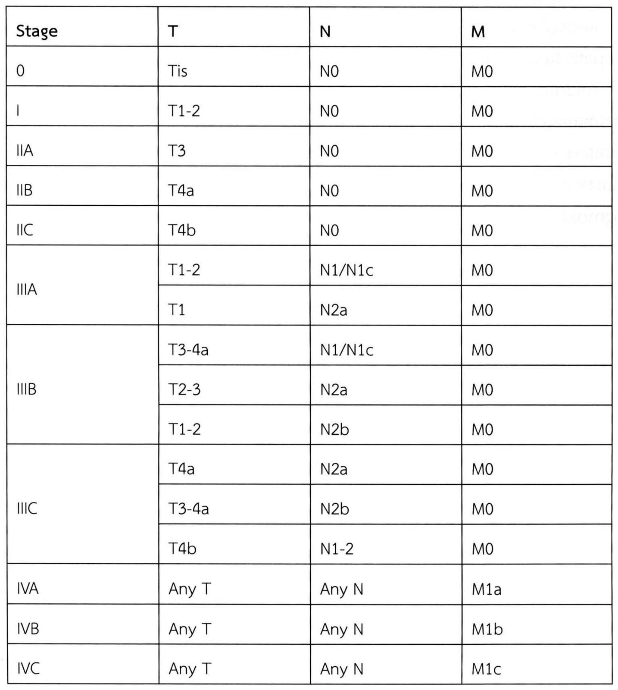

> **Caption (verbatim):** **ตารางที่ 2** Colorectal Cancer TNM Staging, AJCC classification 8th edition.
> **Text in image (verbatim):** Stage · T · N · M · 0 · Tis · N0 · M0 · I · T1-2 · N0 · M0 · IIA · T3 · N0 · M0 · IIB · T4a · N0 · M0 · IIC · T4b · N0 · M0 · IIIA · T1-2 · N1/N1c · M0 · T1 · N2a · M0 · IIIB · T3-4a · N1/N1c · M0 · T2-3 · N2a · M0 · T1-2 · N2b · M0 · IIIC · T4a · N2a · M0 · T3-4a · N2b · M0 · T4b · N1-2 · M0 · IVA · Any T · Any N · M1a · IVB · Any T · Any N · M1b · IVC · Any T · Any N · M1c
> **Description:** Image of the printed staging table with four columns (Stage, T, N, M). The Stage cell is merged vertically for IIIA (2 rows), IIIB (3 rows) and IIIC (3 rows); all other stages occupy one row. The Markdown table above repeats the merged Stage value on each of its rows.
> **Identifiers in image:** none

<!-- p.492 (printed 478) -->
## การผ่าตัด

การผ่าตัดรักษามะเร็งลำไส้ใหญ่และทวารหนักมีเป้าหมายเพื่อการรักษาให้หายขาดและป้องกันการกลับเป็นซ้ำของมะเร็ง โดยมีหลักการสำคัญคือ ตัดลำไส้ใหญ่ให้ได้ขอบเขตที่ดี (free margin) อย่างน้อย 5 เซนติเมตร และเลาะต่อมน้ำเหลืองบริเวณนั้นออกให้หมดด้วยการตัดให้ถึงขั้วของหลอดเลือดที่มาเลี้ยงลำไส้ใหญ่ในตำแหน่งนั้นๆ (central vascular ligation, CVL) โดยอาศัยแบบแผนการกระจายของมะเร็งที่จะกระจายใน mesentery ไปตามต่อมน้ำเหลืองที่อยู่รอบหลอดเลือดที่ไปเลี้ยงลำไส้ใหญ่ในตำแหน่งที่มีมะเร็งอยู่8 ตัวอย่างเช่น CA cecum ลำไส้ใหญ่ส่วนนี้ถูกเลี้ยงด้วย ileocolic vessels จึงต้องทำ high ligation of ileocolic vessels และเรียกชื่อการผ่าตัดนี้ว่า right colectomy แต่ถ้าเป็น CA hepatic flexor colon จะต้องทำ high ligation of ileocolic vessels and right branch of middle colic vessels เนื่องจากอาจมีการกระจายของมะเร็งไปที่ต่อมน้ำเหลืองตามหลอดเลือดใดก็ได้ และจะเรียกชื่อการผ่าตัดนี้ว่า extended right colectomy อีกหนึ่งตัวอย่าง CA sigmoid ก็จะต้องทำ high ligation of inferior mesenteric vessels เนื่องจากลำไส้ใหญ่ส่วน sigmoid ถูกเลี้ยงด้วยเส้นเลือดนี้ และเรียกชื่อการผ่าตัดว่า sigmoidectomy เป็นต้น (รูปที่ 10)

<!-- p.493 (printed 479) -->
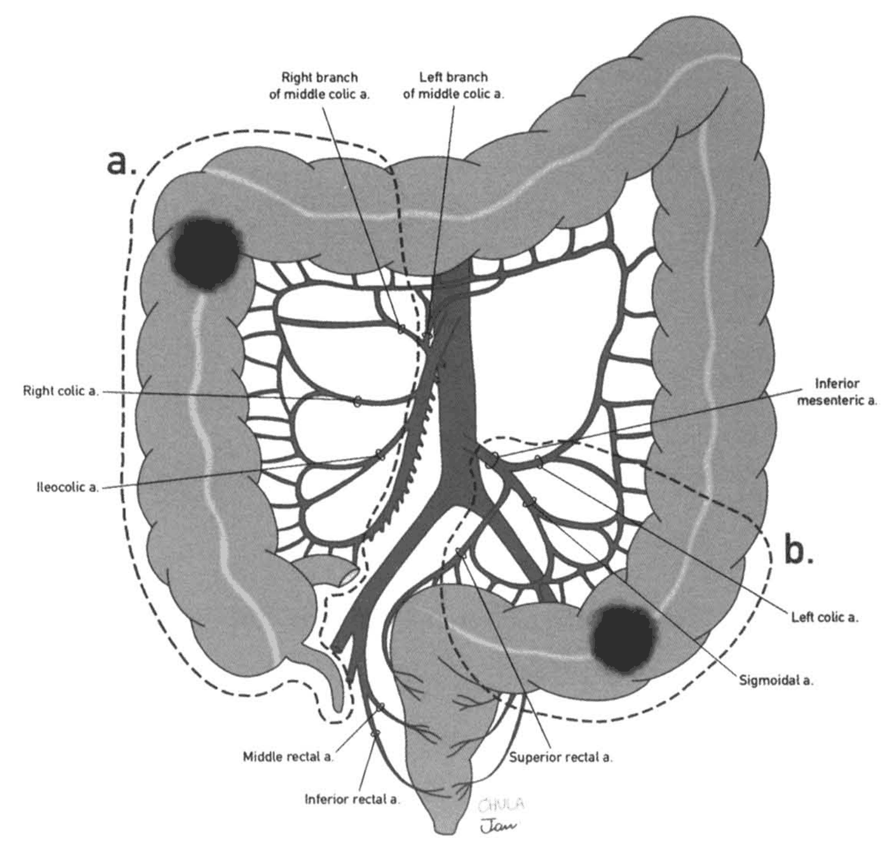

> **Caption (verbatim):** **รูปที่ 10** Vascular anatomy of the colon and rectum. Dotted line (a) illustrated the extended right colectomy. Dotted line (b) illustrated the sigmoidectomy.
> **Text in image (verbatim):** a. · b. · Right branch of middle colic a. · Left branch of middle colic a. · Right colic a. · Ileocolic a. · Inferior mesenteric a. · Left colic a. · Sigmoidal a. · Middle rectal a. · Inferior rectal a. · Superior rectal a. · CHULA · Jan (artist signature)
> **Description:** Grey-tone anatomical drawing of the whole colon and rectum seen from the front (cecum and ascending colon on the reader's left, transverse colon across the top, descending colon on the right, sigmoid colon and rectum at the bottom centre, with the terminal ileum entering the cecum and the appendix hanging below it). The arterial supply is drawn in dark grey: a central vertical trunk with branches to the right colon (labelled Right colic a., Ileocolic a., Right branch and Left branch of middle colic a.) and, from the lower trunk, the Inferior mesenteric a. giving off the Left colic a., Sigmoidal a. and Superior rectal a.; the Middle rectal a. and Inferior rectal a. are labelled near the rectum. Marginal arcades connect the branches along the bowel wall. Small ring marks on the vessels indicate ligation points at the origins of the labelled arteries. Two dark round tumour masses are shown: one at the hepatic flexure (upper end of the ascending colon) and one in the sigmoid colon. Dotted line (a) encloses the specimen of an extended right colectomy: the terminal ileum, cecum, ascending colon, hepatic flexure and right part of the transverse colon, with its mesentery up to the ileocolic, right colic and right branch of the middle colic vessels near their origin (the mesentery along the trunk is shown cut, with a serrated edge). Dotted line (b) encloses the sigmoidectomy specimen: the sigmoid colon (with the tumour) and its mesentery up to the origin of the inferior mesenteric artery, including the left colic, sigmoidal and superior rectal branches.
> **Identifiers in image:** none

เทคนิคการผ่าตัดให้ได้ผลดี นอกจากการทำ central vascular ligation (CVL) แล้วจะต้องผ่าตัดให้ได้ complete mesocolic excision (CME) อีกด้วย9 กล่าวคือ จะต้องเลาะให้ได้ mesocolic fascia ที่ปกคลุมลำไส้ใหญ่และ mesentery โดยไม่ให้ fascia นี้ฉีกขาดจนถึงตำแหน่งที่ทำ central vascular ligation ทั้งนี้เพื่อป้องกันการหลุดลอดของ cancer cells ที่จะเป็นสาเหตุให้เกิด local recurrence ได้ ซึ่งการผ่าตัดนี้เป็นการผ่าตาม embryological plane ที่เป็น avascular plane ทำให้การผ่าตัดมีความปลอดภัยมากยิ่งขึ้นและได้ surgical margin ดีมากพอทำให้โอกาสเกิดมะเร็งเป็นซ้ำเฉพาะที่น้อยลงมาก (รูปที่ 11) นอกจากนั้นยังมีอีกหนึ่งหลักการที่สำคัญ ได้แก่ En bloc resection principle คือการตัดเอาอวัยวะรอบข้างที่ก้อนมะเร็งลุกลามถึง (invasion) ออกไปด้วย เช่น ถ้ามีการลุกลามของมะเร็งถึง small bowel, uterus, หรือ abdominal wall ก็จะต้องตัดอวัยวะส่วนนั้นออกให้ติดไปด้วยกัน เพื่อป้องกันการกลับเป็นซ้ำของมะเร็ง10

<!-- p.494 (printed 480) -->
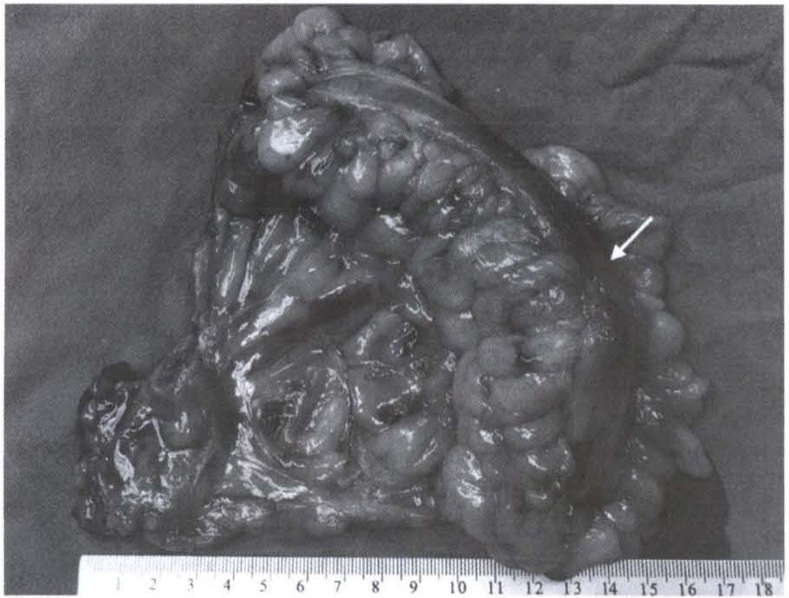

> **Caption (verbatim):** **รูปที่ 11** Colectomy specimen using central vascular ligation (CVL) and complete mesocolic excision (CME), Arrow depicted the location of tumor.
> **Text in image (verbatim):** 1 · 2 · 3 · 4 · 5 · 6 · 7 · 8 · 9 · 10 · 11 · 12 · 13 · 14 · 15 · 16 · 17 · 18 (ruler scale)
> **Description:** Black-and-white photograph of a fresh resected colon specimen laid on a dark cloth, with a ruler marked 1 to 18 along the bottom edge. A curved segment of colon with haustra runs along the top and right side of the specimen, and a broad, fan-shaped sheet of glistening mesentery (mesocolon) with its fat and vessels spreads out to the lower left, still covered by an intact smooth fascial envelope. A white arrow at the right side points to the location of the tumor on the bowel.
> **Identifiers in image:** none

การผ่าตัด rectal cancer มีรายละเอียดที่ต้องพิจารณาเพิ่มเติม เนื่องจากเป็นตำแหน่งของลำไส้ใหญ่ส่วนปลายที่ติดกับหูรูดทวารหนัก (anal sphincter) และยังมีอวัยวะสำคัญหรือหลอดเลือดขนาดใหญ่ (pelvic vessels) อยู่โดยรอบ ทำให้การผ่าตัดลำไส้ใหญ่ส่วนปลายมีความเสี่ยงมากกว่า รวมถึงการที่จะตัดให้ได้ free margin ก็ทำได้ยากกว่าการผ่าตัดลำไส้ใหญ่ในตำแหน่งอื่น ดังนั้นการผ่าตัด rectal cancer จึงต้องอาศัยเทคนิคที่ถูกต้องและอาศัยประสบการณ์ของศัลยแพทย์ที่มากพอจึงจะทำการผ่าตัดได้อย่างปลอดภัย จากเหตุผลข้างต้นทำให้ผลการรักษาของแต่ละสถาบันมีความแตกต่างกันมาก และเนื่องจาก rectal cancer เป็นตำแหน่งที่ผ่าตัดยาก ในอดีตจึงจำเป็นต้องตัดหูรูดทวารหนักออกด้วย (abdominoperineal resection, APR) เพื่อให้ได้ขอบเขตส่วนล่างที่ดีและทำให้สามารถเอาก้อนมะเร็งออกจากเชิงกรานได้ แต่ก็ทำให้ผู้ป่วยต้องมีทวารเทียมตลอดชีวิต (permanent colostomy) และถึงแม้ว่าจะตัดออกกว้างมาก แต่ผลการศึกษากลับพบว่ามีอัตราการเป็นซ้ำเฉพาะที่สูงถึง 20-50 เปอร์เซ็นต์ ทำให้ในอดีตต้องมีการใช้ radiation ร่วมในการรักษาด้วยเสมอ

ปัจจุบันการศึกษาทางกายวิภาค พบว่า rectum ถูกห่อหุ้มด้วย mesorectal fat และมี mesorectal fascia (MRF) ที่มีขอบเขตชัดเจนห่อหุ้มอยู่ชั้นนอกโดยรอบอีกที (รูปที่ 12) โดย fascia นี้จะต่อเนื่องมาจาก mesocolic fascia ของ sigmoid colon และต่อเนื่องลงไปจนถึงบริเวณขอบบนของ pelvic floor ซึ่ง fascia นี้สามารถแยก lower rectum ออกจาก puborectalis muscle ได้ (intersphincteric plane) ความเข้าใจในกายวิภาค

<!-- p.495 (printed 481) -->
ของ mesorectal fascia จะช่วยทำให้การผ่าตัดมีความปลอดภัยมากขึ้น เนื่องจากในบริเวณ fascia นี้ไม่มีหลอดเลือด (avascular plane, embryological plane) ทำให้สามารถเก็บรักษาหูรูดทวารหนัก (sphincter saving operation) ได้มากขึ้น

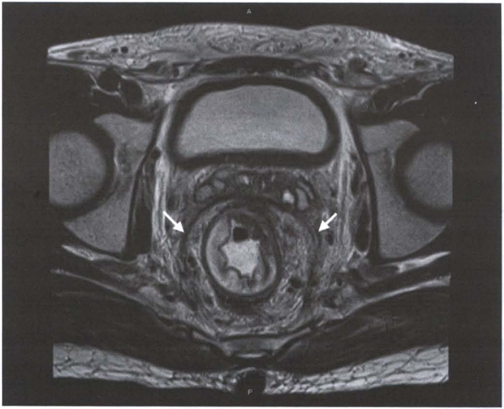

> **Caption (verbatim):** **รูปที่ 12** Mesorectal fascia (arrow) on axial view of the MRI scan.
> **Text in image (verbatim):** A · P (orientation markers, anterior at top and posterior at bottom)
> **Description:** Axial T2-weighted-appearing MRI slice through the pelvis, anterior at the top (marker "A") and posterior at the bottom (marker "P"). The fluid-filled bladder lies anteriorly in the centre, with the femoral heads/hip regions on both sides. Behind the bladder is the rectum, seen in cross-section as a round structure with a layered wall and a stellate bright lumen. The rectum is surrounded by a ring of mesorectal fat containing small dark vessels/nodes, and this fat is outlined by a thin dark line, the mesorectal fascia; two white arrows (one on each side, pointing inward toward the lateral edges of the mesorectum) mark this fascia. The sacrum/coccyx and gluteal soft tissue are posterior.
> **Identifiers in image:** none

การผ่าตัด rectum จะต้องได้ adequate mesorectal excision กล่าวคือต้องตัดให้ได้ lower margin ที่เพียงพออย่างน้อย 5 เซนติเมตร ใต้ต่อตำแหน่งมะเร็ง วิธีนี้จะช่วยลดโอกาสเกิดมะเร็งเป็นซ้ำเฉพาะที่ลงได้มาก11, 12 เหตุผลเนื่องจากพบว่าการกระจายของมะเร็งไปที่ต่อมน้ำเหลืองจะไปได้ไม่เกิน 3 เซนติเมตร ใต้จากตำแหน่งมะเร็งและจะอยู่ภายใน mesorectal fat ที่ถูกห่อหุ้มด้วย mesorectal fascia อีกที (รูปที่ 13) แต่ในกรณีที่ตำแหน่งมะเร็งอยู่ที่ mid to low rectum ซึ่งตำแหน่งนี้จะเหลือ mesorectal fat ไม่ถึง 5 เซนติเมตร ก็ให้เลาะ mesorectal fat ออกให้หมด โดยการผ่าตัดนี้มีชื่อเรียกว่า total mesorectal excision (TME) ซึ่งถ้าได้ lower margin เพียงแค่ 2 เซนติเมตร ก็ถือว่าได้ขอบเขตที่เพียงพอแล้ว (รูปที่ 14)

<!-- p.496 (printed 482) -->
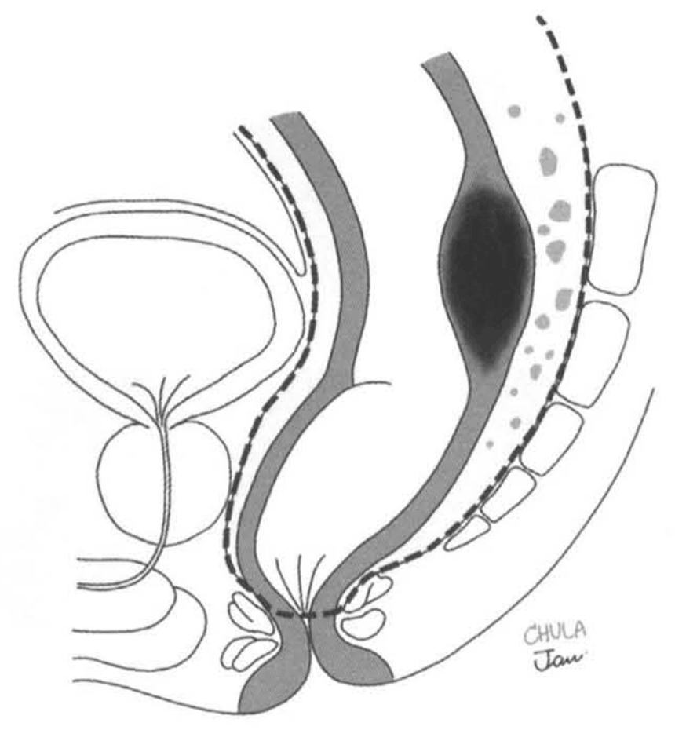

> **Caption (verbatim):** **รูปที่ 13** Anatomy of the rectum, sagittal view. Mesorectal lymph nodes confined in the mesorectal fat. Dotted line demonstrated total mesorectal excision (TME) procedure.
> **Text in image (verbatim):** CHULA · Jan (artist signature)
> **Description:** Line drawing of a midline sagittal section of a male pelvis, anterior on the reader's left. From front to back: the bladder (outline) with the urethra passing through the prostate below it; then a grey tubular structure; then the rectum, a grey-walled tube curving down to the anal canal, containing a dark oval tumour in its upper part on the posterior wall. Behind the rectum is the mesorectal fat containing several small grey dots (mesorectal lymph nodes), and posterior to that the sacrococcygeal vertebral segments are drawn as rounded blocks. A thick dashed line runs around the rectum and its mesorectum, anteriorly in front of the rectal wall and posteriorly just in front of the sacrum, enclosing all the lymph-node dots, and the two limbs meet at the level of the pelvic floor just above the anal sphincter muscles (small looped shapes on either side of the anal canal): this outlines the total mesorectal excision plane.
> **Identifiers in image:** none

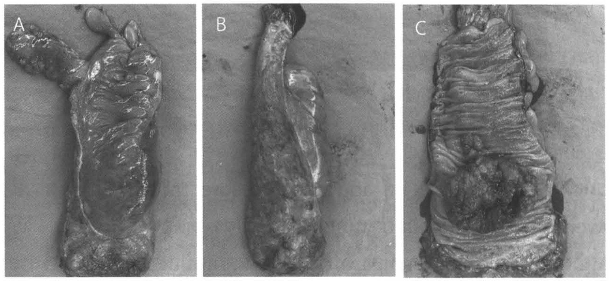

> **Caption (verbatim):** **รูปที่ 14** Low anterior resection specimen from total mesorectal excision (TME) procedure with high ligation of inferior mesenteric vessels (CVL). Intact mesorectal fascia (a, b) Adequate proximal and distal margin (c)
> **Text in image (verbatim):** A · B · C
> **Description:** Three black-and-white photographs of the same resected rectal specimen on a grey background, side by side. (A) The intact specimen viewed from one side: the mesorectum is a bulky, smooth, glistening envelope covering the rectum, with the proximal colon segment and a vascular pedicle at the top left. (B) The specimen viewed from another side, again showing the smooth intact mesorectal fascial surface along its length, tapering at the top. (C) The bowel opened longitudinally, showing mucosal folds above and below an irregular, raised, ulcerated tumour in the lower half, with bowel wall beyond the tumour at both the proximal (top) and distal (bottom) ends.
> **Identifiers in image:** none

<!-- p.497 (printed 483) -->
สำหรับการต่อลำไส้ใหญ่ (anastomosis) ถ้าตำแหน่งรอยต่ออยู่สูงกว่า anterior peritoneal reflection จะเรียกชื่อการผ่าตัดว่า anterior resection (AR) แต่ถ้ารอยต่ออยู่ต่ำกว่า anterior peritoneal reflection จะเรียกชื่อการผ่าตัดว่า low anterior resection (LAR) หรือในบางรายที่ตำแหน่งมะเร็งอยู่ใกล้ anal canal มาก ก็ยังสามารถเก็บรักษาหูรูดทวารหนักได้ด้วยการทำ transanal intersphincteric resection (ISR) with coloanal anastomosis (CAA) แต่ในกรณีที่พบว่ามะเร็งได้ลุกลามถึงหูรูดทวารหนักแล้วควรพิจารณาทำ APR โดยไม่ควรพยายามเก็บรักษาหูรูดไว้เพราะจะทำให้เกิดการเป็นซ้ำของมะเร็งได้ สำหรับในผู้ป่วยที่พบมีการลุกลามของมะเร็งไปถึง prostate, seminal vesicles, uterus, urinary bladder (รูปที่ 15) ก็ต้องยึดหลักการสำคัญของการผ่าตัดให้ได้ free resection margin ด้วยการตัดเอาอวัยวะที่ถูกก้อนมะเร็งลุกลามถึงออกด้วย (En bloc resection) เพื่อป้องกันการกลับเป็นซ้ำ เรียกการผ่าตัดนี้ว่า pelvic exenteration13 แต่การผ่าตัดนี้มีความซับซ้อนและมีความเสี่ยงจากการเสียเลือดมากได้เนื่องจาก pelvic vessels มี variation สูงมาก14 จึงจำเป็นต้องประเมินวิธีการผ่าตัดอย่างรัดกุม13, 15 และวางแผนในการซ่อมแซม pelvic deadspace ที่เกิดขึ้นหลังจากตัดเนื้องอกออกไปแล้วเพื่อป้องกันไม่ให้เกิดภาวะแทรกซ้อนและให้ผลการรักษาเป็นไปอย่างดีที่สุด13, 16, 17

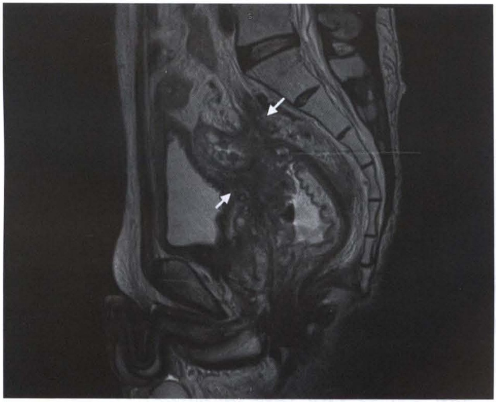

> **Caption (verbatim):** **รูปที่ 15** Extramural invasion (upper arrow) and seminal vesicle invasion (lower arrow) on the sagittal view of MRI.
> **Text in image (verbatim):** S (orientation marker at top, faint)
> **Description:** Sagittal MRI of the pelvis, anterior on the reader's left and posterior (sacrum and coccyx, segmented vertebral bodies) on the right. The bladder is the large uniform grey structure in the lower-left centre. Between the bladder and the sacrum lies the rectum, with a thickened, irregular dark-intermediate tumour mass in its wall and a bright lumen below it. Two white arrows mark the findings named in the caption: the upper arrow points to tumour extending beyond the rectal wall into the surrounding tissue at the upper aspect (extramural invasion), and the lower arrow points to tumour extending anteriorly into the region of the seminal vesicle, between the rectum and the back of the bladder.
> **Identifiers in image:** none

การกระจายของต่อมน้ำเหลืองบริเวณ rectum ยังมีลักษณะพิเศษอีกอย่างคือ สามารถกระจายไปที่บริเวณ lateral pelvic lymph nodes โดยผ่านเข้าทาง internal iliac

<!-- p.498 (printed 484) -->
vessels เนื่องจาก rectum มี dual blood supply จาก superior rectal vessels ผ่านทาง inferior mesenteric vessels และจาก middle and inferior rectal vessels ผ่านทาง internal iliac vessels (รูปที่ 10) ดังนั้นการประเมินก่อนผ่าตัดจะต้องดูในบริเวณนี้อย่างละเอียดด้วย และถ้าพบว่าต่อมน้ำเหลืองมีขนาดใหญ่เกิน 7 มิลลิเมตรขึ้นไป ควรพิจารณาการรักษาด้วย concurrent chemoradiation (CCRT) และ lateral pelvic lymph nodes dissection ต่อไป

เทคนิคในการผ่าตัดลำไส้ใหญ่มีการพัฒนาไปมาก มีการประยุกต์ใช้ laparoscopic surgery ในการรักษา colorectal cancer ซึ่งปัจจุบันพบว่าได้ผลทัดเทียมกับการผ่าตัดแบบ open surgery ที่เป็นมาตรฐาน18 และในหลายรายงานยังพบว่าได้ผลการรักษาที่ดีกว่าด้วย เหตุผลเนื่องจากการมองเห็นผ่านกล้องส่องที่ชัดเจนกว่า โดยเฉพาะในตำแหน่งที่เข้าถึงยาก เช่น pelvic cavity ที่แคบ วิธีนี้ยังสามารถนำมาใช้ในกรณีที่ผ่าตัดยาก เช่น การผ่าตัดในคนอ้วน19 และการผ่าตัดเนื้องอกขนาดใหญ่20 เป็นต้น มีการประยุกต์ใช้หุ่นยนต์ช่วยผ่าตัดลำไส้ใหญ่ (robotic surgery) แต่วิธีนี้มีประเด็นเรื่องค่าใช้จ่ายที่สูงกว่ามากในขณะที่ผลการรักษาก็ไม่แตกต่างกับ laparoscopic surger21 นอกจากนั้นยังมีการพัฒนาเทคนิคการผ่าตัด rectal cancer โดยเริ่มจากด้านล่างเข้าทางทวารหนักก่อน (transanal TME) จากเหตุผลว่าการผ่าตัดเลาะลำไส้ใหญ่จากด้านบนลงมาอาจมีความยากลำบากและเข้าถึงยากในบางกรณี แต่อย่างไรก็ดีเทคนิคใหม่นี้แพทย์จะต้องทำการศึกษาและฝึกฝนจนชำนาญเพื่อลดโอกาสเกิดภาวะแทรกซ้อนและลดการเกิดเป็นซ้ำได้22

การพิจารณาว่าผู้ป่วยจะสามารถผ่าตัดได้เลยหรือควรให้การรักษาร่วมก่อน จะต้องอาศัยการพิจารณาร่วมกันของแพทย์เป็นทีมสหสาขา (multidisiplinary team, MDT) ประกอบไปด้วย ศัลยแพทย์ รังสีแพทย์และแพทย์รังสีรักษา แพทย์เคมีบำบัด รวมถึงพยาธิแพทย์ ซึ่งจะเลือกใช้วิธีการรักษาที่เหมาะสมสำหรับผู้ป่วยในแต่ละรายไป การพิจารณาของแพทย์ร่วมกันนี้มีความสำคัญอย่างยิ่ง โดยเฉพาะในการรักษา rectal cancer ที่จะต้องประเมิน T, N stage (ตารางที่ 3) และ extramural venous invasion (EMVI) (รูปที่ 15) ด้วย pelvic MRI โดยรังสีแพทย์อย่างละเอียด และควรพิจารณาให้ preoperative CCRT ก่อนการผ่าตัด เมื่อพบว่ามีความเสี่ยงต่อการเป็นซ้ำสูง (ตารางที่ 4)23 ส่วนการพิจารณาการรักษาด้วยการให้ยาเคมีบำบัด (chemotherapy) หรือการใช้ภูมิคุ้มกันบำบัด (immunotherapy) ก็ต้องอาศัยองค์ความรู้ใหม่ๆ ที่มีการปรับเปลี่ยนตามยุคสมัย ซึ่งไม่ขอกล่าวถึงรายละเอียดในบทนี้

<!-- p.499 (printed 485) -->
**ตารางที่ 3** Subclassification of T3 rectal cancer.

| Depth of invasion beyond the muscularis propria | Depth of invasion beyond the muscularis propria |
| --- | --- |
| T3a | <1 mm |
| T3b | 1-5 mm |
| T3c | 6-15 mm |
| T3d | >15 mm |

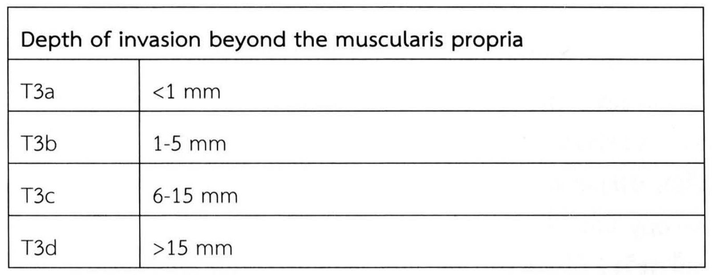

> **Caption (verbatim):** **ตารางที่ 3** Subclassification of T3 rectal cancer.
> **Text in image (verbatim):** Depth of invasion beyond the muscularis propria · T3a · <1 mm · T3b · 1-5 mm · T3c · 6-15 mm · T3d · >15 mm
> **Description:** Image of the printed table. A single bold header cell, "Depth of invasion beyond the muscularis propria", spans both columns; below it are four rows, each with the T3 subcategory in the left column and the depth of tumour invasion beyond the muscularis propria in the right column: T3a <1 mm, T3b 1-5 mm, T3c 6-15 mm, T3d >15 mm. (The header is a merged cell spanning both columns; in the Markdown table above it is repeated in each column.)
> **Identifiers in image:** none

**ตารางที่ 4** Treatment options according to TNM risk category of primary rectal cancer without distant metastases.

| **Risk group** | **TN substage** | **Possible therapeutic options** |
| --- | --- | --- |
| Early (Good) | cT1-cT2 ; cT3a/b if middle or high rectum, N0 , MRF clear, no EMVI | TME alone is standard. |
| Intermediate | cT3a/b very low, levators clear, MRF clear or cT3a/b in mid-or high rectum, cN1-2 (not extranodal), no EMVI | TME alone is a standard only if good-quality mesorectal resection assured |
| Bad | cT3c/d or very low localisation levators threatened, MRF clear cT3c/d mid-rectum, cN1-N2 (extranodal), EMVI+, limited cT4aN0 | Preoperative CCRT followed by TME |
| Advanced (Ugly) | cT3 with any MRF involved, any cT4a/b, lateral node+ | Preoperative CCRT followed by TME and more extended surgery if needed due to tumour overgrowth |

## การติดตามหลังการผ่าตัด

เป้าหมายของการติดตามคือ เฝ้าระวังการกลับเป็นซ้ำของโรคมะเร็ง ซึ่งสามารถจำแนกได้เป็นการกลับเป็นซ้ำเฉพาะที่บริเวณ anastomosis (local recurrence) และการกลับเป็นซ้ำแบบแพร่กระจาย (distant metastasis) โดยส่วนมากมะเร็งลำไส้ใหญ่จะพบการแพร่กระจายไปที่ ตับ ปอด หรือ peritoneal carcinomatosis สำหรับความเสี่ยง

<!-- p.500 (printed 486) -->
ในการเกิดเป็นซ้ำจะแตกต่างกันไป ขึ้นอยู่กับ final pathological staging ที่ได้จากการผ่าตัด โดยผู้ป่วยที่เป็น advanced stage จะมีโอกาสเป็นซ้ำสูงกว่า early stage

ในผู้ป่วยที่พบการกลับเป็นซ้ำของมะเร็ง พบว่าส่วนใหญ่จะเกิดขึ้นภายใน 2 ปีแรกหลังการผ่าตัด และอาจมีบางส่วนที่เกิดการเป็นซ้ำหลังจากนั้น แต่มักจะอยู่ภายใน 5 ปีแรก จึงเป็นที่มาของการแนะนำเรื่องความถี่ในการเฝ้าระวังโดยในช่วง 2 ปีแรก ให้นัดตรวจทุก 3 เดือน ประกอบด้วย CEA, chest x-ray, ultrasound liver และควรพิจารณาทำ colonoscopy และ chest and abdominal CT scan ภายใน 1 ปีแรก หลังจากที่ผ่านการเฝ้าระวัง 2 ปีไปแล้ว ผู้ป่วยจะมีโอกาสเกิดมะเร็งเป็นซ้ำน้อยลงมาก จึงให้เลื่อนการติดตามออกไปเป็นทุก 6 เดือนจนครบ 5 ปี

การเลือก investigation ระหว่าง x-ray, ultrasound, CT scan, MRI scan, หรือ PET/CT scan จะขึ้นกับความเสี่ยงในการเกิดเป็นซ้ำของมะเร็ง เช่น ในผู้ป่วย advanced stage ที่มีโอกาสเป็นซ้ำสูงกว่าสมควรเฝ้าระวังรัดกุมกว่าด้วย CT scan เป็นต้น ส่วนความถี่ในการทำ colonoscopy ขึ้นกับความเสี่ยงเช่นกัน เช่น ในรายที่ส่องกล้องพบ advanced polyp ควรต้องรับการตรวจให้ถี่ขึ้นตามข้อบ่งชี้ และหลังจากติดตามผู้ป่วยจนครบ 5 ปี จะสามารถกล่าวได้ว่าผู้ป่วยน่าจะหายขาดจากโรคมะเร็งแล้ว ให้ทำการตรวจเฝ้าระวังปีละครั้งต่อไปจนครบ 10 ปี

## เอกสารอ้างอิง

1. https://ourworldindata.org/grapher/total-cancer-deaths-by-type

2. https://ourworldindata.org/grapher/total-cancer-deaths-by-type?country=THA

3. Nguyen LH, Goel A, Chung DC. Pathways of Colorectal Carcinogenesis. Gastroenterology 2019 Oct 14. pii: S0016-5085(19)41441-8. doi:10.1053/j.gastro.2019.08.059.

4. Okugawa Y, Grady WM, Goel A. Epigenetic Alterations in Colorectal Cancer: Emerging Biomarkers. Gastroenterology 2015;149:1204-1225.e12.

5. Dekker E, Tanis PJ, Vleugels JLA, Kasi PM, Wallace MB. Colorectal cancer. Lancet 2019;394:1467-1480.

6. Moore JS, Aulet TH. Colorectal Cancer Screening. Surg Clin North Am 2017;97: 487-502.

<!-- p.501 (printed 487) -->
7. Amin MB, Edge S, Greene F, Byrd DR, Brookland RK, Washington MK, et al. AJCC Cancer Staging Manual. New York, NY: Springer 2017; 252-254.

8. Enker WE, Laffer UT, Block GE. Enhanced survival of patients with colon and rectal cancer is based upon wide anatomic resection. Ann Surg 1979;190:350-60.

9. Hohenberger W, Weber K, Matzel K, Papadopoulos T, Merkel S. Standardized surgery for colonic cancer: complete mesocolic excision and central ligation--technical notes and outcome. Colorectal Dis 2009;11:354-64; discussion 364-5.

10. Nakafusa Y, Tanaka T, Tanaka M, Kitajima Y, Sato S, Miyazaki K. Comparison of multivisceral resection and standard operation for locally advanced colorectal cancer: analysis of prognostic factors for short-term and long-term outcome. Dis Colon Rectum 2004;47:2055-63.

11. Heald RJ, Husband EM, Ryall RD. The mesorectum in rectal cancer surgery-the clue to pelvic recurrence? Br J Surg 1982;69:613-6.

12. Heald RJ, Santiago I, Pares O, Carvalho C, Figueiredo N. The Perfect Total Mesorectal Excision Obviates the Need for Anything Else in the Management of Most Rectal Cancers. Clin Colon Rectal Surg 2017;30:324-332.

13. Thiptanakit C, Chowchankit I, Panya S, Kanjanasilp P, Malakorn S, Pattana-Arun J, et al. Urgent Pelvic Exenteration: Should the Indication Be Extended? Dis Colon Rectum 2018;61:561-566.

14. Kanjanasilp P, Ng JL, Kajohnwongsatit K, Thiptanakit C, Limvorapitak T, Sahakitrungruang C. Anatomical Variations of Iliac Vein Tributaries and Their Clinical Implications During Complex Pelvic Surgeries. Dis Colon Rectum 2019; 62:809-814.

15. Sahakitrungruang C, Chantra K, Dusitanond N, Atittharnsakul P, Rojanasakul A. Sacrectomy for primary sacral tumors. Dis Colon Rectum 2009;52:913-8.

16. Sahakitrungruang C, Atittharnsakul P. Colonic flap with mucosa removed: a novel technique for pelvic reconstruction after exenteration of advanced pelvic malignancy. Tech Coloproctol 2012;16:373-8.

17. Sahakitrungruang C, Atittharnsakul P. Sigmoid flap: a novel technique for perineal and neovaginal reconstruction after abdominoperineal resection with near total vaginectomy for locally advanced rectal cancer. J Am Coll Surg 2010;210:e5-8.

<!-- p.502 (printed 488) -->
18. Stevenson AR. The future for laparoscopic rectal cancer surgery. Br J Surg2017;104:643-645.

19. Ng JL, Sahakitrungruang C. Laparoscopic-assisted techniques in overcoming bulky sigmoid colon cancer - a video vignette. Colorectal Dis 2018;20:826.

20. Ng JL, Kajohnwongsatit K, Sahakitrungruang C. Laparoscopic Mesorectal Excision in Obesity: Novel Insights and Technical Strategies. Dis Colon Rectum 2019;62: 380-384.

21. Jayne D, Pigazzi A, Marshall H, Croft J, Corrigan N, Copeland J, et al. Effect of Robotic-Assisted vs Conventional Laparoscopic Surgery on Risk of Conversion to Open Laparotomy Among Patients Undergoing Resection for Rectal Cancer: The ROLARR Randomized Clinical Trial. JAMA 2017;318:1569-1580.

22. Roodbeen SX, de Lacy FB, van Dieren S, Penna M, Ris F, Moran B, et al; International TaTME Registry Collaborative. Predictive Factors and Risk Model for Positive Circumferential Resection Margin Rate After Transanal Total Mesorectal Excision in 2653 Patients With Rectal Cancer. Ann Surg 2019;270:884-891.

23. Glynne-Jones R, Wyrwicz L, Tiret E, Brown G, Rödel C, Cervantes A, Arnold D; ESMO Guidelines Committee. Rectal cancer: ESMO Clinical Practice Guidelines for diagnosis, treatment and follow-up. Ann Oncol 2018;29:iv263.
