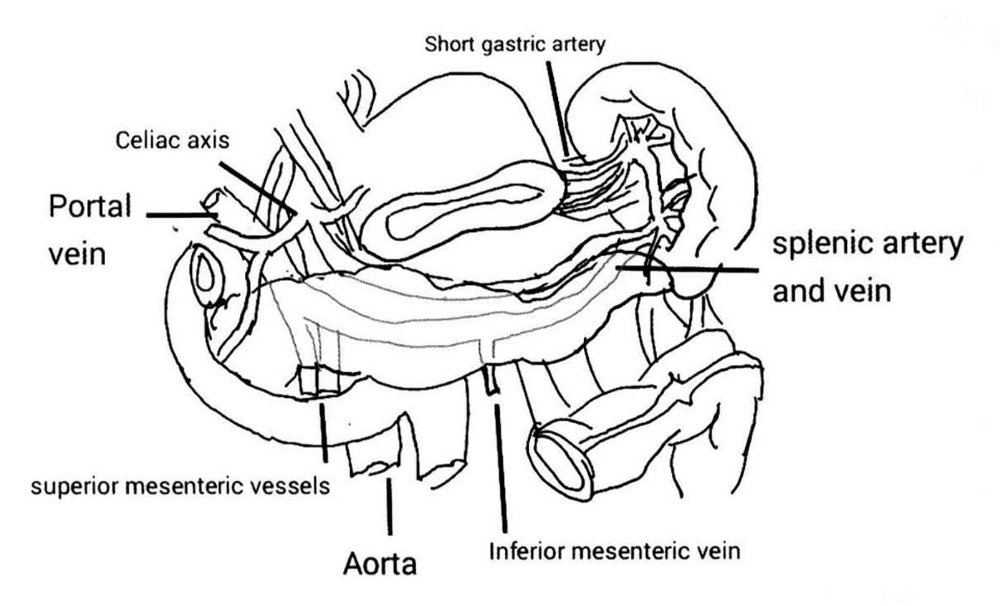
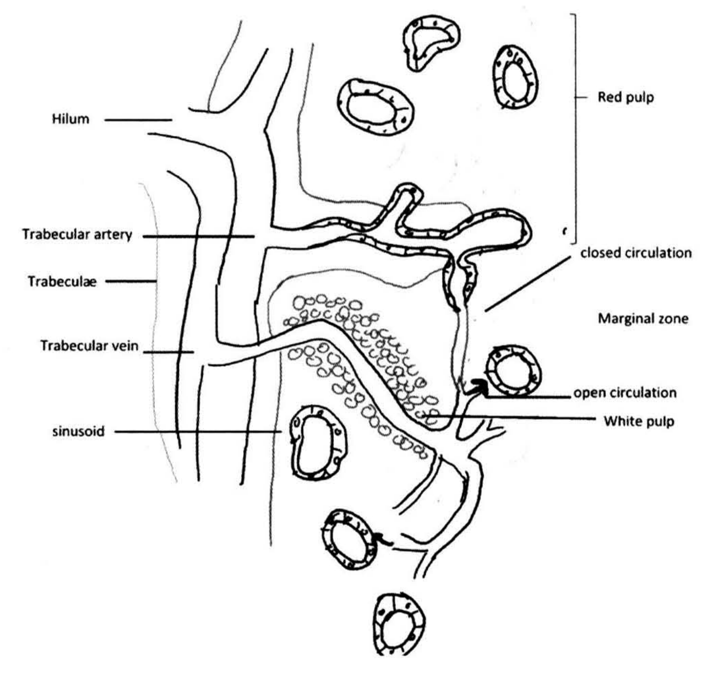
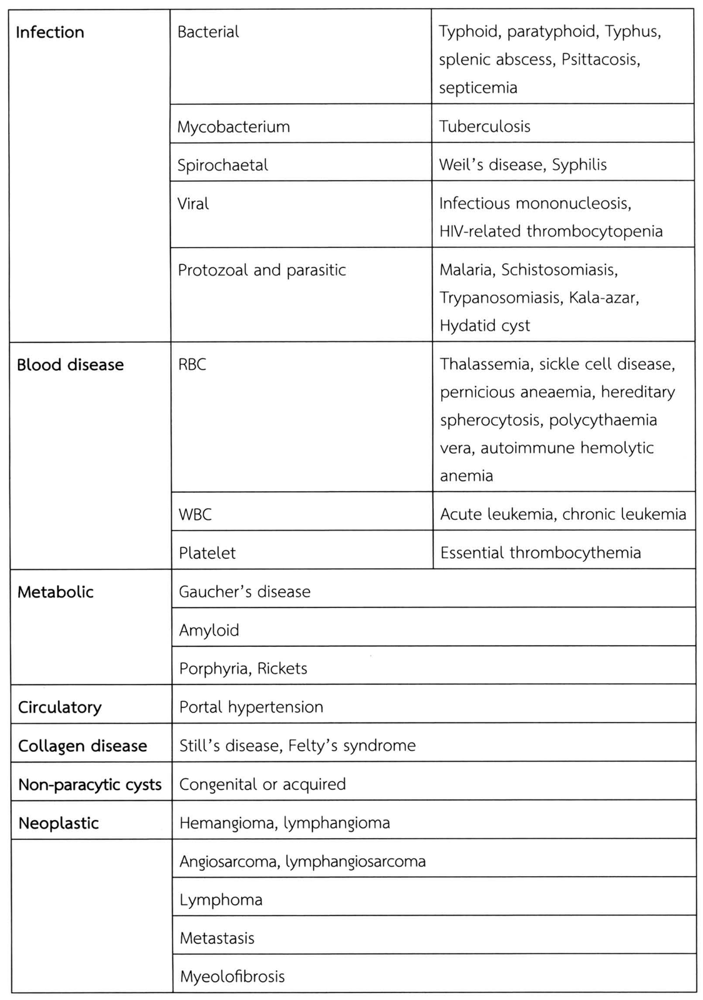

# ม้าม (Spleen)

## Contents of this file
- Embryology and Anatomy (p.504)
- Physiology (p.507)
- Splenomegaly และ Hypersplenism (p.509)
- การตรวจร่างกาย (p.511)
- การตรวจทางรังสี (p.511)
- ความผิดปกติของม้ามในด้านจำนวน, ขนาด หรือตำแหน่ง (p.512)
  - *Accessory spleen/ supernumerary spleens/ splenunculi/ splenules* (p.512)
  - *Wandering spleen/ ectopic spleen* (p.512)
  - *Polysplenia and Asplenia* (p.513)
  - *Splenosis* (p.513)
- Vascular disorder of the spleen, infarction and rupture (p.514)
  - *Splenic artery aneurysm* (p.514)
  - *Portal hypertension* (p.515)
  - *Splenic infarction* (p.515)
  - *Splenic rupture* (p.516)
- Benign disorders of spleen (p.516)
  - *Splenic abscesses* (p.516)
  - *Cysts* (p.517)
- Tumor and metastasis (p.518)
- ข้อบ่งชี้ในการผ่าตัดม้าม (Indication for splenectomy) (p.518)
- ภาวะแทรกซ้อนหลังการผ่าตัด splenectomy (p.522)
- เอกสารอ้างอิง (p.524)

<!-- p.503 (printed none) -->
**ม้าม**

**Spleen**

เอธยา วรสิทธา

<!-- p.504 (printed 490) -->
**ม้าม**

**Spleen**

เอธยา วรสิทธา

## Embryology and Anatomy

ในช่วง 5 สัปดาห์แรกของการตั้งครรภ์ ม้ามจะเจริญมาจากส่วนหนึ่งของ mesogastrium ในช่วง 5 เดือนแรก ในม้ามจะประกอบไปด้วยเซลล์ตั้งต้นของเม็ดเลือดต่างๆ และทำหน้าที่ในการสร้างเม็ดเลือดให้แก่ร่างกายร่วมกับตับ  จนกระทั่งหลังคลอดการสร้างเม็ดเลือดจะเกิดขึ้นที่ไขกระดูกเป็นหลัก1

หลังจากการหมุนของอวัยวะภายในช่องท้อง ม้ามจะเคลื่อนไปอยู่ในตำแหน่งช่องท้องด้านซ้ายบนใต้กระบังลมด้านซ้าย  และมีขอบเขตอยู่ใต้ซี่โครงซี่ที่  9-11  ด้านในของม้ามจะอยู่ชิดกับกระเพาะอาหาร และหางของตับอ่อน โดย 70% ของคนทั่วไปจะพบหางตับอ่อนอยู่ห่างจากม้ามประมาณ 1 เซนติเมตร แต่อีก 30% จะพบหางตับอ่อนอยู่ชิดกับ capsule ของม้าม ทำให้ในการผ่าตัดม้ามอาจมีโอกาสบาดเจ็บที่ตับอ่อนได้มากขึ้น ส่วนด้านล่างของม้ามอยู่ใกล้กับไตด้านซ้ายทางด้านหลัง และ Splenic flexure ของลำไส้ใหญ่ทางด้านหน้า1

ขนาดของม้ามแตกต่างกันในแต่ละช่วงอายุ  ม้ามในผู้ใหญ่มีความยาวเฉลี่ยประมาณ 7-11 เซนติเมตร และน้ำหนักเฉลี่ย 150 กรัม (70-250 กรัม)2 ม้ามยึดอยู่กับอวัยวะข้างเคียงด้วยเอ็นยึด (ligaments) หลายด้าน ได้แก่ 1. splenocolic ligament อยู่ระหว่างม้ามกับลำไส้ใหญ่ 2. Phrenosplenic ligament ยึดอยู่ระหว่างม้ามกับกระบังลม 3. Splenorenal ligament ยึดระหว่างม้ามกับไต, ต่อมหมวกไตและตับอ่อน 4. Gastrosplenic ligament ยึดระหว่างม้ามกับ greater curvature ของกระเพาะอาหาร และมี short gastric vessels ซึ่งมาจาก left gastroepiploic vessels วิ่งผ่านใน ligament นี้ ส่วนใน ligament ข้อ 1-3 นั้นมักจะไม่มีหลอดเลือดวิ่งผ่าน ยกเว้นกรณีที่มีความดันสูงในระบบหลอดเลือดดำที่ไปเลี้ยงตับ (portal hypertension) อาจจะมีหลอดเลือดเล็กๆ วิ่งผ่านเอ็นยึดเหล่านี้ได้3 นอกเหนือจากเอ็นยึดดังกล่าวข้างต้นแล้วยังอาจพบเอ็นยึดจากม้ามไปที่ omentum ซึ่งเอ็นนี้มักจะมีหลอดเลือดเล็กวิ่งผ่าน และ

<!-- p.505 (printed 491) -->
อาจทำให้เกิดการบาดเจ็บต่อม้ามในการผ่าตัดช่องท้องด้านบนและมีการดึงรั้ง omentum โดยไม่ระมัดระวังได้1

ม้ามได้รับเลือดแดงจาก splenic artery เป็นหลัก splenic artery แตกมาจาก celiac axis ซึ่งอาจมีการแตกแขนงไปเลี้ยงบางส่วนของตับอ่อน และมีการแตกแขนงไปเลี้ยงส่วนต่างๆ ของม้ามประมาณ 3-5 แขนงย่อย นอกจากนี้ม้ามยังได้รับเลือดจาก short gastric artery ซึ่งจะให้เลือดไปเลี้ยงประมาณ 2/3 ของม้ามทางด้านบน3 ส่วนหลอดเลือดดำ Splenic vein จะไปเชื่อมกับ Superior mesenteric vein กลายเป็น portal vein นำเลือดดำจากทางเดินอาหารและม้ามผ่านไปยังตับ ส่วน inferior mesenteric vein จะนำเลือดจากลำไส้ใหญ่ซีกซ้ายมาเทเข้าสู่ portal system โดยเทเข้าส่วนต้นของ splenic vein (54-68.5%) หรือ superior mesenteric vein (18.5-27%) หรือระหว่างรอยต่อของหลอดเลือดดำทั้งสองก็ได้ (17-20%)4, 5 อัตราการไหลของเลือดผ่านม้ามอยู่ที่ 200-300 มิลลิลิตรต่อนาที หรือประมาณ 5 เปอร์เซ็นต์

> **Caption (verbatim):** **รูปที่ 1** แสดงกายวิภาคของม้ามและหลอดเลือดที่ไปเลี้ยง
> **Text in image (verbatim):** Short gastric artery · Celiac axis · Portal vein · splenic artery and vein · superior mesenteric vessels · Aorta · Inferior mesenteric vein
> **Description:** Black-and-white line drawing of the upper abdomen viewed from the front with the stomach drawn reflected upward, showing the spleen on the right side of the image (patient's left) and a horizontally lying, faintly shaded organ (the pancreas, unlabelled) across the middle, with an unlabelled C-shaped bowel loop curving around its left end. Organs themselves are not labelled; only vessels are. Label lines point to: the Celiac axis (vessel trunk arising behind the stomach, upper left); the Portal vein (cut vessel at the left near the pancreatic head); the Short gastric artery (small vessels running from the splenic hilum up to the greater curvature of the stomach, top centre-right); the splenic artery and vein (running along the upper border of the pancreas toward the splenic hilum, right); the superior mesenteric vessels (emerging below the pancreatic neck, lower left-centre); the Aorta (cut tubular vessel below the pancreas, bottom centre); and the Inferior mesenteric vein (thin vessel ascending to join behind the pancreas, bottom centre-right). A cut end of a bowel loop is drawn at the lower right.
> **Identifiers in image:** none

ระบบไหลเวียนน้ำเหลืองของม้ามจะเป็นไปตามหลอดเลือด โดยเริ่มจากต่อมน้ำเหลืองบริเวณขั้วม้ามและระบายน้ำเหลืองไปตาม splenic artery ซึ่งวิ่งอยู่เหนือขอบบนของตับอ่อน และ short gastric arteries1 ดังนั้น หากเป็นมะเร็งในบริเวณข้างเคียงกับทางระบายน้ำเหลืองดังกล่าว เช่น ส่วน body หรือ tail ของตับอ่อน และกระเพาะอาหาร โดยเฉพาะฝั่ง greater curvature อาจมีการกระจายของเนื้องอกมาที่บริเวณขั้วม้ามได้ เป็นเหตุผลให้การผ่าตัดมะเร็งในบริเวณเหล่านั้นอาจต้องตัดม้ามร่วมด้วย

<!-- p.506 (printed 492) -->
ม้ามห่อหุ้มด้วยแคปซูลที่ประกอบด้วย fibroelastic tissue และ mesothelium lining 1 ชั้น แคปซูลนี้จะเชื่อมกับ fibrous band ที่เรียกว่า trabeculae ซึ่งยื่นเข้าไปในเนื้อม้ามและแบ่งเป็นส่วนย่อยตามแขนงของหลอดเลือด เนื้อของม้ามระหว่าง trabecula จะประกอบไปด้วย white pulp, red pulp และ marginal zone เมื่อหลอดเลือดแดงที่แตกแขนงตามส่วนย่อยของม้ามโดยส่วนปลายของหลอดเลือดเหล่านี้จะห่อหุ้มด้วยเนื้อเยื่อน้ำเหลืองแทน adventitia เรียกเนื้อเยื่อน้ำเหลืองเหล่านี้ว่า white pulp ซึ่งประกอบไปด้วย T lymphocytes และ lymphoid follicles ที่ประกอบด้วย B lymphocyte ที่เจริญอยู่ในระยะต่างๆ กัน marginal zone คือบริเวณที่อยู่ระหว่าง white pulp กับ red pulp ซึ่งประกอบไปด้วยเนื้อเยื่อน้ำเหลืองและ macrophage หลอดเลือดแดงส่วนปลาย จาก white pulp จะเริ่มเปลี่ยนแปลงไปเป็น splenic cords (cords of Billroth) และ splenic sinuses ในส่วน red pulp Splenic cords เป็นร่างแห fibroblast ที่มี mature macrophage อยู่ ส่วน splenic sinus เป็นพื้นที่รองรับเลือดก่อนที่เลือดจะกลับเข้าสู่ venules และกลับไปสู่ splenic vein ต่อไป Splenic sinus มี endothelial cell lining ที่ประกอบด้วย filament ที่มีลักษณะคล้าย actin-myosin ซึ่งจะสามารถสร้างช่องว่างระหว่าง endothelial cell ให้เซลล์เม็ดเลือดแดงผ่านจาก cord เข้ามาใน sinus ได้ เม็ดเลือดแดงที่อายุมากจะมีความยืดหยุ่นของผนังเซลล์ต่ำและไม่สามารถผ่านร่องดังกล่าวได้และถูกกำจัดด้วย macrophage ในบริเวณ red pulp1, 3 (รูปที่ 2)

> **Caption (verbatim):** **รูปที่ 2** แสดงโครงสร้างของระบบไหลเวียนโลหิตในม้าม
> **Text in image (verbatim):** Hilum · Trabecular artery · Trabeculæ · Trabecular vein · sinusoid · Red pulp · closed circulation · Marginal zone · open circulation · White pulp
> **Description:** Schematic black-and-white line drawing of splenic microcirculation. On the left, parallel lines represent the Trabeculæ extending from the Hilum (upper left), carrying the Trabecular artery (upper horizontal branch running to the right) and the Trabecular vein (lower branch entering from the right). The arterial branch continues into a tortuous vessel with a cellular wall in the upper centre; a vertical bracket on the right side marks the upper region as Red pulp, which contains several ring-shaped sinusoids drawn with endothelial-cell walls. Below, a central arteriole runs diagonally down to the right, surrounded by a cluster of small round cells labelled White pulp; the surrounding paler band is labelled Marginal zone. Label lines on the right indicate "closed circulation" (a vessel connecting directly into a sinusoid) and "open circulation" (a small arrow showing a vessel ending openly near a sinusoid). A ring-shaped "sinusoid" is labelled on the left-centre; further sinusoids appear at the bottom, one with a small arrow entering it.
> **Identifiers in image:** none

<!-- p.507 (printed 493) -->
การไหลเวียนของเลือดผ่านม้ามนั้นจะเริ่มจากหลอดเลือดแดงใหญ่ไปสู่หลอดเลือดแดงขนาดเล็กที่แตกแขนงไปเป็น central artery ระหว่าง traceculae ต่างๆ และผ่าน white pulp และ marginal zone ตามลำดับ หลังจากนั้นประมาณ 10% ของเลือดจะไหลกลับเข้าสู่ splenic vein เลือดที่ไหลผ่านส่วนนี้จะประกอบด้วย plasma และเม็ดเลือดแดงปริมาณไม่มากนัก (Fast flow pattern) ส่วนการไหลเวียนเลือดอีก 90% รวมทั้งเม็ดเลือดแดงส่วนใหญ่จะไหลผ่านม้ามเข้าสู่ splenic cord และ splenic sinus ใน red pulp เพื่อกำจัดเม็ดเลือดแดงที่อายุมากหรือมีรูปร่างผิดปกติก่อนกลับเข้าสู่หลอดเลือดดำ (Slow flow pattern)1

## Physiology

ม้ามมีหน้าที่สำคัญหลักในสองด้าน คือ ด้านระบบเลือด และด้านระบบภูมิคุ้มกัน (ตารางที่ 1) ในด้านระบบเลือด ม้ามมีหน้าที่หลักในการกรองและกำจัดเม็ดเลือดที่อายุมากหรือเม็ดเลือดแดงรูปร่างผิดปกติจากโรคเลือดบางชนิด เช่น thalassemia, hereditary sphrerocytosis, sickle cell anemia เป็นต้น กระบวนการนี้เกิดขึ้นใน red pulp ธาตุเหล็กที่เหลือจากการสลาย hemoglobin จากเม็ดเลือดแดงจะเวียนกลับเข้าสู่กระแสเลือด โดยปกติเม็ดเลือดแดงมีอายุเฉลี่ย 120 วัน แต่ในโรคเลือดที่มีรูปร่างเม็ดเลือดแดงผิดปกติ เม็ดเลือดแดงจะถูกทำลายเร็วขึ้น ทำให้ซีดมากขึ้นและม้ามโต6 นอกจากนี้เม็ดเลือดแดงที่มีลักษณะไม่สมประกอบ มี inclusion ใน cell และมีรูปร่างผิดปกติจะถูกจัดแต่งรูปทรงใหม่ในม้ามโดยการกำจัด cytoplasm บางส่วนออก เรียกกระบวนการนี้ว่า Pitting ตัวอย่าง inclusion bodies ดังกล่าวเช่น Howell-Jolly bodies (nuclear remnant), Heinz bodies (denatured hemoglobin) และ Pappenheimer bodies (iron granules)2

นอกจากเม็ดเลือดแดงแล้ว ม้ามยังมีหน้าที่เกี่ยวกับการทำลายเม็ดเลือดขาวและเกล็ดเลือด ปกตินิวโทรฟิลจะมีอายุอยู่ในระบบไหลเวียนโลหิตประมาณ 6 ชั่วโมง ในขณะที่เกล็ดเลือดมีอายุประมาณ 7-10 วัน ประมาณ 1 ใน 3 ของเกล็ดเลือดจะเก็บไว้ในม้าม (sequestration) ในภาวะม้ามโตอาจจะทำให้ม้ามมีการกักเก็บเกล็ดเลือดไว้สูงถึง 80% และทำให้เกิดเกล็ดเลือดต่ำ (Thrombocytopenia) ได้ นอกจาก sequestration แล้ว เม็ดเลือดขาวต่ำและเกล็ดเลือดต่ำ อาจเกิดจากการทำลายเม็ดเลือดขาวและเกล็ดเลือดมากเกินปกติ (hypersplenism)3

<!-- p.508 (printed 494) -->
ม้ามทำหน้าที่ในการสร้างเม็ดเลือดทุกชนิดในช่วงแรกของการตั้งครรภ์ แต่ทำหน้าที่นี้น้อยมากในผู้ใหญ่ปกติ  หากมีความผิดปกติที่ทำให้ร่างกายไม่สามารถสร้างเม็ดเลือดได้เพียงพอ ม้ามอาจทำหน้าที่ในการสร้างเม็ดเลือดมากขึ้น ในโรคเลือดบางชนิด เช่น ธาลัสซีเมีย (Thalassemia) และ chronic myeloproliferative syndrome เป็นต้น ที่ม้ามอาจจะทำหน้าที่สร้างเม็ดเลือดต่อไป (extramedullary hematopoiesis) เป็นเหตุให้ม้ามมีขนาดใหญ่ขึ้น (Splenomegaly) และเกิดอาการผิดปกติตามมาได้7

ในด้านระบบภูมิคุ้มกันของร่างกาย ม้ามเกี่ยวข้องกับทั้ง innate และ adaptive immunity 66.5% ของ T lymphocyte และ 10-15% ของ B lymphocyte ในร่างกายอยู่ในม้าม2 macrophage จำนวนมากใน red pulp และ marginal zone จะทำหน้าที่กรองและกำจัดจุลชีพ, ซากของเซลล์, antigen-antibody complexes ส่วน Antigen presenting cell ซึ่งอยู่ใน white pulp จะทำหน้าที่นำเสนอแอนติเจนให้กับ lymphocyte ใน lymphoid follicles กระตุ้นให้เกิดการตอบสนองของระบบภูมิต้านทาน การสร้าง immunoglobulin (ส่วนมากเป็น immunoglobulin M ; IgM) นอกจากนี้ ม้ามยังสร้าง opsonins ได้แก่ tufsin และ properdin Tufsin เป็นเปปไทด์ขนาดเล็กที่จะไปจับกับผิวของเซลล์เม็ดเลือดขาวและกระตุ้น phagocytosis ของเซลล์ ส่วน Properdin มีส่วนช่วยในกระบวนการกระตุ้นคอมพลีเมนท์ (alternate pathway of complement activation)1

**ตารางที่ 1** หน้าที่ของม้าม

|  |  |
| --- | --- |
| Hematologic | 1. กรองและกำจัดเซลล์เม็ดเลือดแดงที่อายุมากหรือผิดปกติ 2. เป็น reservoir ของเกล็ดเลือดและเม็ดเลือดขาว 3. สร้างเม็ดเลือดชนิดต่างๆ ในช่วงแรกของตัวอ่อนในครรภ์หรือในผู้ใหญ่ที่มีความผิดปกติบางอย่างของไขกระดูก |
| Immunologic | 1. กรองและกำจัดแอนติเจนในเลือด 2. กระตุ้นระบบภูมิคุ้มกันและการสร้างเม็ดเลือดขาวชนิด lymphocyte 3. กระตุ้นการสร้างแอนติบอดี้ 4. สร้าง opsonin ได้แก่ tuftsin และ properdin |

<!-- p.509 (printed 495) -->
## Splenomegaly และ Hypersplenism

ภาวะม้ามโต (Splenomegaly) หมายถึง การที่ม้ามมีขนาดใหญ่กว่าปกติ โดยทั่วไปหมายถึงการที่ม้ามมีน้ำหนักมากกว่าเท่ากับ 500 กรัม หรือความยาวมากกว่าเท่ากับ 15 เซนติเมตร การตรวจร่างกายในคนไข้ที่ม้ามมีขนาดปกติจะไม่สามารถคลำม้ามได้ แต่ถ้าม้ามมีขนาดใหญ่กว่าปกติเกิน 3 เท่า (น้ำหนักมากกว่าเท่ากับ 750 กรัม) อาจจะสามารถคลำขอบล่างของม้ามใต้ชายโครง Massive splenomegaly เป็นคำที่ใช้ในการบรรยายม้ามที่ใหญ่กว่า 1 กิโลกรัม หรือยาวมากกว่า 22 เซนติเมตร ขอบด้านในของม้ามที่อยู่ชิดกับกระเพาะอาหารจะมีร่องที่ผิวได้ 1-2 ร่อง และร่องจะมีขนาดใหญ่มากขึ้นเมื่อม้ามโต อาจทำให้สับสนกับรอยแตกของม้าม (Splenic rupture) จากภาพทางรังสีได้3

Hypersplenism หมายถึง ภาวะที่ม้ามทำหน้าที่กำจัดเซลล์เม็ดเลือดแดง เม็ดเลือดขาว หรือเกล็ดเลือดมากเกินปกติ ทำให้เกิดภาวะซีด เม็ดเลือดขาวต่ำ หรือเกล็ดเลือดต่ำอย่างน้อย 1 อย่าง โดยที่ไขกระดูกทำงานได้ปกติ และสามารถแก้ไขภาวะเม็ดเลือดต่ำได้ด้วยการตัดม้าม1 โดยอาจจะมีหรือไม่มี splenomegaly ร่วมด้วยก็ได้ Hypersplenism เกิดจาก 2 สาเหตุหลัก ได้แก่ 1. ความผิดปกติของเม็ดเลือด ทำให้เกิดการทำลายเซลล์เม็ดเลือดมากขึ้นในม้ามที่ปกติ เช่น ใน hemoglobinopathy และ immune thrombocytopenic purpura เป็นต้น 2. มีความผิดปกติที่ม้ามเองทำให้เกิด sequestration และการทำลายเม็ดเลือดปกติมากขึ้น เช่น ใน non-Hodgkin lymphoma, Gaucher disease, Sarcoidosis, portal hypertension เป็นต้น3 ในทางกลับกัน ผู้ป่วยที่มีม้ามโตก็อาจไม่ได้มีภาวะของ hypersplenism ก็ได้ สาเหตุของ splenomegaly และ hypersplenism แสดงในตารางที่ 2

<!-- p.510 (printed 496) -->
**ตารางที่ 2** สาเหตุของ splenomegaly

|  |  |  |
| --- | --- | --- |
| **Infection** | Bacterial | Typhoid, paratyphoid, Typhus, splenic abscess, Psittacosis, septicemia |
| **Infection** | Mycobacterium | Tuberculosis |
| **Infection** | Spirochaetal | Weil’s disease, Syphilis |
| **Infection** | Viral | Infectious mononucleosis, HIV-related thrombocytopenia |
| **Infection** | Protozoal and parasitic | Malaria, Schistosomiasis, Trypanosomiasis, Kala-azar, Hydatid cyst |
| **Blood disease** | RBC | Thalassemia, sickle cell disease, pernicious aneaemia, hereditary spherocytosis, polycythaemia vera, autoimmune hemolytic anemia |
| **Blood disease** | WBC | Acute leukemia, chronic leukemia |
| **Blood disease** | Platelet | Essential thrombocythemia |
| **Metabolic** | Gaucher’s disease |  |
| **Metabolic** | Amyloid |  |
| **Metabolic** | Porphyria, Rickets |  |
| **Circulatory** | Portal hypertension |  |
| **Collagen disease** | Still’s disease, Felty’s syndrome |  |
| **Non-paracytic cysts** | Congenital or acquired |  |
| **Neoplastic** | Hemangioma, lymphangioma |  |
|  | Angiosarcoma, lymphangiosarcoma |  |
|  | Lymphoma |  |
|  | Metastasis |  |
|  | Myeolofibrosis |  |

> **Caption (verbatim):** **ตารางที่ 2** สาเหตุของ splenomegaly
> **Text in image (verbatim):** Infection · Bacterial · Typhoid, paratyphoid, Typhus, splenic abscess, Psittacosis, septicemia · Mycobacterium · Tuberculosis · Spirochaetal · Weil’s disease, Syphilis · Viral · Infectious mononucleosis, HIV-related thrombocytopenia · Protozoal and parasitic · Malaria, Schistosomiasis, Trypanosomiasis, Kala-azar, Hydatid cyst · Blood disease · RBC · Thalassemia, sickle cell disease, pernicious aneaemia, hereditary spherocytosis, polycythaemia vera, autoimmune hemolytic anemia · WBC · Acute leukemia, chronic leukemia · Platelet · Essential thrombocythemia · Metabolic · Gaucher’s disease · Amyloid · Porphyria, Rickets · Circulatory · Portal hypertension · Collagen disease · Still’s disease, Felty’s syndrome · Non-paracytic cysts · Congenital or acquired · Neoplastic · Hemangioma, lymphangioma · Angiosarcoma, lymphangiosarcoma · Lymphoma · Metastasis · Myeolofibrosis
> **Description:** Scanned table with merged cells and no header row. The first column holds bold category names; each category cell spans vertically over its rows ("Infection" spans 5 rows, "Blood disease" 3 rows, "Metabolic" 3 rows). For Infection and Blood disease there are two further columns (sub-type, then example diseases). For Metabolic, Circulatory, Collagen disease, Non-paracytic cysts and Neoplastic, the second and third columns are merged into one wide cell holding the disease names (in the Markdown version above these are placed in column 2 with column 3 left empty). Below the "Neoplastic" row, the first-column cell is a separate empty cell spanning the last four rows (Angiosarcoma, lymphangiosarcoma; Lymphoma; Metastasis; Myeolofibrosis), left blank as printed. Spellings such as "aneaemia", "Non-paracytic" and "Myeolofibrosis" are as printed.
> **Identifiers in image:** none

<!-- p.511 (printed 497) -->
## การตรวจร่างกาย8

ม้ามที่ขนาดปกติมักจะคลำไม่ได้ ยกเว้นในผู้ป่วยที่ผอม โดยทั่วไปม้ามจะคลำได้เมื่อมีขนาดใหญ่กว่าปกติ 3 เท่าขึ้นไป การตรวจร่างกายทำเหมือนกับการตรวจช่องท้องทั่วไป คือ เริ่มด้วยการดู ฟัง คลำและเคาะ ในผู้ป่วยที่มีม้ามขนาดใหญ่มาก อาจสามารถสังเกตเห็นได้ว่าผนังหน้าท้องด้านซ้ายบนนูนขึ้นกว่าปกติ ส่วนการฟังนั้น ทำได้โดยวาง stethoscope ที่บริเวณด้านซ้ายบนของช่องท้อง และช่องซี่โครงซ้ายส่วนล่าง อาจจะตรวจได้ “splenic rub” - coarse, scratching sound ซึ่งจะได้ยินเวลาหายใจเข้า ในผู้ป่วยที่มีอาการปวดท้องด้านซ้ายบนหรือปวดร้าวไปไหล่ซ้าย ร่วมกับตรวจได้ splenic rub บ่งบอกว่าผู้ป่วยอาจมีพยาธิสภาพบางอย่างที่ม้าม เช่น การอักเสบ การขาดเลือด ม้ามแตก

การคลำสามารถทำได้หลายวิธี วิธีมาตรฐานคือการคลำในท่านอนหงาย และให้ผู้ป่วยงอเข่าขึ้นเล็กน้อย คลำจากช่องท้องด้านซ้ายล่างไล่ขึ้นไปทางชายโครงด้านซ้าย เพื่อหาขอบล่างของม้าม โดยในแต่ละครั้งที่คลำให้กดลง ดันขึ้นทางศีรษะเล็กน้อยและปล่อย หากคลำไม่ได้ ให้ผู้ป่วยหายใจเข้าลึกๆ ใช้มือซ้ายวางที่ชายโครงซ้ายและมือขวาคลำไปใต้ขอบชายโครงโดยเริ่มจากบริเวณกลางขอบชายโครง (mid-costal margin) ไล่ออกไปทางด้านนอก (lateral) หากยังไม่สามารถคลำได้ ให้ผู้ป่วยนอนตะแคงขวาลงและคลำตามวิธีที่ 2 อีกครั้ง หรืออาจคลำโดยการย้ายไปยืนด้านหลังผู้ป่วย ฝ่ามือขวาและนิ้วโป้งวางที่ขอบชายโครงและนิ้วที่เหลือ 4 นิ้ว เกี่ยวไปใต้ขอบชายโครง

การเคาะ มีประโยชน์ในกรณีที่ม้ามโตไม่มากนักและไม่สามารถคลำได้ โดยตรวจในท่านอนหงาย เคาะบริเวณช่องซี่โครงช่องล่างสุด (intercostal space ที่ 8 หรือ 9) ตัดกับ anterior axillary line (Castell’s point) เปรียบเทียบระหว่างตอนหายใจเข้าและหายใจออก หากเคาะทึบในตอนหายใจเข้า และเคาะโปร่งในตอนหายใจออก แสดงว่าม้ามน่าจะมีขนาดใหญ่กว่าปกติ9

## การตรวจทางรังสี

การถ่ายภาพเอกซเรย์ช่องท้องทั่วไป (plain abdomen) มักไม่ค่อยได้ประโยชน์ แต่อาจสามารถเห็นหินปูนจาก splenic artery aneurysm หรือ หินปูนในเนื้อม้ามซึ่งเกิดจากการขาดเลือด, ถุงน้ำ, hydatid disease หรือวัณโรค การทำ ultrasound สามารถใช้บอกขนาดและพยาธิสภาพบางอย่างในม้ามได้ โดยเฉพาะถุงน้ำ แต่การตรวจทางรังสีที่ใช้บ่อย

<!-- p.512 (printed 498) -->
ที่สุดคือ เอกซเรย์คอมพิวเตอร์ (Computed tomography ; CT) ที่ฉีดสารทึบรังสี เนื่องจากใช้บอกพยาธิสภาพของม้ามและช่วยวินิจฉัยแยกโรคอื่นๆ ในช่องท้องได้ด้วย Magnetic resonance imaging (MRI) สามารถใช้วินิจฉัยพยาธิสภาพของม้ามได้ดีพอๆ กับ CT แต่ราคาแพงกว่า ส่วนการตรวจด้วยสารทึบรังสี เช่น technetium-99m sulfur colloid สามารถบ่งบอกตำแหน่งและขนาดของม้ามได้ และอาจมีประโยชน์ในการวินิจฉัย accessory spleen หรือ splenosis2

## ความผิดปกติของม้ามในด้านจำนวน, ขนาด หรือตำแหน่ง

### *Accessory spleen/ supernumerary spleens/ splenunculi/ splenules*

เกิดจากการที่ primordial splenic buds ไม่ได้เชื่อมต่อกับ dorsal mesogastrium ในช่วงตัวอ่อนในครรภ์ 5 สัปดาห์แรก10 พบได้ประมาณ 20% ของประชากร อาจพบได้ถึง 30% ในผู้ป่วยโรคเลือด 80% ของ accessory spleen พบได้ที่บริเวณขั้วม้าม ส่วนบริเวณอื่นที่อาจพบ ได้แก่ gastrocolic ligament, pancreas tail, greater omentum, greater curvature of stomach, splenocolic ligament, mesentery ของลำไส้เล็กหรือลำไส้ใหญ่, broad ligament ข้างซ้ายในผู้หญิง และ spermatic cord ข้างซ้ายในผู้ชาย3 accessory spleen มักมีขนาดประมาณ 1 เซนติเมตร และอาจพบได้ตั้งแต่ 1-6 อัน เลือดที่ไปเลี้ยง accessory spleen นั้นแตกแขนงมาจาก splenic artery ความสำคัญของ accessory spleen คือ เมื่อผู้ป่วยจำเป็นต้องตัดม้ามเพื่อรักษาโรคทางโลหิตวิทยาหรือภูมิคุ้มกันบางโรค หากไม่สามารถตัดม้ามออกได้ทั้งหมด จะทำให้ผลการรักษาไม่ประสบความสำเร็จ จึงควรมีการตรวจทางรังสีวิทยาก่อนการผ่าตัดเพื่อดูว่าผู้ป่วยมี accessory spleen ร่วมด้วยหรือไม่ อย่างไรก็ตาม accessory spleen ขนาดเล็กอาจไม่สามารถเห็นได้จากการตรวจทางรังสี จึงต้องมีการตรวจค้นให้ทั่วช่องท้องเสมอในการผ่าตัดม้าม ทั้งนี้อัตราการตรวจพบ accessory spleen จากการผ่าตัดแบบเปิดและการผ่าตัดส่องกล้องไม่แตกต่างกัน11

### *Wandering spleen/ ectopic spleen*

พบได้น้อยกว่า 0.5% ของผู้ป่วยที่ได้รับการตัดม้าม โดยมักพบในเด็ก หรือผู้หญิงอายุ 20-40 ปี wandering spleen เกิดจากการที่ ligament โดยรอบของม้ามหย่อนเกินไปหรือเจริญไม่ดีพอ ทำให้ม้ามไม่ติดอยู่กับช่องท้องด้านซ้ายบน โดยอาจพบที่บริเวณใดของ

<!-- p.513 (printed 499) -->
ช่องท้องก็ได้ และมีความเสี่ยงที่จะเกิดการบิดของขั้วม้าม ผู้ป่วยอาจมีอาการปวดท้องเป็นๆ หายๆ ในบางรายอาจพบม้ามโตจากการคั่งของเลือดดำ (venous congestion) หรืออาจปวดท้องรุนแรงจากการบิดขั้วเฉียบพลันและเกิดการขาดเลือด การตรวจร่างกาย อาจคลำได้ก้อนในท้อง การวินิจฉัยทำได้โดยการทำเอกซเรย์คอมพิวเตอร์ช่องท้องและพบม้ามอยู่ในตำแหน่งผิดปกติ หากมีการบิดหมุนขั้วร่วมด้วยจะเห็นการบิดหมุนเป็นเกลียวของหลอดเลือดที่ขั้วม้าม (whorled appearance)6 การรักษาทำได้โดยการทำ splenopexy คือเย็บยึดม้ามไว้ในตำแหน่งปกติโดยใช้ตาข่ายสังเคราะห์ที่ละลายได้ (vicryl mesh) หุ้มม้ามและเย็บตาข่ายติดกับผนังช่องท้อง12 หากมีการขาดเลือดของม้ามจากการบิดขั้วก็จำเป็นต้องตัดม้าม (splenectomy)10

### *Polysplenia and Asplenia10*

ความผิดปกติทั้งสองมักพบร่วมกับ situs ambiguous/ heterotaxia Situs ambiguous ที่พบร่วมกับ asplenia เรียกว่า Ivemark syndrome คือกลุ่มอาการที่อวัยวะภายในมีการวางตัวผิดปกติ และไม่พบเนื้อม้ามปกติ มักพบในผู้ชาย และมักมีอาการโรคหัวใจผิดปกติแต่กำเนิดร่วมด้วยเกือบทุกราย ทำให้ผู้ป่วยมักเสียชีวิตในช่วงขวบปีแรกเนื่องจากโรคหัวใจและภูมิคุ้มกันบกพร่อง

Situs ambiguous with polysplenia เป็นกลุ่มอาการผิดปกติที่ซับซ้อน มักพบร่วมกับความผิดปกติของระบบหัวใจและหลอดเลือด รวมทั้งอวัยวะภายในอื่นๆ มักพบในผู้หญิงมากกว่าผู้ชาย ผู้ป่วยจะมีม้ามมากกว่า 2 อัน และอาจพบได้มากถึง 6 อัน แต่ละอันจะมีขนาดระหว่าง 1-6 เซนติเมตร ตำแหน่งของม้ามอาจอยู่ด้านซ้ายบนของช่องท้องตามปกติ หรืออาจอยู่ด้านขวาบนก็ได้ ความผิดปกติของอวัยวะภายในอื่นๆ ที่พบร่วมกันได้บ่อย เช่น กระเพาะอาหารอยู่ด้านขวาของช่องท้อง, ตับอยู่ด้านซ้ายหรือตรงกลาง, ลำไส้หมุนผิดปกติ (malrotation), ตับอ่อนสั้นกว่าปกติ, ไม่มีถุงน้ำดี, Inferior vena cava (IVC) ผิดปกติ ที่พบได้บ่อยคือ ส่วนของ IVC ใต้ตับขาดหายไป ทำให้มีการเชื่อมต่อของหลอดเลือดดำในท้องไปสู่ในช่องอกผ่านทาง azygos vein แทน

### *Splenosis*

เป็นความผิดปกติที่เกิดตามหลังการผ่าตัดม้ามหรือการเกิดการบาดเจ็บต่อม้ามเนื่องจากมีการกระจายของเนื้อเยื่อม้ามไปที่บริเวณอื่นๆ ได้ ทั้งในช่องท้องและนอกช่องท้อง เช่น ช่องอก, เยื่อหุ้มหัวใจ และชั้นไขมันใต้ผิวหนัง เนื้อเยื่อม้ามนั้นเกิดฝังตัวที่บริเวณใหม่

<!-- p.514 (printed 500) -->
และกระตุ้นให้มีการสร้างหลอดเลือดใหม่ขึ้นมาเลี้ยง โดยทั่วไปมักพบได้หลายตำแหน่งพร้อมกัน มีขนาดและรูปร่างแตกต่างกันไป โดยทั่วไปภาวะนี้ไม่มีอาการและมักพบโดยบังเอิญจากการตรวจทางรังสี และอาจทำให้เข้าใจผิดว่าเป็นความผิดปกติอย่างอื่นโดยเฉพาะเนื้องอกและอาจนำไปสู่การผ่าตัดที่ไม่จำเป็น การวินิจฉัยแยกภาวะนี้จากโรคอื่นทำได้ด้วยการตรวจโดยใช้สารกัมมันตรังสี (Scintigraphy) ติดกับสารบางที่พบในม้าม เช่น เม็ดเลือดแดง หรือเกล็ดเลือด เช่น Tc-99m sulfur colloid, Tc-99 m heat-damaged erythrocytes, In-111 labeled platelets เป็นต้น นอกจากนี้ยังอาจใช้การตรวจด้วยเอกซเรย์คลื่นแม่เหล็กไฟฟ้า (MRI) ร่วมกับการฉีดสาร superparamagnetic iron oxide (SPIO)

อนึ่ง ภาวะ splenosis นี้ถือเป็นประโยชน์ในกรณีที่ผู้ป่วยได้รับการตัดม้าม เนื่องจากยังมีเนื้อเยื่อม้ามที่เหลืออยู่ทำหน้าที่กำจัดเม็ดเลือดที่หมดอายุและหน้าที่ด้านภูมิคุ้มกัน อย่างไรก็ตามในผู้ป่วยที่ตัดม้ามด้วยข้อบ่งชี้ hypersplenism ภาวะ splenosis อาจจะทำให้เกิดการกลับเป็นซ้ำของโรคได้10

## Vascular disorder of the spleen, infarction and rupture

### *Splenic artery aneurysm*

เป็นความผิดปกติที่พบได้น้อย แต่พบได้บ่อยที่สุดในบรรดา visceral artery aneurysm ทั้งหมด พบในผู้หญิงมากกว่าผู้ชาย Aneurysm ที่เกิดขึ้นมักพบบริเวณช่วงกลางไปจนถึงปลายของหลอดเลือด splenic artery โดยทั่วไปมักไม่มีอาการ และพบโดยบังเอิญจากการตรวจทางรังสีโดยเฉพาะเอกซเรย์คอมพิวเตอร์ ในภาพ plain film abdomen อาจเห็นหินปูนเป็นวงที่ขอบของ aneurysm ที่บริเวณช่องท้องด้านซ้ายบน (widened rim of calcification) ผู้ป่วยบางรายอาจมีอาการปวดท้องด้านซ้ายบนหรือคลื่นไส้อาเจียนซึ่งอาการดังกล่าวบ่งชี้ว่า aneurysm กำลังจะแตก และควรได้รับการรักษาเร่งด่วน (Urgency) ในกรณี aneurysm แตก ผู้ป่วยจะมีอาการปวดท้องเฉียบพลัน ความดันโลหิตต่ำ ซีด ท้องโตขึ้น และมีโอกาสเสียชีวิตได้หากไม่ได้รับการรักษาฉุกเฉินโดยการตัดม้าม

ข้อบ่งชี้ในการรักษา splenic artery aneurysm ในกรณีที่ผู้ป่วยไม่มีอาการ ได้แก่ ผู้ป่วยที่กำลังตั้งครรภ์ หรือวางแผนจะตั้งครรภ์ หรือกลุ่มที่เป็น pseudoaneurysm ซึ่งสัมพันธ์กับการเกิดตับอ่อนอักเสบ เนื่องจากผู้ป่วยกลุ่มนี้มีความเสี่ยงในการเกิด ruptured

<!-- p.515 (printed 501) -->
aneurysm สูง การรักษาอาจทำได้โดยการผูกหรือตัด aneurysm (ligation or resection) หรือการตัดม้ามออก โดยเฉพาะในกรณีที่ aneurysm อยู่ใกล้กับขั้วม้าม นอกจากนี้ยังอาจสามารถรักษาโดยใช้ endovascular technique เช่น การ embolization หรือใช้ stent ในผู้ป่วยที่ไม่เหมาะสมกับการผ่าตัด อย่างไรก็ตามการรักษาด้วย endovascular technique อาจทำให้เกิด splenic infarction และเกิดเป็น abscess ตามมาได้ หรือหากไม่สามารถอุดเลือดที่ไปเลี้ยง aneurysm ได้หมด3 ก็อาจทำให้ aneurysm ยังโตขึ้นได้และเสี่ยงต่อการแตก13

### *Portal hypertension*

เกิดได้จากหลายสาเหตุ แต่ที่พบได้บ่อยที่สุดคือโรคตับแข็ง ความดันในระบบ portal system ที่สูงขึ้นทำให้เลือดไหลเข้าตับได้ลดลงและท้นกลับไปทางอื่นเพื่อกลับเข้าสู่ systemic circulation แทน ทำให้เกิดม้ามโต และเกิดภาวะ hypersplenism อย่างไรก็ตามการตัดม้ามในผู้ป่วยที่มี portal hypertension เพื่อช่วยลด pancytopenia นั้นไม่มีประโยชน์ในการเพิ่มอัตราการรอดชีวิตของผู้ป่วย ในบางกรณีที่ผู้ป่วยมีเลือดออกจาก esophageal bleeding ที่ผู้ป่วยมีเกล็ดเลือดต่ำร่วมด้วย การตัดม้ามอาจมีประโยชน์ในการช่วยลดเลือดออก โดยทำร่วมกับ splenorenal shunt เพื่อลดความดันในระบบ portal3

ในบางกรณีผู้ป่วยมี splenic vein thrombosis ทำให้เลือดดำจากม้ามไหลเข้าสู่ portal vein ไม่ได้ เลือดจึงท้นกลับไปทาง short gastric vessels ทำให้เกิด gastric varices ได้ เรียกภาวะนี้ว่า sinistral hypertension ผู้ป่วยกลุ่มนี้มีตับปกติ และ splenic vein thrombosis มักเกิดจากตับอ่อนอักเสบ หรือเนื้องอกตับอ่อนส่วน body หรือ tail ที่ลุกลามเข้าไปในหลอดเลือด นอกจากนี้อาจเกิดจากแผลในกระเพาะอาหารทางด้านหลัง หรือ retroperitoneal fibrosis การรักษาผู้ป่วยในกลุ่มนี้ทำได้โดยการตัดม้ามเพื่อป้องกันการเกิด variceal bleeding1

### *Splenic infarction2*

อาจเกิดได้จากหลายสาเหตุ ได้แก่ massive splenomegaly จาก myeloproliferative syndrome, portal hypertension, splenic vein thrombosis, sickle cell disease, pancreatic disease, การผ่าตัดบางอย่างที่มีการบาดเจ็บต่อหลอดเลือดที่ไปเลี้ยงม้าม เช่น spleen-preserving distal pancreatectomy เป็นต้น โดยทั่วไปผู้ป่วยมักจะมีอาการ

<!-- p.516 (printed 502) -->
ปวดท้องที่ด้านซ้ายบน หรืออาจร้าวไปที่ไหล่ซ้าย แต่บางรายก็อาจไม่มีอาการ การวินิจฉัยสามารถทำได้โดยใช้ CT abdomen with contrast จะพบบริเวณที่ไม่มีเลือดไปเลี้ยงในม้าม (perfusion defect) การรักษามักเป็นการรักษาตามอาการ และควรทำการผ่าตัดม้ามออกเฉพาะกรณีที่มีการติดเชื้อแทรกซ้อนจนเกิดเป็นฝีในม้าม

### *Splenic rupture*

มักเกิดจากการบาดเจ็บจากอุบัติเหตุโดยเฉพาะ blunt abdominal trauma ที่บริเวณช่องท้องด้านซ้ายบน นอกจากนี้ยังอาจเกิดจากการบาดเจ็บระหว่างการผ่าตัด โดยเฉพาะในกรณีที่มีพังผืด (adhesion) ในช่องท้องมาก2 นอกจากนี้ systemic infection บางอย่างที่ส่งผลต่อม้าม อาจทำให้เกิดม้ามแตกเองโดยไม่มีประวัติ trauma มาก่อน (spontaneous splenic rupture) หรืออาจมีเพียงการกระทบกระแทกเพียงเล็กน้อย เช่น Infectious monocucleosis, Cytomegalovirus, Malaria, Listeria, fungus, Dengue, และ Q fever เป็นต้น สาเหตุของการเกิดม้ามแตกในผู้ป่วยกลุ่มนี้คาดว่าเกิดจากการที่เนื้อม้ามอัดแน่นไปด้วยเซลล์อักเสบจำนวนมาก ทำให้เนื้อเยื่อที่เป็นโครงร่างของม้ามผิดรูปร่าง และแคปซูลบางลง จึงแตกออกมาเอง หรือเมื่อถูกกระแทกด้วยแรงไม่มากนัก หรือแม้กระทั่งการทำ Valsalva maneuver (การเพิ่มความดันในช่องท้องจากการไอ จาม เบ่ง)3

## Benign disorders of spleen

### *Splenic abscesses3*

ฝีในม้ามพบได้ไม่บ่อย มีอุบัติการณ์อยู่ประมาณ 0.14-0.7% โดยทั่วไปมักพบในประเทศแถบร้อนชื้น สาเหตุที่ทำให้เกิดฝีในม้าม ได้แก่ 1. การกระจายของเชื้อมาตามกระแสเลือด 2. การติดเชื้อที่เกิดขึ้นที่ม้ามโดยตรง 3. ในผู้ป่วยที่มีความผิดปกติของ hemoglobin เช่น ผู้ป่วย sickle cell anemia ที่มีการอุดตันของหลอดเลือดแดงและเกิดการขาดเลือดของม้าม และเกิดการติดเชื้อตามมา 4. ผู้ป่วยภูมิคุ้มกันบกพร่องและผู้ป่วยที่ได้รับยาเคมีบำบัด 5. อุบัติเหตุ ผู้ป่วยมักมีอาการไข้ ปวดท้องด้านซ้ายบน และ 1/3 อาจตรวจพบม้ามโต อาการมักเป็นอยู่นาน 16-22 วัน ก่อนที่ผู้ป่วยจะได้รับการวินิจฉัย การวินิจฉัยสามารถทำได้โดยการทำ ultrasound หรือ computed tomography ช่องท้อง ซึ่งพบว่ามีความไวและความจำเพาะสูงถึง 95% เชื้อที่พบบ่อย ได้แก่ *Streptococci* และ *Escherichia Coli* แต่อาจพบเชื้ออื่นได้ เช่น *Mycobacterium Tuberculosis,*

<!-- p.517 (printed 503) -->
*Salmonella Typhi, Burkholderia Pseudomallei (Meilioidosis) Meilioidosis* เป็นโรคที่พบได้บ่อยในประเทศไทย โดยเฉพาะในผู้ป่วยธาลัสซีเมีย และผู้ป่วยที่อาศัยอยู่ในภาคตะวันออกเฉียงเหนือ14

การรักษาฝีในม้าม ได้แก่ การให้ยาปฏิชีวนะครอบคลุมเชื้อที่สงสัย และปรับตามผลเพาะเชื้อจากเลือดหรือจากหนอง โดยให้ยานานอย่างน้อย 14 วัน ในกรณีเชื้อแบคทีเรียทั่วไป การผ่าตัดม้ามออกเป็นการรักษามาตรฐาน แต่ในผู้ป่วยบางรายที่มีความเสี่ยงสูงในการผ่าตัด หรือในผู้ป่วยเด็ก หรือฝีเพียงโพรงเดียว (unilocular) อาจเลือกใช้วิธีการใส่สายระบายหนองแทน (percutaneous drainage) ซึ่งมีโอกาสสำเร็จประมาณ 75-90%6 ในกรณีที่สงสัยเชื้อวัณโรค การรักษาหลักคือการให้ยาต้านวัณโรค และอาจเจาะหนองมาส่งตรวจเพื่อยืนยันการวินิจฉัยเท่านั้น ส่วนการตัดม้ามควรทำเฉพาะกรณีที่มีม้ามแตกเท่านั้น15

### *Cysts6*

ถุงน้ำในม้ามมักพบได้โดยบังเอิญจากการตรวจทางรังสี แบ่งได้เป็น 2 กลุ่มใหญ่ๆ คือ parasitic และ nonparasitic เนื้องอกบางชนิดอาจมีลักษณะคล้ายถุงน้ำได้ เช่น lymphangioma และ cavernous hemangioma

<u>Primary true cyst</u> ของม้ามพบได้ 10% ของ nonparasitic cyst ทั้งหมด ที่เหลือมักเป็น pseudocyst ที่เกิดตามหลังการบาดเจ็บที่ม้าม ผนังของ True cyst จะประกอบด้วย squamous epithelium cyst เหล่านี้ไม่มี malignant potential และมักไม่มีอาการ แต่หากขนาดใหญ่มากอาจทำให้มีอาการแน่นท้อง อิ่มเร็วจากการกดเบียดกระเพาะอาหาร หายใจไม่อิ่ม pleuritic chest pain หรือเจ็บบริเวณไหล่ซ้ายหรือหลังจากการดันกะบังลม บางครั้งผู้ป่วยอาจมาด้วยอาการปวดเฉียบพลันซึ่งเกิดจากการแตก, เลือดออกภายในถุงน้ำ หรือการติดเชื้อได้ แต่พบได้ไม่บ่อยนัก การตรวจร่างกายอาจคลำได้ก้อนที่ใต้ชายโครงซ้าย และวินิจฉัยได้โดยการทำ CT abdomen ข้อบ่งชี้ในการรักษา ได้แก่ ผู้ป่วยที่มีอาการ โดยอาจทำการตัดม้ามทั้งหมด หรือเพียงบางส่วน (total or partial splenectomy) หรืออาจตัดเฉพาะผนังถุงน้ำ (cyst wall resection) หรือลอกผนังออก (partial decapsulation)

ถุงน้ำที่เกิดจากการติดเชื้อปรสิตนั้นพบได้ในถิ่นที่มีการระบาดของ hydatid disease ซึ่งเกิดจาก Echinococcus spp. ภาพทางรังสีจะพบถุงน้ำที่มีหินปูนเกาะผนัง หรือมีถุงน้ำขนาดเล็กรอบๆ (daughter cysts) การแตกของถุงน้ำเหล่านี้ทำให้เกิดปฏิกิริยา anaphylactic shock ได้ และทำให้โรคกระจายในช่องท้อง จึงควรตรวจหาแอนติบอดี

<!-- p.518 (printed 504) -->
ต่อ echinococcus ในเลือดเพื่อวินิจฉัยแยกโรคก่อนการเจาะถุงน้ำที่ม้ามเพื่อป้องกันภาวะแทรกซ้อนดังกล่าว การรักษาในผู้ป่วยที่มีอาการคือการตัดม้าม ในถุงน้ำขนาดใหญ่ที่อยู่ชิดผิวมีโอกาสแตกสูงระหว่างผ่าตัด จึงควรดูดน้ำในถุงออก และฉีด 3% sodium chloride solution, alcohol หรือ 0.5% silver nitrate เข้าไปในถุงน้ำเพื่อฆ่าเชื้อก่อน

<u>Pseudocyst</u> เกิดจากการบาดเจ็บบริเวณม้าม ตัวถุงไม่มี epithelium lining มักเป็นถุงเดี่ยว ขอบเรียบ ผนังหนา และบางครั้งอาจมีหินปูนเกาะเป็นหย่อม ในกรณีที่ขนาดเล็กกว่า 4 เซนติเมตร และไม่มีอาการ ไม่จำเป็นต้องให้การรักษา แต่ถ้ามีอาการจากการกดเบียดอวัยวะข้างเคียงหรือขนาดใหญ่ ควรจะรักษาด้วยการผ่าตัดม้ามทั้งหมด หรือเพียงบางส่วน ส่วนการเจาะดูดน้ำออกนั้น เกิดการกลับเป็นซ้ำได้สูง

## Tumor and metastasis3

เนื้องอกที่พบในม้ามมักเป็นเนื้องอกของหลอดเลือด เช่น hemangioma และ angiosarcoma Primary tumor ที่พบได้บ่อยที่สุดของม้ามคือ sarcoma ซึ่งสัมพันธ์กับการสัมผัสสารบางอย่าง เช่น vinyl chloride หรือ thorium dioxide การรักษาหลักคือ การตัดม้าม แต่มักจะมีพยากรณ์โรคที่ไม่ดี

มะเร็งที่กระจายมาที่ม้ามมักมีการกระจายไปที่บริเวณอื่นร่วมด้วย มะเร็งปอดเป็นมะเร็งที่พบบ่อยที่สุดว่ามีการกระจายมาที่ม้าม รองลงมา ได้แก่ มะเร็งลำไส้ใหญ่ มะเร็งรังไข่ และ malignant melanoma

## ข้อบ่งชี้ในการผ่าตัดม้าม (Indication for splenectomy)

ข้อบ่งชี้ในการผ่าตัดม้ามสามารถแบ่งได้เป็น 8 ข้อหลัก1, 6 ดังนี้

1. การบาดเจ็บที่ม้ามจาก Trauma ทั้งจาก blunt หรือ penetrating injury เป็นข้อบ่งชี้ที่พบบ่อยที่สุดของการตัดม้าม นอกจากนี้ อาจเกิดการบาดเจ็บที่ม้ามหรือหลอดเลือดที่ไปเลี้ยงม้ามในระหว่างการผ่าตัดช่องท้อง โดยเฉพาะด้านซ้ายบนทำให้มีความจำเป็นต้องตัดม้ามทิ้งเพื่อห้ามเลือด (Iatrogenic splenectomy)

2. Hypersplenism/ erythrocyte/ immunologic disorders การตัดม้ามในผู้ป่วยกลุ่มนี้ทำเพื่อลดอาการของเม็ดเลือดต่ำทั้งจากสาเหตุของความผิดปกติ

<!-- p.519 (printed 505) -->
ของตัวเม็ดเลือดแดงเอง หรือการที่เม็ดเลือดหรือเกล็ดเลือดถูกทำลายมากขึ้นจากการมี autoantibodies ซึ่งการตัดม้ามในผู้ป่วยกลุ่มนี้จำเป็นต้องตัดม้ามทิ้งให้หมด (total splenectomy) หากมี accessory spleen ก็ต้องตัดออกด้วย รายละเอียดโรคต่างๆ ที่เป็นข้อบ่งชี้ในการผ่าตัดแสดงในตารางที่ 3 และ 4

3. Splenomegaly ส่วนมากผู้ป่วยมักมี hypersplenism ร่วมด้วย แต่ในผู้ป่วยบางรายที่มี massive splenomegaly และมีอาการจากการกดเบียดอวัยวะข้างเคียง (mass effect) ก็เป็นข้อบ่งชี้หนึ่งในการตัดม้าม

4. Incidental splenectomy เป็นการผ่าตัดม้ามออกร่วมกับอวัยวะอื่นๆ ในบริเวณใกล้เคียง เนื่องจากมีเนื้องอกที่อยู่ลุกลามเข้าที่ตัวม้ามหรือหลอดเลือดที่ไปเลี้ยงม้าม หรือมีการกระจายของเนื้องอกมาที่หลอดเลือดในบริเวณขั้วม้าม

5. Diagnostic procedures การผ่าตัด staging laparotomy ใน Hodgkin disease เพื่อประเมินระยะของโรค และตัดม้ามเพื่อส่งตรวจว่ามีโรคที่ม้ามด้วยหรือไม่ ปัจจุบันการผ่าตัดด้วยข้อบ่งชี้นี้มีที่ใช้น้อยลงมาก เนื่องจากสามารถประเมินระยะของโรคด้วยการทำ CT scan หรือ MRI ช่องท้องแทน

6. Vascular procedure เช่น การตัดม้ามเพื่อรักษา splenic vein thrombosis หรือ splenic artery aneurysm

7. ความผิดปกติอื่นๆ ที่ตัวม้ามเอง เช่น splenic abscess, neoplastic cysts, parasitic cysts, symptomatic wandering spleen, splenic tumor เป็นต้น (ตารางที่ 5)

ในปัจจุบัน การผ่าตัดม้ามสามารถทำได้ทั้งการผ่าตัดแบบเปิด (open technique), ผ่าตัดโดยการส่องกล้อง (laparoscopic approach) หรือโดยใช้หุ่นยนต์ (Robotic) การเลือกวิธีการผ่าตัดนั้นขึ้นกับสภาวะของผู้ป่วยว่ามีข้อห้ามในการทำ laparoscopic surgery หรือไม่ (โรคหัวใจหรือโรคปอดที่ไม่สามารถทนต่อ pneumoperitoneum ได้), ข้อบ่งชี้ในการผ่าตัด, ขนาดของม้าม โดยทั่วไปหากม้ามมีขนาดไม่ใหญ่มาก ไม่มีข้อห้ามในการทำ laparoscope, ผ่าตัดด้วย benign disease ใน elective surgery มักจะเลือก laparoscopic splenectomy เนื่องจากแผลเล็กกว่า และการฟื้นตัวหลังผ่าตัดเร็วกว่า

<!-- p.520 (printed 506) -->
**ตารางที่ 3** แสดงข้อบ่งชี้ในการตัดม้ามในผู้ป่วยโรคเลือด3

| **โรค/ภาวะ** | **ข้อบ่งชี้** | **การตอบสนองการรักษา** |
| --- | --- | --- |
| Hereditary spherocytosis | Hemolytic anemia, recurrent transfusion, intractable leg ulcers | ทำให้ภาวะซีดดีขึ้น |
| Thalassemia | Excessive transfusion requirements, symptomatic splenomegaly, infarction, or hypersplenism | ลดการให้เลือด และลดอาการจากม้ามโต |
| Sickle cell disease | History of acute sequestration crisis, splenic symptoms, or infarction (ควรพิจารณาตัดถุงน้ำดีร่วมด้วย) | ลดอาการ แต่ผลการรักษาแตกต่างกันไป |
| Warm-antibody autoimmune hemolytic anemia (AIHA) | ไม่ตอบสนองต่อยา (steroid) | 60-80% response rate แต่กลับเป็นซ้ำได้บ่อย |
| Polycythemia vera, Essential thrombocythemia | Only for advanced disease (เช่น กลายเป็น myeloid metaplasia หรือ acute myeloid leukemia) และมีอาการปวดท้องหรือกินได้น้อยจากม้ามโต | ลดอาการจากม้ามโต |
| Idiopathic thrombocytopenic purpura (ITP) | ไม่ตอบสนองต่อการรักษาด้วยยา หรือกลับเป็นซ้ำ | มีอัตราการตอบสนองในระยะยาว 75-85% |
| Thrombotic thrombocytopenic purpura (TTP) | Excessive transfusion requirements | ส่วนใหญ่จะหายขาด |

<!-- p.521 (printed 507) -->
**ตารางที่ 4** ข้อบ่งชี้ในการตัดม้ามในผู้ป่วยโรคมะเร็งต่างๆ15

| **Diseases** | **ข้อบ่งชี้** | **การตอบสนองการรักษา** |
| --- | --- | --- |
| Chronic lymphocytic leukemia (CLL) | Cytopenias and anemia | อัตราการตอบสนอง 75% |
| Myelofibrosis (agnogenic myeloid metaplasia) | Severe symptomatic splenomegaly | อัตราการตอบสนองที่ 1 ปี 76% มีความเสี่ยงในการเกิดเลือดออก, หลอดเลือดอุดตัน และภาวะแทรกซ้อนจากการติดเชื้อสูง (26%) |
| Hairy cell leukemia | Severe symptomatic splenomegaly, severe transfusion requirements, failure medical therapy | Curative |
| Hodgkin’s lymphoma | Surgical staging in selected cases | ผลการรักษาแตกต่างกันในแต่ละราย |
| Non-Hodgkin’s lymphoma | Cytopenias, symptomatic splenomegaly | ลดอาการ และเพิ่มจำนวนเม็ดเลือด |
| Primary splenic tumor | เพื่อวินิจฉัยและรักษา | แตกต่างกันตามชนิดและระยะของเนื้องอก |
| Metastatic tumor of spleen | เมื่อมีอาการ หรือเป็นส่วนหนึ่งของการรักษามะเร็ง | แตกต่างกันตามชนิดและระยะของเนื้องอก |
| Acute myeloid leukemia (AML)/Chronic myelogenous leukemia (CML)/ Chronic myelomonocytic leukemia (CMML) | Symptomatic splenomegaly | ลดอาการแน่นท้องและกินได้น้อย |

<!-- p.522 (printed 508) -->
**ตารางที่ 5** ข้อบ่งชี้ในการผ่าตัดม้ามด้วยโรคอื่นๆ2

| **โรค/ ภาวะ** | **ข้อบ่งชี้** | **การตอบสนองการรักษา** |
| --- | --- | --- |
| Splenic abscess | Multiloculated หรือ uniloculate ที่ไม่ตอบสนองต่อการให้ยา | Curative |
| Symptomatic nonparacitic cysts | Partial splenectomy for small cysts or unroofing for large cysts | Curative |
| Symptomatic parasitic cysts | Theatment of choice | Curative |
| Amyloidosis | Symptomatic splenomegaly | ลดอาการ แต่ไม่มีผลต่อตัวโรค |
| Gaucher’s disease (Inherited lipid storage disorder) | Hypersplenism | เพิ่มปริมาณเม็ดเลือด แต่ไม่มีผลต่อตัวโรค |
| Niemann-Pick disease | Symptomatic splenomegaly | เพิ่มปริมาณเม็ดเลือด แต่ไม่มีผลต่อตัวโรค |
| Sarcoidosis | Hypersplenism or symptomatic splenomegaly | เพิ่มปริมาณเม็ดเลือดและลดอาการ แต่ไม่มีผลต่อตัวโรค |
| Felty’s syndrome (rheumatoid arthritis, splenomegaly, neutropenia) | Neutropenia | 80% ตอบสนองต่อการรักษา |

## ภาวะแทรกซ้อนหลังการผ่าตัด splenectomy

ภาวะแทรกซ้อนในช่วงแรกหลังการผ่าตัดที่อาจพบได้ ได้แก่ เลือดออกจากการที่หลอดเลือดที่ผูกหรือคลิปไว้ไม่แน่นหรือหลุด ภาวะแทรกซ้อนอื่นๆ ที่พบได้บ่อย เช่น left basal lung atelectasis และ left pleural effusion นอกจากนี้อาจพบการบาดเจ็บที่บริเวณอวัยวะข้างเคียง เช่น กระเพาะอาหาร และตับอ่อน ทำให้เกิดตับอ่อนอักเสบ, pancreatic fistula (น้ำย่อยจากตับอ่อนรั่ว) หรือ localized abscess ได้2

<!-- p.523 (printed 509) -->
หลังจากตัดม้ามแล้ว ในกระแสเลือดจะพบเซลล์เม็ดเลือดแดงที่มี intracytoplasmic inclusions เช่น Howell-Jolly bodies, Heinz bodies, Pappenheimer bodies เพิ่มขึ้น รวมทั้ง target cells, nucleated red blood cells และ reticulocytes ปริมาณเม็ดเลือดขาวและเกล็ดเลือดก็เพิ่มขึ้นด้วยเช่นกัน โดยจะเพิ่มขึ้นชั่วคราวเป็นระยะเวลาหลายเดือนก่อนกลับสู่ระดับใกล้เคียงปกติ แต่เม็ดเลือดขาวอาจมีสัดส่วนของ lymphocyte และ monocyte เพิ่มขึ้น1 ในผู้ป่วยบางรายอาจมีระดับเกล็ดเลือดสูงกว่า 1x106/mL ซึ่งควรได้รับยา aspirin เพิ่ม ป้องกันการเกิด thrombosis และมีการตรวจติดตามเพื่อเฝ้าระวังการเกิด deep vein thrombosis และ pulmonary embolism2

ในด้านระบบภูมิคุ้มกัน ผู้ป่วยที่ได้รับการตัดม้ามมีความเสี่ยงในการติดเชื้อเพิ่มขึ้นและมีความรุนแรงสูง (overwhelming postsplenectomy infection ; OPSI) โดยเฉพาะเชื้อกลุ่มที่เป็น encapsulated bacteria ได้แก่ *Streptococcus pneumoniae* ซึ่งพบได้เกือบ 50% ของการติดเชื้อส่วนใหญ่, *Hemophilus influenza, Neisseria meningitidis* เนื่องจากม้ามเป็นแหล่งสำคัญในการสร้าง opsonin เพื่อกำจัดเชื้อดังกล่าว ผู้ป่วยอาจจะมีอาการของ meningitis, pneumonia หรือ bacteremia ซึ่งมีอัตราตายสูงถึง 40-50% ส่วนมากมักเกิดขึ้นในช่วง 2 ปีแรกหลังการผ่าตัด แต่ในบางรายงานพบว่า 1 ใน 3 ของผู้ป่วยที่มี OPSI เกิดหลังจากผ่าตัดนานกว่า 5 ปี6 ส่วนเชื้ออื่นๆ ที่พบได้บ่อยรองลงมา ได้แก่ *β-hemolytic streptococcus, Staphylococcus aureus, Escherichia coli,* Pseudomonas species, *Salmonella* species, *Capnocytophaga canimorsus* จากสุนัขกัด, Malaria และ Babesiosis3 อนึ่ง การติดเชื้อกลุ่ม gram negative bacteria พบเป็นสาเหตุของ OPSI เพิ่มขึ้นในปัจจุบัน เนื่องจากมีการฉีด Pneumococcal vaccine ก่อนการผ่าตัด อุบัติการณ์การเกิด OPSI จากรายงานต่างๆ พบประมาณ 1-5% ของผู้ป่วยที่ตัดม้าม มีความเสี่ยงสูงในกลุ่มที่ตัดม้ามเนื่องจากเป็นโรคเลือด (leukemia, myelodysplasia, hemoglobinopathy), ผู้ป่วยที่อายุน้อยกว่า 5 ปี หรือผู้ใหญ่อายุมากกว่าเท่ากับ 50 ปีขึ้นไป3

เพื่อป้องกัน OPSI ผู้ป่วยที่จะได้รับการตัดม้ามเป็น elective case ทุกรายควรได้รับฉีด polyvalent pneumococcal vaccine, meningococcal vaccine และ *Hemophilus influenza* vaccine ก่อนผ่าตัดอย่างน้อย 14 วัน หากเป็นการผ่าตัดฉุกเฉินหรือไม่ได้ฉีดวัคซีนก่อนผ่าตัด ควรได้รับการฉีดวัคซีนหลังการผ่าตัดอย่างน้อย 2 สัปดาห์ขึ้นไป เนื่องจากช่วงแรกหลังการผ่าตัด ภูมิคุ้มกันของร่างกายจะต่ำลง และอาจมีผลต่อระดับ

<!-- p.524 (printed 510) -->
ของ antibody titer ที่จะได้จากการฉีดวัคซีน3, 16 นอกจากนี้ยังแนะนำให้ผู้ป่วยที่ตัดม้ามฉีดวัคซีนป้องกันไข้หวัดใหญ่ปีละครั้ง และฉีดวัคซีนป้องกันโรคต่างๆ ในกรณีที่ยังไม่เคยฉีดหรือยังไม่มีภูมิคุ้มกัน ได้แก่ Meales Mumps Rubella, Varicella, Tetanus Diphteria Pertussis, Human papilloma virus, Hepatitis A และ Hepatitis B6 ในผู้ป่วยเด็กอายุต่ำกว่า 5 ปี อาจพิจารณาให้ยาปฏิชีวนะเพื่อป้องกันการติดเชื้อ (penicillin) โดยอาจให้นานอย่างน้อย 5 ปีหลังการผ่าตัด หรือจนกว่าอายุ 5 ปี ในบางสถาบันอาจมีการให้ยาปฏิชีวนะในผู้ใหญ่ด้วย อย่างไรก็ตามไม่มีหลักฐานแน่ชัดว่าการให้ยาฆ่าเชื้อดังกล่าวช่วยลดความเสี่ยงในการเกิด OPSI3

นอกจากการฉีดวัคซีนแล้ว ผู้ป่วยและครอบครัวควรได้รับความรู้ในการดูแลตัวเองและระมัดระวังการติดเชื้อหลังการผ่าตัด มีการนัดตรวจติดตามอาการเพื่อเฝ้าระวังการติดเชื้อตลอดชีวิต ผู้ป่วยควรมีบัตรประจำตัวที่ให้ข้อมูลว่าผู้ป่วยได้รับการตัดม้าม และมีข้อมูลการดูแลรักษาเบื้องต้น รวมทั้งต้องรีบมาโรงพยาบาลทันทีที่เริ่มมีอาการที่สงสัยว่าจะติดเชื้อ รวมทั้งอาการไข้เพียงอย่างเดียว ผู้ป่วยที่มีการติดเชื้อต้องได้รับการดูแลรักษาอย่างเร่งด่วน ได้รับการตรวจเพาะเชื้อในเลือดและบริเวณที่สงสัย และได้ยาปฏิชีวนะที่ครอบคลุมเชื้อทั้ง Gram-positive และ Gram-negative bacteria โดยยาที่แนะนำได้ Vancomycin เพื่อครอบคลุม penicillin-resistance *S. pneumoniae* ร่วมกับ ceftriaxone เพื่อคลุม *N. meningitidis* และ *H.influenza*3

## เอกสารอ้างอิง

1. Fraker DL. The Spleen. In: Greenfield LJ, Mulholland, Michael W., editor. Greenfield’s surgery :Scientific principles and practice. Philadelphia: Wolters Kulwer Health/Lippincott Williams & Wilkins; 2011. p. 1213-39.
2. Williams N, O’Connell PR, McCaskie A. Bailey & Love’s Short Practice of Surgery, 27th Edition : the Collector’s edition. 2018.
3. Adrian E. Park EMT, Adam S. Weltz, Carlos Rodriguez-Otero Luppi. Spleen. In: Brunicardi F AD, Billiar TR, Dunn DL, Hunter JG, Kao LS., Matthews JB, Pollock RE., editor. Schwartz’s Principles of Surgery. 11 ed. New York: McGraw-Hill; 2019. p. 1423-47.

<!-- p.525 (printed 511) -->
4. Papavasiliou P, Arrangoiz R, Zhu F, Chun YS, Edwards K, Hoffman JP. The anatomic course of the first jejunal branch of the superior mesenteric vein in relation to the superior mesenteric artery. International journal of surgical oncology. 2012;2012:538769.
5. Sakaguchi T, Suzuki S, Morita Y, Oishi K, Suzuki A, Fukumoto K, et al. Analysis of anatomic variants of mesenteric veins by 3-dimensional portography using multidetector-row computed tomography. American journal of surgery. 2010;200(1):15-22.
6. Benjamin K. Poulose MDH. The spleen. In: Townsend CM. BR, Evers BM, Mattox KL., editor. Sabiston textbook of surgery: The biological basis of modern surgical practic. Philadelphia PA: Elsevier Saunders; 2017.
7. Fan N, Lavu S, Hanson CA, Tefferi A. Extramedullary hematopoiesis in the absence of myeloproliferative neoplasm: Mayo Clinic case series of 309 patients. Blood Cancer Journal. 2018;8(12):119.
8. Jo A. Spleen. 1990. In: Clinical Methods : The History, Physical, and Laboratory Examinations [Internet]. Boston: Butterworths. 3. Available from: https://www.ncbi.nlm.nih.gov/books/NBK258/.
9. Castell DO. The spleen percussion sign. A useful diagnostic technique. Annals of internal medicine. 1967;67(6):1265-7.
10. Yildiz AE, Ariyurek MO, Karcaaltincaba M. Splenic anomalies of shape, size, and location: pictorial essay. TheScientificWorldJournal. 2013;2013:321810.
11. Targarona EM, Espert JJ, Balague C, Sugranes G, Ayuso C, Lomena F, et al. Residual splenic function after laparoscopic splenectomy: a clinical concern. Archives of surgery (Chicago, Ill : 1960). 1998;133(1):56-60.
12. Palanivelu C, Rangarajan M, Senthilkumar R, Parthasarathi R, Kavalakat AJ. Laparoscopic mesh splenopexy (sandwich technique) for wandering spleen. JSLS : Journal of the Society of Laparoendoscopic Surgeons. 2007;11(2):246-51.
13. Martinelli O, Giglio A, Irace L, Di Girolamo A, Gossetti B, Gattuso R. SINGLE-CENTER EXPERIENCE IN THE TREATMENT OF VISCERAL ARTERY ANEURYSMS. Annals of vascular surgery. 2019.

<!-- p.526 (printed 512) -->
14. Watanapa P, Vathanophas V. Splenic abscess at Siriraj Hospital, Thailand. Journal of the Medical Association of Thailand = Chotmaihet thangphaet. 1989;72(9): 481-6.
15. Bhansali SK. Abdominal tuberculosis. Experiences with 300 cases. The American journal of gastroenterology. 1977;67(4):324-37.
16. Bonanni P, Grazzini M, Niccolai G, Paolini D, Varone O, Bartoloni A, et al. Recommended vaccinations for asplenic and hyposplenic adult patients. Human vaccines & immunotherapeutics. 2017;13(2):359-68.
