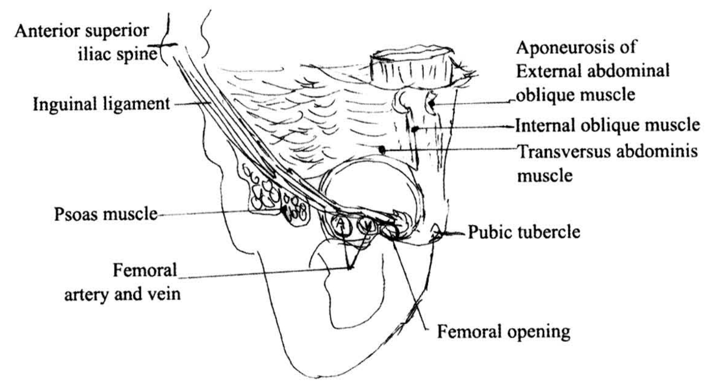
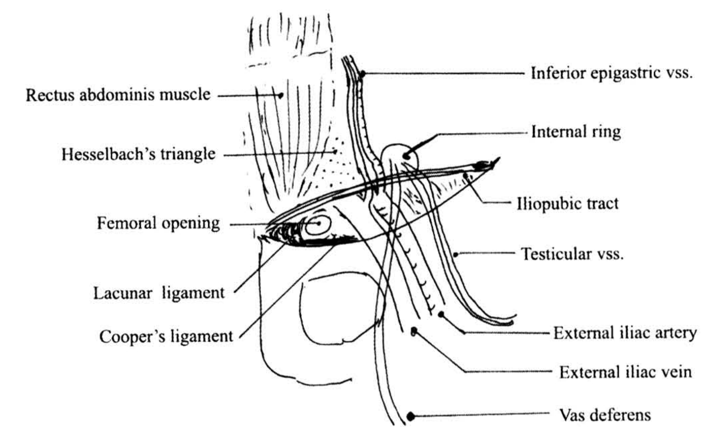
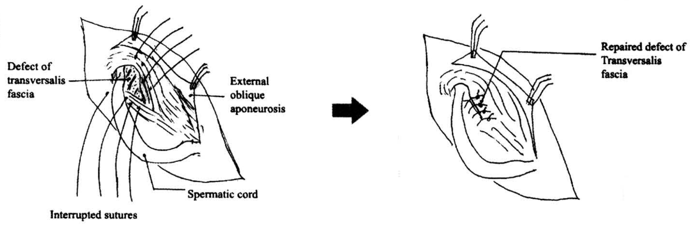
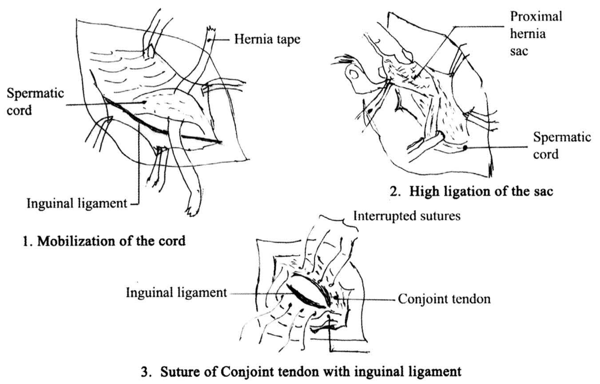
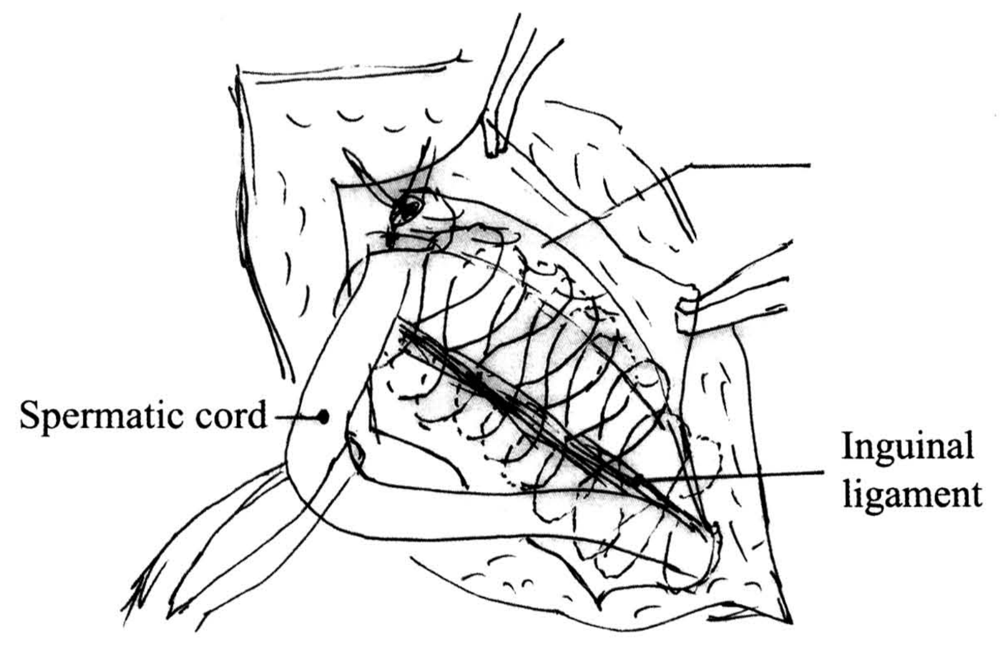
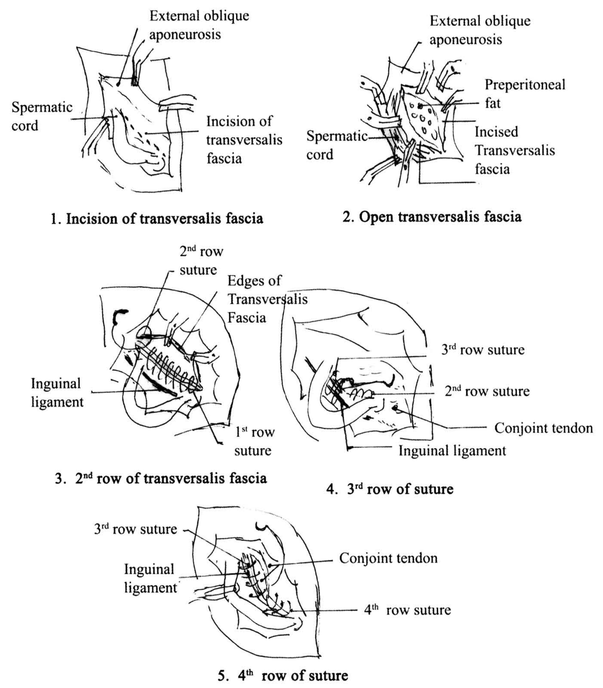
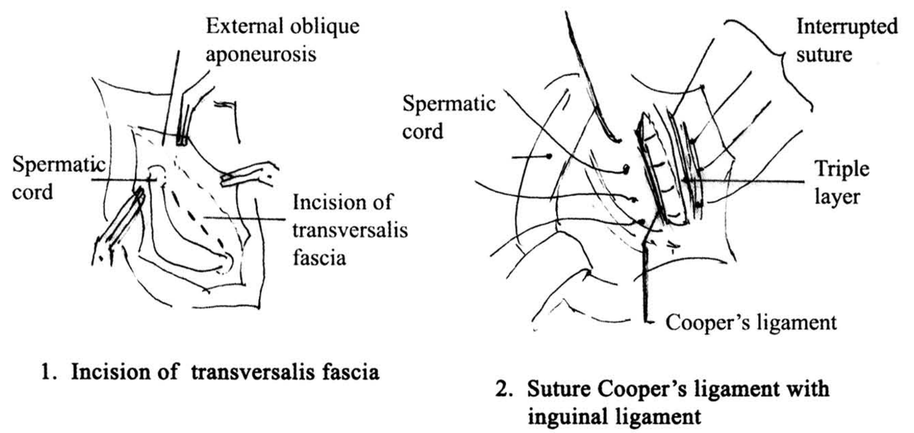
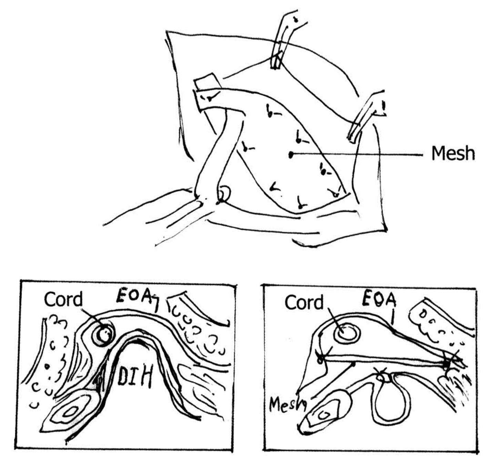
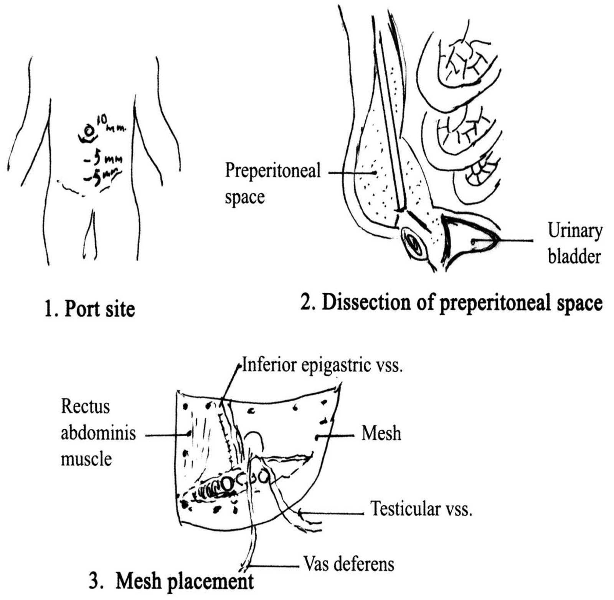
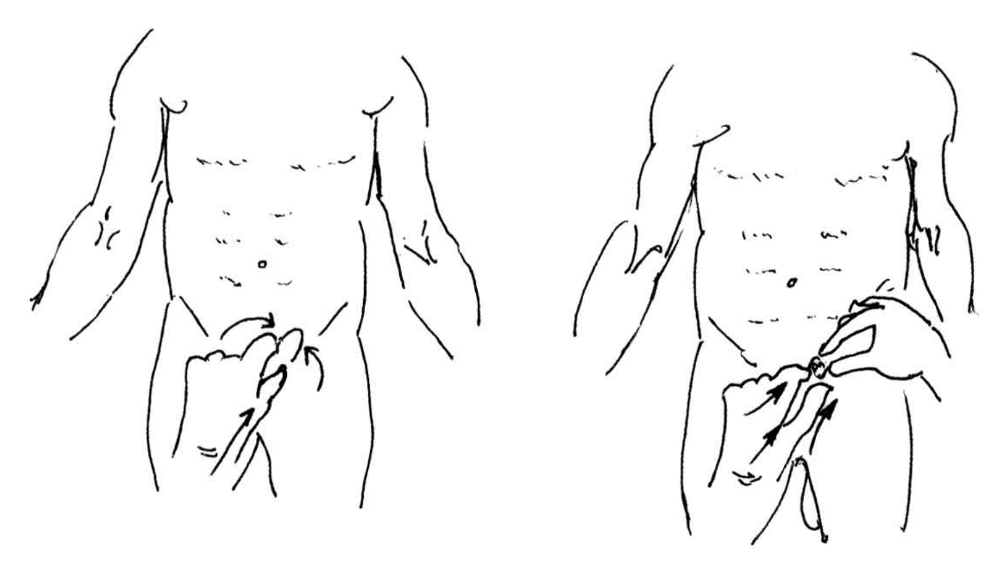

# ไส้เลื่อนผนังหน้าท้อง (Abdominal Wall Hernia)

## Contents of this file
- Pathophysiology (p.528)
- Composition of hernia (p.530)
- Classification of hernia (p.530)
- Groin hernia (p.531)
- Epidemiology (p.532)
- Anatomical considerations (p.533)
  - Inguinal canal (p.533)
  - External oblique aponeurosis (p.534)
  - Internal abdominal oblique muscle (p.534)
  - Transverses abdominis muscle (p.534)
  - Transversalis fascia (p.535)
  - Cooper’s ligament (p.535)
  - Preperitoneal space (p.535)
- Diagnosis (p.536)
  - Differential diagnosis (p.537)
- Indirect inguinal hernia (p.538)
- Direct inguinal hernia (p.539)
- Femoral hernia (p.539)
- Variant ที่พบใน inguinal hernia (p.539)
  - Sliding inguinal hernia (p.539)
  - Pantaloon (dual, saddle bag) hernia (p.540)
- Radiologic investigation (p.540)
- Treatment (p.540)
  - Non-operative treatment (p.540)
- Operative treatment of inguinal hernia (p.541)
  - Indirect inguinal hernia (IIH) (p.541)
  - Direct inguinal hernia (DIH) (p.541)
  - Femoral hernia (p.542)
- Open anterior, non prosthetic repair (p.542)
  - Marcy repair (p.543)
  - Bassini repair (p.543)
  - Maloney darn repair (p.544)
  - Shouldice repair (p.545)
  - McVay Cooper's ligament repair (p.546)
  - Open anterior, prosthetic repair (Lichtenstein tension-Free hernioplasty) (p.547)
  - Open preperitoneal prosthetic repair (p.549)
  - Laparoscopic inguinal hernia repair (p.549)
    - 1. Transabdominal preperitoneal (TAPP) procedure (p.550)
    - 2. Totally extraperitoneal (TEP) procedure (p.550)
  - Complication of inguinal hernia repair (p.551)
    - Recurrence (p.551)
    - Chronic groin pain (p.552)
    - Cord and testicles (p.552)
    - Wound complication (p.552)
    - Osteitis pubis (p.553)
    - Visceral organ injury (p.553)
- Complicated inguinal hernia (p.554)
  - Diagnosis (p.554)
  - Treatment (p.555)
- Pediatric hernias (p.556)
- Groin hernia in woman (p.557)
- Other hernias (p.557)
  - Richter’s hernia (p.557)
  - Sliding hernia (p.557)
  - Epigastric hernia (p.558)
  - Littre’s hernia (p.558)
  - Obturator hernia (p.558)
- Lumbar (dorsal) hernia (p.559)
- Sciatic hernia (p.559)
- Perineal hernia (p.559)
- Incisional hernia (p.560)
  - Treatment (p.561)
- เอกสารอ้างอิง (p.562)

<!-- p.527 (printed none) -->
**ไส้เลื่อนผนังหน้าท้อง**

**Abdominal Wall Hernia**

ศุภอัฐ พึ่งพาพงศ์

<!-- p.528 (printed 514) -->
**ไส้เลื่อนผนังหน้าท้อง**

**Abdominal Wall Hernia**

ศุภอัฐ พึ่งพาพงศ์

ไส้เลื่อนคือภาวะที่มีการยื่นออกไปของอวัยวะภายในผ่านช่องรูเปิดที่ติดต่อกับที่อยู่ของอวัยวะนั้นโดยมีถุงห่อหุ้มอวัยวะที่ยื่นออกไปเอาไว้ โดยในภาษาละติน Hernia แปลว่า rupture of apportion of a stricture ภาวะที่ผนังหน้าท้องอ่อนแอและภาวะที่มีช่องทางออกผิดปกติหรือช่องทางออกปกติที่ติดต่อกับช่องท้องขยายใหญ่ ไม่ว่าจะเป็นตั้งแต่กำเนิดหรือเกิดขึ้นภายหลังเป็นปัจจัยสำคัญที่ทำให้เกิดไส้เลื่อนของผนังหน้าท้อง โดยสามารถแบ่งไส้เลื่อนเป็นชนิดใหญ่ๆ 2 ชนิด คือ

1. External hernia เป็นไส้เลื่อนที่ตรวจพบได้จากภายนอก เช่น Inguinal hernia พบได้บ่อยที่สุดคือ 73%, Femoral hernia พบ 17%, Umbilical hernia พบ 8.5% ชนิดอื่นๆ พบได้น้อย รวมแล้วประมาณ 2% ได้แก่ epigastric, incisional, obturator, Spigelian, lumbar, gluteal, sciatic และ perineal hernia โดยในบทนี้จะกล่าวถึงเฉพาะ Abdominal wall hernia เท่านั้น

2. Internal hernia เป็นไส้เลื่อนที่ซ่อนอยู่ภายใน เช่น paraduodenal hernia เป็นต้น

นอกจากนั้นยังสามารถจัดแบ่งเป็น congenital hernia คือมี abnormal opening อยู่แล้ว และ acquired hernia ซึ่งเกิดขึ้นภายหลัง เช่น incisional hernia เป็นต้น

## Pathophysiology

ผู้ป่วยที่เป็นไส้เลื่อนภายนอกทุกรายมักจะมีปัจจัยอย่างใดอย่างหนึ่งหรือทั้งสองอย่างดังนี้

1. Abnormal opening หรือ defect (รูเปิดที่ผิดปกติหรือส่วนของผนังหน้าท้องที่อ่อนแอ) : ตำแหน่งเหล่านี้มักจะได้แก่บริเวณที่มี structure เช่น เส้นเลือด, หลอดอาหาร, spermatic cord เป็นต้น ผ่านเข้าออกช่องท้องหรือผู้ป่วยอาจมีรูเปิดที่ผิดปกติดังนี้

<!-- p.529 (printed 515) -->
  a. Congenital defect : เช่น

    1. Persistent of processus vaginalis ทำให้เกิด indirect inguinal hernia

    2. Incomplete obliteration of umbilicus ทำให้เกิด umbilical hernia

    3. Persistent communication ระหว่างช่องท้องกับช่องอก ทำให้เกิด diaphragmatic hernia

  b. Acquired defect : การอ่อนแอของผนังหน้าท้อง อาจเกิดจาก

    1. การผ่าตัด เช่น incisional hernia

    2. การอ่อนแอของกล้ามเนื้อหน้าท้อง ซึ่งอาจเกิดจาก obesity ทำให้มีไขมันแทรกระหว่างเส้นใยกล้ามเนื้อมาก, การตั้งครรภ์ ทำให้มีการดึงยืดของกล้ามเนื้อ, ผู้สูงอายุ การบาดเจ็บต่อ Ilioinguinal N. (เช่น การผ่าตัด appendectomy) ทำให้กล้ามเนื้อบริเวณ inguinal area อ่อนแรง จึงเพิ่มโอกาสเกิด inguinal hernia ได้

2. Precipitating factors ได้แก่ การเพิ่มขึ้นของความดันในช่องท้องเป็นระยะเวลานาน สาเหตุที่พบบ่อยมีดังนี้

  a. Chronic cough เช่น ผู้ป่วย COPD และ pulmonary tuberculosis

  b. Straining at defecation เช่น ผู้ป่วยสูงอายุที่มี colonic inertia และ rectal cancer

  c. Straining at micturition เช่น ผู้ป่วยที่มี BPH

  d. Rapid abdominal distention เช่น massive ascites

  e. การยกของหนักๆ

ดังนั้นการรักษาไส้เลื่อนโดยไม่ให้กลับเป็นใหม่ (recurrence) ต้องพยายามกำจัดปัจจัยเหล่านี้ด้วย

<!-- p.530 (printed 516) -->
## Composition of hernia

1. Sac ประกอบด้วย mouth, neck, body, fundus

   Neck : เป็นส่วนที่แคบที่สุด ขนาดเส้นผ่าศูนย์กลางของ neck เป็นสิ่งสำคัญเพราะ incarceration จะเกิดขึ้นได้บ่อยในกรณี neck แคบ ในทางตรงกันข้าม incarceration เกิดได้น้อยในกรณี neck กว้าง เช่น direct inguinal hernia เป็นต้น

   ปกติ sac มักจะคลุมอวัยวะที่ยื่นออกมาครบรอบด้าน แต่ในกรณีของ sliding hernia นั้น body ของ sac ด้านหลังจะเป็นผนังด้านหน้าของอวัยวะใดอวัยวะหนึ่งของ retroperitoneum เช่น sigmoid colon, caecum, bladder เป็นต้น

2. Contents : ที่พบบ่อยที่สุดเป็น fluid นอกนั้น ได้แก่

   - Omentum

   - Small bowel ซึ่งส่วนใหญ่จะไหลลงไปทั้ง segment ของ small bowel ส่วนน้อยจะค้างอยู่เฉพาะผนังด้านใดด้านหนึ่งของลำไส้ ซึ่งส่วนใหญ่เป็น antimesenteric wall (Richter’s hernia) พบใน hernia ที่มี neck แคบ เช่น femoral hernia

   - Colon

   - อื่นๆ เช่น Ovary, appendix หรือ Meckel’s diverticulum (Littre’s hernia)

## Classification of hernia

1. Reducible hernia

2. Irreducible (Incarcerated) hernia

3. Obstructed hernia

4. Strangulated hernia

5. Inflamed hernia

<!-- p.531 (printed 517) -->
**Reducible hernia :** ไส้เลื่อนที่ content สามารถไหลผ่านรูเปิดกลับสู่ตำแหน่งปกติได้ อาจกลับได้เองหรือผู้ป่วยหรือแพทย์ดันกลับได้ hernia กลุ่มนี้มักจะมี neck กว้าง

**Irreducible hernia :** ไส้เลื่อนที่ content ไม่สามารถเคลื่อนผ่านรูเปิดกลับสู่ตำแหน่งปกติได้ แต่ยังไม่มีภาวะแทรกซ้อนเกิดขึ้น อาจเกิดจากมี adhesions ระหว่าง sac กับ contents หรือมี contents อยู่รวมกันหนาแน่น หรือมีการคั่งค้างของอุจจาระในลำไส้ใหญ่ที่ลงมาอยู่ใน sac หรือที่สำคัญคือมี neck ที่แคบ ซึ่งกรณีนี้อาจนำไปสู่ complications เช่น obstruction หรือ strangulation ได้

**Obstructed hernia :** คือ irreducible hernia ที่มีลำไส้เป็น content ร่วมกับมีอาการของ intestinal obstruction เกิดขึ้น แต่ยังไม่มีลักษณะของการขาดเลือดมาเลี้ยงลำไส้

**Strangulated hernia :** คือ irreducible hernia ที่ content ของ hernia เกิดการขาดเลือดมาเลี้ยงอย่างมาก โดยจะเกิด gangrene ภายใน 6 ชั่วโมง อาจเกิดขึ้นโดยไม่มีอาการของ intestinal obstruction เช่น Richter’s hernia หรือ strangulated omentocele เป็นต้น ถึงแม้ว่า femoral hernia จะพบน้อยกว่า inguinal hernia ถึง 4 เท่า แต่อุบัติการณ์เกิด strangulation สูงกว่า ทั้งนี้เพราะ femoral hernia มี neck ที่แคบร่วมกับ wall โดยรอบของ femoral canal (ดังจะกล่าวต่อไป) เป็นโครงสร้างที่แข็งและยืดหยุ่นได้ยาก ความดันจึงสูงขึ้นรวดเร็ว ทำให้เกิด strangulation ได้ง่าย

**Inflamed hernia :** คือ content ใน sac มีภาวะการอักเสบเกิดขึ้น พบได้น้อย เช่น acute appendicitis เป็น content ของไส้เลื่อน (Amyand’s hernia) เป็นต้น

## Groin hernia

Groin hernia ประกอบด้วย Inguinal hernia (direct inguinal hernia และ indirect inguinal hernia) กับ femoral hernia การรักษาผู้ป่วยในช่วงแรกจนถึงต้นศตวรรษที่ 18 เป็นการใช้ Truss ซึ่งเป็นอุปกรณ์ที่ใช้กดไม่ให้มี content ผ่าน opening ของ hernia sac ออกมาด้านนอก ในรายที่ไม่มี intestinal strangulation ส่วนการผ่าตัดจะเลือกวิธี castration หรือ hernia sac debridement แล้วปล่อยให้แผลหายด้วย secondary intention เนื่องจากแพทย์ผู้รักษายังไม่เข้าใจถึง anatomy บริเวณ inguinal region

<!-- p.532 (printed 518) -->
ในปี ค.ศ. 1881 Luca-Championniere ศัลยแพทย์ชาวฝรั่งเศสเป็นผู้ที่ทำผ่าตัด high ligation ของ indirect inguinal hernia sac ที่ internal ring แล้วทำ primary wound closure เพื่อปิดแผลผ่าตัด

ต่อมาเมื่อการแพทย์พัฒนาขึ้นทั้งในด้านขบวนการทำให้ปราศจากเชื้อและการใช้ยาระงับความเจ็บปวดขณะผ่าตัด การผ่าตัดชนิดใหม่ ได้แก่ การ reconstruction of inguinal floor ร่วมกับ high ligation of hernia sac จึงถูกพัฒนาขึ้นโดย Edoardo Bassini ซึ่งได้ชื่อว่าเป็นบิดาแห่ง modern inguinal hernia surgery ได้รายงานการทำ inguinal floor reconstruction โดยการเย็บชั้นของ internal abdominal oblique muscle, transverses abdominal muscle และ transversalis fascia เข้ากับ inguinal ligament ซึ่งได้รับผลการรักษาที่ดี มี morbidity ลดต่ำลง และมีอัตราการกลับเป็นซ้ำเพียง 20% จึงทำให้เป็นที่ยอมรับกันอย่างกว้างขวาง และหลักการทำ inguinal floor reconstruction (inguinal herniorrhaphy) ก็กลายเป็น gold standard ในการรักษา inguinal hernia ต่อมาในศตวรรษที่ 20 ระหว่างนั้นได้มีศัลยแพทย์หลายท่าน ได้แก่ Lotheissen, McVay, Halsted และ Shouldice รายงานการทำ inguinal herniorrhaphy ในวิธีต่างๆ แต่ก็ไม่ได้รับความนิยมมากนักเนื่องจากมีรายงานของ post operative pain ที่มากกว่า และจะมี recurrence rate ที่ต่ำเฉพาะการผ่าตัดที่ทำโดยศัลยแพทย์ที่ชำนาญในวิธีนั้นๆ เท่านั้น

ในปัจจุบันหลักการของ posterior inguinal floor reinforcement ยังคงใช้กันอย่างแพร่หลาย แต่วิธีการผ่าตัดตามแบบของ Bassini มักจะเลือกใช้ในผู้ป่วยที่มีข้อห้ามในการใช้ prosthetic mesh reinforcement (hernioplasty) เนื่องจาก concepts ของ tension free herniorrhaphy ได้เข้ามาแทนที่การผ่าตัดเดิมที่มี tension บริเวณ posterior inguinal wall มากกว่า โดย Lichtenstein ได้รายงานวิธีการทำ prosthetic mesh reinforcement ของ posterior inguinal wall โดยพบว่ามี tension น้อยกว่าการใช้ suture repair และมี recurrence rate ที่ต่ำกว่า จึงเป็นหลักการผ่าตัดรักษา inguinal hernia ที่นิยมใช้กันมาจนถึงปัจจุบัน

## Epidemiology

Inguinal hernia พบได้ประมาณ 75% ของ abdominal wall hernias โดยสัดส่วนของ indirect ต่อ direct inguinal hernia เท่ากับ 2 : 1 พบ inguinal hernia ข้างขวาบ่อยกว่าข้างซ้าย และสัดส่วนของผู้ชายต่อผู้หญิงคือ 7 : 1 ในประเทศสหรัฐอเมริกาแต่ละปี

<!-- p.533 (printed 519) -->
จะมีผู้ป่วย direct และ indirect inguinal hernia ได้รับการผ่าตัดราว 750,000 คน ผู้ป่วย femoral hernia จำนวน 25,000 คน และ hernia ชนิดอื่นๆ อีกราว 339,000 คน

Femoral hernia พบได้น้อยกว่า 10% ของ groin hernia แต่พบว่ามีภาวะแทรกซ้อนจาก incarceration และ strangulation ได้ถึง 40% Femoral hernia พบได้บ่อยในผู้สูงอายุ โดยพบอัตราส่วนชายต่อหญิงเท่ากับ 1 : 4

Congenital inguinal hernia ส่วนใหญ่พบเป็น indirect inguinal hernia มักพบในเด็กที่มีน้ำหนักแรกคลอดน้อยกว่า 1,500 g ส่วนในผู้ใหญ่พบอุบัติการณ์ของ inguinal hernia เพิ่มขึ้นตามอายุ โดยพบถึง 50% ในผู้ชายที่อายุมากกว่า 75 ปี พบว่ามี overall current risk ของ inguinal hernia ในผู้ชายประมาณ 18% และ lifetime risk เท่ากับ 24% เป็น bilaterality คือ 39% (25-34 ปี = 31%, 65-74 ปี = 45% และมากกว่า 74 ปี = 59%) แต่ในบางรายการพบ current risk เพียง 3.2%

## Anatomical considerations

ความเข้าใจกายวิภาคของ inguinal region ในเชิง 3 มิติ โดยเฉพาะ anatomical relation ของ nerve, blood vessel, spermatic cord, muscle, aponeurosis และ fascia ต่างๆ เป็นสิ่งจำเป็นก่อนที่จะทำการรักษาผู้ป่วย groin hernia ไม่ว่าจะเป็นการผ่าตัดรักษา inguinal hernia วิธีใดก็ตามเพื่อให้ได้ผลการรักษาที่ดีที่สุด (รูปที่ 1 และ 2)

### Inguinal canal

ในผู้ใหญ่ inguinal canal มีความยาวประมาณ 4 cm. โดยอยู่เหนือต่อ inguinal ligament 2-4 cm Inguinal canal มีลักษณะเป็นท่อที่มีรูเปิดทาง lateral คือ internal ring (deep ring) และทาง medial คือ external ring (superficial ring) โดย content ใน inguinal canal ประกอบด้วย spermatic cord กับ ilioinguinal nerve ในผู้ชาย และ round ligament of uterus กับ ilioinguinal nerve ในผู้หญิง Spermatic cord มี content ภายใน ได้แก่ vas deferens, testicular artery, pampiniform plexus, genital branch of genitofemoral nerve, lymphatic vessels และ autonomic nerves of testis น้ำถูกคลุมด้วย fascia 3 ชั้น ได้แก่ external spermatic fascia มาจาก external oblique aponeurosis, wide spermatic fascia (cremasteric muscle) มาจาก internal abdominal oblique muscle และ internal spermatic fascia มาจาก transversalis fascia

<!-- p.534 (printed 520) -->
Inguinal canal วางตัวจาก lateral (deep ring) มาทาง medial (superficial ring) และจาก cephalad มาทาง caudad โดยมีผนังด้านหน้าคือ external oblique aponeurosis ผนังด้านบนคือ internal abdominal oblique muscle, transverses abdominal muscle ผนังด้านล่างคือ inguinal ligament และ lacunar ligament ผนังด้านหลัง (floor) คือ transversalis fascia และ aponeurosis of transversus abdominis muscle โดย floor ของ inguinal canal

Hesselbach’s triangle เป็นบริเวณรูปสามเหลี่ยม โดยขอบเขตของ medial คือ linear semilunaris (ขอบนอกของ rectus abdominis muscle) ทาง lateral คือ inferior epigastric vessels และทางด้าน inferior คือ inguinal ligament โดย direct inguinal hernia จะเกิดขึ้นบริเวณสามเหลี่ยมนี้

### External oblique aponeurosis

เป็น aponeurosis ของ external abdominal oblique muscle ทาง medial จะรวมกับ anterior layer of internal abdominal oblique aponeurosis ไปเป็น anterior rectus sheath ขอบล่างจะพับไปด้านหลังเป็น inguinal ligament ซึ่งยึดจาก anterior superior iliac spine (ASIS) ไปยัง pubic tubercle ซึ่งแยกออกเป็น medial และ lateral crus ของ external ring นอกจากนี้ยังแผ่ไปปกคลุมทาง media ของ superior pubic rami เรียกว่า lacunar ligament

### Internal abdominal oblique muscle

เป็นขอบบนของ inguinal canal โดยทาง medial ใกล้กับ pubic tubercle อาจเชื่อมกับ fiber ของ aponeurosis of transverses abdominis muscle เรียกว่า conjoined tendon พบได้เพียง 10% ส่วนใหญ่มักเป็น muscle fiber ที่ไม่ได้รวมกันเป็นโครงสร้างของ tendon

### Transverses abdominis muscle

เป็นกล้ามเนื้อผนังหน้าท้องอยู่ลึกต่อ internal abdominal oblique muscle โดยเมื่อเกิดภาวะที่ความดันในช่องท้องเพิ่มขึ้นกล้ามเนื้อมัดนี้จะหดตัวทำให้ transverse aponeurotic arch (ขอบล่างของกล้ามเนื้อ) ซึ่งเป็นขอบบนของ inguinal canal ลดตัวลงมาชิดกับ inguinal ligament เพื่อเสริมความแข็งแรงของ inguinal floor เรียกว่า shuttering mechanism

<!-- p.535 (printed 521) -->
### Transversalis fascia

เป็น fascia ที่คลุมอยู่ด้าน inner surface ของ transverses abdominis muscle ประกอบด้วย inner layer และ outer layer โดยด้านล่างของ transversalis fascia จะหนาตัวขึ้น เรียกว่า iliopubic tract อยู่ขนานและลึกต่อ inguinal ligament โดยยึดจาก ASIS ไป pubic tubercle เช่นเดียวกัน และทาง medial จะแผ่ออกคลุมบางส่วนของ superior pubic rami แล้ว blend ไปกับ Cooper’s ligament

### Cooper’s ligament

อยู่ทาง posterior ของ superior pubic rami เกิดจากการหนาตัวของ soft tissue บริเวณนั้น และ periosteum โดยอยู่ทางด้าน lateral ต่อ lacunar ligament มีความสำคัญในการเย็บซ่อม femoral opening ในผู้ป่วยที่มี femoral hernia Femoral opening อยู่ด้านหลังต่อ iliopubic tract และ inguinal ligament ผนังทางด้าน medial คือ lacunar ligament ทาง posterior คือ Cooper’s ligament ทาง lateral คือ femoral vein ภายในประกอบด้วยกลุ่มของต่อมน้ำเหลือง (Cloquet’s node)

### Preperitoneal space

เป็น potential space อยู่ระหว่าง transversalis fascia และ peritoneum เป็นที่อยู่ของ adipose tissue, lymphatic, blood vessels และ nerve คือ ***1. iliohypogastric nerve*** (T12) วางตัวอยู่ใน space นี้ จากนั้นวางตัวระหว่าง internal กับ external abdominal oblique muscle แล้วแทงทะลุผ่าน external oblique aponeurosis รับความรู้สึกของผิวหนังบริเวณ mon pubis ***2. ilioinguinal nerve*** (L1) วิ่งผ่าน space นี้ แล้ววางตัวอยู่ใน inguinal canal โดยรับความรู้สึกบริเวณต้นขาด้านใน ***3. genitofemoral nerve*** (L1, L2) ให้ genital branch supply cremasteric muscle และรับความรู้สึกบริเวณ anterior surface ของ scrotum ส่วน femoral branch รับความรู้สึกของต้นขาบริเวณ femoral triangle ***4. lateral femoral coetaneous nerve*** (L2, L3) วิ่งหน้าต่อ attachment ของ inguinal ligament กับ ASIS รับความรู้สึกบริเวณ lateral ของต้นขาส่วนบน Internal ring เป็น opening บริเวณ preperitoneal space lateral ต่อ inferior epigastric vessels ในผู้ชายมี vas deferens testicular vessels วิ่งผ่านเนื้อเข้าสู่ inguinal canal ส่วนผู้หญิงมี round ligament of uterus วางตัวผ่าน

<!-- p.536 (printed 522) -->

> **Caption (verbatim):** รูปที่ 1 Anatomy of inguinal region
> **Text in image (verbatim):** Anterior superior iliac spine · Inguinal ligament · Psoas muscle · Femoral artery and vein · A · V · Aponeurosis of External abdominal oblique muscle · Internal oblique muscle · Transversus abdominis muscle · Pubic tubercle · Femoral opening
> **Description:** Hand-drawn line illustration of the right inguinal region seen from the front, with the abdominal wall layers cut and turned back. The inguinal ligament runs obliquely from the anterior superior iliac spine (upper left) down to the pubic tubercle (lower right). Above it the layered muscles of the abdominal wall are shown: a cut edge labelled aponeurosis of external abdominal oblique muscle, then internal oblique muscle and transversus abdominis muscle beneath. Below the inguinal ligament, from lateral to medial: the psoas muscle (bundle of circular fibres), the femoral artery (circle marked "A") and femoral vein (circle marked "V"), and medial to the vein the femoral opening, just lateral to the pubic tubercle. The outline of the pelvic bone/obturator region is sketched below.
> **Identifiers in image:** none

> **Caption (verbatim):** รูปที่ 2 Preperitoneal anatomy of inguinal region (posterior view)
> **Text in image (verbatim):** Rectus abdominis muscle · Hesselbach’s triangle · Femoral opening · Lacunar ligament · Cooper’s ligament · Inferior epigastric vss. · Internal ring · Iliopubic tract · Testicular vss. · External iliac artery · External iliac vein · Vas deferens
> **Description:** Hand-drawn line illustration of the inguinal region viewed from behind (preperitoneal side). The rectus abdominis muscle is shown vertically on the left. The inferior epigastric vessels run upward just lateral to the rectus. A dotted area beside the rectus, medial to the inferior epigastric vessels and above the iliopubic tract, is labelled Hesselbach’s triangle. Lateral to the inferior epigastric vessels is a rounded opening labelled internal ring, from which the vas deferens descends and the testicular vessels run down laterally. The iliopubic tract crosses the lower field obliquely. Below its medial end is an oval labelled femoral opening, with the lacunar ligament and Cooper’s ligament pointed to at its medial and lower margin. The external iliac artery and external iliac vein descend beneath the iliopubic tract, lateral to the femoral opening.
> **Identifiers in image:** none

## Diagnosis

ผู้ป่วย groin hernia มีอาการและอาการแสดงได้หลากหลาย ตั้งแต่ไม่มีอาการใดๆ จนมีภาวะ strangulation ของ incarcerated hernia ผู้ป่วยที่ไม่มีอาการมักตรวจพบโดยแพทย์ด้วยความบังเอิญขณะมาตรวจร่างกายประจำปีหรือมาตรวจโรคอื่นๆ indirect inguinal hernia และ femoral hernia แสดงอาการได้มากกว่า direct inguinal hernia โดยผู้ป่วยมักรู้สึกอึดอัดหรือปวดบริเวณ inguinal region และมีอาการเป็นๆ หายๆ อาการ

<!-- p.537 (printed 523) -->
จะมากขึ้นและมี activity เช่น เดิน, วิ่ง, ออกกำลังกาย หรือมีความดันในช่องท้องเพิ่มขึ้น อาการคลำได้ก้อนบริเวณขาหนีบ ก้อนอาจไหลกลับเข้าไปในช่องท้องได้เองหรือต้องใช้มือดันกลับเข้าไป ในกรณีที่ก้อนออกมาค้างอยู่นาน มีอาการปวดมากตลอดเวลา แสดงถึงมีภาวะ incarcerated hernia ซึ่งอาจมี strangulation ของ visceral organ ร่วมด้วย หรือถ้ามีอาการท้องอืด, คลื่นไส้, อาเจียน, ไม่ถ่ายหรือผายลม แสดงว่าอาจมีภาวะ obstructed hernia ขึ้น การตรวจร่างกายพบก้อนที่ inguinal region ที่ยุบลงได้ จะช่วยยืนยันการวินิจฉัยโรคนี้ได้มากขึ้น ในกรณีที่ไม่พบก้อนค้างอยู่ ให้ผู้ป่วยยืนแล้วใช้นิ้วชี้สอดผ่าน external ring เข้าไปใน inguinal canal แล้วให้ผู้ป่วยเบ่ง หากพบว่ามีก้อนวิ่งมาชนปลายนิ้วแสดงว่าผู้ป่วยเป็น indirect inguinal hernia ถ้าก้อนวิ่งมาชน palmar surface ของนิ้วแสดงว่าผู้ป่วยเป็น direct inguinal hernia (Impingement test) ส่วน femoral hernia จะมีก้อนอยู่ใต้ต่อ inguinal ligament บริเวณ upper thigh อีกวิธีทำได้โดยให้ผู้ป่วยนอนราบ ใช้นิ้วชี้และนิ้วกลางกดตรง internal ring ของ inguinal canal โดยใช้ anatomical land mark คือ 2 cm เหนือต่อกึ่งกลางของ inguinal ligament จากนั้นให้ผู้ป่วยเบ่งท้อง ถ้าพบว่ามีก้อนยื่นออกมาบริเวณนี้แสดงว่าผู้ป่วยเป็น direct inguinal hernia ถ้าผู้ป่วยเบ่งแล้วไม่มีก้อนใดยื่นออกมา ให้เลิกกดบริเวณ internal ring แล้วให้ผู้ป่วยเบ่งอีกครั้ง ถ้ามีก้อนยื่นออกมาแสดงว่าผู้ป่วยเป็น indirect inguinal hernia (Occlusion test) โดยพบว่าการตรวจร่างกายมี sensitivity ประมาณ 70% และ specificity 96.3% นอกจากนี้ยังมีการตรวจที่ช่วยแยก indirect inguinal hernia ที่ content ไหลลงมาใน scrotal sac กับ scrotal mass อื่นๆ เช่น testicular tumor โดยถ้านิ้วชี้แล้วนิ้วหัวแม่มือสามารถคลำขอบบนของ scrotal mass ได้ ก้อนที่คลำได้จะเกิดมาจากโครงสร้างที่อยู่ในลูกอัณฑะ ไม่ใช่ indirect inguinal hernia

### Differential diagnosis

1. Inguinal lymphadenopathy : มักจะมีหลายก้อนและต่ำกว่า inguinal ligament

2. Saphenuos varix : มักจะพบร่วมกับ greater saphenous varicosities โดยจะอยู่ต่ำกว่า inguinal ligament จะหายไปเมื่อให้ผู้ป่วยยกขาขึ้น

3. Femoral aneurysm : อยู่ต่ำกว่า inguinal ligament และมีลักษณะเป็น pulsatile mass

<!-- p.538 (printed 524) -->
4. Psoas abscess : มีการกดเจ็บ, fluctuation, มีไข้, มี flexion contracture of hip, ก้อนอยู่ต่ำกว่า inguinal ligament และ lateral ต่อ femoral artery

5. Hydrocele : พบเป็น scrotal mass สามารถ get above mass ได้ และตรวจพบ transilllumination test positive

6. Encysted hydrocele of the cord : เป็นก้อนถุงน้ำของ spermatic cord จะเคลื่อนที่ลงเมื่อดึง testis

7. Lipoma of the cord : เป็นก้อนที่ขาหนีบที่ไม่สามารถยุบลงได้ แต่ก็แยกได้ยาก มักแยกผ่าตัด

8. Incompletely descended testis : ตรวจไม่พบ testis ใน scrotum ข้างนั้น แต่อาจพบมี indirect inguinal hernia ร่วมด้วยได้ในข้างเดียวกัน

9. Varicocele : คลำพบเป็นขดของเส้นเลือดบริเวณขั้วบนของอัณฑะ (bag of worm)

## Indirect inguinal hernia

เกิดจากการมี defect บริเวณ internal ring ที่อยู่ lateral ต่อ inferior epigastric vessel โดย defect ที่เกิดขึ้นเป็นได้ทั้งที่เกิดแต่กำเนิดและเกิดขึ้นภายหลัง ในรายที่เป็น congenital defect เกิดจาก remnant ของ processus vaginalis หรือมี obliteration ของ processus vaginalis แต่ยังมี defect บริเวณ internal ring อยู่ อีกกรณีเกิดจาก congenital structural malformation ของ transversalis fascia และ transverses abdominis ทำให้ internal ring มีขนาดกว้างขึ้นและแข็งแรงลดลง นอกจากนี้ Straining ของ abdominal wall และภาวะที่มีความดันในช่องท้องเพิ่มขึ้นก็ทำให้เกิดการขยายตัวของ internal ring ส่วนการผ่าตัดที่ผ่าน internal abdominal oblique และมีการรบกวนต่อเส้นประสาทที่เลี้ยงกล้ามเนื้อนี้ เช่น appendectomy ก็ทำให้เกิดการอ่อนแรงของกล้ามเนื้อหน้าท้อง เป็นผลให้เกิด defect ที่ internal ring ได้ง่ายเช่นกัน

<!-- p.539 (printed 525) -->
## Direct inguinal hernia

เป็นไส้เลื่อนที่ content ยื่นผ่านบริเวณ Hesselbach’s triangle โดยสาเหตุสำคัญที่ทำให้เกิดไส้เลื่อนชนิดนี้ ได้แก่ ภาวะที่มีความดันในช่องท้องเพิ่มขึ้นและความอ่อนแอของ posterior inguinal wall หรือเกิดจาก high lying ของ Arch of Transversus abdominis muscle

## Femoral hernia

เป็นไส้เลื่อนที่ content ยื่นผ่าน femoral opening ซึ่งอยู่ระหว่าง lacunar ligament ทาง medial, femoral vein ทาง lateral, iliopubic tract ทาง anterior และ superior pubic rami ทาง posterior ปัจจัยเสี่ยงที่ทำให้เกิดไส้เลื่อนชนิดนี้ ได้แก่ การเพิ่มความดันในช่องท้องและขนาดของ femoral opening ที่กว้างมากขึ้นเกิดจากการเกาะของ iliopubic tract ที่แผ่กว้างน้อยกว่า 1-2 cm. และโครงสร้าง pelvis ของผู้หญิง

## Variant ที่พบใน inguinal hernia

### Sliding inguinal hernia

เป็นไส้เลื่อนบริเวณ inguinal area ที่มีผนังส่วนหนึ่งของ sac เป็น visceral organ พบได้ประมาณ 8% ของ groin hernia ส่วนใหญ่มักพบในคนอายุมาก โดยเฉพาะผู้ป่วยที่อายุมากกว่า 70 ปี พบใน groin hernia ข้างซ้ายมากกว่าข้างขวา อวัยวะที่ลงมาเป็นผนังของ sac ของข้างซ้าย ได้แก่ sigmoid colon ข้างขวา ได้แก่ caecum, ascending colon และ appendix ส่วน urinary bladder, uterus, fallopian tube และ ovary สามารถยื่นลงมาได้ทั้ง 2 ข้าง Sliding component เหล่านี้มักวางตัวอยู่ทาง posterolateral ของ sac ผู้ป่วยมักมาด้วยอาการของ incarcerated groin hernia โดยไม่มีลักษณะของ ischemia หรือ strangulation เนื่องจาก hernia sac มี neck ที่กว้าง ความสำคัญของการที่มี sliding component เป็นส่วนหนึ่งของผนัง sac ทำให้ในขั้นตอนการทำ herniotomy with high ligation sac อาจเกิดการบาดเจ็บต่อ visceral organ ได้ ปัจจุบันจึงแนะนำให้ดัน sac ให้กลับไปอยู่ใน preperitoneal space โดยไม่ต้องทำ herniotomy with high ligation หรือหากจำเป็นต้องเลาะ visceral organ ออกจาก sac ให้ทำ herniotomy ด้วยความระมัดระวัง

<!-- p.540 (printed 526) -->
### Pantaloon (dual, saddle bag) hernia

คือ Inguinal hernia ที่มีถุงไส้เลื่อนคร่อมบน inferior epigastric vessels ทำให้เป็นเสมือนกางเกง ซึ่งมี 2 ขา ถุงหนึ่งผ่าน internal ring ไปตาม inguinal canal คือ indirect inguinal hernia ส่วนอีกถุงหนึ่งเป็นชนิด direct inguinal hernia ความสำคัญคือขณะผ่าตัดเมื่อพบ indirect inguinal hernia แล้ว ไม่ได้สังเกตว่ายังมี indirect sac อยู่ ทำให้ไม่ได้ทำ herniotomy with high ligation ของ indirect sac

## Radiologic investigation

การตรวจทางรังสีวิทยามักไม่มีความจำเป็น **ยกเว้น**ในผู้ป่วยที่มีอาการและอาการแสดงไม่ชัดเจน เพื่อลดอัตราการผ่าตัดโดยไม่จำเป็น ในผู้ป่วยที่สงสัยว่ามี inguinal hernia

- Ultrasonography เป็นวิธีที่ดีวิธีหนึ่งในการวินิจฉัยและราคาถูก รังสีแพทย์สามารถตรวจผู้ป่วยในท่ายืนหรือให้ผู้ป่วยทำ Valsalva maneuver ร่วมด้วยได้ โดยจะพบว่ามี bulging ของ inguinal region และอาจพบ content ใน sac แต่อัตราการตรวจพบขึ้นกับความชำนาญของรังสีแพทย์ด้วย โดยมี sensitivity 92.7% และ specificity 81.5%

- Computed tomography (CT scan) และ Magnetic resonance image (MRI) ทั้งสองวิธีเป็นการตรวจทางรังสีวิทยาที่ดีที่สุดในขณะนี้แม้ว่าจะมีราคาแพง โดยจะตรวจพบว่ามี bulging ของ inguinal region หรือพบ content ใน sac เช่นเดียวกับ ultrasonography แต่มี sensitivity สูงกว่า 94.5% และ specificity 96.35%

## Treatment

### Non-operative treatment

ปัจจุบันยังแนะนำให้ทำการผ่าตัดรักษาผู้ป่วยไส้เลื่อนทุกรายที่มีอาการ เนื่องจากกลัวภาวะแทรกซ้อนของ visceral organ ischemia หรือ strangulation การใช้ Truss หรืออุปกรณ์ที่สวมเพื่อป้องกันไม่ให้มีไส้เลื่อนยื่นออกมา หลังจากที่ที่ไส้เลื่อนนั้นมี spontaneous หรือ manual reduction โดย Truss จะมีลักษณะเหมือนกางเกงในที่สวมแล้วมีแรงกดบริเวณไส้เลื่อนเพื่อดันไม่ให้มี content ยื่นออกมา และไม่ให้ไส้เลื่อน

<!-- p.541 (printed 527) -->
มีขนาดใหญ่ขึ้น ปัจจุบันยังไม่มีการศึกษาใดที่แสดงให้เห็นว่าการใช้ Truss จะสามารถควบคุมอาการและอาการแสดงของผู้ป่วยไส้เลื่อนได้ นอกจากนี้ยังมีภาวะแทรกซ้อนที่เกิดจากการใช้ Truss ได้แก่ Atrophic of spermatic cord และทำให้การผ่าตัดทำได้ยากเนื่องจากมีรายงานของการเกิด fibrosis บริเวณ groin ในผู้ป่วยที่ใช้ Truss

## Operative treatment of inguinal hernia

### Indirect inguinal hernia (IIH)

1. กลุ่มที่เกิดขึ้นจากความผิดปกติโดยกำเนิด คือมี persistent processus vaginalis ให้ผ่าตัดรักษาโดยการทำ Herniotomy และ High ligation ของ hernia sac ได้แก่ การผ่าตัดเลาะ hernia sac ที่ยื่นเข้ามาใน inguinal canal แล้วเย็บปิด sac ในจุดที่ sac ยื่นผ่าชั้น preperitoneal fat หาก internal ring ไม่ขยายออก และ posterior inguinal floor ไม่หย่อนก็ไม่จำเป็นต้องทำ herniorrhaphy หรือ hernioplasty

2. กลุ่มที่ไม่ได้เกิดขึ้นจากความผิดปกติโดยกำเนิด กลุ่มนี้กลไกการเกิดเริ่มจากมีการอ่อนแรงของ posterior inguinal floor ก่อน โดยเฉพาะ transversalis fascia ซึ่งจะพบในคนอายุมากๆ ดังนั้นกลุ่มนี้จะพบทุก components คือมี internal ring ที่กว้าง มี inguinal floor ที่อ่อนแอ ดังนั้นการรักษา คือการทำ herniotomy ร่วมกับ herniorrhaphy หรือ hernioplasty และที่สำคัญกลุ่มนี้มักจะมี precipitating factors ซึ่งเราต้องกำจัดด้วย

### Direct inguinal hernia (DIH)

หลักการรักษาคล้ายใน indirect inguinal hernia ชนิดที่ไม่ได้เกิดจากความผิดปกติแต่กำเนิดเพราะกลไกการเกิดคล้ายกัน เพียงแต่ sac ยื่นออกมาทาง Hesselbach’s triangle แทนที่จะเป็น internal ring ที่ต่างกันคือไม่ต้องทำ herniotomy เพียงแต่ดัน sac กลับเข้าช่องท้อง (invagination) แล้วจึงทำการเย็บซ่อม posterior inguinal floor (herniorrhaphy or hernioplasty) ยกเว้นในรายที่เป็น congenital DIH การรักษาโดยการตัด sac แล้วเย็บปิด defect ที่ conjoint tendon

<!-- p.542 (printed 528) -->
### Femoral hernia

รักษาด้วยการทำ Herniotomy with high ligation of sac แล้ว repair femoral opening ด้วยการเย็บ Cooper’s ligament เข้ากับ conjoint tendon ทางด้าน medial ต่อ femoral vein เพื่อปิด femoral ring ส่วนทางด้านหน้าและ lateral ต่อ femoral vein จะเย็บ inguinal ligament ติดกับ conjoint tendon (McVay’s repair) หรือใช้ nonabsorbable mesh อุดบริเวณ femoral opening (Mesh plug) หรือวางปิด femoral opening รวมไปถึง Hesselbach’s triangle และ internal ring

ปัจจุบัน operative repair มีหลายวิธีและเป็นการรักษาหลักของผู้ป่วย inguinal hernia โดยแบ่งประเภทของการผ่าตัดได้ดังนี้

1. Non prosthetic repair
  - Open anterior
  - Open preperitoneal
2. Prosthetic repair
  - Open anterior
  - Open preperitoneal
  - Laparoscopic preperitoneal

## Open anterior, non prosthetic repair

เป็นการเย็บ tissue รอบๆ มาปิด posterior inguinal floor เพื่อเสริมความแข็งแรง จึงเรียกอีกข้อหนึ่งว่า pure tissue repair ปัจจุบันวิธีนี้นิยมลดลงเนื่องจากเชื่อว่าการเย็บ structure ต่างๆ เข้ามาหากันนั้นทำให้เกิด tension และการมี tension ทำให้เกิด recurrent hernia ตามมา แต่การศึกษาในอดีตพบว่าในศัลยแพทย์ที่ชำนาญการผ่าตัดชนิดนี้มี recurrent rate ไม่แตกต่างกับวิธี prosthetic repair โดยมีขั้นตอนการผ่าตัดดังนี้

1. Initial incision

2. Mobilization of the cord structure

<!-- p.543 (printed 529) -->
3. Diversion of Cremasteric muscle

4. High ligation of the sac

5. Management of inguinal scrotal hernia sac (distal sac)

6. Relaxing incision

7. Wound closure

การผ่าตัดชนิดนี้เป็นการผ่าตัดชนิดแรกๆ ในการผ่าตัดรักษา groin hernia ซึ่งทำได้หลายวิธี ได้แก่

### Marcy repair

Marcy repair เป็นการเย็บขอบทางด้าน medial ของ internal ring ให้แคบลงหลังจากที่ทำ herniotomy with high ligation of sac เลือกใช้ในผู้ป่วยเด็กหรือวัยรุ่นที่มี congenital indirect inguinal hernia เกิดขึ้นโดยที่ยังไม่มี weakness ของ posterior inguinal floor (รูปที่ 3)

> **Caption (verbatim):** รูปที่ 3 Marcy repair
> **Text in image (verbatim):** Defect of transversalis fascia · External oblique aponeurosis · Spermatic cord · Interrupted sutures · Repaired defect of Transversalis fascia
> **Description:** Two hand-drawn line illustrations of the operative field in the inguinal canal, joined by a bold right-pointing arrow (before → after). Left panel: the external oblique aponeurosis is opened and its edges held up by two clamps; the spermatic cord is seen in the canal, and at its medial side a stippled area marks the defect of the transversalis fascia at the internal ring; several interrupted sutures are placed through the edges of the defect, their long ends hanging down (label "Interrupted sutures"). Right panel: the same field after the sutures are tied, with a short row of knotted stitches labelled "Repaired defect of Transversalis fascia"; the aponeurosis edges are still retracted by the two clamps.
> **Identifiers in image:** none

### Bassini repair

เลือกใช้ในผู้ป่วย direct หรือ indirect inguinal hernia ที่มี weakness ของ posterior inguinal wall หลังจากที่ทำ herniotomy with high ligation of sac แล้ว ศัลยแพทย์จะผ่าเปิด transversalis fascia ซึ่งเป็นบริเวณของ posterior inguinal floor

<!-- p.544 (printed 530) -->
จาก pubic tubercle จนถึงทาง medial ของ internal ting แล้วเย็บรวบโครงสร้างทางด้านบนทั้ง 3 ชั้น ได้แก่ transversalis fascia, transverses abdominis muscle และ internal abdominal oblique muscle เข้ากับ ring ขอบของ inguinal ligament ทางด้านล่าง ตั้งแต่ pubic tubercle ไปจนถึง internal ring ด้วย non absorbable suture, interrupted ปัจจุบันมีการเปลี่ยนแปลงขั้นตอนในการผ่าตัดโดยไม่ผ่าเปิด transversalis fascia แต่จะเย็บรวบโครงสร้างทั้ง 3 เข้ากับ inguinal ligament เพื่อลดอัตราการบาดเจ็บของ urinary bladder เส้นเลือดและเส้นประสาทใน preperitoneal space (รูปที่ 4)

> **Caption (verbatim):** รูปที่ 4 Bassini repair
> **Text in image (verbatim):** Hernia tape · Spermatic cord · Inguinal ligament · 1. Mobilization of the cord · Proximal hernia sac · Spermatic cord · 2. High ligation of the sac · Interrupted sutures · Inguinal ligament · Conjoint tendon · 3. Suture of Conjoint tendon with inguinal ligament
> **Description:** Three hand-drawn line illustrations of the steps of Bassini repair through an opened inguinal canal. Panel 1 "Mobilization of the cord" (upper left): the external oblique aponeurosis is opened and retracted by clamps; the spermatic cord is lifted out of the canal and encircled by a hernia tape; the inguinal ligament is the dark curved edge along the lower border of the canal. Panel 2 "High ligation of the sac" (upper right): the proximal hernia sac is dissected free from the spermatic cord and ligated at its neck; the spermatic cord is labelled below it. Panel 3 "Suture of Conjoint tendon with inguinal ligament" (bottom centre): a row of interrupted sutures is placed between the conjoint tendon (upper/medial edge) and the inguinal ligament (lower edge) to close the posterior wall of the canal, with the suture ends left long.
> **Identifiers in image:** none

### Maloney darn repair

เป็นการ reinforce inguinal floor ด้วย nylon โดยเย็บข้ามไปมาระหว่างขอบบน (transversalis fascia, transversus abdominal, internal abdominal oblique muscle) กับขอบล่าง (inguinal ligament) ของ inguinal canal โดยจะเย็บอ้อมไปทาง lateral ของ internal ring และไม่ดึงขอบบนและล่างมาชนกันเพื่อไม่ให้เกิด tension เมื่อเย็บเสร็จแล้วจะมีลักษณะเป็นตาข่าย ซึ่งเกิดจากการสานไปมาของ nonabsorbable suture 2 ชั้น (รูปที่ 5) วิธีนี้เป็นการเลียนแบบหลักการของ prosthetic repair แต่ใช้ nylon เป็นตัวเย็บสานไปมาแทน mesh

<!-- p.545 (printed 531) -->

> **Caption (verbatim):** รูปที่ 5 Maloney darn repair
> **Text in image (verbatim):** Spermatic cord · Inguinal ligament
> **Description:** Line drawing of an open inguinal operative field (anterior view through the opened inguinal canal), with retractors holding the wound edges apart at the top and right. The spermatic cord is drawn as a tubular structure lifted and retracted toward the left/lower side (label "Spermatic cord" with a dot-ended leader). Across the posterior inguinal floor, a long continuous suture is shown criss-crossing back and forth in multiple loops (a darn) between the tissue above and the inguinal ligament below, running obliquely from the upper left (near the internal ring, where the cord exits) to the lower right; the inguinal ligament is labelled at the right with a leader line pointing to the dense oblique line of the darn. An additional leader line at the upper right points into the field but has no label text printed.
> **Identifiers in image:** none

### Shouldice repair

เป็นการเย็บ imbrication ของ inguinal floor ที่เกิดจาก 4 continuous suture line เพื่อเสริมความแข็งแรงของ posterior inguinal เริ่มต้นจากกรีดเปิด transversalis fascia จาก pubic tubercle ไปจนถึง internal ring ชั้นแรกเป็นการเย็บ internal oblique muscle ทางด้าน posterior เข้ากับ lateral cut edge ของ transversalis fascia จาก pubic tubercle ไปถึง internal ring ชั้นที่สองเป็นการ imbrication โดยเย็บ medial cut edge ของ transversalis fascia เข้ากับ inguinal ligament ชั้นที่ 3 เย็บด้านในของ internal abdominal oblique และ transversus abdominis muscle (conjoint tendon) เข้ากับ inguinal ligament และชั้นที่ 4 เป็นการเย็บ imbrication ของขอบนอกของ transversus abdominis และ internal abdominal oblique กับ inguinal ligament (รูปที่ 6) เนื่องจากเป็นการเย็บซ่อมที่มีการ imbrication ของ tissue หลายขั้น ทำให้เกิด tension มากในบริเวณ inguinal floor จึงจำเป็นต้องทำ relaxing incision โดยกรีด anterior rectus sheath ใต้ต่อ arcuate line ในแนว vertical ทุกรายเพื่อลด tension

<!-- p.546 (printed 532) -->

> **Caption (verbatim):** รูปที่ 6 Shouldice repair
> **Text in image (verbatim):** External oblique aponeurosis · Spermatic cord · Incision of transversalis fascia · 1. Incision of transversalis fascia · External oblique aponeurosis · Preperitoneal fat · Spermatic cord · Incised Transversalis fascia · 2. Open transversalis fascia · 2nd row suture · Edges of Transversalis Fascia · Inguinal ligament · 1st row suture · 3. 2nd row of transversalis fascia · 3rd row suture · 2nd row suture · Conjoint tendon · Inguinal ligament · 4. 3rd row of suture · 3rd row suture · Inguinal ligament · Conjoint tendon · 4th row suture · 5. 4th row of suture
> **Description:** Composite of five numbered line drawings showing the sequential steps of the Shouldice repair through an open inguinal incision. Panel 1 (top left, "Incision of transversalis fascia"): the external oblique aponeurosis is opened and retracted, the spermatic cord is retracted to the side, and a dashed line on the posterior wall marks the incision of the transversalis fascia. Panel 2 (top right, "Open transversalis fascia"): the transversalis fascia has been incised and its edges retracted (labelled "Incised Transversalis fascia"), exposing preperitoneal fat (drawn as small globules) in the opening; the external oblique aponeurosis and spermatic cord are labelled. Panel 3 (middle left, "2nd row of transversalis fascia"): the edges of the transversalis fascia are shown overlapped and sewn with a running suture; leaders mark the 1st row suture, the 2nd row suture, the edges of transversalis fascia and the inguinal ligament along the lower edge. Panel 4 (middle right, "3rd row of suture"): a further running suture (3rd row suture) brings the conjoint tendon down toward the inguinal ligament over the previous 2nd row suture; conjoint tendon and inguinal ligament are labelled. Panel 5 (bottom, "4th row of suture"): the final running suture (4th row suture) is placed, with the 3rd row suture, the conjoint tendon and the inguinal ligament labelled.
> **Identifiers in image:** none

### McVay Cooper's ligament repair

เป็นการผ่าตัดที่เลือกใช้ในผู้ป่วย femoral hernia โดยการ repair ชนิดนี้จะเสริมความแข็งแรงให้ทั้งบริเวณ posterior inguinal wall และ femoral opening มักไม่เลือกใช้ในผู้ป่วย direct และ indirect inguinal hernia เนื่องจากเป็นวิธีที่ซับซ้อนเกินความจำเป็นและมี tension สูง หลังจากกรีดเปิด transversalis fascia บริเวณ posterior inguinal wall ทางด้าน medial จะเย็บ triple layer ของ transversalis fascia, transversus abdominis muscle และ internal abdominal oblique muscle

<!-- p.547 (printed 533) -->
เข้ากับ Cooper's ligament เพื่อลดขนาดของ femoral opening โดย stitch สุดท้ายทางขอบด้านนอกของ Cooper's ligament จะเย็บรวม inguinal ligament ไปด้วยเพื่อทำให้ femoral opening แคบลงมามากที่สุด (รูปที่ 7) จากนั้นทางด้าน lateral จะเย็บเหมือนกับ Bassini repair คือเย็บ triple layer เข้ากับ inguinal ligament หลังจากให้ทำ relaxing incision ที่ anterior rectus sheath ทุกราย เพื่อลด tension เนื่องจากการผ่าตัดวิธีนี้มี tension มาก ยังอาจทำให้มีอัตราการเป็นซ้ำสูง จึงไม่นิยมใช้รักษา inguinal hernia แต่จะเลือกใช้ในผู้ป่วย femoral hernia โดยเฉพาะในรายที่มีโอกาสเกิด infection ร่วมด้วย เช่น strangulated femoral hernia ซึ่งเป็นข้อห้ามในการใช้ artificial mesh repair

> **Caption (verbatim):** รูปที่ 7 McVay Cooper's ligament repair
> **Text in image (verbatim):** External oblique aponeurosis · Spermatic cord · Incision of transversalis fascia · 1. Incision of transversalis fascia · Spermatic cord · Interrupted suture · Triple layer · Cooper's ligament · 2. Suture Cooper's ligament with inguinal ligament
> **Description:** Two numbered line drawings of the McVay Cooper's ligament repair through an open inguinal incision. Panel 1 (left, "Incision of transversalis fascia"): the external oblique aponeurosis is opened and held by retractors, the spermatic cord is retracted to the left, and a dashed line on the posterior inguinal wall marks the incision of the transversalis fascia. Panel 2 (right, "Suture Cooper's ligament with inguinal ligament"): a row of interrupted sutures (bracketed and labelled "Interrupted suture") passes between the triple layer (labelled, along the upper/medial edge of the defect) and Cooper's ligament (labelled at the bottom, along the lower edge); the spermatic cord is labelled at the left.
> **Identifiers in image:** none

### Open anterior, prosthetic repair (Lichtenstein tension-Free hernioplasty)

ปัจจุบันเป็นวิธีที่นิยมเลือกใช้เป็นวิธีแรกๆ ในการผ่าตัดรักษา groin hernia เนื่องจากความเชื่อในหลักการของ tension free ที่พบว่าทำให้อัตราการเป็นซ้ำลดลง แต่ข้อเสียของวิธีนี้คือการใส่ artificial nonabsorbable mesh เข้าไปในร่างกายซึ่งอาจเป็น source ของ infection ได้ จึงไม่แนะนำให้ใช้ในกรณีของ strangulated hernia การผ่าตัดเริ่มด้วยการเปิด external oblique aponeurosis เข้าสู่ inguinal canal เหมือนกับ Bassini

<!-- p.548 (printed 534) -->
repair แล้วทำ herniotomy with high ligation of sac ใน indirect inguinal hernia หรือ invaginate sac ใน direct inguinal hernia จากนั้น dissect inguinal floor ทาง medial ให้เลย pubic tubercle ไป 2 cm. และ lateral ออกไปจาก internal ring เพื่อใช้เป็นพื้นที่ในการวาง mesh โดยเลือก mesh ขนาดตั้งแต่ 15 x 8 cm. ในผู้ใหญ่ ทาง medial วาง mesh ให้อยู่ด้านหลังต่อ anterior rectus sheath ซึ่งอยู่ medial ต่อ pubic tubercle ประมาณ 2 cm. เพื่อลดอัตราการกลับเป็นซ้ำซึ่งมักเกิดบริเวณนี้ ตัดขอบ mesh ทาง lateral ให้เกิดเป็น slit เพื่อล้อมรอบ spermatic cord ที่ internal ring ทั้งด้านบนและด้านล่างไปจนถึง anterior superior iliac spine จากนั้นใช้ nonabsorbable suture เย็บ continuous locking stitch รอบๆ ขอบ mesh กับ tissue ข้างเดียว โดยขอบบนเย็บเข้ากับ anterior rectus sheath และ conjoint tendon ขอบล่างเย็บเข้ากับ inguinal ligament โดยการเย็บให้กะระยะไม่ให้ mesh มีความตึงมากเกินไป ในกรณีที่เป็น femoral hernia ให้เปิด transversalis fascia แล้ววาง mesh ปิด femoral opening หลังจากนั้นเย็บขอบล่างของ mesh ติดกับ cooper's ligament ข้างด้านใน ส่วนด้านนอกก็เย็บเหมือนกับการ repair direct และ indirect inguinal hernia (รูปที่ 8)

> **Caption (verbatim):** รูปที่ 8 Open anterior, prosthetic repair
> **Text in image (verbatim):** Mesh · Cord · EOA · DIH · Cord · EOA · Mesh
> **Description:** Three line drawings. Top: operative view of an open inguinal field with retractors at the upper edge; the spermatic cord is lifted and passes through a slit in a sheet of mesh, and the mesh (labelled "Mesh") lies over the posterior inguinal floor, fixed at its edges with multiple small sutures. Bottom left (boxed cross-section, before repair): the cord (labelled "Cord", drawn as a circle) lies beneath the external oblique aponeurosis ("EOA"), and a dome-shaped bulge labelled "DIH" protrudes upward from below through the posterior wall beneath the cord. Bottom right (boxed cross-section, after repair): the cord ("Cord") lies beneath the EOA, and a flat layer labelled "Mesh" is drawn spanning beneath the cord, sutured at both ends to the surrounding tissues; a small loop structure is drawn beneath it. Abbreviations are not expanded in the image.
> **Identifiers in image:** none

<!-- p.549 (printed 535) -->
### Open preperitoneal prosthetic repair

เป็นการผ่าตัดรักษา groin hernia ด้วยการวาง artificial nonabsorbable mesh ให้ชั้น preperitoneal space ระหว่าง peritoneum กับ transversalis fascia โดยใช้หลักการที่เมื่อเกิดการเพิ่มความดันในช่องท้องจะยิ่งดันให้ mesh ติดกับ abdominal wall และเสริมความแข็งแรงให้ abdominal ซึ่งต่างจากวิธี open anterior prosthetic repair ที่การเพิ่มความดันในช่องท้องจะดันแยก mesh ออกจาก abdominal wall โดยการ approach เข้าสู่ preperitoneal space ทำได้ 2 วิธี คือ anterior repair จะผ่าตัดผ่าน inguinal incision และ inguinal canal แล้วเปิด inguinal floor เข้าสู่ preperitoneal space จากนั้นทำ herniotomy with high ligation ของ sac ใน indirect inguinal hernia หรือ invagination sac ใน direct inguinal hernia วาง mesh ขนาดไม่น้อยกว่า 12 × 12 cm. ไว้ใน space นี้ ส่วน posterior approach จะลงแผล paramedian หรือ pfannenstiel เข้าสู่ preperitoneal space โดยไม่ผ่านเข้า inguinal canal reduce direct hernia sac และ indirect hernia sac หรือ disconnect indirect hernia sac ในกรณีที่ sac ยาวและติดกับ structure ใน spermatic cord เหนียวแน่น ต่อมาวาง mesh ใน preperitoneal space แล้วเย็บ mesh ยึดกับ abdominal wall

### Laparoscopic inguinal hernia repair

เป็นการผ่าตัดส่องกล้องรักษา inguinal hernia โดยการ reduce hernia sac กลับเข้ามาใน preperitoneal space แล้ววาง artificial non absorbable mesh เพื่อเสริมความแข็งแรงของผนังหน้าท้องในชั้น preperitoneal space โดยเลือกทำในผู้ป่วยที่มีการกลับเป็นซ้ำของ inguinal hernia ที่ได้รับการผ่าตัดแบบ open, anterior repair เนื่องจากการผ่าตัด laparoscopic repair จะผ่าตัดเข้าไปในชั้น preperitoneal space ซึ่งยังไม่เคยได้รับการผ่าตัดผ่านเข้าไปมาก่อน ทำให้ไม่มี scarring tissue ที่ทำให้การผ่าตัดทำได้ลำบาก และลดอัตราการบาดเจ็บต่อ content ใน inguinal canal ซึ่งเคยได้รับการผ่าตัดผ่านเข้าไปและมี scarring tissue ล้อมรอบ หากต้องผ่าตัดแบบ anterior repair เข้าไปทางเดิมในผู้ป่วย bilateral inguinal hernia การผ่าตัด laparoscopic repair สามารถรักษา inguinal hernia ทั้งสองข้างผ่านทางแผลผ่าตัดขนาดเล็กแผลเดียวกันได้ นอกจากนี้อาจทำในผู้ป่วย unilateral groin hernia ที่มีความต้องการที่จะได้รับการผ่าตัดรักษาด้วยวิธี laparoscopic repair เนื่องจากได้รับความเจ็บปวดหลังผ่าตัดน้อยกว่าและ

<!-- p.550 (printed 536) -->
สามารถกลับไปทำงานได้เร็วกว่า แต่ยังไม่มีการศึกษาที่สนับสนุนชัดเจนในการใช้วิธีนี้ผ่าตัดรักษา unilateral groin hernia เนื่องจากเป็นการผ่าตัดที่ต้องใช้เครื่องมือราคาแพง ปัจจุบันมีวิธีการผ่าตัด 2 วิธี คือ

#### 1. Transabdominal preperitoneal (TAPP) procedure

เป็นการผ่าตัดด้วยกล้องผ่านเข้าไปในช่องท้อง จากนั้นกรีดเปิด peritoneum ตามขวางที่ abdominal wall เหนือต่อ hernia sac แล้วเลาะ peritoneum ในลักษณะเป็น flap ออกจาก abdominal wall จากนั้น reduce hernia sac เข้ามาอยู่ใน preperitoneal space วาง mesh ขนาด 12 x 15 cm ใน space นี้หน้าต่อ hernia sac ปิดบริเวณ Hesselbach's triangle, internal inguinal ring และ femoral opening แล้วยึด mesh ติดกับ abdominal wall จากนั้นปิด peritoneum เข้ากับ abdominal wall ป้องกันไม่ให้ mesh สัมผัสกับผนังลำไส้ ซึ่งอาจทำให้เกิด erosion ของ mesh ทะลุลำไส้ได้ ข้อเสียของวิธีนี้คือการผ่าตัดต้องผ่านเข้าไปในช่องท้องทำให้เกิดพังผืด (adhesion) ในช่องท้องและอาจเกิดการบาดเจ็บต่ออวัยวะในช่องท้องระหว่างผ่าตัดได้

#### 2. Totally extraperitoneal (TEP) procedure

การผ่าตัดใช้หลักการเดียวกับ TAPP ทุกประการ แต่การผ่าตัดจะอยู่ใน preperitoneal space เท่านั้น โดยไม่ผ่านเข้าไปในช่องท้อง ขั้นแรกจะ dissect เข้าไปใน preperitoneal space จากแผลใต้สะดือ แล้วใช้ balloon ถ่างขยาย space นี้ จากนั้น reduce hernia sac กลับเข้ามาวาง mesh ใน preperitoneal space แล้วยึด mesh ติดกับผนังหน้าท้อง ข้อดีของวิธีนี้คือไม่ผ่าตัดผ่านเข้าไปในช่องท้องโดยไม่จำเป็น แต่การผ่าตัดต้องได้รับการฝึกฝนและทำได้ยากกว่า TAPP

<!-- p.551 (printed 537) -->

> **Caption (verbatim):** รูปที่ 10 Laparoscopic inguinal hernia repair
> **Text in image (verbatim):** 10 mm. · 5 mm · 5 mm · 1. Port site · Preperitoneal space · Urinary bladder · 2. Dissection of preperitoneal space · Inferior epigastric vss. · Rectus abdominis muscle · Mesh · Testicular vss. · Vas deferens · 3. Mesh placement
> **Description:** Three numbered line drawings of laparoscopic inguinal hernia repair. Panel 1 ("Port site"): outline of the front of the lower trunk showing three port positions in the midline — a 10 mm port at the umbilicus (handwritten "10 mm.") and two 5 mm ports below it (handwritten "5 mm", "5 mm"). Panel 2 ("Dissection of preperitoneal space"): sagittal-type drawing of the lower abdominal wall with an instrument inserted into a dotted, expanded space between the abdominal wall layers (labelled "Preperitoneal space"); bowel loops lie behind it and the urinary bladder (labelled) is shown at the bottom. Panel 3 ("Mesh placement"): view of a sheet of mesh (labelled "Mesh") laid over the groin region and fixed with multiple tacks along its edges; labels mark the rectus abdominis muscle at the medial side, the inferior epigastric vss. running upward beneath the mesh, and the testicular vss. and vas deferens emerging below the lower edge of the mesh.
> **Identifiers in image:** none

### Complication of inguinal hernia repair

#### Recurrence

พบได้ 1-7% และอุบัติการณ์ลดลงน้อยกว่า 1% ในศัลยแพทย์ที่ชำนาญ โดยต้องวินิจฉัยภาวะนี้แยกจาก lipoma of spermatic cord, hematoma, seroma หรือ bulging of internal oblique muscle การกลับเป็นซ้ำเป็นผลมาจาก technical failure, inadequate fascial strength, trauma, excessive tension หรือ uncontrolled precipitating factor ส่วนใหญ่มักพบก้อนยื่นออกมาทาง medial ใกล้กับ pubic tubercle

<!-- p.552 (printed 538) -->
#### Chronic groin pain

อาการปวดบริเวณขาหนีบหลังผ่าตัดเกิดจากหลายสาเหตุ เช่น scar tissue, reaction to prosthetic material หรือ nerve entrapment Chronic postherniorrhaphy groin pain หมายถึงอาการปวดที่ขาหนีบที่เป็นมานานมากกว่า 3 เดือน หลังการผ่าตัดรักษาไส้เลื่อนที่ขาหนีบ โดยแบ่งเป็น 2 ชนิด คือ neuropathic pain ซึ่งเกิดจากการบาดเจ็บของเส้นประสาท ไม่ว่าจะเป็นการถูกตัดขาดทั้งหมดหรือบางส่วน nerve entrapment หรือ crushing ลักษณะการปวดจะเป็น throbbing, shooting หรือ dullness pain และมักจะสัมพันธ์กับการเปลี่ยนท่าทาง การรักษาด้วย anti-inflammatory agent มักทำในผู้ป่วยมีอาการดีขึ้น ส่วน nociceptive pain เกิดจากการบาดเจ็บของเนื้อเยื่อบริเวณขาหนีบที่เกิดจากการผ่าตัด เช่น osteitis pubis, adductor tenoperiostitis อาจเกิดขณะที่มีการถ่ายอุจจาระหรือปัสสาวะ อาการปวดมักค่อยๆ เพิ่มมากขึ้นช้าๆ การรักษามักเริ่มด้วย anti-inflammatory agent และ physical therapy

#### Cord and testicles

Scrotal hematoma มักเกิดจาก delay bleeding จาก cremasteric muscle, internal spermatic fascia หรือ inferior epigastric vessels ซึ่งส่วนใหญ่มักจะหยุดได้เองโดยไม่ต้องเปิดผ่าตัด Ischemic orchitis พบได้ประมาณ 1% เกิดจาก traumatic thrombosis of pampiniform plexus มักมีอาการในวันที่ 1-5 หลังผ่าตัด โดยพบมากในการผ่าตัดรักษาผู้ป่วย recurrent groin hernia หรือการเลาะ sac ขนาดใหญ่ยาวเลย pubic tubercle ลงไปใน scrotum ผู้ป่วยจะมีไข้ต่ำๆ ปวดหน่วงๆ ที่อัณฑะ และพบว่าอัณฑะมีขนาดใหญ่ขึ้น รักษาโดยการใช้ scrotal support และ anti-inflammatory agent ผู้ป่วยบางรายอาจมี testicular atrophy เกิดขึ้นได้ ซึ่งไม่สามารถคาดการณ์ได้ล่วงหน้า Hydrocele เป็นภาวะแทรกซ้อนที่เกิดได้น้อยมาก มักพบในกรณีที่ส่วน distal ของ sac ยาวลงไปใน scrotum และไม่ได้ตัดออก ป้องกันได้โดยการเปิด opening ของ distal sac ให้กว้างขึ้น

#### Wound complication

การเกิด wound infection พบได้น้อยกว่า 5% เนื่องจากเป็น clean wound แต่พบว่าสามารถพบการติดเชื้อได้นานถึง 9 เดือนหลังผ่าตัด (โดยเฉลี่ย 2 สัปดาห์ ของ 39 เดือน) อย่างไรก็ตามจากการศึกษาพบว่าการใช้ยาปฏิชีวนะก่อนผ่าตัดไม่ลดอุบัติการณ์

<!-- p.553 (printed 539) -->
ของแผลติดเชื้อจากการผ่าตัดรักษา groin hernia ในกรณีที่เกิดแผลติดเชื้อหลังการผ่าตัดชนิด nonprosthetic repair ให้รักษาด้วยการเปิดแผลผ่าตัดเพื่อระบายหนองและทำแผลจนกว่าการติดเชื้อจะดีขึ้น การใช้ oral หรือ intravenous antibiotic ร่วมด้วยหรือไม่นั้นขึ้นอยู่กับความรุนแรงของแผลติดเชื้อ ส่วนใน prosthetic repair หลังการติดเชื้อเกิดขึ้นมักจำเป็นต้องรื้อเอา mesh ออกพร้อมกับการเปิดแผลเพื่อระบายหนอง เมื่อเกิดแผลติดเชื้อจะทำให้มีโอกาสเกิดการกลับเป็นซ้ำของไส้เลื่อนมากขึ้น

Seroma คือการมี serum ขังอยู่ใต้แผลผ่าตัด เกิดได้บ่อยในผู้ป่วยที่ได้รับการผ่าตัดชนิด mesh repair ซึ่งเป็นผลจากการเกิด reaction ต่อ foreign body โดยเฉพาะอย่างยิ่งในรายที่ต้องเลาะเนื้อเยื่อเป็นบริเวณกว้างเพื่อวาง mesh ขนาดใหญ่ seroma มักถูกร่างกายดูดซึมได้เอง ไม่จำเป็นต้องเจาะดูดออกเนื่องจากเพิ่มโอกาสที่จะเกิด infected seroma ยกเว้นในกรณีที่ผู้ป่วยมีอาการเจ็บปวดจาก seroma อย่างรุนแรง

Hematoma เป็นภาวะแทรกซ้อนที่พบได้บ่อยและมักหายไปได้เอง ไม่จำเป็นต้องเปิดผ่าตัดเพื่อ evacuate clot ยกเว้นกรณีที่เป็น hematoma ขนาดใหญ่ จำเป็นต้องเปิดผ่าตัดเพื่อหยุดเลือดและ evacuate clot ออก

#### Osteitis pubis

เป็น painful inflammatory condition ของ symphysis pubic เกิดจากการเย็บซ่อมบริเวณ posterior inguinal wall ทะลุผ่าน periosteum ของกระดูก pubis แล้วเกิด inflammation ตามมา โดยผู้ป่วยจะมีอาการปวดบริเวณหัวหน่าว โดยเฉพาะเมื่อมีการเกร็งของกล้ามเนื้อหน้าท้องและมีการเคลื่อนไหวของข้อสะโพกข้างนั้น วินิจฉัยด้วย plain x-ray, bone scan หรือ MRI ของกระดูก pubis ส่วนใหญ่มักรักษาได้ด้วยการทำ physical therapy และ anti-inflammatory agent แต่ในกรณีที่อาการไม่ดีขึ้นหลัง conservative treatment อาจจำเป็นต้องผ่าตัดเพื่อเอา suture หรือ stapler ที่ทำให้เกิด inflammation ของ pubis ออก

#### Visceral organ injury

อวัยวะภายในที่เกิดการบาดเจ็บได้บ่อย ได้แก่ อวัยวะภายในที่ไหลลงมาเป็น content ของ sac หรือเป็นผนังของ sac ใน sliding hernia โดยเกิดการบาดเจ็บขณะที่จะทำ herniotomy with high ligation ส่วนขณะทำ herniorrhaphy มีโอกาสที่เกิดการบาดเจ็บต่อ urinary bladder และ femoral vessels ได้ ขณะที่เย็บที่ inguinal ligament

<!-- p.554 (printed 540) -->
## Complicated inguinal hernia

Obstruction และ strangulation สามารถเกิดขึ้นได้ทุกช่วงอายุและเพศ ถึงแม้จะพบได้ไม่บ่อยในเด็กทารก ทั้งนี้เพราะ inguinal canal ในเด็กค่อนข้างตั้งฉากกับ peritoneum ไม่เฉียงเหมือนในผู้ใหญ่ กล่าวคือ internal และ external ring อยู่ค่อนข้างในแนวเดียวกัน ดังนั้น hernia มัก reduce ได้ง่ายกว่า โดยส่วนใหญ่พบมากใน indirect type ถึงแม้ว่า femoral hernia มีโอกาสเกิด complication ได้มากกว่าก็ตาม แต่อุบัติการณ์ของ complicated indirect inguinal hernia สูงกว่ามาก

ผู้ป่วยส่วนมากมักมีประวัติของ reducible groin mass มาก่อน ต่อมาจะมี sudden onset ของอาการ gut obstruction เกิดขึ้น ได้แก่ ปวดท้องเป็นพักๆ, มีอาเจียน, ไม่ถ่าย, ไม่ผายลม, ท้องอืดมากขึ้น เป็นต้น ถ้ามีอาการปวดบริเวณขาหนีบหรือกดเจ็บที่ก้อนร่วมด้วย ให้นึกถึง strangulation ไว้ด้วย Strangulation พบได้บ่อยในไส้เลื่อนขนาดใหญ่และผู้สูงอายุ ซึ่งเป็นเหตุผลหนึ่งที่ควรผ่าตัดรักษาตั้งแต่อายุน้อยๆ

สาเหตุที่ทำให้เกิด complications ได้บ่อยที่สุดคือ neck ของ sac แคบ สาเหตุรองลงมาคือ external ring แคบ (โดยเฉพาะในเด็ก) และ adhesion ใน sac ซึ่งจะกดรัดลำไส้ได้

Contents ที่พบบ่อยที่สุดคือลำไส้เล็ก รองลงมาคือ omentum ดังนั้นถ้าผู้ป่วยมี omental strangulation หรือเป็น Richter’s hernia หรือเป็น strangulation ของรังไข่หรือท่อนำไข่ผู้ป่วยจะไม่มีอาการของ complete get obstruction ได้

### Diagnosis

ผู้ป่วยอาจจะมีประวัติเป็นไส้เลื่อนที่ขาหนีบ แต่ก้อนดันกลับได้มาก่อน ต่อมามักจะให้ประวัติว่าก้อนที่ขาหนีบไม่สามารถดันกลับเข้าไปได้เช่นเมื่อก่อนและมีอาการปวดที่ก้อนร่วมด้วย ถ้าผู้ป่วยยังไม่มี clinical ของ gut obstruction ร่วมด้วย เรามักจะเรียก condition ขณะนี้ของผู้ป่วยว่าเป็น <u>irreducible hernia</u> (incarcerated hernia) ต่อมาผู้ป่วยอาจจะมีอาการ colicky pain มักจะเป็นรอบๆ สะดือ มีอาเจียนรุนแรงบ่อยครั้ง ไม่ถ่าย ไม่ผายลม ตรวจร่างกายมักพบว่ามี dehydration มาก ท้องอืด ยังไม่มีกดเจ็บในท้อง อาจจะมีเจ็บที่ก้อนที่ขาหนีบ ก้อน tense, bowel sound เพิ่มขึ้น, film acute abdomen series พบลักษณะของ small bowel Obstruction ซึ่งในกรณีนี้เราเรียกว่า <u>obstructed hernia</u> ต่อมาถ้ายังไม่ได้รับการรักษาผู้ป่วยอาจจะบอกว่าถุงไส้เลื่อนโตขึ้น บวม แดง

<!-- p.555 (printed 541) -->
ตรวจร่างกายมี dehydration อย่างมาก, ท้องอืดมาก, เริ่มมีจุดกดเจ็บที่ท้อง ก้อน tense มาก, tender อาจมีลักษณะของ inflammation ไม่มี expansile impulse ขณะให้ผู้ป่วยไอ บางครั้งตรวจทางทวารหนักอาจพบมีเลือดปน กรณีนี้บ่งถึงผู้ป่วยเป็น s<u>trangulated hernia</u> ซึ่ง content ที่ค้างอยู่กำลังจะ gangrene ผู้ป่วยบางรายอาจจะมา late มากหลังจาก gangrene แล้ว ผู้ป่วยจะบอกว่าอาการปวดท้อง colicky pain หายไป จะปวดตื้อๆ ตลอดเวลา bowel sound ลดลง หรือแม้กระทั่งมาด้วย peritonitis คือมี perforation แล้ว และมีอาการของ shock ร่วมด้วยก็เป็นได้

ส่วนบางรายที่ก้อนอาจมีลักษณะ tense, tender, inflammation มาก แต่ไม่มีอาการของ complete gut obstruction ก็อาจเป็น strangulation ของ omentum, ovary หรือเป็น Richter’s hernia บางรายอาจมาด้วย scrotal abscess ได้

> **Caption (verbatim):** **รูปที่ 11** Manual reduction (taxis)
> **Text in image (verbatim):** none
> **Description:** Two side-by-side black-and-white line drawings of a man's torso and upper thighs seen from the front (chest, umbilicus, groins), showing manual reduction of a groin hernia. Left drawing: one hand cups the bulge in the right groin, with curved arrows around the fingers and straight arrows pointing upward along the hand, showing the mass being pushed up and back toward the inguinal canal. Right drawing: two hands are used. One hand grips the bulge below and pushes it upward (several arrows pointing up), and the fingers of the other hand hold the neck of the hernia at the groin crease, near where the mass enters the abdominal wall. The outline of the scrotum is drawn below.
> **Identifiers in image:** none

### Treatment

ระยะแรกต้องเริ่มด้วยการ resuscitation ก่อน เพราะผู้ป่วยกลุ่มนี้มี dehydration ไม่มากก็น้อย ในรายที่จะต้องผ่าตัดต้องเตรียมเหมือนผู้ป่วยที่จะผ่าตัดฉุกเฉินทั่วๆ ไป

1. การรักษาด้วยการผ่าตัด : ใน strangulated และ obstructed hernia ควรผ่าตัดฉุกเฉินทุกรายหลังจาก resuscitation ดีแล้ว หลักการผ่าตัด คือตัดส่วนที่รัดลำไส้ออก ถ้าลำไส้ส่วนใดตายต้องตัดออกและต่อปลายที่ดีเข้าหากัน นำลำไส้กลับเข้าช่องท้องและเย็บซ่อม floor

<!-- p.556 (printed 542) -->
2. การรักษาโดยไม่ผ่าตัด : มีข้อบ่งชี้ในผู้ป่วย incarcerated hernia โดยเฉพาะในเด็กที่ยังไม่มีอาการและอาการแสดงของ intestinal obstruction และ strangulation ทำให้สามารถ reduce กลับสู่ช่องท้องได้และไม่เกิด gangrene ของลำไส้

วิธีการคือให้ sedative agent และ muscle relaxant นอนยกให้ส่วนสะโพกและขาสูงขึ้นกว่าลำตัว ลำไส้จะไหลกลับสู่ช่องท้องเอง หากลำไส้ยังไม่ไหลกลับสู่ช่องท้องอาจทำ manual reduction (taxis) เบาๆ เพื่อดันลำไส้กลับเข้าสู่ช่องท้อง การทำ manual reduction ต้องทำด้วยความระมัดระวังเพราะอาจทำให้เกิดภาวะแทรกซ้อน ได้แก่

  1. ผนังลำไส้ชอกช้ำหรือฉีกขาดได้
  2. Reduction-en-masse คือก้อนที่ขาหนีบถูกดันกลับเข้าไป แต่ neck ของ sac ยังรัดลำไส้อยู่
  3. Sac อาจจะแตก
  4. ดัน strangulated bowel กลับสู่ช่องท้อง

## Pediatric hernias

Inguinal hernia ในเด็กส่วนใหญ่เป็นชนิด indirect ซึ่งเกิดจาก persistent processus vaginalis พบได้ 1-5% โดยพบได้มากขึ้นใน preterm infant (<32 wks.) และ low birth weights (<1,000 g) ส่วนใหญ่มักเกิดกับข้างขวามากกว่าข้างซ้ายถึง 2 เท่า เนื่องจาก late descent ของ right. testicle และ 10% พบว่ามี bilaterality

พบการเกิด incarceration ได้ถึง 20% และการผ่าตัดรักษาฉุกเฉินพบว่ามีภาวะแทรกซ้อนขึ้น คือ testicular infarction หรือ atrophy สูงกว่าการผ่าตัดรักษาไม่ฉุกเฉินถึง 20 เท่า ดังนั้นจึงเลือก conservative treatment โดยการจัดให้เด็กอยู่ในท่า Trendelenburg, ให้ sedative agent, iced pack และลอง gentle manual reduction ก่อนเสมอ การผ่าตัดฉุกเฉินทำเมื่อผู้ป่วยมีอาการที่สงสัยว่าจะเกิด gangrene ของ content ใน sac, peritonitis หรือผู้ป่วยไม่มีอาการดีขึ้นหลังจาก conservative treatment การผ่าตัดทำเพียง herniotomy with high ligation of sac โดยไม่จำเป็นต้องทำ herniorrhaphy ในกรณีที่ internal ring มีขนาดกว้าง (พบในผู้ป่วยเด็กที่มีไส้เลื่อนขนาดใหญ่) ให้เห็นชอบ internal ring ให้มีขนาดเล็กลง (Marcy repair)

<!-- p.557 (printed 543) -->
## Groin hernia in woman

Groin hernia ที่พบได้บ่อยที่สุดในผู้ป่วยหญิงเป็นชนิด indirect โดยรวมพบได้เพียง 10% ของ groin hernia ของทั้งผู้ชายและผู้หญิง แต่ femoral hernia ในผู้หญิงพบได้มากเป็น 10% เท่าของ femoral hernia ในผู้ชาย (10% ในผู้หญิง, 1% ในผู้ชาย) direct inguinal hernia พบได้น้อยมาก การรักษาไม่แตกต่างจากการผ่าตัดรักษา groin hernia ในผู้ชาย แต่ศัลยแพทย์บางรายแนะนำให้ตัด round ligament ออกไปด้วยร่วมกับการทำ herniotomy บริเวณ linear alba ในผู้ป่วยคนเดียวกัน

## Other hernias

### Richter’s hernia

คือไส้เลื่อนที่มี content ภายใน sac เป็นผนังลำไส้ด้าน antimesenteric เพียงอย่างเดียว ทำให้ผู้ป่วยมีอาการได้หลายอย่างตั้งแต่ไม่มีอาการผิดปกติใดเลย จนมีอาการของ strangulation ของลำไส้ ได้แก่ อาการปวดที่ก้อน คลื่นไส้ อาเจียน โดยจะมีอาการของลำไส้อุดตันหรือไม่นั้น ขึ้นอยู่กับผนังของลำไส้ออกมาคาอยู่มากน้อยเพียงใด Richter’s hernia พบได้ใน abdominal wall hernia ทุกชนิด แต่พบมากที่สุดใน femoral hernia แต่เนื่องจากในปัจจุบันมีการทำ laparoscopic surgery เป็นจำนวนมากทำให้เพิ่มอุบัติการณ์ของ Richter’s hernia ที่ trocar site ข้อควรระวังในการผ่าตัดคือการประเมินว่าผนังลำไส้ที่คาอยู่มีการเน่าตายหรือไม่ หากการประเมินไม่สามารถทำได้ทางแผลผ่าตัดไส้เลื่อนก็จำเป็นต้องทำ exploratory laparotomy เพื่อให้สามารถประเมินการเน่าตายของลำไส้ได้ชัดเจนและทำการรักษาต่อไป

### Sliding hernia

Sliding hernia คือไส้เลื่อนที่ผนังของ hernia sac บางส่วนเป็นส่วนของอวัยวะภายใน มักพบใน inguinal hernia โดยพบบ่อยที่สุดใน indirect inguinal hernia, femoral hernia และ direct inguinal hernia ตามลำดับ อวัยวะภายในที่มักเป็นส่วนหนึ่งของ hernia sac คือ sigmoid colon ทางด้านซ้าย caecum ทางด้านขวา และ urinary bladder อาจพบได้ทั้ง 2 ด้าน โดยจากการตรวจร่างกายมักพบเป็น incarcerated hernia การรักษาเหมือนกับการรักษาไส้เลื่อนทั่วไป แต่มีข้อควรระวังคือการผ่าตัดเปิด hernia sac เพื่อทำ herniotomy with high ligation อาจเกิดอันตรายต่ออวัยวะภายในที่เป็น

<!-- p.558 (printed 544) -->
ส่วนหนึ่งของผนัง hernia sac ได้ โดยส่วนใหญ่อวัยวะภายในที่เป็นส่วนหนึ่งของ sac มักอยู่ทางด้าน posterolateral จึงแนะนำให้ผ่าตัดเปิด sac ทาง anteromedial ส่วนการทำ herniorrhaphy ก็เลือกใช้วิธีเช่นเดียวกับการรักษา hernia ทั่วไปคือการใช้ tissue repair หรือ prosthetic mesh repair

### Epigastric hernia

เป็นไส้เลื่อนบริเวณ linear alba ส่วนใหญ่เกิดในระดับสูงกว่าสะดือ ไส้เลื่อนชนิดนี้มักมีขนาดเล็กทำให้วินิจฉัยได้ยาก โดยเฉพาะในคนอ้วน โดยผู้ป่วยมักมาด้วยอาการเจ็บหรือรู้สึกตึงบริเวณตรงกลางของผนังหน้าท้อง เนื่องจากไส้เลื่อนมักมีขนาดเล็ก การผ่าตัดรักษาด้วยวิธี simple suture closure ก็มีผลการรักษาที่ดีโดยไม่ต้องใช้ mesh repair ข้อควรระวังอาจพบไส้เลื่อนหลายแห่ง

### Littre’s hernia

เป็นไส้เลื่อนที่มี Meckel diverticulum เป็น content พบได้น้อยมาก และส่วนใหญ่ไม่สามารถวินิจฉัยได้ก่อนผ่าตัด

### Obturator hernia

Obturator canal อยู่บริเวณ obturator foramen ของ pubic bone โดยมี obturator internus, obturator externus และ obturator membrane คลุมอยู่ ภายในเป็นที่อยู่ของ obturator nerve และ vessels ความอ่อนแอของ obturator membrane ทำให้รูเปิดของ obturator canal กว้างขึ้นและมี abdominal visceral organ ไหลผ่านเข้าไปเกิดเป็น obturator hernia โดยผู้ป่วยที่มาพบแพทย์อาจจะไม่มีอาการผิดปกติจนถึงมีอาการของ intestinal obstruction หรือ strangulation และอาจมีอาการของ obturator nerve irritation โดยจะมีการปวดจี๊ดๆ บริเวณต้นขาด้านใน โดยเฉพาะเมื่อ hip อยู่ในท่า internal rotation (Howship Romberg’s sign)

การผ่าตัดรักษาสามารถทำได้หลายวิธี ได้แก่ การผ่าตัดผ่านช่องท้องทั้ง open และ laparoscopic technique ซึ่งมักเลือกใช้วิธีนี้เมื่อสงสัยว่าผู้ป่วยมีภาวะ intestinal obstruction หรือ strangulation retropubic (preperitoneal), obturator, inguinal และ combination approach ก็เป็นวิธีที่มีรายงานการรักษาในผู้ป่วยที่ไม่สงสัยว่ามี intestinal obstruction และ strangulation โดยหลักการในการรักษาในทุกๆ วิธีคือ

<!-- p.559 (printed 545) -->
reduction of content, invagination of hernia sac และ repair obturator foramen ด้วย interrupted sutures

## Lumbar (dorsal) hernia

Lumbar hernia เป็นไส้เลื่อนของ Grynfeltt’s และ Petit’s triangle บริเวณ posterior abdominal wall โดย Grynfeltt’s hernia จะอยู่ทาง superolateral และ Petit’s hernia จะอยู่ทาง inferomedial และ diffuse lumbar hernia เป็น hernia ขนาดใหญ่บริเวณ lumbar region ที่มักเกิด frank incision สำหรับ kidney operation

Lumbar hernia มักมีขนาดใหญ่ขึ้นเรื่อยๆ ถ้าปล่อยทิ้งไว้โดยไม่รักษา การรักษาด้วย simple suture repair overlapping หรือ imbricating suture repair ของ muscle และ fascia บริเวณนั้นอาจทำได้ในไส้เลื่อนที่มีขนาดเล็ก ส่วน lumbar hernia ที่มีขนาดใหญ่มักเลือกใช้ prosthetic mesh reinforcement, pedicle flaps หรือ free tissue flaps ในการรักษา

## Sciatic hernia

Greater sciatic foramen ของ pelvic เป็นอีกบริเวณที่มีไส้เลื่อนเกิดขึ้นได้ ซึ่งวินิจฉัยได้ยาก เนื่องจากผู้ป่วยมักไม่มีอาการและอาการแสดงถ้าหากไม่มี intestinal obstruction หรือ strangulation ในผู้ป่วยที่ไม่มีภาวะดังกล่าวอาจมาด้วยอาการของ gluteal หรือ intragluteal mass คือมักปวดหน่วงๆ บริเวณก้นโดยเฉพาะเวลายืนหรือเดิน การผ่าตัดรักษาทำได้ทั้ง transabdominal และ transgluteal approach

## Perineal hernia

เป็นไส้เลื่อนที่พบได้น้อยมาก โดยเกิดจาก congenital หรือ acquired defects บริเวณ perineal area นอกจากนี้ยังเกิดหลังการผ่าตัดบางอย่าง ได้แก่ abdominoperineal resection, prostatectomy หรือ removal of pelvic organ การรักษามักใช้ prosthetic mesh reinforcement หรือ myocutaneous flap ปิดรู defect

<!-- p.560 (printed 546) -->
## Incisional hernia

Incisional hernia เกิดจาก inadequate healing หรือ straining ของ abdominal wall scar ไส้เลื่อนชนิดนี้มีโอกาสกลับเป็นซ้ำได้มาก เนื่องจากปัจจัยเสี่ยงมักยังไม่ถูกกำจัดไป ดังนั้นการกำจัดปัจจัยเสี่ยงออกไปก่อนที่จะผ่าตัดซ่อมแซมจะทำให้ลดอัตราการเป็นซ้ำได้

ปัจจัยเสี่ยงที่ทำให้เกิด incisional hernia

1. Surgical infection

   การติดเชื้อของแผลผ่าตัดเป็นปัจจัยที่พบได้บ่อยที่สุดของ incisional hernia โดยการติดเชื้อจะทำให้แผลหายยากและทำให้ความแข็งแรงของแผลลดลง

2. Obesity

   ความอ้วนเป็นปัจจัยเสี่ยงที่สำคัญอีกอย่างหนึ่ง ไขมันที่สะสมบริเวณผนังหน้าท้องและ omentum ทำให้เพิ่ม straining ของแผลผ่าตัด โดยเฉพาะในช่วงแรกของ tissue healing ผู้ป่วยที่อ้วนมักจะมีกล้ามเนื้อและ fascia ของผนังหน้าท้องที่ไม่แข็งแรงร่วมด้วย ทำให้ไม่สามารถทนรับ staining ได้ ทำให้การกลับเป็นซ้ำเกิดได้มาก นอกจากนี้ยังเกิดภาวะแทรกซ้อนอื่นๆ ได้อีกหลังผ่าตัด ได้แก่ pulmonary complication, wound infection และ pulmonary embolus

3. Low midline incision

4. Straining of abdominal wall

   การที่ผู้ป่วยมี abdominal distension มากๆ หลังผ่าตัด ซึ่งมักเกิดช่วงวันแรกๆ ของการผ่าตัด ภาวะปัสสาวะลำบาก ท้องผูก หรือมี pulmonary complication ซึ่งมักทำให้ผู้ป่วยต้องไอบ่อยๆ จะเพิ่ม staining ต่อผนังหน้าท้อง ทำให้เกิดการแยกของแผลผ่าตัดได้ง่าย

5. Drugs

   Steroids และ chemotherapy เป็นกลุ่มยาที่พบว่ามีการใช้ได้บ่อยในผู้ป่วย incisional hernia โดยตัวยาจะกด normal inflammatory response และ healing process

<!-- p.561 (printed 547) -->
6. ภาวะอื่นๆ ได้แก่ อายุมาก, malnutrition, ascites, postoperative hematoma, peritoneal dialysis และ pregnancy

การเลือกเวลาในการผ่าตัดรักษา incisional hernia เป็นอีกปัจจัยหนึ่งที่สำคัญ โดยในผู้ป่วยแต่ละรายก็จะมีความแตกต่างกัน แต่ส่วนใหญ่มักเลือกผ่าตัดหลังจากที่สามารถควบคุมปัจจัยเสี่ยงต่างๆ ที่ทำให้กลับเป็นซ้ำได้แล้ว และผู้ป่วยหายจากภาวะ wound infection โดยเฉพาะอย่างยิ่งในรายเลือก repair hernia ด้วย prosthetic mesh ซึ่งการที่มีแผลติดเชื้ออยู่จะทำให้เกิด recurrence infection ที่ mesh ได้

### Treatment

1. Tissue repair

   ทำโดยการใช้ nonabsorbable suture เย็บผนังหน้าท้องที่แยกออกจากกันให้มาชนก้นหรือทับซ้อนกัน (Mayo technique) โดยเลือกใช้ในผู้ป่วยที่มีไส้เลื่อนขนาดเล็ก หลังจากเย็บซ่อมแล้วผนังหน้าท้องไม่มีความตึงมากนัก แต่ปัจจุบันวิธีนี้นิยมใช้ลดลง เพราะมีหลายการศึกษาพบว่าการรักษาด้วยวิธีนี้จะมีการกลับเป็นซ้ำได้มากกว่าการใช้ prosthetic mesh เนื่องจากมีความตึงของผนังหน้าท้องมากกว่า แต่ข้อดีของวิธีนี้ก็คือไม่มีสิ่งแปลกปลอมขนาดใหญ่ฝังอยู่ในผนังหน้าท้องและสิ้นเปลืองค่าใช้จ่ายน้อยกว่า

2. Prosthetic mesh repair

   เป็นวิธีการรักษาที่ใช้ prosthetic mesh วางไว้ที่ผนังหน้าท้องเพื่อเหนี่ยวนำให้เกิด tissue integration กับ mesh ทำให้ผนังหน้าท้องแข็งแรง โดยมักวาง mesh ไว้ในชั้น retro rectus muscle หรือ preperitoneal space และใช้เวลาประมาณ 6-8 สัปดาห์ จึงจะเกิด tissue integration เข้ากับ mesh จนผนังหน้าท้องแข็งแรง

<!-- p.562 (printed 548) -->
## เอกสารอ้างอิง

1. Wantz GE. Abdominal Wall Hernias. In: Schwartz SI, Shires GT, Spencer FC, Daly JM, Fischer JE, Galloway AC, editors. Principles of surgery. 7th ed. New York: McGraw-Hill; 1999. p. 1585-611.
2. Malangoni MA, Gagliardi RJ. Hernias. In: Beauchamp RD, Evers BM, Mattox KL, editors. Sabiston textbook of surgery: the biological basis of modern surgical practice. 17th ed. Pennsylvania: The Curtis Center; 2004. p. 1199-218.
3. Fitzgibbons RJ Jr, Filipi CJ, Quinn TH. In: Brunicardi FC, Andersen DK, Billiar TR, Dunn DL, Hunter JG, Pollock RE, editors. Schwartz’s principles of surgery. 8th ed. New York: McGraw-Hill; 1999. p. 1353-94.
