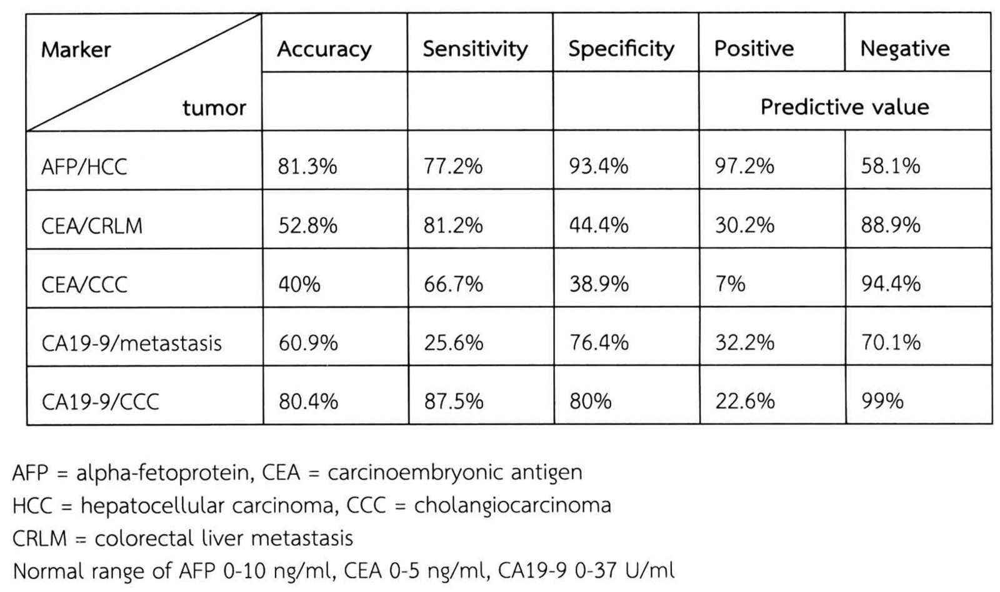
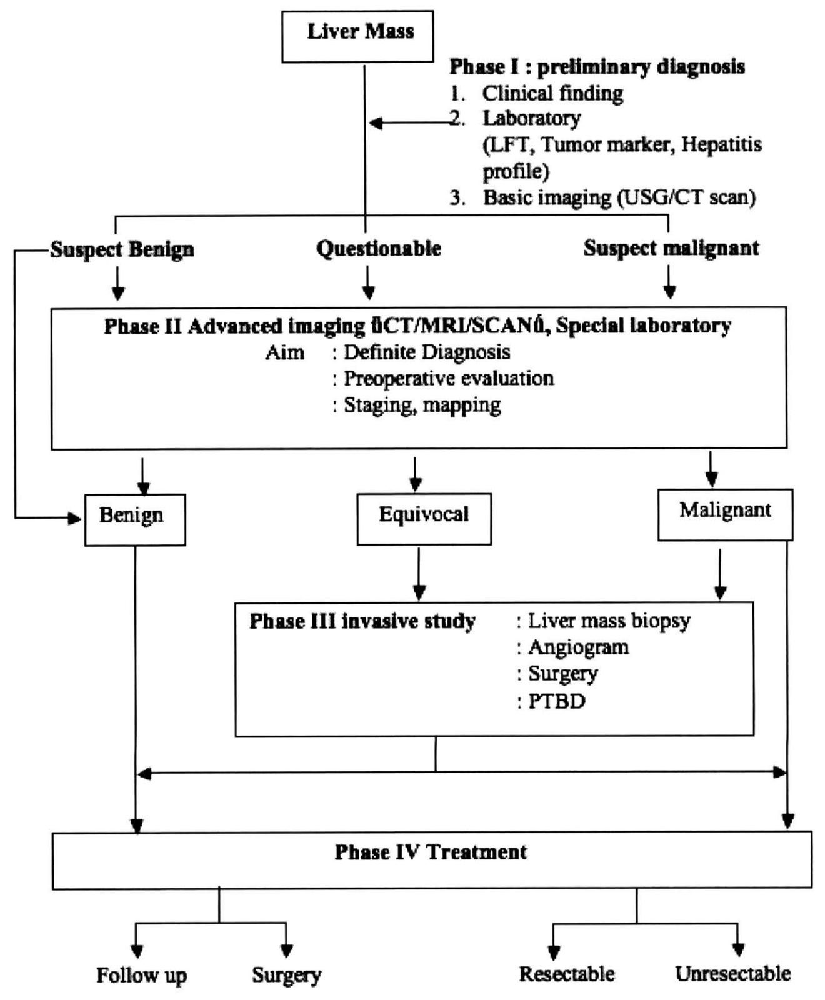
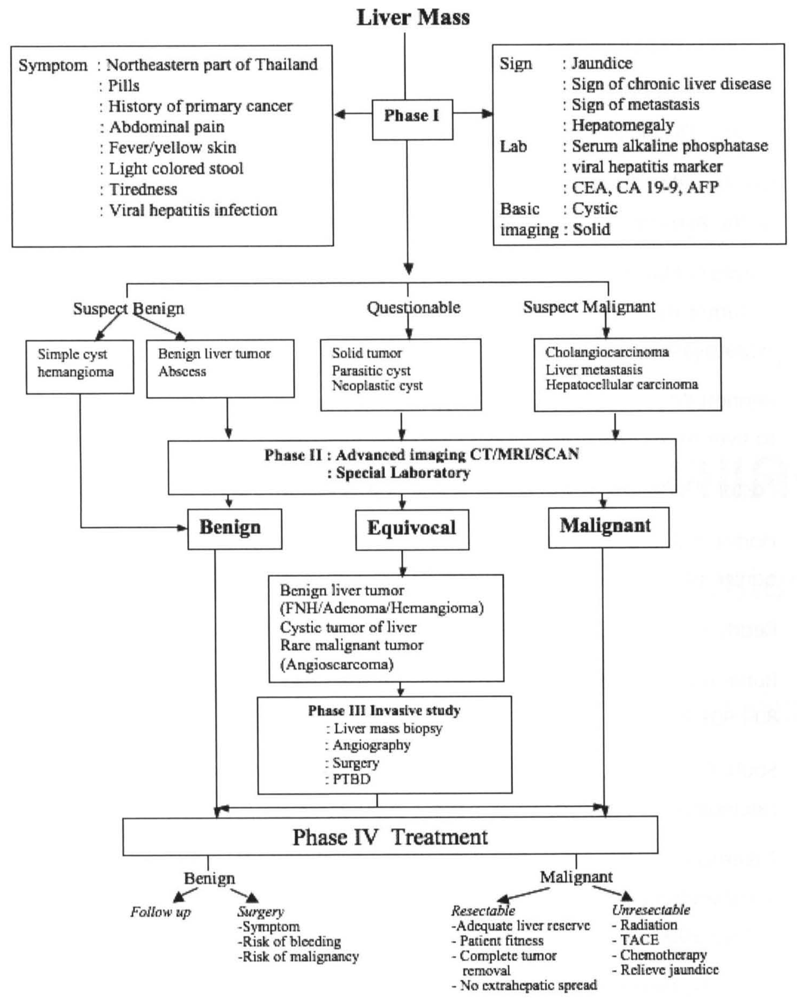

# แนวทางการวินิจฉัยก้อนที่ตับ (Liver mass approach)

## Contents of this file
- แนวทางในการวินิจฉัยโรคที่เป็นสาเหตุของก้อนที่ตับ (p.564)
- 1. ประวัติ และการตรวจร่างกาย (p.564)
  - 1.1 อายุ เพศ และภูมิลำเนา (p.564)
  - 1.2 การติดเชื้อไวรัสตับอักเสบ บี/ซี หรือภาวะตับแข็ง (p.565)
  - 1.3 ประวัติเป็นมะเร็งที่อื่นมาก่อน (p.565)
  - 1.4 อาการ (symptom)/อาการแสดง (sign) (p.565)
- 2. การตรวจทางห้องปฏิบัติการ (p.565)
  - 2.1 การตรวจหน้าที่การทำงานของตับ (p.565)
  - 2.2 Hepatitis B, C serology (p.565)
  - 2.3 Tumor marker (p.565)
- 3. การตรวจทางรังสีวิทยา (p.566)
  - 3.1 Ultrasonography (p.567)
  - 3.2 CT scan (p.568)
  - 3.3 MRI (p.569)
  - 3.4 Liver scintigraphy (p.569)
  - 3.5 Angiography (p.569)
- 4. Liver mass biopsy (p.570)
- 5. Special laboratory (p.571)
- แนวทางในการวินิจฉัยและรักษาก้อนที่ตับ (p.571)
  - Phase I : preliminary diagnosis (p.571)
  - Phase II : advanced imaging and special laboratory (p.572)
  - Phase III : invasive study (p.572)
  - Phase IV : treatment plan (p.573)
- Reference (p.576)

<!-- p.563 (printed none) -->
**แนวทางการวินิจฉัยก้อนที่ตับ**

**Liver mass approach**

บุญชู ศิริจินดากุล

<!-- p.564 (printed 550) -->
**แนวทางการวินิจฉัยก้อนที่ตับ**

**Liver mass approach**

บุญชู ศิริจินดากุล

ก้อนที่ตับ (liver mass) เป็นปัญหาสำคัญอย่างหนึ่งที่พบบ่อยในผู้ป่วยศัลยกรรมจากสถิติของสำนักงานสถิติแห่งชาติ พ.ศ. 2543 พบว่ามะเร็งตับ (ไม่ได้แยกเฉพาะเจาะจงว่าเป็นมะเร็งชนิดไหน) เป็นสาเหตุการตายอันดับ 1 ของคนไทย ดังนั้นการตรวจวินิจฉัยก้อนที่ตับได้อย่างแม่นยำ นอกจากจะทำให้สามารถรักษาได้อย่างทันท่วงทีแล้ว ยังอาจช่วยเพิ่มอัตราการอยู่รอดชีวิตของผู้ป่วยให้ยาวนานยิ่งขึ้น

ความสำคัญของการดูแลรักษาก้อนที่ตับต้องแยกให้ได้ว่าเป็นเนื้องอกไม่ร้ายแรง (benign) หรือเป็นมะเร็ง (malignant) ซึ่งต้องอาศัยข้อมูลเพื่อช่วยในการวินิจฉัย ได้แก่ ประวัติการเจ็บป่วย เช่น การติดเชื้อไวรัสตับอักเสบบีหรือซี (chronic hepatitis B or C infection), ภาวะตับแข็ง, การตรวจร่างกาย, การตรวจทางห้องปฏิบัติการ เช่น การตรวจหน้าที่การทำงานของตับ tumor marker (alpha-fetoprotein, CEA, CA 19-9) ลักษณะที่เห็นจากการตรวจทางรังสีวิทยา เช่น เป็นซีสต์ (cyst) หรือ solid mass ข้อมูลต่างๆ เหล่านี้จะทำให้แพทย์สามารถวินิจฉัยโรคและทำการรักษาได้อย่างถูกต้อง อย่างไรก็ดี ในผู้ป่วยบางรายอาจต้องได้รับการตรวจเพิ่มเติม เช่น การเจาะชิ้นเนื้อตรวจ (liver mass biopsy) หรือการผ่าตัดตัดชิ้นเนื้อออกเพื่อให้ได้มาซึ่งการวินิจฉัยโรคและการรักษาไปพร้อมๆ กัน

## แนวทางในการวินิจฉัยโรคที่เป็นสาเหตุของก้อนที่ตับ

ข้อมูลที่ใช้ประกอบการวินิจฉัย ได้แก่

## 1. ประวัติ และการตรวจร่างกาย

### 1.1 อายุ เพศ และภูมิลำเนา

ผู้ป่วยอายุมากที่มีก้อนที่ตับ มีโอกาสเป็นมะเร็งสูงกว่าผู้ป่วยที่อายุน้อยกว่า1 เพศหญิง โดยเฉพาะอย่างยิ่งมีประวัติทานยาคุมกำเนิด ทำให้นึกถึงเนื้องอก hepatic adenoma2

<!-- p.565 (printed 551) -->
ผู้ป่วยที่มีก้อนที่ตับและมีภูมิลำเนาอยู่ทางภาคตะวันออกเฉียงเหนือ ถ้ามีอาการตาเหลือง ตัวเหลืองร่วมด้วย อาจนึกถึงมะเร็งท่อน้ำดีในเนื้อตับ

### 1.2 การติดเชื้อไวรัสตับอักเสบ บี/ซี หรือภาวะตับแข็ง

ผู้ป่วยที่มีประวัติการติดเชื้อไวรัสตับอักเสบ บี/ซี และ/หรือมีภาวะตับแข็งตรวจพบว่ามีก้อนที่ตับให้สงสัยว่า ก้อนที่ตับเป็นมะเร็งตับชนิดปฐมภูมิแบบ hepatocellular carcinoma2, 3

### 1.3 ประวัติเป็นมะเร็งที่อื่นมาก่อน

ผู้ป่วยที่มีประวัติเป็นมะเร็งที่อื่นมาก่อน และมีก้อนที่ตับให้สงสัยว่าก้อนที่ตับเป็นมะเร็งตับชนิดทุติยภูมิ (liver metastasis)2, 3

### 1.4 อาการ (symptom)/อาการแสดง (sign)

ในผู้ป่วยที่มีอาการของก้อนที่ตับ และตรวจร่างกายพบว่าตับโต มีโอกาสที่ก้อนที่ตับเป็นมะเร็งค่อนข้างสูง1

ผู้ป่วยที่มีก้อนที่ตับ มีภาวะดีซ่าน คันตามตัว อุจจาระสีซีด ปัสสาวะสีเข้ม อาจทำให้นึกถึงมะเร็งของท่อน้ำดีในเนื้อตับ ผู้ป่วยที่มีไข้ ตับโต อาจมีฝีในตับ การตรวจพบว่ามีภาวะตับแข็ง อาจทำให้นึกถึงก้อนที่ตับว่าเป็น hepatocellular carcinoma การตรวจพบต่อมน้ำเหลืองที่ supraclavicular ข้างซ้าย และ/หรือตรวจทางทวารหนัก พบ rectal shelf ทำให้นึกถึงก้อนที่ตับว่าเป็น metastasis

## 2. การตรวจทางห้องปฏิบัติการ

### 2.1 การตรวจหน้าที่การทำงานของตับ

alkaline phosphatase จะสูงขึ้นในผู้ป่วยที่มีก้อนที่ตับเป็นมะเร็งมากกว่าผู้ป่วยที่มีก้อนที่ตับเป็นเนื้องอกไม่ร้ายแรง1, 3 นอกจากนี้การตรวจยังทำให้ทราบถึงหน้าที่การทำงานของตับว่าดีมากน้อยเพียงพอหรือไม่

### 2.2 Hepatitis B, C serology

### 2.3 Tumor marker

<!-- p.566 (printed 552) -->
50-75% ผู้ป่วยที่มีก้อนที่ตับเป็นมะเร็งปฐมภูมิแบบ hepatocellular carcinoma จะมี serum alpha fetoprotein สูงกว่าค่าปกติ3, 4 ผู้ป่วยที่มีก้อนที่ตับเป็นมะเร็งปฐมภูมิแบบ cholangiocarcinoma หรือมะเร็งทุติยภูมิจากมะเร็งลำไส้ใหญ่ จะมี serum CEA และ/หรือ serum CA 19-9 สูงขึ้น1, 3, 4 ดังตารางที่ 14 แสดงความไวและความจำเพาะของ tumor marker ในการวินิจฉัยมะเร็งตับที่พบบ่อย

**ตารางที่ 1** Accuracy, sensitivity, specificity, positive predictive value and negative predictive value of serum tumor markers

| Marker / tumor | Accuracy | Sensitivity | Specificity | Positive Predictive value | Negative Predictive value |
| --- | --- | --- | --- | --- | --- |
| AFP/HCC | 81.3% | 77.2% | 93.4% | 97.2% | 58.1% |
| CEA/CRLM | 52.8% | 81.2% | 44.4% | 30.2% | 88.9% |
| CEA/CCC | 40% | 66.7% | 38.9% | 7% | 94.4% |
| CA19-9/metastasis | 60.9% | 25.6% | 76.4% | 32.2% | 70.1% |
| CA19-9/CCC | 80.4% | 87.5% | 80% | 22.6% | 99% |

AFP = alpha-fetoprotein, CEA = carcinoembryonic antigen 
HCC = hepatocellular carcinoma, CCC = cholangiocarcinoma 
CRLM = colorectal liver metastasis 
Normal range of AFP 0-10 ng/ml, CEA 0-5 ng/ml, CA19-9 0-37 U/ml

> **Caption (verbatim):** ตารางที่ 1 Accuracy, sensitivity, specificity, positive predictive value and negative predictive value of serum tumor markers
> **Text in image (verbatim):** Marker · tumor · Accuracy · Sensitivity · Specificity · Positive · Negative · Predictive value · AFP/HCC · 81.3% · 77.2% · 93.4% · 97.2% · 58.1% · CEA/CRLM · 52.8% · 81.2% · 44.4% · 30.2% · 88.9% · CEA/CCC · 40% · 66.7% · 38.9% · 7% · 94.4% · CA19-9/metastasis · 60.9% · 25.6% · 76.4% · 32.2% · 70.1% · CA19-9/CCC · 80.4% · 87.5% · 80% · 22.6% · 99% · AFP = alpha-fetoprotein, CEA = carcinoembryonic antigen · HCC = hepatocellular carcinoma, CCC = cholangiocarcinoma · CRLM = colorectal liver metastasis · Normal range of AFP 0-10 ng/ml, CEA 0-5 ng/ml, CA19-9 0-37 U/ml
> **Description:** Table with 6 columns and 5 data rows, saved as an image because of its merged header. The top-left header cell is split by a diagonal line, with "Marker" in the upper part and "tumor" in the lower part, so each row label is written as marker/tumor. The other headers are Accuracy, Sensitivity, Specificity, Positive and Negative. A second header row has one merged cell, "Predictive value", under both the Positive and Negative columns. The rows give the percentage values for AFP/HCC, CEA/CRLM, CEA/CCC, CA19-9/metastasis and CA19-9/CCC. Under the table are four lines of abbreviations and normal ranges.
> **Identifiers in image:** none

## 3. การตรวจทางรังสีวิทยา

การตรวจพบก้อนที่ตับ นอกจากอาการทางคลินิกที่จะช่วยบ่งชี้แล้ว การตรวจทางรังสีวิทยาเป็นสิ่งจำเป็นอย่างยิ่งในการที่จะทำให้การวินิจฉัยมีประสิทธิภาพยิ่งขึ้น ปัจจุบันวิวัฒนาการการพัฒนาด้านเทคโนโลยีได้ทำให้เครื่องมือที่ใช้ในการตรวจมีประสิทธิภาพสูงขึ้น การตรวจทางรังสีวิทยาที่ใช้ในการตรวจก้อนที่ตับมีอยู่หลายวิธี ได้แก่

1. Ultrasonography
2. *CT scan (spiral dynamic CT รวมถึง CT arterioportography)*
3. MRI (dynamic MRI)

<!-- p.567 (printed 553) -->
4. Liver Scintigraphy
5. Angiography

Sensitivity, invasiveness (including radiation exposure), cost และ availability ของการตรวจทางรังสีวิทยา สรุปได้ดังตารางที่ 25

**ตารางที่ 2** factors for imaging decisions

| Imaging modality | Sensitivity | Invasiveness | Cost | Availability |
| --- | --- | --- | --- | --- |
| Ultrasonography | +++ | 0 | + | ++++ |
| Nuclear medicine | ++ | + | ++ | ++++ |
| CT | ++++ | ++ | +++ | ++++ |
| MRI | ++++ | 0 | ++++++ | ++ |
| Angiography | +++ | ++++ | ++++++ | +++ |

### 3.1 Ultrasonography

Ultrasound เป็นวิธี non-invasive imaging ที่ทำกันมากที่สุด Ultrasound สามารถแยก cystic ออกจาก solid liver mass ได้ค่อนข้างดี5 อย่างไรก็ดี sensitivity ของ ultrasound ในการตรวจค้นพบ HCC ในผู้ป่วย end stage liver disease มีเพียง 50%6 นอกจากนี้ยังใช้ ultrasound ในการเฝ้าติดตามการเปลี่ยนแปลงขนาดของ benign liver tumor เช่น hemangioma หรือ focal nodular hyperplasia3

ข้อดีของ ultrasound คือราคาถูก มีเครื่องมือใช้กันแพร่หลาย ผู้ป่วยไม่ได้รับรังสี ข้อจำกัดของ ultrasound คือเป็น operator dependence, ความลำบากในการ orientation ภาพ, คนไข้อ้วนหรือมีแผลบริเวณช่องท้องด้านขวาบนทำให้การแปลผลและการตรวจเป็นไปด้วยความลำบากยากยิ่งขึ้น5

<!-- p.568 (printed 554) -->
### 3.2 CT scan

ปัจจุบันวิวัฒนาการทางด้านเทคโนโลยีดีขึ้นมาก ทำให้การตรวจด้วย CT scan ถูกพัฒนาขึ้นมาจนเป็น spiral CT scan ซึ่งสามารถตรวจช่องท้องด้านบนภายในเวลา 20-30 วินาที นอกจากนี้การทำ dynamic CT scan (arterial, portal, delayed enhancement phase) ช่วยบ่งบอกถึง etiology ของ liver mass ได้3, 5, 6, 7 เช่น เนื้องอกที่มี enhancement ใน arterial phase (focal hypervascular tesion) ได้แก่ hepatocellular carcinoma, hepatic adenoma, focal nodular hyperplasia, hemangioma และ Liver metastasis บางชนิด ลักษณะของ arterial enhancement สามารถบ่งบอกถึงลักษณะของเนื้องอกได้ ดังเช่นการศึกษาของ Nino-Murcia และคณะ8 (ตารางที่ 3) เนื้องอกบางชนิดจะมี enhancement ใน delayed phase เช่น cholangiocarcinoma

**ตารางที่ 3** Arterial phase enhancement patterns of 100 focal liver lesions

| Enhancement pattern | HCC | Hemangiona | FNH | Metastasis | Other* | Total |
| --- | --- | --- | --- | --- | --- | --- |
| Homogeneous | 13 | 1 | 5 | 4 | 0 | 23 |
| Abnormal internal vessels or variegated | 9 | 0 | 0 | 1 | 0 | 10 |
| Peripheral puddle | 0 | 6 | 0 | 1 | 0 | 7 |
| Complete ring | 7 | 0 | 0 | 40 | 2 | 49 |
| Incomplete ring | 0 | 2 | 0 | 1 | 0 | 3 |
| No enhancement | 2 | 0 | 0 | 6 | 0 | 8 |
| Total | 31 | 9 | 5 | 53 | 2 | 100 |

*one cholangiocarinoma and one abscess

นอกจากนี้ยังมีการตรวจที่เรียกว่า CT arterial portography ซึ่งสามารถที่จะตรวจพบเนื้องอกที่มีขนาดเล็กกว่า 0.5 ซม. ได้ อย่างไรก็ดีการตรวจด้วยวิธีดังกล่าวนี้ใช้สำหรับการวางแผนการรักษาในการตัดเนื้องอกมากกว่าจะเป็นการ screening5 ปัจจุบันไม่เป็นที่นิยมทำ เนื่องจากเป็น invasive procedure

<!-- p.569 (printed 555) -->
### 3.3 MRI

MRI เป็นเครื่องมือในการตรวจที่ดีในการแยก cavernous hemangioma ออกจาก liver tumor อื่นๆ ถึง 95% ของผู้ป่วย นอกจากนี้ MRI ยังตรวจพบ metastatic islet cell, carcinoid, melanoma และ thyroid tumor ได้ดีกว่า CT scan ที่สำคัญในกรณีที่ HCC พบร่วมกับภาวะตับแข็ง ภาวะดังกล่าวนี้ MRI จะตรวจพบเนื้องอกได้ดีกว่า CT scan เพราะสามารถแยก fatty infiltration และ regenerating nodule ได้ดีกว่า3

MRI ยังสามารถแยก cystic fluid ได้ รวมไปถึงบอกได้ว่าเลือดที่ออกเป็น acute, subacute หรือ chronic blood5 นอกจากนี้ในรายที่เป็น CRLM และได้รับยาเคมีบำบัด การประเมินเนื้องอกด้วยการทำ MRI ให้ประสิทธิภาพที่ดีกว่า

### 3.4 Liver scintigraphy

Radionuclide scan จะตรวจค้นพบก้อนที่ตับได้ เมื่อเนื้องอกมีขนาดอย่างน้อย 2-2.5 ซม.3, 5 มีเทคนิคของการ scan หลายวิธี ที่นิยมทำกันคือ 99mTc sulfur colloid scan ซึ่งจะถูก uptake โดย Kupffer cell และ radiolabeled RBC scan โดยที่ FNH มีส่วนประกอบของ Kupffer cell ซึ่งก้อนที่ตับอย่างอื่นไม่มี ดังนั้นการทำ sulfur colloid scan จะเห็นร่องรอยของโรคเป็น isointense หรือ hyperintense เมื่อเปรียบเทียบกับเนื้อตับที่อยู่รอบๆ อย่างไรก็ดี 30% ของ FNH ผล scan อาจเป็น hypodense เนื่องจากมี vascular thrombosis หรือ abnormal vascular supply3, 9 สำหรับ radiolabeled RBC scan ใช้ในการวินิจฉัย cavernous hemangioma ยิ่งถ้าใช้ร่วมกับ single photon emission computed tomography (SPECT) จะทำให้มี sensitivity และ specificity ในการตรวจ hemangioma ที่มีขนาดมากกว่า 2 ซม. สูงถึง 90-95%9 RBC scan อาจให้ผลลวงลบได้ถ้ามีพยาธิสภาพ fibrosis หรือ thrombosis ของก้อน9

### 3.5 Angiography

เนื่องจากวิวัฒนาการในการตรวจด้วย CT scan และ MRI พัฒนาขึ้นไปมาก ดังนั้นการตรวจด้วยวิธีนี้ทำกันลดน้อยลง และเสี่ยงต่อผู้ป่วยมากกว่าวิธีการตรวจอื่นๆ อย่างไรก็ดี angiography ยังมีประโยชน์โดยเฉพาะอย่างยิ่งในการเตรียมผู้ป่วยก่อนการทำผ่าตัด hepatic resection หรือใช้เป็น alternative treatment เช่น การทำ

<!-- p.570 (printed 556) -->
transarterial chemoembolization ใช้เป็นการตรวจในกรณีที่การตรวจวิธีอื่นๆ ไม่สามารถบอกได้ และก้อนที่ตับนั้นเป็น hypervascular lesion3, 5

ในปัจจุบันยังมีการตรวจที่เรียกว่า PET CT scan โดยทั่วไปการตรวจวิธีนี้นิยมใช้กับ liver metastasis นิยมใช้ในการประเมินและการวางแผนการรักษามากกว่าที่จะใช้เป็นการวินิจฉัย

## 4. Liver mass biopsy

การเจาะก้อนที่ตับเพื่อนำมาตรวจทางพยาธิวิทยานั้นสามารถบอกได้ว่าก้อนที่ตับนั้นเป็นอะไร อย่างไรก็ดี วิธีการดังกล่าวค่อนข้าง invasive และมีภาวะแทรกซ้อนได้ เช่น อาการปวด อาการตกเลือดภายในช่องท้อง10, ในรายที่เป็นเนื้อมะเร็ง อาจมีการกระจายของเนื้องอกตามแนวของเข็มที่เจาะได้10 ดังเช่นการศึกษาของ Takamori และคณะ11 ที่พบมีการกระจายของเนื้องอกตามแนวของเข็มที่เจาะในผู้ป่วย Hepatocellular carcinoma สูงถึง 5.1%

นอกจากนี้บางครั้ง เซลล์ที่ได้ก็ไม่สามารถแยกโรคได้ โดยเฉพาะอย่างยิ่งการแยกโรค well differentiated hepatocellular carcinoma ออกจากเซลล์ตับที่ปกติ, focal nodular hyperplasia และ hepatic adenoma2, 10

Torzilli และคณะ12 ได้ทำการศึกษาถึงความแม่นยำในการตรวจก้อนที่ตับก่อนการผ่าตัด โดยอาศัยอาการทางคลินิก, tumor marker, การตรวจทางรังสีวิทยา (Ultrasound, CT scan, MRI, Angiography) โดยไม่มีการตรวจชิ้นเนื้อของก้อนที่ตับ พบว่ามีความแม่นยำ ความไว ความจำเพาะในการตรวจก้อนที่ตับที่เป็น hepatocellular carcinoma (99.0%, 100%, 98.9%) cholangiocarcinoma (99.6%, 100%, 99.5%), metastasis (99.1%, 100%, 98.8%) และ benign liver tumor (98.7%, 57.1%, 100%) ตามลำดับ

ดังนั้นจะเห็นได้ว่าการเจาะก้อนที่ตับ อาจจะมีความจำเป็นลดลง อย่างไรก็ดีในผู้ป่วยที่มีก้อนที่ตับที่ยังไม่สามารถให้การวินิจฉัยได้และผู้ป่วยไม่แข็งแรงเพียงพอที่จะผ่าตัด การเจาะก้อนที่ตับอาจจะมีประโยชน์ในการวางแผนการรักษาต่อไป2

<!-- p.571 (printed 557) -->
## 5. Special laboratory

การตรวจหา E.histolytica titer ในผู้ป่วยที่สงสัย amebic liver abscess การตรวจ indirect hemagglutination test สำหรับ hydatid cyst13

## แนวทางในการวินิจฉัยและรักษาก้อนที่ตับ

แนวทางในการวินิจฉัยและรักษาก้อนที่ตับ แบ่งเป็น 4 ขั้นตอน

1. Phase I : preliminary diagnosis

ขั้นตอนนี้อาศัยอาการทางคลินิก, ผลเลือดจากการตรวจหน้าที่การทำงานของตับ, tumor marker, ไวรัสตับอักเสบบี ซี รวมถึงการตรวจทางรังสีวิทยาขั้นต้น (ultrasound หรือ CT scan)

2. Phase II : Advanced Imaging and Special Laboratory

ขั้นตอนนี้มีวัตถุประสงค์เพื่อให้ได้การวินิจฉัยขั้นสุดท้าย รวมถึงการทราบระยะของโรคในกรณีที่ก้อนที่ตับเป็นมะเร็ง ขั้นตอนดังกล่าวนี้อาศัยการตรวจ CT scan, MRI, Liver scintigraphy และการตรวจพิเศษต่างๆ เช่น การเจาะเลือดหาค่า E.histolytica titer เพื่อใช้ในการวินิจฉัย amebic liver abscess เป็นต้น

3. Phase III : Invasive study

หลังจากที่ผ่าน 2 ขั้นตอน จะสามารถวินิจฉัยก้อนที่ตับได้เป็นส่วนใหญ่ อย่างไรก็ดี มีก้อนที่ตับบางประเภทซึ่งยังไม่สามารถให้การวินิจฉัยได้ ในกรณีนี้อาจจะต้องได้รับการตรวจเพิ่มเติม เช่น การเจาะก้อนที่ตับเพื่อนำชิ้นเนื้อไปตรวจ การทำ angiography หรือแม้แต่การผ่าตัดเนื้องอกในผู้ป่วยบางรายซึ่งจะกล่าวต่อไปในภายหลัง

4. Phase IV : treatment plan

หลังจากวินิจฉัยโรคได้ทำการวางแผนการรักษาต่อไป

### Phase I : preliminary diagnosis

เมื่อผู้ป่วยผ่านขั้นตอนนี้ จะแบ่งก้อนที่ตับได้เป็น 3 กลุ่มใหญ่ ๆ

<!-- p.572 (printed 558) -->
**กลุ่มที่ 1.** ก้อนที่ตับสงสัยเป็นเนื้องอกไม่ร้ายแรง เช่น liver cyst หรือ cavernous hemangioma

**กลุ่มที่ 2.** ก้อนที่ตับสงสัยเป็นมะเร็ง เช่น hepatocellular carcinoma ในผู้ป่วยที่มีภาวะตับแข็งหรือติดเชื้อไวรัสตับอักเสบบี/ซี และมีค่า alphafetoprotein (AFP) ขึ้นสูง โดยเฉพาะอย่างยิ่งค่าที่มากกว่า 400 ng/ml14, liver metastasis ในผู้ป่วยที่มีประวัติ primary cancer ที่อื่น เช่น มะเร็งลำไส้ใหญ่และมีค่า CEA ขึ้นสูงกว่าค่าปกติ, cholangiocarcinoma (intrahepatic type) ในผู้ป่วยที่มีภูมิลำเนามาจากทางภาคตะวันออกเฉียงเหนือและมีอาการของ obstructive jaundice

**กลุ่มที่ 3.** ไม่สามารถระบุได้ว่าก้อนที่ตับเป็นเนื้องอกชนิดใด เช่น ก้อนที่ตับเป็นก้อนเนื้อ (solid mass) หรือกลุ่มที่ไม่ใช่ simple cyst เช่น parasitic cyst หรือ neoplastic cyst

### Phase II : advanced imaging and special laboratory

หลังจากผู้ป่วยได้รับการตรวจเพิ่มในขั้นตอนนี้ เช่น การทำ CT scan หรือ MRI ก้อนที่ตับส่วนใหญ่จะสามารถวินิจฉัยได้ว่าเป็นเนื้องอกชนิดไม่ร้ายแรง เช่น ฝีที่ตับ, hemangioma, parasitic cyst, focal fatty infiltration/sparing ก้อนที่ตับเป็นมะเร็ง เช่น hepatocellular carcinoma, liver metastasis, cholangiocarcinoma ซึ่งนอกจากจะได้การวินิจฉัยขั้นสุดท้ายยังสามารถทราบระยะของโรค (staging) และช่วยวางแผนในการผ่าตัดด้วย (mapping) อย่างไรก็ดีมีก้อนที่ตับบางชนิดที่ยังไม่สามารถบอกชนิดของก้อนได้ ซึ่งต้องผ่านขั้นตอนที่ 3

### Phase III : invasive study

ก้อนที่ตับกลุ่มนี้ โดยเฉพาะอย่างยิ่งกลุ่มที่เป็น benign liver tumor เช่น focal nodular hyperplasia, adenoma, hemangioma หรือ cystic tumor ของ liver ในผู้ป่วยกลุ่มนี้ การเจาะก้อนที่ตับนอกจากจะไม่ได้ประโยชน์ในการวินิจฉัยแล้ว ยังอาจทำให้มีภาวะเสี่ยงได้ ผู้ป่วยกลุ่มนี้การผ่าตัดตัดเนื้องอกออก นอกจากจะทำให้ได้การวินิจฉัยแล้วยังเป็นการรักษาไปพร้อมๆ กันด้วย

ในผู้ป่วยที่สงสัยเป็น cholangiocarcinoma และมีอาการของ obstructive jaundice การทำ percutaneous transhepatic biliary drainage (PTBD) นอกจากจะทราบถึง

<!-- p.573 (printed 559) -->
biliary anatomy แล้ว ยังช่วยบรรเทาอาการดีซ่าน

การเจาะก้อนที่ตับอาจจะทำในขั้นตอนนี้ โดยเฉพาะอย่างยิ่งในผู้ป่วยที่จะวางแผนการรักษาโดยวิธีการไม่ผ่าตัดหรือก้อนที่ตับที่ยังไม่สามารถวินิจฉัยโรคได้

### Phase IV : treatment plan

หลังจากวินิจฉัยก้อนที่ตับได้ ขั้นตอนต่อไปคือการรักษา ในกรณีของก้อนที่ตับเป็นเนื้องอกไม่ร้ายแรงและไม่มีอาการ ใช้การเฝ้าติดตาม อย่างไรก็ดีในกรณีที่มีอาการ เช่น อาการปวด หรือมีภาวะแทรกซ้อน เช่น การติดเชื้อ แตก เลือดออกภายในก้อนหรือมีโอกาสเป็นมะเร็ง (ในกรณีของ hepatic adenoma) หรือก้อนที่ตับที่ไม่สามารถแยกโรคได้ (โดยเฉพาะอย่างยิ่ง กลุ่ม benign liver tumor) การรักษาคือการผ่าตัด สำหรับกรณีของก้อนที่ตับเป็นมะเร็ง การรักษาที่ดีที่สุดคือการผ่าตัด โดยเกณฑ์ที่ใช้ในการผ่าตัดคือผู้ป่วยแข็งแรงเพียงพอที่จะผ่าตัด ตับเหลือเพียงพอที่จะทำงานเป็นปกติภายหลังการผ่าตัด ก้อนที่ตับสามารถผ่าตัดเอาออกได้หมด (ยกเว้นเนื้องอกบางชนิดถึงแม้จะเอาออกไม่หมด แต่คุณภาพชีวิตภายหลังการผ่าตัดดีขึ้น เช่น เนื้องอกกลุ่ม neuroendocrine tumor, carcinoid syndrome) และไม่มีการแพร่กระจายของเนื้องอกออกนอกตับ (ยกเว้นในบางกรณี ถึงแม้จะมีการกระจายของมะเร็งนอกตับ เช่น มะเร็งของลำไส้ใหญ่กระจายมาที่ปอด แต่ถ้าสามารถผ่าตัดเอาเนื้องอกที่ปอดออกได้ก็อาจพิจารณาผ่าตัดก้อนที่ตับได้) กรณีถ้าก้อนที่ตับเป็นมะเร็ง แต่ไม่สามารถผ่าตัดได้ การรักษาขึ้นอยู่กับลักษณะของเนื้องอกชนิดนั้นๆ เช่น การให้เคมีบำบัด การฉายแสง การทำ transarterial chemoembolization (TACE) การใช้ radiofrequency ablation หรือการรักษาอาการดีซ่าน เป็นต้น

สรุปแนวทางในการวินิจฉัยและรักษาก้อนที่ตับนั้น ได้เป็นแผนภูมิที่ 1 และ 2

<!-- p.574 (printed 560) -->
**แผนภูมิที่ 1**

- **Liver Mass**
  - ← **Phase I : preliminary diagnosis** (input arrow onto the line below Liver Mass)
    1. Clinical finding
    2. Laboratory (LFT, Tumor marker, Hepatitis profile)
    3. Basic imaging (USG/CT scan)
  - → **Suspect Benign** → Phase II box; also → **Benign** directly (bypass line on the left)
  - → **Questionable** → Phase II box
  - → **Suspect malignant** → Phase II box
- **Phase II Advanced imaging ûCT/MRI/SCANû, Special laboratory**
  - Aim : Definite Diagnosis
  - : Preoperative evaluation
  - : Staging, mapping
  - → Benign
  - → Equivocal
  - → Malignant
- Benign → Phase IV Treatment
- Equivocal → Phase III invasive study
- Malignant → Phase III invasive study; Malignant → Phase IV Treatment
- **Phase III invasive study** : Liver mass biopsy : Angiogram : Surgery : PTBD
  - → double-headed arrow to the left (Benign line → Phase IV) and to the right (Malignant line → Phase IV)
- **Phase IV Treatment**
  - → Follow up
  - → Surgery
  - → Resectable
  - → Unresectable

> **Caption (verbatim):** แผนภูมิที่ 1
> **Text in image (verbatim):** Liver Mass · Phase I : preliminary diagnosis · 1. Clinical finding · 2. Laboratory · (LFT, Tumor marker, Hepatitis profile) · 3. Basic imaging (USG/CT scan) · Suspect Benign · Questionable · Suspect malignant · Phase II Advanced imaging ûCT/MRI/SCANû, Special laboratory · Aim : Definite Diagnosis · : Preoperative evaluation · : Staging, mapping · Benign · Equivocal · Malignant · Phase III invasive study · : Liver mass biopsy · : Angiogram · : Surgery · : PTBD · Phase IV Treatment · Follow up · Surgery · Resectable · Unresectable
> **Description:** Black-and-white flowchart going from top to bottom. The top box, "Liver Mass", has a vertical line running down from it. A side arrow from the Phase I list (clinical finding, laboratory, basic imaging) points into that line. The line then splits three ways: Suspect Benign, Questionable and Suspect malignant. Each of these has a downward arrow into one wide Phase II box (advanced imaging, special laboratory, with its aims listed). A separate line also runs from Suspect Benign down the left margin straight to the Benign box. Three arrows lead out of the Phase II box to three boxes: Benign, Equivocal and Malignant. Equivocal and Malignant each have an arrow down into the Phase III invasive study box (liver mass biopsy, angiogram, surgery, PTBD). A line comes down from the Phase III box to a horizontal double-headed arrow, which points left to the vertical line from Benign and right to the vertical line from Malignant. Both of those vertical lines have arrows into the wide Phase IV Treatment box. Below Phase IV there are two branches: the left one splits into Follow up and Surgery, and the right one splits into Resectable and Unresectable. In the Phase II heading, the brackets around "CT/MRI/SCAN" are printed as the stray glyph "û" (a font substitution in the original), and this is transcribed as printed.
> **Identifiers in image:** none

<!-- p.575 (printed 561) -->
**แผนภูมิที่ 2**

- **Liver Mass** → **Phase I**
  - Phase I ← → left box: Symptom : Northeastern part of Thailand : Pills : History of primary cancer : Abdominal pain : Fever/yellow skin : Light colored stool : Tiredness : Viral hepatitis infection
  - Phase I → right box: Sign : Jaundice : Sign of chronic liver disease : Sign of metastasis : Hepatomegaly; Lab : Serum alkaline phosphatase : viral hepatitis marker : CEA, CA 19-9, AFP; Basic imaging : Cystic : Solid
  - Phase I → splits into:
    - **Suspect Benign**
      - → Simple cyst hemangioma → **Benign** (directly, bypassing Phase II)
      - → Benign liver tumor, Abscess → Phase II
    - **Questionable** → Solid tumor, Parasitic cyst, Neoplastic cyst → Phase II
    - **Suspect Malignant** → Cholangiocarcinoma, Liver metastasis, Hepatocellular carcinoma → Phase II
- **Phase II : Advanced imaging CT/MRI/SCAN : Special Laboratory**
  - → **Benign** → Phase IV Treatment
  - → **Equivocal** → Benign liver tumor (FNH/Adenoma/Hemangioma), Cystic tumor of liver, Rare malignant tumor (Angioscarcoma) → **Phase III Invasive study** : Liver mass biopsy : Angiography : Surgery : PTBD
    - Phase III → double-headed arrow to the left (Benign line → Phase IV) and to the right (Malignant line → Phase IV)
  - → **Malignant** → Phase IV Treatment
- **Phase IV Treatment**
  - Benign
    - → *Follow up*
    - → *Surgery*
      - -Symptom
      - -Risk of bleeding
      - -Risk of malignancy
  - Malignant
    - → *Resectable*
      - -Adequate liver reserve
      - - Patient fitness
      - - Complete tumor removal
      - - No extrahepatic spread
    - → *Unresectable*
      - - Radiation
      - - TACE
      - - Chemotherapy
      - - Relieve jaundice

> **Caption (verbatim):** แผนภูมิที่ 2
> **Text in image (verbatim):** Liver Mass · Phase I · Symptom : Northeastern part of Thailand · : Pills · : History of primary cancer · : Abdominal pain · : Fever/yellow skin · : Light colored stool · : Tiredness · : Viral hepatitis infection · Sign : Jaundice · : Sign of chronic liver disease · : Sign of metastasis · : Hepatomegaly · Lab : Serum alkaline phosphatase · : viral hepatitis marker · : CEA, CA 19-9, AFP · Basic imaging : Cystic · : Solid · Suspect Benign · Questionable · Suspect Malignant · Simple cyst hemangioma · Benign liver tumor Abscess · Solid tumor Parasitic cyst Neoplastic cyst · Cholangiocarcinoma Liver metastasis Hepatocellular carcinoma · Phase II : Advanced imaging CT/MRI/SCAN · : Special Laboratory · Benign · Equivocal · Malignant · Benign liver tumor (FNH/Adenoma/Hemangioma) · Cystic tumor of liver · Rare malignant tumor (Angioscarcoma) · Phase III Invasive study · : Liver mass biopsy · : Angiography · : Surgery · : PTBD · Phase IV Treatment · Benign · Follow up · Surgery · -Symptom · -Risk of bleeding · -Risk of malignancy · Malignant · Resectable · -Adequate liver reserve · - Patient fitness · - Complete tumor removal · - No extrahepatic spread · Unresectable · - Radiation · - TACE · - Chemotherapy · - Relieve jaundice
> **Description:** Black-and-white flowchart going from top to bottom. It is a more detailed version of แผนภูมิที่ 1. At the top, "Liver Mass" leads down into a small "Phase I" box. Arrows go left from Phase I to a box of symptoms and history items, and right to a box of signs, laboratory tests and basic imaging (cystic/solid). A downward arrow from Phase I splits three ways: Suspect Benign, Questionable and Suspect Malignant. Suspect Benign has two diagonal arrows. One goes to a "Simple cyst hemangioma" box, which runs down the left side directly to the Benign box and skips Phase II. The other goes to a "Benign liver tumor / Abscess" box, which leads into Phase II. Questionable leads to a box of solid tumor, parasitic cyst and neoplastic cyst. Suspect Malignant leads to a box of cholangiocarcinoma, liver metastasis and hepatocellular carcinoma. Both of these boxes lead into the wide Phase II box (advanced imaging CT/MRI/SCAN, special laboratory). Three arrows lead out of Phase II to three boxes in bold: Benign, Equivocal and Malignant. Equivocal leads to a box listing benign liver tumor (FNH/adenoma/hemangioma), cystic tumor of liver and rare malignant tumor (angiosarcoma, spelled "Angioscarcoma"). That box leads to the Phase III Invasive study box (liver mass biopsy, angiography, surgery, PTBD). A horizontal double-headed arrow under Phase III points to the vertical lines from Benign and from Malignant, and both lines have arrows into the wide Phase IV Treatment box. Phase IV splits into Benign and Malignant. Under Benign, arrows point to Follow up and to Surgery (indications: symptom, risk of bleeding, risk of malignancy). Under Malignant, arrows point to Resectable (criteria: adequate liver reserve, patient fitness, complete tumor removal, no extrahepatic spread) and to Unresectable (options: radiation, TACE, chemotherapy, relieve jaundice). The outcome labels Follow up, Surgery, Resectable and Unresectable are printed in italics.
> **Identifiers in image:** none

<!-- p.576 (printed 562) -->
## Reference

1. Little JM, Kenny J, Hollands MJ. Hepatic Incidentaloma : A modern Problem. World J Surg 1990 ; 14 : 448-51.
2. Lise M, Pian PP, Nitti D, Miotto D, Balduino M, Bacchetti S. Benign liver tumors in adults : Diagnosis and Management. J Hep Bil Pancr Surg 1996; 3: 89-97.
3. Quinlan RM : Tumors of the liver. In : Zuidema GD, editor. Shackelford's Surgery of the Alimentary tract. 4th ed. WB Saunders Company Ltd, 1996 : 512-25.
4. Torzilli G, Makuuchi M, Ferrero A, et al. Accuracy of the preoperative determination of tumor markers in the differentiation of liver mass lesions in surgical patients. Hepatogastroenterlogy 2002; 49: 740-45.
5. Bennett WF, Bova JG. Review of hepatic imaging and a problem-oriented approach to liver mass. Hepatology 1990 ; 12:761-75.
6. Foster JH. Benign liver tumors. World J Surg 1982; 6:25-31.
7. Horton KM, Bluemke DA, Hruban RH, Soyer P, Fishman EK. CT and MR Imaging of benign hepatic and biliary tumors. Radiographics 1999; 19:431-51.
8. Reddy KR, Schiff ER. Approach to a liver mass. Sem Liv Dis 1993; 13: 423-35.
9. Rubin RA, Mitchell DG. Evaluation of the solid hepatic mass. Med Clin NA 1996 ; 80 : 907-28.
10. Souto E, Gores GJ. When Should a liver mass suspected of being a hepatocellular carcinoma be biopsied? Liver Transpl 2000; 6: 73-5.
11. Takamori R, Wong LL, Dang C, Wong L. Needle tract implantation from hepatocellular cancer : Is needle biopsy of the liver always necessary? Liver Transpl 2000 ; 6: 67-72.
12. Torzilli G, Minagawa M, Takayama T, et al. Accurate preoperative evaluation of liver mass lesions without fine needle biopsy. Hepatology 1992 ; 30: 889-93.
13. Taylor BR, Langer B. Current surgical management of hepatic cyst disease. Adv Surg 1998; 31 : 127-48.
14. Bruix J, Sherman M, Llovet JM, et al. Clinical management of Hepatocellular carcinoma. Conclusions of the Barcelona-2000 EASL conference. J Hepatol 2000 ;35: 421-30.
