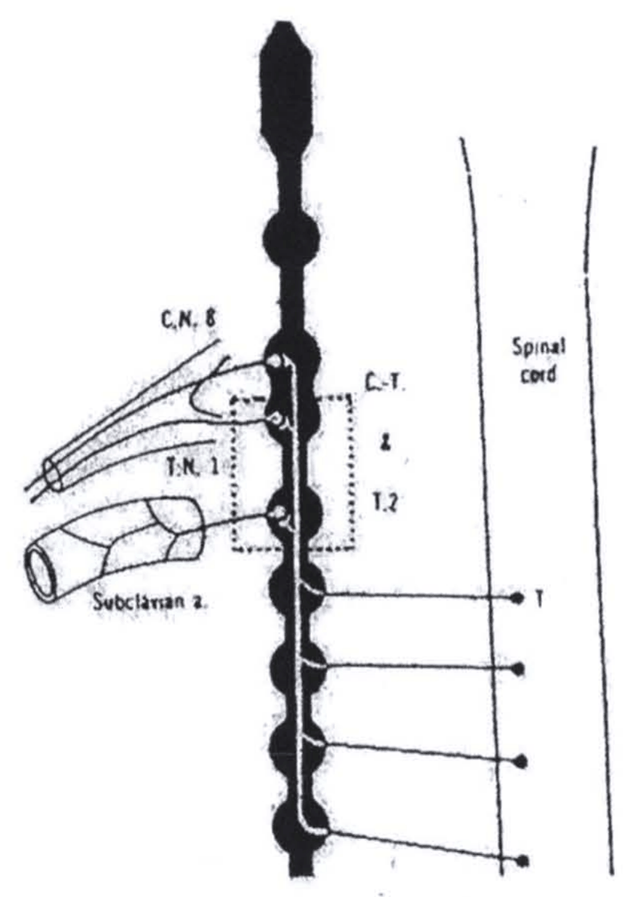
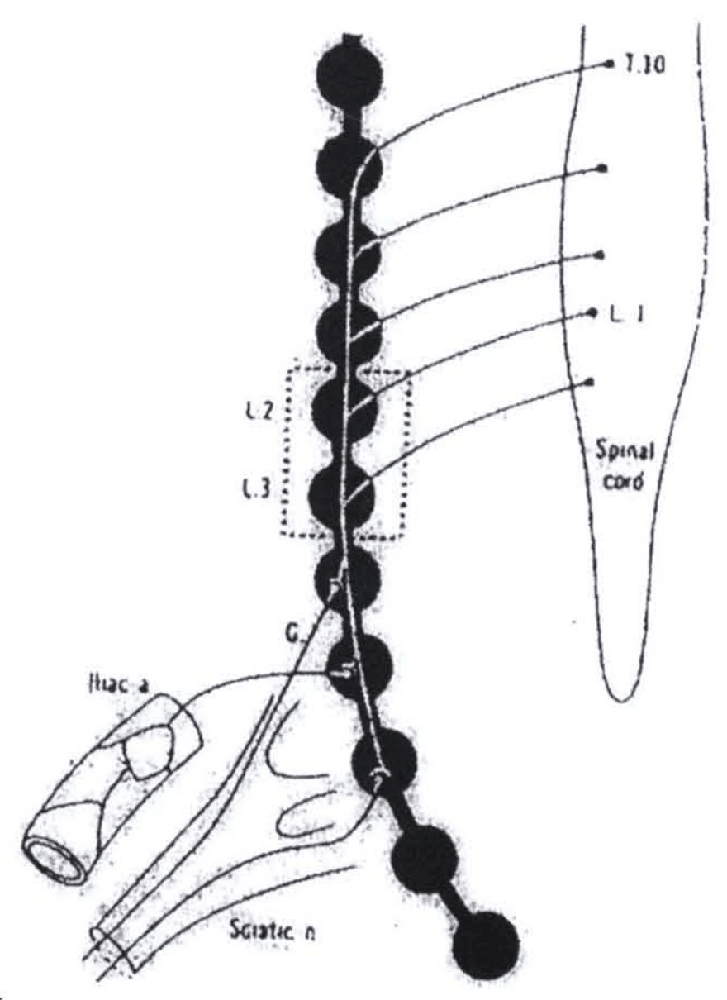
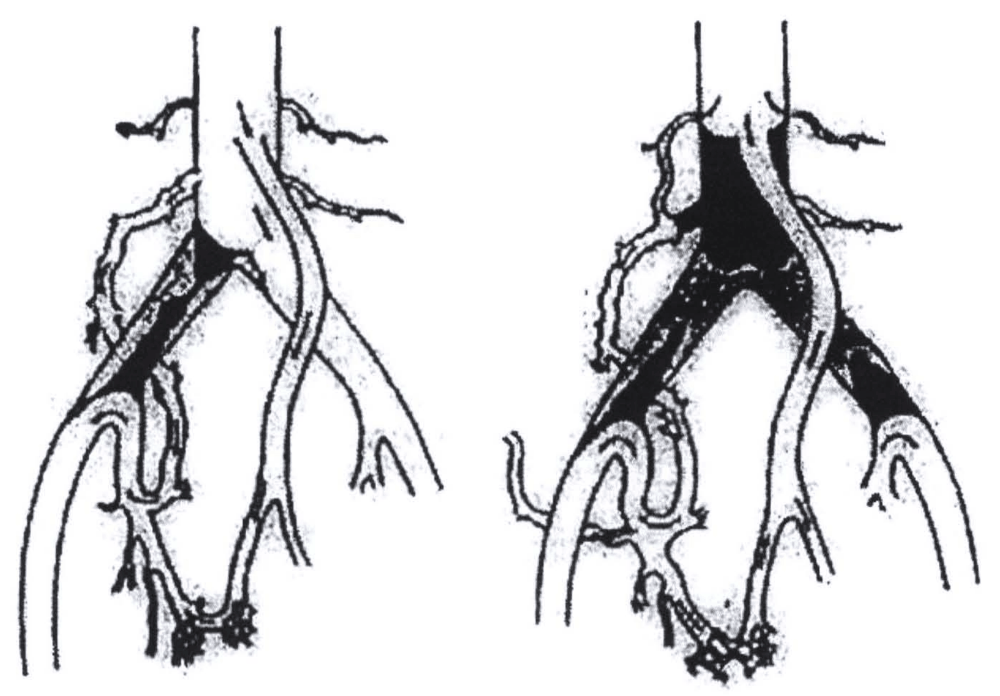
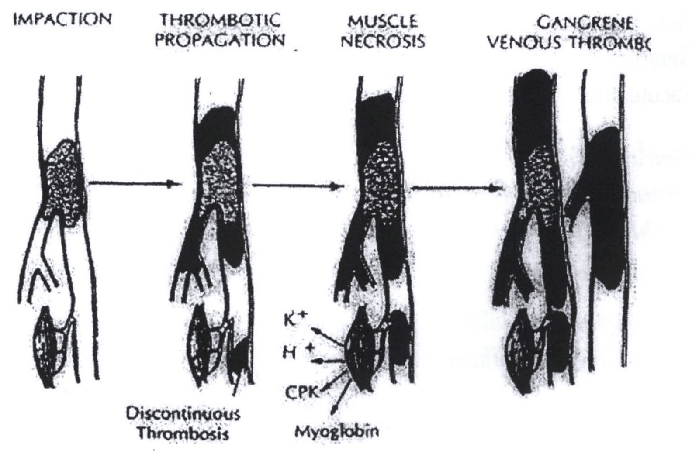
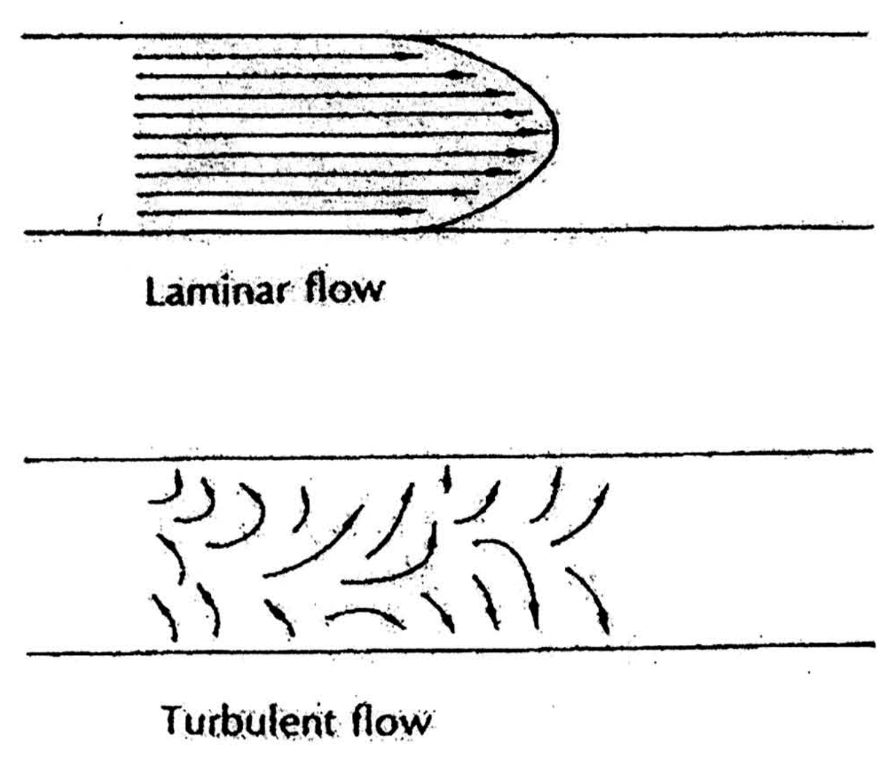
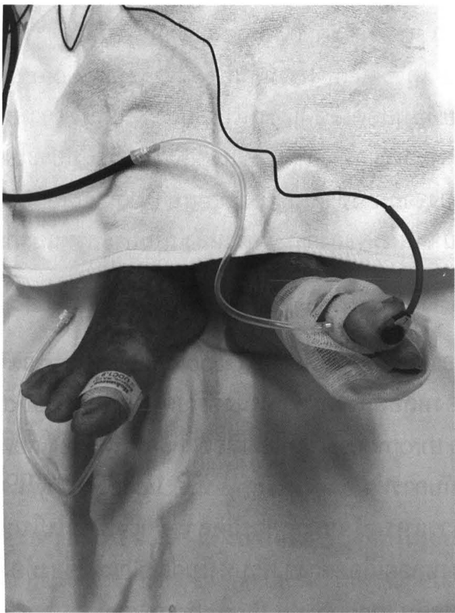
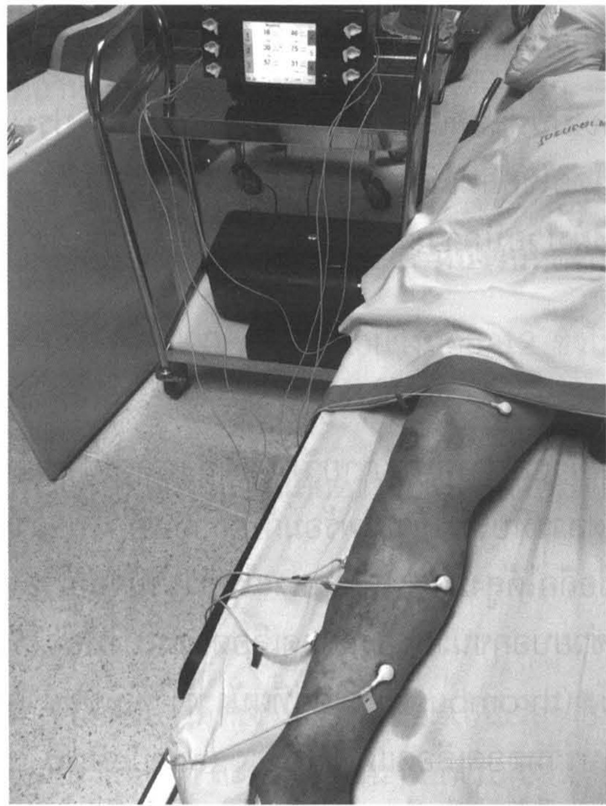
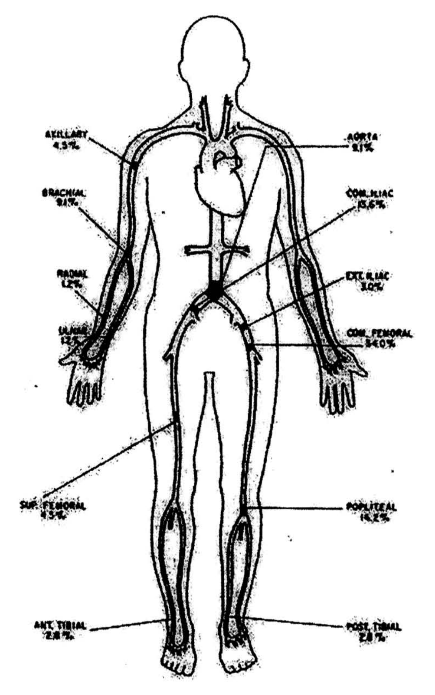
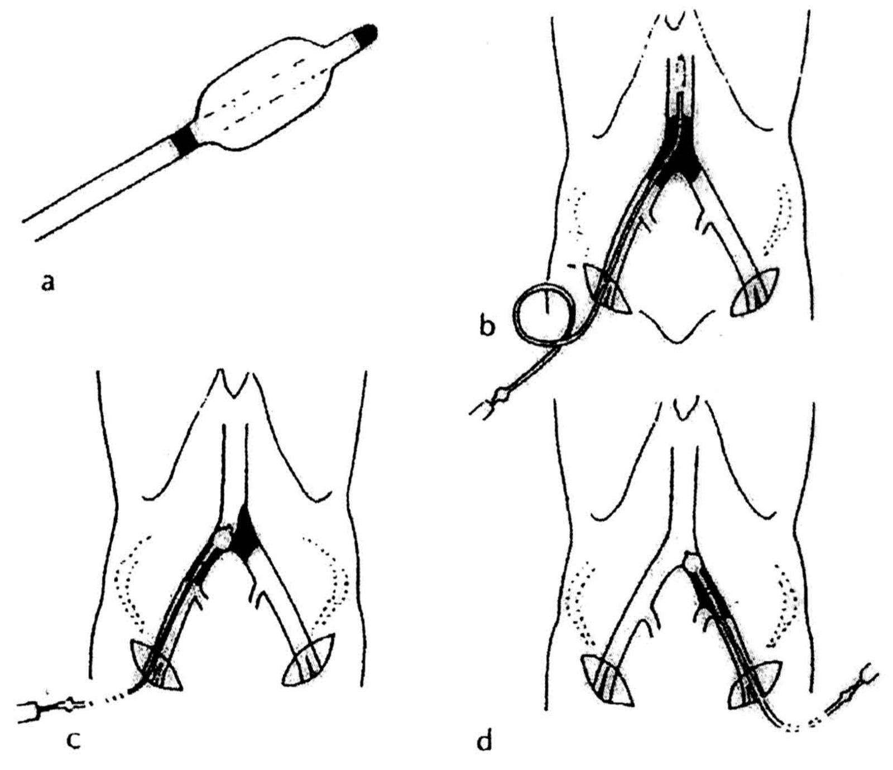

# โรคหลอดเลือดแดง (Disease of the arterial system) — part 1 of 2

## Contents of this file
- กายวิภาคศาสตร์ (Anatomy) (p.578)
- สรีรวิทยา (Physiology) (p.582)
- การตรวจพิเศษของระบบหลอดเลือดแดง (Investigations of the arterial system) มีหลายวิธี (p.584)
  - การตรวจหลอดเลือดแดงแบบไม่รุกล้ำ (p.584)
    - Doppler flowmeter (p.584)
    - Toe pressure (p.585)
    - Pulse volume record (PVR) (p.585)
    - Treadmill exercise (p.586)
    - Duplex scan (p.586)
    - Transcutaneous oxygen tension (TcPO2) (p.586)
  - การตรวจหลอดเลือดแดงแบบรุกล้ำ (p.587)
    - Computed tomography (p.587)
    - Magnetic resonance imaging (MRI) (p.588)
    - Angiography (p.588)
- ความรุนแรงของโรคหลอดเลือดแดง (Severity of arterial diseases) (p.590)
- หลอดเลือดแดงอุดตันอย่างเฉียบพลัน (Acute arterial occlusion) (p.591)
  - Arterial embolism (p.591)
  - Arterial thrombosis (p.592)
- ลักษณะทางคลินิก (Clinical features) (p.593)
- การวินิจฉัยแยกโรค (Differential diagnosis) (p.594)
- การรักษา (p.595)
  - การทำ femoral embolectomy (p.596)
  - Interventional radiology : Thrombolysis (p.596)
- หลอดเลือดแดงอุดตันอย่างเรื้อรัง (Chronic limb threatening ischemia) (p.598)
  - หลอดเลือดแดงเลี้ยงขาอุดตันอย่างเรื้อรังจากโรคหลอดเลือดแข็ง (Atheromatous disease of the lower extremity) (p.598)
    - ลักษณะทางคลินิก (Clinical features) (p.599)
    - Asymptomatic disease (p.599)
    - Intermittent claudication (p.599)
    - Ischemic rest pain (p.599)
    - Tissue necrosis (p.600)
    - Ischemic ulceration (p.600)
    - Gangrene (p.600)
- การตรวจร่างกาย (p.600)

<!-- p.577 (printed none) -->
**โรคหลอดเลือดแดง**

**Disease of the arterial system**

กฤตยา กฤตยากีรณ

<!-- p.578 (printed 564) -->
**โรคหลอดเลือดแดง**

**Disease of the arterial system**

กฤตยา กฤตยากีรณ

ปัจจุบันประชากรประเทศไทยมีอายุยืนยาวขึ้นทำให้เกิดโรคต่างๆ ตามมา ซึ่งหนึ่งในนั้นเป็นปัจจัยเสี่ยงต่อการเป็นโรคหลอดเลือดแดง ปัญหาทางหลอดเลือดแดงสามารถแบ่งได้กว้างๆ เป็น ตีบ ตัน โต และแตก (atherosclerosis, occlusion, aneurysmal change, and rupture) ภาวะต่างๆ เหล่านี้ถ้าไม่สามารถวินิจฉัยและแก้ไขอย่างทันท่วงทีก็จะนำมาซึ่งการสูญเสียอวัยวะและในหลายๆ ครั้งถึงขั้นเสียชีวิตได้

## กายวิภาคศาสตร์ (Anatomy)

ผนังหลอดเลือดแดงมี 3 ชั้น ชั้นใน (intima) ประกอบด้วยเยื่อบุผิว (endothelium) และเนื้อเยื่อเกี่ยวพัน (connective tissue) ชั้นกลาง (media) ประกอบด้วยกล้ามเนื้อเรียบและเนื้อเยื่อยืดหยุ่น (elastic tissue) ชั้นนอก (adventitia) ประกอบด้วยเนื้อเยื่อเกี่ยวพัน (connective tissue) เช่น คอลลาเจน (collagen) เป็นส่วนใหญ่ ส่วนประกอบของผนังหลอดเลือดแดงขึ้นอยู่กับขนาดของหลอดเลือดนั้น หลอดเลือดแดงขนาดใหญ่ เช่น หลอดเลือดแดงเอออร์ตา (aorta) ต้องรับแรงดันสูงตลอดเวลา จึงมีชั้นกลางหนาและมีเนื้อเยื่อยืดหยุ่น (elastic tissue) มาก หลอดเลือดแดงขนาดกลาง เช่น หลอดเลือดแดง popliteal ชั้นกลางมีเนื้อเยื่อยืดหยุ่น (elastic tissue) น้อยลง แต่มีกล้ามเนื้อเรียบมากขึ้น หลอดเลือดแดงขนาดเล็กและหลอดเลือดฝอย (arteriole) ซึ่งเป็นหลอดเลือดแดงที่มีขนาดเล็กกว่า 100 micron แทบจะไม่มีเนื้อเยื่อยืดหยุ่น (elastic tissue) ที่ชั้นกลาง มีแต่กล้ามเนื้อเรียบเป็นส่วนใหญ่ หลอดเลือดที่มาเลี้ยงผนังของหลอดเลือดแดงนี้เรียกว่า vasa vasorum จะเป็นแขนงของหลอดเลือดแดงนั้นเองหรือแขนงของหลอดเลือดที่อยู่ข้างเคียง

ปลายประสาทที่มาเลี้ยงหลอดเลือดแดงอยู่ในชั้นกลางส่วนใหญ่เป็นเส้นประสาทที่ไม่มีไมเอลินหุ้ม (non-myelinated fiber) ของระบบประสาทออโตโนมิค (autonomic nervous system) ทำหน้าที่ควบคุมการขยายและหดตัวของหลอดเลือด (vasomotor tone)

<!-- p.579 (printed 565) -->
หลอดเลือดแดงจะขยายตัวเมื่อการทำงานของประสาทซิมปาเทททิค (sympathetic) ลดลง เช่น โดยใช้ยากดระบบประสาทซิมปาเทททิคในการรักษาโรคความดันเลือดสูง หรือโดยการตัดเส้นและปมประสาทซิมปาเทททิค (cervical หรือ lumbar sympathectomy) เพื่อเพิ่มเลือดไปเลี้ยงแขนหรือขา เป็นต้น ประสาทซิมปาเทททิคที่ควบคุมหลอดเลือดแดงมาจากไขสันหลังระดับ thoracolumbar โดยมี preganglionic fiber ออกมาใน anterior root ไปเข้า sympathetic ganglion จากนั้นมี post-ganglionic fiber ไปตามประสาทไขสันหลัง (spinal nerve) ไปเป็น plexus ในผนังหลอดเลือดแดงประสาทซิมปาเทททิคของหลอดเลือดแดงที่ศีรษะและคอมาจากไขสันหลังระดับ T1 และ T2 และไปเข้า cervical sympathetic chain ส่วนที่แขนมาจากระดับ T1 ถึง T4 ซึ่งผ่านเข้า thoracic ganglion ที่ 1 และ 2 และ stellate ganglion แล้วจึงเข้า brachial plexus ส่วนที่ขามาจาก T10 ถึง T12 ผ่าน lumbar ganglion ไปเข้า lumbosacral plexus (รูปที่ 1, 2) การกระตุ้นประสาทซิมปาเทททิคทำให้กล้ามเนื้อเรียบในหลอดเลือดแดงขนาดเล็กและหลอดเลือดฝอย (arteriole) บีบตัว ประสาทพาราซิมปาเทททิค (parasympathetic) มีบทบาทน้อยมากในการกระตุ้นให้หลอดเลือดแดงขยายตัว ยกเว้นในบางอวัยวะ เช่น ต่อมน้ำลาย กระเพาะอาหาร และอวัยวะเพศ

นอกจากระบบประสาทออโตโนมิคแล้ว หลอดเลือดแดงเล็กและหลอดเลือดฝอย (arteriole) ยังถูกควบคุมด้วยฮอร์โมน catecholamine และ reninangiotensin และได้รับผลกระทบจากระดับของ metabolite, ระดับความเป็นกรดหรือด่างของเลือด (pH) ระดับคาร์บอนไดออกไซด์ในเลือด (pCO2) และอุณหภูมิในเนื้อเยื่อที่อยู่โดยรอบ

โดยทั่วไปอวัยวะของร่างกายได้รับเลือดจากหลอดเลือดแดงหลัก เช่น ไตได้จากหลอดเลือดแดงรีนัล (renal) ขาได้จากหลอดเลือดแดงอิลิแอก (common iliac) เป็นต้น นอกจากนี้แต่ละอวัยวะจะมีหลอดเลือดแขนง (collateral) มาเลี้ยงไม่มากก็น้อย ในกรณีเกิดภาวะหลอดเลือดแดงหลักตีบลงทีละน้อย (chronic arterial occlusion) หลอดเลือดแขนงจะรับเลือดแทนและมีขนาดใหญ่ขึ้น ทำให้เนื้อเยื่อปลายทางได้รับเลือดในปริมาณใกล้เคียงกับปกติ (รูปที่ 3) แต่ถ้าหลอดเลือดแดงหลักอุดตันอย่างเฉียบพลัน หลอดเลือดแขนงไม่สามารถเปิดขยายได้ทันท่วงที ทำให้เนื้อเยื่อปลายทางขาดเลือดหรือตายได้ (รูปที่ 4) หลอดเลือดแดงบางตำแหน่งมีแขนงน้อยหรือไม่มีเลย เช่น หลอดเลือดแดงโคโรนารี (coronary) หลอดเลือดแดงของไขสันหลัง (longitudinal spinal artery) หลอดเลือดแดงของจอตา (central artery of retina) และหลอดเลือดแดงในสมอง (cerebral artery) ที่อยู่เลย circle of Willis จะทำให้เนื้อเยื่อปลายทางตาย

<!-- p.580 (printed 566) -->
ถ้าหลอดเลือดแดงหลักอุดตัน

> **Caption (verbatim):** **รูปที่ 1** ระบบประสาทซิมปาเทททิค (sympathetic) ของเส้นเลือดที่แขน (C-T หมายถึง cervicothoracic (stellate) ganglion กรอบที่เป็นจุดแสดงขอบเขตของการทำ cervical sympathectomy.1
> **Text in image (verbatim):** C.N. 8 · C.-T. · & · T.2 · T.N. 1 · Subclavian a. · Spinal cord · T
> **Description:** Black-and-white schematic line drawing. A vertical chain of black beaded ganglia (the sympathetic chain) runs down the centre; its upper end is a large elongated ganglion. To the right, two vertical lines outline the spinal cord (labelled "Spinal cord"). Several horizontal lines connect dots on the spinal cord (the uppermost labelled "T") to the lower ganglia, with a fine white fibre running up inside the chain. Fibres leave the upper ganglia to the left: to nerve trunks labelled "C.N. 8" and "T.N. 1" (drawn as a cut bundle) and to a cut tubular vessel labelled "Subclavian a.". A dotted rectangle encloses the ganglia labelled "C.-T. & T.2" (cervicothoracic ganglion and second thoracic ganglion), marking the extent of a cervical sympathectomy.
> **Identifiers in image:** none

> **Caption (verbatim):** **รูปที่ 2** ระบบประสาทซิมปาเทททิค (sympathetic) ของเส้นเลือดที่ขา กรอบที่เป็นจุดแสดงขอบเขตการทำ lumbar sympathectomy.1
> **Text in image (verbatim):** T.10 · L.1 · L.2 · L.3 · Spinal cord · G. · Iliac a · Sciatic n
> **Description:** Black-and-white schematic line drawing. A vertical chain of black beaded ganglia (lumbar sympathetic chain) runs down the centre and angles slightly to the right at its lower end. To the right, the tapering lower end of the spinal cord is outlined (labelled "Spinal cord"). Lines run from dots on the spinal cord, from "T.10" down to "L.1" and one level below, obliquely down to ganglia of the chain, with a white fibre running down inside the chain. A dotted rectangle encloses the ganglia labelled "L.2" and "L.3", marking the extent of a lumbar sympathectomy. Below, a ganglion labelled "G." and the lower ganglia send fibres to the left to a cut tubular vessel labelled "Iliac a." and to a nerve bundle labelled "Sciatic n.".
> **Identifiers in image:** none

<!-- p.581 (printed 567) -->

> **Caption (verbatim):** **รูปที่ 3** หลอดเลือดแขนงใหม่ (collateral) ที่เกิดขึ้นเมื่อมีการอุดตันที่หลอดเลือดแดงคอมมอนอิลิแอก (common iliac) และที่ aortic bifurcation.1
> **Text in image (verbatim):** none
> **Description:** Two side-by-side black-and-white line drawings of the distal abdominal aorta, its bifurcation and the iliac arteries, with the paired vertical lines of the aorta entering from the top. Occluded segments are shaded solid black. Left drawing: the black occlusion is in one (the viewer's left) common iliac artery, starting just below the bifurcation; tortuous collateral channels arise from branches of the aorta above and from the other side, run around the blocked segment and reconnect with the iliac branches below, including a network across the pelvis at the bottom. Right drawing: the black occlusion fills the aortic bifurcation and extends into both common iliac arteries; larger, more numerous tortuous collateral vessels from the aortic branches above the block bypass it and connect to the distal iliac branches and a pelvic network below.
> **Identifiers in image:** none

> **Caption (verbatim):** (printed at the top of p.582) **รูปที่ 4** ผลที่เกิดเมื่อมีเอมโบลัส (embolus) ไปอุดตันหลอดเลือดแดง1
> **Text in image (verbatim):** IMPACTION · THROMBOTIC PROPAGATION · MUSCLE NECROSIS · GANGRENE VENOUS THROMBC[cut off at the image edge in the book] · Discontinuous Thrombosis · K+ · H+ · CPK · Myoglobin
> **Description:** Black-and-white drawing in four panels from left to right, joined by horizontal arrows, each showing an artery segment with its branches running down to a muscle (spindle shape) beside a parallel vein. (1) IMPACTION: a speckled embolus is lodged in the artery at a branch point; the artery below it is unshaded. (2) THROMBOTIC PROPAGATION: solid black thrombus extends above and below the embolus into the branches; a separate black clot further down beside the muscle is labelled "Discontinuous Thrombosis". (3) MUSCLE NECROSIS: thrombus fills the artery and branches; arrows point outward from the muscle to the labels K+, H+, CPK and Myoglobin (substances released from the necrotic muscle). (4) GANGRENE / VENOUS THROMBOSIS (label cut off in the book): the artery and branches are filled with black thrombus and the adjacent vein is also filled with black thrombus.
> **Identifiers in image:** none

<!-- p.582 (printed 568) -->
*[caption of รูปที่ 4, whose figure is on p.581:]*

**รูปที่ 4** ผลที่เกิดเมื่อมีเอมโบลัส (embolus) ไปอุดตันหลอดเลือดแดง1

## สรีรวิทยา (Physiology)

การไหลของเลือด (flow) มีความสัมพันธ์กับ (ก) ความดันเลือด (pressure) (ข) ขนาดของหลอดเลือด และ (ค) ความเข้มข้นหรือความหนืด (viscosity) ของเลือด

เลือดจะไหลช้าถ้าความเข้มข้นสูง เช่น มีเม็ดเลือดแดงมากไปหรือมีการขาดน้ำ หรือถ้าความดันเลือดตก เลือดก็จะไหลช้าลง ถ้าความดันตกถึงระดับหนึ่ง (critical closing pressure) ก็จะทำให้หลอดเลือดแดงขนาดเล็กและหลอดเลือดฝอย (arteriole) ปิดสนิทได้ถึงแม้ความดันเลือดยังไม่ลดลงจนถึงที่สุดก็ตาม

ปกติเลือดจะไหลขนานไปกับผนังหลอดเลือด โดยส่วนที่อยู่ติดกับผนังจะไหลช้ากว่าส่วนที่อยู่ตรงกลางหลอดเลือด เรียกว่า laminar flow ถ้าเกิดหลอดเลือดตีบ เลือดจะไหลผ่านตำแหน่งที่ตีบเร็วขึ้น ถ้าหลอดเลือดยิ่งตีบมากเท่าไร ความเร็วของเลือดก็จะยิ่งเพิ่มขึ้นจนถึงระดับหนึ่ง (critical velocity) การไหลที่เป็นแบบ laminar flow จะเสียไป กระแสเลือดจะปั่นป่วน (turbulent flow) ทำให้มีเสียง murmur หรือ bruit เกิดขึ้น (รูปที่ 5) หลอดเลือดแดงที่ตีบเพียงเล็กน้อยจะไม่ทำให้ปริมาณเลือดที่ไหลผ่านลดลงมากนัก แต่ถ้าตีบมากถึงจุดวิกฤต (critical stenosis) คือ เส้นผ่าศูนย์กลางลดลงเหลือร้อยละ 50 ซึ่งทำให้พื้นที่หน้าตัด (cross section) ลดลงถึงร้อยละ 75 ปริมาณเลือดที่ไหลผ่านจะลดลงอย่างมาก มีโอกาสเกิดอาการขาดเลือดที่อวัยวะส่วนปลายทั้งอย่างเฉียบพลัน (acute arterial occlusion) และอย่างเรื้อรัง (chronic arterial occlusion)

<!-- p.583 (printed 569) -->

> **Caption (verbatim):** **รูปที่ 5** ลักษณะการไหลของเลือดแบบ laminar และ turbulent1
> **Text in image (verbatim):** Laminar flow · Turbulent flow
> **Description:** Two schematic line drawings, one above the other, each showing a vessel as two parallel horizontal lines. Top ("Laminar flow"): parallel horizontal arrows all pointing right, shortest next to the walls and longest in the centre, their tips forming a curved parabolic front (velocity profile fastest in the centre, slowest at the walls). Bottom ("Turbulent flow"): many short curved arrows pointing in varied directions (up, down, obliquely), showing disordered, swirling flow between the walls.
> **Identifiers in image:** none

การเขียนหน้าป้าย (medical record) เป็นการบันทึกข้อมูลที่สำคัญเกี่ยวกับผู้ป่วย การสื่อสารระหว่างแพทย์ ได้รับรู้ถึงการประเมินผู้ป่วยและแผนการรักษา ข้อมูลผู้ป่วยเพื่อการดูแลรักษาในอนาคต องค์ประกอบการเขียนหน้าป้ายควรมีประวัติ อาการนำ อาการสำคัญ อาการแสดง อาการเริ่มแรก ระยะเวลาของอาการ ตำแหน่ง ลักษณะของอาการที่สำคัญ ปัจจัยที่ทำให้เป็นมากขึ้น ปัจจัยที่ทำให้ดีขึ้น การรักษาเบื้องต้นที่ได้รับ โรคประจำตัว แพ้ยา แพ้อาหาร ประวัติสูบบุหรี่ จำนวนปีที่สูบ เลิกแล้วหรือยัง และตรวจร่างกายอย่างละเอียด

การตรวจร่างกายตั้งแต่สัญญาณชีพ วัดความดันแขนทั้งสองข้าง วัดส่วนสูง น้ำหนัก คำนวณ Body mass index ดูลักษณะโดยรวมของผู้ป่วย ขนาดของขาสองข้างเท่ากันหรือไม่ ฟังได้ bruit บริเวณไหนของร่างกาย คลำชีพจรทั้งสี่รยางค์ ถ้าคลำได้ปกติให้ 2 คลำไม่ได้ให้ 0 ถ้าคลำได้เบากว่าอีกข้างให้ 1

Allen’s Test โดยการ exsanguinate เลือดออกจากมือแล้วกดหลอดเลือดแดง Radial และ Ulnar ปล่อยหลอดเลือดแดงที่กดไว้ออกทีละเส้น สังเกต reperfusion ของมือ

<!-- p.584 (printed 570) -->
## การตรวจพิเศษของระบบหลอดเลือดแดง (Investigations of the arterial system) มีหลายวิธี

### การตรวจหลอดเลือดแดงแบบไม่รุกล้ำ

#### Doppler flowmeter

เป็นเครื่องมือพื้นฐานในการตรวจหลอดเลือดแดงและหลอดเลือดดำ เนื่องจากทำได้สะดวก ไม่มีอาการแทรกซ้อน เครื่อง Doppler อาศัยคลื่นเสียงตรวจการเคลื่อนที่ (flow) ของเม็ดเลือดในหลอดเลือดแล้วเปลี่ยนเป็นสัญญาณเสียงในคลื่นความถี่ที่สามารถได้ยิน ถ้าเลือดไหลเร็วจะได้ยินสัญญาณชัด และจะไม่ได้ยินสัญญาณถ้าเลือดไหลช้ากว่า 2 เซนติเมตรต่อวินาที ซึ่งในการตรวจหลอดเลือดแดงต้องถือว่ามีการอุดตันเกิดขึ้น

ลักษณะ wave form ปกติควรได้ยินเป็น tri phasic หรือ bi phasic ถ้าได้ยินเป็น mono phasic หรือไม่ได้ยินถือว่าผิดปกติ ถ้าได้ยินเป็น high pitch แสดงถึงการตีบของหลอดเลือด

เครื่องมือนี้สามารถตรวจได้ว่าหลอดเลือดแดงยังมีเลือดไหลผ่านแม้จะมีการตีบตันจนคลำชีพจรของหลอดเลือดไม่ได้ และสามารถใช้วัดความดันของหลอดเลือดในที่ซึ่งไม่สามารถวัดได้ด้วยวิธีธรรมดา เช่น ความดันที่ข้อเท้า (ankle pressure) ที่นิ้วเท้าหรือที่องคชาต เป็นต้น

ในคนปกติ ความดันเลือดที่ข้อเท้า (ankle pressure) จะสูงกว่าที่แขน (arm หรือ brachial pressure) เล็กน้อย ซึ่งถ้าเอาค่าความดันเลือดที่ข้อเท้า (ankle pressure) หารด้วยความดันที่แขน (brachial pressure) เรียกว่า ankle-brachial pressure index จะมีค่ามากกว่า 1.0 ถ้าค่าต่ำกว่า 0.9 ให้สงสัยว่าจะมีการตีบของหลอดเลือดแดงที่ไปเลี้ยงขา ถ้าค่า ABI สูงกว่า 1.3 ให้ถือว่าผิดปกติเพราะเป็น non compressible vessel ถ้าคำนวณได้ 0.9-1.0 ให้ประเมินตามอาการ อาการแสดง หรือนัดมาวัดอีกครั้งในหกเดือนเพื่อดูแนวโน้มค่า ABI

ผู้ป่วยที่มีอาการปวดขาเมื่อเดินมากๆ จากขาขาดเลือดไปเลี้ยงอย่างเรื้อรัง (intermittent claudication) มักจะมี ankle-brachial pressure index ประมาณ 0.5-0.7 ผู้ป่วยที่มีอาการปวดเท้าเมื่ออยู่เฉยๆ (rest pain) หรือมีแผลที่เกิดจากการขาดเลือดที่เท้ามักจะมี ankle-brachial pressure index ต่ำกว่า 0.3 นอกจากนี้ยังอาจใช้ pressure index ในการตรวจดูการไหลของเลือด (flow) ของนิ้วเท้าและองคชาตได้

<!-- p.585 (printed 571) -->
ค่าปกติของ toe-brachial pressure ratio จะสูงกว่า 0.65 สำหรับที่องคชาตนั้น ถ้า penile-brachial pressure ratio ต่ำกว่า 0.6 มักจะเข้าได้กับการเสื่อมสมรรถภาพทางเพศ เนื่องจากเลือดไปเลี้ยงไม่พอ (vasculogenic impotence)

ความดันที่ข้อเท้าวัดที่หลอดเลือดแดง dorsalis pedis หรือหลอดเลือดแดง posterior tibial ที่ต่ำกว่า 40 มิลลิเมตรปรอท บ่งบอกถึงการขาดเลือดไปเลี้ยงอย่างรุนแรง (limb threatening ischemia)

#### Toe pressure

เป็นการวัดความดันหลอดเลือดบริเวณนิ้วเท้า เนื่องจาก digital artery จะเกิด atherosclerosis ช้ากว่า Crural artery ค่า toe pressure index จึงพอเชื่อถือได้มากกว่า ABI ในกรณีที่มีค่ามากกว่า 1.3 แต่การทำจะลำบากกว่า ABI ดังรูปที่ 6 ถ้าค่า toe index มากกว่า 0.65 ถือว่าปกติ

> **Caption (verbatim):** **รูปที่ 6** แสดงวิธีการวัด Toe pressure (small cuff at proximal digit)
> **Text in image (verbatim):** none
> **Description:** Black-and-white clinical photograph of a patient's two feet lying on a bed sheet, seen from above, with the legs covered by a towel. A small pneumatic cuff is wrapped around the base (proximal part) of the great toe of the foot on the left of the image, connected to thin clear tubing. The foot on the right of the image is wrapped in gauze, with a probe (attached to a dark cable) applied at the tip of the great toe and clear tubing running to the dressing. Cables and tubing run up over the towel. (The small printed marking on the toe cuff is an equipment label, not legible.)
> **Identifiers in image:** none

#### Pulse volume record (PVR)

<!-- p.586 (printed 572) -->
เป็นการวัดปริมาตรที่เปลี่ยนแปลงในตำแหน่งที่ศึกษาในแต่ละท่อนของขาตามการเต้นของหัวใจ โดยมีลักษณะเป็นกราฟให้เห็น กราฟที่ปกติจะเป็น dicrotic notch ถ้ามีการตีบ dicrotic notch จะลดลง ถ้าเป็นมากกราฟจะเตี้ยลงและมี prolong up stroke และ down stroke

#### Treadmill exercise

เป็นการตรวจดูว่าขามีเลือดไปเลี้ยงดีหรือไม่ โดยให้ผู้ป่วยเดินบนทางเอียงลาดที่มีความชัน 12 องศา ด้วยความเร็วประมาณชั่วโมงละ 4 กิโลเมตร เป็นเวลา 5 นาที หรือจนต้องหยุดเดินเนื่องจากปวดขา จากนั้นจึงให้ผู้ป่วยนอนแล้ววัดความดันที่แขน (brachial pressure) และความดันที่ข้อเท้า (ankle pressure) ทุกนาที จนกระทั่งค่ากลับคืนมาเท่ากับก่อนเดิน (ประมาณ 10-15 นาที) ถ้าผู้ป่วยเดินไม่ได้ อาจตรวจด้วยวิธี reactive hyperemia โดยใช้ที่วัดความดันเลือด (blood pressure cuff) พันเหนือเข่า แล้วใส่ลมเข้าไปให้สูงกว่าความดัน systolic ประมาณ 50 มิลลิเมตรปรอท เป็นเวลา 5 นาที จากนั้นปล่อยลมออกแล้ววัดความดันทุก 1 นาที จนค่ากลับคืนมาเท่ากับค่าก่อนตรวจ ในคนปกติเมื่อเดิน treadmill exercise ได้ 5 นาที ความดันที่ข้อเท้า (ankle pressure) จะเท่าเดิมหรือเพิ่มขึ้น แต่ในผู้ป่วยที่มีหลอดเลือดแดงที่ไปเลี้ยงขาตีบตัน ความดันที่ข้อเท้า (ankle pressure) จะลดต่ำลงมากเมื่อทำ treadmill exercise วิธีนี้มีประโยชน์ในการแยกผู้ป่วยที่มีอาการปวดขาเนื่องจากการขาดเลือด (intermittent claudication) ออกจากการปวดขาจากสาเหตุอื่น เช่น โรคของกระดูกสันหลัง เส้นประสาทและกล้ามเนื้อ เป็นต้น

#### Duplex scan

เป็นเครื่องมือที่อาศัยหลักการเดียวกับ Doppler flowmeter แต่ซับซ้อนกว่า สามารถแสดงให้เห็นภาพของหลอดเลือด ตำแหน่งที่ตีบตัน เช่น carotid artery stenosis ก้อนเลือด (clot หรือ thrombus) ในหลอดเลือดและการไหลของเลือดในหลอดเลือดนั้นได้ แม้ภาพจะไม่ชัดเท่ากับการทำ angiography หรือ venography แต่ก็ปลอดภัยกว่ามาก ไม่ต้องเสี่ยงต่ออาการแทรกซ้อนจากการฉีดสารทึบรังสีเข้าไปในหลอดเลือด นิยมใช้ในการวินิจฉัยโรคของหลอดเลือดต่างๆ รวมทั้งในช่องอกและช่องท้อง และในการวินิจฉัยภาวะหลอดเลือดดำอุดตัน (deep vein thrombosis)

ใช้สำหรับติดตามหลังการรักษา เช่น graft surveillance ใน arterial bypass

#### Transcutaneous oxygen tension (TcPO2)

<!-- p.587 (printed 573) -->
เป็นการวัดค่า Oxygen ที่มาเลี้ยงบริเวณที่ตรวจ (หัว probe จะแปะหลายตำแหน่ง) มีการวัดหลายระยะ มีการยกขาสูงเพื่อดูเลือดว่ายังสามารถเลี้ยงบริเวณที่ตรวจได้หรือไม่ หลังจากนั้นให้ผู้ป่วยหายใจ Oxygen mask with bag แล้ววัดค่าเทียบ เพื่อช่วยในการประเมินการรักษา แผลจะหายหรือไม่ ถ้ามีการ revascularization จะได้ประโยชน์หรือไม่ เป็นต้น ดังรูปที่ 7 ค่าที่วัดได้ตอนแรกถ้าน้อยกว่า 20 mmHg ถือว่าเป็น critical limb ischemia ถ้ามากกว่า 40 mmHg โอกาสที่แผลหายค่อนข้างสูง

> **Caption (verbatim):** **รูปที่ 7** แสดงวิธีการวัด Transcutaneous oxygen tension
> **Text in image (verbatim):** [unclear: monitor screen values 18 · 40 · 30 · 75 · 57 · 31]
> **Description:** Black-and-white clinical photograph. A patient lies on a bed covered by a sheet up to the thigh; one bare leg (thigh to lower leg) is exposed along the edge of the bed. Several round electrode probes are stuck on the skin at different positions down the leg (one on the thigh near the edge of the sheet and others on the lower leg), each connected by thin wires that run up to a measuring device on a wheeled metal trolley beside the bed. The device has a screen showing six numerical readings in two columns, with sensor ports on either side of the screen. The patient's head and face are not in the frame.
> **Identifiers in image:** none

### การตรวจหลอดเลือดแดงแบบรุกล้ำ

#### Computed tomography

มีประโยชน์ในการตรวจหลอดเลือดแดงเอออร์ตาโป่งพองในช่องท้อง หรือ aortic dissection ทำให้รู้ขนาดและตำแหน่งของหลอดเลือดโป่งพอง (aneurysm) ที่แน่นอน เช่น อยู่เหนือหรือใต้หลอดเลือดแดงรีนัล ซึ่งเป็นข้อมูลที่สำคัญในการรักษา และใช้ช่วยวินิจฉัยโรคแทรกซ้อนจากการผ่าตัดหลอดเลือดแดงเอออร์ตา เช่น false aneurysm และการติดเชื้อของหลอดเลือดเทียม (graft infection) เป็นต้น

<!-- p.588 (printed 574) -->
ใช้เป็นการตรวจประเมินหลอดเลือดเพื่อวางแผนการรักษา ประเมินผลการรักษา และติดตามผลการรักษา โดยการฉีดสารทึบรังสีทางหลอดเลือดดำ ถ้าเป็นไปได้ควรให้ผู้ป่วยอยู่ในภาวะ Euvolemia เนื่องจากผู้ป่วยจะได้รับสารทึบรังสีเป็นปริมาณมากกว่าการทำ angiogram อาจมีผลเสียต่อไตได้ แพทย์มักจะส่งตรวจ CTA เมื่อวางแผนที่จะทำหัตถการกับผู้ป่วย เช่น surgical bypass, angioplasty with stent, EVAR หลัง CTA ต้องติดตามผลและระวังภาวะไตวายเฉียบพลันเสมอ (Contrast Induced Nephropathy)

#### Magnetic resonance imaging (MRI)

เป็นการตรวจประเมินหลอดเลือดเพื่อวางแผนการรักษา ประเมินผลการรักษา และติดตามผลการรักษา โดยใช้คลื่นแม่เหล็กไฟฟ้าและอาจต้องฉีด Gadolinium contrast ซึ่งไม่เหมาะในกรณีที่ผู้ป่วยมีภาวะไตเรื้อรัง เนื่องจากอาจเกิดภาวะ Nephrogenic systemic fibrosis ได้

#### Angiography

เป็นการศึกษาพยาธิสภาพและกายวิภาคของหลอดเลือดแดง โดยใช้เข็มแทงหลอดเลือดแดงและฉีดสารทึบรังสีเข้าไปพร้อมกับเอกซเรย์ภาพของหลอดเลือด วิธีนี้ให้ผลแน่นอนและมีความเชื่อถือได้สูงมาก โดยเฉพาะในการวินิจฉัยโรคหลอดเลือดแดงตีบตัน แต่ angiography ไม่ช่วยบอกขนาดของหลอดเลือดแดงโป่งพอง (aneurysm) ซึ่งมักจะมีก้อนเลือดหรือทรอมบัส (thrombus) เกาะอยู่ที่ผนัง ทำให้เห็นขนาดเล็กกว่าความเป็นจริง แต่จะช่วยบอกให้ทราบว่าหลอดเลือดแดงโป่งพอง (aneurysm) ในช่องท้องนั้นอยู่เหนือหรือใต้ต่อหลอดเลือดแดงรีนัล หรือมีการตีบตันของหลอดเลือดแดงอิลิแอกร่วมด้วย

การทำ angiography อาจมีภาวะแทรกซ้อนได้หลายอย่าง เช่น การใช้เข็มแทงหลอดเลือดแดงทำให้หลอดเลือดฉีกขาด หรืออุดตันจากทรอมโบสิส (thrombosis) หรือผนังชั้นในของหลอดเลือดแดงที่แข็ง (plaque) หลุดเป็น embolism แพ้สารที่ฉีด หรือไตวายจากสารทึบรังสี ดังนั้นจึงควรทำ angiography ในกรณีที่จำเป็นเท่านั้น เช่น ในการวางแผนผ่าตัดรักษาผู้ป่วยหรือเพื่อประโยชน์การฉีดยาละลายลิ่มเลือด (thrombolytic therapy) หรือในการใส่ลูกโป่งขยายหลอดเลือดแดงตีบ (balloon angioplasty)

1. ข้อบ่งชี้

<!-- p.589 (printed 575) -->
1.1 เพื่อศึกษาลักษณะหลอดเลือด

1.2 เพื่อทำหัตถการในหลอดเลือด (angioplasty, embolization, EVAR, etc.)

1.3 ให้ยาละลายลิ่มเลือดโดยตรง

1.4 เพื่อศึกษาหลังทำหัตถการ เช่น completion angiogram

2. การเตรียมผู้ป่วยก่อน angiography

2.1 งดน้ำงดอาหารคืนก่อนหัตถการยกเว้นยาที่จำเป็น

2.2 งดยาละลายลิ่มเลือดตามความเหมาะสม

2.3 ส่งตรวจ Bun, Cr, CBC และ Bun, Cr หนึ่งวันหลังหัตถการ

2.4 ให้ 0.9% NSS 1,000 ml ก่อนอย่างน้อย 12 ชั่วโมง และระวังในผู้ป่วยโรคหัวใจและโรคไต

2.5 ตรวจบริเวณที่จะเจาะหลอดเลือดว่ามีการติดเชื้อหรือไม่ เช่น บริเวณขาหนีบมีเชื้อรา บริเวณข้อพับเป็นฝี

3. หลังทำ angiography

3.1 ให้ผู้ป่วยเหยียดรยางค์ที่เจาะหลอดเลือดเป็นเวลา 6 ชั่วโมง (แนวทางการเหยียดรยางค์ Sheath French ละชั่วโมง เช่น puncture right common femoral artery ด้วย 7 French Sheath ให้เหยียดขาขวาเจ็ดชั่วโมง เป็นต้น)

3.2 ตรวจดู hematoma pseudoaneurysm บริเวณที่เจาะหลอดเลือด retroperitoneal hematoma ต้องสงสัยไว้เสมอและยืนยันโดยการทำ CT scan

3.3 เฝ้าระวังการทำงานของไต โดยส่ง Bun Cr วันรุ่งขึ้นและวันที่สามและเจ็ด

3.4 ตรวจชีพจรก่อนและหลังหัตถการ รวมทั้งส่ง ABI และ PVR เมื่อพร้อม

3.5 ตรวจระบบประสาทรยางค์ที่ได้รับการเจาะ เช่น Axillary a. puncture อาจเกิด Nerve injury ได้จากการกดห้ามเลือด

4. การให้ recombinant tissue Plasminogen Activator

<!-- p.590 (printed 576) -->
4.1 มักทำในผู้ป่วย thrombosis, popliteal a. aneurysm, graft thrombosis

4.2 ข้อห้ามในการทำ rtPA ได้แก่ ผู้ป่วยที่ต้องรีบ revascularization, recent CVA, CNS pathology, severe HT, active bleeding, Coagulopathy, recent operation, pregnancy

4.3 ส่งตรวจ Bun, Cr, fibrinogen level, PT, INR, CBC

4.4 Hydration, Oxygenation

4.5 เฝ้าระวังเลือดออกใน ICU และคอยสังเกตชีพจร

4.6 ระวังไม่ให้ความดันสูงจนเกินไป

4.7 ให้ heparin ทาง sheath ให้ได้ค่า aPTT ประมาณสองเท่า

4.8 angiogram ซ้ำหลังให้ยาได้ระยะหนึ่งเพื่อประเมินผลการรักษา

## ความรุนแรงของโรคหลอดเลือดแดง (Severity of arterial diseases)2

โรคของหลอดเลือดแดงอาจแบ่งความรุนแรงออกเป็น 4 ระดับ คือ

1. เป็นอันตรายถึงชีวิตถ้าไม่ได้รับการรักษาทันท่วงที (life threatening condition) เช่น หลอดเลือดแดงเอออร์ตาโป่งพองในช่องท้องแตก (ruptured abdominal aortic aneurysm) หรือการอุดตันอย่างเฉียบพลันของหลอดเลือดแดง superior mesenteric (acute mesenteric occlusion) เป็นต้น

2. อาจถูกตัดแขนหรือขาถ้ารักษาไม่ทันท่วงที (limb threatening condition) เช่น การอุดตันอย่างเฉียบพลันของหลอดเลือดแดงฟีเมอรัล (femoral) หรือหลอดเลือดแดง popliteal เป็นต้น

3. ได้รับความทุกข์ทรมานจากความเจ็บปวดหรือเสียการทำงาน (functional disabling condition) เช่น ผู้ป่วยที่หลอดเลือดแดงที่ขามีการอุดตันอย่างเรื้อรัง (chronic arterial occlusion) ที่มีอาการปวดขาและเท้าเมื่อเดิน (intermittent claudication) หรือเมื่ออยู่เฉยๆ (rest pain) เป็นต้น

<!-- p.591 (printed 577) -->
4. ไม่มีอาการ (asymptomatic status)

ความเข้าใจเกี่ยวกับการดำเนินของโรคทำให้แพทย์สามารถทำการวินิจฉัยและให้การรักษาผู้ป่วยอย่างเหมาะสม

## หลอดเลือดแดงอุดตันอย่างเฉียบพลัน (Acute arterial occlusion)

การที่หลอดเลือดแดงอุดตันอย่างเฉียบพลันมักมีสาเหตุจากเอมโบลัส (embolus) หรือทรอมโบสิส (thrombosis) แขนหรือขาที่หลอดเลือดแดงอุดตันจะมีอาการปวด (pain) ซีด (pallor) ชา (paresthesia) ขยับได้น้อยลง (paralysis) คลำชีพจรไม่ได้ (pulselessness) และเย็น (polar หรือ cold sensation) จำง่ายๆ ว่า “6 P” (ซึ่ง paralysis จะเป็น P สุดท้ายที่เป็นและรุนแรง) การอุดตันอย่างเฉียบพลันอาจเกิดกับหลอดเลือดแดงที่ไปเลี้ยงอวัยวะอื่น เช่น หลอดเลือดแดง internal carotid, หลอดเลือดแดงรีนัล และหลอดเลือดแดง superior mesenteric เป็นต้น ทำให้มีอาการตามอวัยวะที่ขาดเลือดไปเลี้ยงนั้นๆ

### Arterial embolism

เอมโบลัส (embolus) คือสิ่งแปลกปลอมที่ลอยอยู่ในกระแสเลือด เช่น ฟองอากาศ ก้อนเลือดหรือทรอมบัส (thrombus) และวัตถุ เช่น ลูกกระสุนปืนหรือสายสวนหลอดเลือดแดงที่ขาดและหลุดลอยไป เป็นต้น แต่ส่วนใหญ่เป็นชิ้นส่วนของทรอมบัสในหัวใจห้องบนซ้าย (left atrium) ของผู้ป่วยที่เป็นโรคหัวใจเต้นไม่เป็นจังหวะ (atrial fibrillation) บางครั้งเป็นชิ้นส่วนของทรอมบัสในหลอดเลือดแดงที่โป่งพอง (aneurysm) สาเหตุอื่นพบได้น้อย ได้แก่ atrial myxoma, bacterial endocarditis เศษ atheroma ลูกกระสุนปืนหรือสายสวนหลอดเลือดแดงที่ขาด สำหรับการที่ทรอมบัสที่เกิดจากหลอดเลือดดำอุดตัน (deep vein thrombosis) หลุดเข้าหัวใจ ผ่าน atrial septa defect (ASD) หรือ patent foramen ovale เข้ามาในระบบหลอดเลือดแดงพบได้น้อยมาก

ตำแหน่งที่เอมโบลัสไปอุดขึ้นอยู่กับขนาดของเอมโบลัสและขนาดของหลอดเลือดแดง มักจะพบที่บริเวณแยกแขนง เพราะหลอดเลือดมีขนาดเล็กลงทันที เช่น ที่ aortic bifurcation จุดที่หลอดเลือดแดงคอมมอนฟีเมอรัล (common femoral) แยกเป็น

<!-- p.592 (printed 578) -->
หลอดเลือดแดงซูเปอร์ไฟเชียลฟีเมอรัล (superficial femoral) และหลอดเลือดแดงดีพฟีเมอรัล (deep femoral) และจุดที่หลอดเลือดแดง popliteal แยกเป็นหลอดเลือดแดง anterior tibial และ tibioperoneal trunk เป็นต้น (รูปที่ 8)

> **Caption (verbatim):** **รูปที่ 8** แสดงตำแหน่งที่พบการอุดตันของหลอดเลือดแดงจากเอมโบลัส (embolus)3
> **Text in image (verbatim):** AXILLARY [unclear: 4.5%] · BRACHIAL 9.1% · RADIAL 1.2% · ULNAR [unclear: 1.2%] · AORTA 9.1% · COM. ILIAC [unclear: 15.6%] · EXT. ILIAC 3.0% · COM. FEMORAL 34.0% · SUP. FEMORAL [unclear: 4.5%] · POPLITEAL 14.2% · ANT. TIBIAL 2.8% · POST. TIBIAL 2.8%
> **Description:** Line drawing of a whole human figure, front view, with the heart and the main arterial tree drawn in (aortic arch and neck vessels, descending aorta with a pair of side branches, aortic bifurcation shown as a black dot, iliac arteries, arteries of both arms down to the hands and of both legs down to the feet; arterial segments are shaded/stippled). Leader lines point from labels to sites of embolic occlusion, each with the percentage of emboli found there. Left side of the drawing (top to bottom): axillary artery at the shoulder, brachial artery in the upper arm, radial and ulnar arteries at the forearm/wrist, superficial femoral artery in the thigh, anterior tibial artery at the lower leg. Right side (top to bottom): aorta (line to the aorta at the bifurcation region), common iliac (line to the aortic bifurcation/iliac origin), external iliac, common femoral at the groin, popliteal behind the knee, posterior tibial at the lower leg. The largest percentage is at the common femoral (34.0%), followed by common iliac and popliteal. The print is a low-quality reproduction; some digits are hard to read.
> **Identifiers in image:** none

### Arterial thrombosis

ก้อนเลือดหรือทรอมบัส (thrombus) ในหลอดเลือดแดงมักเกิดขึ้นตรงตำแหน่งที่มีความผิดปกติอยู่ก่อนแล้ว เช่น มีการตีบจากโรคหลอดเลือดแข็ง (atherosclerosis) หรือผนังชั้นใน (intima) ของหลอดเลือดแดงฉีกขาดจากการบาดเจ็บ (trauma) เป็นต้น ถ้าไม่รวมปัญหาจากการบาดเจ็บแล้ว จะพบว่าทรอมโบสิส (thrombosis) ส่วนใหญ่เกิดใน

<!-- p.593 (printed 579) -->
ผู้ที่มีอายุมากที่มีโรคหลอดเลือดแข็ง (atherosclerosis) โดยมีภาวะต่างๆ เป็นสาเหตุนำ เช่น ภาวะขาดน้ำ (dehydration) ภาวะหัวใจวาย ภาวะติดเชื้อ เป็นต้น

## ลักษณะทางคลินิก (Clinical features)

การอุดตันอย่างเฉียบพลันที่เกิดขึ้นกับหลอดเลือดแดงที่ไปเลี้ยงแขนหรือขา จะทำให้ผู้ป่วยมีอาการ “6P” ดังได้กล่าวมาแล้ว ไม่ว่าจะเกิดจากเอมโบลัสหรือทรอมโบสิส ซึ่งแพทย์ผู้รักษาจะต้องพยายามแยกสาเหตุให้ได้เนื่องจากการวางแผนการรักษาต่างกัน การอุดตันของหลอดเลือดแดงอย่างเฉียบพลันที่เกิดจากเอมโบลัสจะทำให้มีอาการทันที ผู้ป่วยมักจะบอกเวลาได้แน่นอนว่ารู้สึกปวดเมื่อไร และมักมีประวัติของโรคหัวใจ เช่น ลิ้นหัวใจรั่ว (rheumatic heart disease) หรือหัวใจเต้นไม่เป็นจังหวะ (atrial fibrillation) สำหรับรายที่เกิดจากทรอมโบสิสนั้น ผู้ป่วยมักมีอายุมาก มีโรคของหลอดเลือดอยู่ก่อนแล้ว และมีสาเหตุนำ เช่น ภาวะขาดน้ำ ภาวะติดเชื้อ ภาวะหัวใจล้มเหลว อาการค่อยเป็นค่อยไป ไม่เกิดขึ้นทันทีเหมือนจากเอมโบลัส

การตรวจร่างกายพบแขนขาที่มีการอุดตันจากเอมโบลัสจะมีลักษณะของการขาดเลือด เช่น ปวด เย็น ซีด รุนแรงกว่าที่พบในการอุดตันจากทรอมโบสิส เนื่องจากผู้ที่เป็นทรอมโบสิสมักจะมีหลอดเลือดแดงตีบมานานและมีหลอดเลือดแขนง (collateral) เกิดขึ้นแล้ว นอกจากนี้ ขาข้างที่มีทรอมโบสิสมักมีลักษณะของการขาดเลือดเรื้อรัง เช่น ผิวหนังมันเลี่ยน เนื้อเยื่อที่ปลายนิ้วลีบ เล็บแห้งแตก (trophic changes) อาจฟังได้ arterial bruit เป็นต้น ผู้ป่วยที่มีการอุดตันที่ขาจากเอมโบลัส มักจะมีชีพจรปกติที่ขาอีกข้าง ในรายที่เป็นจากทรอมโบสิส อาจคลำชีพจรของอีกข้างหนึ่งไม่ได้หรือเบาลง เนื่องจากหลอดเลือดแดงตีบอยู่ก่อนแล้ว อย่างไรก็ตามพึงระลึกไว้เสมอว่าการอุดตันจากเอมโบลัสนั้นอาจเกิดขึ้นในผู้ป่วยอายุมากที่มีโรคหลอดเลือดแข็ง (atherosclerosis) ได้เช่นกันถ้ามีปัจจัยเสริม เช่น หัวใจเต้นไม่เป็นจังหวะ (atrial fibrillation) หรือกล้ามเนื้อหัวใจตาย

ความรุนแรงของการขาดเลือดมักจะคะเนได้จากการตรวจร่างกาย ถ้ายังมีเลือดไปเลี้ยงที่ปลายเท้าเพียงพอ จะไม่มีอาการชาหรือกล้ามเนื้ออ่อนแรง ถ้าการขาดเลือดรุนแรงขึ้นจะมีอาการชาและกล้ามเนื้อเริ่มอ่อนแรง ถ้าขาไม่มีความรู้สึกและขยับไม่ได้เลย แสดงว่าภาวะขาดเลือดมีความรุนแรงมาก ถ้ากล้ามเนื้อที่น่องแข็งตึง (muscle rigor) ซึ่งเกิดจากกล้ามเนื้อขาดเลือดเกินกว่า 6 ชั่วโมง แสดงว่ากล้ามเนื้อตาย แก้ไขไม่ได้ และอาจต้องพิจารณาตัดขา

<!-- p.594 (printed 580) -->
การประเมินความรุนแรงของขาขาดเลือดมีแนวทางการประเมินโดยดูระบบหลอดเลือดและระบบประสาท ระบบหลอดเลือดจะดูหลอดเลือดแดงและหลอดเลือดดำ ระบบประสาทจะประเมิน sensory กับ motor ถ้าเป็น grade I ขายังขาดเลือดไม่รุนแรง สามารถใช้เวลาในการประเมินและรักษาได้ grade III ไม่ควรเสียเวลาในการประเมิน ควรรีบนำคนไข้ไปตัดขาที่ขาดเลือด grade II มีความเร่งด่วนในการ revascularization โดยแบ่งเป็น IIa กับ IIb ดังตารางที่ 14

**ตารางที่ 1** แสดงแนวทางการประเมินและรักษาภาวะขาขาดเลือด

|  | **Viable (I)** | **Marginally threatened (IIa)** | **Immediately threatened (IIb)** | **Nonviable (III)** |
| --- | --- | --- | --- | --- |
| **Pain** | Mild | Moderate | Severe | Variable |
| **Capillary refill** | Intact | Delayed | Delayed | Absent |
| **Motor deficit** | None | None | **Partial** | Complete, paralysis (rigor) |
| **Sensory deficit** | None | None or minimal (toes) | More than toes | Complete, anesthetic |
| **Arterial Doppler** | **Audible** | Inaudible | Inaudible | Inaudible |
| **Venous Doppler** | Audible | Audible | Audible | **Inaudible** |
| **Treatment** | Urgent evaluation | Urgent revascularization | Emergency revascularization | Amputation |

## การวินิจฉัยแยกโรค (Differential diagnosis)5

ภาวะอุดตันอย่างเฉียบพลันของหลอดเลือดแดงที่ไปเลี้ยงขาต้องวินิจฉัยแยกจากโรคต่างๆ ดังต่อไปนี้

1. โรคของประสาทไขสันหลังและกล้ามเนื้อ ผู้ป่วยเหล่านี้จะตรวจไม่พบลักษณะของการขาดเลือดของขา ชีพจรหลอดเลือดแดง dorsalis pedis และหลอดเลือดแดง posterior tibial ปกติดี

<!-- p.595 (printed 581) -->
2. Aortic dissection ผู้ป่วยมักมีอาการอื่นร่วมด้วย เช่น ปวดหน้าอกหรือหลังมาก ภาวะช็อค ภาวะไตวาย เป็นต้น

3. Acute deep vein thrombosis ผู้ป่วยมักขาบวมคล้ำ ขาจะอุ่น อาจคลำชีพจรได้ ถ้าไม่บวมมากเมื่อยกขาอาการจะดีขึ้น ปวดน้อยลงและขายุบบวมลง ซึ่งตรงข้ามกับผู้ป่วยที่มีหลอดเลือดแดงอุดตัน ซึ่งอาการจะแย่ลงถ้ายกขาสูงและดีขึ้นเมื่อเอาเท้าลงต่ำ

## การรักษา

ควรฉีดเฮพาริน (heparin) 5,000 ยูนิต (80-120 Unit/Kg) continuous drip 15-25 Unit/Kg/Hr เข้าหลอดเลือดดำทันทีเมื่อวินิจฉัยได้ เพื่อป้องกันไม่ให้เลือดที่คั่งอยู่เหนือและใต้ตำแหน่งที่อุดตันแข็งตัว ทำให้อาการแย่ลง และช่วยลดโอกาสที่จะเกิดเอมโบลัสใหม่ในกรณีที่การอุดตันเกิดจากเอมโบลัส

ถ้าตรวจร่างกายพบจุดที่อุดตันอยู่ที่หลอดเลือดแดงใหญ่ เช่น เอออร์ตาหลอดเลือดแดงอิลิแอกหรือหลอดเลือดแดงฟีเมอรัล และประวัติบ่งชี้แน่ชัดว่าเป็นจากเอมโบลัส ควรผ่าตัดทำ embolectomy ผ่านทางหลอดเลือดแดงคอมมอนฟีเมอรัล (common femoral) เรียกว่า femoral embolectomy โดยไม่ต้องเสียเวลาตรวจพิเศษอื่นๆ เมื่อทำเรียบร้อยแล้วจึงค้นหาสาเหตุของเอมโบลัสต่อไป เช่น ทำ echocardiography ตรวจหาทรอมบัสในหัวใจ ถ้าประวัติและการตรวจร่างกายบ่งชี้ว่าเป็นการอุดตันอย่างเฉียบพลันจากทรอมโบสิส (acute arterial thrombosis) ควรรีบทำ angiography ก่อน ซึ่งจะช่วยให้เห็นพยาธิสภาพของหลอดเลือดซึ่งมีอยู่ก่อนแล้ว จะช่วยทำให้วางแผนการรักษาได้ถูกต้อง นอกจากนี้ขณะทำ angiography แพทย์อาจทำการรักษาโดยให้ยาละลายลิ่มเลือด (thrombolytic therapy) เมื่อลิ่มเลือดละลายแล้วจึงใช้ลูกโป่งขยายหลอดเลือดแดงส่วนที่ตีบ (balloon angioplasty) ต่อไป

ในกรณีที่ประวัติและการตรวจร่างกายแยกไม่ได้ชัดว่าสาเหตุเป็นเอมโบลัสหรือทรอมโบสิส และขามีอาการขาดเลือดรุนแรง ควรรีบผ่าตัดทำ femoral embolectomy ถ้าการอุดตันเกิดจากเอมโบลัส การผ่าตัดก็สิ้นสุดเท่านั้น แต่ถ้าเกิดจากทรอมโบสิสและหลอดเลือดแดงอิลิแอกและฟีเมอรัลข้างนั้นแข็งและตีบจากโรคหลอดเลือดแข็ง (atherosclerosis) อาจต้องพิจารณาทำการผ่าตัดเพิ่มเติม เช่น ทำผ่าตัดเปลี่ยนทางเดินเลือด หรือ arterial bypass (ดู chronic arterial occlusion)

ปัจจุบันการทำ Computed tomography angiography (CTA) ก่อนเพื่อช่วยในการ

<!-- p.596 (printed 582) -->
วางแผนรักษาและวินิจฉัยแยกโรคก็มีความสำคัญ และควรทำ CTA ถ้าไม่ทำให้การรักษาล่าช้าและไม่มีข้อห้าม

### การทำ femoral embolectomy

การผ่าตัด femoral embolectomy สามารถใช้รักษาเอมโบลัสที่อุดหลอดเลือดแดงตั้งแต่เอออร์ตาจนถึงข้อเท้า หลักการคือใช้ Fogarty catheter (ซึ่งคล้าย Foley catheter แต่เล็กมากและยาวกว่า) ใส่เข้าหลอดเลือดแดงคอมมอนฟีเมอรัล และสอดลึกจนเลยตำแหน่งที่อุดตันแล้วเป่าลูกโป่ง (balloon) ให้โป่ง แล้วดึงเอาเอมโบลัสรวมทั้งลิ่มเลือดที่เกิดใหม่หลังการอุดตันออกมา (รูปที่ 9)

ถ้าการอุดตันอยู่ที่เอออร์ตาควรทำ femoral embolectomy ของด้านตรงข้ามด้วยเสมอ เพราะมักจะมีเศษของเอมโบลัสหลุดไปอุดอยู่เช่นกัน หลังผ่าตัดควรคลำชีพจรหลอดเลือดแดง dorsalis pedis และหลอดเลือดแดง posterior tibial ให้ได้เป็นปกติ ถ้าสาเหตุของเอมโบลัสเกิดจากความผิดปกติของหัวใจ เช่น หัวใจเต้นไม่เป็นจังหวะ (atrial fibrillation) ผู้ป่วยควรได้รับเฮพารินทางหลอดเลือดดำ (iv) ประมาณ 700 ถึง 1,000 ยูนิตต่อชั่วโมง (เริ่มให้ 6 ชั่วโมงหลังผ่าตัด) เพื่อรักษาระดับของ partial thromboplastin time ไว้ที่ 1.5 ถึง 2 เท่าของปกติ และเปลี่ยนเป็นรับประทานยาวอร์ฟาริน (warfarin) ในอีก 1 สัปดาห์ต่อมา ผู้ป่วยควรรับประทานยาวอร์ฟารินจนกว่าจะแก้ปัญหาที่หัวใจได้ บางรายอาจต้องให้ยากันเลือดแข็งตลอดชีวิต เนื่องจากเป็นหัวใจเต้นไม่เป็นจังหวะชนิดเรื้อรัง (chronic atrial fibrillation) โดยไม่กลับคืนเป็นปกติ อาจพิจารณาให้ยากลุ่ม direct oral anticoagulant (DOAC)

### Interventional radiology : Thrombolysis6

อาจใส่สายสวนเพื่อให้ยาละลายลิ่มเลือด (thrombolytic agent) เข้าไปที่ตำแหน่งที่อุดตันขณะทำ angiography เพื่อจะละลายทรอมบัสหรือเอมโบลัส ยาที่ใช้ ได้แก่ reverse tissue plasminogen activator (rTPA) วิธีนี้ใช้รักษาได้ดีถ้ามีการอุดตันไม่เกิน 72 ชั่วโมง ยานี้อาจทำให้มีเลือดออกได้ง่าย ปัจจุบันใช้ในผู้ป่วยที่ทนการผ่าตัดไม่ได้หรือผู้ป่วยที่มีภาวะขาขาดเลือดแบบ marginally threatened (IIa) หรือ popliteal artery ซึ่งหลอดเลือดมีขนาดเล็ก ทำ embolectomy ได้ยาก

<!-- p.597 (printed 583) -->

> **Caption (verbatim):** **รูปที่ 9** การทำ embolectomy1 (a) ปลาย Fogarty catheter ซึ่งสามารถขยายออกเป็นลูกโป่ง (b) ใส่สาย catheter เข้าทางหลอดเลือดแดงคอมมอนฟีเมอรัล (common femoral) และสอดขึ้นไปให้เลยเอมโบลัส (embolus) (c) เป่าลูกโป่งที่ปลาย catheter และดึงรูดเอาเอมโบลัส (embolus) ออก (d) ทำซ้ำจากอีกข้าง
> **Text in image (verbatim):** a · b · c · d
> **Description:** Four-panel line drawing. (a) Close-up of the tip of a Fogarty catheter: a long thin shaft ending in an inflated, elongated balloon with a dark band at its proximal end and a small dark rounded tip beyond the balloon. (b) Lower abdomen and upper thighs seen from the front, with the distal aorta dividing into the two iliac arteries running down to the groins; small groin incisions are drawn at both common femoral arteries. A dark (black) embolus fills the aortic bifurcation. A coiled catheter is inserted through the groin incision on the left side of the drawing and passed up the iliac artery and through the embolus into the aorta above it. (c) Same view: the balloon at the catheter tip (small round shape) has been inflated just below/at the bifurcation and is being pulled back, withdrawing the embolus material down the iliac artery on the left side of the drawing toward the groin incision; the catheter hub/syringe lies outside the incision on the left. (d) Same view: the catheter has been inserted from the opposite groin (right side of the drawing), with the balloon at the bifurcation and dark clot within that iliac artery being withdrawn toward the right groin incision; the hub lies outside on the right. Dotted curved lines on either side indicate the pelvic outline.
> **Identifiers in image:** none

ในกรณีที่การอุดตันเกิดจากทรอมโบสิสและสามารถละลายลิ่มเลือดได้หมด จะพบว่าหลอดเลือดแดงมักตีบตรงบริเวณที่เกิดทรอมโบสิส แพทย์อาจใช้ลูกโป่งเข้าไปขยายส่วนที่ตีบ (balloon angioplasty) เรียกวิธีการนี้ว่า percutaneous transluminal angioplasty (PTA)

peripheral vascular intervention เป็นการรักษาโรคหลอดเลือดแดงโดยไม่ต้อง

<!-- p.598 (printed 584) -->
ผ่าตัด ใช้หลักการของ Seldinger technique, Angioplasty, และ Stenting เนื่องจากผู้ป่วยต้องรับสารทึบรังสีทำให้เสี่ยงต่อการเกิด contrast induce nephropathy ได้ ปัจจุบันจึงมีการใช้ CO2 เป็น contrast เพื่อลดปริมาณการใช้สารทึบรังสี หลักในการถ่างขยายหลอดเลือดต้องสามารถใช้ลวดผ่านบริเวณรอยโรคแล้วจึงใช้ลูกโป่งถ่างขยายหลอดเลือด บางกรณีอาจต้องใช้ขดลวดค้ำยันช่วยไม่ให้หลอดเลือดหดตีบซ้ำ วัสดุที่ใช้มีความแตกต่างในแง่ความคงทน หักงอ ตีบ ตันที่แตกต่างกันออกไป แพทย์เป็นผู้พิจารณาเลือกใช้ตามความเหมาะสมในแต่ละตำแหน่ง

## หลอดเลือดแดงอุดตันอย่างเรื้อรัง (Chronic limb threatening ischemia)

การตีบตันของหลอดเลือดแดงที่ไปเลี้ยงขาอย่างช้าๆ หรือเรื้อรัง มักจะมีสาเหตุมาจากโรคหลอดเลือดแข็ง (atherosclerosis) สาเหตุอื่นพบได้น้อย ได้แก่ thromboangiitis obliterans (Buerger’s disease), muscular entrapment (popliteal artery entrapment syndrome) และ adventitial cystic disease ของหลอดเลือดแดง popliteal เป็นต้น

### หลอดเลือดแดงเลี้ยงขาอุดตันอย่างเรื้อรังจากโรคหลอดเลือดแข็ง (Atheromatous disease of the lower extremity)

ผู้ป่วยส่วนใหญ่อายุ 50 ปีขึ้นไป หลอดเลือดแดงจะตีบทีละน้อยเนื่องจากมีการสะสมของไขมันที่ผนังชั้นในของหลอดเลือด (atheromatous plaque) เพิ่มขึ้น ทำให้มีอาการขาดเลือดไปเลี้ยงอย่างเรื้อรัง บางครั้งผนังชั้นในของหลอดเลือดที่แข็ง (atheromatous plaque) จะแตกเป็นแผลและมีเศษ plaque หลุดเป็นเอมโบลัสไปอุดหลอดเลือดแดงปลายทาง และบางครั้งอาจเกิดทรอมโบสิสขึ้นที่ตำแหน่งที่ตีบแล้วทำให้เกิดภาวะอุดตันอย่างเฉียบพลัน (acute arterial occlusion) การตีบตันอาจเป็นที่ตำแหน่งเดียว (singlesegment) เช่น ที่หลอดเลือดแดงคอมมอนอิลิแอกหรือที่หลอดเลือดแดงฟีเมอรัล (superficial femoral) ตรงที่ผ่าน adductor canal หรือหลายตำแหน่ง (multisegment, tandem lesion) เช่น ตั้งแต่ปลายของเอออร์ตามาจนถึงหลอดเลือดแดง anterior tibial, posterior tibial และ peroneal โดยทั่วไปแล้วการตีบตันที่ระดับเดียวมักจะทำให้เกิด

<!-- p.599 (printed 585) -->
อาการน้อยกว่าการตีบตันที่หลายจุดหรือหลายระดับ ตำแหน่งที่ตีบตันจะมีผลต่ออาการของผู้ป่วยเช่นกัน ถ้าการตีบตันอยู่ที่ตำแหน่งที่มีหลอดเลือดแขนง (collateral) ไปเลี้ยงขาน้อย ผู้ป่วยจะมีอาการมากกว่าเมื่อการตีบตันอยู่ตำแหน่งที่มีหลอดเลือดแขนงมากกว่า

#### ลักษณะทางคลินิก (Clinical features)

ผู้ป่วยที่มีการตีบตันของหลอดเลือดอย่างเรื้อรัง อาจแบ่งออกได้เป็น 4 กลุ่ม ตามระดับความรุนแรง คือกลุ่มที่ไม่มีอาการ (asymptomatic) กลุ่มที่มีอาการปวดกล้ามเนื้อเมื่อเดิน (intermittent claudication) กลุ่มที่มีอาการปวดเท้าแม้ขณะอยู่เฉยๆ (ischemic rest pain) และกลุ่มที่มีเนื้อตายเกิดขึ้น (tissue necrosis, ulcer, gangrene)

#### Asymptomatic disease

ผู้ป่วยกลุ่มนี้มักพบโดยบังเอิญจากการตรวจร่างกายทั่วไป เช่น ตรวจพบชีพจรที่เท้าหายไปหรือฟังได้เสียง bruit ตรงตำแหน่งที่หลอดเลือดแดงตีบ ผู้ป่วยกลุ่มนี้ไม่จำเป็นต้องทำการผ่าตัดรักษาแต่ควรได้รับคำแนะนำที่เหมาะสม เช่น หยุดสูบบุหรี่ ออกกำลังกายอย่างสม่ำเสมอ และลดความอ้วน และควรรักษาภาวะที่ทำให้หลอดเลือดแข็ง (atherosclerosis) หรือการขาดเลือดแย่ลง เช่น ภาวะไขมันในเลือดสูง เบาหวาน โรคหัวใจ เป็นต้น

#### Intermittent claudication

ผู้ป่วยจะมีอาการปวดกล้ามเนื้อน่องเวลาเดิน แต่อาจเป็นที่ต้นขาหรือที่ก้นก็ได้ถ้าการตีบตันอยู่สูง เช่น ที่ aortic bifurcation หรือหลอดเลือดแดงอิลิแอก ระยะทางที่ผู้ป่วยเดินแล้วเริ่มมีอาการปวดช่วยบอกถึงความรุนแรงของโรค ผู้ป่วยที่เดินได้ระยะสั้นๆ แล้วมีอาการปวดบ่งบอกว่าเป็นมาก การพยากรณ์โรคมักจะไม่ดี ถ้ามีการตีบตันที่ aortic bifurcation ร่วมกับที่หลอดเลือดแดงอิลิแอก ผู้ป่วยจะมีอาการปวดที่แก้มก้นเวลาเดินและมีปัญหาอวัยวะเพศชายไม่แข็งตัว เรียกว่า Leriche’s syndrome

#### Ischemic rest pain

อาการปวดที่เกิดขึ้นในขณะที่อยู่เฉยโดยไม่ออกแรง บ่งชี้ว่าเกิดการขาดเลือดรุนแรงมาก บริเวณที่ปวดมักจะเป็นส่วนที่อยู่ปลาย ได้แก่ นิ้วเท้า ส้นเท้า หลังเท้า อาจมีอาการชา

<!-- p.600 (printed 586) -->
ร่วมด้วย มักจะปวดตอนกลางคืน เมื่อเป็นมากขึ้นจะปวดทั้งกลางวันและกลางคืน อาการปวดอาจทุเลาลงถ้าผู้ป่วยห้อยเท้าลงต่ำเพื่อให้เลือดคั่งอยู่ที่ปลายเท้านานขึ้น ผู้ป่วยบางรายต้องพึ่งยาแก้ปวดตลอดเวลาและติดยาแก้ปวดในที่สุด

#### Tissue necrosis

ในระยะสุดท้ายจะมีเนื้อตายเกิดขึ้น ผู้ป่วยมักจะมาพบแพทย์ด้วยเรื่องแผลเรื้อรังซึ่งมักเป็นที่ปลายนิ้วหรือปลายเท้า และต่อมากลายเป็นเนื้อตายหรือ gangrene

#### Ischemic ulceration

แผลเรื้อรังที่เกิดจากการขาดเลือดไปเลี้ยง มักพบที่ปลายนิ้วเท้า ส้นเท้า และตาตุ่ม มักมีอาการปวดมาก ยกเว้นในผู้ที่มีพยาธิสภาพของเส้นประสาท (neuropathy) ร่วมด้วย เช่น ผู้ป่วยโรคเบาหวานที่เป็นมาก เนื่องจากเส้นประสาทรับความรู้สึกเสียไป แผลส่วนใหญ่ไม่หายเองถ้าภาวะการขาดเลือดไม่ได้รับการแก้ไข แผลเหล่านี้ต้องแยกจากแผลเรื้อรังที่เกิดจากความผิดปกติของหลอดเลือดดำที่ขา (chronic venous stasis ulcer) ซึ่งพบที่บริเวณเหนือตาตุ่มด้านใน (medial malleolus) ไม่ค่อยมีอาการเจ็บปวดและอาการจะดีขึ้นเมื่อยกเท้าสูงและต้องแยกจากแผลเรื้อรังที่เท้าที่เกิดจากประสาทรับความรู้สึกเสียไป (neuropathy, cord transection, posterior column lesion) ซึ่งมักพบที่ปลายนิ้วและใต้บริเวณหัวกระดูก metatarsal

#### Gangrene

หมายถึง ภาวะที่มีเนื้อตายเนื่องจากขาดเลือดไปเลี้ยง เนื้อที่ตายมีสีน้ำเงินคล้ำหรือสีดำ ส่วนใหญ่พบที่นิ้วเท้าและส้นเท้า ถ้าเนื้อค่อยๆ ตายไปทีละน้อยจนแห้งแข็ง เรียกว่า dry gangrene ในที่สุดเนื้อส่วนที่ตายจะหลุดออกมาเอง (autoamputation) ถ้าเนื้อที่ตายนั้นมีการติดเชื้อแบคทีเรียแทรกซ้อน บริเวณนั้นจะแฉะและเหม็น บีบดูมีน้ำสีน้ำตาลซึมออกมา เรียกว่า wet gangrene พบบ่อยในผู้ป่วยที่มีโรคเบาหวานร่วมด้วย มีอันตรายมากเนื่องจากการติดเชื้อจะลุกลามได้เร็วถ้ารักษาไม่ทันท่วงทีหรือไม่ถูกต้อง

## การตรวจร่างกาย

ผู้ป่วยที่หลอดเลือดแดงที่ขาตีบเรื้อรังมักมีความเปลี่ยนแปลงที่เท้า เช่น ขนที่นิ้วเท้าหายไป เล็บด้านหนาและขรุขระ ผิวหนังแห้งบาง ปลายนิ้วลีบ กล้ามเนื้อที่เท้าลีบ (trophic
