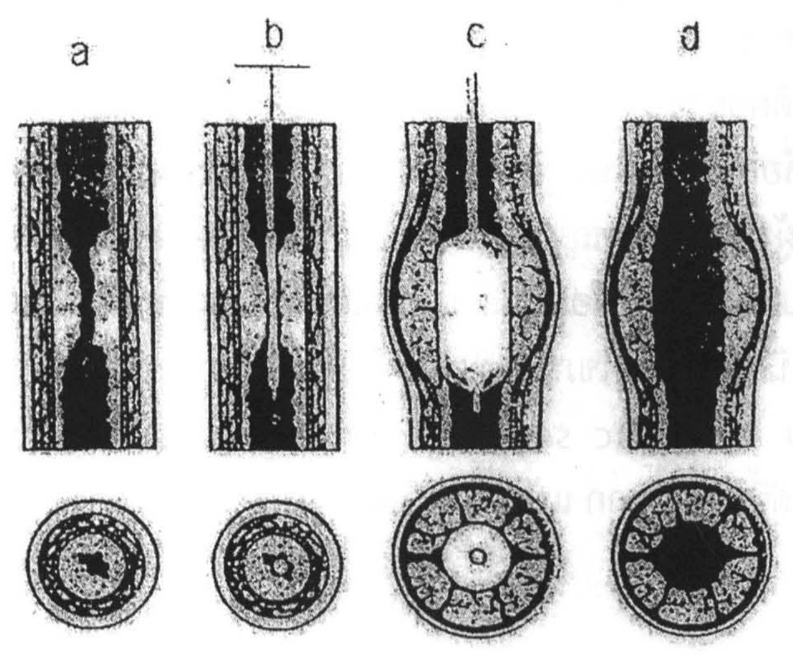
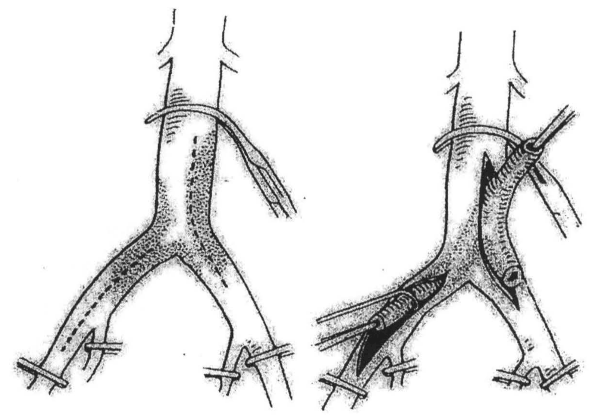
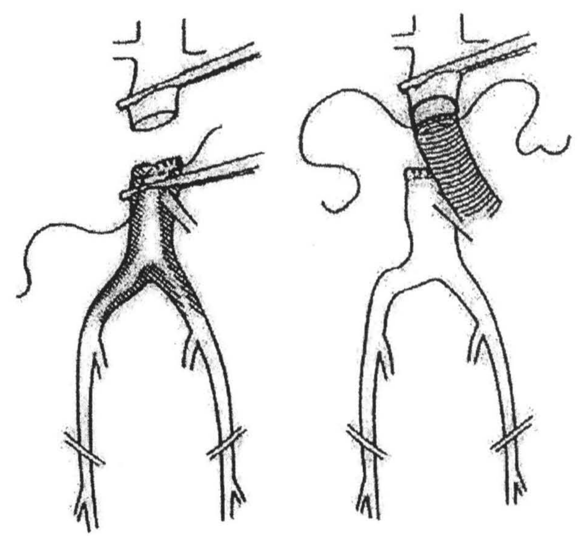
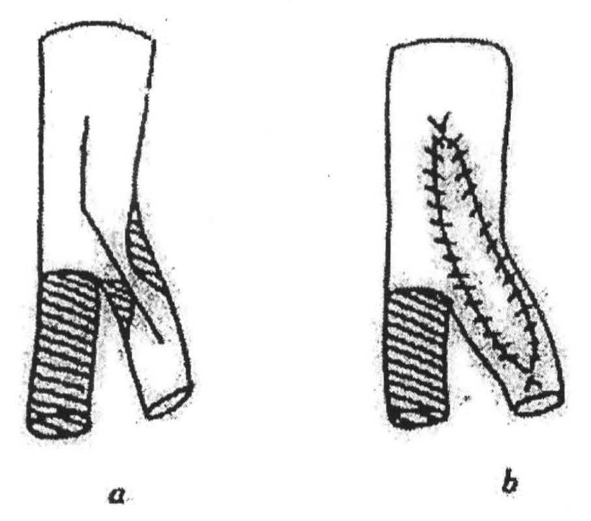
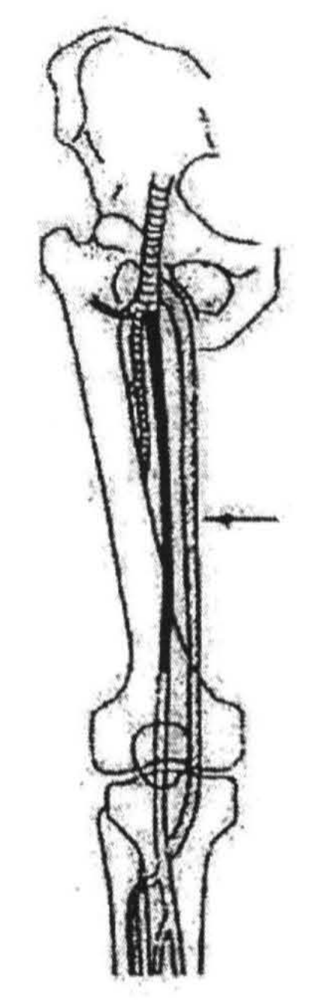
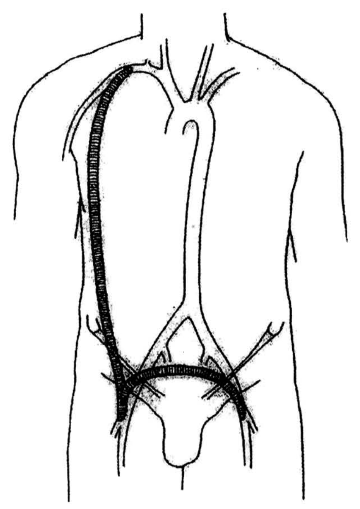
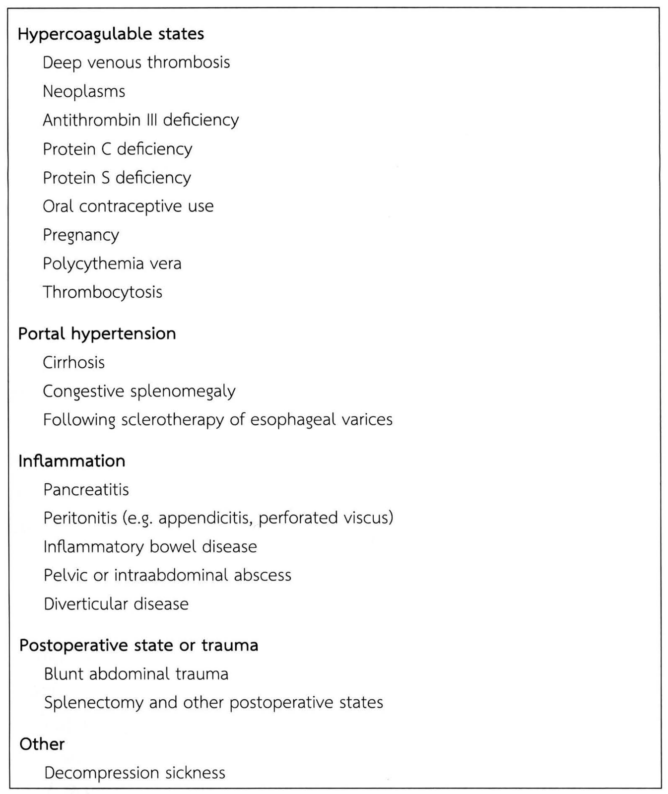
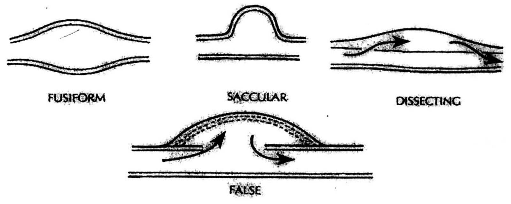
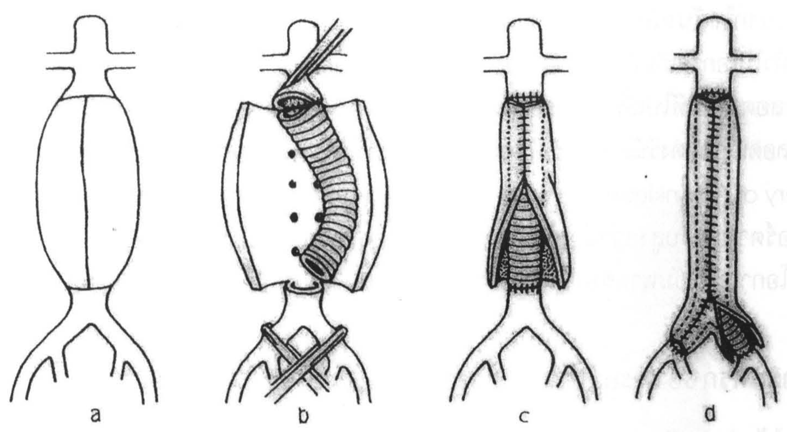
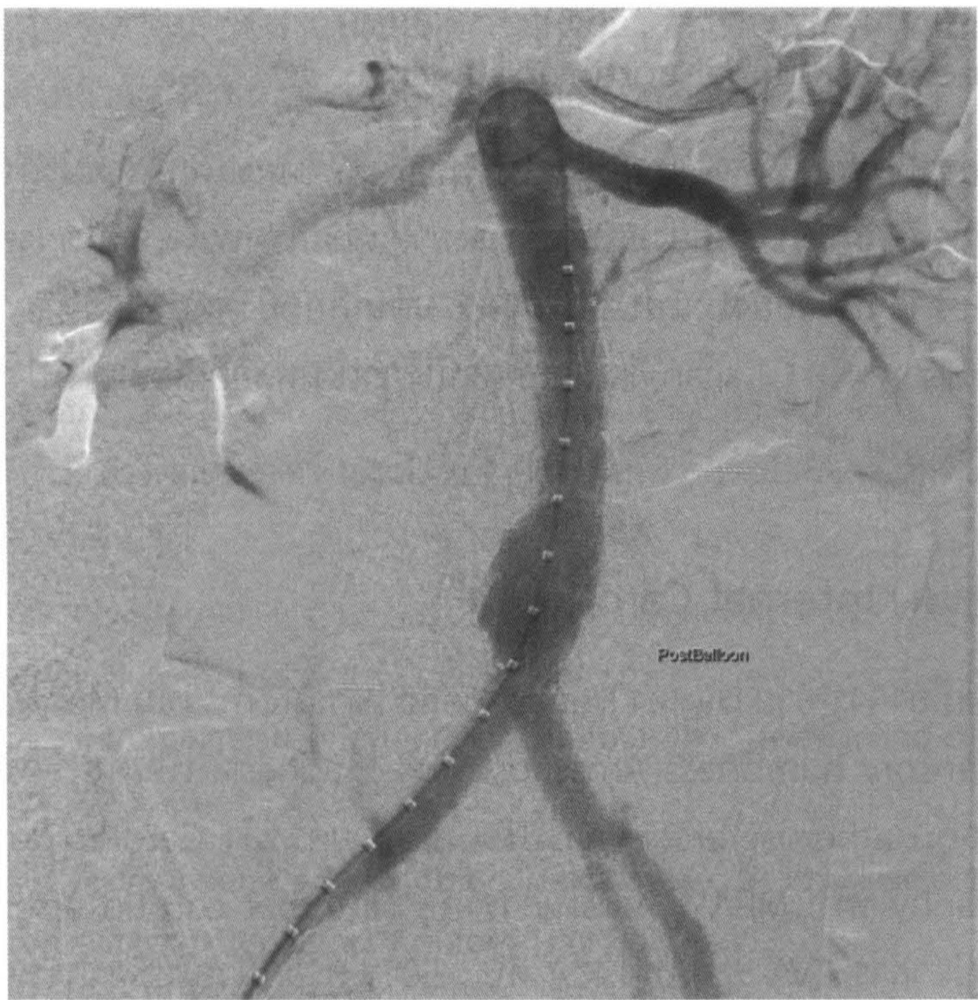

# โรคหลอดเลือดแดง (Disease of the arterial system) — part 2 of 2

## Contents of this file
  - การยืนยันการวินิจฉัย (Diagnostic evaluation) (p.601)
  - การพยากรณ์โรค (Prognosis) (p.601)
  - การรักษา (p.602)
    - การรักษาทั่วไป (Medical Therapy) (p.602)
    - การออกกำลังกาย (Exercise) (p.602)
    - หยุดสูบบุหรี่ (p.602)
    - ลดความอ้วนและปัจจัยเสี่ยงอื่นๆ (p.602)
    - สุขวิทยาส่วนเท้า (Foot hygiene) (p.602)
    - ยาขยายหลอดเลือด (Vasodilators) (p.603)
    - การรักษาทางรังสีร่วมรักษา (Interventional radiology) (p.603)
    - การรักษาทางศัลยกรรม (Operative therapy) (p.604)
  - ผลการผ่าตัดรักษา (p.608)
    - Superior mesenteric artery thrombosis (p.609)
    - Nonocclusive mesenteric ischemia (p.610)
    - Mesenteric venous thrombosis (p.610)
  - ลักษณะทางคลินิก (Clinical features) (p.610)
    - การวินิจฉัย (p.610)
    - การรักษา (p.611)
      - Superior mesenteric artery emboli (p.611)
      - Superior mesenteric artery thrombosis (p.611)
      - Nonocclusive mesenteric ischemia (p.612)
  - Superior mesenteric venous thrombosis (p.613)
- Chronic visceral ischemia (p.613)
  - ลักษณะทางกายวิภาคศาสตร์ (Anatomic considerations) (p.614)
  - ลักษณะทางคลินิก (Clinical features) (p.614)
    - การวินิจฉัย (p.614)
    - การรักษา (p.615)
- Arterial aneurysm (p.615)
  - สาเหตุของ aneurysm (p.615)
    - 1. Degenerative conditions (p.615)
    - 2. Inflammatory conditions (p.616)
    - 3. Mechanical conditions (p.616)
    - 4. Congenitial disorders (p.616)
  - ลักษณะทางคลินิก (Clinical features) (p.616)
    - Asymptomatic aneurysm (p.616)
    - Rupture (p.616)
    - Thromboembolic complications (p.617)
  - หลอดเลือดแดงเอออร์ตาโป่งพองในช่องท้อง (Abdominal aortic aneurysm) (p.617)
    - การวินิจฉัย (p.617)
    - การรักษา (p.617)
    - ภาวะแทรกซ้อนหลังผ่าตัด (Postoperative complications) (p.620)
      - Early complications (p.620)
      - ภาวะแทรกซ้อนระยะหลังๆ (Late complications) (p.620)
    - Ruptured abdominal aortic aneurysm (p.622)
- หลอดเลือดแดง Internal Carotid ตีบ (p.622)
- สรุป (p.623)
- เอกสารอ้างอิง (p.623)

<!-- p.601 (printed 587) -->
change) ถ้าให้ผู้ป่วยนอนราบและยกเท้าขึ้นสูงเท้าจะซีด เมื่อให้ผู้ป่วยนั่งและห้อยเท้าลงต่ำเท้าจะมีสีแดงคล้ำ (elevation pallor and dependent rubor) เนื่องจากมีการสูญเสียการควบคุมของเส้นประสาทซิมปาเทททิค (sympathetic reflex vasoconstriction) ไป

อาจตรวจระดับการตีบตันได้คร่าวๆ จากการคลำชีพจร ถ้าชีพจรของหลอดเลือดแดงคอมมอนฟีเมอรัล (common femoral) เบาลง แสดงว่าการตีบตันอยู่ที่เอออร์ตาหรือหลอดเลือดแดงอิลิแอก ถ้าชีพจรของหลอดเลือดแดงคอมมอนฟีเมอรัลแรงดี แต่คลำชีพจรของหลอดเลือดแดง popliteal ไม่ได้ แสดงว่ามีการตีบตันของหลอดเลือดแดงซูเปอร์ไฟเชียลฟีเมอรัล (superficial femoral) ซึ่งมักพบบ่อยที่ adductor canal ถ้าคลำชีพจรที่เท้า (dorsalis pedis หรือหลอดเลือดแดง posterior tibial) ไม่ได้ แต่คลำชีพจรของหลอดเลือดแดงคอมมอนฟีเมอรัลได้ดี แสดงว่าการตีบตันเป็นที่ใดที่หนึ่งระหว่างหลอดเลือดแดงคอมมอนฟีเมอรัล และหลอดเลือดแดง dorsalis pedis หรือหลอดเลือดแดง posterior tibial

การฟังได้เสียง bruit บ่งว่าหลอดเลือดแดงบริเวณนั้นตีบ

### การยืนยันการวินิจฉัย (Diagnostic evaluation)

การตรวจพิเศษใช้ช่วยยืนยันข้อวินิจฉัยและหาตำแหน่งของการตีบตัน ควรเริ่มจากการตรวจที่ง่ายและไม่มีอันตราย (noninvasive study) ก่อน เช่น ใช้ Doppler flowmeter วัดความดันเลือดที่ข้อเท้าเทียบกับที่แขน (ankle-brachial pressure index) หรือทำ treadmill exercise ซึ่งจะช่วยยืนยันว่ามีการขาดเลือดที่ไปเลี้ยงขาจริง

ควรทำ angiography ต่อเมื่ออาการของผู้ป่วยรุนแรงและต้องทำการผ่าตัดแก้ไขหรือเมื่อจะรักษาโดยใช้ลูกโป่งขยายหลอดเลือด (percutaneous transluminal angioplasty หรือ PTA)

### การพยากรณ์โรค (Prognosis)

ผู้ป่วยส่วนใหญ่ (ร้อยละ 90) มีอาการดีขึ้นด้วยการปฏิบัติตัวที่ถูกต้องและใช้ยาช่วยมีเพียงร้อยละ 10 เท่านั้นที่ต้องผ่าตัดรักษา ผู้ป่วยประมาณร้อยละ 5 จะมีอาการรุนแรงและไม่ดีขึ้นแม้จะรับการรักษาเต็มที่แล้วจนต้องตัดขา (amputation) ในที่สุด ประมาณร้อยละ

<!-- p.602 (printed 588) -->
25-50 ของผู้ป่วยที่หลอดเลือดแดงตีบจนถึงมีอาการจะเสียชีวิตภายใน 5 ปี หลังการวินิจฉัย สาเหตุการตาย ได้แก่ กล้ามเนื้อหัวใจตายอย่างเฉียบพลัน (acute myocardial infarction) และหลอดเลือดแดงในสมองอุดตันหรือแตก (stroke)

### การรักษา

#### การรักษาทั่วไป (Medical Therapy)

#### การออกกำลังกาย (Exercise)

การเดินออกกำลังกายอย่างสม่ำเสมอจะช่วยเพิ่มการไหลเวียนของเลือดผ่านทางหลอดเลือดแขนงและช่วยให้กล้ามเนื้อปรับตัวต่อการขาดเลือดอย่างเรื้อรัง ควรให้ผู้ป่วยเดินให้ไกลที่สุดจนกระทั่งปวดขาอย่างมาก (severe claudication) ซึ่งจุดนี้ถือเป็น maximum walking distance (MWD) หลังจากนั้นจึงเริ่มให้เดินออกกำลังกายอย่างสม่ำเสมอ ระยะประมาณ 150% ของ MWD ซึ่งเป็นระยะทางที่ผู้ป่วยจะมีอาการปวดขาแต่ให้ผู้ป่วยฝืนเดินต่อ ให้พักประมาณ 3-5 นาที แล้วเริ่มเดินใหม่ ทำอย่างนี้อย่างน้อยวันละ 5 ครั้ง เมื่อครบ 4-6 สัปดาห์ จึงวัด MWD ใหม่และเปลี่ยนแปลงระยะทางเดินออกกำลังกายตาม MWD การปฏิบัติตัวตามวิธีดังกล่าวอย่างเคร่งครัดจะช่วยให้อาการ claudication อย่างรุนแรง ดีขึ้นมากหรือหายไปได้ชั่วคราว

#### หยุดสูบบุหรี่

การสูบบุหรี่เป็นปัจจัยที่ทำให้การพยากรณ์โรคไม่ดี ควรทำทุกวิถีทางให้ผู้ป่วยหยุดสูบบุหรี่ ถ้าไม่สามารถหยุดสูบบุหรี่ได้โรคจะรุนแรงขึ้นอย่างรวดเร็วจนต้องถูกตัดขาหรือถ้าเคยผ่าตัดรักษามาก่อนก็อาจเกิดการอุดตันขึ้นใหม่อย่างรวดเร็ว

#### ลดความอ้วนและปัจจัยเสี่ยงอื่นๆ

ความอ้วน (obesity) ไขมันในเลือดสูง (hyperlipidemia) โรคเบาหวานและความดันเลือดสูง เป็นปัจจัยที่ทำให้อาการของผู้ป่วยเลวลง จึงต้องควบคุมให้ดี

#### สุขวิทยาส่วนเท้า (Foot hygiene)

<!-- p.603 (printed 589) -->
บาดแผลเล็กน้อยที่เท้าหรือนิ้วเท้าในผู้ป่วยเหล่านี้อาจลุกลามจนทำให้ถูกตัดขาได้ การดูแลรักษาเท้าให้ดีจึงเป็นสิ่งสำคัญมาก เท้าควรจะสะอาดและแห้งอยู่เสมอ เล็บเท้าควรตัดให้ถูกวิธี ควรรีบรักษาการติดเชื้อของเล็บเท้าและซอกนิ้วจากเชื้อราหรือเชื้อแบคทีเรีย รองเท้าควรจะมีขนาดพอดีไม่คับหรือหลวมเกินไป

#### ยาขยายหลอดเลือด (Vasodilators)

ยาขยายหลอดเลือดมีบทบาทน้อยมากในภาวะนี้และบอกได้ไม่ชัดเจนว่าอาการดีขึ้นจากยาเนื่องจากผู้ป่วยมักจะได้รับการรักษาวิธีอื่นไปพร้อมกัน เช่น การเดินออกกำลัง การหยุดสูบบุหรี่ การลดน้ำหนัก เป็นต้น โดยปกติหลอดเลือดเล็กๆ ในกล้ามเนื้อผู้ป่วยเหล่านี้มักจะขยายตัวเต็มที่อยู่แล้ว เพื่อตอบสนองต่อการขาดเลือด การให้ยาจึงไม่น่าจะมีประโยชน์ อีกทั้งยาขยายหลอดเลือดอาจทำให้ความดันเลือดต่ำลงและยิ่งขาดเลือดไปเลี้ยงมากขึ้น

#### การรักษาทางรังสีร่วมรักษา (Interventional radiology)

ผู้ป่วยที่ทำ angiography แล้ว พบว่าหลอดเลือดตีบเป็นช่วงสั้นๆ เพียงตำแหน่งเดียว (เช่น ตีบเป็นช่วงสั้นๆ หรือ short segment stenosis ของหลอดเลือดแดงคอมมอนอิลิแอก) แพทย์อาจทำการรักษาด้วยวิธี percutaneous transluminal angioplasty (PTA) (รูปที่ 10) ซึ่งถ้าทำสำเร็จจะช่วยให้หลีกเลี่ยงการผ่าตัดผู้ป่วยได้ PTA มีประโยชน์มากในผู้ป่วยที่ไม่เหมาะสำหรับการผ่าตัดใหญ่ สำหรับการตีบที่เป็นแนวยาว (long segment stenosis) หรือการตีบของหลอดเลือดแดงขนาดเล็ก การทำ PTA มักไม่สำเร็จ และควรรักษาโดยการผ่าตัดถ้าทำได้

> **Caption (verbatim):** (printed at the top of p.604) **รูปที่ 10** การขยายหลอดเลือดแดงโดยวิธี angioplasty2 (a) หลอดเลือดแดงที่ตีบจาก atheromatous plaque (b) และ (c) การสอดสายสวน (catheter) และลูกโป่ง (balloon) (c) ลูกโป่ง (balloon) ทำให้ plaque แตก ชั้นกลาง (media) และชั้นนอก (adventitia) ของหลอดเลือดยืดออก
> **Text in image (verbatim):** a · b · c · d
> **Description:** Line drawing in four panels labelled a to d from left to right. Each panel shows a longitudinal section of an artery segment (top) with its cross-section below. (a) The artery wall with a plaque narrowing the lumen to a thin, irregular channel in the middle of the segment; the cross-section shows a small irregular lumen surrounded by a thick plaque layer. (b) A thin catheter/guidewire, entering from a T-shaped handle at the top, is passed through the narrowed lumen; the cross-section shows the small catheter within the narrow lumen. (c) A balloon on the catheter is inflated (white oval) inside the stenosis; the arterial wall bulges outward and the plaque is shown split into fragments around the balloon; the cross-section shows the balloon in the centre surrounded by a ring of cracked plaque segments. (d) After the balloon is removed, the lumen (black) is widened, the wall remains bulged outward and the cracked plaque segments line a wide, irregular lumen in the cross-section.
> **Identifiers in image:** none

<!-- p.604 (printed 590) -->
*[caption of รูปที่ 10, whose figure is on p.603:]*

**รูปที่ 10** การขยายหลอดเลือดแดงโดยวิธี angioplasty2
(a) หลอดเลือดแดงที่ตีบจาก atheromatous plaque
(b) และ (c) การสอดสายสวน (catheter) และลูกโป่ง (balloon)
(c) ลูกโป่ง (balloon) ทำให้ plaque แตก ชั้นกลาง (media) และชั้นนอก (adventitia) ของหลอดเลือดยืดออก

#### การรักษาทางศัลยกรรม (Operative therapy)

ข้อบ่งชี้ในการผ่าตัดรักษา ได้แก่

1. มีการขาดเลือดอย่างมากจนมีเนื้อตาย (gangrene) หรือเป็นแผลที่เรื้อรัง (ischemic ulcer)

2. มีอาการปวดขาหรือเท้าตลอดเวลาแม้แต่เวลาอยู่เฉยๆ (rest pain)

3. มีอาการ claudication ที่รุนแรงจนผู้ป่วยไม่สามารถดำรงชีวิตหรือประกอบอาชีพตามปกติได้ และอาการนี้ไม่ดีขึ้นถึงแม้จะได้ปฏิบัติตัวอย่างเหมาะสมและได้รับยารักษาอย่างเต็มที่เป็นเวลานานกว่า 3 เดือน

การผ่าตัดรักษาการตีบตันของหลอดเลือดแดงที่ขามักเป็นการผ่าตัดใหญ่ จึงต้องแก้ไขปัจจัยเสี่ยงต่างๆ ของผู้ป่วยให้ดีก่อนผ่าตัด ได้แก่ สภาพของหัวใจ ปอดและไต ความดันเลือดสูง โรคเบาหวาน เป็นต้น

การผ่าตัดมี 3 วิธี คือ ก. การลอกผนังที่ตีบตันออก (endarterectomy) ซึ่งมักใช้กับการตีบตันช่วงสั้นๆ ข. การทำผ่าตัดเปลี่ยนเส้นทางให้เลือดไปเลี้ยงขา (arterial bypass) และ ค. การทำผ่าตัดขยายปากทางของหลอดเลือดแดง profunda femoris (profunda-plasty) การจะเลือกวิธีไหนขึ้นอยู่กับตำแหน่งและลักษณะของการตีบตันและสภาพของผู้ป่วย เนื่องจากผู้ป่วยส่วนใหญ่เป็นโรคหลอดเลือดแข็ง (atherosclerosis) ที่ทำให้หลอดเลือดแดงตีบหลายแห่งพร้อมกัน ตั้งแต่เอออร์ตาถึงหลอดเลือดแดงที่ข้อเท้า หลักการรักษาในรายเหล่านี้คือต้องแก้ไขภาวะตีบตันที่อยู่สูง (proximal) ที่สุดก่อน เช่น แก้ไขที่หลอดเลือดแดง aortoiliac segment ก่อนบริเวณ femoropopliteal เป็นต้น ซึ่งจะทำให้อาการดีขึ้นอย่างมาก แม้หลอดเลือดแดงปลายล่างจะยังคงตีบตันอยู่ก็ตาม

<!-- p.605 (printed 591) -->
ถ้า aortoiliac segment ตีบตันเป็นช่วงสั้นๆ อาจรักษาโดยการลอกผนังด้านในออก endarterectomy (รูปที่ 11) แต่ถ้าการตีบตันยาวจนถึงหลอดเลือดแดงเอ็กซ์เทอนัลอิลิแอก (external iliac) หรือคอมมอนฟีเมอรัล มักต้องรักษาด้วยวิธี bypass โดยใช้หลอดเลือดเทียมที่ทำด้วยวัสดุสังเคราะห์ เช่น Dacron graft ต่อระหว่างเอออร์ตากับหลอดเลือดแดงคอมมอนฟีเมอรัล เรียกว่า aortofemoral bypass (รูปที่ 12)

รายที่จุดเริ่มต้นของหลอดเลือดแดงดีพฟีเมอรัล (deep femoral หรือ profunda femoris) ตีบตันก็สามารถขยายจุดตีบนี้ได้โดยใช้ส่วนของหลอดเลือดดำ (vein patch) หรือวัสดุสังเคราะห์ (Dacron patch, PTFE patch) มาปะเสริม ซึ่งอาจทำร่วมกับลอกผนังด้านในออก (endarterectomy) เรียกวิธีนี้ว่า profundaplasty (รูปที่ 13) เหมาะสำหรับผู้ป่วยที่ไม่สามารถทำผ่าตัดใหญ่ (arterial bypass) ได้

ในระดับ femoropopliteal segment ถ้าหลอดเลือดแดงซูเปอร์ไฟเชียลฟีเมอรัล (superficial femoral) ตีบเป็นช่วงสั้นๆ อาจรักษาโดยการลอกผนังด้านใน (endarterectomy) หรือใช้ลูกโป่งขยาย (balloon angioplasty) แต่ส่วนใหญ่แล้วมักจะต้องทำ femoropopliteal bypass (รูปที่ 14) โดยใช้หลอดเลือดดำ long saphenous ของผู้ป่วยเอง การนำหลอดเลือดดำ long saphenous มาใช้ทำ bypass เช่นนี้มี 2 วิธี คือ ก. ตัดหลอดเลือดดำ long saphenous ออกมาแล้วใช้ปลายล่าง (distal) ของหลอดเลือดดำต่อเข้ากับหลอดเลือดแดงคอมมอนฟีเมอรัล และต่อปลายบน (proximal) ของหลอดเลือดดำ long saphenous เข้ากับหลอดเลือดแดง popliteal เพื่อให้เลือดไหลผ่านหลอดเลือดดำโดยไม่ติดลิ้น (valve) ภายใน เรียกวิธีนี้ว่า reversed saphenous vein bypass grafting ข. ต่อปลายบนของหลอดเลือดดำ long saphenous ทางด้าน proximal เข้ากับหลอดเลือดแดงคอมมอนฟีเมอรัล แล้วใช้เครื่องมือทำลายลิ้น (vein valvulotome) สอดเข้าจากทางด้าน distal ทำลายลิ้น (valve) ในหลอดเลือดดำ saphenous ให้หมด จากนั้นจึงผูกแขนงของหลอดเลือดดำ long saphenous ให้หมดและต่อปลายล่าง (distal) ของหลอดเลือดดำเข้ากับหลอดเลือดแดง popliteal เรียกวิธีนี้ว่า in situ saphenous vein bypass grafting

<!-- p.606 (printed 592) -->

> **Caption (verbatim):** **รูปที่ 11** การทำ thromboendarterectomy ที่เอออร์ตา (aorta) และหลอดเลือดแดงอิลิแอก (iliac) ทั้งสองข้าง ผิวด้านในของหลอดเลือดที่มี atheromatous plaque ถูกลอกออกมา ผนังหลอดเลือดเหลือแต่ชั้นนอก (adventitia) และบางส่วนของชั้นกลาง (media)1
> **Text in image (verbatim):** none
> **Description:** Two-panel line drawing of the distal abdominal aorta and its bifurcation into both iliac arteries. Left panel: a vascular tape/clamp loops across the aorta above the bifurcation and tapes encircle the iliac branches below; dashed lines run down the aorta and along both iliac arteries marking the planned arteriotomy/dissection lines, with the diseased segment shaded (stippled). Right panel: the aorta and both iliac arteries have been opened; a cylindrical plaque core (the atheromatous intima, drawn as a ribbed tube) is being lifted out of the aorta and right-side iliac artery and drawn out with an instrument at the top right, while on the left iliac artery another plaque core is being extracted through the opening with a long instrument entering from the lower left; the opened arterial walls (dark) are seen behind the cores. Tapes still encircle the vessels above and below.
> **Identifiers in image:** none

> **Caption (verbatim):** **รูปที่ 12** แสดงการทำ aortofemoral bypass โดยใช้หลอดเลือดเทียม (synthetic graft)1
> **Text in image (verbatim):** none
> **Description:** Two-panel line drawing of the abdominal aorta, its bifurcation and both iliac/femoral arteries. Left panel: the aorta is divided below a proximal clamp; the upper (proximal) aortic stump is held by a clamp, and the lower (distal) aortic stump, held by a second clamp, is being closed (oversewn) with a running suture; the diseased aortic bifurcation and iliac arteries are shaded; tapes cross both lower limb arteries. Right panel: a ribbed (crimped) synthetic tube graft is sewn end-to-end to the clamped proximal aortic stump with a suture whose loose ends trail to each side; the oversewn distal aortic stump lies beside the graft, which runs downward beside the native aorto-iliac vessels; tapes again cross both lower limb arteries.
> **Identifiers in image:** none

<!-- p.607 (printed 593) -->

> **Caption (verbatim):** **รูปที่ 13** Profundaplasty (a) ผ่าเข้าหลอดเลือดแดงคอมมอนฟีเมอรัล (common femoral) และหลอดเลือดแดง profunda femoris พร้อมทั้งลอกผนังชั้นในออก (endarterectomy) เพื่อขยายปลายทางเข้าหลอดเลือดแดง profunda femoris (b) เย็บปิดโดยใช้ vein patch 1
> **Text in image (verbatim):** a · b
> **Description:** Two-panel line drawing of the femoral artery bifurcation: a wide vertical common femoral artery dividing into a hatched (diseased/occluded) branch on the left and an unhatched branch angling down to the right (the profunda femoris). (a) A longitudinal arteriotomy line runs from the common femoral artery down onto the origin of the right-hand branch; hatched plaque is seen at the branch origin along the incision. (b) The arteriotomy has been closed with an elongated, elliptical patch sewn in with interrupted/running stitches (cross-hatched suture marks along both edges), extending from the common femoral artery down onto the right-hand branch, widening its origin; the hatched left branch is unchanged.
> **Identifiers in image:** none

ถ้าหลอดเลือดดำ saphenous มีขนาดไม่เหมาะสม อาจต้องนำหลอดเลือดเทียมมาใช้ เช่น ชนิดที่ทำจากสาร polytetrafluoroethylene (PTFE) หรือวัสดุถักทอ เช่น Dacron graft หรือใช้หลอดเลือดดำในสายสะดือ (umbilical vein) ที่ผ่านกรรมวิธีเก็บรักษาเป็นพิเศษมาแล้ว (glutaraldehyde starch-preserved human umbilical vein)

ในกรณีที่ผู้ป่วยที่ aortoiliac segment ตีบตัน และร่างกายมีสภาพไม่เหมาะกับการผ่าตัดใหญ่ เช่น aortofemoral bypass อาจนำหลอดเลือดเทียมมาทำ bypass ระหว่างหลอดเลือดแดง axillary กับหลอดเลือดแดงคอมมอนฟีเมอรัล (เรียกว่า axillofemoral bypass) ถ้าหลอดเลือดแดงคอมมอนอิลิแอก (common iliac) ข้างหนึ่งตันและอีกข้างยังดีอยู่ อาจทำ bypass จากหลอดเลือดแดงคอมมอนฟีเมอรัลข้างที่ดีไปยังอีกข้างหนึ่ง โดยต่อต่ำกว่า (distal) ตำแหน่งที่อุดตัน (เรียกว่า femorofemoral bypass) หลอดเลือดเทียมที่ใช้เป็นพวก Dacron หรือ PTFE เรียกการทำ bypass ทั้งสองแบบนี้ว่า extraanatomic bypass (รูปที่ 15) ซึ่งเป็นการผ่าตัดที่ไม่ต้องทำผ่านช่องท้องผู้ป่วย

ในผู้ป่วยที่หลอดเลือดตีบตันอย่างมากจนไม่สามารถทำผ่าตัดแก้ไขได้ การทำ lumbar sympathectomy อาจช่วยให้เลือดมาเลี้ยงผิวหนังที่เท้าดีขึ้น แต่มักไม่ช่วยแก้อาการปวด

<!-- p.608 (printed 594) -->
การทำ lumbar sympathectomy เพียงอย่างเดียวจะไม่ค่อยได้ผลในการรักษาอาการรุนแรงจากหลอดเลือดแดงเลี้ยงขาตีบตัน

ผู้ป่วยที่มีอาการปวดรุนแรงตลอดเวลาหรือมีเนื้อตาย (gangrene) และอาการไม่ดีขึ้นไม่ว่าจะรักษาด้วยวิธีใด อาจต้องพิจารณาตัดขา ซึ่งควรเลือกตัดที่ระดับต่ำสุดที่คิดว่าแผลจะหายได้ (ดูเรื่อง amputation)

### ผลการผ่าตัดรักษา7

อัตราตายระหว่างและหลังการผ่าตัดแก้ไขภาวะหลอดเลือดแดงที่ขาตีบตันขึ้นกับสภาพผู้ป่วยก่อนผ่าตัด และอยู่ระหว่างร้อยละ 3-5 สาเหตุการตายที่สำคัญคือกล้ามเนื้อหัวใจตายอย่างเฉียบพลัน (acute myocardial infarction) ผู้ป่วยที่ต้องถูกตัดขามีอัตราตายมากกว่านี้ เนื่องจากมีสภาพที่หนักกว่า

> **Caption (verbatim):** **รูปที่ 14** การทำ femoropopliteal bypass โดยใช้หลอดเลือดใหม่ (graft) (ลูกศร) ต่อข้ามหลอดเลือดแดงซูเปอร์ไฟเชียลฟีเมอรัล (superficial femoral) ที่อุดตัน1
> **Text in image (verbatim):** none
> **Description:** Line drawing, anterior view of the right thigh skeleton (pelvis, hip joint, femur, knee and upper tibia/fibula) with the arterial tree overlaid. A ribbed artery descends from the pelvis to the groin; below the groin the superficial femoral artery is drawn solid black (occluded) along the thigh. A separate tubular graft runs from the femoral artery at the groin down the medial (right-hand) side of the thigh parallel to the occluded artery and joins the popliteal artery behind/at the knee, below which the leg arteries continue. A horizontal arrow from the right points to the graft at mid-thigh.
> **Identifiers in image:** none

<!-- p.609 (printed 595) -->

> **Caption (verbatim):** **รูปที่ 15** การทำ extraanatomic bypass (axillobifemoral bypass)1
> **Text in image (verbatim):** none
> **Description:** Line drawing of the outline of a male torso (anterior view, from neck to upper thighs) showing the aortic arch, its branches, the descending aorta and its bifurcation into the iliac and femoral arteries. A ribbed synthetic graft starts at the axillary artery below the clavicle on the left side of the drawing, runs down the lateral chest and abdominal wall outside the body cavities, and ends at the femoral artery in the groin on the same side. A second ribbed graft limb arches across the lower abdomen above the pubis from that groin to the femoral artery in the opposite groin (femorofemoral crossover), so both femoral arteries are supplied from the axillary artery.
> **Identifiers in image:** none

ผู้ป่วยประมาณร้อยละ 5 จะถูกตัดขาเนื่องจากการผ่าตัดให้เลือดไปเลี้ยงขา (vascular reconstruction) ไม่ได้ผล และประมาณร้อยละ 10-20 ของผู้ป่วยที่เหลือจะถูกตัดขาในระยะต่อมา (late post-operative period) เนื่องจากหลอดเลือดใหม่ (graft) อุดตันและโรคมีอาการมากขึ้น

ผู้ป่วยที่ได้ทำ aortofemoral bypass ไปแล้ว ประมาณร้อยละ 90 ตัวหลอดเลือดเทียม (synthetic graft) ยังทำงานดีอยู่ในระยะ 5 ปี สำหรับผู้ป่วยที่ทำ femoropopliteal bypass นั้น วัสดุที่ใช้ทำหลอดเลือดใหม่ (graft) มีความสำคัญ ถ้าใช้หลอดเลือดดำ saphenous (autogenous graft) เมื่อ 5 ปีผ่านไปหลอดเลือดใหม่จะทำงานดีอยู่ประมาณร้อยละ 60-75 แต่ถ้าใช้หลอดเลือดเทียม (synthetic graft) โอกาสที่หลอดเลือดใหม่จะทำงานดีอยู่เมื่อ 5 ปีผ่านไปจะต่ำกว่านี้

#### Superior mesenteric artery thrombosis

มักจะเกิดใน SMA ที่ตีบอยู่ก่อนแล้ว ส่วนใหญ่พบที่ส่วนต้นของ SMA ผู้ป่วยประมาณร้อยละ 20-50 มีประวัติบ่งชี้ว่า SMA ตีบเรื้อรังมาก่อน ได้แก่ อาการปวดท้องหลังรับประทานอาหาร ซูบผอมลงเพราะการดูดซึมอาหารผิดปกติ (malabsorption) ผู้ป่วยส่วนใหญ่มีปัญหาหลอดเลือดแดงที่อื่นตีบตันร่วมด้วย เช่น ที่หัวใจ สมอง และที่ขา เป็นต้น

<!-- p.610 (printed 596) -->
#### Nonocclusive mesenteric ischemia

พบประมาณร้อยละ 20-30 เกิดขึ้นเพราะการไหลเวียนของเลือดไม่ดี (low flow state) เช่น ความดันเลือดต่ำ หัวใจวาย หัวใจเต้นผิดปกติ ขาดน้ำ เป็นต้น ส่วนใหญ่พบในผู้ที่ได้รับยากระตุ้นให้หลอดเลือดบีบตัว (vasoactive medications) อาการของการขาดเลือดไปเลี้ยงลำไส้จะเกิดขึ้นทีละน้อยภายหลังจากเกิดภาวะการไหลเวียนของเลือดไม่ดี เนื่องจากหลอดเลือดที่ลำไส้หดตัว (splanchnic vasoconstriction) จนเกิดภาวะขาดเลือด แนวทางการรักษา คือรักษาต้นเหตุที่ทำให้ต้องใช้ยากระตุ้นหลอดเลือดบีบตัว

#### Mesenteric venous thrombosis

พบไม่บ่อย หลอดเลือด SMV หรือแขนงถูกอุดตันจากทรอมโบสิส (thrombosis) ทำให้เลือดดำจากลำไส้ไหลกลับไม่ดี ลำไส้จะบวม และอาจเกิดการเน่าตาย (venous gangrene) ตามมา มักพบร่วมกับภาวะต่างๆ เช่น Hypercoagulable states, Portal hypertension, Inflammation เป็นต้น ดังตารางที่ 2

### ลักษณะทางคลินิก (Clinical features)

อาการปวดท้องเป็นอาการนำที่สำคัญ ผู้ป่วยจะปวดท้องมากเป็นพักๆ แต่ตรวจร่างกายในระยะแรกไม่พบอะไรชัดเจนนอกจากลำไส้บีบตัวรุนแรง เมื่อลำไส้เน่าตาย ผู้ป่วยจะท้องอืดหน้าท้องแข็งเกร็ง ฟังหน้าท้องไม่ได้ยินเสียงลำไส้เคลื่อนไหว (ileus) ในระยะนี้ผู้ป่วยมักมีอาการหนัก กระวนกระวาย อาจมีภาวะช็อคร่วมด้วย การดำเนินโรคในผู้ป่วยที่หลอดเลือดแดง superior mesenteric อุดตัน จะรวดเร็วกว่าผู้ป่วยที่หลอดเลือดดำอุดตันมาก ผู้ป่วยในกลุ่ม nonocclusive mesenteric ischemia ซึ่งมีอาการหนักจากโรคอื่นอยู่ก่อนแล้ว เช่น หัวใจวายหรือช็อก เป็นต้น อาจไม่มีอาการปวดท้องเด่นชัด แต่ท้องอืดแน่นมีเลือดออกในทางเดินอาหาร

#### การวินิจฉัย

ต้องคิดถึงโรคนี้เสมอในผู้ป่วยที่มีปัจจัยเสี่ยงและมีอาการปวดท้องเฉียบพลัน ผู้ป่วยมักจะมีอายุเกิน 50 ปี มีประวัติเป็นโรคหัวใจเรื้อรังหรือมีภาวะที่ทำให้การไหลเวียนของเลือดไม่ดี ถ้ามีประวัติของการอุดตันอย่างเฉียบพลันของหลอดเลือดแดงที่แขนหรือขาหรือสมองมาก่อน (acute arterial emboli) ควรสงสัย SMA อุดตันจากเอมโบไล (emboli)

<!-- p.611 (printed 597) -->
ไว้ให้มาก ถ้ามีประวัติหลอดเลือดที่ขาตีบเรื้อรัง ควรสงสัย SMA อุดตันจากทรอมโบสิส (thrombosis) การตรวจเลือดพบเม็ดโลหิตขาวขึ้นสูง (สูงกว่า 15,000/mm3) ระดับของฮีโมโกลบิน (hemoglobin) และฮีมาโตคริต (hematocrit) จะสูงเนื่องจากมีการสูญเสียน้ำเข้าสู่ผนังลำไส้ เข้าในลำไส้และในเยื่อบุช่องท้อง ถ้าเป็นมากจะมีภาวะเลือดเป็นกรด (metabolic acidosis) การเอกซเรย์ช่องท้องมักไม่พบความผิดปกติในระยะแรก แต่มีประโยชน์เพราะจะช่วยแยกสาเหตุอื่นที่ทำให้ปวดท้องหรือท้องอืด เมื่อลำไส้เน่าตายและผู้ป่วยท้องอืดมาก เอกซเรย์จะพบแก๊สในลำไส้และในผนังลำไส้ซึ่งมักจะสายเกินไป

การทำ Computed tomography angiography ทำให้วินิจฉัยได้แน่นอน จึงควรทำแต่เนิ่นๆ ถ้าสงสัยภาวะนี้ก่อนที่ลำไส้เน่าตาย

#### การรักษา

##### Superior mesenteric artery emboli

รักษาโดยการผ่าตัด ใช้ Fogarty catheter ดึงเอมโบไล (emboli) ออกจาก SMA (เรียกว่า SMA embolectomy) ในระหว่างผ่าตัดถ้าพบลำไส้ส่วนใดเน่าตายให้ตัดออก ถ้ายังไม่แน่ใจว่าลำไส้เน่าตายจริงก็ยังไม่ควรตัดออก มิฉะนั้นอาจตัดลำไส้ออกมากเกินไป ในกรณีนี้ควรปิดหน้าท้องแล้วผ่าตัดตรวจดูลำไส้ใหม่ในอีก 12-24 ชั่วโมงต่อมา (เรียกการผ่าตัดครั้งที่ 2 ว่า second look operation) ถ้าพบลำไส้เน่าตายเพิ่มขึ้นก็ตัดส่วนที่เน่าตายออก

##### Superior mesenteric artery thrombosis

รักษาโดยการลอกผนังชั้นในออก endarterectomy หรือทำ bypass grafting (ดู chronic visceral ischemia) เนื่องจากในภาวะทรอมโบสิส (thrombosis) มักจะมีหลอดเลือดเลี้ยงลำไส้หดตัว (splanchnic vasoconstriction) เกิดขึ้นร่วมด้วย จึงนิยมฉีดยาขยายหลอดเลือดเข้า SMA โดยผ่านทางสายสวนที่ทำ angiography ทั้งก่อนและหลังผ่าตัด ซึ่งมีส่วนช่วยให้การรักษาได้ผลดีขึ้น เช่น ใช้ papaverine ฉีดเข้า SMA ในขนาด 30-60 มิลลิกรัมต่อชั่วโมง ในการทำผ่าตัดถ้าพบลำไส้เน่าตายหรือยังไม่แน่ใจว่าเกิดการเน่าตาย ให้รักษาเหมือนกับที่กล่าวไว้ในการผ่าตัดรักษา superior mesenteric artery emboli

<!-- p.612 (printed 598) -->
**ตารางที่ 2** ภาวะต่างๆ ที่พบร่วมกับ mesenteric venous thrombosis8

- **Hypercoagulable states**
  - Deep venous thrombosis
  - Neoplasms
  - Antithrombin III deficiency
  - Protein C deficiency
  - Protein S deficiency
  - Oral contraceptive use
  - Pregnancy
  - Polycythemia vera
  - Thrombocytosis
- **Portal hypertension**
  - Cirrhosis
  - Congestive splenomegaly
  - Following sclerotherapy of esophageal varices
- **Inflammation**
  - Pancreatitis
  - Peritonitis (e.g. appendicitis, perforated viscus)
  - Inflammatory bowel disease
  - Pelvic or intraabdominal abscess
  - Diverticular disease
- **Postoperative state or trauma**
  - Blunt abdominal trauma
  - Splenectomy and other postoperative states
- **Other**
  - Decompression sickness

> **Caption (verbatim):** **ตารางที่ 2** ภาวะต่างๆ ที่พบร่วมกับ mesenteric venous thrombosis8
> **Text in image (verbatim):** Hypercoagulable states · Deep venous thrombosis · Neoplasms · Antithrombin III deficiency · Protein C deficiency · Protein S deficiency · Oral contraceptive use · Pregnancy · Polycythemia vera · Thrombocytosis · Portal hypertension · Cirrhosis · Congestive splenomegaly · Following sclerotherapy of esophageal varices · Inflammation · Pancreatitis · Peritonitis (e.g. appendicitis, perforated viscus) · Inflammatory bowel disease · Pelvic or intraabdominal abscess · Diverticular disease · Postoperative state or trauma · Blunt abdominal trauma · Splenectomy and other postoperative states · Other · Decompression sickness
> **Description:** A single-column boxed table listing conditions associated with mesenteric venous thrombosis, grouped under five bold category headings (Hypercoagulable states, Portal hypertension, Inflammation, Postoperative state or trauma, Other), each followed by its indented list of conditions as transcribed above. Saved as an image because the grouped layout is not a plain grid.
> **Identifiers in image:** none

##### Nonocclusive mesenteric ischemia

การรักษามุ่งแก้ไขให้ภาวะการไหลเวียนของเลือดไปเลี้ยงลำไส้ให้ดีขึ้น เช่น แก้ไขการขาดน้ำ รักษาภาวะหัวใจล้มเหลว รักษาการติดเชื้อ เป็นต้น ร่วมไปกับการให้ยาขยายหลอดเลือด papaverine เข้าทาง SMA จนกว่าภาวะหลอดเลือดที่เลี้ยงลำไส้หดตัว

<!-- p.613 (printed 599) -->
(splanchnic vasoconstriction) หายไปและผู้ป่วยมีอาการดีขึ้น ถ้าในระหว่างรักษาผู้ป่วยท้องอืดขึ้น กดเจ็บ แข็งเกร็ง แสดงว่าอาจมีลำไส้เน่าตายแล้ว ให้ทำผ่าตัดเปิดช่องท้อง และรักษาเหมือนกับที่กล่าวไว้ในการผ่าตัดรักษา superior mesenteric artery emboli

### Superior mesenteric venous thrombosis

การวินิจฉัย SMV thrombosis จากการทำ angiography ของ SMA ต้องมีหลักฐานดังนี้

1. พบลิ่มเลือด (thrombus) ใน SMV ในภาพ venous phase ของ angiography
2. ไม่เห็น SMV หรือหลอดเลือดดำพอร์ตัน (portal) ใน venous phase ของ angiography
3. เลือดไหลเข้า SMV ช้ามาก
4. มีการหดตัวของหลอดเลือดแดงที่เลี้ยงลำไส้ทั่วๆ ไป
5. มีเลือดคั่งที่ผนังลำไส้

ปัจจุบันการทำ CT abdomen with intravenouos contrast สามารถวินิจฉัยได้แม่นยำโดยไม่ต้องทำ SMA angiography ได้ การรักษาเริ่มโดยการให้ยากันเลือดแข็ง (heparin) ทันที และอาจให้ร่วมกับยาละลายลิ่มเลือด (thrombolytic therapy) เช่น reverse tissue plasminogen activator แต่ต้องระวังภาวะเลือดออกซึ่งเป็นโรคแทรกซ้อนสำคัญของการให้ยาดังกล่าว ถ้าผู้ป่วยมีอาการแสดงว่าอาจมีลำไส้เน่าตายให้ทำผ่าตัดเปิดช่องท้อง และจัดการกับลำไส้เหมือนที่กล่าวไว้ในการผ่าตัดรักษา superior mesenteric artery emboli สำหรับการเอาลิ่มเลือดออกจาก SMV (venous thrombectomy) นั้น ผลการรักษาไม่ดีนักเนื่องจากทรอมโบสิสจะเกิดขึ้นใหม่อย่างรวดเร็ว

## Chronic visceral ischemia

Chronic visceral ischemia หรือบางทีเรียกว่า intestinal angina เป็นผลจากการที่หลอดเลือดแดงใหญ่ที่เลี้ยงอวัยวะในช่องท้องอุดตันอย่างเรื้อรัง ได้แก่ หลอดเลือดแดง celiac, superior mesenteric และ inferior mesenteric สาเหตุส่วนใหญ่เกิดจากโรคหลอดเลือดแข็ง (atherosclerosis) การวินิจฉัยค่อนข้างยากถ้าไม่คิดถึง

<!-- p.614 (printed 600) -->
### ลักษณะทางกายวิภาคศาสตร์ (Anatomic considerations)

ปกติร้อยละ 90 ของเลือดที่มาเลี้ยงอวัยวะในช่องท้องมาจาก celiac axis และ SMA ร้อยละ 10 มาจากหลอดเลือดแดง inferior mesenteric (IMA) และหลอดเลือดแดง internal iliac ข้างซ้ายและขวา หลอดเลือดเหล่านี้มีหลอดเลือดแขนง (collateral) ต่อกันอย่างทั่วถึง

การที่หลอดเลือดแขนงของลำไส้เชื่อมโยงกันอย่างกว้างขวาง ทำให้โอกาสที่จะขาดเลือดเป็นไปได้น้อย ถึงแม้จะมีหลอดเลือดใหญ่เส้นใดเส้นหนึ่งอุดตัน การตีบหรืออุดตันของหลอดเลือดใหญ่เหล่านี้มักเกิดขึ้นตรงจุดที่แตกแขนงออกมาจากเอออร์ตา มักอุดตันช่วงสั้นๆ ประมาณ 1-2 เซนติเมตร และส่วนใหญ่เกิดจากโรคหลอดเลือดแข็ง (atherosclerosis) ในผู้สูงอายุที่เป็นโรคหลอดเลือดแข็ง (atherosclerosis) ของเอออร์ตาจน IMA อุดตันจะไม่มีอาการของลำไส้ขาดเลือดไปเลี้ยง (visceral ischemia) จนกว่าจะมีการตีบหรืออุดตันของ celiac axis และหรือ SMA ร่วมด้วย

### ลักษณะทางคลินิก (Clinical features)

ผู้ป่วยมักเป็นเพศหญิงอายุ 50 ปีขึ้นไป เคยมีประวัติปวดท้องหลังรับประทานอาหาร (postpandrial pain) อาการปวดเป็นแบบเป็นๆ หายๆ จากการหดรัดตัวของกล้ามเนื้อในผนังลำไส้ (colic) บริเวณกลางท้องหรือที่ลิ้นปี่ (epigastrium) เมื่อมีการขาดเลือดมากขึ้นผู้ป่วยจะปวดท้องถี่ขึ้นและรุนแรงขึ้นจนไม่อยากรับประทานอาหาร น้ำหนักลดลงมาก อาการปวดท้องและน้ำหนักลดพบเสมอในผู้ป่วยเหล่านี้ อาการอื่นที่พบไม่บ่อย ได้แก่ ท้องผูก ท้องเสีย คลื่นไส้ อาเจียน และภาวะลำไส้ดูดซึมอาหารผิดปกติ (malabsorption)

#### การวินิจฉัย

ได้จากประวัติและการตรวจร่างกาย อาจฟังได้เสียง bruit ในท้อง ผู้ป่วยมักจะมีการอุดตันของหลอดเลือดแดงที่ไปส่วนอื่นของร่างกายร่วมด้วย การวินิจฉัยที่แน่นอนได้จากการทำ angiography ซึ่งมักจะพบ celiac axis, SMA และ IMA ตีบหรือตันมากกว่าหนึ่งเส้น

<!-- p.615 (printed 601) -->
#### การรักษา

โดยการทำผ่าตัดเปลี่ยนเส้นทางให้เลือดไปเลี้ยงลำไส้ดีขึ้น (bypass) หรือลอกผนังด้านใน (endarterectomy) ที่หลอดเลือดแดง superior mesenteric มีเป้าหมายเพื่อลดอาการที่เกิดจากการขาดเลือดและป้องกันลำไส้เน่าตาย (gangrene)

## Arterial aneurysm9

Aneurysm หมายถึง หลอดเลือดแดงที่โป่งพองผิดปกติ ถ้าผนังของ aneurysm เป็นผนังของหลอดเลือดแดงที่โป่งออกไป เรียกว่า true aneurysm (มีชั้น adventitia ห่อหุ้ม) ถ้าผนังของ aneurysm เป็นเนื้อเยื่อที่อยู่รอบหลอดเลือดนั้น เรียกว่า false aneurysm เช่นที่พบหลังจากหลอดเลือดแดงทะลุหรือรอยต่อของหลอดเลือดเทียมกับหลอดเลือดแดงรั่ว (anastomotic false aneurysm) (รูปที่ 16)

> **Caption (verbatim):** **รูปที่ 16** หลอดเลือดแดงโป่งพอง (Aneurysm) ชนิดต่างๆ1
> **Text in image (verbatim):** FUSIFORM · SACCULAR · DISSECTING · FALSE
> **Description:** Black-and-white line drawing of four types of arterial aneurysm, each shown as a longitudinal segment of artery drawn as two double-line walls. Top left, FUSIFORM: both walls bulge outward symmetrically over a segment, giving a spindle-shaped dilatation of the whole circumference. Top centre, SACCULAR: only the upper wall bulges out as a rounded, dome-shaped pouch while the lower wall stays straight. Top right, DISSECTING: the vessel wall is split along its length so that a second channel forms inside the wall, separated from the true lumen by a line; one arrow shows blood entering the false channel at the left and another arrow shows it re-entering/exiting towards the right lower end. Bottom centre, FALSE: the arterial wall has a gap (the upper wall is interrupted), and blood escapes through the gap (curved arrow upward) into a dome-shaped cavity bounded by a dotted/stippled layer of surrounding tissue rather than the arterial wall, then returns into the lumen (curved arrow downward and to the right); the lower wall is intact.
> **Identifiers in image:** none

### สาเหตุของ aneurysm

#### 1. Degenerative conditions

ได้แก่ โรคหลอดเลือดแข็ง (atherosclerosis) ซึ่งเป็นสาเหตุที่พบบ่อยและสำคัญที่สุดของหลอดเลือดแดงเอออร์ตาในช่องท้องโป่งพอง (abdominal aortic aneurysm) สาเหตุอื่นพบน้อย เช่น fibromuscular dysplasia ซึ่งเป็นสาเหตุสำคัญของ aneurysm ขนาดเล็กของหลอดเลือดแดงรีนัล (renal) และหลอดเลือดแดงแคโรติค (carotid) และ cystic medial necrosis ซึ่งเป็นสาเหตุสำคัญของ dissecting aneurysm ของเอออร์ตาโดยเฉพาะผู้ที่มีความดันเลือดสูงหรือเป็น Marfan’s syndrome

<!-- p.616 (printed 602) -->
#### 2. Inflammatory conditions

การอักเสบมีทั้งที่เกิดจากการติดเชื้อและที่ไม่มีการติดเชื้อ ในอดีตโรคซิฟิลิสเป็นสาเหตุที่พบบ่อย แต่ในปัจจุบันเชื้อซัลโมเนลลา (salmonella) เป็นสาเหตุสำคัญของหลอดเลือดแดงโป่งพอง (aneurysm) ที่เกิดจากการติดเชื้อ สาเหตุจากการอักเสบที่ไม่ติดเชื้อพบได้น้อย ได้แก่ giant cell arteritis และ polyarteritis nodosa

#### 3. Mechanical conditions

หลอดเลือดแดงอาจพองออกเป็น aneurysm เพราะมีเลือดมากระแทกอย่างรุนแรง เช่น การโป่งพองของหลอดเลือดแดงเลยส่วนที่ตีบ (poststenotic dilatation) บางครั้งเป็นเพราะมีจุดอ่อนที่หลอดเลือดแดง เช่น false aneurysm จากหลอดเลือดแดงทะลุ หรือ false aneurysm ที่เกิดตรงรอยต่อของหลอดเลือดเทียมกับหลอดเลือดแดง เป็นต้น

#### 4. Congenitial disorders

เช่น berry aneurmsy ของหลอดเลือดแดงเลี้ยงสมอง (cerebral artery) หรือ aneurysm ที่พบใน Ehlers-Danlos syndrome หรือใน Marfan’s syndrome

### ลักษณะทางคลินิก (Clinical features)

ผู้ป่วยที่มีหลอดเลือดแดงโป่งพองแบ่งออกได้เป็น 3 กลุ่ม คือ กลุ่มที่ไม่มีอาการ กลุ่มที่มีอาการเพราะหลอดเลือดแดงโป่งพองนี้แตก และกลุ่มที่มีอาการของ embolism เนื่องจากทรอมบัส (thrombus) ในตัวหลอดเลือดแดงที่โป่งพองหลุดไปอุดหลอดเลือดแดงปลายทาง

#### Asymptomatic aneurysm

ส่วนใหญ่อยู่ในกลุ่มนี้ ผู้ป่วยมักสังเกตเองว่ามีก้อนเต้นได้ในช่องท้องหรือที่อื่นของร่างกาย หรือพบโดยบังเอิญขณะตรวจร่างกาย

#### Rupture

ผู้ป่วยที่หลอดเลือดแดงโป่งพองแตกจะมีอาการปวดที่ก้อน คลำได้ก้อนเต้นได้ที่โตขึ้นเรื่อยๆ (expanding หรือ pulsatile mass) และความดันเลือดต่ำจากการเสียเลือด

<!-- p.617 (printed 603) -->
#### Thromboembolic complications

ภายในก้อนหลอดเลือดแดงที่โป่งพอง มักจะมีก้อนทรอมบัส (thrombus) อยู่ซึ่งอาจโตจนอุดตันตัวหลอดเลือดแดงที่โป่งพอง หรือหลุดไปอุดหลอดเลือดแดงปลายทางอย่างเฉียบพลัน (acute arterial occlusion) พบบ่อยในหลอดเลือดแดงโป่งพองของหลอดเลือดแดง popliteal หรือฟีเมอรัล (femoral)

### หลอดเลือดแดงเอออร์ตาโป่งพองในช่องท้อง (Abdominal aortic aneurysm)

เกิดจากภาวะหลอดเลือดแดงแข็งและมีไขมันสะสมอยู่ภายใน (atherosclerosis) พบได้บ่อย และส่วนใหญ่เป็นที่เอออร์ตาใต้หลอดเลือดแดงรีนัล พบในผู้สูงอายุเพศชายมากกว่าเพศหญิงในอัตราส่วน 10 ต่อ 1 ผู้ป่วยมักจะมาด้วยเรื่องก้อนเต้นได้ในท้องหรือตรวจพบก้อนโดยบังเอิญ ถ้าก้อนเริ่มจะแตกจะมีอาการปวดที่ก้อน ปวดร้าวไปหลัง อาจมีอาการช็อคจากการเสียเลือดร่วมด้วย

#### การวินิจฉัย

ตรวจร่างกายพบก้อนเต้นได้เหนือสะดือค่อนไปทางซ้าย ควรคลำชีพจรที่อื่นด้วยเสมอเพื่อตรวจดูการตีบตันของหลอดเลือดแดงทั่วไป เอกซเรย์ท้องท่าตรง (A-P) และข้าง (lateral) อาจพบหินปูนเกาะที่ผนังของหลอดเลือดแดงที่โป่งพอง การทำ ultrasonography หรือ CT scan จะช่วยวินิจฉัยและสามารถบอกขนาดของหลอดเลือดโป่งพอง ไม่จำเป็นต้องทำ angiography เสมอไปในการวินิจฉัย ยกเว้นในกรณีที่สงสัยว่าก้อน aneurysm อยู่เหนือหลอดเลือดแดงรีนัล หรือในกรณีที่มีการตีบตันของหลอดเลือดแดงรีนัล หรือหลอดเลือดแดงอิลิแอกร่วมด้วย ซึ่งจะทำให้สามารถวางแผนผ่าตัดได้ละเอียดมากขึ้น angiography ไม่สามารถบอกขนาดของหลอดเลือดแดงโป่งพอง เพราะก้อนทรอมบัสอยู่ภายในผนังทำให้ภาพหลอดเลือดแดงที่โป่งพองเล็กกว่าความเป็นจริง

#### การรักษา

ถ้าปล่อยทิ้งไว้หลอดเลือดแดงเอออร์ตาโป่งพองในช่องท้อง (abdominal aortic aneurysm) มีโอกาสแตกได้ การผ่าตัดแบบไม่ฉุกเฉิน (elective) มีอัตราตายต่ำกว่าร้อยละ 5 แต่ถ้าต้องผ่าตัดฉุกเฉินเพราะแตกแล้ว โอกาสตายมีมากกว่าร้อยละ 50 การพิจารณาผ่าตัดแบบไม่ฉุกเฉิน (elective) นั้น ต้องคำนึงถึงความเสี่ยงในการผ่าตัดเพราะ

<!-- p.618 (printed 604) -->
ผู้ป่วยมักมีอายุมากและมีโรคหัวใจ โรคปอด โรคไตร่วมด้วย และยังต้องคำนึงถึงโอกาสที่หลอดเลือดแดงโป่งพอง (aneurysm) จะแตก ซึ่งขึ้นอยู่กับขนาด ยิ่งมีขนาดใหญ่ยิ่งมีโอกาสแตกได้ง่าย

**ข้อบ่งชี้ในการผ่าตัดรักษาหลอดเลือดแดงเอออร์ตาโป่งพองในช่องท้อง (abdominal aortic aneurysm) ได้แก่**

1. หลอดเลือดแดงโป่งพองมีขนาดใหญ่กว่า 5.5 เซนติเมตร และผู้ป่วยไม่มีปัจจัยเสี่ยงมากนัก (เช่น โรคหัวใจ โรคปอด โรคไต เป็นต้น)
2. หลอดเลือดแดงโป่งพองมีขนาดโตขึ้นมากกว่า 0.5 เซนติเมตรต่อปี
3. เริ่มจะแตก (leaking, threatened rupture) หรือแตก (rupture) ผู้ป่วยที่หลอดเลือดแดงโป่งพองเริ่มจะแตกจะมีอาการปวดท้องร้าวไปส่วนหลังอย่างมาก ถ้ามีอาการช็อคจากการเสียเลือดร่วมด้วยมักจะแสดงว่าหลอดเลือดแดงโป่งพองแตกแล้ว อัตราตายสูงมาก
4. อวัยวะข้างเคียงถูกกด เช่น ท่อไต ลำไส้
5. มีเลือดออกในระบบทางเดินอาหาร เพราะหลอดเลือดแดงโป่งพองแตกทะลุเข้าระบบทางเดินอาหาร (aorto-enteric fistula)
6. ทำให้เกิดอาการอุดตัน (thromboembolism) ของหลอดเลือดแดงที่ขา

การรักษาปัจจุบันมีสองวิธี ได้แก่ ผ่าตัดแบบเปิด (Open aneurysm repair) กับการผ่าตัดโดยใช้ขดลวดค้ำยัน (Endovascular aneurysm repair)

Open aneurysm repair (รูปที่ 17) จะเลือกในผู้ป่วยที่ไม่เหมาะในการทำ Endovascular Aneurysm repair (EVAR) หรือเป็นผู้ป่วยที่แข็งแรงสามารถทนต่อผ่าตัดใหญ่ได้ ซึ่งวิธีนี้เป็นวิธีที่คงทนและทำกันมานานหลายสิบปี ผู้ป่วยที่ผ่านระยะต้นๆ ของการผ่าตัดได้จะไม่ค่อยมีปัญหาในภายหลัง

Endovascular Aneurysm repair (รูปที่ 16) เป็นวิธีรักษา AAA ที่เริ่มทำกันตั้งแต่ พ.ศ. 2532 ปัจจุบันนิยมแพร่หลายมากขึ้น เนื่องจากเทคนิคและอุปกรณ์มีความทันสมัยมากขึ้น ผู้ป่วยบาดเจ็บเล็กน้อยจากการผ่าตัดฟื้นตัวเร็ว แต่ข้อเสียคือต้องติดตามผลการรักษากับแพทย์ตลอดชีวิต

<!-- p.619 (printed 605) -->
Open aneurysm repair เป็นการรักษาโดยผ่าตัดเข้าช่องท้องแล้วใช้คีมหนีบหลอดเลือด (vascular clamp) หนีบเอออร์ตาเหนือและใต้หลอดเลือดแดงโป่งพอง (aneurysm) เปิดก้อนหลอดเลือดแดงโป่งพอง (aneurysm) เอาก้อนทรอมบัสที่อยู่ภายในออกแล้วใส่หลอดเลือดเทียม (Dacron graft) ลงไปแทน ต่อปลายบนของหลอดเลือดเทียมกับเอออร์ตา ปลายล่างต่อกับเอออร์ตาส่วนที่เหลือ หรือต่อกับหลอดเลือดแดงอิลิแอก หรือต่ำกว่านั้นตามความจำเป็น

> **Caption (verbatim):** **รูปที่ 17** การผ่าตัดรักษาหลอดเลือดแดงเอออร์ตาโป่งพองในช่องท้อง (abdominal aortic aneurysm)1 (a) รอยผ่าเปิด aneurysm (b) ต่อหลอดเลือดเทียม (synthetic graft) กับเอออร์ตา (c) นำผนัง aneurysm มาหุ้มเพื่อเสริมรอยต่อ (d) หลอดเลือดเทียม (synthetic graft) ชนิดยาวที่ใช้กับ aneurysm ที่มาลงถึงหลอดเลือดแดงอิลิแอก (iliac)
> **Text in image (verbatim):** a · b · c · d
> **Description:** Four-panel black-and-white line drawing (a–d, left to right) of open repair of an infrarenal abdominal aortic aneurysm, each panel showing the aorta from the renal arteries (paired horizontal branches near the top) down to the aortic bifurcation into the iliac arteries (branching vessels at the bottom). (a) A large spindle-shaped aneurysm below the renal arteries, with a vertical line down its front marking the incision used to open the aneurysm sac. (b) The aneurysm sac has been opened and its walls are retracted to both sides; a clamp is placed across the aorta at the top (just below the renal arteries) and two crossed clamps are placed on the iliac arteries at the bottom; a corrugated tubular synthetic graft is being sewn to the upper aortic end, and dots on the back wall of the opened sac mark the origins of lumbar arteries. (c) The tube graft is in place, sewn to the aorta above and below, and the opened aneurysm wall is being wrapped closed over the graft and sutured in the midline (stitches shown down the front) to reinforce the anastomosis. (d) A long bifurcated synthetic graft, wrapped and sutured in the midline, extends from below the renal arteries down into the iliac arteries, one limb shown with its corrugated graft visible at the iliac anastomosis, used when the aneurysm extends down to the iliac arteries. Faint bleed-through text from the reverse page is visible at the right edge.
> **Identifiers in image:** none

<!-- p.620 (printed 606) -->
#### ภาวะแทรกซ้อนหลังผ่าตัด (Postoperative complications)

##### Early complications

โรคแทรกซ้อนในระยะแรกหลังผ่าตัดรักษาหลอดเลือดแดงเอออร์ตาโป่งพองในช่องท้อง ได้แก่ ภาวะเลือดออกในช่องท้อง ไตวาย หลอดเลือดแดงที่ขาอุดตันจากเอมโบลัส (embolus) ลำไส้ใหญ่ด้านซ้ายขาดเลือด (colonic ischemia) จากการตัดและผูก IMA ระหว่างผ่าตัด ความผิดปกติในการหลั่งน้ำอสุจิ (retrograde ejaculation) เนื่องจาก preaortic sympathetic plexus ถูกตัด ร่างกายท่อนล่างเป็นอัมพาต (paraplegia) เนื่องจากไขสันหลังส่วนล่างขาดเลือดระหว่างการใช้คีมหนีบหลอดเลือดหนีบ aorta โดยทั่วไปโอกาสเกิดอัมพาตของร่างกายส่วนล่าง (paraplegia) มีน้อยมาก แต่อาจเกิดขึ้นได้ถ้าหลอดเลือดที่ไปเลี้ยงไขสันหลัง (artery of Adamkiewicz) แยกออกจากเอออร์ตาใต้หลอดเลือดแดงรีนัล ซึ่งไม่มีเลือดไหลผ่านขณะที่ใช้คีมหนีบหลอดเลือดหนีบเอออร์ตา ปกติ artery of Adamkiewicz จะแยกออกจากเอออร์ตาประมาณระดับ T10-T12 ดังนั้นการหนีบเอออร์ตาที่ระดับสูงกว่านี้ ในการผ่าตัดรักษา thoracoabdominal aortic aneurysm จึงมีโอกาสเกิดอัมพาตของร่างกายส่วนล่าง (paraplegia) ได้สูง

##### ภาวะแทรกซ้อนระยะหลังๆ (Late complications)

ได้แก่ การเกิด false aneurysm ที่รอยต่อระหว่างหลอดเลือดเทียมกับหลอดเลือดแดงซึ่งอาจเกิดจากการติดเชื้อที่รอยต่อ หรือด้ายที่ใช้เย็บขาด หรือผนังหลอดเลือดแดงที่เย็บฉีกขาดหรือเปื่อยลงตามกาลเวลา หลอดเลือดเทียมอาจติดเชื้อ (graft infection) ซึ่งส่วนใหญ่เกิดขึ้นหลังปีแรกไปแล้ว แต่บางรายอาจเกิด 10 ถึง 20 ปี หลังการผ่าตัด เชื้อที่พบบ่อยได้แก่ Staphylococcus aureus และ staphylococcus epidermidis เข้าใจว่าเชื้อซึ่งปกติอยู่ที่ผิวหนังปนเปื้อนหลอดเลือดเทียมในระหว่างการผ่าตัดและปรากฏอาการในภายหลัง นอกจากนี้จากเชื้อแบคทีเรียที่อยู่ในกระแสเลือด (transient bacteremia) อาจฝังตัวในหลอดเลือดเทียมได้ ดังนั้นผู้ป่วยที่มีหลอดเลือดเทียมจึงควรได้รับยาปฏิชีวนะ (prophylactic antibiotics) ถ้าต้องมีการตรวจหรือผ่าตัดอื่นที่อาจทำให้มีเชื้อแบคทีเรียในกระแสเลือด (transient bacteremia) เช่น การถอนฟัน การใส่สายสวนปัสสาวะ เป็นต้น

การติดเชื้อของหลอดเลือดเทียมในช่องท้องมีอัตราตายสูงมาก อาการที่นำผู้ป่วยมาพบแพทย์ ได้แก่ อาการไข้เรื้อรัง หลอดเลือดโป่งพอง (false aneurysm) และเลือดออก

<!-- p.621 (printed 607) -->
ในระบบทางเดินอาหารจากมีทางติดต่อระหว่างเอออร์ตากับลำไส้ (aortoenteric fistula) การตรวจทางห้องปฏิบัติการมักจะไม่พบสิ่งผิดปกติชัดเจน ยกเว้นเม็ดโลหิตขาวขึ้นสูง การ scan โดยติดฉลากเม็ดเลือดขาวด้วย Indium 111 แล้วฉีดเม็ดเลือดขาวนั้นเข้าร่างกาย เม็ดเลือดขาวเหล่านี้จะไปรวมกันบริเวณหลอดเลือดเทียมที่ติดเชื้อและให้ผลบวก

การทำ white blood cell scan นี้ อาจให้ผลบวกลวง (false positive) ได้ เนื่องจากเม็ดเลือดขาวจะไปเกาะบริเวณอื่นที่อักเสบได้เหมือนกัน ในปัจจุบัน CT scan เป็นวิธีที่ดีที่สุดในการวินิจฉัย ถ้ามีการติดเชื้อของหลอดเลือดเทียม CT scan จะแสดงให้เห็นหลอดเลือดโป่งพอง (false aneurysm) หนองที่อยู่รอบหลอดเลือดเทียม (perigraft fluid) หรือฟองอากาศโดยรอบหลอดเลือดเทียม (perigraft air)

การติดเชื้อของหลอดเลือดเทียมรักษาโดยผ่าตัดเอาหลอดเลือดเทียมที่ติดเชื้อออก และทำ extra-anatomic bypass เช่น axillofemoral bypass เพื่อให้เลือดไปเลี้ยงที่ขาได้

> **Caption (verbatim):** **รูปที่ 18** Endovascular Aneurysm Repair
> **Text in image (verbatim):** PostBalloon
> **Description:** Grayscale digital subtraction angiogram of the abdominal aorta in frontal projection, taken during endovascular aneurysm repair (labelled "PostBalloon", i.e. after balloon dilatation). Contrast (dark) fills the abdominal aorta from the top of the image down to its bifurcation into the two common iliac arteries near the bottom. At the upper part of the image a renal artery arises from the aorta towards the image right and branches into the kidney; contrast also outlines vessels at the upper left. The aortic lumen is widened in its lower segment just above the bifurcation, where a rounded bulge projects towards the image left. A thin line studded with evenly spaced radio-opaque marker dots runs from the lower left of the image (along the iliac artery on the image-left side) up through the bifurcation and along the aorta to below the renal artery level, representing the delivery catheter/device marker line. The contrast-filled iliac artery on the image-right side extends down to the bottom edge. Bright white streaks at the left side of the image are subtraction artefacts.
> **Identifiers in image:** none

<!-- p.622 (printed 608) -->
ภาวะแทรกซ้อนที่อาจพบได้ในผู้ป่วยที่ทำ EVAR ได้แก่ ยังมีเลือดไหลเข้าไปอยู่ใน aneurysm sac เรียกว่า Endoleak ซึ่ง Endoleak type II พบได้บ่อยสุด

Type I Endoleak เป็นการรั่วระหว่าง Aneurysm กับตัว Stent

Type II Endoleak เป็นการรั่วจาก Inferior mesenteric a. หรือ Lumbar artery

Type III Endoleak เป็นการรั่วระหว่างรอยต่อของ Stent

Type IV Endoleak เป็นการรั่วผ่านผนัง Stent

Endoleak type I และ III ต้องได้รับการแก้ไขเนื่องจากตัว aneurysm ยังรับ pressure เท่ากับ systemic pressure ทำให้ยังมีโอกาสแตกอยู่ ถ้าเป็น Endoleak type II แนะนำให้ติดตามดูขนาดของ aneurysm ซึ่งถ้าโตขึ้นก็ต้องแก้ไข ปัจจุบันไม่ค่อยพบ Endoleak type IV

#### Ruptured abdominal aortic aneurysm

ถ้าสงสัยว่าหลอดเลือดแดงเอออร์ตาโป่งพองในช่องท้องแตก ควรนำผู้ป่วยไปผ่าตัดฉุกเฉินทันที ถ้าผู้ป่วยมีปัจจัยเสี่ยงมาก (เช่น สูงอายุและมีโรคหัวใจ โรคไต โรคปอดรุนแรง เป็นต้น) และการวินิจฉัยยังไม่แน่นอนและความดันเลือดยังดีอยู่ อาจทำการตรวจด้วย ultrasonography หรือ CT scan ก่อน ถ้าพิสูจน์ได้ว่าเป็นหลอดเลือดแดงโป่งพองแตกจริงจึงค่อยทำการผ่าตัด

## หลอดเลือดแดง Internal Carotid ตีบ10

ผู้ป่วยจะมีอาการ อาการแสดง Hemispheric symptoms เช่น Motor weakness, paralysis Sensory numbness Amaurosis fugax aphasia เป็นต้น ปัจจัยเสี่ยงโรคนี้เช่นเดียวกับกลุ่ม atherosclerosis การประเมินผู้ป่วยควรทำ Carotid duplex scan, CT angiography หรือ MRA ข้อบ่งชี้ในการรักษา Internal carotid artery stenosis ได้แก่ ผู้ป่วยมีอาการ CVA ร่วมกับมี ICA ตีบ >50% หรือผู้ป่วยไม่มีอาการแต่มี ICA ตีบ >80% ผู้ป่วยที่มี Internal Carotid Artery Stenosis ควรได้รับการรักษาโดย Carotid Endarterectomy ถ้ามีข้อที่ไม่เหมาะในการทำ CEA อาจพิจารณาทำ Carotid artery stenting ได้

<!-- p.623 (printed 609) -->
ข้อที่ไม่เหมาะในการทำ CEA

High cervical (C2) carotid bifurcation or Low intrathoracic lesion.

Prior radical neck surgery or radiation therapy.

Prior ipsilateral CEA.

Contralateral laryngeal nerve injury.

Tracheostomy.

## สรุป

โรคทางหลอดเลือดแดงมีปัจจัยเสี่ยงหลายประการ หนึ่งในนั้นคือสูงอายุ ประชากรประเทศไทยมีผู้สูงอายุมากขึ้น แพทย์จึงควรมีความรู้ สามารถป้องกันและวินิจฉัยโรคหลอดเลือดแดงที่สำคัญได้ เช่น หลอดเลือดแดงใหญ่โป่งพอง หลอดเลือดไปเลี้ยงอวัยวะต่างๆ ตีบตัน เพื่อลดอุบัติการณ์ไม่พึงประสงค์

## เอกสารอ้างอิง

1. ธนิต วัชรพุกก์. Artery, vein and lymphatic. ใน: ชาญวิทย์ ตันติ์พิพัฒน์, ธนิต วัชรพุกก์, บรรณาธิการ. ตำราศัลยศาสตร์ (พิมพ์ครั้งที่ 1). กรุงเทพฯ: โรงพิมพ์จุฬาลงกรณ์มหาวิทยาลัย, 2534: 301-29.
2. Conte MS, Pomposelli FB, Clair DG, Geraghty PJ, McKinsey JF, Mills JL, et al. Society for Vascular Surgery practice guidelines for atherosclerotic occlusive disease of the lower extremities: management of asymptomatic disease and claudication. J Vasc Surg. 2015; 61 (3 Suppl): 2S-41S.
3. Haimovici H. Peripheral arterial embolism; a study of 330 unselected cases of embolism of the extremities. Angiology. 1950; 1: 20-45.
4. Rutherford RB, Baker JD, Ernst C, et al. Recommended standards for reports dealing with lower extremity ischemia: revised version. J Vasc Surg. 1997; 26: 517-38.

<!-- p.624 (printed 610) -->
5. Hingorani A, LaMuraglia GM, Henke P, Meissner MH, Loretz L, Zinszer KM, et al. The management of diabetic foot: A clinical practice guideline by the Society for Vascular Surgery in collaboration with the American Podiatric Medical Association and the Society for Vascular Medicine. J Vasc Surg. 2016; 63 (2 Suppl): 3S-21S.
6. Mills JL Sr, Conte MS, Armstrong DG, Pomposelli FB, Schanzer A, Sidawy AN, et al. The Society for Vascular Surgery Lower Extremity Threatened Limb Classification System: risk stratification based on wound, ischemia, and foot infection (WIfI). J Vasc Surg 2014; 59: 220-234.
7. Zierler RE, Jordan WD, Lal BK, Mussa F, Leers S, Fulton J, Pevec W, et al. The Society for Vascular Surgery practice guidelines on follow-up after vascular surgery arterial procedures. J Vasc Surg. 2018; 68 (1): 256-284.
8. Kaleya RN, Boley SJ. Acute mesenteric vascular disease. In: Veith FJ, Hobson RW 2d, Williams RA, Wilson SE, editors. Vascular surgery: principles and practice. New York: McGraw-Hill, 1994: 762-80.
9. Chaikof EL, Dalman RL, Eskandari MK, Jackson BM, Lee WA, Mansour MA, et al. The Society for Vascular Surgery practice guidelines on the care of patients with an abdominal aortic aneurysm. J Vasc Surg. 2018; 67: 2-77.
10. Ricotta JJ1, Aburahma A, Ascher E, Eskandari M, Faries P, Lal BK. Updated Society for Vascular Surgery guidelines for management of extracranial carotid disease. J Vasc Surg. 2011; 54: e1-31.
