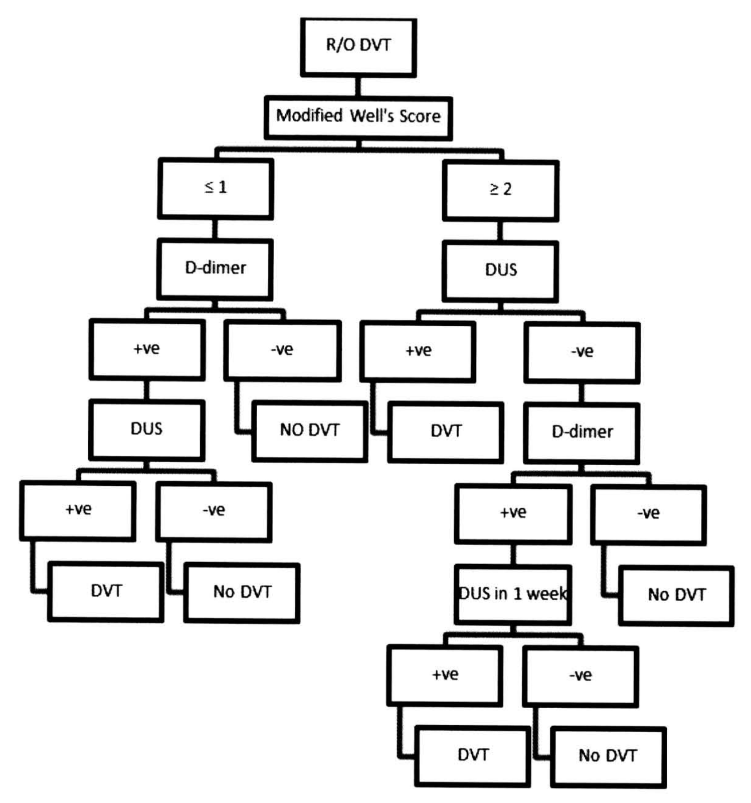

# ภาวะลิ่มเลือดอุดตันในหลอดเลือดดำ (Venous Thromboembolism (VTE))

## Contents of this file
- ปัจจัยเสี่ยงที่พบได้บ่อยต่อการเกิด DVT (p.626)
- การจำแนกกลุ่ม DVT (p.627)
- อาการและอาการแสดง (p.627)
- การตรวจทางรังสีวิทยา (p.628)
- การตรวจทางห้องปฏิบัติการ (p.629)
- การวินิจฉัย (p.630)
- การรักษา DVT (p.631)
- การรักษาทั่วไปในระยะแรก (p.632)
- การรักษาสำหรับ proximal DVT (p.632)
- ยาที่ใช้ในการรักษา DVT (p.632)
  - Unfractionated Heparin (UFH) (p.632)
  - Low molecular weight heparin (LMWH) (p.633)
  - Vitamin K antagonist (p.633)
  - DOAC (Direct oral anticoagulant) (p.634)
- ระยะเวลาของการให้ยาแบ่งเป็น (p.635)
- การพิจารณาการรักษา (p.635)
- การรักษาด้วย Systemic และ Catheter-Directed Thrombolysis (p.635)
- การรักษาสำหรับ Calf DVT (p.636)
- การใส่ IVC filter (p.636)
- การรักษาเมื่อมีการกลับเป็นซ้ำของ DVT ขณะรักษา (p.637)
- Upper-Extremity DVT (UEDVT) (p.637)
  - สาเหตุของการเกิด UEDVT (p.637)
  - อาการของ UEDVT (p.638)
  - การรักษา UEDVT (p.638)
- สรุป (p.638)
- เอกสารอ้างอิง (p.638)

<!-- p.625 (printed none) -->
**ภาวะลิ่มเลือดอุดตันในหลอดเลือดดำ**

**Venous Thromboembolism (VTE)**

อภินันท์ อุทัยไพศาลวงศ์

<!-- p.626 (printed 612) -->
**ภาวะลิ่มเลือดอุดตันในหลอดเลือดดำ**

**Venous Thromboembolism (VTE)**

อภินันท์ อุทัยไพศาลวงศ์

ภาวะลิ่มเลือดอุดตันในหลอดเลือดดำ (Venous thromboembolism ; VTE) ประกอบด้วยภาวะลิ่มเลือดอุดตันในหลอดเลือดดำชั้นใน (Deep venous thrombosis ; DVT) และภาวะลิ่มเลือดอุดตันในปอด (Pulmonary Embolism ; PE) ซึ่งโดยทั่วไปการเกิดสามารถเกิดขึ้นได้กับหลอดเลือดดำทั่วร่างกาย แต่พบบ่อยในหลอดเลือดดำส่วนล่างของร่างกายทั้งในขาและอุ้งเชิงกราน ตั้งแต่ calf vein, popliteal vein, femoral vein และ iliac vein โดยปัจจัยหลักที่ทำให้เกิด VTE มี 3 ปัจจัยหลักตาม Virchow’s triad ได้แก่ venous stasis, endothelial injury และ hypercoagulability โดยทั่วไปการเกิด DVT มักเกิดจากบริเวณที่มี venous stasis ของส่วนบริเวณใต้เข่าก่อน เช่น soleal vein หรือบริเวณหลังต่อ venous valve ของ calf vein เป็นต้น1

## ปัจจัยเสี่ยงที่พบได้บ่อยต่อการเกิด DVT2-4

| **Acquired** | Malignancy Advanced age (>65 years) Major surgery Injury/Trauma Limb Immobilization Pregnancy Hormonal use/oral contraceptive use Obesity Previous history of VTE Family history of VTE Heart failure Renal disease : Chronic renal disease, Nephrotic syndrome Inflammatory bowel disease Long time flight >6 hours |
| --- | --- |

<!-- p.627 (printed 613) -->
| **Hemophilia** | Factor V Leiden Antithrombin deficiency Protein C or Protein S deficiency Heparin cofactor II deficiency Plasminogen deficiency |
| --- | --- |

ในผู้ป่วยบางรายการเกิด DVT อาจมีสาเหตุมาจาก anatomy ที่เกี่ยวข้องกับหลอดเลือดดำ เช่น ผู้ป่วยกลุ่มอาการ May-Thurner syndrome ซึ่งมีอาการของ DVT ที่ iliac vein ของขาซ้าย ซึ่งเกิดจากถูกกดทับโดย common iliac artery ของขาข้างขวาลงบนกระดูกสันหลังของผู้ป่วย ทำให้เกิดการตีบแคบลงของ iliac vain ของขาซ้าย จนทำให้เกิด DVT ตามมา ซึ่งอาจพบเป็นแบบเฉียบพลัน (acute) หรือเรื้อรัง (chronic) ได้5

## การจำแนกกลุ่ม DVT2, 3

โดยทั่วไปการจำแนกกลุ่มของ DVT มักใช้ปัจจัยในการเกิดและยังมีประโยชน์ในการพิจารณาการรักษาร่วมด้วย

1. **Provoked DVT** เป็นกลุ่มที่มีสาเหตุของการเกิดชัดเจนและเป็นปัจจัยเสี่ยงที่เกิดขึ้นชั่วคราวสามารถหายได้ เช่น surgery, immobilization หรือ trauma เป็นต้น

2. **Unprovoked** หรือ **Idiopathic DVT** เป็นกลุ่มที่มีสาเหตุแน่ชัดหรือสาเหตุของการเกิดไม่สามารถแก้ไขได้ เช่น ผู้ป่วยกลุ่ม Thrombophilia

3. **Cancer associated thrombosis** โดยทั่วไปผู้ป่วยมะเร็งมีโอกาสเกิดภาวะ hypercoagulable state เนื่องจากผู้ป่วยมักมีสารต่างๆ ที่ทำให้เกิดภาวะการแข็งตัวของเลือดง่ายกว่าปกติ เช่น tissue factor, cancer procoagulant และ fibrinogen เป็นต้น

## อาการและอาการแสดง6, 7

จากที่โดยทั่วไปการเกิด DVT มักเกิดกับเส้นเลือดใต้เข่าก่อน ทำให้อาการและอาการแสดงสามารถเป็นได้ตั้งแต่ไม่มีอาการหรือมีอาการปวด บวม แดงที่ไม่เฉพาะเจาะจงรวมทั้งขาจะอุ่นกว่าข้างปกติหรืออาจมีอาการปวดตามแนวของหลอดเลือดดำชั้นลึก และอาการจะแย่ลงเมื่อลิ่มเลือดขึ้นมาบริเวณด้านบนมากขึ้น ลักษณะอาการบวมมักเป็นแบบ pitting edema ร่วมกับสามารถพบการขยายตัวของหลอดเลือดดำที่ผิวหนัง (Dilated

<!-- p.628 (printed 614) -->
superficial veins) บางครั้งหากมีการเกิด thrombosis เป็นแบบ extensive หรือไปถึง iliac แต่ใน collateral vein ยังไม่มีการอุดตัน ทำให้ผู้ป่วยมีอาการบวมมากและเกิดการ spasm ของหลอดเลือดที่มาเลี้ยงบริเวณผิวหนัง ทำให้ขามีลักษณะซีดลง เรียกว่าภาวะ Phlemasia alba dolens แต่ถ้ามีการเกิด thrombosis ของ collateral vein แล้วจะทำให้ขามีลักษณะม่วง เรียกว่า Phlemasia caerulea dorens ซึ่งบ่งบอกว่าสามารถเกิด venous gangrene ตามมาได้ แต่โดยทั่วไปมักเกิดกับผู้ป่วยที่เป็น Cancer associated thrombosis

## การตรวจทางรังสีวิทยา1

1. **Duplex Ultrasound (DUS)** เป็นการตรวจที่สามารถใช้ตรวจ thrombus ที่อยู่บริเวณใต้ต่อขาหนีบไป โดยมี sensitivity และ specificity มากกว่า 95% ในผู้ป่วยที่มีอาการ ซึ่งโดยทั่วไปมักทำตั้งแต่ข้อเท้าถึงบริเวณขาหนีบ โดยภาพทางรังสีที่พบได้มีดังนี้

  - Noncompressible vein
  - Absence flow in vein
  - Hypo/hyper-echogenic thrombus in vein
  - Venous distension
  - Loss of respiratory flow variation

  โดยทั่วไปการทำ DUS สามารถใช้ในการวินิจฉัย femoropopliteal DVT ได้ดี แต่ในระดับ calf vein DVT อาจมี sensitivity ที่ลดลงอยู่ในช่วง 50-93% แต่มี specificity 100%

2. **Venography** เป็น standard ในการวินิจฉัย โดยการฉีดสารทึบรังสีที่บริเวณ dorsal foot vein แล้วถ่ายภาพรังสีของ deep venous system (ascending venography) โดยหากมี DVT จะพบ filling defect โดยทั่วไปแนะนำให้ทำการถ่ายภาพรังสีใน 2 projection อย่างไรก็ตามในปัจจุบันการทำ venography ไม่เป็นที่นิยมเนื่องจากค่อนข้าง invasive และเกิดภาวะแทรกซ้อนได้ ปัจจุบันมักใช้ในส่วนของงานวิจัยหรือใช้ในกรณีที่การตรวจวิธีอื่นๆ แล้วได้ผลไม่ชัดเจน

<!-- p.629 (printed 615) -->
3. **Computer tomographic venography (CTV)** เป็นการตรวจที่มักใช้เพื่อดู thrombus ที่มี extension เหนือต่อ inguinal ligament ขึ้นมายัง iliac vein หรือ IVC สามารถช่วยในการวินิจฉัยการเกิด femoropopliteal DVT ได้ แต่ผลไม่ชัดเจนในการตรวจ calf vein DVT ปัจจุบันมักไม่ใช้ในวินิจฉัยแรกในผู้ป่วยที่สงสัย DVT มักใช้ในกรณีที่สงสัยภาวะบางอย่าง เช่น May-Thurner syndrome หรือใช้วางแผนในการรักษาก่อนใส่ IVC filter

4. **Magnetic resonance venography (MRV)** เป็นการตรวจที่อาจใช้ทดแทนการทำ CTV ในผู้ป่วยที่มีปัญหาการทำงานของไต โดยมี sensitivity และ specificity มากกว่า 95% แต่ไม่เป็นที่นิยมเนื่องจากใช้เวลาในการตรวจนาน

5. **Idoine-125 Fibrinogen Uptake** เป็นการตรวจโดยใช้ฉีด Idoine-125 Fibrinogen ซึ่งจะไปจับกับบริเวณมี fibrin thrombus โดยจะพบว่ามีการ uptake เพิ่มขึ้นมากกว่า 20% ในบริเวณที่สงสัย สามารถช่วยในการวินิจฉัย calf vein DVT ได้ แต่ในส่วน proximal DVT จะที่มี background radiation จาก pelvis หรือ urinary tract ทำให้การแปลผลทำได้ยาก อีกข้อจำกัดคือในบริเวณที่มีการผ่าตัดหรือการอักเสบจะรบกวนการแปลผลได้ เนื่องจากจะเป็นบริเวณที่มีการ uptake Idoine-125 Fibrinogen เพิ่มขึ้นเช่นกัน โดยทั่วไปการทำ Idoine-125 Fibrinogen Uptake มี sensitivity และ specificity ประมาณ 70% เท่านั้น และมักใช้ในงานวิจัยมากกว่า

## การตรวจทางห้องปฏิบัติการ8

- **D-dimer** เป็น degradation product ของ fibrin ที่สลายหลังจากเกิด clot ซึ่งจะเพิ่มขึ้นในผู้ป่วยที่มีการ clot ในร่างกายจากสาเหตุใดก็ได้โดยไม่จำเพาะเจาะจง เช่น เกิดหลังจากมีการบาดเจ็บต่อร่างกาย เกิดภายหลังจากการผ่าตัด เป็นต้น ถึงแม้การเพิ่มสูงขึ้นของ D-dimer (>500 ng/mL) จะไม่เจาะจงในผู้ป่วยที่สงสัยภาวะ DVT แต่เนื่องจากค่า D-dimer มี negative predictive value สูง จึงมักใช้ในการตรวจ D-dimer ในผู้ป่วยที่สงสัยภาวะ DVT น้อย เพื่อใช้ในการวินิจฉัยแยกโรค โดยพิจารณาร่วมกับการใช้ modified Well’s score

<!-- p.630 (printed 616) -->
## การวินิจฉัย3

ปัจจุบันการวินิจฉัยนิยมใช้ modified Well’s score ในการเริ่มต้น โดยถ้าพบว่ามีคะแนน ≥2 ถือว่าผู้ป่วยมีโอกาสเป็น DVT มาก (high probability) ในผู้ป่วยกลุ่มนี้จะทำการส่งตรวจ DUS เพื่อตรวจหา DVT ถ้าตรวจพบควรให้การรักษาทันที แต่ถ้าตรวจ DUS ไม่พบ DVT ให้ทำการส่ง D-dimer ต่อ ถ้าพบว่ามีค่า D-dimer ที่สูงขึ้น ให้ติดตามทำ DUS อีกใน 1 สัปดาห์ แต่ถ้า D-dimer ไม่สูงขึ้น สามารถวินิจฉัยแยกโรคจาก DVT ได้ แต่ถ้าคะแนน ≤1 ถือว่าโอกาสเป็น DVT น้อย (low probability) ให้ส่งตรวจ D-dimer ต่อ ถ้าพบว่ามีค่า D-dimer ที่สูงขึ้นให้ทำ DUS แต่ถ้า D-dimer ไม่สูงขึ้น (<500 ng/mL) สามารถวินิจฉัยแยกโรคจาก DVT ได้ อย่างไรก็ตามในสถานการณ์ที่ไม่สามารถส่งตรวจ DUS ได้ในผู้ป่วย high probability สามารถทำการรักษาผู้ป่วยก่อนได้ทันที ในบางกรณีที่สงสัยว่าการเกิด DVT อยู่ในบริเวณที่สูงกว่า femoropopliteal segment หลังจากทำ DUS แล้วไม่พบ DVT อาจทำการตรวจเพิ่มเติมโดยการส่ง CTV เพื่อวินิจฉัยได้

**Modified Well’s Score**

| **Clinical Feature** | **Points** |
| --- | --- |
| Active Cancer (treatment ongoing, within 6 months, or palliative) | 1 |
| Paralysis, paresis or recent plaster immobilization of lower extremities | 1 |
| Recently bedridden for more than 3 days or major surgery within 12 weeks requiring general or regional anesthesia | 1 |
| Localised tenderness along the distribution of the deep venous system | 1 |
| Entire leg swollen | 1 |
| Calf swelling 3 cm larger than asymptomatic side | 1 |
| Pitting oedema confined to the symptomatic leg | 1 |
| Collateral superficial veins (non-varicose) | 1 |
| Previously document DVT | 1 |
| An alternative diagnosis is at least as likely as DVT | -2 |

<!-- p.631 (printed 617) -->
- R/O DVT → Modified Well's Score
  - ≤ 1 → D-dimer
    - +ve → DUS
      - +ve → DVT
      - -ve → No DVT
    - -ve → NO DVT
  - ≥ 2 → DUS
    - +ve → DVT
    - -ve → D-dimer
      - +ve → DUS in 1 week
        - +ve → DVT
        - -ve → No DVT
      - -ve → No DVT

> **Caption (verbatim):** แนวทางการวินิจฉัย DVT
> **Text in image (verbatim):** R/O DVT · Modified Well's Score · ≤ 1 · ≥ 2 · D-dimer · DUS · +ve · -ve · DUS · NO DVT · DVT · D-dimer · +ve · -ve · DVT · No DVT · +ve · -ve · DUS in 1 week · No DVT · +ve · -ve · DVT · No DVT
> **Description:** Flowchart (tree of rectangular boxes joined by connector lines, top to bottom) for diagnosing DVT. The top box "R/O DVT" leads to "Modified Well's Score", which splits into two branches. Left branch "≤ 1" → "D-dimer", which splits into "+ve" and "-ve"; "-ve" leads to "NO DVT"; "+ve" leads to "DUS", which splits into "+ve" → "DVT" and "-ve" → "No DVT". Right branch "≥ 2" → "DUS", which splits into "+ve" → "DVT" and "-ve" → "D-dimer"; this D-dimer splits into "-ve" → "No DVT" and "+ve" → "DUS in 1 week", which splits into "+ve" → "DVT" and "-ve" → "No DVT". The caption is printed in a separate box below the chart.
> **Identifiers in image:** none

## การรักษา DVT2, 3

เป้าหมายของการรักษาประกอบด้วย

- การลดอาการบวมหรือปวดในระยะแรกของการเกิด DVT
- การป้องกันภาวะแทรกซ้อนที่สามารถเกิดได้เฉียบพลัน ซึ่งภาวะแทรกซ้อนสำคัญ คือ pulmonary embolism ซึ่งมีความรุนแรงตั้งแต่ไม่มีอาการ มีอาการเหนื่อย ความดันโลหิตตก ไปจนถึงทำให้ผู้ป่วยเสียชีวิตได้ (fatal pulmonary embolism ; fatal PE)
- การป้องกันการกลับเป็นซ้ำ (recurrence)

<!-- p.632 (printed 618) -->
- การป้องกันภาวะแทรกซ้อนในระยะยาว ซึ่งเป็นกลุ่มอาการที่เรียกว่า post thrombotic syndrome (PTS)9
- ในผู้ป่วยที่สงสัยภาวะ DVT แต่ไม่สามารถส่งตรวจ DUS ได้ทันที สามารถให้การรักษาก่อนได้

## การรักษาทั่วไปในระยะแรก3

- โดยทั่วไปสามารถรักษาแบบผู้ป่วยนอกได้ โดยสามารถให้ผู้ป่วยเคลื่อนไหวร่างกายได้ตามปกติ หายผู้ป่วยมีอาการบวมมากสามารถใส่ compressive stocking เพื่อช่วยบรรเทาอาการได้
- ตำแหน่งของการเกิด DVT มีความสำคัญในการพิจารณาการรักษา โดยหากเกิด thrombosis ของ deep vein ที่อยู่ตั้งแต่ popliteal vein ขึ้นมาเรียกว่า proximal DVT ถ้าตำแหน่งของการเกิด DVT อยู่ใน deep vein ที่อยู่ใต้เข่า เช่น calf vein เรียกว่า distal DVT2
- การรักษาผู้ป่วยสามารถรักษาแบบผู้ป่วยนอกได้ ยกเว้นผู้ป่วยที่มีอาการรุนแรง (massive DVT ; iliofemoral DVT, Plegmasia cerulean dolens) ผู้ป่วยที่มีอาการของ PE ร่วมด้วย ผู้ป่วยที่มีความเสี่ยงต่อการเกิดเลือดจากการให้ anticoagulant หรือผู้ป่วยที่มีความจำเป็นต้องได้รับการรักษาตัวในโรงพยาบาลจากสาเหตุอื่นๆ10

## การรักษาสำหรับ proximal DVT

## ยาที่ใช้ในการรักษา DVT2

### Unfractionated Heparin (UFH)

การออกฤทธิ์ของยากลุ่มนี้ เป็นการกระตุ้นการทำงานของ antithrombin ให้เพิ่มขึ้นมากกว่า 1,000 เท่า เพื่อไปยับยั้งการสร้างและการทำงานของ factor IIa (thrombin) และ factor Xa มีค่า half-life 45-90 นาที โดยทั่วไปควรเริ่มให้ IV bolus 80 units/kg จากนั้นให้ continuous IV drip 18 units/kg/hr โดยจะตรวจติดตามค่า activated

<!-- p.633 (printed 619) -->
partial thromboplastin time (aPTT) ให้อยู่ในระดับ 1.5-2.5 เทียบกับค่า control ทุก 6 ชั่วโมง หากมีภาวะแทรกซ้อน เช่น มีเลือดออกจากการให้ ควรพิจารณาหยุดยา และมี reversal agent คือ protamine sulfate โดยให้ 1 mg ต่อ heparin 90-115 units, dose ไม่ควรเกิน 50 mg และควรฉีดยาช้าๆ Side effect ที่อาจเกิดได้จากการให้ protamine sulfate คือ hypotension, pulmonary edema และ anaphylaxis เป็นต้น

### Low molecular weight heparin (LMWH)

เป็นยาที่ออกฤทธิ์เช่นเดียวกับ UFH แต่เนื่องจากมี polysaccharide ที่สั้นกว่า จึงทำให้มีการออกฤทธิ์ต่อ factor IIa ได้น้อยกว่า อย่างไรก็ตามหากเปรียบเทียบกันแล้ว LMWH มี bioavailability (>90%) และ half-life (4-6 ชั่วโมง) ที่มากกว่า UFH การให้ยาโดยทั่วไปจะให้โดยการฉีดเข้าใต้ผิวหนัง (Subcutaneous ; SC) โดยจะฉีดวันละ 2 ครั้ง ซึ่งการให้ยาขึ้นกับน้ำหนักตัวของผู้ป่วย ยาในกลุ่มนี้ที่นิยมใช้ คือ enoxaparin โดย dose ยาคือ 1 mg/kg SC ทุก 12 ชั่วโมง อย่างไรก็ตาม enoxaparin เป็นยาที่ร่างกายขับออกทางไต ดังนั้นห้ามใช้ในผู้ป่วยที่มีการทำงานของไตบกพร่อง โดยเฉพาะผู้ป่วยที่มี CCr <30 ควรลดขนาดยาลง และในผู้ป่วยที่ CCr <20 หรือผู้ป่วยที่ได้รับการฟอกเลือด ควรหลีกเลี่ยงการใช้ยา

การให้ยาโดยทั่วไปไม่จำเป็นต้องมีการตรวจติดตามระดับของการออกฤทธิ์ของยา ยกเว้นในผู้ป่วยกลุ่มที่มีการทำงานของไตบกพร่อง ผู้ป่วยเด็ก ผู้ป่วยตั้งครรภ์ หรือผู้ป่วยที่มีน้ำหนักมากกว่า 120 kg ควรมีการตรวจ anti-Xa assays เพื่อดูว่าขนาดยาที่ให้เหมาะสมหรือไม่ ในส่วนของ reversal agent นั้น LMWH ไม่มียาที่สามารถของฤทธิ์ได้ 100% ยาที่ใช้คือ protamine sulfate สามารถของฤทธิ์ได้เพียงบางส่วน ในการรักษา DVT นั้น LWMH ให้ผลการรักษาไม่แตกต่างจาก UFH แต่มีภาวชะแทรกซ้อนในเรื่องของเลือดออกน้อยกว่า

### Vitamin K antagonist2

ยากลุ่มนี้จะยับยั้งการทำงานของ Vitamin K-dependent procoagulant (factor II, VII, IX, X ) รวมถึง protein C และ protein S ด้วย ยากลุ่มนี้ คือ warfarin และ coumarin derivatives อื่นๆ ซึ่งโดยทั่วไป warfarin จะออกฤทธิ์เต็มที่หลัง 72 ชั่วโมง ใช้เวลาอย่างน้อย 4-5 วัน ที่จะทำให้ระดับยาคงที่

<!-- p.634 (printed 620) -->
การให้ยา warfarin โดยทั่วไปในระยะแรกมักให้ยาในกลุ่ม parenteral เช่น Intravenous unfractionated heparin, Subcutaneous low molecular weight heparin (LMWH) ร่วมด้วย โดยจะหยุดยากลุ่ม parenteral เมื่อค่า international normalized ratio (INR) ของค่า prothrombin time อยู่ในช่วง 2-3 ขนาดยาที่เริ่มให้มักอยู่ในช่วง 5-10 mg/day แต่ควรลดขนาดยาลงในผู้ป่วยสูงอายุ ผู้ป่วยโรคตับ และผู้ป่วยที่มีภาวะ malnutrition และมีความจำเป็นต้องพิจารณายาอื่นๆ ที่ผู้ป่วยได้รับอยู่ด้วย เนื่องจาก warfarin เป็นยาที่มี drug interaction กับยาอื่นค่อนข้างมาก โดยทั่วไปการให้ยากลุ่ม parenteral จะอยู่ในช่วง 5-7 วันแรก เนื่องจาก Factor X และ II มี Half-life ที่ 36 และ 72 ชั่วโมง แต่ protein C และ S มี half-life ที่สั้นกว่า ดังนั้นในระยะของการให้ warfarin จะทำให้มีการลดระดับลงของ Protein C และ S ก่อน ทำให้เกิดภาวะ hypercoagulable state ในช่วงแรก ซึ่งอาจทำให้เกิดภาวะแทรกซ้อนตามมา ที่พบได้คือ superficial skin necrosis

หากผู้ป่วยมีภาวะแทรกซ้อนเลือดออกหลังได้รับยา warfarin ยาที่ใช้ในการแก้ไข คือ Vitamin K แต่หากผู้ป่วยมีผล INR ที่สูงเกินไป โดยที่ยังไม่มีภาวะเลือดออก แนะนำให้หยุดรับประทานยาแล้วทำการปรับลดขนาดยาลง

### DOAC (Direct oral anticoagulant)11

เป็นยากลุ่ม oral anticoagulant ที่ออกฤทธิ์ยับยั้ง coagulation cascade โดยตรง ซึ่งมียาที่ออกฤทธิ์ต่างกัน 2 กลุ่ม คือ

1. ออกฤทธิ์ยับยั้ง thrombin (factor IIa) ได้แก่ dabigatran
2. ออกฤทธิ์ยับยั้ง factor Xa ได้แก่ rivaroxaban, apixaban, endoxaban

โดย dabigatran และ endoxaban มีความจำเป็นต้องได้ยากลุ่ม parenteral anticoagulant ร่วมด้วย 5 วัน แต่ rivaroxaban และ apixaban สามารถเริ่มยาได้เลย อย่างไรก็ตามยากลุ่ม DOAC ส่วนใหญ่ขับออกจากร่างกายทางไต ดังนั้นจึงควรหลีกเลี่ยงในผู้ป่วยที่มีความเสื่อมในการทำงานของไต

<!-- p.635 (printed 621) -->
## ระยะเวลาของการให้ยาแบ่งเป็น2

1. Initial phase เป็นการให้ยาในระยะ 7 วันแรกหลังจากเกิด DVT
2. Long term phase เป็นการให้ยาในระยะ 3 เดือนแรกหลังจากเกิด DVT
3. Extended phase เป็นการให้ยาในระยะที่มากกว่า 3 เดือนหลังจากเกิด DVT

## การพิจารณาการรักษา2-3

1. Provoked DVT เริ่มให้การรักษาตั้งแต่วินิจฉัยได้ และพิจารณาให้ยาต่อเนื่องเป็นระยะเวลา 3 เดือนหลังจากที่แก้ไขความเสี่ยงของการเกิด DVT แล้ว โดยให้ยาในกลุ่ม parenteral ร่วมกับ VKA หรือ DOAC

2. Unprovoked หรือ Idiopathic DVT โดยทั่วไปควรให้ยาอย่างน้อย 3-6 เดือน หลังจากวินิจฉัย โดยภายหลังจากรักษาแล้ว การให้ยาต่อเนื่องถือว่าเป็นการให้แบบ prophylaxis ทั้งนี้ต้องพิจารณาถึงความเสี่ยงของการกลับเป็นซ้ำ เปรียบเทียบกับความเสี่ยงของการเกิดภาวะแทรกซ้อนจากการให้ยากลุ่ม anticoagulant ถ้าพิจารณาให้ยาต่อเนื่องระยะเวลาของการให้ยาไม่มีกำหนดไว้ชัดเจน โดยยาที่แนะนำให้ คือ กลุ่ม DOAC ในระยะแรกของการให้ยา เนื่องจากพบว่ามีเปรียบเทียบการรักษาโดยให้ VKA แล้วพบว่าผลของการรักษาไม่แตกต่างกัน แต่มีความเสี่ยงต่อการเกิดภาวะแทรกซ้อนจากการมีเลือดออกได้น้อยกว่า ความจำเป็นในการให้ parenteral anticoagulant ขึ้นกับการเลือกใช้ยาในแต่ละตัวของกลุ่ม DOAC แต่อย่างไรก็ตามสามารถพิจารณาให้ยากลุ่ม parenteral anticoagulant ร่วมกับ VKA และให้ VKA ต่อเนื่องเมื่อยาได้ระดับที่เหมาะสมได้

3. Cancer associated thrombosis เนื่องจากผู้ป่วยกลุ่มนี้มีโอกาสของการเกิดกลับเป็นซ้ำของ DVT สูง จึงแนะนำให้ยา parenteral anticoagulant ไปตลอดชีวิต หรือจนกว่าจะทำการรักษามะเร็งสำเร็จ โดยยาที่แนะนำให้ คือ LMWH

## การรักษาด้วย Systemic และ Catheter-Directed Thrombolysis12

ในการรักษา DVT มีการศึกษาพบว่าการทำ thrombolysis ในผู้ป่วย proximal DVT น่าจะสามารถลดอุบัติการณ์การเกิด severe PTS ในผู้ป่วยได้ แต่ไม่มีความแตกต่างกัน

<!-- p.636 (printed 622) -->
ในเรื่องของ quality of life และยังมีความเสี่ยงต่อการเกิดภาวะแทรกซ้อนเลือดออกจากการทำหัตถการได้ ในปัจจุบันการรักษาด้วยวิธีเหล่านี้ยังไม่เป็นที่แนะนำ

## การรักษาสำหรับ Calf DVT3

โดยทั่วไปถึงแม้ calf DVT จะมีโอกาสการเกิด PE ต่ำ อย่างไรก็ตามในผู้ป่วยที่ไม่ได้รับการรักษาด้วย anticoagulant มีโอกาสเกิดการ extension ของ thrombus ขึ้นไปยัง popliteal vein ถึงหนึ่งในสามของผู้ป่วย13 ดังนั้นจึงมีคำแนะนำให้ anticoagulant เป็นระยะเวลา 3 เดือน โดยเฉพาะอย่างยิ่งกลุ่มผู้ป่วยที่มีอาการหรือผู้ป่วยที่มีความเสี่ยงต่อการเกิด extension ของ thrombus เช่น กลุ่ม unprovoked, ผู้ป่วยที่มีค่า D-dimer สูงขึ้น, ลักษณะ thrombus ยาวมากกว่า 5 เซนติเมตร หรือมีเส้นผ่านศูนย์กลางมากกว่า 7 มิลลิเมตร, thrombus อยู่ใกล้กับ popliteal vein, ผู้ป่วยที่เป็นมะเร็ง, ผู้ป่วยที่มีการกลับเป็นซ้ำของ DVT, ผู้ป่วยที่ไม่สามารถเคลื่อนไหวร่างกายได้ หรือผู้ป่วยที่ได้รับการรักษาตัวอยู่ในโรงพยาบาล เป็นต้น ผู้ป่วยกลุ่มนี้มีความจำเป็นต้องได้รับ anticoagulant

อย่างไรก็ตามหากผู้ป่วยไม่มีอาการและไม่มีความเสี่ยงต่อการเกิด extension ของ thrombus ขึ้นไปยัง popliteal vein ต่ำ และผู้ป่วยไม่ต้องการรับยากลุ่ม anticoagulant อาจพิจารณาให้ติดตามการรักษาผู้ป่วยโดยใช้ DUS อีก 2 สัปดาห์

## การใส่ IVC filter

โดยทั่วไปถ้าผู้ป่วย DVT สามารถได้รับ Anticoagulant การใส่ IVC filter มักไม่มีความจำเป็น ดังนั้นการใส่ IVC filter มักใส่ในผู้ป่วยที่มีข้อห้ามหรือมีภาวะแทรกซ้อนจากการให้ anticoagulant เช่น ผู้ป่วยที่มี active bleeding, ผู้ป่วยที่กำลังจะได้รับการทำหัตถการที่มีความเสี่ยงต่อการเกิด bleeding หรือเข้ารับการผ่าตัด, ผู้ป่วยที่มีภาวะเลือดออกในสมอง (recent intracranial hemorrhage) เป็นต้น ข้อบ่งชี้อื่นๆ เช่น ผู้ป่วยที่มีภาวะแทรกซ้อน เช่น PE หลังจากได้ anticoagulant ทั้งที่ระดับยาเหมาะสมในการรักษา หรือผู้ป่วยที่ไม่สามารถปรับระดับยาให้อยู่ในขนาดที่เหมะสมได้ เป็นต้น14 และควรนำ IVC filter ออก เมื่อผู้ป่วยสามารถได้รับ anticoagulant ได้ เนื่องจากการใส่ IVC filter เป็นระยะเวลานานจะทำให้การนำ IVC filter ออกทำได้ยาก และอาจมีภาวะแทรกซ้อนจาก IVC filter เช่น IVC thrombosis, migration หรือ perforation ได้15

<!-- p.637 (printed 623) -->
## การรักษาเมื่อมีการกลับเป็นซ้ำของ DVT ขณะรักษา2-3

เมื่อมีการสงสัยว่าผู้ป่วยมีการเกิดการกลับเป็นซ้ำขณะทำการรักษา สิ่งที่ควรพิจารณา คือ

1. ประเมินผู้ป่วยว่ามีการกลับเป็นซ้ำของ DVT จริง โดยอาจดูจากอาการ การตรวจทางรังสีวินิจฉัยว่ามีการเกิดใหม่ของ thrombus ทั้งในตำแหน่งเดิมและตำแหน่งอื่น เป็นต้น
2. ประเมิน compliance ในการรับประทานยาของผู้ป่วย
3. ประเมินผู้ป่วยว่ามีภาวะของโรคมะเร็งหรือไม่

หลักการรักษาโดยทั่วไป ถ้าผู้ป่วยได้รับ anticoagulant ชนิดที่เป็นแบบ enteral ให้เปลี่ยนเป็นแบบ parenteral โดยแนะนำให้เป็นกลุ่ม LMWH เป็นระยะเวลาอย่างน้อย 1 เดือน แล้วจึงเปลี่ยนเป็นกลุ่ม enteral ตามเดิม ส่วนถ้าผู้ป่วยได้รับยาในรูปแบบ parenteral อยู่แล้ว แนะนำให้เพิ่มขนาดยาประมาณ 25-30%

## Upper-Extremity DVT (UEDVT)

การเกิด DVT ของแขนโดยทั่วไปหมายถึงการเกิด DVT ที่ subclavian, axillary, brachial veins และอาจมี extension ไปยัง the brachiocephalic vein, superior vena cava หรือ the internal jugular vein ได้ โดยมีอุบัติการณ์การเกิดที่ 5-10% ของผู้ป่วย VTE ทั้งหมด1

### สาเหตุของการเกิด UEDVT2, 3

1. Primary UEDVT พบได้ 25% ซึ่งผู้ป่วยอาจจะเป็นกลุ่ม unprovoked DVT ซึ่งอาจพบมีภาวะ thrombophilia ร่วมด้วย หรือเป็นผู้ป่วยที่มีภาวะ thoracic outlet syndrome แล้วมีการกดทับของหลอดเลือดดำที่แขนจากซี่โครงที่หนึ่ง, กล้ามเนื้อกลุ่ม Scalene หรือผู้ป่วยบางรายพบมี cervical rib ทำให้เกิด DVT ได้ โดยมักเรียกผู้ป่วยกลุ่มนี้ว่า Paget-Schroetter syndrome

2. Secondary UEDVT พบได้ 75% ซึ่งการเกิด DVT มาจากการที่ผู้ป่วยได้รับการใส่สายสวนต่างๆ ที่หลอดเลือดดำบริเวณแขน เช่น central venous catheters, pacemakers เป็นต้น

<!-- p.638 (printed 624) -->
### อาการของ UEDVT2-3

ผู้ป่วยจะมีอาการปวดของแขนร่วมกับอาการบวม อาจพบมี collateral vein ที่แขน, คอ และบริเวณหน้าอกได้ บางครั้งอาจพบการเปลี่ยนแปลงสีของผิวหนังบริเวณแขนได้ โดยทั่วไปผู้ป่วยกลุ่ม UEDVT พบ Symptomatic PE ประมาณ 5%, มีการกลับเป็นซ้ำที่ประมาณ 8% ใน 5 ปี และพบอาการกลุ่ม PTS ได้ 20% ของผู้ป่วย

### การรักษา UEDVT2, 3

ถ้าผู้ป่วยสามารถนำสายที่ใส่ในหลอดเลือดดำออกควรนำออก แต่ถ้าผู้ป่วยมีความจำเป็นต้องใช้สายที่ใส่ในหลอดเลือดดำสามารถใส่ไว้ได้ และเริ่มให้ยาทันทีหลังจากวินิจฉัย โดยทั่วไปแนะนำให้เป็นระยะเวลาอย่างน้อย 3 เดือน โดยในปัจจุบันยังไม่มีคำแนะนำในที่เจาะจงการเลือกชนิดของยากลุ่ม anticoagulant

## สรุป

โดยทั่วไปผู้ป่วยที่สงสัยภาวะ DVT นั้น การวินิจฉัยที่รวดเร็วและถูกต้องมีความสำคัญ สามารถลดภาวะแทรกซ้อนที่สำคัญที่ทำให้ผู้ป่วยเสียชีวิตคือ PE ได้ โดยพิจารณาจากปัจจัยเสี่ยงต่างๆ อาการและอาการแสดง รวมไปถึงการตรวจทางรังสีวินิจฉัยและการตรวจทางห้องปฏิบัติการ เนื่องจากในปัจจุบัน anticoagulant มีหลากหลายชนิด การเลือกให้ยาในการรักษาและระยะเวลาในการให้ยาแก่ผู้ป่วยขึ้นกับสาเหตุและตำแหน่งของการเกิด DVT การทำ systemic หรือ catheter-based thrombolysis ยังคงต้องการการศึกษาเพิ่มเติม

## เอกสารอ้างอิง

1. Line BR. Pathophysiology and diagnosis of deep venous thrombosis. Semin Nucl Med. 2001;31(2):90-101.
2. Kearon C, Akl EA, Comerota AJ, Prandoni P, Bounameaux H, Goldhaber SZ, et al. Antithrombotic therapy for VTE disease: Antithrombotic Therapy and Prevention of Thrombosis, 9th ed: American College of Chest Physicians Evidence-Based Clinical Practice Guidelines. Chest. 2012;141(2 Suppl):e419S-e96S.

<!-- p.639 (printed 625) -->
3. Kearon C, Akl EA, Ornelas J, Blaivas A, Jimenez D, Bounameaux H, et al. Antithrombotic Therapy for VTE Disease: CHEST Guideline and Expert Panel Report. Chest. 2016;149(2):315-52.
4. Ramaswamy RS, Akinwande O, Giardina JD, Kavali PK, Marks CG. Acute Lower Extremity Deep Venous Thrombosis: The Data, Where We Are, and How It Is Done. Tech Vasc Interv Radiol. 2018;21(2):105-12.
5. Lee AI, Ochoa Chaar CI. CLINICAL PROBLEM-SOLVING. The Hidden Lesion. N Engl J Med. 2016;374(22):2160-5.
6. Bauersachs RM. Clinical presentation of deep vein thrombosis and pulmonary embolism. Best Pract Res Clin Haematol. 2012;25(3):243-51.
7. Bates SM, Ginsberg JS. Clinical practice. Treatment of deep-vein thrombosis. N Engl J Med. 2004;351(3):268-77.
8. Linkins LA, Takach Lapner S. Review of D-dimer testing: Good, Bad, and Ugly. Int J Lab Hematol. 2017;39 Suppl 1:98-103.
9. Kahn SR, Shbaklo H, Lamping DL, Holcroft CA, Shrier I, Miron MJ, et al. Determinants of health-related quality of life during the 2 years following deep vein thrombosis. J Thromb Haemost. 2008;6(7):1105-12.
10. Douketis JD. Treatment of deep vein thrombosis: what factors determine appropriate treatment? Can Fam Physician. 2005;51:217-23.
11. Weitz JI, Jaffer IH, Fredenburgh JC. Recent advances in the treatment of venous thromboembolism in the era of the direct oral anticoagulants. F1000Res. 2017;6:985.
12. Vedantham S, Goldhaber SZ, Julian JA, Kahn SR, Jaff MR, Cohen DJ, et al. Pharmacomechanical Catheter-Directed Thrombolysis for Deep-Vein Thrombosis. N Engl J Med. 2017;377(23):2240-52.
13. De Martino RR, Wallaert JB, Rossi AP, Zbehlik AJ, Suckow B, Walsh DB. A meta-analysis of anticoagulation for calf deep venous thrombosis. J Vasc Surg. 2012;56(1):228-37 e1; discussion 36-7.

<!-- p.640 (printed 626) -->
14. Streiff MB. Vena caval filters: a comprehensive review. Blood. 2000;95(12):3669-77.
15. Mahmood SS, Abtahian F, Fogerty AE, Cefalo P, MacKay C, Jaff MR, et al. Anticoagulation Is Associated with Decreased Inferior Vena Cava Filter-Related Complications in Patients with Metastatic Carcinoma. Am J Med. 2017;130(1): 77-82 e1.
