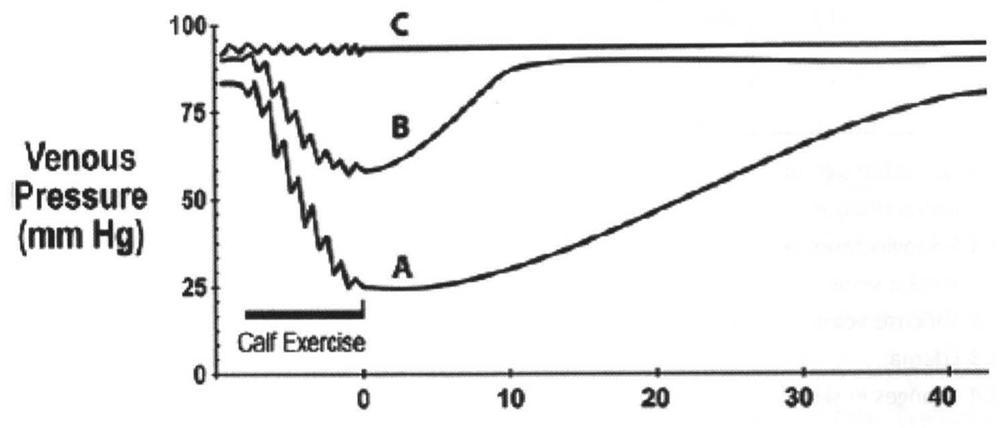

# โรคหลอดเลือดดำบกพร่อง (Chronic venous disease (CVD))

## Contents of this file
- Anatomy (p.642)
- Pathophysiology (p.643)
- Risk factor of CVD (p.644)
- Clinical Presentation (p.645)
  - ก. Telangiectasia (p.645)
  - ข. Reticular veins (p.645)
  - ค. Varicose vein (p.645)
  - ง. Edema (p.646)
  - จ. Changes in skin and subcutaneous tissue (p.646)
  - ฉ. Venous Ulcer (p.646)
- Physical Examination (p.646)
- Diagnosis (p.647)
  - *Diagnostic tools* (p.647)
  - *Duplex Ultrasound (DUS)* (p.647)
  - *Plethysmography และ venous pressure measurement* (p.648)
  - *Computed Tomographic Venography (CTV) และ Magnetic Resonance Venography (MRV)* (p.648)
  - *Ambulatory Venous Pressure* (p.648)
- Classification ของ Chronic venous disease (p.649)
- TREATMENT OPTIONS IN CHRONIC VENOUS DISEASE (p.651)
- 1. Compressive therapy (p.651)
- 2. Medication (p.652)
- 3. Sclerotherapy (p.653)
- 4. Transcutaneous laser (TCL) (p.654)
- 5. Surgical treatment (p.654)
- 6. Endovenous treatment (p.655)
  - 1. Thermal ablation (p.655)
  - 2. Non-thermal ablation (p.655)
- 7. Treatment of perforator vein pathology (p.656)
- 8. Treatment of deep vein pathology (p.656)
  - การรักษาผู้ป่วยที่มี deep venous incompetence (p.657)
- สรุป (p.657)
- เอกสารอ้างอิง (p.658)

<!-- p.641 (printed none) -->
**โรคหลอดเลือดดำบกพร่อง**

**Chronic venous disease (CVD)**

อภินันท์ อุทัยไพศาลวงศ์

<!-- p.642 (printed 628) -->
**โรคหลอดเลือดดำบกพร่อง**

**Chronic venous disease (CVD)**

อภินันท์ อุทัยไพศาลวงศ์

โรคหลอดเลือดดำบกพร่องโดยทั่วไปมักกล่าวถึงหลอดเลือดดำของขา รวมเรียก Chronic venous disease (CVD) ซึ่งหมายถึงโรคที่เกิดจากการทำงานของหลอดเลือดดำที่ผิดปกติ อาการและอาการแสดงมีได้หลากหลาย ตั้งแต่ไม่มีอาการ มีหลอดเลือดดำขอด มีอาการปวดเมื่อยขา ขาบวม ผิวหนังที่ขามีสีคล้ำกว่าปกติ รวมไปถึงมีการอักเสบไปจนถึงมีแผลเรื้อรังที่ขา1-2 ในขณะที่ Chronic venous insufficiency (CVI) หมายถึงโรคที่มีอาการหรืออาการแสดงของ CVD ที่มีความรุนแรงกว่า ได้แก่ กลุ่มที่มีการเปลี่ยนแปลงสีของผิวหนัง การอักเสบของผิวหนังที่ขา รวมไปถึงผู้ป่วยที่มีแผลจากหลอดเลือดดำ บางครั้งจะรวมไปถึงอาการบวมจากหลอดเลือดดำด้วย2 อุบัติการณ์ของการเกิด CVD และ CVI ยังไม่ทราบแน่ชัดมีรายงานตั้งแต่ 5-30% และพบในผู้หญิงมากกว่าผู้ชาย 3 เท่า3

## Anatomy1-2

1. Superficial veins of lower extremities

  - Greater Saphenous Vein (GSV) เป็นหลอดเลือดดำที่อยู่ด้านในของขา มักมีความยาวตั้งแต่ต้นขาถึงข้อเท้า โดยจะมี fascia ล้อมรอบ เรียกว่า Saphenous fascia อยู่ใน Saphenous compartment โดยภาพจากการทำอัลตราซาวน์ B-mode จะมีลักษณะเป็น Egyptian eye ซึ่งปกติจะพบ GSV เพียงเส้นดียว แต่สามารถมี GSV 2 เส้นคู่กัน (duplicated GSV) พบได้ 1% ของผู้ป่วย โดยทั่วไป GSV จะเชื่อมกับ Common Femoral vein ที่บริเวณขาหนีบ และจะเรียกบริเวณนี้ว่า Saphenofemoral junction (SFJ) ซึ่งบริเวณก่อนถึง SFJ จะมีแขนง (Tributary) 5 แขนง คือ superficial circumflex iliac, superficial epigastric, superficial external pudendal, medial accessory femoral และ lateral accessory femoral vein และยังสามารถพบ anterior accessory saphenous vein (AASV) และ posterior accessory saphenous vein (PASV) ซึ่งจะขนานไปกับ GSV บริเวณต้นขา

<!-- p.643 (printed 629) -->
  - Small Saphenous Vein (SSV) เป็นหลอดเลือดดำที่วางตัวอยู่บริเวณน่องด้านหลัง โดยจะเชื่อมกับ popliteal vein แต่อาจพบว่าบางครั้งบริเวณที่เชื่อมกันอาจอยู่สูงกว่า popliteal fossa ได้ ในผู้ป่วยบางรายอาจพบมีแขนงของหลอดเลือดเชื่อมกับ GSV โดย intersaphenous vein หรือ Giacomini vein ซึ่งมักจะวิ่งจาก SSV บริเวณ popliteal fossa ไป GSV ทางด้านหลังของขา

  - Perforating vein เป็นหลอดเลือดดำที่วางตัวในแนวขวาง ผ่านชั้น fascia เพื่อเชื่อมต่อระหว่างหลอดเลือดดำชั้นตื้นและหลอดเลือดดำชั้นลึก

2. Deep veins of lower extremities

  - เป็นหลอดเลือดดำที่วางตัวอยู่ใต้ชั้น fascia และเป็น venous outflow สำคัญของส่วนขารับเลือดตั้งแต่ deep plantar arch โดยจะวางตัวขนานไปกับหลอดเลือดแดง และรวมไปถึง intramuscular veins, venous sinusoids และ venous plexus

  - ส่วนของ popliteal vein จะรับเลือดดำจาก gastrocnemius vein, tibial vein และ SSV บางครั้ง gastrocnemius vein อาจจะรวมตัวกับ SSV ก่อนเชื่อมกับ popliteal vein โดยปกติแล้ว SSV จะเชื่อมเข้า popliteal vein บริเวณ Saphenopopliteal junction (SPJ) ซึ่งมักอยู่ภายในระยะไม่เกิน 5 เซนติเมตร จากข้อพับเข่า จากนั้น popliteal vein จะวางตัวตามแนวยาวขึ้นผ่าน adductor canal แล้วเปลี่ยนชื่อเป็น femoral vein (ในปัจจุบันไม่นิยมเรียกว่า “superficial femoral vein”) จากนั้นขึ้นไปในระยะประมาณ 10 เซนติเมตร ใต้ต่อ inguinal ligament จะมีการรวมตัวของ femoral vein และ deep femoral vein เป็น common femoral vein ข้างต้น ซึ่ง femoral vein และ popliteal vein มักมีการแยกตัวเป็น 2 เส้น วางตัวขนานไปกับ Superficial femoral artery และ popliteal artery ในบริเวณใกล้ต่อ inguinal ligament จะมี GSV มาเชื่อมเข้าบริเวณ SFJ ดังที่กล่าวแล้ว

## Pathophysiology1-2

การเกิดโรคของหลอดเลือดเกิดจากการเพิ่มขึ้นของความดันในหลอดเลือดดำของขา (Venous hypertension) และมีการไหลของเลือดดำกลับสู่หัวใจลดลง กลไกหลักที่ทำให้ความดันของหลอดเลือดดำที่ขาสูงขึ้น ได้แก่ reflux และ obstruction ซึ่งทั้ง 2 กลไก

<!-- p.644 (printed 630) -->
สามารถเกิดร่วมกันได้ ซึ่งภาวะเหล่านี้ทำให้ความสามารถในการลงเลือดกลับสู่หัวใจระหว่างที่มีการขยับของขาลดลง ซึ่งเกิดได้จากหลายสาเหตุ เช่น มีการอุดกั้นของเส้นทางเดินของหลอดเลือดดำ มีความผิดปกติของผนังและลิ้นของหลอดเลือดดำทั้งในชั้นตื้นและชั้นลึก เป็นต้น นอกจาก 2 สาเหตุที่กล่าวมาข้างต้นแล้ว ความผิดปกติจาก muscle pump dysfunction ซึ่งมักเกิดจากหลอดเลือดบริเวณน่องก็เป็นอีกสาเหตุที่ทำให้เกิด Venous hypertension ได้

ในระดับ superficial vein การเกิด reflux มักเกิดจากความผิดปกติของผนังของหลอดเลือดดำเอง (primary cause) ซึ่งมักมีผลให้ผนังของหลอดเลือดดำเกิดการขยายตัวใหญ่ขึ้น ทำให้ลิ้นของหลอดเลือดไม่สามารถทำงานได้อย่างมีประสิทธิภาพ จึงเกิดการไหลย้อนของเลือดดำ (reflux)

ในระดับ deep vein ของขา ความผิดปกติมักเกิดตามหลังการเกิด Deep vein thrombosis ทำให้ผนังของหลอดเลือดดำผิดปกติ ลิ้นและผนังหลอดเลือดดำเสียการทำงาน ซึ่งสามารถทำให้เกิดความผิดปกติแบบ chronic obstruction มีผลให้เกิด resistance ของการไหลเวียนของเลือดดำ และการที่ลิ้นของหลอดดำเสียการทำงานก็สามารถเกิดความผิดปกติแบบ reflux ได้ ซึ่งเรียกว่า post-thrombotic change ซึ่งเกิดได้ 80% ของผู้ป่วยที่มีความผิดจาก deep vein อย่างไรก็ตามความผิดปกติของ deep vein พบว่ามีผู้ป่วย 20% มีความผิดปกติที่ไม่ได้เกิด DVT หรือมีสาเหตุอื่นๆ มาก่อน4

## Risk factor of CVD

1. **อายุ (Age)** ในอายุที่มากขึ้น ทำให้ผู้ป่วยมีความเสี่ยงต่อการเกิดโรคจากหลอดเลือดดำผิดปกติมากขึ้น ทั้งการเกิดหลอดเลือดดำขอดและหลอดเลือดดำบกพร่อง โดยเฉพาะผู้ป่วยที่มีอายุมากกว่า 70 ปีขึ้นไป มีความเสี่ยงมากกว่าผู้ป่วยที่มีอายุน้อยกว่าถึง 2.4 เท่า ในการเกิดหลอดเลือดขอด และ 4.8 เท่า ในการเกิดหลอดเลือดดำบกพร่องเมื่อเปรียบเทียบกับผู้ป่วยที่มีอายุน้อยกว่า5

2. **เพศ (Gender)** จากการศึกษาส่วนใหญ่พบว่าเพศหญิงมีความเสี่ยงในการเกิดหลอดเลือดดำขอดและหลอดเลือดดำบกพร่องได้มากกว่าเพศชาย และความเสี่ยงอาจเพิ่มขึ้นในผู้หญิงที่เคยตั้งครรภ์5อย่างไรก็ตามในปัจจุบันยังมีบางการศึกษาพบว่าไม่มีความแตกต่างกันในความเสี่ยงระหว่างเพศชายและหญิง6

<!-- p.645 (printed 631) -->
3. **ภาวะอ้วน (Obesity)** ผู้ป่วยที่มี BMI มากกว่า 25-30 มีความเสี่ยงต่อการเกิดภาวะหลอดเลือดดำบกพร่องเพิ่มขึ้น 3-6 เท่า และในผู้ป่วยบางกลุ่มพบว่าเป็นผู้ป่วยที่มีอาการของโรคหลอดเลือดดำบกพร่องแต่ตรวจไม่พบความผิดปกติของหลอดเลือดดำที่ชัดเจน7-8

4. **ประวัติครอบครัว (Family history)** จากการศึกษาส่วนใหญ่พบว่าประวัติครอบครัวมีความสัมพันธ์กับความเสี่ยงของการเกิดหลอดเลือดดำขอดและหลอดเลือดดำบกพร่อง อย่างไรก็ตามในปัจจุบันยังไม่มีการค้นในระดับ genetic ที่จะสามารถอธิบายความเสี่ยงดังกล่าว9

## Clinical Presentation1-2

อาการของผู้ป่วย CVD มีความหลากหลายและแตกต่างกัน ซึ่งสามารถเป็นได้ตั้งแต่ไม่มีอาการ มีหลอดเลือดที่บริเวณผิวหนังมีการขยายตัว ไปจนถึงมีการอักเสบของผิวหนังและมีแผลที่ขา

### ก. Telangiectasia

เป็นหลอดเลือดดำที่มีขนาด 0.1-1 มิลลิเมตร พบในบริเวณ superficial โดยส่วนใหญ่มักพบว่าจะมี reticular vein เป็น feeder

### ข. Reticular veins

เป็นหลอดเลือดดำที่อยู่บริเวณ superficial มีผนังบาง ขนาดเส้นผ่านศูนย์กลาง 1-3 มิลลิเมตร มักเป็น tributary vein ของ truncal vein (GSV) บางครั้งจะพบอยู่ด้าน lateral ของขา extend ไปทั้งด้านเหนือเข่าและใต้เข่า เรียกว่า lateral subdermic venous system (LSVS)

### ค. Varicose vein

เป็นหลอดเลือดดำที่มีการขยายขนาด (dilatation) ความยาว (elongation) และมีลักษณะคดโค้ง (tortuosity) โดยเส้นผ่านศูนย์กลางของหลอดเลือดดำที่พบจะยาวมากกว่า 3 มิลลิเมตร สามารถเกิดได้กับทั้ง truncal vein และ tributary vein ได้

<!-- p.646 (printed 632) -->
### ง. Edema

อาการบวมเกิดจากการสะสมของ fluid และมีการ leakage ออกนอกหลอดเลือดดำหรือการขยายของหลอดเลือดดำ โดยอาการบวมมักเริ่มที่บริเวณรอบๆ ตาตุ่มก่อน อาการมักเป็นมากขณะยืนระหว่างและหากยกขาสูงสักระยะอาจยุบลงได้บ้าง บางครั้งผู้ป่วยอาจมาด้วยความรู้สึกหนักขาหรือมีอาการรองเท้าคับหลังจากยืนนานๆ

### จ. Changes in skin and subcutaneous tissue

การที่ผู้ป่วยมีความดันในหลอดเลือดดำเพิ่มขึ้น ซึ่งเป็น hydrostatic pressure มีผลทำให้เม็ดเลือดแดงมีการรั่วซึมออกนอกหลอดเลือดดำ ทำให้มีการสะสมของ hemosiderin ที่บริเวณผิวหนังของผู้ป่วยทำให้ผิวหนังมีสีคล้ำมากขึ้น (hyperpigmentation) และทำให้เกิด eczematous dermatitis ได้ จากนั้นจะมีกลไกการอักเสบทำให้เกิด fibrotic process ส่งผลให้ผิวหนังที่ขาเกิดลักษณะที่เรียกว่า Lipodermatosclerosis ลักษณะของขาแข็งตึง ในผู้ป่วยบางรายขาบริเวณน่องที่มีอาการอักเสบมานานจะมีลักษณะ fibrosis ที่เด่นชัดจนทำให้ขามีขนาดเล็กลงเฉพาะบริเวณที่มีอาการอักเสบ เกิดเป็นลักษณะของขาที่เรียกว่า reverse champagne bottle sign และการเกิดกระบวนการอักเสบสามารถส่งผลให้เกิด lymphedema ซึ่งอาจพบร่วมด้วยในผู้ป่วยได้

### ฉ. Venous Ulcer

เป็นแผลที่มักอยู่ด้านในของน่องเหนือตาตุ่มด้านใน มักพบร่วมกับลักษณะของผิวหนังมีการอักเสบ มักมีลักษณะ dermatitis หรือ lipodermatosclerosis ร่วมด้วย ผู้ป่วยบางรายอาจมีอาการปวด คัน บวม รวมไปถึงอาการแสบร้อนได้ ลักษณะของแผลมักตื้นขอบไม่เรียบ มีลักษณะของ granulation ปกคลุม มีสารคัดหลั่งออกจากแผลค่อนข้างมาก บางครั้งจะมีพบ fibrin บนแผลด้วย10

## Physical Examination

การตรวจร่างกายผู้ป่วยควรตรวจในท่ายืนและตรวจขาทั้ง 2 ข้าง บางครั้งอาจมีความจำเป็นในการตรวจร่างกายบริเวณท้องและสีข้างของผู้ป่วยด้วยว่ามีลักษณะของ venous collateral เนื่องจากลักษณะเหล่านี้บ่งบอกว่ามีความผิดปกติในระดับ iliac vein และ IVC ได้ และต้องสังเกตว่าผู้ป่วยมีความผิดปกติในระบบอื่นๆ เช่น arterial insufficiency, orthopaedic, rheumatology หรือ neurology ร่วมด้วยหรือไม่

<!-- p.647 (printed 633) -->
การตรวจร่างกายควรพิจารณาถึงลักษณะของผิวหนังที่มีความผิดปกติ เช่น มีหลอดเลือดดำที่ผิดปกติ ทั้ง telangiectasia, reticular vein และ varicose vein รวมไปถึงบริเวณที่ผิวหนังมีการเปลี่ยนแปลง เช่น edema, hyperpigmentation, stasis dermatitis, atrophie blanche และ lipodermatosclerosis เป็นต้น หากมีแผลควรบันทึกตำแหน่งของแผล ขนาดของแผล และลักษณะของแผลให้ชัดเจน เพื่อสามารถใช้ในการติดตามผลการรักษาได้ต่อไป

ในปัจจุบันการตรวจด้วย tourniquet เช่น Brodie-Trendelenburg test, Perthes test เป็นต้น มีการใช้น้อยลง เนื่องจากมีความเชื่อถือได้น้อยและข้อมูลที่ได้ไม่สามารถใช้วางแผนในการรักษาได้อย่างเพียงพอ

## Diagnosis1-2

การวินิจฉัยโรคในกลุ่ม CVD ขึ้นกับการซักประวัติและตรวจร่างกายร่วมกับการวินิจฉัยทางรังสีเพิ่มเติม เช่น continuous wave Doppler, duplex ultrasound (DUS), phlebography, plethysmography, venous pressure measurement, magnetic resonance venography (MRV) และ computed tomography venography (CTV) เป็นต้น

### *Diagnostic tools*

Definition of reflux : การตรวจ reflux ที่ถูกต้อง ต้องทำในท่ายืน ระยะเวลาในการบ่งบอกว่าหลอดเลือดดำใดมี reflux แตกต่างกันขึ้นกับตำแหน่งของหลอดเลือด คือ มากกว่า 1 วินาที ในหลอดเลือดดำชั้นลึก, มากกว่า 0.5 วินาที ในหลอดเลือดดำชั้นตื้นและ perforator vein 11

### *Duplex Ultrasound (DUS)*

การทำ DUS เป็นการตรวจที่ร่วมกันระหว่างภาพ ultrasound และ pulsed wave Doppler ซึ่งสามารถให้ข้อมูลได้ทั้ง anatomy และ hemodynamic feature รวมทั้งมีการใส่ภาพ color flow ได้ เพื่อให้ได้ข้อมูลที่เพียงพอทั้ง superficial และ deep system และสามารถให้ข้อมูลของ Anatomy, valvular incompetence และ venous obstruction ได้ดี แต่อย่างไรก็ตามข้อจำกัดของ DUS คือ ความถูกต้องในการทำและ

<!-- p.648 (printed 634) -->
แปลผล ขึ้นกับประสบการณ์และความชำนาญของผู้ทำ รวมทั้งการทำ DUS ยังไม่สามารถให้ข้อมูลของหลอดเลือดดำในช่องท้องและอุ้งเชิงกรานได้ดีนัก12-13

### *Plethysmography และ venous pressure measurement*

เป็นการวัด volume ที่อยู่ใน venous segment และตรวจ venous volume ที่มีการเปลี่ยนแปลง โดยมีด้วยกันหลายเทคนิค เช่น Air Plethysmography, Photoplethysmography และ Strain-gauge plethysmography เป็นต้น แต่ในปัจจุบันไม่เป็นที่นิยมเนื่องจากการตรวจมีความยุ่งยากและมีการใช้ DUS แทนที่ การตรวจด้วย Plethysmography มักใช้ในงานวิจัยหรือใช้ในการตรวจวัดผลหลังการรักษา14-15

### *Computed Tomographic Venography (CTV) และ Magnetic Resonance Venography (MRV)*

การตรวจ CTV และ MRV สามารถให้ข้อมูลหลอดเลือดดำที่อยู่ในช่องท้องและอุ้งเชิงกรานได้ รวมทั้งบอกความผิดปกติจากการเกิด compression เช่น post-thrombotic obstruction, May-Thurner syndrome หรือ pelvic varicocele เป็นต้น16-17

### *Ambulatory Venous Pressure*

ปัจจุบันถือเป็น gold standard ในการประเมินผู้ป่วย CVD โดยเทคนิคที่ใช้ คือ การแทงเข็มที่บริเวณ dorsal vein ของเท้า จากนั้นต่อเข้ากับ pressure transducer แล้วประเมินความดันของหลอดเลือดดำในเวลาพัก และเวลาออกกำลังของกล้ามเนื้อน่องในท่ายืน โดยการวัด Ambulatory venous pressure สามารถใช้ประเมินความรุนแรงของโรคและใช้ติดตามผลการรักษาได้ อย่างไรก็ตามการแปลผลสาเหตุของ CVD ที่เกิดจาก deep venous system ให้ผลไม่แม่นยำนัก ปัจจุบันมีการใช้น้อยเนื่องจากเป็นวิธีที่ invasive และการทำค่อนข้างยุ่งยาก18

การวัด ambulatory venous pressure จะเปรียบเทียบจากภาวะปกติที่ความดันของหลอดเลือดดำที่ขาในท่ายืนจะอยู่ที่ประมาณ 80-90 mmHg หากมีการออกกำลังของกล้ามเนื้อที่น่อง ความดันจะลดลงเหลือ 20-30 mmHg หรือมากกว่า 50% และความดันจะกลับมาเท่าเดิมหลังจากหยุดการออกกำลังกาย โดยใช้เวลามากกว่า 20 วินาที หากมีความผิดปกติแบบ reflux จะทำให้ความดันของหลอดเลือดดำที่ขาขณะออกกำลังกายลดลงน้อยกว่า 50% และใช้เวลาในการกลับมาเท่าเดิม <20 วินาที แต่ถ้ามีความผิดปกติ

<!-- p.649 (printed 635) -->
แบบ obstruction จะพบว่ามีความดันของขาในท่ายืนมากกว่า 80-90 mmHg และลดลงน้อยมากในขณะออกกำลังกาย1-2

> **Caption (verbatim):** **รูปที่ 1** แสดงค่า ambulatory foot venous pressure ขณะพักและขณะออกกำลังในท่ายืน1-2 A : ค่าปกติของความดันของหลอดเลือดดำที่ขาขณะยืนประมาณ 80-90 mmHg และความดันจะตกลงเป็น 20-30 mmHg (>50%) ขณะออกกำลังกล้ามเนื้อน่อง และใช้ระยะเวลามากกว่า 20 วินาที ในการกลับสู่ค่าปกติหลังหยุดออกกำลัง B : ในผู้ป่วยที่มีความผิดปกติแบบ venous reflux พบว่าผู้ป่วยมีค่าความดันของหลอดเลือดดำที่ขาขณะยืนสูงขึ้นกว่าปกติ และความดันจะตกลงน้อยกว่า 50% ของค่าเริ่มต้นขณะออกกำลังกล้ามเนื้อน่อง และใช้ระยะเวลาน้อยกว่า 20 วินาที ในการกลับสู่ค่าเดิมหลังหยุดออกกำลัง C : ในผู้ป่วยที่มีความผิดปกติแบบ venous obstruction พบว่าผู้ป่วยมีค่าความดันของหลอดเลือดดำที่ขาขณะยืนสูงขึ้นกว่าปกติ และความดันจะตกลงเพียงเล็กน้อยขณะออกกำลังกล้ามเนื้อน่อง
> **Text in image (verbatim):** Venous Pressure (mm Hg) · 100 · 75 · 50 · 25 · 0 · 0 · 10 · 20 · 30 · 40 · Calf Exercise · A · B · C
> **Description:** Line graph of venous pressure over time. Y-axis: "Venous Pressure (mm Hg)", ticks 0, 25, 50, 75, 100. X-axis: ticks 0, 10, 20, 30, 40 (no axis title; the region left of 0 is the exercise period). A horizontal black bar labelled "Calf Exercise" spans the period just before 0. Three curves: C (top) starts at about 93 mmHg, shows small saw-tooth oscillations during calf exercise without falling, and stays flat at about 93-95 mmHg throughout. B starts at about 90 mmHg, falls in a saw-tooth pattern during exercise to about 58 mmHg at time 0, then rises quickly back to about 88-90 mmHg by about 10 and stays there. A starts at about 83 mmHg, falls in a saw-tooth pattern during exercise to about 25 mmHg at time 0, then rises slowly and gradually, reaching only about 80 mmHg near 40. Faint show-through text from the reverse page is visible at the right edge of the image.
> **Identifiers in image:** none

## Classification ของ Chronic venous disease2

การแบ่ง Classification ของ CVD ที่เป็นที่นิยม คือ CEAP classification โดยมีการบอกระดับความรุนแรงของโรคโดยพิจารณาจาก C (Clinical symptom and sign), A (Anatomy), E (Etiology) และ P (Pathophysiology)

<!-- p.650 (printed 636) -->
**ตารางที่ 1 แสดง CEAP classification**

| Clinical classification (C) | Etiologic classification (E) | Anatomic classification (A) | Pathophysiologic classification (P) |
| --- | --- | --- | --- |
| **C0** No visible sign of venous disease **C1** Telangiectases or reticular veins **C2** Varicose veins **C3** Edema **C4** Changes in skin and subcutaneous tissue **A** *hyperpigmentation or eczema* **B** *Lipodermatosclerosis or atrophie blanche* **C5** Healed ulcer **C6** Active ulcer | **Ec** congenital **Ep** primary (undeterminate cause) **Es** secondary (e.g. post thrombotic) **En** no venous cause identified | **As** Superficial **Ad** Deep **Ap** Perforator **An** No venous location identified | **Pr** Reflux **Po** Obstruction, thrombosis **Pr, o** Reflux and obstruction **Pn** No venous pathophysiology identified |

การใช้ CEAP classification มี Level of investigation แบ่งเป็น 3 level ดังนี้

- Level 1 ได้จากการซักประวัติและตรวจร่างกาย อาจมีการใช้ handheld Doppler ในการตรวจด้วย

- Level 2 ได้จากการตรวจเพิ่มเติมแบบ non-invasive imaging ได้แก่ colour venous duplex และ plethysmography

- Level 3 ได้จากการตรวจเพิ่มเติมแบบ invasive หรือ complex imaging อื่นๆ เช่น venography, Computerized tomography หรือ MR imaging เป็นต้น

อย่างไรก็ตามในปัจจุบันยังมีการ classification อื่นๆ อีก เช่น Venous Clinical Severity Score (VCSS), Venous Segmental Disease Score (VSDS), Venous Disability Score (VDS) เป็นต้น ซึ่งแนะนำให้พิจารณาใช้กับผู้ป่วย CVI แต่เนื่องจากมีความยุ่งยากจึงยังไม่เป็นที่แพร่หลายนัก

<!-- p.651 (printed 637) -->
## TREATMENT OPTIONS IN CHRONIC VENOUS DISEASE

## 1. Compressive therapy

Compression therapy เป็นการรักษาที่สำคัญ เป็นวิธีที่ง่ายและ non-invasive สำหรับผู้ป่วย มีประสิทธิภาพในการช่วยลด venous hypertension ซึ่งถือเป็นสาเหตุของการเกิด CVD ได้ โดยกลไกหลัก คือ การช่วย compression ทั้ง superficial และ deep venous system ทำให้ volume และ reflux ลดลงได้ รวมถึงช่วยให้ muscle pump function ดีขึ้น ทำให้สามารถลด ambulatory venous pressure และลดอาการบวมได้

ในผู้ป่วยกลุ่ม C0-C4 ควรแนะนำให้ผู้ป่วยใช้ graduated compressive stocking ซึ่งจะมีความดันสูงสุดที่บริเวณด้านล่างและความดันจะลดลงเรื่อยๆ ในส่วนที่สูงขึ้นมาก โดยความดันบริเวณต้นขามักน้อยกว่าด้านข้อเท้าหรือน่องมากกว่า 50% ในปัจจุบัน graduated compressive stocking ที่มีการใช้มักเป็นแบบ depressive graduated compressive stocking ซึ่งจะมีความดันสูงสุดที่บริเวณข้อเท้า แต่จากการศึกษาพบว่าการใช้ progressive graduated stocking ซึ่งจะมีความดันสูงสุดที่บริเวณน่องสามารถลดอาการปวดและอาการอื่นๆ ของขาได้ดีกว่า

โดยทั่วไปความดันของ graduated compressive stocking แบ่งเป็น 4 ระดับ ขึ้นกับระดับของความดันที่สูงสุดบริเวณน่องหรือข้อเท้า ซึ่งระดับความดันอาจแตกต่างกันบ้างขึ้นกับบริษัทที่ผลิต

**ตารางที่ 2** แสดงระดับความดันของ compressive stocking

| Class I | 0-15 mmHg |
| --- | --- |
| Class II | 15-30 mmHg |
| Class III | 30-40 mmHg |
| Class IV | >40 mmHg |

โดยคำแนะนำการใช้ระดับของความดันขึ้นกับความรุนแรง ในผู้ป่วยกลุ่ม C2-C3 แนะนำให้ใช้อย่างน้อย class II ส่วนในผู้ป่วย C4 แนะนำให้ใช้อย่างน้อย class III และผู้ป่วยที่มี active venous ulcer แนะนำให้ใช้ความดันที่มากกว่า 40 mmHg การเปลี่ยน

<!-- p.652 (printed 638) -->
graduated compressive stocking แนะนำให้เปลี่ยนทุก 6-9 เดือน เนื่องจากหากใช้ไประยะเวลาหนึ่งจะมีความดันของ graduated compressive stocking ลดลง

ในผู้ป่วยที่มี active venous ulcer แนะนำให้ทำแผลโดยใช้เทคนิค four layer compressive dressing โดยเปลี่ยนแผลอย่างน้อย 1 ครั้งต่อสัปดาห์ ในผู้ป่วยที่ไม่มีการติดเชื้อ ซึ่งเทคนิคการ dressing จะทำให้สามารถรักษาความดันอย่างน้อย 40 mmHg ได้อย่างต่อเนื่อง

อย่างไรก็ตามในผู้ป่วยที่ได้รับ compressive therapy ควรระมัดระวังในผู้ป่วยที่มีปัญหา arterial disease ร่วมด้วย โดยไม่ควรใช้ในผู้ป่วยที่มี ABI <0.5 เนื่องจากอาจทำให้อาการของ arterial disease แย่ลงได้

## 2. Medication

ในปัจจุบันการรักษาด้วยยาไม่จัดเป็นการรักษาหลักใน CVD เนื่องจากยังมีข้อถกเถียงกันในข้อมูลเชิงวิชาการ ยาที่ใช้เป็นยาในกลุ่มที่เรียกว่า Venoactive drug ซึ่งออกฤทธิ์ในการช่วยให้ venous tone และ capillary permeability ดีขึ้น อย่างไรก็ตามการใช้ยาในการรักษา CVD มีการยอมรับแตกต่างกันไปในแต่ละประเทศ และเป็นเพียงการรักษาร่วมกับวิธีอื่นเท่านั้น

2.1 micronized purified flavonoid fraction เป็นยาในกลุ่ม flavonoid นอกจากออกฤทธิ์แบบ venoactive drug แล้ว ยังช่วยลดอาการบวมและอาการอักเสบได้ จากการออกฤทธิ์ต่อ leukocyte และ endothelium ซึ่งจากการศึกษาพบว่าการให้ยาในกลุ่ม MPFF สามารถช่วยลดอาการของ CVD ได้ และสามารถช่วยให้ active venous ulcer หายได้เร็วกว่าหากให้ยาร่วมกับการทำ compressive dressing19

2.2 Sulodexide เป็น purified glycosaminoglycan ที่เป็นการประกอบกันของ dermatan sulfate และ fast moving heparin มีฤทธิ์เป็น antithrombotic และ profibrinolytic รวมทั้งลดการอักเสบ ซึ่งมีข้อมูลว่าสามารถช่วยให้การให้อัตราการหายของ active venous ulcer เร็วขึ้น แต่ยังไม่มีการศึกษาถึงผลของการรักษาในระยะยาว20

<!-- p.653 (printed 639) -->
2.3 Horse chestnut seed extract เป็นยาที่มีสาร aescin ซึ่งมีข้อมูลว่าอาจช่วยในการลดอาการของผู้ป่วยกลุ่ม CVD โดยช่วยลดอาการบวม ปวด และคันได้ อย่างไรก็ตามการศึกษาค่อนข้างจำกัดและมักเป็นผลการรักษาในระยะสั้น21

## 3. Sclerotherapy

เป็นการฉีด chemical agent เข้าที่หลอดเลือดดำ เพื่อให้มีการทำลายของ endothelium ของหลอดเลือดดำ โดยสามารถฉีด dilated veins ได้ตั้งแต่ telangiectasia, tributary varicosity, perforator vein ไปจนถึง truncal vein ซึ่งการทำ sclerotherapy สามารถใช้เป็นการรักษาหลักหรือใช้ร่วมกับการรักษาอื่นๆ ได้ โดยสารเคมีที่ใช้ ได้แก่ 23.4% hypertonic sodium chloride และ sodium tetradecyl sulfate เป็นต้น แต่สารที่ใช้แพร่หลายในประเทศไทย คือ 1% polidocanol เทคนิคในการฉีดทั่วไปมี 2 เทคนิคหลัก คือ liquid injection และ foam injection ซึ่งโดยทั่วไป liquid injection มักใช้ใน telangiectasia และ reticular vein ในขณะที่ foam injection มักใช้ในหลอดเลือดดำที่มีขนาดมากกว่า 3 มิลลิเมตร โดยใช้หลักการการผสมระหว่าง chemical agent 1 ส่วน ต่อ air 3-4 ส่วน จากนั้นผสมกันผ่าน three-way อย่างน้อย 20 ครั้ง ให้ได้เป็นลักษณะ microbubble (Tessari technique)22 โดยมักต้องฉีดภายใน 1-2 นาที หากทิ้งไว้นาน foam จะมีการคืนตัวต้องทำการผสมใหม่ การรักษาด้วย foam sclerotherapy สำหรับ truncal vein หรือ perforator vein นั้น ส่วนใหญ่มักต้องใช้การทำ ultrasound guided foam sclerotherapy (UGFS) หลังทำ sclerotherapy ผู้ป่วยควรใช้ compressive therapy อย่างเคร่งครัดในระยะแรก

ผลการรักษาในปัจจุบันหากเปรียบเทียบกับวิธีอื่นพบว่าอาจมีการกลับเป็นซ้ำหลังการรักษาที่มากกว่าการรักษาด้วยวิธีอื่นๆ โดยเฉพาะอย่างยิ่งหลอดเลือดดำที่มีขนาดมากกว่า 5 มิลลิเมตรขึ้นไป23 อย่างไรก็ตามการทำ sclerotherapy สามารถทำซ้ำได้ หากการติดตามการรักษาแล้วยังพบว่ามีส่วนของหลอดเลือดดำที่ยังมี reflux หลังการรักษาไปแล้ว และสามารถทำในผู้ป่วยที่มีการกลับเป็นซ้ำในผู้ป่วยที่ได้รับการรักษาด้วยวิธีอื่น1-2

ข้อดีของการทำ sclerotherpay คือ การทำง่าย less invasive กว่าวิธีอื่น อย่างไรก็ตามมีข้อควรระวังในผู้ป่วยกลุ่มที่มีอาการแพ้สารเคมีดังกล่าว หากฉีดแล้วสารเคมีออกนอกหลอดเลือดดำ อาจทำให้เกิด tissue necrosis ได้ และสามารถเกิด hyperpigmentation รอบจุดที่ฉีดยา เกิด telangiectatic matting ตามแนวของหลอดเลือด หรือมีอาการปวด

<!-- p.654 (printed 640) -->
รอบบริเวณที่ฉีดได้ บางครั้งอาจมีการอักเสบของหลอดเลือด (phlebitis) ได้ ซึ่งในผู้ป่วยอาจต้องมีการทำ microthrombectomy เพื่อลดอาการปวดให้แก่ผู้ป่วย24

## 4. Transcutaneous laser (TCL)

การทำ TCL เป็นการใช้แสง laser ผ่านผิวหนังไปยังหลอดเลือดซึ่งจะถูกเก็บพลังงานโดย oxyhaemoglobin และเปลี่ยนพลังงานเป็นความร้อน ทำให้เกิดการทำลายของผนังหลอดเลือดและเกิดการแข็งตัวของเลือดในหลอดเลือด โดยทั่วไปมักใช้ในหลอดเลือดที่มีขนาดเล็ก เช่น telangiectasia และ reticular vein25 การรักษาด้วย TCL เป็นการรักษาที่มีค่าใช้จ่ายสูงกว่า sclerotherapy และผลการรักษาอาจด้อยกว่า และผู้ป่วยบางรายต้องมีการทำซ้ำ อย่างไรก็ตามสามารถใช้ในผู้ป่วยที่มีความกังวลต่อความเสี่ยงในการเกิด telangiectatic matting หลังการรักษาด้วย sclerotherapy ผู้ป่วยที่แพ้ sclerosing agent หรือผู้ป่วยที่ได้รับการรักษาด้วย scelrotherapy แล้วผลการรักษาไม่เป็นที่น่าพอใจ

## 5. Surgical treatment

การรักษาด้วยการผ่าตัด โดยทั่วไปขึ้นกับตำแหน่งและ pathophysiology ของหลอดเลือดที่ผิดปกติ การผ่าตัดในผู้ป่วยกลุ่ม CEAP ที่มี clinical classification ตั้งแต่ C2 ขึ้นไปที่สาเหตุเกิดจาก GSV reflux การผ่าตัดที่เป็น gold standard มาอย่างยาวนาน คือ High ligation with stripping ซึ่งการรักษาจะให้ผลดีควรร่วมกับการรักษาด้วย Compression therapy ซึ่งจะสามารถทำให้ลดการกลับเป็นซ้ำ26 และในผู้ป่วย active venous ulcer หายเร็วกว่ากลุ่มที่ไม่ได้รับ Compression therapy ร่วมด้วย การผ่าตัด high ligation เป็นการผ่าตัดโดย ligation ที่บริเวณ saphenofemoral junction และจากนั้นทำ venous stripping ซึ่งการรักษาด้วย venous stripping ควรทำในระดับต้นขาบริเวณเหนือเข่าเท่านั้น เนื่องจากในส่วนของขาใต้เข่า หลอดเลือด GSV จะอยู่ใกล้กับ saphenous nerve มาก ซึ่งอาจจะทำให้เกิดการบาดเจ็บต่อเส้นประสาทได้

หากความผิดปกติเกิดจาก SSV reflux การผ่าตัดโดยทั่วไปนิยมทำ คือ high ligation โดยเป็นการ ligation บริเวณ saphenopopliteal function แต่ไม่นิยมทำ venous stripping ร่วมด้วย เนื่องจากมีโอกาสบาดเจ็บต่อ sural nerve ซึ่งวางตัวใกล้กับ SSV ได้27-28

<!-- p.655 (printed 641) -->
## 6. Endovenous treatment

ในปัจจุบันการรักษาด้วย Endovenous technique เริ่มเป็นที่นิยมและเป็นทางเลือกเข้ามาแทนที่การผ่าตัด ซึ่งผลการรักษาไม่แตกต่างจากการรักษาโดยการผ่าตัด แต่มีข้อได้เปรียบในเรื่องของการฟื้นตัวและอาการปวดหลังการรักษา โดยหลักการสำคัญ คือ การทำลาย endothelium ของหลอดเลือดด้วยเทคนิคต่างๆ ทำให้เกิด thrombosis และ fibrosis ตามมาได้ ในปัจจุบันแบ่งเป็น 2 กลุ่ม คือ thermal ablation และ non-thermal ablation

### 1. Thermal ablation

เป็นการสร้างพลังงานความร้อนเพื่อทำลาย endothelium ของหลอดเลือด ปัจจุบันเทคนิคที่ใช้ในการสร้างพลังงานความร้อนที่นิยมมี 2 เทคนิค คือ radiofrequency ablation (RFA) และ endovenous laser ablation (EVLA) ในการรักษา GSV reflux การใช้ thermal ablation มักเริ่มอยู่บริเวณต้นขาเหนือเข่า เนื่องจากหากใช้บริเวณใต้เข่าการสร้างความร้อนอาจทำให้เกิด nerve injury ได้ สำหรับการรักษาด้วย thermal ablation ต้องมีการฉีด tumescent ซึ่งเป็นการผสมระหว่าง normal saline, xylocaine with adrenaline และ Sodium bicarbonate ให้ tumescent อยู่รอบๆ หลอดเลือดดำ ให้มีระยะห่างระหว่างหลอดเลือดดำและเนื้อเยื่อข้างเคียงอย่างน้อย 1 เซนติเมตร เพื่อป้องกันการเกิดการทำงานของเนื้อเยื่อข้างเคียงในขณะที่มีการสร้างความร้อน และบริเวณที่ทำการรักษาควรห่างจาก SFJ อย่างน้อย 2.3 เซนติเมตร เพื่อป้องกันการเกิด DVT จากการเกิด thrombosis ในหลอดเลือด

### 2. Non-thermal ablation

เป็นการทำลาย endothelium ของหลอดเลือดโดยไม่ใช้ความร้อน มี 2 เทคนิคที่มีในปัจจุบัน คือ Mechanochemical endovenous ablation (MOCA) และ cyanoacrylate glue injection โดย MOCA เป็นการใส่สาย catheter ที่ส่วนปลาย มี rotating wire สามารถทำให้เกิดการบาดเจ็บต่อ endothelium จากนั้นในเวลาเดียวกันจะมีการฉีด scelrosing agent ร่วมด้วย ทำให้เกิดการทำลายต่อ endothelium29 ในส่วนของ cyanoacrylate glue injection เป็นการฉีด cyanoacrylet glue ร่วมกับการ compression หลอดเลือดเป็นระยะ ซึ่งทำให้หลอดเลือดเกิดการ thrombosis ได้30

<!-- p.656 (printed 642) -->
อย่างไรก็ตามในกลุ่ม endovenous treatment มีข้อจำกัดไม่สามารถใช้กับผู้ป่วยบางรายได้ เช่น หลอดเลือดดำที่มีขนาดมากกว่า 1-1.4 เซนติเมตร, หลอดเลือดดำมีลักษณะคดโค้งไม่สามารถสอดสาย catheter เข้าหลอดเลือดได้ หรือหลอดเลือดดำอยู่ตื้นกว่า 1 เซนติเมตร ในการรักษาด้วย thermal ablation อาจทำให้เกิดการบาดเจ็บต่อผิวหนังได้30-31

ภาวะแทรกซ้อนที่เกิดขึ้นได้ในการรักษาด้วย endovenous treatment เช่น มีการเกิด DVT จาก superficial vein ที่เกิด thrombosis เข้าไปยัง deep vein, การเกิด phlebitis ตามหลอดเลือดที่ถูกทำลาย หรือการเกิดการบาดเจ็บต่อเนื้อเยื่อข้างเคียง โดยเฉพาะในกลุ่ม thermal ablation31

## 7. Treatment of perforator vein pathology1-2

คำจำกัดความของ pathologic perforator vein คือ มีขนาดเส้นผ่านศูนย์กลางมากกว่า 3.5 มิลลิเมตร, reflux time >0.5 วินาที และตำแหน่งอยู่บริเวณที่เกิดแผล venous ulcer ในอดีตมีการผ่าตัดโดยวิธี subfascial endoscopic perforator surgery (SEPS) แต่ปัจจุบันมีทางเลือกในการรักษาแบบ noninvasive ที่ได้รับความนิยมมากกว่า เช่น การฉีด scelrotherapy หรือ endovenous treatment เป็นต้น

โดยทั่วไปการรักษา perforator vein แนะนำให้ใช้ในกลุ่มที่มี CEAP clinical classification ตั้งแต่ C4 ขึ้นไป เพื่อลดการกลับเป็นซ้ำของแผลและลด progression ของโรค

## 8. Treatment of deep vein pathology1-2

โดยส่วนใหญ่การเกิด reflux ใน deep vein มักเกิดตามหลังการเกิด obstruction ก่อน ในผู้ป่วยที่เป็น DVT หลังการรักษาที่ยังมี residual venous obstruction หรือมีการ recanalization แล้ว แต่มีการถูกทำลายของ valve หรือเกิด scar ที่ endothelium ทำให้เกิด venous outflow resistance ที่สูงขึ้น ในการรักษาผู้ป่วยกลุ่ม deep vein pathology หากการตรวจวินิจฉัยพบว่ามีภาวะ obstruction และ reflux ร่วมกัน แนะนำให้แก้ไขภาวะ obstruction ก่อน แล้วประเมินซ้ำ หาก reflux ยังคงอยู่ให้ทำการแก้ไขภาวะ reflux ต่อไป

<!-- p.657 (printed 643) -->
มีภาวะกลุ่มโรคหนึ่งซึ่งมีการเกิด iliac vein compression เช่น May-Thurner syndrome ซึ่ง left common iliac vein ถูกกดทับระหว่าง right iliac artery และ spine ทำให้เกิด venous outflow obstruction แบบ nonthrombosis

การรักษาหลักที่สำคัญในผู้ป่วยกลุ่มที่มี deep vein pathology ทั้งสาเหตุจาก chronic venous obstruction หรือ deep vein reflux คือ compression therapy เนื่องจากในปัจจุบันยังมีการรักษาที่ให้ผลการรักษาดีในผู้ป่วยกลุ่มนี้ แนะนำให้ทำในผู้ป่วยที่รักษาด้วย compression therapy อย่างเต็มที่ก่อน หากผลการรักษาไม่สามารถแก้ไขอาการต่างๆ ในผู้ป่วยได้จึงจะพิจารณาการรักษาอื่นต่อไป

**การรักษาผู้ป่วยที่มีภาวะ chronic venous obstruction** มี 2 วิธีหลัก คือ

1. Open bypass procedure ทำการผ่าตัด bypass โดยการผ่าตัดขึ้นกับบริเวณที่เกิด obstruction เช่น femoro-femoral bypass (Palma procedure), femoro-iliac-inferior vena cava bypass, spiral vein grafts และ femoral vein patch angioplasty

2. Percutaneous transluminal angioplasty (PTA) with stenting โดยการรักษาเป็นการรักษาหลักที่ใช้ในผู้ป่วยกลุ่ม May-Thurner syndrome

### การรักษาผู้ป่วยที่มี deep venous incompetence

การผ่าตัดเพื่อแก้ไข deep venous valve incompetence มีหลายเทคนิคทั้ง internal valvuloplasty, external valvuloplasty, external banding, neovalve, valve transposition, transplantation of an autologous valve อย่างไรก็ตามการผ่าตัดเหล่านี้มีผลการผ่าตัดในระยะสั้นดี แต่ระยะผลการรักษายังแตกต่างกันในหลายการศึกษา จึงยังไม่มีข้อสรุปในการพิจารณาเลือกใช้ในการรักษา

## สรุป

ผู้ป่วยกลุ่ม CVD เป็นโรคที่มีผลต่อคุณภาพชีวิตของผู้ป่วย การซักประวัติ ตรวจร่างกาย และการเลือกเครื่องมือในการ investigation สามารถนำมาซึ่งการวินิจฉัยที่ถูกต้อง เพื่อให้ได้ข้อมูลของอาการ ความรุนแรงของโรค สาเหตุ ตำแหน่งที่ผิดปกติ และพยาธิสภาพกำเนิด ซึ่งสามารถช่วยให้การพิจารณาการรักษาเหมาะสมในผู้ป่วยแต่ละรายได้ อันจะนำมาซึ่งผลการรักษาที่มีประสิทธิภาพแก่ผู้ป่วยต่อไป

<!-- p.658 (printed 644) -->
## เอกสารอ้างอิง

1. Eberhardt RT, Raffetto JD. Chronic venous insufficiency. Circulation. 2014;130(4): 333-46.
2. Wittens C, Davies AH, Baekgaard N, Broholm R, Cavezzi A, Chastanet S, et al. Editor’s Choice - Management of Chronic Venous Disease: Clinical Practice Guidelines of the European Society for Vascular Surgery (ESVS). Eur J Vasc Endovasc Surg. 2015;49(6):678-737.
3. Evans CJ, Fowkes FG, Ruckley CV, Lee AJ. Prevalence of varicose veins and chronic venous insufficiency in men and women in the general population: Edinburgh Vein Study. J Epidemiol Community Health. 1999;53(3):149-53.
4. Meissner MH, Moneta G, Burnand K, Gloviczki P, Lohr JM, Lurie F, et al. The hemodynamics and diagnosis of venous disease. J Vasc Surg. 2007;46 Suppl S: 4S-24S.
5. Criqui MH, Jamosmos M, Fronek A, Denenberg JO, Langer RD, Bergan J, et al. Chronic venous disease in an ethnically diverse population: the San Diego Population Study. Am J Epidemiol. 2003;158(5):448-56.
6. Chiesa R, Marone EM, Limoni C, Volonte M, Schaefer E, Petrini O. Chronic venous insufficiency in Italy: the 24-cities cohort study. Eur J Vasc Endovasc Surg. 2005;30(4):422-9.
7. Danielsson G, Eklof B, Grandinetti A, Kistner RL. The influence of obesity on chronic venous disease. Vasc Endovascular Surg. 2002;36(4):271-6.
8. Padberg F, Jr., Cerveira JJ, Lal BK, Pappas PJ, Varma S, Hobson RW 2nd. Does severe venous insufficiency have a different etiology in the morbidly obese? Is it venous? J Vasc Surg. 2003;37(1):79-85.
9. Krysa J, Jones GT, van Rij AM. Evidence for a genetic role in varicose veins and chronic venous insufficiency. Phlebology. 2012;27(7):329-35.
10. Singer AJ, Tassiopoulos A, Kirsner RS. Evaluation and Management of Lower-Extremity Ulcers. N Engl J Med. 2017;377(16):1559-67.
11. Labropoulos N, Tiongson J, Pryor L, Tassiopoulos AK, Kang SS, Ashraf Mansour M, et al. Definition of venous reflux in lower-extremity veins. J Vasc Surg. 2003;38(4) 793-8.

<!-- p.659 (printed 645) -->
12. Haenen JH, van Langen H, Janssen MC, Wollersheim H, van’t hof MA, van Asten WN, et al. Venous duplex scanning of the leg: range, variability and reproducibility. Clin Sci (Lond). 1999;96(3):271-7.
13. Magnusson M, Kalebo P, Lukes P, Sivertsson R, Risberg B. Colour Doppler ultrasound in diagnosing venous insufficiency. A comparison to descending phlebography. Eur J Vasc Endovasc Surg. 1995;9(4):437-43.
14. Bays RA, Healy DA, Atnip RG, Neumyer M, Thiele BL. Validation of air plethysmography, photoplethysmography, and duplex ultrasonography in the evaluation of severe venous stasis. J Vasc Surg. 1994;20(5):721-7.
15. Owens LV, Farber MA, Young ML, Carlin RE, Criado-Pallares E, Passman MA, et al. The value of air plethysmography in predicting clinical outcome after surgical treatment of chronic venous insufficiency. J Vasc Surg. 2000;32(5):961-8.
16. Marston W, Fish D, Unger J, Keagy B. Incidence of and risk factors for iliocaval venous obstruction in patients with active or healed venous leg ulcers. J Vasc Surg. 2011;53(5):1303-8.
17. Uhl JF. Three-dimensional modelling of the venous system by direct multislice helical computed tomography venography: technique, indications and results. Phlebology. 2012;27(6):270-88.
18. Neglen P, Raju S. Ambulatory venous pressure revisited. J Vasc Surg. 2000;31(6): 1206-13.
19. Gohel MS, Davies AH. Pharmacological agents in the treatment of venous disease: an update of the available evidence. Curr Vasc Pharmacol. 2009;7(3):303-8.
20. Wu B, Lu J, Yang M, Xu T. Sulodexide for treating venous leg ulcers. Cochrane Database Syst Rev. 2016(6):CD010694.
21. Pittler MH, Ernst E. Horse chestnut seed extract for chronic venous insufficiency. Cochrane Database Syst Rev. 2012;11:CD003230.
22. Tessari L, Cavezzi A, Frullini A. Preliminary experience with a new sclerosing foam in the treatment of varicose veins. Dermatol Surg. 2001;27(1):58-60.
23. Smith PC. Chronic venous disease treated by ultrasound guided foam sclerotherapy. Eur J Vasc Endovasc Surg. 2006;32(5):577-83.

<!-- p.660 (printed 646) -->
24. Scultetus AH, Villavicencio JL, Kao TC, Gillespie DL, Ketron GD, Iafrati MD, et al. Microthrombectomy reduces postsclerotherapy pigmentation: multicenter randomized trial. J Vasc Surg. 2003;38(5):896-903.
25. Eremia S, Li C, Umar SH. A side-by-side comparative study of 1064 nm Nd:YAG, 810 nm diode and 755 nm alexandrite lasers for treatment of 0.3-3 mm leg veins. Dermatol Surg. 2002;28(3):224-30.
26. Barwell JR, Davies CE, Deacon J, Harvey K, Minor J, Sassano A, et al. Comparison of surgery and compression with compression alone in chronic venous ulceration (ESCHAR study): randomised controlled trial. Lancet. 2004;363(9424):1854-9.
27. Paravastu SC, Horne M, Dodd PD. Endovenous ablation therapy (laser or radiofrequency) or foam sclerotherapy versus conventional surgical repair for short saphenous varicose veins. Cochrane Database Syst Rev. 2016;11:CD010878.
28. Schweighofer G, Muhlberger D, Brenner E. The anatomy of the small saphenous vein: fascial and neural relations, saphenofemoral junction, and valves. J Vasc Surg. 2010;51(4):982-9.
29. Elias S, Raines JK. Mechanochemical tumescentless endovenous ablation: final results of the initial clinical trial. Phlebology. 2012;27(2):67-72.
30. Bissacco D, Stegher S, Calliari FM, Viani MP. Saphenous vein ablation with a new cyanoacrylate glue device: a systematic review on 1000 cases. Minim Invasive Ther Allied Technol. 2019;28(1):6-14.
31. Hassanin A, Aherne TM, Greene G, Boyle E, Egan B, Tierney S, et al. A systematic review and meta-analysis of comparative studies comparing nonthermal versus thermal endovenous ablation in superficial venous incompetence. J Vasc Surg Venous Lymphat Disord. 2019;7(6):902-13 e3.
