# การผ่าตัดมะเร็งเต้านม (Surgical Management of malignant neoplasm of breast) — part 1 of 2

## Contents of this file
- Introduction (p.662)
- WHO classification of breast neoplasm 4 edition (p.664)
  - Invasive breast carcinoma of No Specified Type (NST) (p.664)
  - Special subtypes of invasive breast carcinoma (p.665)
- Precancerous lesions (p.668)
- Intraductal proliferative lesions (p.669)
- American joint committee on cancer (AJCC) 8 staging (p.671)
- 6 factors to consider before treatment of breast cancer (p.684)
  - Disease factor (p.684)
  - Patient Factor (p.685)
  - Patient Factor (p.686)
- How to treat the patient (p.686)

<!-- p.661 (printed none) -->
**การผ่าตัดมะเร็งเต้านม**

**Surgical Management of malignant neoplasm of breast**

มาวิน วงศ์สายสุวรรณ

<!-- p.662 (printed 648) -->
**การผ่าตัดมะเร็งเต้านม**

**Surgical Management of malignant neoplasm of breast**

มาวิน วงศ์สายสุวรรณ

## Introduction

อุบัติการณ์การเกิดมะเร็งเต้านม (รูปที่ 1)1 และอัตราการเสียชีวิตจากมะเร็งเต้านม (รูปที่ 2)1 ในประเทศไทยจะมีแนวโน้มสูงขึ้นทุกๆ ปี และอัตราการเสียชีวิตต่อจำนวนคนเป็นมะเร็งเต้านม (MR/IR) ก็ยังมีสัดส่วนที่สูงอยู่ เช่น ในกลุ่มประเทศเอเชียตะวันออกเฉียงใต้ ปี ค.ศ. 2008 อยู่ที่ 0.41 (รูปที่ 3)2 จนมาในปี ค.ศ. 2012 มีค่า MR/IR ประเทศไทยเราอยู่ระหว่าง 0.27-0.41 (รูปที่ 4)3

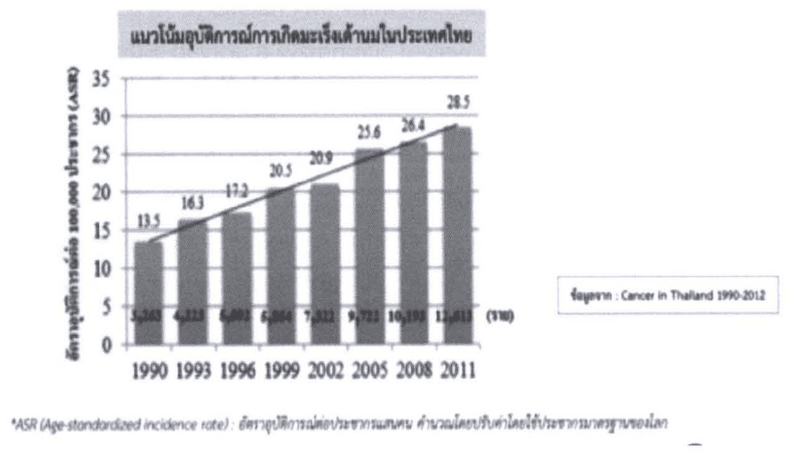

> **Caption (verbatim):** รูปที่ 1 แนวโน้มอุบัติการณ์การเกิดมะเร็งเต้านมในประเทศไทย
> **Text in image (verbatim):** แนวโน้มอุบัติการณ์การเกิดมะเร็งเต้านมในประเทศไทย · อัตราอุบัติการณ์ต่อ 100,000 ประชากร (ASR) · 0 · 5 · 10 · 15 · 20 · 25 · 30 · 35 · 1990 · 1993 · 1996 · 1999 · 2002 · 2005 · 2008 · 2011 · 13.5 · 16.3 · 17.2 · 20.5 · 20.9 · 25.6 · 26.4 · 28.5 · [unclear: 5,263] · [unclear: 6,223] · [unclear: 6,892] · [unclear: 6,864] · [unclear: 7,322] · [unclear: 9,722] · [unclear: 10,193] · [unclear: 12,613] · (ราย) · ข้อมูลจาก : Cancer in Thailand 1990-2012 · *ASR (Age-standardized incidence rate) : อัตราอุบัติการณ์ต่อประชากรแสนคน คำนวณโดยปรับค่าโดยใช้ประชากรมาตรฐานของโลก
> **Description:** Vertical bar chart titled "แนวโน้มอุบัติการณ์การเกิดมะเร็งเต้านมในประเทศไทย". Y-axis: age-standardized incidence rate per 100,000 population (ASR), scale 0–35 in steps of 5. X-axis: years 1990, 1993, 1996, 1999, 2002, 2005, 2008, 2011. Bar heights (labelled above each bar): 13.5, 16.3, 17.2, 20.5, 20.9, 25.6, 26.4, 28.5 respectively — a steady rise. A straight trend line runs upward across the bar tops from 1990 to 2011. Inside the base of each bar is the number of cases (ราย), blurry in the scan, read approximately as 5,263; 6,223; 6,892; 6,864; 7,322; 9,722; 10,193; 12,613. A box to the right gives the data source: Cancer in Thailand 1990-2012. A footnote below defines ASR as the incidence rate per 100,000 population, adjusted using the world standard population.
> **Identifiers in image:** none

<!-- p.663 (printed 649) -->
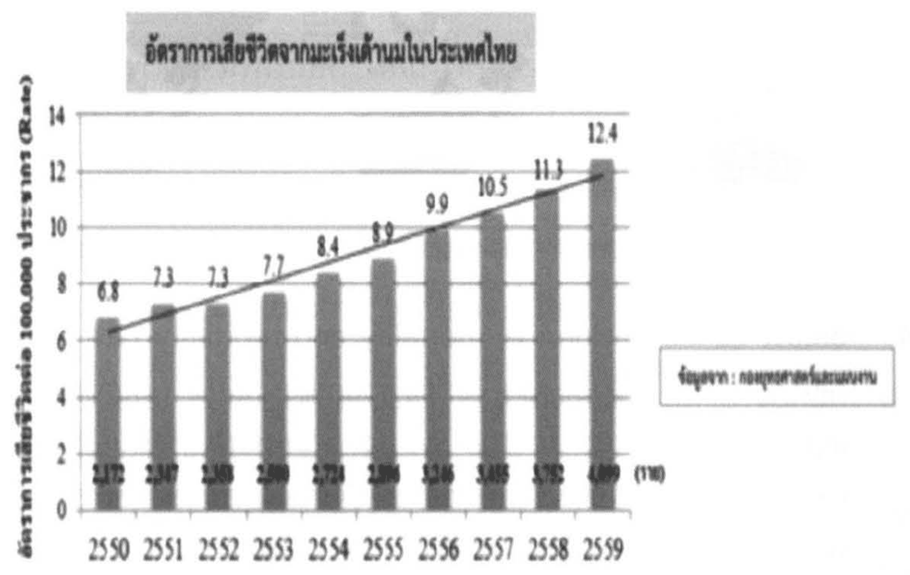

> **Caption (verbatim):** รูปที่ 2 อัตราการเสียชีวิตจากมะเร็งเต้านมในประเทศไทย
> **Text in image (verbatim):** อัตราการเสียชีวิตจากมะเร็งเต้านมในประเทศไทย · อัตราการเสียชีวิตต่อ 100,000 ประชากร (Rate) · 0 · 2 · 4 · 6 · 8 · 10 · 12 · 14 · 2550 · 2551 · 2552 · 2553 · 2554 · 2555 · 2556 · 2557 · 2558 · 2559 · 6.8 · 7.3 · 7.3 · 7.7 · 8.4 · 8.9 · 9.9 · 10.5 · 11.3 · 12.4 · [unclear: 2,172] · [unclear: 2,347] · [unclear: 2,353] · [unclear: 2,500] · [unclear: 2,724] · [unclear: 2,896] · [unclear: 3,246] · [unclear: 3,455] · [unclear: 3,782] · [unclear: 4,099] · (ราย) · ข้อมูลจาก : [unclear: กองยุทธศาสตร์และแผนงาน]
> **Description:** Vertical bar chart titled "อัตราการเสียชีวิตจากมะเร็งเต้านมในประเทศไทย". Y-axis: death rate per 100,000 population (Rate), scale 0–14 in steps of 2. X-axis: Thai Buddhist-era years 2550 to 2559. Bar heights (labelled above each bar): 2550 = 6.8, 2551 = 7.3, 2552 = 7.3, 2553 = 7.7, 2554 = 8.4, 2555 = 8.9, 2556 = 9.9, 2557 = 10.5, 2558 = 11.3, 2559 = 12.4 — a steady rise, with a straight upward trend line across the bars. Near the base of each bar is the number of deaths (ราย), blurry in the scan, read approximately as 2,172; 2,347; 2,353; 2,500; 2,724; 2,896; 3,246; 3,455; 3,782; 4,099. A box to the right gives the data source (ข้อมูลจาก : กองยุทธศาสตร์และแผนงาน, small and blurry).
> **Identifiers in image:** none

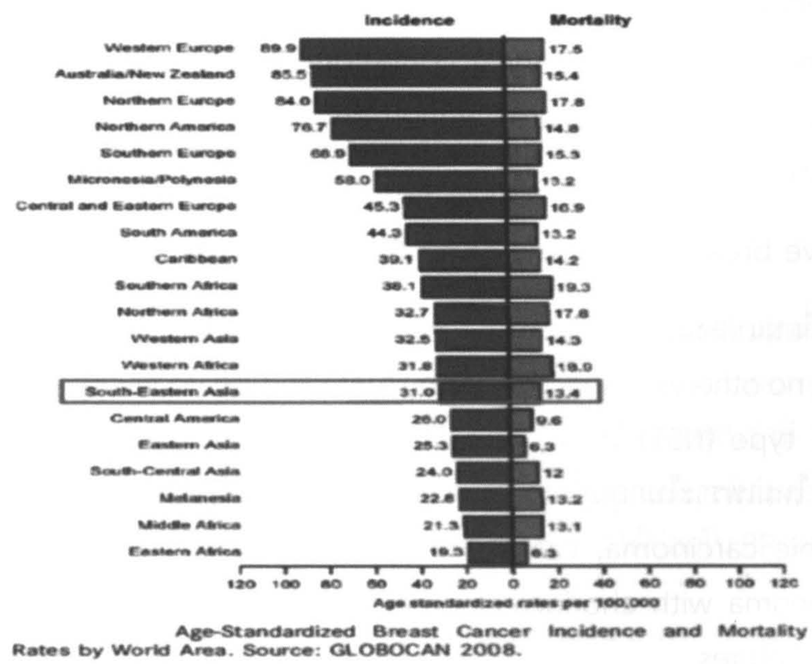

> **Caption (verbatim):** รูปที่ 3 Age-Standardized Breast Cancer Incidence and Mortality Rates by World Area. Source : GLOBOCAN 2008.
> **Text in image (verbatim):** Incidence · Mortality · Western Europe 89.9 17.5 · Australia/New Zealand 85.5 15.4 · Northern Europe 84.0 [unclear: 17.8] · Northern America 76.7 14.8 · Southern Europe 68.9 15.3 · Micronesia/Polynesia 58.0 13.2 · Central and Eastern Europe 45.3 16.9 · South America 44.3 13.2 · Caribbean 39.1 14.2 · Southern Africa 38.1 19.3 · Northern Africa 32.7 17.8 · Western Asia 32.5 14.3 · Western Africa 31.8 [unclear: 18.0] · South-Eastern Asia 31.0 13.4 · Central America 26.0 9.6 · Eastern Asia 25.3 6.3 · South-Central Asia 24.0 12 · Melanesia 22.8 13.2 · Middle Africa 21.3 13.1 · Eastern Africa 19.3 [unclear: 6.3] · 120 · 100 · 80 · 60 · 40 · 20 · 0 · 20 · 40 · 60 · 80 · 100 · 120 · Age standardized rates per 100,000 · Age-Standardized Breast Cancer Incidence and Mortality Rates by World Area. Source: GLOBOCAN 2008.
> **Description:** Back-to-back horizontal bar chart by world region. Dark bars extending left from a central zero line show incidence; lighter bars extending right show mortality; the shared x-axis runs 120–0–120, age-standardized rates per 100,000. Regions are listed from highest to lowest incidence, from Western Europe (incidence 89.9, mortality 17.5) at the top to Eastern Africa (19.3) at the bottom; values as listed above. The row "South-Eastern Asia" (incidence 31.0, mortality 13.4) is outlined with a rectangle to highlight it. Mortality bars are all short (about 6–19) compared with incidence.
> **Identifiers in image:** none

<!-- p.664 (printed 650) -->
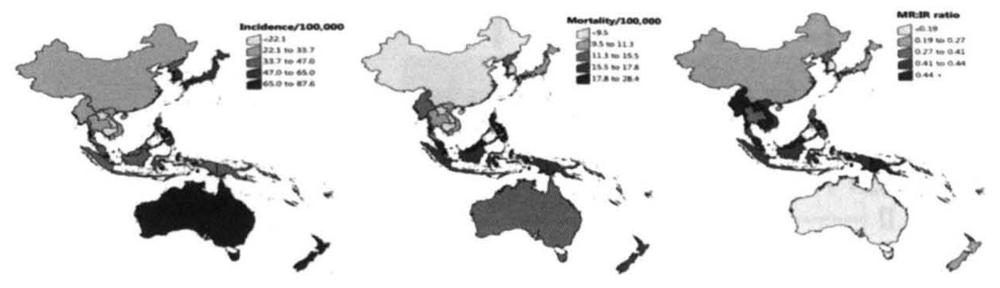

> **Caption (verbatim):** รูปที่ 4 Breast Cancer incidence, mortality and mortality rate : incidence rate ratio (MR : IR) for Asia-Pacific countries, 2012. Notes : Rates were age- standardized to the World Standard Population17 and expressed per 100,000 females. All categories were based on quintiles. Data source : GLOBOCAN6
> **Text in image (verbatim):** Incidence/100,000 · <22.1 · 22.1 to 33.7 · 33.7 to 47.0 · 47.0 to 65.0 · 65.0 to 87.6 · Mortality/100,000 · <9.5 · 9.5 to 11.3 · 11.3 to 15.5 · 15.5 to 17.8 · 17.8 to 28.4 · MR:IR ratio · <0.19 · 0.19 to 0.27 · 0.27 to 0.41 · 0.41 to 0.44 · 0.44 +
> **Description:** Three side-by-side grayscale choropleth maps of the Asia-Pacific region (China, Japan, Korea, mainland and maritime Southeast Asia, Australia, New Zealand and Pacific islands), each with a five-shade quintile legend (lightest = lowest category, darkest = highest). Left map, incidence per 100,000: Australia and New Zealand are darkest (highest incidence); China and Southeast Asian countries are in lighter-to-middle shades. Middle map, mortality per 100,000: China is lightest; Australia is a middle-dark shade; parts of Southeast Asia (e.g. Indonesia, the Philippines, Myanmar) are among the darker shades. Right map, MR:IR ratio: Australia is lightest (lowest ratio); mainland Southeast Asia (including the Thailand–Myanmar area) and parts of Indonesia/Papua are among the darkest shades (highest ratio); China is a middle-light shade.
> **Identifiers in image:** none

## WHO classification of breast neoplasm 4th edition4

ใน WHO classification นี้จะครอบคลุมทั้งมะเร็งระยะลุกลาม ไม่ลุกลาม รวมถึง precancerous lesion และ benign conditions อื่นๆ เช่น benign epithelial proliferation, fibroepithelial proliferation, myoepithelial และ mesenchymal proliferation.

### Invasive breast carcinoma of No Specified Type (NST)

สิ่งที่เปลี่ยนแปลงและต่างจากใน 3rd edition (2003) คือคำว่า invasive ductal carcinoma, no otherwise specified (NOS) เปลี่ยนไปเป็นคำว่า invasive carcinoma, no special type (NST) ใน 4th edition (2012) จะเห็นว่า คำว่า ductal หายไปใน edition ใหม่เพราะในกลุ่มนี้จะหมายความถึง rare morphological variants เช่น pleomorphic carcinoma, carcinoma with osteoclast-like stromal giant cells, carcinoma with choriocarcinomatous features และ carcinoma with melanotic features

Carcinoma of mixed type จะมีลักษณะพิเศษคือ มี specialized pattern มากกว่า 50% ของมะเร็ง โดยมี non-specialized pattern ระหว่าง 10-49% ซึ่งจะใช้กับกรณีที่มี invasive NST ร่วมกับ special type หรือ invasive NST ร่วมกับ lobular carcinoma

<!-- p.665 (printed 651) -->
### Special subtypes of invasive breast carcinoma

specific subtypes ที่พบบ่อย ได้แก่ invasive lobular carcinoma, tubular, cribriform, metaplastic, apocrine, mucinous, papillary, micropapillary, medullary, neuroendocrine carcinoma และ salivary หรือ skin adnexal type features ลักษณะ specific features เหล่านี้จะดูจาก morphology แต่ก็มีความเกี่ยวข้องกับ clinical, epidemiology และ molecular ด้วยเช่นกัน

invasive lobular carcinoma (ILC) จะสามารถมีได้หลาย variant ได้แก่ solid, alveolar, pleomorphic, tubulolobular และ mixed variant ซึ่งจะมีการพยากรณ์แตกต่างไปจาก classic ILC โดยใน pleomorphic lobular carcinoma อาจพบลักษณะของ apocrine, histiocytic หรือ signet-ring cell differrentiation ได้ ส่วนใหญ่ Tumor grade ของ classic ILC (ประมาณ 76%) จะเป็น grade 2 ตาม Nottingham histologic grading system ส่วน ILC ที่มี grade 3 มักจะพบใน solid และ pleomorphic subtype

ปกติแล้วจะ E-cadherin negative ใน ILC ยกเว้น 15% ของ ILC จะมี E-cadherin positive เช่น ใน tubulolobular variant

Tubular และ invasive cribriform carcinoma เป็น favorable carcinoma และพบ low grade tumor เป็นส่วนใหญ่ โดยใน new WHO classification เน้นย้ำว่าจะต้องมีลักษณะเฉพาะนี้มากกว่า 90% ของมะเร็ง

Carcinoma with medullary features ถูกแนะนำให้มาใช้ทดแทน medullary carcinoma, atypical medullary carcinoma และ invasive carcinoma NST with medullary features ซึ่งในกลุ่มนี้จะพบมีพยากรณ์โรคที่ดีหากพบว่ามี prominent lympho-plasmocytic infiltration หรือมี B-cell/plasma cell meta gene ในมะเร็งและมักพบลักษณะ carcinoma with medullary features ได้บ่อยใน BRCA1 germ-line mutations

Metaplastic carcinoma เป็นมะเร็งที่มีการ differentiation ไปเป็น squamous หรือ mesenchymal ซึ่งรวมไปถึง spindle, chondroid, osseous หรือ rhabdomyoid cells ซึ่ง grading tumor อาจมีได้ทั้ง low grade พบใน low grade adenosquamous หรือ low grade spindle cell หรือ high grade ใน high grade squamous และ

<!-- p.666 (printed 652) -->
high grade spindle cell carcinoma ส่วนใหญ่ metaplastic carcinoma จะเป็น triple negative แต่พยากรณ์โรคจะแย่กว่า triple negative แบบอื่นๆ

Carcinoma with apocrine differentiation มักพบในมะเร็ง NST แต่ก็สามารถพบในมะเร็ง specific type เช่น lobular, micropapillary, papillary และ medullary tumors ควรยกเลิกคำว่า apocrine carcinoma เปลี่ยนเป็น carcinoma with apocrine differentiation แทน มะเร็งชนิดนี้มักมี estrogen และ progesterone receptor เป็นลบ แต่ androgen receptor และ HER-2 เป็นบวก

Adenoid cystic carcinoma พบบ่อยที่สุดในกลุ่มของมะเร็งเต้านมชนิดต่อมน้ำลายและส่วนใหญ่เป็นมะเร็งชนิด low grade เร็วๆ นี้พบว่ามีการเปลี่ยนแปลงของยีนแบบ recurrent chromosomal translocation t (6 ; 9) (q22-23 ; p23-24) ซึ่งนำไปสู่การเกิด MYB–NFIB fusion gene มะเร็งชนิดนี้มักไม่มีการกระจายไปต่อมน้ำเหลือง

Mucinous carcinoma และ carcinoma with signet-ring cell differentiation ถูกบรรยายไว้ด้วยกันใน WHO classification ใหม่นี้ โดย carcinoma with signet-ring differentiation จะพบใน invasive lobular carcinoma และยังอาจพบได้ใน pleomorphic variant หรือใน invasive carcinoma NST และยังอาจพบ high-grade mucinous carcinoma ซึ่งจะมี extracellular mucin เด่นชัดมาก

Invasive mucinous carcinoma ส่วนใหญ่จะเป็น luminal mucinous A molecular subtype แต่บางครั้งก็เจอที่เป็น large cell cluster และ hypercellular หรือที่เรียกว่า type B luminous carcinoma ซึ่งมียีนคล้ายกับ neuroendocrine carcinoma การพยากรณ์โรคของ pure mucinous carcinoma จะดีซึ่งต่างจากกลุ่ม mixed mucinous carcinoma ซึ่งพยากรณ์โรคจะเหมือนกับ invasive NST

Carcinoma with neuroendocrine features ซึ่งมักจะเป็น low to intermediate grade และมี morphology คล้าย neuroendocrine ของทางเดินอาหารและปอด ซึ่งควรจะเรียกว่า neuroendocrine tumor, well-differentiated นอกจากนั้น NST carcinomas และมีบาง variants เช่น mucinous, papillary อาจมีการแสดงถึง neuroendocrine features ซึ่งจะเรียกว่า invasive breast carcinoma with neuroendocrine differentiation พบได้น้อยมากที่มี poorly differentiated neuroendocrine/small cell carcinoma ในมะเร็งกลุ่มนี้มักมี estrogen และ

<!-- p.667 (printed 653) -->
progesterone receptor positive ทั้งในกลุ่ม well/moderately differentiated tumor ส่วนใน poorly differentiation/small cell carcinoma ก็ยังมี hormone positive มากกว่า 50% พยากรณ์ของมะเร็งชนิดนี้ไม่แน่นอน มีตั้งแต่ดีและไม่ดี

Invasive papillary carcinoma เป็นหนึ่งใน special differentiated adenocarcinoma แต่มี morphology แบบ papillary ในส่วนของ clinical, genetic, prognostic feature ไม่แตกต่างจาก NST carcinoma ส่วน invasive micropapillary carcinoma จะเป็น luminal-type และมักจะมี lymphovascular invasion และกระจายไปต่อมน้ำเหลืองได้บ่อย

Secretory carcinoma มักมี genetic translocation เฉพาะตัวและพบในผู้ป่วยอายุน้อย ส่วน oncocytic carcinoma คล้ายกับ oncocytic tumor ของไตและไทรอยด์ ส่วนมะเร็งชนิดอื่นๆ เช่น polymorphous carcinoma, sebaceous carcinoma, lipid-rich carcinoma, glycogen-rich clear cell carcinoma และ actinic cell carcinoma กรณีเฉพาะบางอย่าง

Microinvasive carcinoma จัดเป็น pT1 ใช้ในกรณีที่เซลล์มะเร็งลุกลามผ่าน basement membrane 1 จุด หรือมากกว่า แต่ละจุดไม่เกิน 0.1 ซม. มักจะพบในกรณีที่มี extensive DCIS รวมทั้ง high nuclear grade การจะวินิจฉัยได้ต้องเคร่งครัดใน criteria เพื่อป้องกันไม่ให้เกิดการ overdiagnosis ซึ่งอาจทำให้ overestimate อุบัติการณ์ได้ การพยากรณ์โรคในกลุ่มนี้พบว่าไม่แตกต่างไปจาก pure DCIS ที่มีขนาดและ grade เดียวกัน ดังนั้นการรักษาจะใช้หลักการเดียวกับ high grade DCIS

Inflammatory carcinoma เป็นมะเร็งร้ายแรงมีลักษณะทางคลินิคและพยาธิวิทยาเฉพาะตัว การดำเนินอาการของโรคอย่างรวดเร็วโดยหน้าอกจะบวมขึ้นและผิวหนังเปลี่ยนแปลง (สีแดง บวม ผิวขรุขระเหมือนผิวส้ม) บ่อยครั้งที่คลำก้อนได้ไม่ชัดเจนแต่เต้านมจะหนาๆ และแข็งไปทั้งเต้านม พยาธิวิทยาจะคล้ายอาการทางคลินิคคือ จะมี lymphocytic tumor emboli จำนวนมากในผิวหนัง การวินิจฉัยสามารถดูได้จากอาการทางคลินิคและพยาธิวิทยา immunoprofile มีได้หลากหลาย แต่ส่วนใหญ่จะเป็น NST carcinomas grade 3

สำหรับมะเร็งเต้านม 2 ข้างสามารถเกิดพร้อมกัน (synchronous) หรือไม่พร้อมกัน (asynchronous) สำหรับ synchronous breast cancer หมายถึง มะเร็งเต้านมที่เป็น

<!-- p.668 (printed 654) -->
2 ข้าง พร้อมๆ กันหรือระยะเวลาวินิจฉัยห่างกันภายใน 3 เดือน ส่วน metachronous bilateral breast cancer หมายถึง วินิจฉัยทั้ง 2 ครั้ง ห่างกันเกิน 3 เดือน Bilateral breast cancer ต้องแยกว่าไม่ใช่ metastatic cancer จากด้านตรงข้ามซึ่งพบได้น้อยมาก จะแยก metastatic breast cancer จากมะเร็งเต้านม 2 ข้างโดยดู tumor type, grade, LVI, lymph node status

## Precancerous lesions

WHO ใหม่จัดให้ DCIS และ lobular neoplasm เป็น precursor lesion แต่เน้นย้ำว่า clinical behavior และผลลัพธ์จากการติดตามแตกต่างกัน

Lobular neoplasm แบ่งเป็น lobular carcinoma in situ (LCIS) และ pleomorphic lobular carcinoma in situ (PlCIS) ซึ่งแตกต่างจาก atypical lobular hyperplasia (ALH) โดยทางพยาธิวิทยา classic LCIS จะมี distension มากกว่าครึ่งหนึ่งของ acini ของ lobular unit โดยมีลักษณะ uniform และ discohesive ของ atypical epithelial cells แต่ยังมี variances ของ classic LCIS ที่มี distension และ comedo-necrosis จำนวนมาก เช่น pleomorphic LCIS. LCIS จะมีความเสี่ยงที่จะเกิดมะเร็งระยะลุกลามในภายหลังมากกว่า ALH ลักษณะทางพยาธิวิทยาบางอย่าง เช่น degree of pleomorphism, bulk of disease, solid-duct involvement และ comedo necrosis จะช่วยบอกความรุนแรงของภาวะ LCIS ซึ่งหากมีความรุนแรงมากก็น่าจะทำ complete excision แต่อย่างไรก็ดียังไม่มีหลักฐานชัดเจนว่าต้องรักษาเช่นนี้ ดังนั้นการรักษาก็ยังขึ้นกับคำแนะนำแต่ละสถาบัน

DCIS โดยธรรมชาติแล้วจะสามารถพัฒนาไปเป็นมะเร็งระยะลุกลามได้แต่ก็ไม่เสมอไป มีการนำเสนอให้แบ่ง grading ของ DCIS จะดูจากลักษณะนิวเคลียสแต่แตกต่างไปจาก WHO classification เช่น low grade DCIS บางครั้งก็พบว่ามี punctate หรือ comedo necrosis ส่วน high grade DCIS มักพบ comedo necrosis แต่ก็ไม่จำเป็นต้องมีทุกราย traditional classification มักจะรายงานว่ามี comedo necrosis หรือไม่, cell polarization, ขนาดของ lesion, ตำแหน่งของ lesion ที่สัมพันธ์กับหินปูน และ surgical margin

<!-- p.669 (printed 655) -->
## Intraductal proliferative lesions

ในขณะที่ DCIS จัดเป็น precursor สำหรับ invasive cancer สำหรับ Intraductal proliferative lesions ก็จัดอยู่ในกลุ่มการเปลี่ยนแปลงของเซลล์และโครงสร้างที่มีการแบ่งตัวเพิ่มขึ้นในบริเวณ TDLU (terminal ductal-lobular unit) ซึ่งมีความสัมพันธ์ในการเพิ่มความเสี่ยงของการเกิด invasive cancer ในอนาคต classification ของ intraductal proliferative lesions ยังเป็นที่ถกเถียง ทั้งนี้รวมถึงการแยกระหว่าง ADH (atypical ductal hyperplasia) กับ low grade DCIS หรือการวินิจฉัยว่าเป็น ductal intraepithelial neoplasia (DIN) การใช้ศัพท์เหล่านี้น้อยลงเพราะไม่ช่วยลด interobserver variability

Usual ductal hyperplasia (UDH) เดิมเรียก epitheliosis ปัจจุบันใช้คำนี้แยกจาก florid ductal hyperplasia และ ADH โดยอาศัย criteria ของ histology และ immunohistology โดย UDH จะมีความเสี่ยง เพิ่มความเสี่ยงมะเร็งเต้านม 1.5-2 เท่า

Columnar cell lesions การเปลี่ยนแปลงใน TDLU มักจะพบร่วมกับ intraluminal secretion และ microcalcification และมีความเสี่ยงมะเร็ง 1.5 เท่า ส่วน columnar cell change และ columnar cell hyperplasia อาจเกี่ยวข้องกับ benign epithelial proliferative lesions โดยแตกต่างจากกลุ่มที่มีความเสี่ยงมะเร็งตรงที่ไม่มี cellular atypia

Flat epithelial atypia (FEA) จะมีชั้นของ cuboidal หรือ columnar cell 1 ชั้นขึ้นไป และไม่มี polarity เซลล์ลักษณะกลมๆ มี uniform nuclei และ inconspicuous nuclei แต่จะไม่มีลักษณะ micropapillae, archades หรือ bridges การรักษาภาวะ FEA นี้ขึ้นกับอาการทางคลินิกและผลตรวจทางรังสีวิทยา

Atypical ductal hyperplasia (ADH) ในบรรดา intraductal proliferative lesions, ADH มีความเสี่ยงที่จะเกิดมะเร็ง invasive breast cancer สูงสุดคือประมาณ 3-5 เท่า ลักษณะทางกายภาพ (morphological features) ของ ADH จะเหมือนกับ DCIS เพียงแต่ ADH จะมีขนาดที่จำกัด เกณฑ์ที่ใช้วินิจฉัยมี 2 ข้อที่ใช้แยก ADH ออกจาก low-grade DCIS คือ 1) มี homogenous involvement ไม่เกิน 2 ชั้นของ membrane bound space หรือ 2) ขนาดน้อยกว่า 2 มม. และจะใช้คำว่า atypical intraductal proliferative lesions กับชิ้นเนื้อที่ได้จาก core needle biopsy เพื่อให้ผ่าตัดก้อนทั้งก้อนออก เพื่อประเมินทางพยาธิวิทยาอีกครั้ง

<!-- p.670 (printed 656) -->
Papillary lesions Benign intraductal papilloma สามารถพบได้ทั้งแบบ central ใกล้หรือใต้หัวนม และ peripheral type ที่อยู่ห่างจากหัวนม และมีแบบเดียว (solitary) หรือหลายๆ ตำแหน่ง (multiple) และมีลักษณะเฉพาะคือมี fibrovascular core และ epithelial และ myoepithelial layer คำว่า “papillomatosis” ไม่ใช้ใน WHO classification เพราะในอดีตถูกใช้กับทั้ง usual-type ductal hyperplasia และ papillomas. Atypical epithelial proliferations (ADH and DCIS) มักจะพบได้บ่อยใน papillomas และมักเป็นแบบ low grade จะวินิจฉัยว่าเป็น Intraductal papilloma with ADH เมื่อ atypical epithelial proliferation <3 มม. แต่หาก lesion ใหญ่กว่า 3 มม. จะเรียกว่า intraductal papilloma with low-grade DCIS

Intraductal papillary carcinoma เป็นหนึ่งในรูปแบบหนึ่งของ DCIS ซึ่งแตกต่างจาก benign และ atypical papilloma ชัดเจนและมีรูปแบบอื่นๆ หลายแบบ ได้แก่ micropapillary หรือ cribriform แต่ไม่พบแบบ comedo necrosis และ การเกิด Intraductal papillary carcinoma ก็ไม่ได้พัฒนามาจาก Intraductal papillomas และมีคำหนึ่งสมัยก่อนเรียกว่า intracystic papillary carcinoma แต่ปัจจุบันเรียกว่า encapsulated papillary carcinoma เพราะ fibrous ที่หุ้มอยู่รอบๆ มักไม่มีชั้น myoepithelial อยู่รอบๆ ปัจจุบันถือว่าเป็น DCIS โอกาสกระจายไปต่อมน้ำเหลืองน้อยมาก และมีอีกรูปแบบหนึ่งเรียกว่า solid papillary carcinoma มีลักษณะแตกต่างจาก encapsulated papillary carcinoma คือมักมีหลายๆ ก้อนติดกัน และลักษณะ papillary ไม่ชัดเจนเพราะเด่นแบบ solid เกณฑ์การวินิจฉัยประกอบด้วย 1) เซลล์เหมือนๆ กันขนาดเล็กและ hyperchromatic nuclei และอาจมี neuroendocrine หรือ mucinous differentiation ร่วมด้วย 2) พยากรณ์โรคดี และมี myoepithelium ล้อมรอบจัดอยู่ระยะ in situ carcinoma

Classification of primary breast cancer5

A. Non-invasive (in situ) epithelial cancer

  1. Ductal carcinoma in situ or Intraductal carcinoma (papillary, cribriform, solid and comedo types)

  2. Lobular carcinoma in situ (LCIS)

<!-- p.671 (printed 657) -->
B. Invasive epithelial cancer

  1. Infiltrating (invasive) lobular carcinoma 10-15-%

  2. Infiltrating (invasive) ductal carcinoma

    - Invasive ductal carcinoma NOS (not otherwise specified) 50-70%
    - Tubular carcinoma 2-3%
    - Medullary carcinoma 5%
    - Mucinous (Colloid) carcinoma 2-3%
    - Invasive cribriform carcinoma 1-3%
    - Adenoid cystic carcinoma 1%
    - Metaplastic carcinoma 1%
    - Other type such as secretory (juvenile) carcinoma, inflammatory carcinoma.

C. Mixed connective and epithelial tumors

  - Malignant Phyllodes tumor
  - Carcinosarcoma
  - Angiosarcoma

## American joint committee on cancer (AJCC) 8th staging6

เป็นครั้งแรกที่ AJCC แบ่ง staging ของ breast เป็น anatomical และ prognostic staging โดย anatomical staging จะขึ้นกับ TNM แต่ prognostic staging (ตารางที่ 1) จะดูจาก tumor grading, estrogen receptor, progesterone receptor และ Her-2 receptor ร่วมด้วย (ตารางที่ 2, 3, 4, 5, 6)

<!-- p.672 (printed 658) -->
**ตารางที่ 1** Anatomical staging6

| T | N | M | Stage |
| --- | --- | --- | --- |
| Tis | N0 | M0 | 0 |
| T1 | N0 | M0 | IA |
| T0 | N1mi | M0 | IB |
| T1 | N1mi | M0 | IB |
| T0 | N1 | M0 | IIA |
| T1 | N1 | M0 | IIA |
| T2 | N0 | M0 | IIA |
| T2 | N1 | M0 | IIB |
| T3 | N0 | M0 | IIB |
| T0 | N2 | M0 | IIIA |
| T1 | N2 | M0 | IIIA |
| T2 | N2 | M0 | IIIA |
| T3 | N1 | M0 | IIIA |
| T3 | N2 | M0 | IIIA |
| T4 | N0 | M0 | IIIB |
| T4 | N1 | M0 | IIIB |
| T4 | N2 | M0 | IIIB |
| Any T | N2 | M0 | IIIC |
| Any T | Any N | M1 | IV |

Notes :

1. T1 includes T1mi.

2. T0 and T1 tumors with nodal micrometastases (N1mi) are staged as Stage IB

<!-- p.673 (printed 659) -->
3. T2, T3, and T4 tumors with nodal micrometastases (N1mi) are staged using the N1 category

4. M0 in cludes M0(i+)

5. The designation pM0 is not valid; any M0 is clinical.

6. If a patient presents with M1 disease prior to neoadjuvant systemic therapy, the stage designation may be changed if postsurgical imaging studies reveal the presence of distant metastases, provided the studies are performed within 4 month of diagnosis in the absence of disease progression, and provided the patient has not received neoadjuvant thrrapy.

7. Staging following neoadjuvant therapy is denoted with a “yc” or “yp” prefix to the T and N classification. There is no anatomic stage group assigned if there is a complete pathological response (pCR) to neoadjuvant therapy, foe example, ypT0ypN0cM0.

**ตารางที่ 2** Anatomical stage 1 เทียบกับ Prognostic stage6

(Merged cells repeated on every row they span.)

| TNM | Grade | HER2 Status | ER Status | PR Status | Stage |
| --- | --- | --- | --- | --- | --- |
| Tis N0 M0 | Any | Any | Any | Any | 0 |
| T1* N0 M0 T0 N1mi M0 T1* N1mi M0 | G1 | Positive | Positive | Positive | IA |
| T1* N0 M0 T0 N1mi M0 T1* N1mi M0 | G1 | Positive | Positive | Negative | IA |
| T1* N0 M0 T0 N1mi M0 T1* N1mi M0 | G1 | Positive | Negative | Positive | IA |
| T1* N0 M0 T0 N1mi M0 T1* N1mi M0 | G1 | Positive | Negative | Negative | IA |
| T1* N0 M0 T0 N1mi M0 T1* N1mi M0 | G1 | Negative | Positive | Positive | IA |
| T1* N0 M0 T0 N1mi M0 T1* N1mi M0 | G1 | Negative | Positive | Negative | IA |
| T1* N0 M0 T0 N1mi M0 T1* N1mi M0 | G1 | Negative | Negative | Positive | IA |
| T1* N0 M0 T0 N1mi M0 T1* N1mi M0 | G1 | Negative | Negative | Negative | IB |

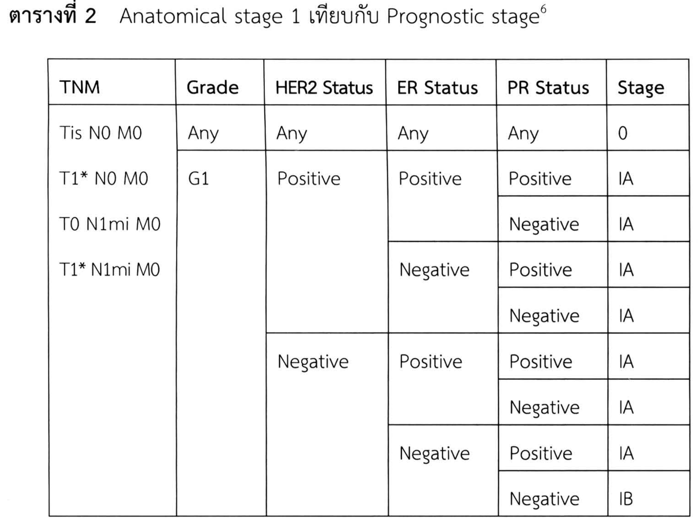

> **Caption (verbatim):** ตารางที่ 2 Anatomical stage 1 เทียบกับ Prognostic stage6
> **Text in image (verbatim):** ตารางที่ 2 Anatomical stage 1 เทียบกับ Prognostic stage6 · TNM · Grade · HER2 Status · ER Status · PR Status · Stage · Tis N0 M0 · Any · Any · Any · Any · 0 · T1* N0 M0 · T0 N1mi M0 · T1* N1mi M0 · G1 · Positive · Positive · Positive · IA · Negative · IA · Negative · Positive · IA · Negative · IA · Negative · Positive · Positive · IA · Negative · IA · Negative · Positive · IA · Negative · IB
> **Description:** Ruled table with six columns (TNM, Grade, HER2 Status, ER Status, PR Status, Stage) and merged cells. First data row: Tis N0 M0, Grade Any, HER2 Any, ER Any, PR Any, Stage 0. The TNM column has no horizontal rule below "Tis N0 M0"; the three TNM groups T1* N0 M0, T0 N1mi M0, T1* N1mi M0 are listed beneath it in one tall merged cell. Grade G1 is one merged cell spanning the remaining 8 rows. HER2 Positive spans the first 4 of these rows and HER2 Negative the last 4; within each, ER Positive spans 2 rows and ER Negative 2 rows; each ER cell splits into PR Positive and PR Negative. Stages: HER2+/ER+/PR+ IA, HER2+/ER+/PR− IA, HER2+/ER−/PR+ IA, HER2+/ER−/PR− IA, HER2−/ER+/PR+ IA, HER2−/ER+/PR− IA, HER2−/ER−/PR+ IA, HER2−/ER−/PR− IB.
> **Identifiers in image:** none

<!-- p.674 (printed 660) -->
(ตารางที่ 2 continued from the previous page; the TNM cell is printed empty on this page. Merged cells repeated on every row they span.)

| TNM | Grade | HER2 Status | ER Status | PR Status | Stage |
| --- | --- | --- | --- | --- | --- |
|  | G2 | Positive | Positive | Positive | IA |
|  | G2 | Positive | Positive | Negative | IA |
|  | G2 | Positive | Negative | Positive | IA |
|  | G2 | Positive | Negative | Negative | IA |
|  | G2 | Negative | Positive | Positive | IA |
|  | G2 | Negative | Positive | Negative | IA |
|  | G2 | Negative | Negative | Positive | IA |
|  | G2 | Negative | Negative | Negative | IB |
|  | G3 | Positive | Positive | Positive | IA |
|  | G3 | Positive | Positive | Negative | IA |
|  | G3 | Positive | Negative | Positive | IA |
|  | G3 | Positive | Negative | Negative | IA |
|  | G3 | Negative | Positive | Positive | IA |
|  | G3 | Negative | Positive | Negative | IB |
|  | G3 | Negative | Negative | Positive | IB |
|  | G3 | Negative | Negative | Negative | IB |

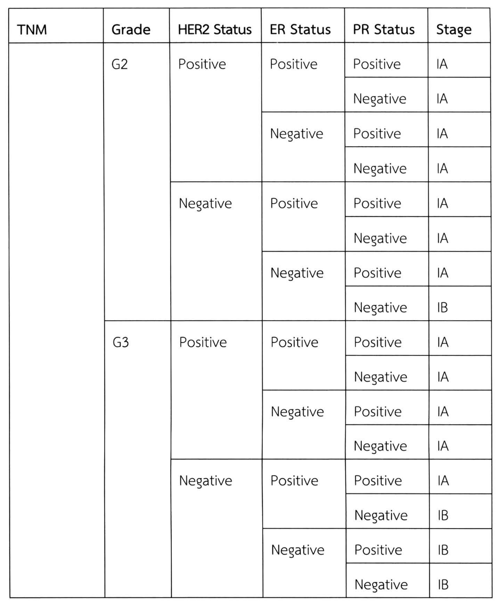

> **Caption (verbatim):** none
> **Text in image (verbatim):** TNM · Grade · HER2 Status · ER Status · PR Status · Stage · G2 · Positive · Positive · Positive · IA · Negative · IA · Negative · Positive · IA · Negative · IA · Negative · Positive · Positive · IA · Negative · IA · Negative · Positive · IA · Negative · IB · G3 · Positive · Positive · Positive · IA · Negative · IA · Negative · Positive · IA · Negative · IA · Negative · Positive · Positive · IA · Negative · IB · Negative · Positive · IB · Negative · IB
> **Description:** Continuation of ตารางที่ 2 from the previous page, with the same six column headers repeated (TNM, Grade, HER2 Status, ER Status, PR Status, Stage). The TNM column is one empty merged cell spanning all 16 rows. Grade G2 spans the first 8 rows and G3 the last 8. Within each grade, HER2 Positive spans 4 rows and HER2 Negative 4 rows; within each HER2 group ER Positive spans 2 rows and ER Negative 2 rows; each ER cell splits into PR Positive and PR Negative. Stages for G2: HER2+/ER+/PR+ IA, HER2+/ER+/PR− IA, HER2+/ER−/PR+ IA, HER2+/ER−/PR− IA, HER2−/ER+/PR+ IA, HER2−/ER+/PR− IA, HER2−/ER−/PR+ IA, HER2−/ER−/PR− IB. Stages for G3: HER2+/ER+/PR+ IA, HER2+/ER+/PR− IA, HER2+/ER−/PR+ IA, HER2+/ER−/PR− IA, HER2−/ER+/PR+ IA, HER2−/ER+/PR− IB, HER2−/ER−/PR+ IB, HER2−/ER−/PR− IB.
> **Identifiers in image:** none

**ตารางที่ 3** Anatomical stage 2A เทียบกับ Prognostic stage6

(No header row printed. Merged cells repeated on every row they span.)

|  |  |  |  |  |  |
| --- | --- | --- | --- | --- | --- |
| T0 N1**M0 T1 N1**M0 T2 N0 M0 | G1 | Positive | Positive | Positive | IB |
| T0 N1**M0 T1 N1**M0 T2 N0 M0 | G1 | Positive | Positive | Negative | IIA |
| T0 N1**M0 T1 N1**M0 T2 N0 M0 | G1 | Positive | Negative | Positive | IIA |
| T0 N1**M0 T1 N1**M0 T2 N0 M0 | G1 | Positive | Negative | Negative | IIA |

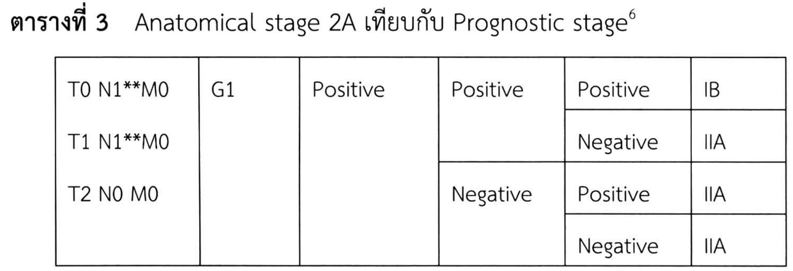

> **Caption (verbatim):** ตารางที่ 3 Anatomical stage 2A เทียบกับ Prognostic stage6
> **Text in image (verbatim):** ตารางที่ 3 Anatomical stage 2A เทียบกับ Prognostic stage6 · T0 N1**M0 · T1 N1**M0 · T2 N0 M0 · G1 · Positive · Positive · Positive · IB · Negative · IIA · Negative · Positive · IIA · Negative · IIA
> **Description:** Ruled table with six columns and no header row (columns correspond in layout to TNM, Grade, HER2, ER, PR, Stage of the preceding table). One merged TNM cell lists T0 N1**M0, T1 N1**M0, T2 N0 M0; Grade G1 and HER2 Positive are merged cells spanning all 4 rows; ER Positive spans the first 2 rows and ER Negative the last 2; each splits into PR Positive / Negative. Stages: ER+/PR+ IB, ER+/PR− IIA, ER−/PR+ IIA, ER−/PR− IIA. The table continues on the next page.
> **Identifiers in image:** none

<!-- p.675 (printed 661) -->
(ตารางที่ 3 continued from the previous page; TNM and Grade cells of the first block are printed empty on this page, and the TNM cell of the G2/G3 block is printed empty. Merged cells repeated on every row they span.)

| TNM | Grade | HER2 Status | ER Status | PR Status | Stage |
| --- | --- | --- | --- | --- | --- |
|  |  | Negative | Positive | Positive | IB |
|  |  | Negative | Positive | Negative | IIA |
|  |  | Negative | Negative | Positive | IIA |
|  |  | Negative | Negative | Negative | IIA |
|  | G2 | Positive | Positive | Positive | IB |
|  | G2 | Positive | Positive | Negative | IIA |
|  | G2 | Positive | Negative | Positive | IIA |
|  | G2 | Positive | Negative | Negative | IIA |
|  | G2 | Negative | Positive | Positive | IB |
|  | G2 | Negative | Positive | Negative | IIA |
|  | G2 | Negative | Negative | Positive | IIA |
|  | G2 | Negative | Negative | Negative | IIB |
|  | G3 | Positive | Positive | Positive | IB |
|  | G3 | Positive | Positive | Negative | IIA |
|  | G3 | Positive | Negative | Positive | IIA |
|  | G3 | Positive | Negative | Negative | IIA |
|  | G3 | Negative | Positive | Positive | IIA |
|  | G3 | Negative | Positive | Negative | IIB |
|  | G3 | Negative | Negative | Positive | IIB |
|  | G3 | Negative | Negative | Negative | IIB |

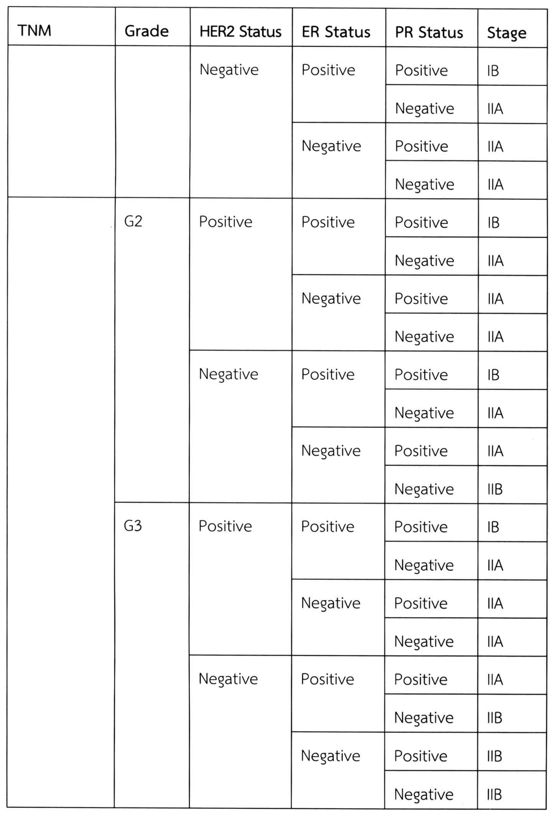

> **Caption (verbatim):** none
> **Text in image (verbatim):** TNM · Grade · HER2 Status · ER Status · PR Status · Stage · Negative · Positive · Positive · IB · Negative · IIA · Negative · Positive · IIA · Negative · IIA · G2 · Positive · Positive · Positive · IB · Negative · IIA · Negative · Positive · IIA · Negative · IIA · Negative · Positive · Positive · IB · Negative · IIA · Negative · Positive · IIA · Negative · IIB · G3 · Positive · Positive · Positive · IB · Negative · IIA · Negative · Positive · IIA · Negative · IIA · Negative · Positive · Positive · IIA · Negative · IIB · Negative · Positive · IIB · Negative · IIB
> **Description:** Continuation of ตารางที่ 3 from the previous page, with six column headers (TNM, Grade, HER2 Status, ER Status, PR Status, Stage). The first block of 4 rows has empty TNM and Grade cells (continuing the T0 N1**M0 / T1 N1**M0 / T2 N0 M0, G1 group from the previous page) and HER2 Negative: ER+/PR+ IB, ER+/PR− IIA, ER−/PR+ IIA, ER−/PR− IIA. A horizontal rule across the TNM column then separates a second block of 16 rows whose TNM cell is empty. Grade G2 (8 rows): HER2+/ER+/PR+ IB, HER2+/ER+/PR− IIA, HER2+/ER−/PR+ IIA, HER2+/ER−/PR− IIA, HER2−/ER+/PR+ IB, HER2−/ER+/PR− IIA, HER2−/ER−/PR+ IIA, HER2−/ER−/PR− IIB. Grade G3 (8 rows): HER2+/ER+/PR+ IB, HER2+/ER+/PR− IIA, HER2+/ER−/PR+ IIA, HER2+/ER−/PR− IIA, HER2−/ER+/PR+ IIA, HER2−/ER+/PR− IIB, HER2−/ER−/PR+ IIB, HER2−/ER−/PR− IIB.
> **Identifiers in image:** none

<!-- p.676 (printed 662) -->
**ตารางที่ 4** Anatomical stage 2B เทียบกับ Prognostic stage6

(Merged cells repeated on every row they span.)

| TNM | Grade | HER2 Status | ER Status | PR Status | Stage |
| --- | --- | --- | --- | --- | --- |
| T2 N1***M0 T3 N0 M0 | G1 | Positive | Positive | Positive | IB |
| T2 N1***M0 T3 N0 M0 | G1 | Positive | Positive | Negative | IIA |
| T2 N1***M0 T3 N0 M0 | G1 | Positive | Negative | Positive | IIA |
| T2 N1***M0 T3 N0 M0 | G1 | Positive | Negative | Negative | IIB |
| T2 N1***M0 T3 N0 M0 | G1 | Negative | Positive | Positive | IIA |
| T2 N1***M0 T3 N0 M0 | G1 | Negative | Positive | Negative | IIB |
| T2 N1***M0 T3 N0 M0 | G1 | Negative | Negative | Positive | IIB |
| T2 N1***M0 T3 N0 M0 | G1 | Negative | Negative | Negative | IIB |
| T2 N1***M0 T3 N0 M0 | G2 | Positive | Positive | Positive | IB |
| T2 N1***M0 T3 N0 M0 | G2 | Positive | Positive | Negative | IIA |
| T2 N1***M0 T3 N0 M0 | G2 | Positive | Negative | Positive | IIA |
| T2 N1***M0 T3 N0 M0 | G2 | Positive | Negative | Negative | IIB |
| T2 N1***M0 T3 N0 M0 | G2 | Negative | Positive | Positive | IIA |
| T2 N1***M0 T3 N0 M0 | G2 | Negative | Positive | Negative | IIB |
| T2 N1***M0 T3 N0 M0 | G2 | Negative | Negative | Positive | IIB |
| T2 N1***M0 T3 N0 M0 | G2 | Negative | Negative | Negative | IIIB |

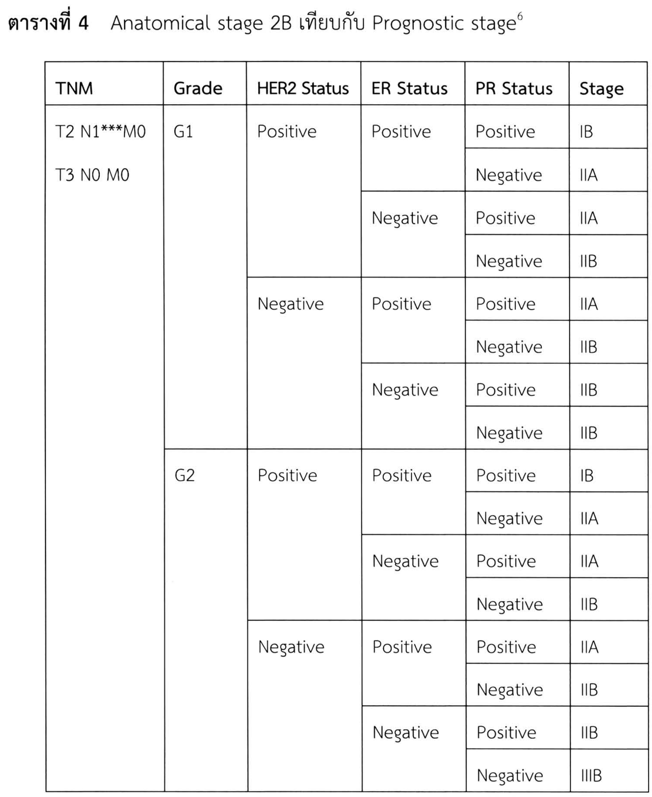

> **Caption (verbatim):** ตารางที่ 4 Anatomical stage 2B เทียบกับ Prognostic stage6
> **Text in image (verbatim):** ตารางที่ 4 Anatomical stage 2B เทียบกับ Prognostic stage6 · TNM · Grade · HER2 Status · ER Status · PR Status · Stage · T2 N1***M0 · T3 N0 M0 · G1 · Positive · Positive · Positive · IB · Negative · IIA · Negative · Positive · IIA · Negative · IIB · Negative · Positive · Positive · IIA · Negative · IIB · Negative · Positive · IIB · Negative · IIB · G2 · Positive · Positive · Positive · IB · Negative · IIA · Negative · Positive · IIA · Negative · IIB · Negative · Positive · Positive · IIA · Negative · IIB · Negative · Positive · IIB · Negative · IIIB
> **Description:** Ruled table with six columns (TNM, Grade, HER2 Status, ER Status, PR Status, Stage) and merged cells. One merged TNM cell (T2 N1***M0, T3 N0 M0) spans all 16 rows. Grade G1 spans the first 8 rows and G2 the next 8; within each grade HER2 Positive and HER2 Negative each span 4 rows, ER Positive and ER Negative each span 2 rows, and each splits into PR Positive / Negative. G1 stages: HER2+/ER+/PR+ IB, HER2+/ER+/PR− IIA, HER2+/ER−/PR+ IIA, HER2+/ER−/PR− IIB, HER2−/ER+/PR+ IIA, HER2−/ER+/PR− IIB, HER2−/ER−/PR+ IIB, HER2−/ER−/PR− IIB. G2 stages: HER2+/ER+/PR+ IB, HER2+/ER+/PR− IIA, HER2+/ER−/PR+ IIA, HER2+/ER−/PR− IIB, HER2−/ER+/PR+ IIA, HER2−/ER+/PR− IIB, HER2−/ER−/PR+ IIB, HER2−/ER−/PR− IIIB (as printed).
> **Identifiers in image:** none

<!-- p.677 (printed 663) -->
(ตารางที่ 4 continued from the previous page; the TNM cell is printed empty on this page. Merged cells repeated on every row they span.)

| TNM | Grade | HER2 Status | ER Status | PR Status | Stage |
| --- | --- | --- | --- | --- | --- |
|  | G3 | Positive | Positive | Positive | IB |
|  | G3 | Positive | Positive | Negative | IIB |
|  | G3 | Positive | Negative | Positive | IIB |
|  | G3 | Positive | Negative | Negative | IIB |
|  | G3 | Negative | Positive | Positive | IIB |
|  | G3 | Negative | Positive | Negative | IIIA |
|  | G3 | Negative | Negative | Positive | IIIA |
|  | G3 | Negative | Negative | Negative | IIIB |

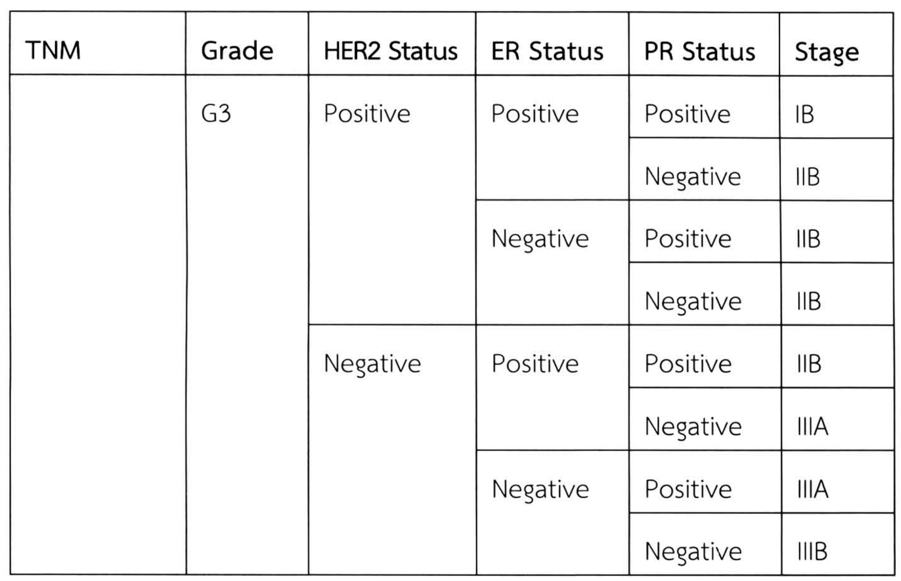

> **Caption (verbatim):** none
> **Text in image (verbatim):** TNM · Grade · HER2 Status · ER Status · PR Status · Stage · G3 · Positive · Positive · Positive · IB · Negative · IIB · Negative · Positive · IIB · Negative · IIB · Negative · Positive · Positive · IIB · Negative · IIIA · Negative · Positive · IIIA · Negative · IIIB
> **Description:** Continuation of ตารางที่ 4 from the previous page, with the six column headers repeated (TNM, Grade, HER2 Status, ER Status, PR Status, Stage). The TNM column is one empty merged cell; Grade G3 spans all 8 rows. HER2 Positive and HER2 Negative each span 4 rows; ER Positive and ER Negative each span 2 rows; each splits into PR Positive / Negative. Stages: HER2+/ER+/PR+ IB, HER2+/ER+/PR− IIB, HER2+/ER−/PR+ IIB, HER2+/ER−/PR− IIB, HER2−/ER+/PR+ IIB, HER2−/ER+/PR− IIIA, HER2−/ER−/PR+ IIIA, HER2−/ER−/PR− IIIB.
> **Identifiers in image:** none

**ตารางที่ 5** Anatomical stage 3A เทียบกับ Prognostic stage6

(Merged cells repeated on every row they span.)

| TNM | Grade | HER2 Status | ER Status | PR Status | Stage |
| --- | --- | --- | --- | --- | --- |
| T0 N2 M0 T1* N2 M0 T2 N2 M0 T3 N1***M0 T3 N2 M0 | G1 | Positive | Positive | Positive | IIA |
| T0 N2 M0 T1* N2 M0 T2 N2 M0 T3 N1***M0 T3 N2 M0 | G1 | Positive | Positive | Negative | IIIA |
| T0 N2 M0 T1* N2 M0 T2 N2 M0 T3 N1***M0 T3 N2 M0 | G1 | Positive | Negative | Positive | IIIA |
| T0 N2 M0 T1* N2 M0 T2 N2 M0 T3 N1***M0 T3 N2 M0 | G1 | Positive | Negative | Negative | IIIA |
| T0 N2 M0 T1* N2 M0 T2 N2 M0 T3 N1***M0 T3 N2 M0 | G1 | Negative | Positive | Positive | IIA |
| T0 N2 M0 T1* N2 M0 T2 N2 M0 T3 N1***M0 T3 N2 M0 | G1 | Negative | Positive | Negative | IIIA |
| T0 N2 M0 T1* N2 M0 T2 N2 M0 T3 N1***M0 T3 N2 M0 | G1 | Negative | Negative | Positive | IIIA |
| T0 N2 M0 T1* N2 M0 T2 N2 M0 T3 N1***M0 T3 N2 M0 | G1 | Negative | Negative | Negative | IIIB |

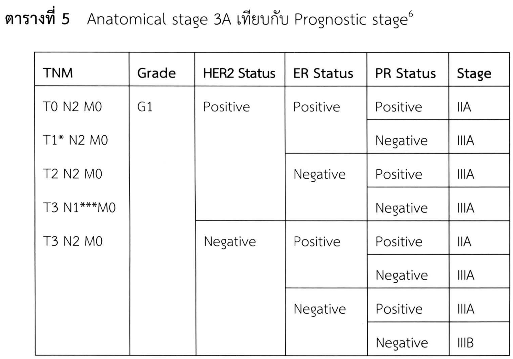

> **Caption (verbatim):** ตารางที่ 5 Anatomical stage 3A เทียบกับ Prognostic stage6
> **Text in image (verbatim):** ตารางที่ 5 Anatomical stage 3A เทียบกับ Prognostic stage6 · TNM · Grade · HER2 Status · ER Status · PR Status · Stage · T0 N2 M0 · T1* N2 M0 · T2 N2 M0 · T3 N1***M0 · T3 N2 M0 · G1 · Positive · Positive · Positive · IIA · Negative · IIIA · Negative · Positive · IIIA · Negative · IIIA · Negative · Positive · Positive · IIA · Negative · IIIA · Negative · Positive · IIIA · Negative · IIIB
> **Description:** Ruled table with six columns (TNM, Grade, HER2 Status, ER Status, PR Status, Stage) and merged cells. One merged TNM cell lists T0 N2 M0, T1* N2 M0, T2 N2 M0, T3 N1***M0, T3 N2 M0; Grade G1 spans all 8 rows. HER2 Positive and HER2 Negative each span 4 rows; ER Positive and ER Negative each span 2 rows; each splits into PR Positive / Negative. Stages: HER2+/ER+/PR+ IIA, HER2+/ER+/PR− IIIA, HER2+/ER−/PR+ IIIA, HER2+/ER−/PR− IIIA, HER2−/ER+/PR+ IIA, HER2−/ER+/PR− IIIA, HER2−/ER−/PR+ IIIA, HER2−/ER−/PR− IIIB. The table continues on the next page.
> **Identifiers in image:** none

<!-- p.678 (printed 664) -->
(ตารางที่ 5 continued from the previous page; the TNM cell is printed empty on this page. Merged cells repeated on every row they span.)

| TNM | Grade | HER2 Status | ER Status | PR Status | Stage |
| --- | --- | --- | --- | --- | --- |
|  | G2 | Positive | Positive | Positive | IIA |
|  | G2 | Positive | Positive | Negative | IIIA |
|  | G2 | Positive | Negative | Positive | IIIA |
|  | G2 | Positive | Negative | Negative | IIIA |
|  | G2 | Negative | Positive | Positive | IIA |
|  | G2 | Negative | Positive | Negative | IIIA |
|  | G2 | Negative | Negative | Positive | IIIA |
|  | G2 | Negative | Negative | Negative | IIIB |
|  | G3 | Positive | Positive | Positive | IIB |
|  | G3 | Positive | Positive | Negative | IIIA |
|  | G3 | Positive | Negative | Positive | IIIA |
|  | G3 | Positive | Negative | Negative | IIIA |
|  | G3 | Negative | Positive | Positive | IIIA |
|  | G3 | Negative | Positive | Negative | IIIB |
|  | G3 | Negative | Negative | Positive | IIIB |
|  | G3 | Negative | Negative | Negative | IIIC |

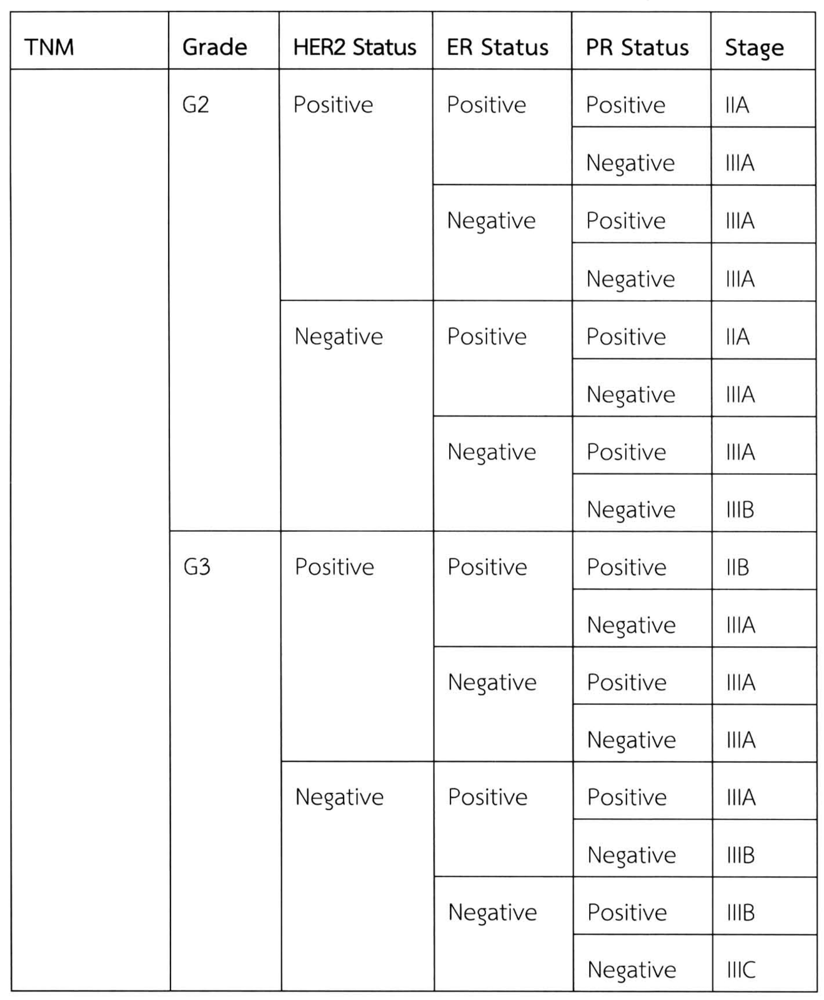

> **Caption (verbatim):** none
> **Text in image (verbatim):** TNM · Grade · HER2 Status · ER Status · PR Status · Stage · G2 · Positive · Positive · Positive · IIA · Negative · IIIA · Negative · Positive · IIIA · Negative · IIIA · Negative · Positive · Positive · IIA · Negative · IIIA · Negative · Positive · IIIA · Negative · IIIB · G3 · Positive · Positive · Positive · IIB · Negative · IIIA · Negative · Positive · IIIA · Negative · IIIA · Negative · Positive · Positive · IIIA · Negative · IIIB · Negative · Positive · IIIB · Negative · IIIC
> **Description:** Continuation of ตารางที่ 5 from the previous page, with the six column headers repeated (TNM, Grade, HER2 Status, ER Status, PR Status, Stage). The TNM column is one empty merged cell spanning all 16 rows. Grade G2 spans the first 8 rows and G3 the last 8; within each grade HER2 Positive and HER2 Negative each span 4 rows, ER Positive and ER Negative each span 2 rows, and each splits into PR Positive / Negative. G2 stages: HER2+/ER+/PR+ IIA, HER2+/ER+/PR− IIIA, HER2+/ER−/PR+ IIIA, HER2+/ER−/PR− IIIA, HER2−/ER+/PR+ IIA, HER2−/ER+/PR− IIIA, HER2−/ER−/PR+ IIIA, HER2−/ER−/PR− IIIB. G3 stages: HER2+/ER+/PR+ IIB, HER2+/ER+/PR− IIIA, HER2+/ER−/PR+ IIIA, HER2+/ER−/PR− IIIA, HER2−/ER+/PR+ IIIA, HER2−/ER+/PR− IIIB, HER2−/ER−/PR+ IIIB, HER2−/ER−/PR− IIIC.
> **Identifiers in image:** none

<!-- p.679 (printed 665) -->
**ตารางที่ 6** Anatomical stage 3B เทียบกับ Prognostic stage6

| TNM | Grade | HER2 Status | ER Status | PR Status | Stage |
| --- | --- | --- | --- | --- | --- |
| T4 N0 M0 T4 N1\*\*\*M0 T4 N2 M0 Any T N3 M0 | G1 | Positive | Positive | Positive | IIIA |
| T4 N0 M0 T4 N1\*\*\*M0 T4 N2 M0 Any T N3 M0 | G1 | Positive | Positive | Negative | IIIB |
| T4 N0 M0 T4 N1\*\*\*M0 T4 N2 M0 Any T N3 M0 | G1 | Positive | Negative | Positive | IIIB |
| T4 N0 M0 T4 N1\*\*\*M0 T4 N2 M0 Any T N3 M0 | G1 | Positive | Negative | Negative | IIIB |
| T4 N0 M0 T4 N1\*\*\*M0 T4 N2 M0 Any T N3 M0 | G1 | Negative | Positive | Positive | IIIB |
| T4 N0 M0 T4 N1\*\*\*M0 T4 N2 M0 Any T N3 M0 | G1 | Negative | Positive | Negative | IIIB |
| T4 N0 M0 T4 N1\*\*\*M0 T4 N2 M0 Any T N3 M0 | G1 | Negative | Negative | Positive | IIIB |
| T4 N0 M0 T4 N1\*\*\*M0 T4 N2 M0 Any T N3 M0 | G1 | Negative | Negative | Negative | IIIC |
| T4 N0 M0 T4 N1\*\*\*M0 T4 N2 M0 Any T N3 M0 | G2 | Positive | Positive | Positive | IIIA |
| T4 N0 M0 T4 N1\*\*\*M0 T4 N2 M0 Any T N3 M0 | G2 | Positive | Positive | Negative | IIIB |
| T4 N0 M0 T4 N1\*\*\*M0 T4 N2 M0 Any T N3 M0 | G2 | Positive | Negative | Positive | IIIB |
| T4 N0 M0 T4 N1\*\*\*M0 T4 N2 M0 Any T N3 M0 | G2 | Positive | Negative | Negative | IIIB |
| T4 N0 M0 T4 N1\*\*\*M0 T4 N2 M0 Any T N3 M0 | G2 | Negative | Positive | Positive | IIIB |
| T4 N0 M0 T4 N1\*\*\*M0 T4 N2 M0 Any T N3 M0 | G2 | Negative | Positive | Negative | IIIB |
| T4 N0 M0 T4 N1\*\*\*M0 T4 N2 M0 Any T N3 M0 | G2 | Negative | Negative | Positive | IIIB |
| T4 N0 M0 T4 N1\*\*\*M0 T4 N2 M0 Any T N3 M0 | G2 | Negative | Negative | Negative | IIIC |

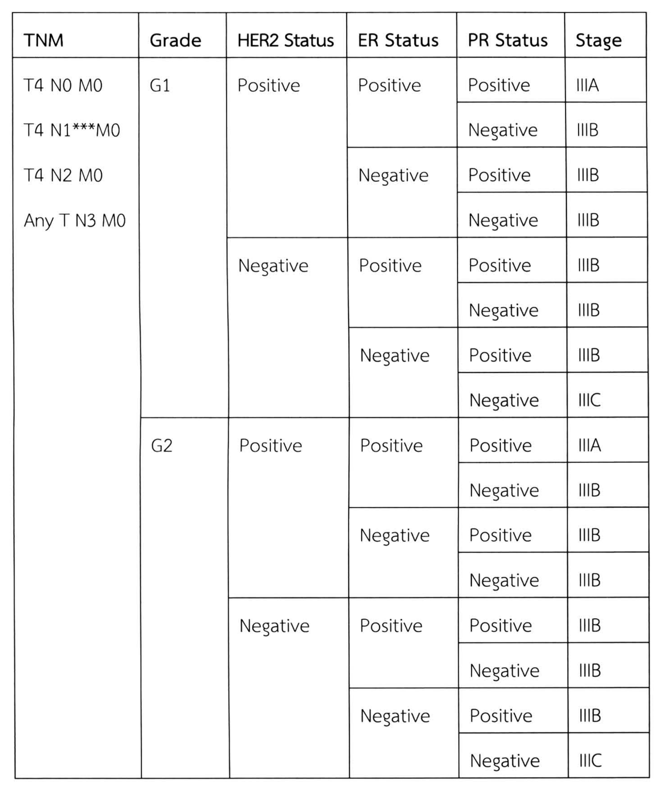

> **Caption (verbatim):** ตารางที่ 6 Anatomical stage 3B เทียบกับ Prognostic stage6
> **Text in image (verbatim):** TNM · Grade · HER2 Status · ER Status · PR Status · Stage · T4 N0 M0 · T4 N1***M0 · T4 N2 M0 · Any T N3 M0 · G1 · G2 · Positive · Negative · IIIA · IIIB · IIIC
> **Description:** Table with merged cells, six columns (TNM, Grade, HER2 Status, ER Status, PR Status, Stage). A single merged TNM cell (T4 N0 M0, T4 N1***M0, T4 N2 M0, Any T N3 M0) spans all 16 rows on this page. Grade cells G1 and G2 each span 8 rows; within each grade, HER2 Positive and Negative each span 4 rows; within each HER2 status, ER Positive and Negative each span 2 rows; PR Positive/Negative are single rows with the resulting prognostic stage. G1: HER2+/ER+/PR+ IIIA, HER2+/ER+/PR− IIIB, HER2+/ER−/PR+ IIIB, HER2+/ER−/PR− IIIB, HER2−/ER+/PR+ IIIB, HER2−/ER+/PR− IIIB, HER2−/ER−/PR+ IIIB, HER2−/ER−/PR− IIIC. G2: HER2+/ER+/PR+ IIIA, HER2+/ER+/PR− IIIB, HER2+/ER−/PR+ IIIB, HER2+/ER−/PR− IIIB, HER2−/ER+/PR+ IIIB, HER2−/ER+/PR− IIIB, HER2−/ER−/PR+ IIIB, HER2−/ER−/PR− IIIC. The table continues on the next page (G3).
> **Identifiers in image:** none

<!-- p.680 (printed 666) -->
| TNM | Grade | HER2 Status | ER Status | PR Status | Stage |
| --- | --- | --- | --- | --- | --- |
|  | G3 | Positive | Positive | Positive | IIIB |
|  | G3 | Positive | Positive | Negative | IIIB |
|  | G3 | Positive | Negative | Positive | IIIB |
|  | G3 | Positive | Negative | Negative | IIIB |
|  | G3 | Negative | Positive | Positive | IIIB |
|  | G3 | Negative | Positive | Negative | IIIC |
|  | G3 | Negative | Negative | Positive | IIIC |
|  | G3 | Negative | Negative | Negative | IIIC |

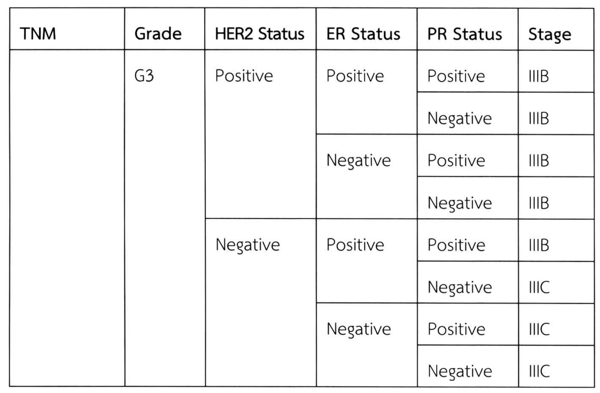

> **Caption (verbatim):** none
> **Text in image (verbatim):** TNM · Grade · HER2 Status · ER Status · PR Status · Stage · G3 · Positive · Negative · IIIB · IIIC
> **Description:** Continuation of ตารางที่ 6 from the previous page, with the header row repeated (TNM, Grade, HER2 Status, ER Status, PR Status, Stage). The TNM cell is empty on this page (continuation of the merged TNM cell from the previous page). Grade G3 spans all 8 rows; HER2 Positive and Negative each span 4 rows; ER Positive and Negative each span 2 rows; PR and Stage per row. G3: HER2+/ER+/PR+ IIIB, HER2+/ER+/PR− IIIB, HER2+/ER−/PR+ IIIB, HER2+/ER−/PR− IIIB, HER2−/ER+/PR+ IIIB, HER2−/ER+/PR− IIIC, HER2−/ER−/PR+ IIIC, HER2−/ER−/PR− IIIC.
> **Identifiers in image:** none

ตามตารางที่ 7 จะพบว่า 3-year breast cancer specific survival (BCSS) และ (OS) พบว่า stage IIIB 3-year BCSS ใน 7th AJCC แย่กว่า stage IIIC และ stage IIB 3-year overall survival (OS) ใน 7th AJCC จะเท่ากับ stage IIIA ซึ่งไม่พบปัญหานี้หากเป็น 8th AJCC7

**ตารางที่ 7** เปรียบเทียบ percentage ของ 8th AJCC prognostic staging ในแต่ละ stage เมื่อเทียบกับ 7th AJCC staging เดิม7

| Stage | AJCC 7 | AJCC 7 | AJCC 8 | AJCC 8 | 3-year BCSS (%) | 3-year BCSS (%) | 3-year OS (%) | 3-year OS (%) |
| --- | --- | --- | --- | --- | --- | --- | --- | --- |
|  | No. | % | No. | % | AJCC7 | AJCC8 | AJCC7 | AJCC8 |
| IA | 88,985 | 52.9 | 69,557 | 41.4 | 99.2 | 99.5 | 96.9 | 97.3 |
| IB | 4,567 | 2.7 | 39,490 | 23.5 | 98.3 | 98.7 | 96.8 | 95.7 |
| IIA | 43,124 | 25.7 | 17,944 | 10.7 | 96.6 | 96.9 | 93.2 | 94.3 |
| IIB | 9,562 | 5.7 | 9,399 | 5.6 | 90.1 | 95.6 | 87.1 | 92.8 |
| IIIA | 12,897 | 7.7 | 12,556 | 7.5 | 89.5 | 92.3 | 87.1 | 89.2 |
| IIIB | 3,736 | 2.2 | 8,235 | 4.9 | 75.2 | 88.8 | 68.5 | 85.5 |
| IIIC | 5,205 | 3.1 | 10,895 | 6.5 | 78.9 | 73.7 | 75.5 | 69.9 |

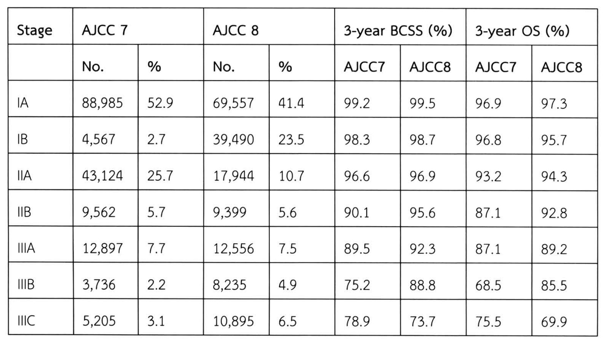

> **Caption (verbatim):** ตารางที่ 7 เปรียบเทียบ percentage ของ 8th AJCC prognostic staging ในแต่ละ stage เมื่อเทียบกับ 7th AJCC staging เดิม7
> **Text in image (verbatim):** Stage · AJCC 7 · AJCC 8 · 3-year BCSS (%) · 3-year OS (%) · No. · % · AJCC7 · AJCC8 · IA · IB · IIA · IIB · IIIA · IIIB · IIIC · 88,985 · 52.9 · 69,557 · 41.4 · 99.2 · 99.5 · 96.9 · 97.3 · 4,567 · 2.7 · 39,490 · 23.5 · 98.3 · 98.7 · 96.8 · 95.7 · 43,124 · 25.7 · 17,944 · 10.7 · 96.6 · 96.9 · 93.2 · 94.3 · 9,562 · 5.7 · 9,399 · 5.6 · 90.1 · 95.6 · 87.1 · 92.8 · 12,897 · 7.7 · 12,556 · 7.5 · 89.5 · 92.3 · 87.1 · 89.2 · 3,736 · 2.2 · 8,235 · 4.9 · 75.2 · 88.8 · 68.5 · 85.5 · 5,205 · 3.1 · 10,895 · 6.5 · 78.9 · 73.7 · 75.5 · 69.9
> **Description:** Table with a two-level header. Top header: Stage, AJCC 7 (merged over No. and %), AJCC 8 (merged over No. and %), 3-year BCSS (%) (merged over AJCC7 and AJCC8), 3-year OS (%) (merged over AJCC7 and AJCC8). Seven rows for stages IA, IB, IIA, IIB, IIIA, IIIB, IIIC giving patient numbers and percentages under the AJCC 7 and AJCC 8 staging, and 3-year breast cancer specific survival and overall survival under each edition (values as in the transcribed table above). Under AJCC 7, stage IIIB has lower 3-year BCSS (75.2) than IIIC (78.9) and IIB OS (87.1) equals IIIA OS (87.1); under AJCC 8 the values decrease in stage order.
> **Identifiers in image:** none

<!-- p.681 (printed 667) -->
หากดูตารางเปรียบเทียบ 7th AJCC และ 8th AJCC จะพบว่า stage IIIB ใน 7th AJCC ไม่ว่าคำนวณด้วย univariate หรือ multivariate ก็มี prognosis แย่กว่า stage IIIC แต่หากใช้ 8th AJCC จะไม่เกิดปัญหานี้ แสดงให้เห็นว่า 8th AJCC prognostic staging มีความถูกต้องกว่า 7th AJCC7 (ตารางที่ 8)

**ตารางที่ 8** เปรียบเทียบ Prognosis

| Factors | 7th staging system | 7th staging system | 7th staging system | 7th staging system | 8th prognostic staging system | 8th prognostic staging system |
| --- | --- | --- | --- | --- | --- | --- |
|  | Univariate Cox analysis | Univariate Cox analysis | Multivariate Cox analysis | Multivariate Cox analysis | Univariate Cox analysis | Univariate Cox analysis |
|  | HR (95% CI) | *P*-value | HR (95% CI) | *P*-value | HR (95% CI) | *P*-value |
| **Stage** |  |  |  |  |  |  |
| IA | Reference |  | Reference |  | Reference |  |
| IB | 1.92 (1.46, 2.53) | <0.001 | 1.97 (1.50, 2.60) | <0.001 | 2.92 (2.48, 3.42) | <0.001 |
| IIA | 3.95 (3.56, 4.38) | <0.001 | 2.78 (2.50, 3.08) | <0.001 | 6.51 (5.55, 7.63) | <0.001 |
| IIB | 11.43 (10.21, 12.81) | <0.001 | 5.30 (4.71, 5.97) | <0.001 | 9.15 (7.71, 10.85) | <0.001 |
| IIIA | 12.42 (11.19, 13.78) | <0.001 | 8.88 (7.98, 9.87) | <0.001 | 16.31 (14.08, 18.89) | <0.001 |
| IIIB | 32.89 (29.38, 36.83) | <0.001 | 20.09 (17.90, 22.55) | <0.001 | 24.81 (21.42, 28.74) | <0.001 |
| IIIC | 27.40 (24.61, 30.50) | <0.001 | 18.54 (16.62, 20.69) | <0.001 | 60.55 (52.96, 69.24) | <0.001 |
| **Grade** |  |  |  |  |  |  |
| I | Reference |  | Reference |  | – |  |
| II | 3.00 (2.60, 3.45) | <0.001 | 1.77 (1.53, 2.04) | <0.001 | – |  |
| III–IV | 11.59 (10.14, 13.25) | <0.001 | 3.27 (2.84, 3.78) | <0.001 | – |  |
| **ER status** |  |  |  |  |  |  |
| Positive | Reference |  | Reference |  | – |  |
| Negative | 4.63 (4.38, 4.90) | <0.001 | 1.55 (1.43, 1.67) | <0.001 | – |  |
| **PR status** |  |  |  |  |  |  |
| Positive | Reference |  | Reference |  | – |  |
| Negative | 5.00 (4.72, 5.31) | <0.001 | 1.98 (1.82, 2.15) | <0.001 | – |  |
| **HER2 status** |  |  |  |  |  |  |
| Positive | Reference |  | Reference |  | – |  |
| Negative | 0.88 (0.82, 0.95) | <0.001 | 1.84 (1.70, 1.99) | <0.001 | – |  |

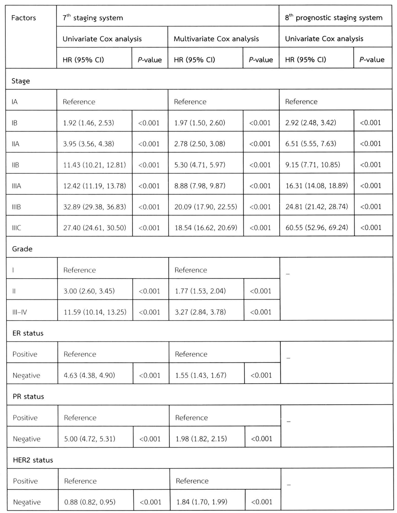

> **Caption (verbatim):** ตารางที่ 8 เปรียบเทียบ Prognosis
> **Text in image (verbatim):** Factors · 7th staging system · 8th prognostic staging system · Univariate Cox analysis · Multivariate Cox analysis · Univariate Cox analysis · HR (95% CI) · *P*-value · Stage · IA · Reference · IB · 1.92 (1.46, 2.53) · <0.001 · 1.97 (1.50, 2.60) · 2.92 (2.48, 3.42) · IIA · 3.95 (3.56, 4.38) · 2.78 (2.50, 3.08) · 6.51 (5.55, 7.63) · IIB · 11.43 (10.21, 12.81) · 5.30 (4.71, 5.97) · 9.15 (7.71, 10.85) · IIIA · 12.42 (11.19, 13.78) · 8.88 (7.98, 9.87) · 16.31 (14.08, 18.89) · IIIB · 32.89 (29.38, 36.83) · 20.09 (17.90, 22.55) · 24.81 (21.42, 28.74) · IIIC · 27.40 (24.61, 30.50) · 18.54 (16.62, 20.69) · 60.55 (52.96, 69.24) · Grade · I · II · 3.00 (2.60, 3.45) · 1.77 (1.53, 2.04) · III–IV · 11.59 (10.14, 13.25) · 3.27 (2.84, 3.78) · ER status · Positive · Negative · 4.63 (4.38, 4.90) · 1.55 (1.43, 1.67) · PR status · 5.00 (4.72, 5.31) · 1.98 (1.82, 2.15) · HER2 status · 0.88 (0.82, 0.95) · 1.84 (1.70, 1.99) · –
> **Description:** Table with a three-level merged header: Factors (spanning all header rows); "7th staging system" spanning Univariate Cox analysis and Multivariate Cox analysis; "8th prognostic staging system" spanning Univariate Cox analysis; each analysis split into HR (95% CI) and *P*-value columns. Body grouped by full-width section rows Stage, Grade, ER status, PR status, HER2 status. In each group the reference category (IA, Grade I, Positive) shows "Reference" spanning both the HR and P-value columns of each analysis. All listed P-values are <0.001. For the 8th prognostic staging system, Grade, ER, PR and HER2 rows are not analysed: a single merged cell containing "–" spans each of those groups. In the 7th system, stage IIIB HR (32.89 univariate; 20.09 multivariate) is higher than IIIC (27.40; 18.54), while in the 8th system HR increases with stage up to IIIC 60.55.
> **Identifiers in image:** none

<!-- p.682 (printed 668) -->
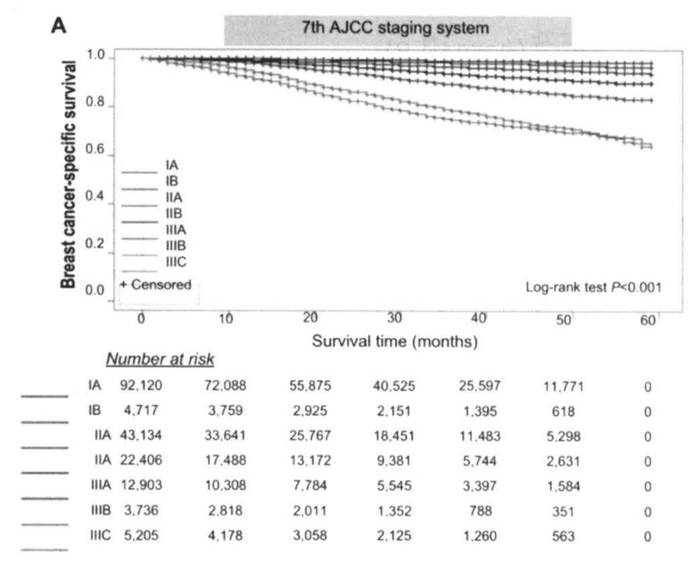

> **Caption (verbatim):** รูปที่ 5 Graph A, B, C, และ D
> **Text in image (verbatim):** A · 7th AJCC staging system · Breast cancer-specific survival · 1.0 · 0.8 · 0.6 · 0.4 · 0.2 · 0.0 · IA · IB · IIA · IIB · IIIA · IIIB · IIIC · + Censored · Log-rank test *P*<0.001 · 0 · 10 · 20 · 30 · 40 · 50 · 60 · Survival time (months) · Number at risk · IA 92,120 · 72,088 · 55,875 · 40,525 · 25,597 · 11,771 · 0 · IB 4,717 · 3,759 · 2,925 · 2,151 · 1,395 · 618 · 0 · IIA 43,134 · 33,641 · 25,767 · 18,451 · 11,483 · 5,298 · 0 · IIA 22,406 · 17,488 · 13,172 · 9,381 · 5,744 · 2,631 · 0 · IIIA 12,903 · 10,308 · 7,784 · 5,545 · 3,397 · 1,584 · 0 · IIIB 3,736 · 2,818 · 2,011 · 1,352 · 788 · 351 · 0 · IIIC 5,205 · 4,178 · 3,058 · 2,125 · 1,260 · 563 · 0
> **Description:** Panel A of รูปที่ 5: Kaplan–Meier curves of breast cancer-specific survival (y-axis 0.0–1.0) against survival time in months (x-axis 0–60) by 7th AJCC stage (legend IA, IB, IIA, IIB, IIIA, IIIB, IIIC, in grey shades; + marks censored observations). Log-rank test *P*<0.001. All curves start at 1.0; the upper five curves stay between about 0.8 and 1.0 at 60 months (lowest of them ending near 0.82), while the two lowest curves decline to about 0.63–0.65 at 60 months and cross/overlap each other. Below the plot is a "Number at risk" table at 0, 10, 20, 30, 40, 50, 60 months: IA 92,120 / 72,088 / 55,875 / 40,525 / 25,597 / 11,771 / 0; IB 4,717 / 3,759 / 2,925 / 2,151 / 1,395 / 618 / 0; IIA 43,134 / 33,641 / 25,767 / 18,451 / 11,483 / 5,298 / 0; IIA (fourth row, printed "IIA") 22,406 / 17,488 / 13,172 / 9,381 / 5,744 / 2,631 / 0; IIIA 12,903 / 10,308 / 7,784 / 5,545 / 3,397 / 1,584 / 0; IIIB 3,736 / 2,818 / 2,011 / 1,352 / 788 / 351 / 0; IIIC 5,205 / 4,178 / 3,058 / 2,125 / 1,260 / 563 / 0.
> **Identifiers in image:** none

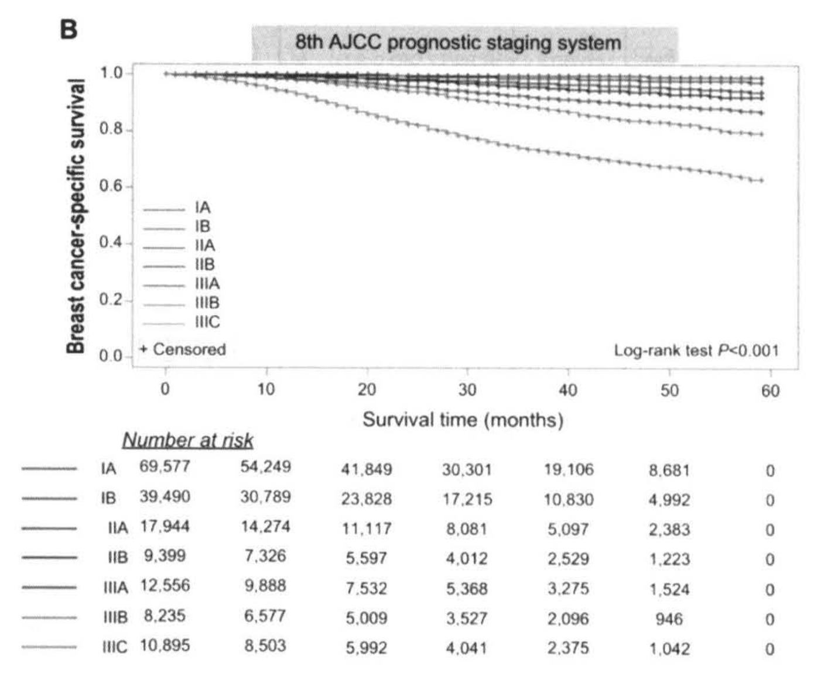

> **Caption (verbatim):** none (panel B of รูปที่ 5)
> **Text in image (verbatim):** B · 8th AJCC prognostic staging system · Breast cancer-specific survival · 1.0 · 0.8 · 0.6 · 0.4 · 0.2 · 0.0 · IA · IB · IIA · IIB · IIIA · IIIB · IIIC · + Censored · Log-rank test *P*<0.001 · 0 · 10 · 20 · 30 · 40 · 50 · 60 · Survival time (months) · Number at risk · IA 69,577 · 54,249 · 41,849 · 30,301 · 19,106 · 8,681 · 0 · IB 39,490 · 30,789 · 23,828 · 17,215 · 10,830 · 4,992 · 0 · IIA 17,944 · 14,274 · 11,117 · 8,081 · 5,097 · 2,383 · 0 · IIB 9,399 · 7,326 · 5,597 · 4,012 · 2,529 · 1,223 · 0 · IIIA 12,556 · 9,888 · 7,532 · 5,368 · 3,275 · 1,524 · 0 · IIIB 8,235 · 6,577 · 5,009 · 3,527 · 2,096 · 946 · 0 · IIIC 10,895 · 8,503 · 5,992 · 4,041 · 2,375 · 1,042 · 0
> **Description:** Panel B of รูปที่ 5: Kaplan–Meier curves of breast cancer-specific survival (y-axis 0.0–1.0) against survival time in months (x-axis 0–60) by 8th AJCC prognostic stage (legend IA, IB, IIA, IIB, IIIA, IIIB, IIIC; + censored). Log-rank test *P*<0.001. The curves are spread apart: the upper curves end between about 0.86 and 0.98 at 60 months, one curve ends near 0.79, and the lowest curve declines steadily to about 0.62 at 60 months, with no crossing of the lowest curves. Below the plot is a "Number at risk" table at 0, 10, 20, 30, 40, 50, 60 months: IA 69,577 / 54,249 / 41,849 / 30,301 / 19,106 / 8,681 / 0; IB 39,490 / 30,789 / 23,828 / 17,215 / 10,830 / 4,992 / 0; IIA 17,944 / 14,274 / 11,117 / 8,081 / 5,097 / 2,383 / 0; IIB 9,399 / 7,326 / 5,597 / 4,012 / 2,529 / 1,223 / 0; IIIA 12,556 / 9,888 / 7,532 / 5,368 / 3,275 / 1,524 / 0; IIIB 8,235 / 6,577 / 5,009 / 3,527 / 2,096 / 946 / 0; IIIC 10,895 / 8,503 / 5,992 / 4,041 / 2,375 / 1,042 / 0.
> **Identifiers in image:** none

<!-- p.683 (printed 669) -->
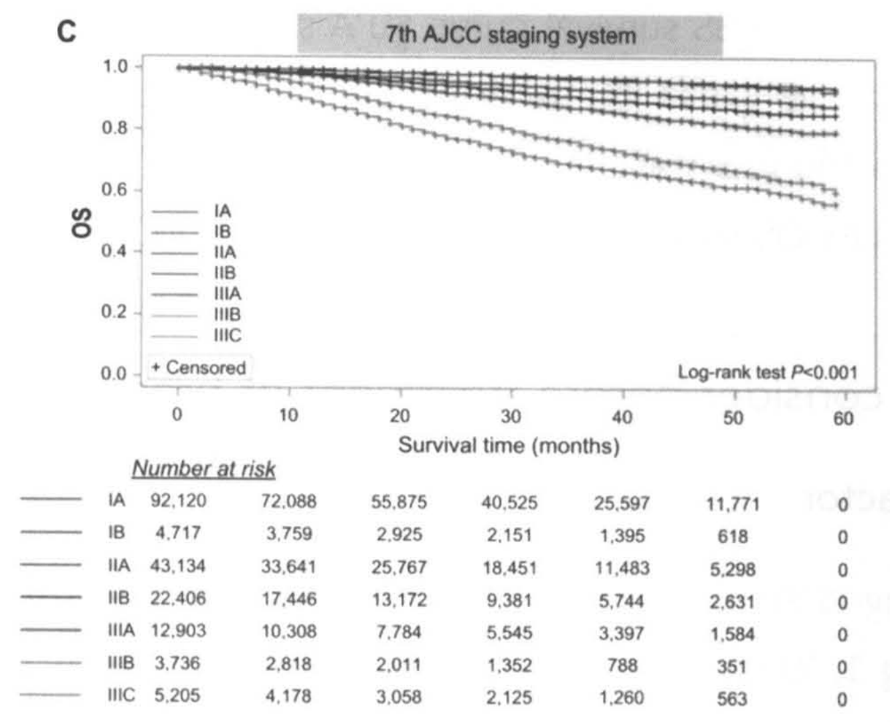

> **Caption (verbatim):** none (panel C of รูปที่ 5; shared caption printed below panel D)
> **Text in image (verbatim):** C · 7th AJCC staging system · OS · 1.0 · 0.8 · 0.6 · 0.4 · 0.2 · 0.0 · IA · IB · IIA · IIB · IIIA · IIIB · IIIC · + Censored · Log-rank test *P*<0.001 · 0 · 10 · 20 · 30 · 40 · 50 · 60 · Survival time (months) · Number at risk · IA 92,120 · 72,088 · 55,875 · 40,525 · 25,597 · 11,771 · 0 · IB 4,717 · 3,759 · 2,925 · 2,151 · 1,395 · 618 · 0 · IIA 43,134 · 33,641 · 25,767 · 18,451 · 11,483 · 5,298 · 0 · IIB 22,406 · 17,446 · 13,172 · 9,381 · 5,744 · 2,631 · 0 · IIIA 12,903 · 10,308 · 7,784 · 5,545 · 3,397 · 1,584 · 0 · IIIB 3,736 · 2,818 · 2,011 · 1,352 · 788 · 351 · 0 · IIIC 5,205 · 4,178 · 3,058 · 2,125 · 1,260 · 563 · 0
> **Description:** Panel C of รูปที่ 5: Kaplan–Meier curves of overall survival (OS, y-axis 0.0–1.0) against survival time in months (x-axis 0–60) by 7th AJCC stage (legend IA, IB, IIA, IIB, IIIA, IIIB, IIIC in grey shades; + censored). Log-rank test *P*<0.001. All curves start at 1.0; five upper curves end between about 0.78 and 0.92 at 60 months, and two lower curves decline to about 0.59 and 0.55 at 60 months, running close together. Below the plot is a "Number at risk" table at 0, 10, 20, 30, 40, 50, 60 months: IA 92,120 / 72,088 / 55,875 / 40,525 / 25,597 / 11,771 / 0; IB 4,717 / 3,759 / 2,925 / 2,151 / 1,395 / 618 / 0; IIA 43,134 / 33,641 / 25,767 / 18,451 / 11,483 / 5,298 / 0; IIB 22,406 / 17,446 / 13,172 / 9,381 / 5,744 / 2,631 / 0; IIIA 12,903 / 10,308 / 7,784 / 5,545 / 3,397 / 1,584 / 0; IIIB 3,736 / 2,818 / 2,011 / 1,352 / 788 / 351 / 0; IIIC 5,205 / 4,178 / 3,058 / 2,125 / 1,260 / 563 / 0. Faint show-through text from the reverse page is visible at the right edge and is not part of the figure.
> **Identifiers in image:** none

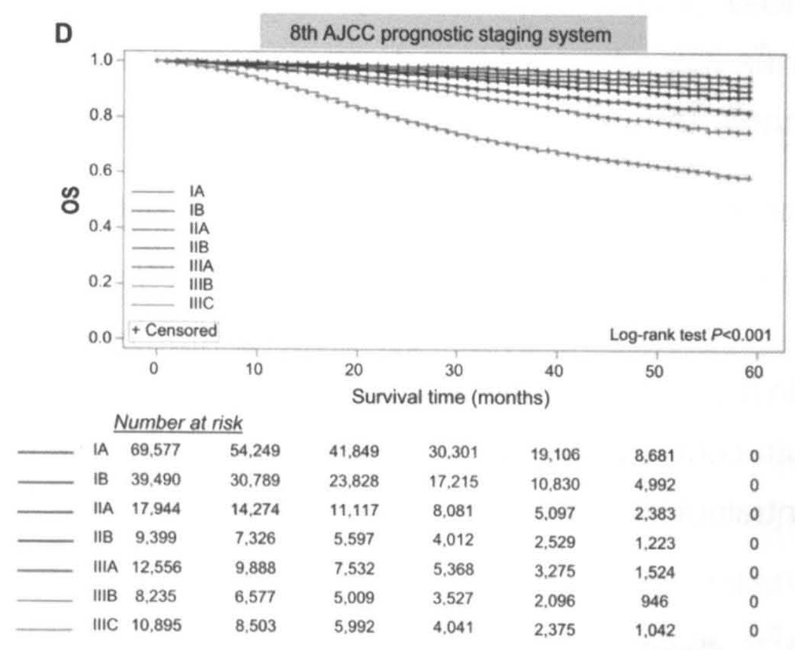

> **Caption (verbatim):** **Figure** **A, B, C, D** The AJCC staging systems predict survival for primary breast cancer patients and indicate the number of patients at risk. **Notes** : The 7th AJCC staging system : BCSS (**A**) and OS (**C**) The 8th AJCC prognostic staging system : BCSS (**B**) and OS (**D**) **Abbreviations :** AJCC, American Joint Committee on Cancer ; OS, overall survival ; BCSS, breast cancer-specific survival.
> **Text in image (verbatim):** D · 8th AJCC prognostic staging system · OS · 1.0 · 0.8 · 0.6 · 0.4 · 0.2 · 0.0 · IA · IB · IIA · IIB · IIIA · IIIB · IIIC · + Censored · Log-rank test *P*<0.001 · 0 · 10 · 20 · 30 · 40 · 50 · 60 · Survival time (months) · Number at risk · IA 69,577 · 54,249 · 41,849 · 30,301 · 19,106 · 8,681 · 0 · IB 39,490 · 30,789 · 23,828 · 17,215 · 10,830 · 4,992 · 0 · IIA 17,944 · 14,274 · 11,117 · 8,081 · 5,097 · 2,383 · 0 · IIB 9,399 · 7,326 · 5,597 · 4,012 · 2,529 · 1,223 · 0 · IIIA 12,556 · 9,888 · 7,532 · 5,368 · 3,275 · 1,524 · 0 · IIIB 8,235 · 6,577 · 5,009 · 3,527 · 2,096 · 946 · 0 · IIIC 10,895 · 8,503 · 5,992 · 4,041 · 2,375 · 1,042 · 0
> **Description:** Panel D of รูปที่ 5: Kaplan–Meier curves of overall survival (OS, y-axis 0.0–1.0) against survival time in months (x-axis 0–60) by 8th AJCC prognostic stage (legend IA, IB, IIA, IIB, IIIA, IIIB, IIIC; + censored). Log-rank test *P*<0.001. The curves are spread apart: the upper curves end between about 0.81 and 0.93 at 60 months, one curve ends near 0.73, and the lowest curve declines steadily to about 0.57 at 60 months. Below the plot is a "Number at risk" table at 0, 10, 20, 30, 40, 50, 60 months: IA 69,577 / 54,249 / 41,849 / 30,301 / 19,106 / 8,681 / 0; IB 39,490 / 30,789 / 23,828 / 17,215 / 10,830 / 4,992 / 0; IIA 17,944 / 14,274 / 11,117 / 8,081 / 5,097 / 2,383 / 0; IIB 9,399 / 7,326 / 5,597 / 4,012 / 2,529 / 1,223 / 0; IIIA 12,556 / 9,888 / 7,532 / 5,368 / 3,275 / 1,524 / 0; IIIB 8,235 / 6,577 / 5,009 / 3,527 / 2,096 / 946 / 0; IIIC 10,895 / 8,503 / 5,992 / 4,041 / 2,375 / 1,042 / 0.
> **Identifiers in image:** none

<!-- p.684 (printed 670) -->
หากดูจากรูปที่ 5 BCSS survival curve รูป A survival curve stage IIIB ต่ำกว่า IIIC แต่รูป B stage IIIB สูงกว่า IIIC นอกจากนี้ OS survival curve ในรูป C stage IA และ IB เกือบจะเท่ากัน และ stage IIIB ก็ต่ำกว่า IIIC แต่ในรูป D OS stage IB ต่ำกว่า IA อย่างมีนัยสำคัญ และ OS survival curve stage IIIB สูงกว่า IIIC7

## 6 factors to consider before treatment of breast cancer

### Disease factor

1. Staging-เราจะอาศัย clinical staging กล่าวคือ หากเป็น early breast cancer (staging 1, 2) ก็สามารถเลือกได้ว่าจะผ่าตัดเลย แบบไหน อย่างไร เช่น breast conserving หรือ mastectomy และ/หรือ immediate reconstruction ด้วย แต่หากเป็น locally advanced inoperable (T x N2M0, T4N x M0, T x N3M0) แนะนำว่าควรให้ยาเคมีก่อนผ่าตัด ส่วน advanced breast cancer ควรพิจารณารักษาด้วย systemic treatment เป็นหลัก โดยอาศัย IHC ว่าจะรักษาด้วยยาประเภทไหน

2. Extent of lesion-หากแบ่งตาม extent of lesion จะแบ่งได้เป็น 3 แบบ ได้แก่ unifocal, multi-focal (lesion อยู่ใน quadrant เดียวกัน หรือ lesion ห่างกันไม่เกิน 4-5 ซม.8, 9) และ multi-centric lesion (lesion อยู่คนละ quadrant หรือห่างกันเกิน 4-5 ซม.8, 9) Unifocal lesion เหมาะสมที่สุดที่จะทำ breast conserving surgery (BCS) ส่วน multi-centric lesion เหมาะสมน้อยที่สุดที่จะทำ BCS แต่ก็ไม่ได้เป็นข้อห้าม (absolute contraindication) เพราะบางกรณีที่ผู้ป่วยมีขนาดเต้านมใหญ่มากก็สามารถทำได้

3. Subtype ปัจจุบัน IHC ช่วยบอก Molecular subtype ได้คราวๆ ซึ่งหากเป็นกลุ่ม triple negative และ Her-2 breast cancer มักจะแนะนำให้ neoadjuvant chemotherapy หรือ targeted therapy ก่อนผ่าตัด หากก้อนมากกว่า 2 ซม ขึ้นไป และหลังผ่าตัดการพิจารณาการให้ adjuvant therapy ก็ต้องอาศัย IHC หรือ molecular subtype ด้วย และ molecular subtype ก็มีผลกับ extent ของ lesion ด้วย (ตารางที่ 9)

<!-- p.685 (printed 671) -->
**ตารางที่ 9** Immunophenotypic parameters, histology grade and node status by invasive tumor distribution (unifocal, multifocal, and diffuse) in 875 consecutive breast cancer cases, Falun 2005-200910

| Phenotype | Invasive tumor distribution Unifocal | Invasive tumor distribution Multifocal | Invasive tumor distribution Diffuse | Invasive tumor distribution Total |
| --- | --- | --- | --- | --- |
| ER positive | 83.1% (423/509) | 81.8% (256/313) | 97.7% (42/43) | 83.4% (721/865) |
| PR positive | 66.3% (331/499) | 64.9% (203/313) | 53.5% (23/43) | 65.1% (557/855) |
| HER2 positive | 9.6% (48/501) | 15.2% (48/315) | 4.8% (2/42) | 11.4% (98/858) |
| Triple negative | 11.2% (56/499) | 10.5% (33/313) | 2.4% (1/42) | 10.5% (90/854) |
| Basal-like | 12.5% (37/296) | 11.3% (22/195) | 3.7% (1/27) | 11.6% (60/518) |
| Grade 3 | 22.6% (115/509) | 25.2% (80/318) | 7.0% (3/43) | 22.8% (198/870) |
| Node positive | 27.3% (140/513) | 54.2% (173/319) | 55.8% (24/43) | 38.5% (337/875) |

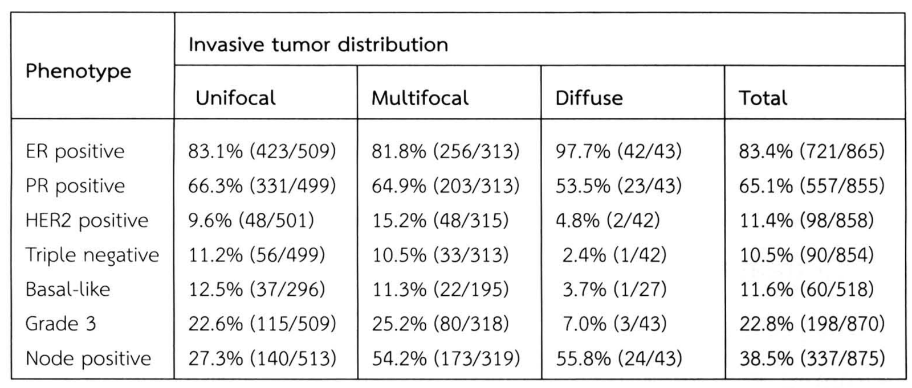

> **Caption (verbatim):** ตารางที่ 9 Immunophenotypic parameters, histology grade and node status by invasive tumor distribution (unifocal, multifocal, and diffuse) in 875 consecutive breast cancer cases, Falun 2005-200910
> **Text in image (verbatim):** Phenotype · Invasive tumor distribution · Unifocal · Multifocal · Diffuse · Total · ER positive · 83.1% (423/509) · 81.8% (256/313) · 97.7% (42/43) · 83.4% (721/865) · PR positive · 66.3% (331/499) · 64.9% (203/313) · 53.5% (23/43) · 65.1% (557/855) · HER2 positive · 9.6% (48/501) · 15.2% (48/315) · 4.8% (2/42) · 11.4% (98/858) · Triple negative · 11.2% (56/499) · 10.5% (33/313) · 2.4% (1/42) · 10.5% (90/854) · Basal-like · 12.5% (37/296) · 11.3% (22/195) · 3.7% (1/27) · 11.6% (60/518) · Grade 3 · 22.6% (115/509) · 25.2% (80/318) · 7.0% (3/43) · 22.8% (198/870) · Node positive · 27.3% (140/513) · 54.2% (173/319) · 55.8% (24/43) · 38.5% (337/875)
> **Description:** Table with a two-level header: "Phenotype" spans both header rows; "Invasive tumor distribution" is a merged header over four columns Unifocal, Multifocal, Diffuse and Total. Seven rows (ER positive, PR positive, HER2 positive, Triple negative, Basal-like, Grade 3, Node positive) give the percentage and (n/N) for each distribution group, as transcribed above. Node positivity rises from 27.3% in unifocal to 54.2% in multifocal and 55.8% in diffuse tumors.
> **Identifiers in image:** none

### Patient Factor

4. Underlying disease and life expectancy มีโรคหลายโรคไม่ควรได้รับการฉายแสงเพราะจะทำให้เกิดผลข้างเคียงมากกว่าผู้ป่วยปกติ เช่น active connective tissue disease11 หรือบางครั้งผู้ป่วยที่เคยได้รับการฉายแสงจากมะเร็งบริเวณทรวงอกมาก่อนแล้ว เช่น มะเร็งต่อมน้ำเหลืองก็ไม่สามารถรับการฉายแสงได้อีก ซึ่งควรพิจารณาหลีกเลี่ยงการผ่าตัดแบบสงวนเต้านม หรือหากคาดการณ์ช่วงอายุขัยที่เหลือจากโรคประจำตัวต่างๆ และอายุปัจจุบันของผู้ป่วย ควรเลือกการรักษาให้เหมาะสม เช่น ผู้ป่วยอายุ 90 ปี มีโรคประจำตัวมาก มะเร็งระยะ 1-2 ชนิดตอบสนองฮอร์โมนดี ควรจะเลือกให้ผู้ป่วยทานยาต้านฮอร์โมนมากกว่าที่จะผ่าตัด modified radical mastectomy (MRM) ซึ่งอาจไม่ช่วยยืดอายุผู้ป่วยแต่กลับเพิ่มความเสี่ยงจากการผ่าตัดและดมยาสลบ หรืออาจเกิดภาวะแทรกซ้อนหลังผ่าตัดด้วย

5. Patients’ preference and cost of treatment แม้ว่าผลการรักษาด้วยการผ่าตัดแบบสงวนเต้านมในมะเร็งเต้านมระยะแรก (ระยะที่ 1 และ 2) จะมีอัตราการรอดชีวิต 5 ปี ไม่แตกต่างจากการรักษาด้วยการผ่าตัดแบบ MRM แต่อัตราการเกิด local recurrence ของผู้ป่วยสงวนเต้านมจะสูงกว่า MRM และค่าใช้จ่ายในการผ่าตัดและรักษาแบบสงวนเต้านมจะสูงกว่าการผ่าตัดเต้านม ดังนั้นผู้ป่วยต้องทราบเรื่องค่าใช้จ่ายที่จะเกิดขึ้นหลังได้รับการผ่าตัดทั้ง 2 แบบ

<!-- p.686 (printed 672) -->
### Patient Factor

6. Physician factor เนื่องจากศัลยแพทย์แต่ละท่านมีความชำนาญต่างกันไป บางท่านไม่ถนัดในด้านการผ่าตัดสงวนเต้านม บางท่านไม่ถนัดด้านการผ่าตัดเสริมสร้างเต้านม และไม่ใช่ทุกโรงพยาบาลจะมีเครื่องมือครบทุกอย่าง เช่น stereotactic guide โรงพยาบาลส่วนใหญ่ในประเทศไทยทำไม่ได้ เครื่องฉายแสงส่วนใหญ่ก็ไม่มี ดังนั้นหากหลังผ่าตัดต้องฉายแสง อาจต้องส่งต่อผู้ป่วยไปยังโรงพยาบาลที่มีเครื่องมือพร้อมกว่า ซึ่งเป็นอีกหนึ่งปัจจัยที่ทำให้ผู้ป่วยไม่เลือกการผ่าตัดสงวนเต้านม

## How to treat the patient

หากก้อนคลำไม่ได้ จะเริ่มจากความผิดปกติของภาพถ่ายทางรังสีวิทยาว่าจะเจาะตรวจด้วยเข็มก่อน หรือจะผ่าตัดความผิดปกตินั้นออกเลย แต่ถ้าคลำพบก้อนจะใช้ triple assessment โดยเริ่มต้นจากการวินิจฉัยด้วยการตรวจร่างกาย ตรวจทางรังสีวิทยา และการเจาะตรวจด้วยเข็มตามลำดับ โดยการรักษามะเร็งเต้านมประกอบไปด้วย

1) การผ่าตัด ซึ่งประกอบด้วย

  - การผ่าตัดบริเวณเต้านม ได้แก่ การผ่าตัดเต้านมออกทั้งหมด การผ่าตัดเต้านมบางส่วน การผ่าตัดเสริมสร้างเต้านมขึ้นมาใหม่
  - การผ่าตัดบริเวณรักแร้ ได้แก่ การผ่าตัดต่อมน้ำเหลืองบางส่วน (sentinel lymph node biopsy) หรือการผ่าตัดต่อมน้ำเหลืองรักแร้ ระดับ 1, 2 ออก (axillary lymph node level 1, 2 dissection)

2) การให้ยารักษา ประกอบด้วย (จะไม่กล่าวถึงในบทนี้)

  - การให้ยาเคมีบำบัด (Chemotherapy)
  - การให้ยาต้านฮอร์โมน (Hormonal therapy)
  - การให้ยามุ่งเป้า (Targeted therapy)
  - การให้ยาเสริมภูมิต้านทาน (Immunotherapy)
