# การผ่าตัดมะเร็งเต้านม (Surgical Management of malignant neoplasm of breast) — part 2 of 2

## Contents of this file
- การผ่าตัด (p.687)
  - การผ่าตัดสงวนเต้านม (p.687)
  - การผ่าตัด mastectomy (p.692)
  - Y-shape (Fish tail) (p.697)
- การผ่าตัด immediate reconstruction หลังจาก skin sparing mastectomy (p.701)
- การผ่าตัดต่อมน้ำเหลืองของรักแร้ (p.705)
- เอกสารอ้างอิง (p.709)

<!-- p.687 (printed 673) -->
3) การฉายแสง (จะไม่กล่าวถึงในบทนี้)

  - การฉายแสงบริเวณเต้านม-ฉายทั้งเต้านม (whole breast radiation) หรือฉายบางส่วน (partial breast radiation)
  - การฉายแสงบริเวณต่อมน้ำเหลือง

## การผ่าตัด

ปัจจุบันผู้ป่วยส่วนใหญ่จะพบมะเร็งได้ในระยะแรกๆ มากขึ้น เนื่องจากความตื่นตัวของประชาชนในเรื่องมะเร็งเต้านม มีคนมารับการคัดกรองมะเร็งเต้านมมากขึ้น ดังนั้นโอกาสที่จะสามารถ ผ่าตัดสงวนเต้านมได้มากขึ้น ในโรงพยาบาลจุฬาลงกรณ์เอง ผู้ป่วยมะเร็งเต้านมที่เข้ามารับการรักษา สามารถสงวนเต้านมได้ถึง 60% แต่อย่างไรก็ดีในโรงพยาบาลอื่นๆ ที่ศัลยแพทย์ยังไม่มีความชำนาญ ขาดเครื่องมือ เช่น เครื่องฉายแสง ผู้ป่วยยังกังวลว่ามะเร็งเต้านมจะเป็นซ้ำหากเก็บเต้านมไว้ ค่าใช้จ่ายที่สูงขึ้นหากเลือกวิธีการสงวนเต้านม บางครั้งรอยโรคเองก็เป็นอุปสรรคในการผ่าตัดสงวนต้านม เช่น การกระจายของมะเร็งหลายๆ ที่ห่างกัน (diffuse or multicentric) หรือมีก้อนมะเร็งเต้านมขนาดใหญ่เมื่อเทียบกับขนาดของเต้านม

### การผ่าตัดสงวนเต้านม

มีงานวิจัยแบบ RCTs รวมทั้ง meta-analysis (ตารางที่ 10) จำนวนมาก ยืนยันว่าการผ่าตัดสงวนเต้านมร่วมกับการฉายแสงมีอัตราการรอดชีวิตระยะยาว ไม่แตกต่างจากการตัดเต้านม แต่คุณภาพชีวิตดีกว่า ดังนั้นหากผู้ป่วยไม่มีข้อห้ามใดๆ ในการรับการรักษาแบบสงวนเต้านม แพทย์สมควรแนะนำการรักษาแบบสงวนเต้านมให้กับผู้ป่วย12

<!-- p.688 (printed 674) -->
**ตารางที่ 10** สรุปการวิจัยแบบสุ่ม โดยมีกลุ่มควบคุม (randomized control trials) (RCTs) เปรียบเทียบ ผ่าตัดแบบสงวนเต้านมกับผ่าตัดทั้งเต้านมออก12

| อ้างอิง (การศึกษา) | ช่วงเวลา | จำนวนผู้ป่วย | ระยะเวลาติดตาม (ปี) | การรักษา: ชนิดการผ่าตัด | การรักษา: จำนวน | อายุ (ปี) | Local Recurrence (%) | Overall Survival ตามอายุ | Subset analysis |
| --- | --- | --- | --- | --- | --- | --- | --- | --- | --- |
| Van Dougen และคณะ 2000 (EORTC 10801) | 1980-1986 | 868 | 13.4 (มัธยฐาน) | BCT | 448 | ไม่ทราบค่าเฉลี่ย 41% <50a 12% <40a 4.5% <35a | LRR 19.7 ที่ 10 ปี | 65.2% ที่ 10 ปี | มี |
| Van Dougen และคณะ 2000 (EORTC 10801) | 1980-1986 | 868 | 13.4 (มัธยฐาน) | MRM | 420 | ไม่ทราบค่าเฉลี่ย 41% <50a 12% <40a 4.5% <35a | LRR 12.2 ที่ 10 ปี (p=0.0097) | 66.1% ที่ 10 ปี (p=0.11) | มี |
| Fisher และคณะ 2002 (NSABP B-06) | 1976-1984 | 1851 | 20 (ค่าเฉลี่ย) | BCT | 628 | ไม่ทราบค่าเฉลี่ย 44% <50 15% <40a, b | 2.7% c | 45% ที่ 20 ปี | ไม่มี |
| Fisher และคณะ 2002 (NSABP B-06) | 1976-1984 | 1851 | 20 (ค่าเฉลี่ย) | TM | 589 | ไม่ทราบค่าเฉลี่ย 41.2% <50 14% <40 | 10.2% c | 47% ที่ 20 ปี (p=0.57) | ไม่มี |

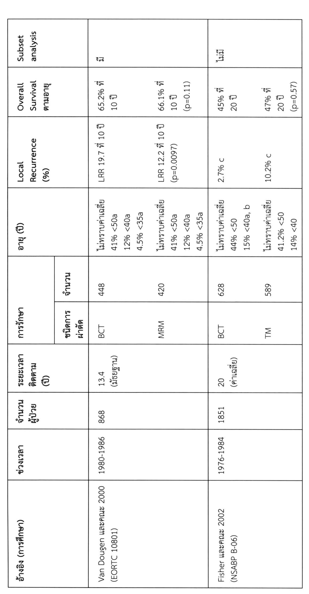

> **Caption (verbatim):** ตารางที่ 10 สรุปการวิจัยแบบสุ่ม โดยมีกลุ่มควบคุม (randomized control trials) (RCTs) เปรียบเทียบ ผ่าตัดแบบสงวนเต้านมกับผ่าตัดทั้งเต้านมออก12
> **Text in image (verbatim):** อ้างอิง (การศึกษา) · ช่วงเวลา · จำนวนผู้ป่วย · ระยะเวลาติดตาม (ปี) · การรักษา · ชนิดการผ่าตัด · จำนวน · อายุ (ปี) · Local Recurrence (%) · Overall Survival ตามอายุ · Subset analysis · Van Dougen และคณะ 2000 (EORTC 10801) · 1980-1986 · 868 · 13.4 (มัธยฐาน) · BCT · 448 · ไม่ทราบค่าเฉลี่ย 41% <50a 12% <40a 4.5% <35a · LRR 19.7 ที่ 10 ปี · 65.2% ที่ 10 ปี · มี · MRM · 420 · ไม่ทราบค่าเฉลี่ย 41% <50a 12% <40a 4.5% <35a · LRR 12.2 ที่ 10 ปี (p=0.0097) · 66.1% ที่ 10 ปี (p=0.11) · Fisher และคณะ 2002 (NSABP B-06) · 1976-1984 · 1851 · 20 (ค่าเฉลี่ย) · BCT · 628 · ไม่ทราบค่าเฉลี่ย 44% <50 15% <40a, b · 2.7% c · 45% ที่ 20 ปี · ไม่มี · TM · 589 · ไม่ทราบค่าเฉลี่ย 41.2% <50 14% <40 · 10.2% c · 47% ที่ 20 ปี (p=0.57)
> **Description:** First page of Table 10, printed rotated 90° (landscape; the image is stored as it appears on the page, so it must be turned clockwise to read). A ruled table with 10 columns, where "การรักษา" is a merged header over two sub-columns (ชนิดการผ่าตัด, จำนวน). Two studies are listed, each with two treatment arms in one merged study row (study-level cells — อ้างอิง, ช่วงเวลา, จำนวนผู้ป่วย, ระยะเวลาติดตาม, Subset analysis — are merged over both arms; in the Markdown table they are repeated on each arm row): EORTC 10801 (BCT vs MRM) and NSABP B-06 (BCT vs TM). All values are as transcribed in the Markdown table above. The table continues on the next pages.
> **Identifiers in image:** none

<!-- p.689 (printed 675) -->
| อ้างอิง (การศึกษา) | ช่วงเวลา | จำนวนผู้ป่วย | ระยะเวลาติดตาม (ปี) | การรักษา: ชนิดการผ่าตัด | การรักษา: จำนวน | อายุ (ปี) | Local Recurrence (%) | Overall Survival ตามอายุ | Subset analysis |
| --- | --- | --- | --- | --- | --- | --- | --- | --- | --- |
| Veronesi และคณะ 2002 (National cancer institute of Milan) | 1973-1980 | 701 | 20 (มัธยฐาน) | BCT | 352 | เฉลี่ย 50 ปี 7% <35a, d 23% <40a, d | 8.8% ที่ 20 ปี | 41.7% ที่ 20 ปี | มี |
| Veronesi และคณะ 2002 (National cancer institute of Milan) | 1973-1980 | 701 | 20 (มัธยฐาน) | RM | 349 | เฉลี่ย 51 ปี 7% <35a, d 23% <40a, d | 2.3% ที่ 20 ปี (p <0.001) | 41.2% ที่ 20 ปี (p=1.0) | มี |
| Arriagada และคณะ 2003 (institute Gustave-Rossy) | 1972-1979 | 179 | 22 (ค่าเฉลี่ย) | BCT | 88 | เฉลี่ย 51.8 ปี 4% <35a 18% <40a | ไม่กล่าวในรายงาน | 65% ที่ 10 ปี | ไม่มี |
| Arriagada และคณะ 2003 (institute Gustave-Rossy) | 1972-1979 | 179 | 22 (ค่าเฉลี่ย) | MRM | 91 | เฉลี่ย 51.4 4% <35a 18% <40a | ไม่กล่าวในรายงาน | 67% ที่ 10 ปี (p=0.67) | ไม่มี |
| Poggi และคณะ 2003 (U.S. National Cancer Institute | 1979-1987 | 237 | 18.4 (มัธยฐาน) | BCT | 121 | มัธยฐาน 50 ปี 23% <40 | 22% ที่ 20 ปี | 54% ที่ 20 ปี | ไม่มี |

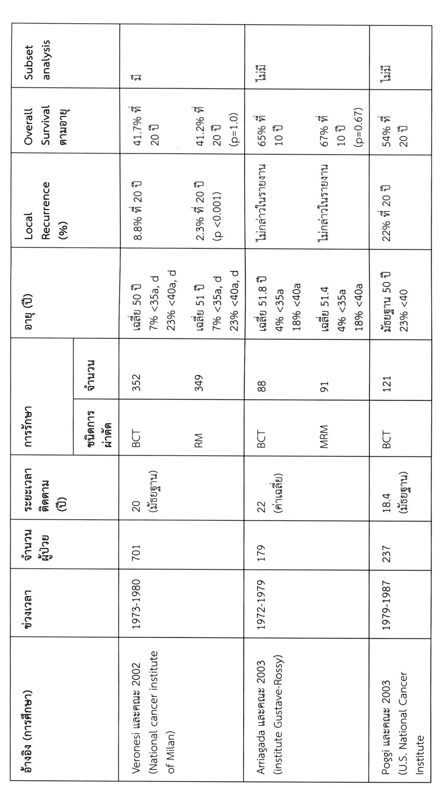

> **Caption (verbatim):** none (continuation of ตารางที่ 10 from the previous page)
> **Text in image (verbatim):** อ้างอิง (การศึกษา) · ช่วงเวลา · จำนวนผู้ป่วย · ระยะเวลาติดตาม (ปี) · การรักษา · ชนิดการผ่าตัด · จำนวน · อายุ (ปี) · Local Recurrence (%) · Overall Survival ตามอายุ · Subset analysis · Veronesi และคณะ 2002 (National cancer institute of Milan) · 1973-1980 · 701 · 20 (มัธยฐาน) · BCT · 352 · เฉลี่ย 50 ปี 7% <35a, d 23% <40a, d · 8.8% ที่ 20 ปี · 41.7% ที่ 20 ปี · มี · RM · 349 · เฉลี่ย 51 ปี 7% <35a, d 23% <40a, d · 2.3% ที่ 20 ปี (p <0.001) · 41.2% ที่ 20 ปี (p=1.0) · Arriagada และคณะ 2003 (institute Gustave-Rossy) · 1972-1979 · 179 · 22 (ค่าเฉลี่ย) · BCT · 88 · เฉลี่ย 51.8 ปี 4% <35a 18% <40a · ไม่กล่าวในรายงาน · 65% ที่ 10 ปี · ไม่มี · MRM · 91 · เฉลี่ย 51.4 4% <35a 18% <40a · ไม่กล่าวในรายงาน · 67% ที่ 10 ปี (p=0.67) · Poggi และคณะ 2003 (U.S. National Cancer Institute · 1979-1987 · 237 · 18.4 (มัธยฐาน) · BCT · 121 · มัธยฐาน 50 ปี 23% <40 · 22% ที่ 20 ปี · 54% ที่ 20 ปี · ไม่มี
> **Description:** Second page of Table 10, printed rotated 90° (landscape; stored as it appears on the page). Same 10-column layout with the header row repeated ("การรักษา" merged over ชนิดการผ่าตัด and จำนวน). Rows: Veronesi 2002 Milan trial (BCT vs RM), Arriagada 2003 (institute Gustave-Rossy) (BCT vs MRM), and the BCT arm of Poggi 2003 (U.S. National Cancer Institute); the Poggi study's second arm continues on the next page. Study-level cells are merged over both arms of each study (repeated per arm row in the Markdown table). All values as in the Markdown table above.
> **Identifiers in image:** none

<!-- p.690 (printed 676) -->
| อ้างอิง (การศึกษา) | ช่วงเวลา | จำนวนผู้ป่วย | ระยะเวลาติดตาม (ปี) | การรักษา: ชนิดการผ่าตัด | การรักษา: จำนวน | อายุ (ปี) | Local Recurrence (%) | Overall Survival ตามอายุ | Subset analysis |
| --- | --- | --- | --- | --- | --- | --- | --- | --- | --- |
|  |  |  |  | MRM | 116 | มัธยฐาน 50 ปี 21% <40 | 0% ที่ 20 ปี | 58% ที่ 20 ปี (p=0.67) |  |
|  |  |  |  | **ชนิดการผ่าตัด** | **จำนวน** |  |  |  |  |
| Blichert-Toft และคณะ (DBCG-82TM) | 1983-1989 | 731 | 19.6 (มัธยฐาน) | BCT | 367 | เฉลี่ย 50.9 4% <35 14% <40 | 4.5% ที่ 10 ปี | 57.8% ที่ 20 ปี | มี |
| Blichert-Toft และคณะ (DBCG-82TM) | 1983-1989 | 731 | 19.6 (มัธยฐาน) | MRM | 364 | เฉลี่ย 51.4 3.5% <35 12% <40 | 6.9% ที่ 10 ปี (p=0.16) | 50.6 ที่ 20 ปี (p=0.20) | มี |

a ประมาณค่าจากข้อมูลในการศึกษา

b ประมาณค่าจากจำนวนผู้หญิงอายุไม่เกิน 49 ปี และสันนิษฐานว่า 1 ใน 3 ควรน้อยกว่า 40 ปี

c มะเร็งเป็นซ้ำที่ข้างเดิมหลังผ่าตัดเฉพาะก้อน (lumpectomy) ไม่นับว่าเป็นซ้ำ recurrence และผู้หญิงในกลุ่มตัดเฉพาะก้อน (lumpectomy) ผู้ซึ่งมีซ้ำเฉพาะที่ ipsilateral tumor breast recurrence จะจัดเป็น event-free

d ประมาณค่าจากข้อมูลรวม (pooled data) ของสถาบันมะเร็งแห่งมิลาน รวมถึงผู้ป่วยในการศึกษาอื่นๆ โดยสันนิษฐานว่าการกระจายของอายุเหมือนๆ กัน

EORTC = European Organisation for Research and Treatment of Cancer, BCT = breast-conserving therapy ; LRR = locoregional recurrence, MRM = modified radical mastectomy, NSABP = National Surgical Adjuvant Breast and Bowel Project, TM = tumor mastectomy, RM = radical mastectomy, DBCG = Danish breast cancer cooperative group

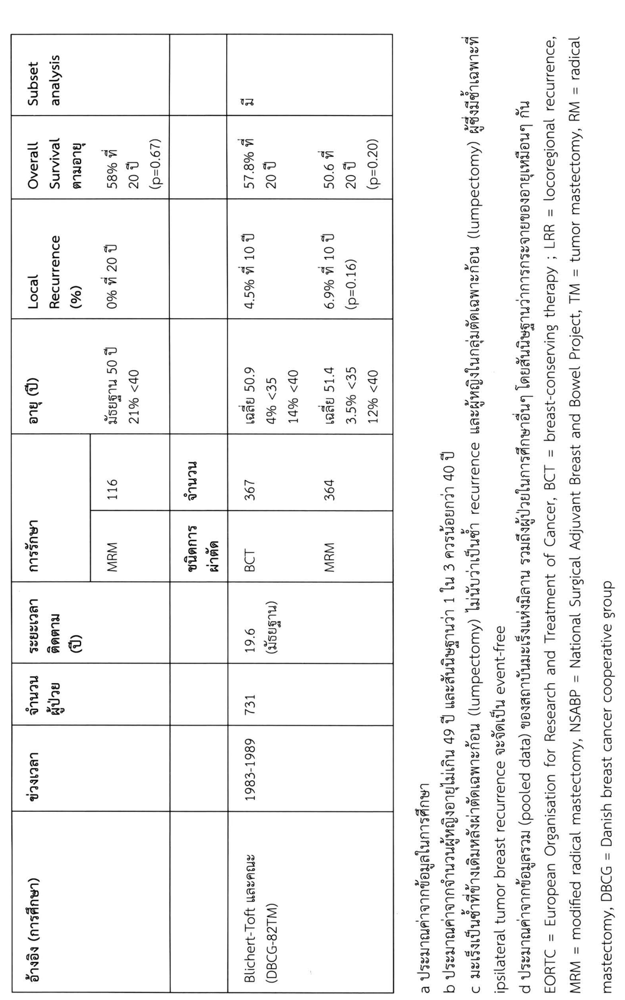

> **Caption (verbatim):** none (continuation of ตารางที่ 10; footnotes a–d and abbreviations printed below the table, transcribed above)
> **Text in image (verbatim):** อ้างอิง (การศึกษา) · ช่วงเวลา · จำนวนผู้ป่วย · ระยะเวลาติดตาม (ปี) · การรักษา · MRM · 116 · มัธยฐาน 50 ปี 21% <40 · 0% ที่ 20 ปี · 58% ที่ 20 ปี (p=0.67) · อายุ (ปี) · Local Recurrence (%) · Overall Survival ตามอายุ · Subset analysis · ชนิดการผ่าตัด · จำนวน · Blichert-Toft และคณะ (DBCG-82TM) · 1983-1989 · 731 · 19.6 (มัธยฐาน) · BCT · 367 · เฉลี่ย 50.9 4% <35 14% <40 · 4.5% ที่ 10 ปี · 57.8% ที่ 20 ปี · มี · MRM · 364 · เฉลี่ย 51.4 3.5% <35 12% <40 · 6.9% ที่ 10 ปี (p=0.16) · 50.6 ที่ 20 ปี (p=0.20) · footnotes a–d and abbreviation list as transcribed above
> **Description:** Last page of Table 10, printed rotated 90° (landscape; stored as it appears on the page). The header row is repeated, but in this printing the "การรักษา" header block contains, in place of its sub-headers, a data row (MRM, 116, มัธยฐาน 50 ปี / 21% <40, 0% ที่ 20 ปี, 58% ที่ 20 ปี (p=0.67)) whose study cells are empty — it appears to be the second arm of the Poggi 2003 study begun on the previous page; the sub-header cells "ชนิดการผ่าตัด" and "จำนวน" then appear in a separate otherwise-empty row beneath it. The final study is Blichert-Toft (DBCG-82TM), BCT vs MRM, with study-level cells merged over both arms (repeated per arm row in the Markdown table). Below the table are footnotes a–d explaining the a/b/c/d markers used in the age and local-recurrence columns, and a list of abbreviations.
> **Identifiers in image:** none

<!-- p.691 (printed 677) -->
ปัจจุบัน ข้อห้ามการผ่าตัดรักษามะเร็งเต้านมแบบสงวนเต้านม (absolute contraindication) คงเหลือเพียง

1. Inflammatory breast cancer
2. Diffuse pleomorphic microcalcification
3. Cannot achieve adequate margin after re-wide excision

ส่วนหลายข้อที่เป็นข้อห้ามก็ล้วนเป็นแค่ relative contraindication ในปัจจุบัน อาทิ มะเร็ง involve nipple ซึ่งก็สามารถทำผ่าตัดแบบ central wide excision (ดูรูปที่ 6)

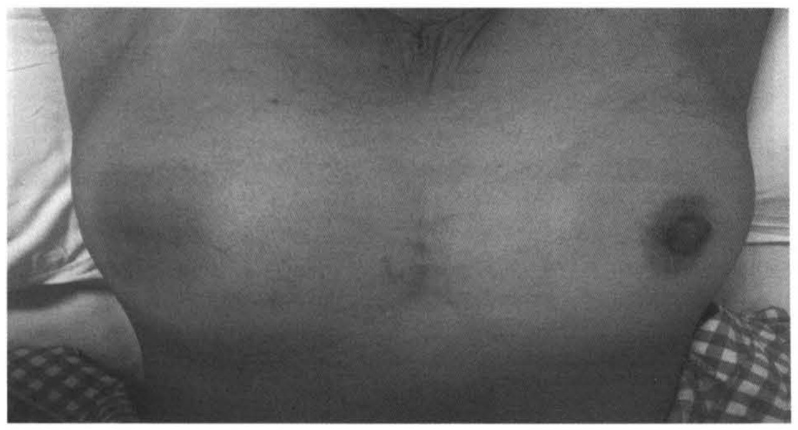

> **Caption (verbatim):** **รูปที่ 6**
> **Text in image (verbatim):** none
> **Description:** Black-and-white clinical photograph of a woman's anterior chest, lying supine on a bed with pillows and a checkered cloth at the lower corners; the view extends from the lower neck/clavicles to below both breasts (no face visible). The breast on the right side of the image has a normal-appearing nipple–areola complex. The breast on the left side of the image shows no nipple–areola complex at its centre; the skin there is smooth. Shown in the text as an example of central wide excision when the cancer involves the nipple. A faint darker irregular mark lies near the midline between the breasts.
> **Identifiers in image:** none

ก้อนใหญ่ก็สามารถ neoadjuvant ให้ก้อนเล็กลงก่อนจะตัดสินใจผ่าตัดสงวนเต้านมได้ ก้อนที่เป็น multifocal/multicentric ก็สามารถรักษาแบบสงวนเต้านมได้ (ดูรูปที่ 7, 8, 9)

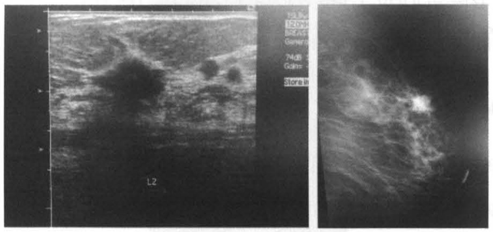

> **Caption (verbatim):** **รูปที่ 7** multifocal breast cancer
> **Text in image (verbatim):** [unclear: 15L8w] · [unclear: 12.0MHz] · [unclear: BREAST] · [unclear: General] · 74dB · Gain= · Store in · L2
> **Description:** Two images side by side. Left: a breast ultrasound image (grey-scale, with a depth scale with tick marks along the left edge and partly cut-off machine setting labels on the right). Within the breast tissue there is a large irregular hypoechoic (dark) mass at upper-left centre, and two smaller round hypoechoic nodules to its right in the same field; the label "L2" is at the bottom. Right: a mammogram detail (white tissue on black background) showing fibroglandular tissue with a dense bright irregular focus in the upper-right part of the tissue and a small linear bright mark near the lower right. Captioned as multifocal breast cancer.
> **Identifiers in image:** none

<!-- p.692 (printed 678) -->
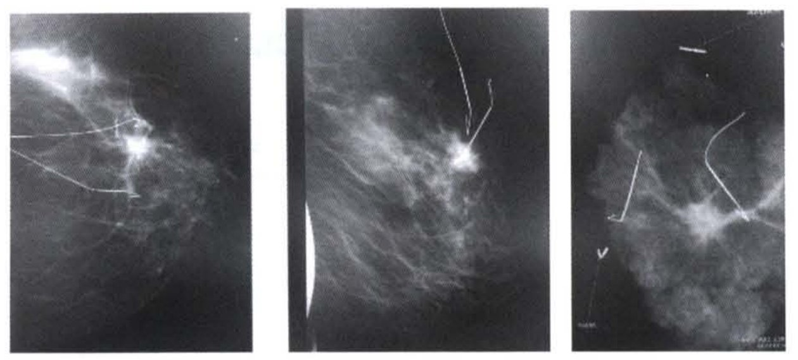

> **Caption (verbatim):** **รูปที่ 8** Needle localization of lesion by 2 needles
> **Text in image (verbatim):** [illegible] (tiny burned-in labels at the top-right, bottom-left and bottom-right corners of the third image)
> **Description:** Three mammogram images side by side (white breast tissue on a dark background). Left: a dense bright lesion near the centre-left of the breast, with two thin bright wires (localization needles) entering from the left edge, both converging at the lesion. Middle: a bright dense lesion in the upper-right part of the breast, with two wires entering from the top and ending at the lesion. Right: a dense bright irregular lesion in the lower centre, with two hooked wires — one on the left and one entering from the upper right toward the lesion — plus a short bright horizontal marker near the top and a "V"-shaped marker at the left. The tiny corner labels are not legible in the print.
> **Identifiers in image:** none

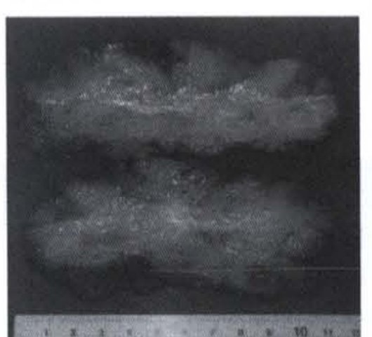

> **Caption (verbatim):** **รูปที่ 9** specimen larger than 10 cm, result left BCT after 10 year
> **Text in image (verbatim):** 1 · 2 · 3 · 4 · 5 · 6 · 7 · 8 · 9 · 10 · 11 · 12 (centimetre numbers on the ruler; 4–6 and 11–12 faint)
> **Description:** Left panel of Figure 9 (the figure has two photographs side by side, saved here as two files). A surgical specimen photographed on a dark background: two elongated pieces of breast tissue laid one above the other, with a centimetre ruler along the bottom edge; the specimen spans beyond the 10 cm mark of the ruler. A specimen accession label printed on the ruler below the numbers was cropped out.
> **Identifiers in image:** none

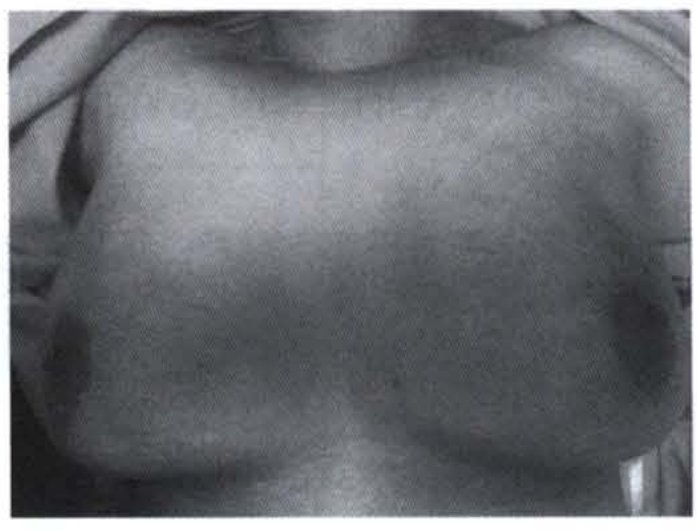

> **Caption (verbatim):** **รูปที่ 9** specimen larger than 10 cm, result left BCT after 10 year
> **Text in image (verbatim):** none
> **Description:** Right panel of Figure 9. Black-and-white clinical photograph of a woman's anterior chest (from the lower neck down; no face visible), lying on a bed, showing both breasts with similar overall contour and size — per the caption, the result of left breast-conserving therapy after 10 years.
> **Identifiers in image:** none

โดยไม่ทำให้ compromise survival เมื่อเทียบกับการรักษาแบบตัดเต้านมทั้งเต้า

แพทย์จะเสนอแนะการผ่าตัดแบบเอาเต้านมด้านนั้นออกทั้งเต้านมให้ผู้ป่วย เมื่อมีข้อห้าม (absolute contraindication) ในการรักษาแบบสงวนเต้านม

ยังมี relative contraindication เช่น BRCA carrier, multifocal/multicentric lesion, T3/T4 lesion, มี extensive DCIS ร่วมด้วย, invasive lobular carcinoma, breast cancer in the young, male breast cancer, recurrent breast cancer after BCT ซึ่งปัจจุบันไม่ใช่ absolute contraindication ในการทำ BCT

### การผ่าตัด mastectomy

ในปัจจุบันจะทำเมื่อผู้ป่วยมีข้อห้ามในการ BCT และปฏิเสธ immediate breast reconstruction หรือไม่เหมาะสมกับการทำ immediate breast reconstruction

เช่น เป็นมะเร็งเต้านมที่มี diffuse pleomorphic microcalcification แล้วผู้ป่วยไม่อยากทำ immediate reconstruction หลังผ่าตัด (ดูรูปที่ 10, 11, 12) ผู้ป่วย inflammatory breast cancer แม้จะได้ยาเคมีบำบัดก่อนผ่าตัดแล้ว ก็น่าจะทำ mastectomy (ดูรูปที่ 13)

<!-- p.693 (printed 679) -->
แล้วค่อยพิจารณา delayed breast reconstruction ทีหลัง หากรักษาครบหมดแล้ว และมี disease-free นานพอสมควร ค่อยพิจารณา delayed breast reconstruction

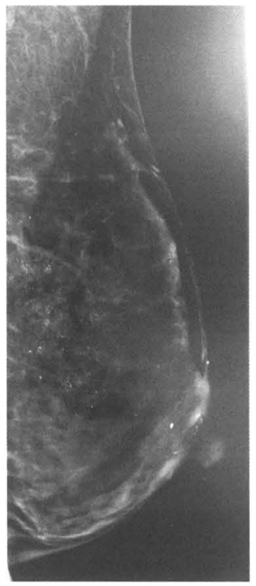

> **Caption (verbatim):** **รูปที่ 10**
> **Text in image (verbatim):** none
> **Description:** A single mammogram of one breast in an oblique (mediolateral-oblique-type) projection: the breast is seen in profile with the chest wall/pectoral region at the upper left and the nipple pointing to the right; a band of denser tissue runs along the upper left edge. Throughout the fibroglandular tissue there are many scattered tiny bright dots, with a few brighter dots near the skin and nipple area at the lower right. Referred to in the text (with รูปที่ 11 and 12) as an example of breast cancer with diffuse pleomorphic microcalcification treated by mastectomy.
> **Identifiers in image:** none

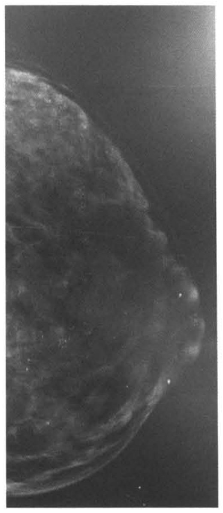

> **Caption (verbatim):** **รูปที่ 11**
> **Text in image (verbatim):** none
> **Description:** A single mammogram of one breast in a cranio-caudal-type projection: a rounded breast outline with the chest wall at the left edge and the nipple at the right. Many tiny bright dots are scattered through the fibroglandular tissue, and a few larger bright dots lie near the nipple and the skin of the lower outer contour. Referred to in the text (with รูปที่ 10 and 12) as an example of breast cancer with diffuse pleomorphic microcalcification treated by mastectomy.
> **Identifiers in image:** none

<!-- p.694 (printed 680) -->
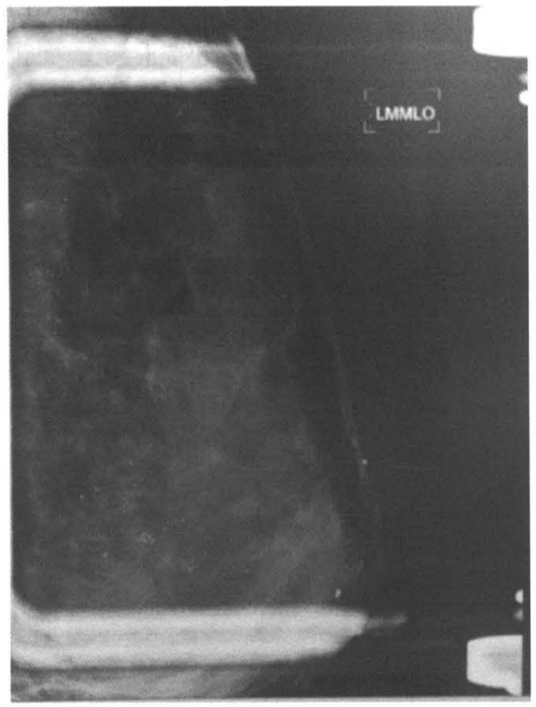

> **Caption (verbatim):** **รูปที่ 12**
> **Text in image (verbatim):** LMMLO
> **Description:** A grey-scale radiographic (mammographic) image labelled "LMMLO" in a bracketed box at the upper right. A roughly rectangular area of soft tissue with a mottled, finely speckled texture fills the left two-thirds of the field, bordered above and below by broad bright horizontal bands; the right third is dark background with small bright structures along the right edge. Referred to in the text (with รูปที่ 10 and 11) as an example of breast cancer with diffuse pleomorphic microcalcification treated by mastectomy.
> **Identifiers in image:** none

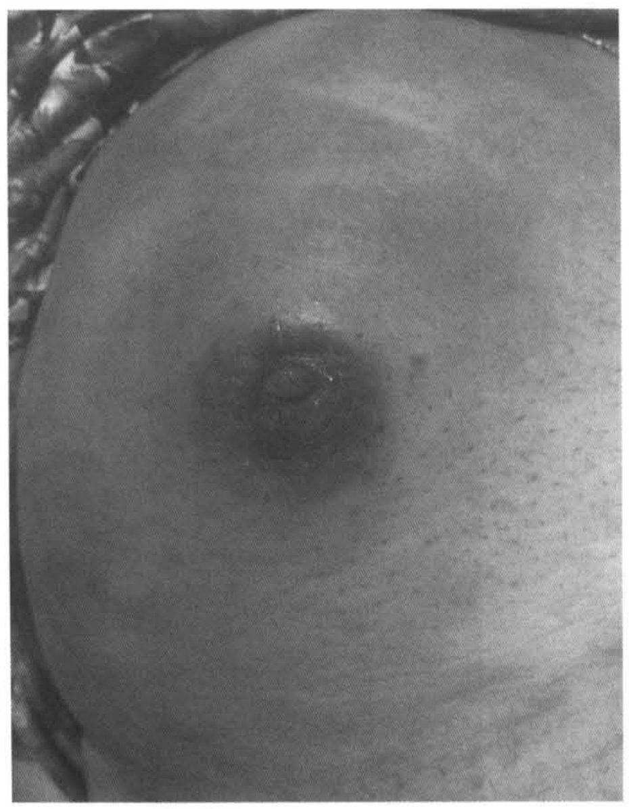

> **Caption (verbatim):** **รูปที่ 13**
> **Text in image (verbatim):** none
> **Description:** Black-and-white close-up clinical photograph of a single breast, filling most of the frame, with patterned cloth at the upper-left edge. The skin over the breast, especially on the right and lower parts of the image, shows many small dark dots/pits. The nipple–areola complex is at the centre; the nipple appears flattened, with a small crusted/shiny area at its upper margin. Referred to in the text as a patient with inflammatory breast cancer who should undergo mastectomy even after chemotherapy before surgery.
> **Identifiers in image:** none

<!-- p.695 (printed 681) -->
การทำผ่าตัด mastectomy มาตรฐานปัจจุบันนิยมใช้ elliptical incision แต่ axis อาจเป็น transverse หรือ oblique ก็แล้วแต่ความเหมาะสม แต่อย่างไรก็ดีบางครั้งก็ต้องเลือก vertical incision เช่นกัน (ดูรูปที่ 14, 15, 16 ,17)

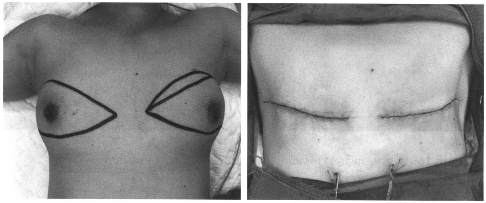

> **Caption (verbatim):** **รูปที่ 14** รูปบนเรียกว่า Stewart (horizontal elliptical incision)
> **Text in image (verbatim):** none
> **Description:** Two black-and-white clinical photographs side by side. Left: a woman lying supine, anterior chest from the lower neck to the upper abdomen (no face visible), with skin markings for bilateral mastectomy — on each breast a horizontal elliptical (leaf-shaped) outline drawn in thick black marker, encircling the nipple–areola complex and pointing medially toward the sternum; on the breast on the right side of the image a second, narrower inner line is drawn along the upper part of the ellipse. Right: the postoperative result on the operating table, surrounded by drapes — the chest is flat with two long horizontal sutured incision lines, one on each side, meeting near the midline, and two surgical drains exiting from the lower edge of the field.
> **Identifiers in image:** none

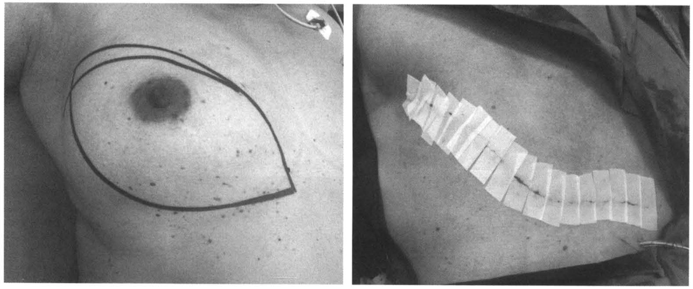

> **Caption (verbatim):** **รูปที่ 15** รูปด้านบนเรียกว่า Orr (Oblique elliptical incision)
> **Text in image (verbatim):** none
> **Description:** Two black-and-white clinical photographs side by side. Left: close-up of one breast with an oblique elliptical outline drawn in thick black marker, enclosing the nipple–areola complex, its wide end toward the upper outer side (axilla, upper left of the image) and its point toward the lower medial side (right of the image); a second line runs inside the upper border; scattered small dark skin spots are visible and an ECG electrode with lead is at the top edge. Right: the postoperative result after mastectomy, the chest wall flat with an oblique incision running from the upper left (axillary side) to the lower right, closed and covered by a row of overlapping white adhesive skin-closure strips; a drain tube exits at the lower right, with surgical drapes around the field.
> **Identifiers in image:** none

<!-- p.696 (printed 682) -->
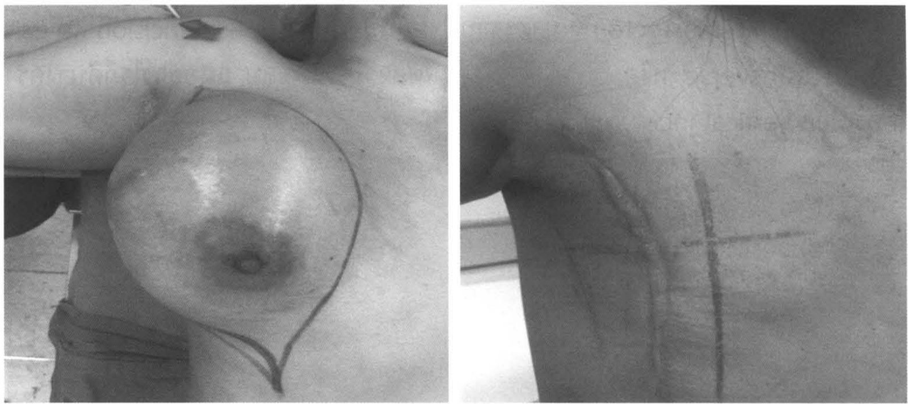

> **Caption (verbatim):** **รูปที่ 16** รูปด้านบนเรียกว่า Harrington (vertical elliptical incision)
> **Text in image (verbatim):** none
> **Description:** Two black-and-white clinical photographs side by side, patient supine with the arm abducted. Left: a large, rounded breast with the nipple-areola complex in the lower central part; a skin-marker line is drawn as an ellipse around the breast, running vertically and converging to a pointed lower end below the breast (vertical elliptical incision outline); a small dark marking is visible near the shoulder/upper arm at the top left. Right: close-up of the axilla and lateral chest wall with skin-marker lines: a long curved vertical line, a straight vertical line, and a horizontal line crossing it, forming a cross-shaped marking on the lateral chest wall below the axilla. No face shown.
> **Identifiers in image:** none

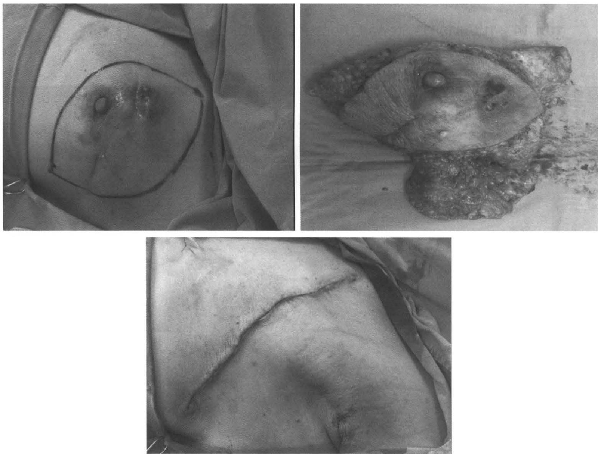

> **Caption (verbatim):** **รูปที่ 17** รูปด้านบนแสดง lesion ที่อยู่ upper inner และลุกลามถึงผิวหนังต้องเอาออกจะใช้ inverted oblique elliptical incision
> **Text in image (verbatim):** none
> **Description:** Three black-and-white intraoperative photographs. Top left: a draped breast with skin involvement near and medial to the nipple (irregular skin lesion areas), outlined by a skin-marker line in an obliquely oriented elliptical shape encompassing the nipple-areola complex and the involved skin. Top right: the excised mastectomy specimen lying on a drape, showing the elliptical skin paddle with the nipple and a dark skin lesion area, with attached breast/axillary fatty tissue below and around it. Bottom center: the chest wall after closure, showing a long oblique sutured incision line running diagonally upward across the chest toward the axilla. No face shown.
> **Identifiers in image:** none

<!-- p.697 (printed 683) -->
สำหรับคนที่มี breast ขนาดใหญ่ หากตัดปกติแล้วอาจเกิด dog ear ได้จึงต้องอาศัยเทคนิค ดังต่อไปนี้

- Y-shape incision (Fish tail)13
- Waisted teardrop14
- D-shape incision15
- Sliding suturing (devalia technique)16
- Lazy S incision17
- Oncoplastic technique by Krishna B Clough18

### Y-shape (Fish tail)

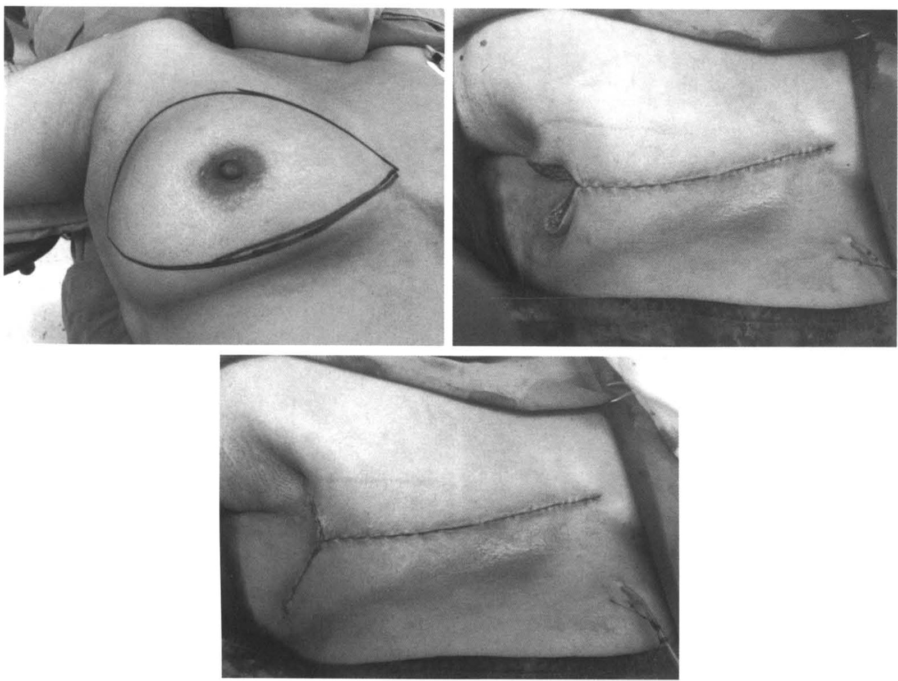

> **Caption (verbatim):** **รูปที่ 18** รูปภาพด้านบนแสดงถึง Y-shape incision (Fish tail) technique
> **Text in image (verbatim):** none
> **Description:** Three black-and-white intraoperative photographs. Top left: a large breast, patient supine with arm abducted, with a skin-marker line drawn as a teardrop/elliptical outline around the breast and nipple-areola complex, with the pointed end directed laterally toward the right of the image and a doubled line along the lower border. Top right: the chest wall after mastectomy closure, showing a long horizontal sutured incision with a short limb branching off at its medial end (left side of the image), forming a Y-shaped junction; a drain exit site with stitches is visible at the lower right. Bottom center: another view of the closed wound showing the horizontal suture line ending at a Y-shaped junction with two short oblique limbs at the left end (the "fish tail"), and a drain site with stitches at the lower right. No face shown.
> **Identifiers in image:** none

<!-- p.698 (printed 684) -->
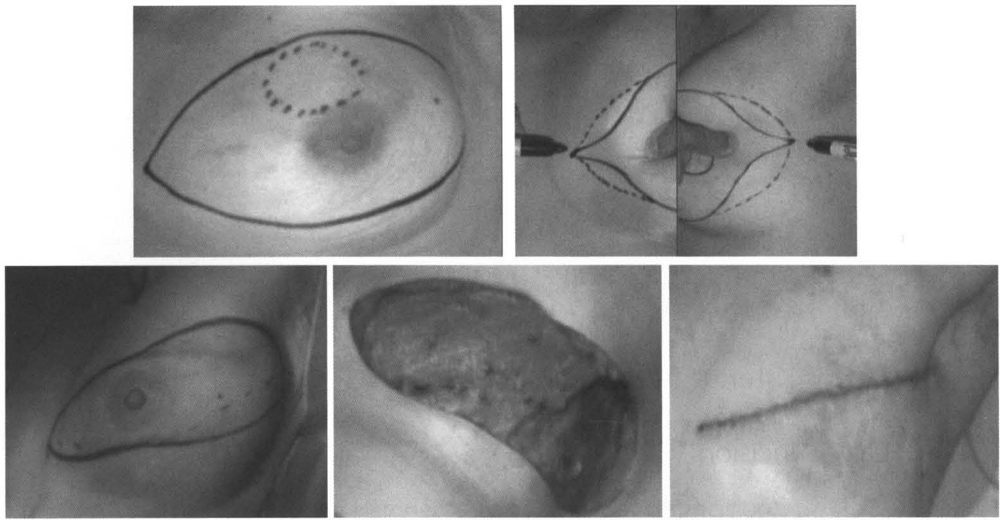

> **Caption (verbatim):** **รูปที่ 19** รูปภาพด้านบนคือ Waisted tear drop incision14
> **Text in image (verbatim):** none
> **Description:** Composite of five photographs in two rows (upper row two, lower row three). Upper left: close-up of a breast with a solid skin-marker line drawn as a teardrop shape (pointed end to the left, rounded end to the right) enclosing the nipple-areola complex, plus a dotted circular marking in the upper part inside the outline. Upper right: two adjoining panels showing breast skin markings with pen tips at each side: a solid curved "waisted" teardrop outline (narrowed sides) and a dashed outer curved line, both converging to points at the left and right ends where the marker pens touch, with the nipple-areola in the center. Lower left: a breast with a solid marked outline of a waisted teardrop shape enclosing the nipple, narrowing toward the left. Lower middle: the operative field after excision, showing the exposed underlying tissue/chest wall in a teardrop-shaped defect with skin flap edges. Lower right: the closed wound showing a slightly oblique, nearly straight linear suture line running toward the axilla. No face shown.
> **Identifiers in image:** none

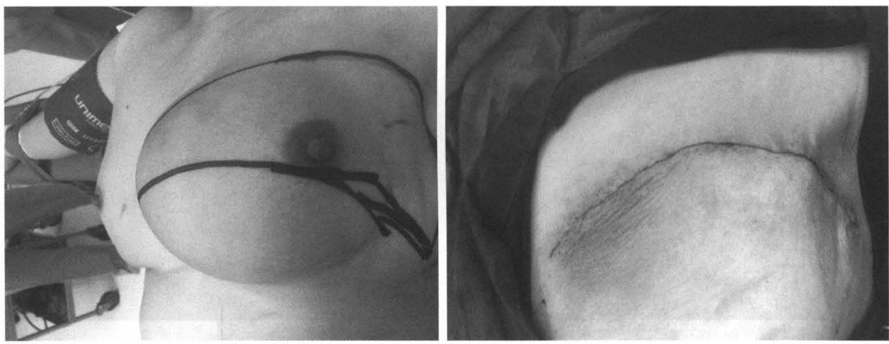

> **Caption (verbatim):** **รูปที่ 20** รูปภาพด้านบนคือ D-shape incision
> **Text in image (verbatim):** none (only a partial brand name on a blood-pressure cuff in the background)
> **Description:** Two black-and-white photographs side by side. Left: a large breast, patient supine with the arm on an arm board (blood-pressure cuff on the arm in the background), with skin-marker lines: a curved line running along the upper border of the breast and a straight horizontal line crossing below the nipple, together forming a D-shaped outline; additional thick marks/lines are drawn at the lateral end. Right: the chest wall after closure, showing a sutured incision that follows a curved, D-like contour across the chest wall. No face shown.
> **Identifiers in image:** none

<!-- p.699 (printed 685) -->
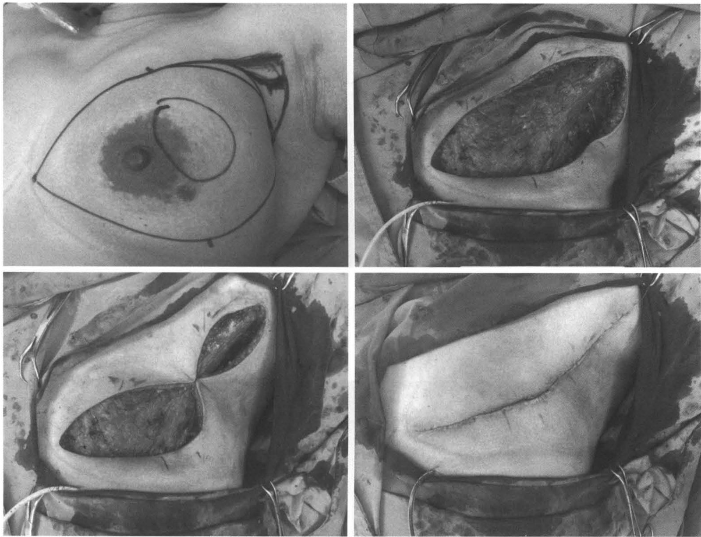

> **Caption (verbatim):** **รูปที่ 21** รูปภาพ Devalia (sliding) technique (จะแบ่งความยาว flap บนเป็น 2 ส่วนเท่าๆ กัน และ flap ล่างเป็น 3 ส่วนเท่ากัน และเย็บจุดกึ่งกลางของ flap บนเข้าไปติดกับจุด 3/1 ด้านนอกของ flap ล่าง แล้วค่อยเย็บที่เหลือโดยแบ่งครึ่งไปเรื่อยๆ จนแผลสนิทดังรูปสุดท้าย
> **Text in image (verbatim):** none
> **Description:** Four black-and-white intraoperative photographs in a 2 × 2 grid showing the sequence of the sliding (Devalia) closure. Top left: a breast with a skin-marker outline of a teardrop-shaped elliptical incision (pointed end to the left, toward the midline) around the nipple-areola complex, with a smaller circular marking around an area next to the areola and small tick marks on the outline. Top right: after mastectomy, the elliptical skin defect exposing the underlying chest-wall muscle, with the skin flaps retracted by hooks and a drain tube at the lower left. Bottom left: the first tacking stitch has brought the midpoint of the upper flap down to a point on the lower flap, dividing the defect into a larger medial (left) elliptical opening and a smaller lateral (upper right) opening. Bottom right: the completed closure, a long oblique sutured incision running from lower left to upper right with no dog ear, drain tubes visible at the bottom. No face shown.
> **Identifiers in image:** none

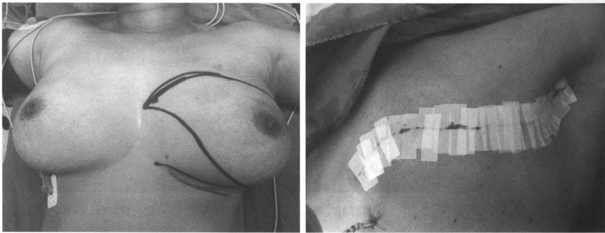

> **Caption (verbatim):** **รูปที่ 22** บางครั้งต้องใช้ lazy S incision
> **Text in image (verbatim):** none
> **Description:** Two black-and-white photographs side by side. Left: anterior view of the chest of a supine patient (neck visible at the top, no face) with ECG leads, both breasts visible; on the breast on the right side of the image, skin-marker lines form an S-shaped/curved outline starting near the midline (sternal area), sweeping upward and laterally over the breast and a second curved line along the lower part toward the lateral side (lazy S incision outline). Right: the chest wall after closure, showing a long, gently S-curved incision line covered with multiple adhesive skin-closure strips placed transversely along its length; a drain site with a stitch is visible near the lower edge. No face shown.
> **Identifiers in image:** none

<!-- p.700 (printed 686) -->
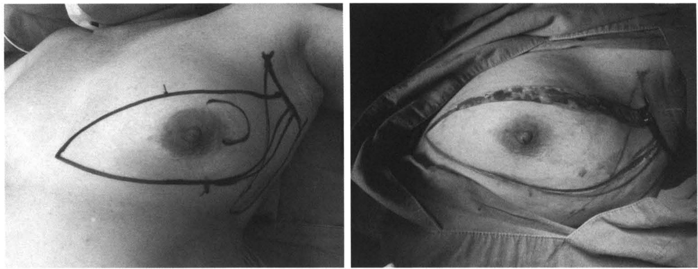

> **Caption (verbatim):** **รูปที่ 23** ในบางกรณีก็จะใช้ Greenough incision
> **Text in image (verbatim):** none
> **Description:** Two black-and-white photographs side by side. Left: a breast of a supine patient with skin-marker lines: a horizontally oriented elliptical (spindle-shaped) outline around the nipple-areola complex, pointed at the medial (left) end, with its lateral end continuing toward the axilla where several additional curved/oblique lines are drawn; a smaller curved line lies just lateral to the areola; small cross-ticks mark the outline. Right: the draped operative field with the skin incised along the upper border of the elliptical outline (bleeding wound edge visible along the top) and the marked lower line around the nipple-areola complex. No face shown.
> **Identifiers in image:** none

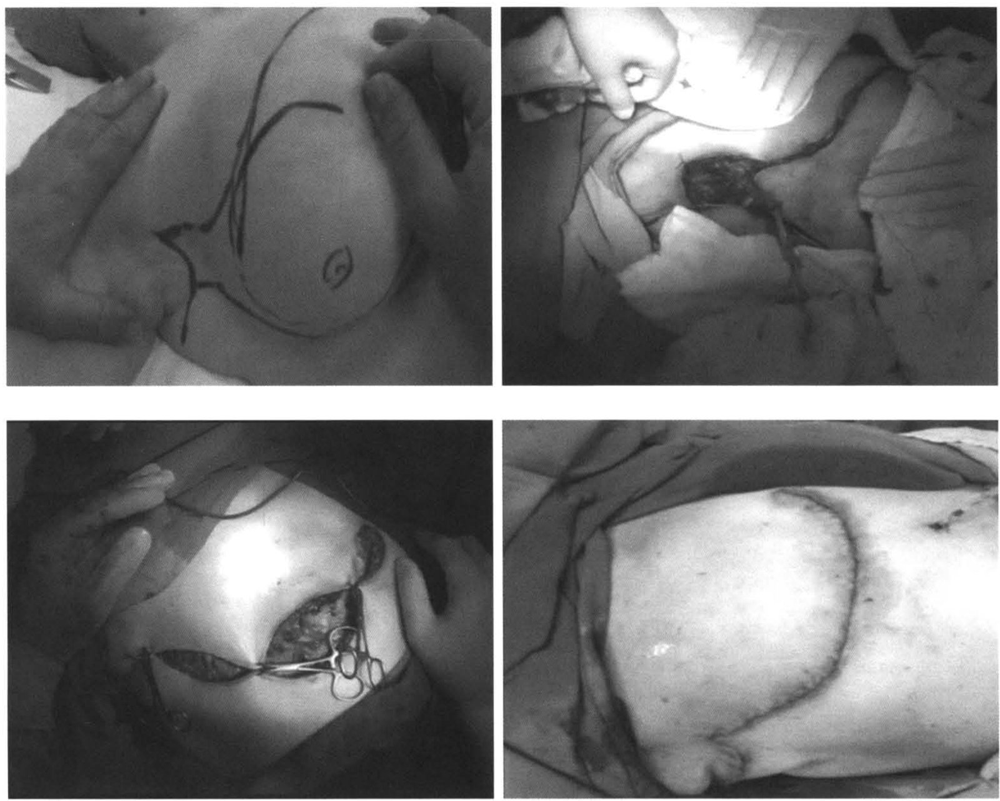

> **Caption (verbatim):** none on this page (the next caption, **รูปที่ 24**, is printed on p.701 below further photographs)
> **Text in image (verbatim):** none
> **Description:** Four black-and-white intraoperative photographs in a 2 × 2 grid. Top left: a large breast held by gloved hands, with skin-marker lines: a curved outline around the breast extending laterally toward the axilla, where it forms a pointed, flap-like extension, plus a small circle marked near the nipple. Top right: operative field with lighting, showing a gloved hand retracting tissue at an incision with exposed dark tissue and the marker line continuing along the skin. Bottom left: under bright light, the skin incision with an elliptical opening medially and a deeper wound laterally, with a pair of surgical instruments (forceps/clamp) in the wound and hands retracting. Bottom right: the chest wall after closure, showing a long curved sutured incision forming a C-shaped / D-shaped arc across the chest, with a small drain site near the upper right. No face shown.
> **Identifiers in image:** none

<!-- p.701 (printed 687) -->
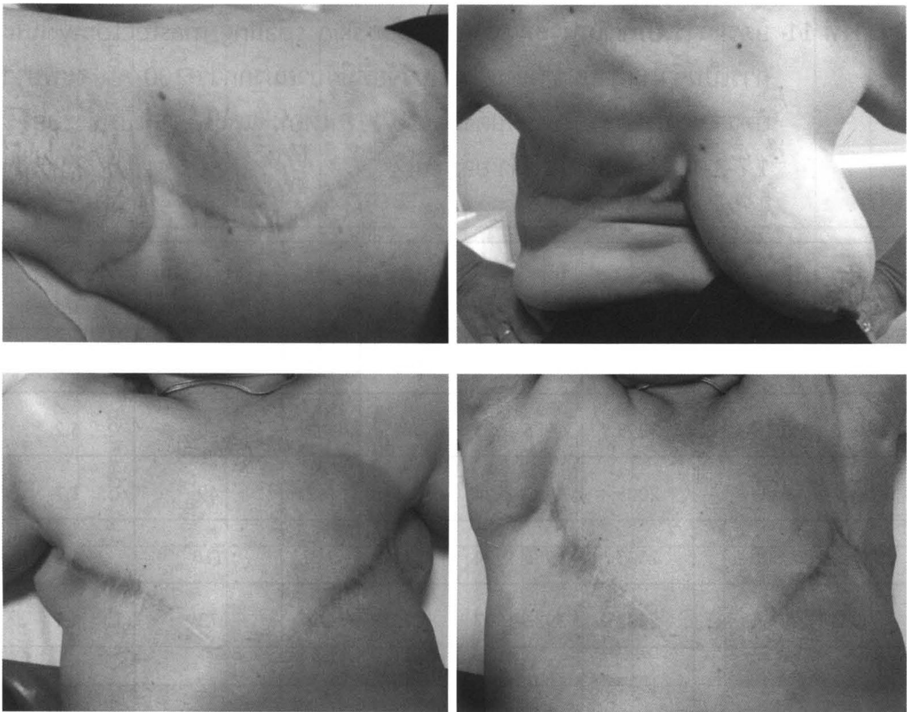

> **Caption (verbatim):** **รูปที่ 24** มีการใช้ Krishna technique18 ทำเป็น flap ตรงรักแร้เพื่อเลื่อนผิวหนังมาด้านหน้า แล้วจะป้องกันการเกิด dog ear ได้
> **Text in image (verbatim):** none
> **Description:** Four black-and-white clinical photographs in a 2 × 2 grid showing healed post-mastectomy chest walls. Top left: oblique view of a flat chest wall after mastectomy with a healed transverse/curved scar extending toward the axilla, without a dog-ear at the lateral end. Top right: a patient in a lateral/oblique position with the arm raised, showing the axilla and lateral chest wall with the remaining contralateral breast hanging at the right of the image. Bottom left and bottom right: anterior views of the chest (neck/clavicle region at the top, no face) after bilateral mastectomy, with faint healed transverse scars on both sides of the chest extending laterally toward the axillae, the lateral ends lying flat. No face shown.
> **Identifiers in image:** none

## การผ่าตัด immediate reconstruction หลังจาก skin sparing mastectomy

- มีรายงาน Subcutaneous mastectomy ใน Benign breast disease ครั้งแรกในปี ค.ศ. 196219 โดย Freeman ต่อมา Toth และ Lappert20 ในปี ค.ศ. 1991 ได้บัญญัติวิธีการรักษามะเร็งเต้านมแบบสงวนผิวหนัง เรียกว่า skin sparing mastectomy และในปี ค.ศ. 1996 ศัลยแพทย์ตกแต่งชื่อ John Bostwick III21 ได้แนะนำวิธีการรักษาแบบ oncoplastc breast surgery (OBS) ซึ่งหมายถึงการผ่าตัด partial หรือ total mastectomy แล้วตามด้วยการผ่าตัด immediate breast reconstruction, หรือจะสร้างเต้านมภายหลัง เรียกว่า delayed breast reconstruction
- แม้ว่าจะยังไม่มี RCT เทียบระหว่าง skin sparing mastectomy กับ modified radical mastectomy แต่จากงานวิจัยที่มีผู้ป่วยมากกว่า 100 ราย พบว่าอัตราการเป็นซ้ำอยู่ในระดับที่ต่ำดังตารางที่ 11

<!-- p.702 (printed 688) -->
**ตารางที่ 11** อัตราการเป็นซ้ำเฉพาะที่หลังการผ่าตัด skin sparing mastectomy และการเป็นซ้ำในเต้านมข้างเดิม ในงานวิจัยที่มีผู้ป่วยมากกว่า 100 คน จะพบว่าอัตราการปราศจากโรคนานตั้งแต่ 50-118 เดือน และโอกาสเป็นซ้ำร้อยละ 1.7-8.0 ซึ่งอยู่ในเกณฑ์ที่ต่ำ ยอมรับได้22

| ชื่อผู้วิจัย | ปีที่ตีพิมพ์ | ปีที่ ทำการวิจัย | จำนวน ผู้ป่วย | ระยะ มะเร็ง | จำนวนเดือนที่ ปราศจากโรค | การเป็นซ้ำที่ เต้านม (%) |
| --- | --- | --- | --- | --- | --- | --- |
| Carlson et al. | 2003 | 1989-1998 | 565 | 0-4 | 65 | 5.5 |
| Newman et al. | 1998 | 1986-1993 | 372 | 1-2 | 50 | 6.2 |
| Greenway et al. | 2005 | 1989-2004 | 225 | 0-2 | 49 | 1.7 |
| Spiegel and Butler | 2003 | 1985-1994 | 221 | 0-3? | 118 | 4.5 |
| Medina-Franco et al. | 2002 | 1986-1997 | 173 | 1-3 | 73 | 4.5 |
| Kroll et al. | 1999 | 1986-1990 | 114 | 1-2 | 72 | 7.0 |
| Meretoja et al. | 2007 | 1992-2006 | 146 | 1-2 | 51 | 2.7 |

<!-- p.703 (printed 689) -->
**ตารางที่ 12** การศึกษาเปรียบเทียบระหว่างผลของการฉายแสงหลังผ่าตัดเสริมสร้างเต้านม23

| ลักษณะงานวิจัย | การเปรียบเทียบ | Reconstruction | CC (any grade) | CC (severe) | Re-operation | Infection | All complications |
| --- | --- | --- | --- | --- | --- | --- | --- |
| Meta-analysis | Implants no DXT | 229 | 4% (9/228) | - | 4% (7/159) | 8% (13/159) | 21.2% (48/228) |
| Meta-analysis | Implants and DXT | 196 | 15% (30/196) | - | 8% (13/155) | 10% (15/155) | 51.6% (101/196) p <0.01 |
| Meta-analysis | Autologous/DXT | 164 | N/A | N/A | 11% (18/164) | 4% (4/105) | 7.8% (13/164) |
| Meta-analysis | Implants DXT | 216 | 32% (52/216) | - | 32% (69/216) | 18% (24/134) | 33.5% (72/216) p <0.01 |
| Prospective series | Implant 54 | 92 | 14% 13/92 | 0% | 2% (2/96) | - | - |
| Prospective series | Implant /LD58 | - | - | - | - | - | - |
| Prospective series | Implant /DXT8 | 44 | 39% 17/44 | 11%5/44 | 9% (4/44) | - | - |
| Prospective series | Implant/LD/ DXT36 | - | - | - | - | - | - |
| Retrospecti- veseries | Autologous/DXT | 76 | N/A | N/A | 37% (36/76) | - | 70% (53/76) |
| Prospective serires | LD | 7 | N/A | N/A | - | - | - |
| Prospective serires | LD/implant | 35 | 10.8% (4/35) | - | 31.5% (11/35) | - | - |

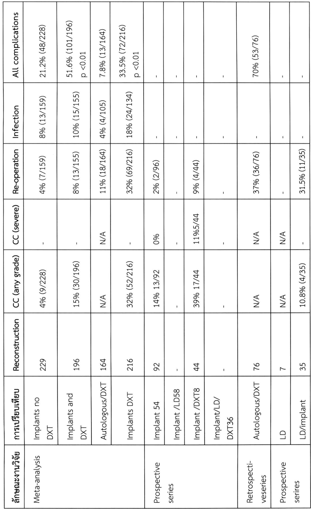

> **Caption (verbatim):** **ตารางที่ 12** การศึกษาเปรียบเทียบระหว่างผลของการฉายแสงหลังผ่าตัดเสริมสร้างเต้านม23
> **Text in image (verbatim):** ลักษณะงานวิจัย · การเปรียบเทียบ · Reconstruction · CC (any grade) · CC (severe) · Re-operation · Infection · All complications · Meta-analysis · Implants no DXT · 229 · 4% (9/228) · - · 4% (7/159) · 8% (13/159) · 21.2% (48/228) · Implants and DXT · 196 · 15% (30/196) · - · 8% (13/155) · 10% (15/155) · 51.6% (101/196) p <0.01 · Autologous/DXT · 164 · N/A · N/A · 11% (18/164) · 4% (4/105) · 7.8% (13/164) · Implants DXT · 216 · 32% (52/216) · - · 32% (69/216) · 18% (24/134) · 33.5% (72/216) p <0.01 · Prospective series · Implant 54 · 92 · 14% 13/92 · 0% · 2% (2/96) · - · - · Implant /LD58 · - · - · - · - · - · - · Implant /DXT8 · 44 · 39% 17/44 · 11%5/44 · 9% (4/44) · - · - · Implant/LD/DXT36 · - · - · - · - · - · - · Retrospecti-veseries · Autologous/DXT · 76 · N/A · N/A · 37% (36/76) · - · 70% (53/76) · Prospective serires · LD · 7 · N/A · N/A · - · - · - · LD/implant · 35 · 10.8% (4/35) · - · 31.5% (11/35) · - · -
> **Description:** The whole of Table 12, printed rotated 90° on the page (shown here as on the page, read by turning it clockwise). It has 8 columns and 11 data rows. The first column (ลักษณะงานวิจัย, study type) has merged cells: "Meta-analysis" spans the first four rows (Implants no DXT, Implants and DXT, Autologous/DXT, Implants DXT); "Prospective series" spans the next four rows (Implant 54, Implant /LD58, Implant /DXT8, Implant/LD/DXT36); "Retrospecti-veseries" covers one row (Autologous/DXT); "Prospective serires" spans the last two rows (LD, LD/implant). The remaining columns give number of reconstructions, capsular contracture (CC) of any grade and severe, re-operation, infection and all complications, as transcribed in the Markdown table above.
> **Identifiers in image:** none

<!-- p.704 (printed 690) -->
*[ตารางที่ 12 continued from p.703; no header row is printed on this page. Columns, in order, are those of p.703: ลักษณะงานวิจัย · การเปรียบเทียบ · Reconstruction · CC (any grade) · CC (severe) · Re-operation · Infection · All complications. The first two rows have an empty first-column cell on this page, continuing the merged cell from p.703.]*

|  |  |  |  |  |  |  |  |
| --- | --- | --- | --- | --- | --- | --- | --- |
|  | LD/DXT | 13 | N/A | N/A | - | - | - |
|  | LD/implant DXT | 18 | 33.3 (7/18) | - | 27.8% (5/18) | - | - |
| Retrospective | Autologous | 454 | - | - | - | - | - |
| Retrospective | No DXT | 274 | - | - | - | - | 28.4% |
| Retrospective | DXT | 179 | - | - | - | - | 32.5% |
| Retrospective | Implant | 700 | - | - | - | - | - |
| Retrospective | No DXT | 595 | 3% | - | 8.4% | - | 26.7% |
| Retrospective | DXT | 105 | 23% | - | 29.9% | 10.3% | 58.8% p <0.01 |
| Retrospecti- veseries | Expander | 60 | - | 3.3% | 5% | - | 11.6% |
| Retrospecti- veseries | Expander/DXT | 37 | - | 21.6% | 54% | - | 45.9% |
| Retrospective series/case controls | Expander (matched subject) | 47 | 20% | 5% | 30% | 0% | - |
| Retrospective series/case controls | Expander/DXT | 48 | 50% | 15% | 33% | 15% | - |

DXT = การฉายแสง, CC = capsular contracture, LD latissimus Doris flap

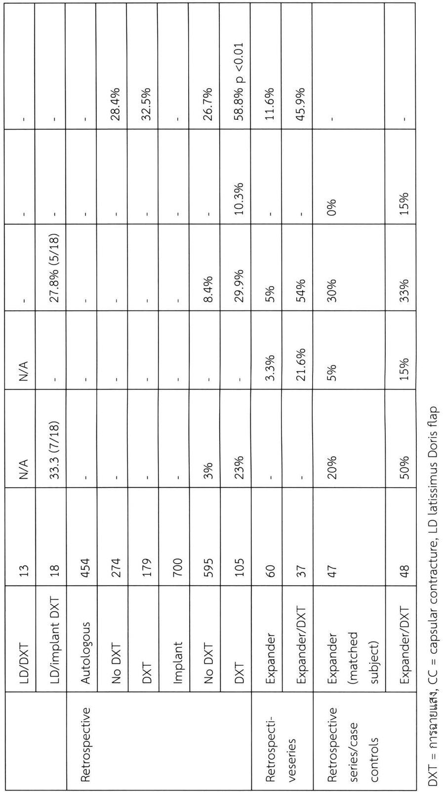

> **Caption (verbatim):** none on this page (continuation of **ตารางที่ 12** from p.703)
> **Text in image (verbatim):** LD/DXT · 13 · N/A · N/A · - · - · - · LD/implant DXT · 18 · 33.3 (7/18) · - · 27.8% (5/18) · - · - · Retrospective · Autologous · 454 · - · - · - · - · - · No DXT · 274 · - · - · - · - · 28.4% · DXT · 179 · - · - · - · - · 32.5% · Implant · 700 · - · - · - · - · - · No DXT · 595 · 3% · - · 8.4% · - · 26.7% · DXT · 105 · 23% · - · 29.9% · 10.3% · 58.8% p <0.01 · Retrospecti-veseries · Expander · 60 · - · 3.3% · 5% · - · 11.6% · Expander/DXT · 37 · - · 21.6% · 54% · - · 45.9% · Retrospective series/case controls · Expander (matched subject) · 47 · 20% · 5% · 30% · 0% · - · Expander/DXT · 48 · 50% · 15% · 33% · 15% · - · DXT = การฉายแสง, CC = capsular contracture, LD latissimus Doris flap
> **Description:** Continuation of Table 12, printed rotated 90° on the page (read by turning it clockwise), with no header row. Same 8 columns as on p.703. The first-column cell for the first two rows (LD/DXT, LD/implant DXT) is empty, continuing the merged "Prospective serires" group from p.703. The first column then has merged cells: "Retrospective" spans six rows (Autologous, No DXT, DXT, Implant, No DXT, DXT); "Retrospecti-veseries" spans two rows (Expander, Expander/DXT); "Retrospective series/case controls" spans two rows (Expander (matched subject), Expander/DXT). The abbreviation footnote is printed below the table. Values as transcribed in the Markdown table above.
> **Identifiers in image:** none

<!-- p.705 (printed 691) -->
- อุปสรรคสำคัญของการผ่าตัด immediate reconstruction คือการฉายแสงหลังผ่าตัด (ตารางที่ 12) เพราะจะทำให้ความสวยงามลดลง และอาจเกิดภาวะแทรกซ้อนได้ ดังนั้นหากทราบล่วงหน้าว่าต้องฉายแสงแน่ๆ ควรหลีกเลี่ยงการทำ immediate reconstruction หรือเลือก autologous flap ในการทำ immediate reconstruction หรือหากไม่แน่ใจว่าจะต้องฉายแสงหรือไม่ก็เลือกใส่ tissue expander ไว้ก่อน ดังแผนภูมิที่ 124 diagram เพื่อสามารถปรับเปลี่ยนและเปลี่ยนแปลงตามสถานการณ์ภายหลังได้ตลอดเวลา แต่อย่างไรก็ดีคนไทยไม่ค่อยนิยมการที่ต้องผ่าตัด 2 ครั้ง เพราะค่าใช้จ่ายสูงขึ้นและต้องเจ็บตัวหลายครั้ง

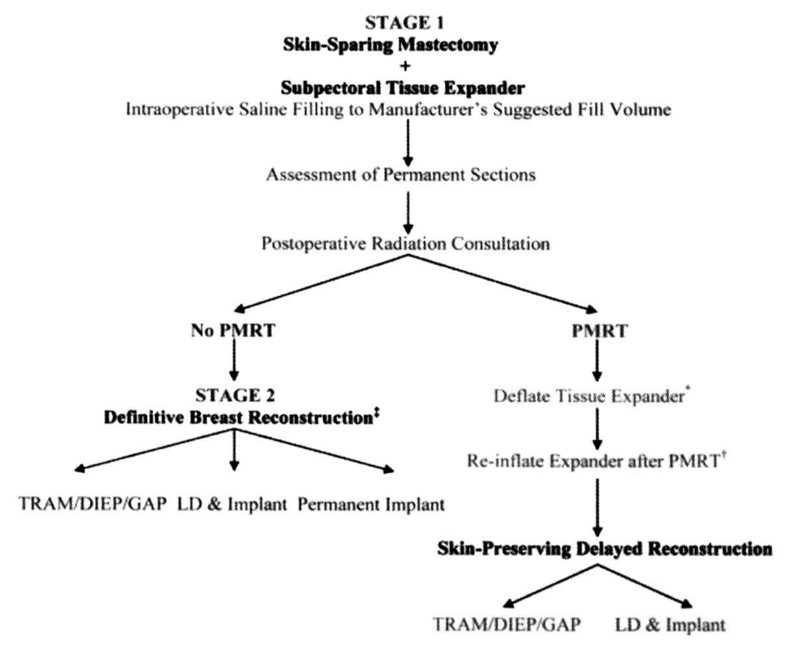

> **Caption (verbatim):** แผนภูมิที่ 1
> **Text in image (verbatim):** STAGE 1 · Skin-Sparing Mastectomy · + · Subpectoral Tissue Expander · Intraoperative Saline Filling to Manufacturer's Suggested Fill Volume · Assessment of Permanent Sections · Postoperative Radiation Consultation · No PMRT · PMRT · STAGE 2 · Definitive Breast Reconstruction‡ · TRAM/DIEP/GAP · LD & Implant · Permanent Implant · Deflate Tissue Expander* · Re-inflate Expander after PMRT† · Skin-Preserving Delayed Reconstruction · TRAM/DIEP/GAP · LD & Implant
> **Description:** Flowchart (no boxes, text nodes joined by arrows) of a staged breast reconstruction pathway. Flow: STAGE 1: Skin-Sparing Mastectomy + Subpectoral Tissue Expander (Intraoperative Saline Filling to Manufacturer's Suggested Fill Volume) → Assessment of Permanent Sections → Postoperative Radiation Consultation, which branches into two: No PMRT → STAGE 2: Definitive Breast Reconstruction‡ → three options: TRAM/DIEP/GAP; LD & Implant; Permanent Implant; PMRT → Deflate Tissue Expander* → Re-inflate Expander after PMRT† → Skin-Preserving Delayed Reconstruction → two options: TRAM/DIEP/GAP; LD & Implant. The footnote symbols (‡, *, †) are printed in the figure but their explanations are not printed on the page.
> **Identifiers in image:** none

## การผ่าตัดต่อมน้ำเหลืองของรักแร้

สมัย William Halsted การผ่าตัดต่อมน้ำเหลืองรักแร้ระดับ 1, 2 และ 3 ร่วมกับการผ่าตัดเต้านมและกล้ามเนื้อ pectoralis major และ minor แต่ปัจจุบันพบว่าต่อมน้ำเหลืองมีโอกาสจะมีมะเร็งกระจายลดลงมาก ดูได้จากกราฟที่ 125 จะเห็นได้ว่ามะเร็งระยะ 0, 1 มีสัดส่วนเพิ่มมากขึ้นมาก

<!-- p.706 (printed 692) -->
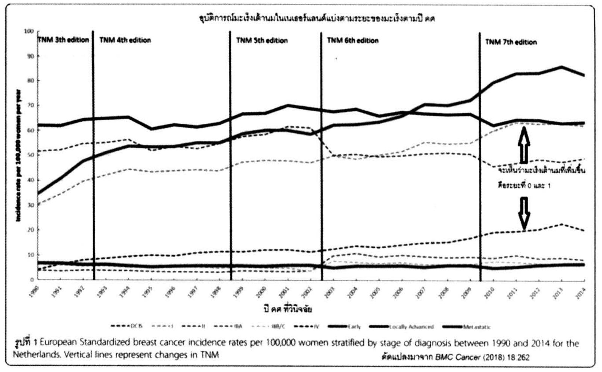

> **Caption (verbatim):** กราฟที่ 1
> **Text in image (verbatim):** อุบัติการณ์มะเร็งเต้านมในเนเธอร์แลนด์แบ่งตามระยะของมะเร็งตามปี คศ · Incidence rate per 100,000 women per year · 0 · 10 · 20 · 30 · 40 · 50 · 60 · 70 · 80 · 90 · 100 · TNM 3th edition · TNM 4th edition · TNM 5th edition · TNM 6th edition · TNM 7th edition · 1990 · 1991 · 1992 · 1993 · 1994 · 1995 · 1996 · 1997 · 1998 · 1999 · 2000 · 2001 · 2002 · 2003 · 2004 · 2005 · 2006 · 2007 · 2008 · 2009 · 2010 · 2011 · 2012 · 2013 · 2014 · ปี คศ ที่วินิจฉัย · จะเห็นว่ามะเร็งเต้านมที่เพิ่มขึ้น · คือระยะที่ 0 และ 1 · DCIS · I · II · IIIA · IIIB/C · IV · Early · Locally Advanced · Metastatic · รูปที่ 1 European Standardized breast cancer incidence rates per 100,000 women stratified by stage of diagnosis between 1990 and 2014 for the Netherlands. Vertical lines represent changes in TNM · ดัดแปลงมาจาก *BMC Cancer* (2018) 18 262
> **Description:** Boxed line chart. Y axis: incidence rate per 100,000 women per year, 0 to 100 in steps of 10. X axis: year of diagnosis (ปี คศ ที่วินิจฉัย), 1990 to 2014, one tick per year (the small tick labels are blurred in the scan). Four bold vertical lines divide the period into TNM editions: TNM 3th edition (1990 to between 1992 and 1993), TNM 4th edition (to between 1998 and 1999), TNM 5th edition (to between 2002 and 2003), TNM 6th edition (to between 2009 and 2010), TNM 7th edition (from 2010). The legend lists dashed lines of different shades for stages DCIS, I, II, IIIA, IIIB/C, IV and thick solid lines for Early, Locally Advanced and Metastatic; individual lines cannot be matched to legend entries with certainty from the scan. Visible trends: one thick solid line starts at about 35 in 1990, rises to about 60 by 2001, crosses above the other thick line around 2006 and climbs to about 85 in 2013 (about 82 in 2014); a second thick solid line stays around 61 to 70 throughout (about 62 in 1990, peak about 70 in 2001, about 63 in 2014); a thick solid line near the bottom stays at about 5 to 7 throughout. Among the dashed lines: one starts near 52, peaks about 61 in 2001, drops to about 50 in 2003 and is about 45 to 48 after 2010; a light grey dashed line rises from about 30 in 1990 to about 63 in 2011-2014; a dashed line near the bottom rises from about 4 in 1990 to about 12 in 2003 and about 22 in 2013 (about 20 in 2014); other dashed lines stay below about 10. An annotation with two hollow arrows near 2011 reads "จะเห็นว่ามะเร็งเต้านมที่เพิ่มขึ้น คือระยะที่ 0 และ 1": the up arrow points to the light grey dashed line at about 63 and the down arrow points to the dashed line at about 20. Inside the box under the legend is the source figure's own caption (beginning "รูปที่ 1") and the credit "ดัดแปลงมาจาก BMC Cancer (2018) 18 262".
> **Identifiers in image:** none

พบว่าจากรายงานของ MD Anderson cancer center26 พบว่าหลังจาก NSABP B-32 และ ACOSOG Z0010 รายงานออกมา พบว่าผู้ป่วยได้รับการผ่าตัด SLNB ใน mastectomy เพิ่มขึ้นเกือบ 50% ของผู้ป่วย และใน breast conserving surgery เกือบ 80% ของผู้ป่วย (ดูรูปที่ 25)

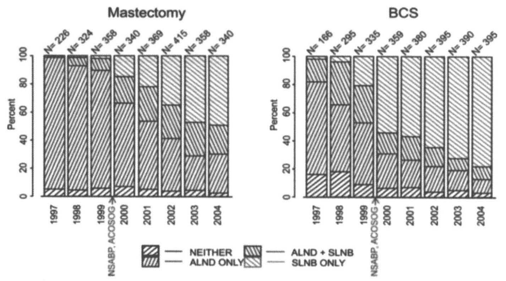

> **Caption (verbatim):** รูปที่ 25 Percentage of patients who underwent sentinel lymph node biopsy (SLNB) and/or axillary lymph node dissection (ALND) by year of diagnosis, according to type of surgery. BCS indicates breast-conserving surgery; NSABP, National Surgical Adjuvant Breast and Bowel Project; ASOSOG, American College of Surgeons Oncology Group.
> **Text in image (verbatim):** Mastectomy · BCS · Percent · 0 · 20 · 40 · 60 · 80 · 100 · N= 226 · N= 324 · N= 358 · N= 340 · N= 369 · N= 415 · N= 358 · N= 340 · N= 166 · N= 295 · N= 335 · N= 359 · N= 380 · N= 395 · N= 390 · N= 395 · 1997 · 1998 · 1999 · 2000 · 2001 · 2002 · 2003 · 2004 · NSABP, ACOSOG · NEITHER · ALND ONLY · ALND + SLNB · SLNB ONLY
> **Description:** Two panels of 100% stacked bar charts, left "Mastectomy" and right "BCS", y axis Percent 0-100, one bar per year 1997-2004 with the number of patients above each bar. Each bar is divided by hatch pattern, bottom to top: NEITHER, ALND ONLY, ALND + SLNB, SLNB ONLY. An arrow labelled "NSABP, ACOSOG" points up to the x axis between 1999 and 2000 in each panel. Mastectomy (N = 226, 324, 358, 340, 369, 415, 358, 340 for 1997-2004): NEITHER about 2-7% each year; the top of ALND ONLY is about 98% (1997), 92% (1998), 89% (1999), then 66% (2000), 53% (2001), 41% (2002), 28% (2003), 30% (2004); ALND + SLNB is a thin band in 1997-1999 and reaches roughly to 85% (2000), 78% (2001), 65% (2002), 52% (2003), 50% (2004); SLNB ONLY makes up the remainder, rising from near 0 to about half of patients by 2003-2004. BCS (N = 166, 295, 335, 359, 380, 395, 390, 395): NEITHER about 16% (1997), 18% (1998), 9% (1999), then about 2-7%; top of ALND ONLY about 81% (1997), 65% (1998), 52% (1999), 30% (2000), 26% (2001), 21% (2002), 18% (2003), 12% (2004); top of ALND + SLNB about 98% (1997), 96% (1998), 79% (1999), 45% (2000), 42% (2001), 35% (2002), 27% (2003), 21% (2004); SLNB ONLY makes up the remainder, rising to about 79% in 2004. Values are read approximately from the bar heights.
> **Identifiers in image:** none

<!-- p.707 (printed 693) -->
**ตารางที่ 13** **การ**เปรียบเทียบ morbidity ระหว่างการทำ ALND กับ SLNB26

*(The study-name rows span the full table width in print; they are given here as rows with empty cells.)*

| ชื่อผู้วิจัยหรืองานวิจัย | จำนวนผู้ป่วย | แขนบวม (%) | แขนชา (%) | การกางแขนมีปัญหา (%) | น้ำเหลืองคั่ง (%) |
| --- | --- | --- | --- | --- | --- |
| Veronesi et al. |  |  |  |  |  |
| SLNB | 259 | 7 | 1 | 0 | NR |
| ALND | 257 | 75 | 68 | 21 |  |
| ALMANAC |  |  |  |  |  |
| SLNB | 478 | 5 | 11 |  | NR |
| ALND | 476 | 13 | 31 | Significantly impaired in ALND group |  |
| Sentinella-GIVOM |  |  |  |  |  |
| SLNB | 345 | OR=0.48* | OR=0.51† | OR=0.55‡ | NR |
| ALND | 352 |  |  |  |  |
| SNAC |  |  |  |  |  |
| SLNB | 544 | 2.8 | NR | 2.5 | 17 |
| ALND | 539 | 4.2 | - | 4.4 | 36 |
| NSABP B-32 |  |  |  |  |  |
| SLNB | 2,697 | 8 | 8.1 | 13 | NR |
| ALND | 2,619 | 14 | 31.1 | 19 |  |
| Purushotham et al. |  |  |  |  |  |
| SLNB | 143 | OR=0.30§ | 66 | No significant change | 14 |
| ALND | 155 |  | 84 |  | 21 |

SLNB = sentinel lymph node biopsy ; ALND = axillary lymph node dissection ; NR = not reported ; OR = odds ratio

*p = 0.01 ; † p <0.0001 ; ‡p = 0.02 ; §p = 0.004.

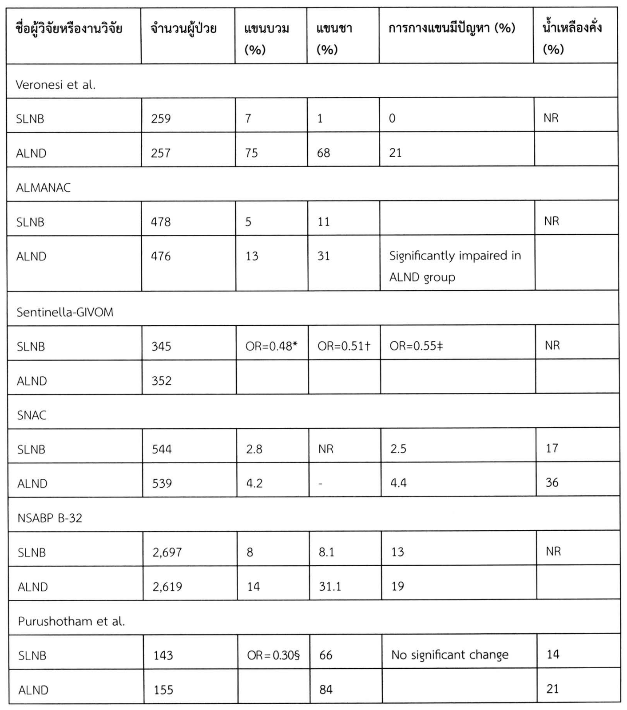

> **Caption (verbatim):** ตารางที่ 13 การเปรียบเทียบ morbidity ระหว่างการทำ ALND กับ SLNB26
> **Text in image (verbatim):** same as the transcribed table above
> **Description:** Image of Table 13, saved because the table has full-width merged rows naming each study (Veronesi et al., ALMANAC, Sentinella-GIVOM, SNAC, NSABP B-32, Purushotham et al.), each followed by an SLNB row and an ALND row with six columns: study/arm, number of patients, arm swelling (%), arm numbness (%), shoulder abduction problem (%), seroma (%). All cell values are transcribed in the Markdown table above.
> **Identifiers in image:** none

<!-- p.708 (printed 694) -->
**ตารางที่ 14** การเปรียบเทียบ survival outcome (ALN vs SLNB)26

| ชื่อผู้วิจัย/งานวิจัย | Axillary recurrence (%) | Disease-free survival (%) | Overall survival (%) |
| --- | --- | --- | --- |
| Veronesi et al. | 0 vs 0.01 | 88.8 vs 89.9 (10 yr)* | 89.7 vs 93.5 (10 yr)† |
| ALMANAC | 0.84 vs 0.2 (1 yr) | NR | NR |
| Sentinella-GIVOM | 0.05 vs 0.01 | 89.9 vs 87.6 | 95.5 vs 94.8 |
| Canavese et al. | 0.87 vs 0.0 | 89.8 vs 94.5↕ | 97.2 vs 97.2§ |
| NSABP B-32 | 0.1 vs 0.3 | 82.4 vs 81.5 (8 yr) | 91.8 vs 90.3 (8 yr) |

ALND = axillary lymph node dissection ; SLNB = sentinel lymph node biopsy ; NR = not reported

*p = 0.52 ; †p = 0.15 ; ↕p = 0.715 ; §p = 0.697.

ตารางที่ 13, 14 เนื่องจาก morbidity น้อยกว่า axillary recurrence, disease-free survival และ overall survival ไม่แตกต่างกัน ปัจจุบันการทำ SLNB จึงเป็นการตรวจแบบ gold standard ในการประเมิน regional metastasis ในกรณีที่ผู้ป่วยมี clinical node negative

แต่ต่อมา ACOSOG Z0011 ได้มีผลงานวิจัยต่อมาว่าในการผ่าตัด breast conserving surgery แม้ SLN จะ positive 1-2 node ก็ไม่จำเป็นต้อง complete ALND เพราะ axillary recurrence และ overall survival ไม่แตกต่างกัน

ดังนั้นผู้เขียนขอเสนอแผนภูมิการประเมิน regional node ดังแผนภูมิที่ 2

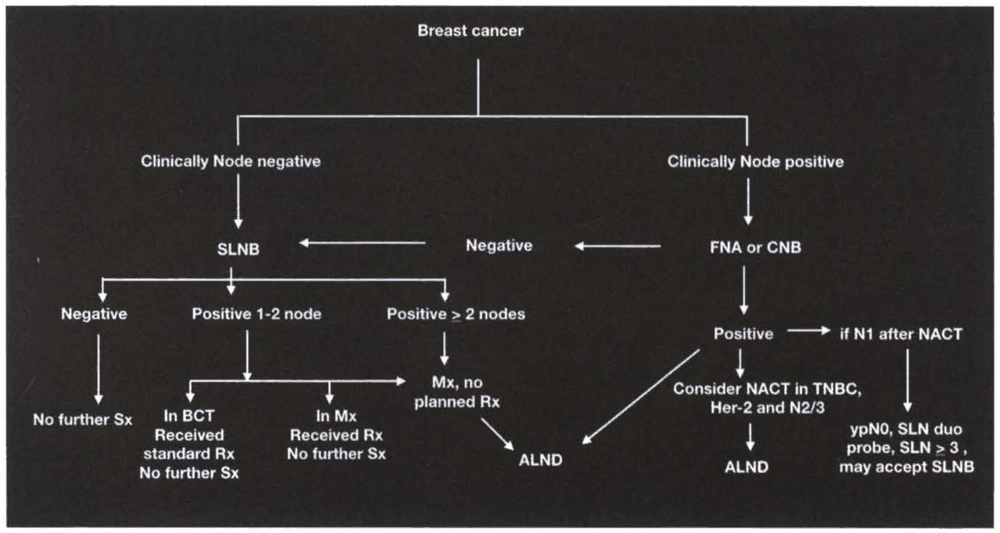

> **Caption (verbatim):** none
> **Text in image (verbatim):** Breast cancer · Clinically Node negative · Clinically Node positive · SLNB · Negative · FNA or CNB · Negative · Positive 1-2 node · Positive ≥ 2 nodes · Positive · if N1 after NACT · No further Sx · In BCT Received standard Rx No further Sx · In Mx Received Rx No further Sx · Mx, no planned Rx · ALND · Consider NACT in TNBC, Her-2 and N2/3 · ALND · ypN0, SLN duo probe, SLN ≥ 3 , may accept SLNB
> **Description:** Flowchart in white text and lines on a black background (referred to in the text as แผนภูมิที่ 2; no caption is printed under it). Flow: Breast cancer → Clinically Node negative or Clinically Node positive; Clinically Node negative → SLNB; Clinically Node positive → FNA or CNB; FNA or CNB → Negative → SLNB (arrows run right to left); FNA or CNB → Positive; Positive → ALND (diagonal arrow to the central ALND); Positive → Consider NACT in TNBC, Her-2 and N2/3 → ALND; Positive → if N1 after NACT → ypN0, SLN duo probe, SLN ≥ 3 , may accept SLNB; SLNB → three branches: Negative → No further Sx; Positive 1-2 node → In BCT Received standard Rx No further Sx; or In Mx Received Rx No further Sx; or Mx, no planned Rx; Positive ≥ 2 nodes → Mx, no planned Rx; Mx, no planned Rx → ALND.
> **Identifiers in image:** none

<!-- p.709 (printed 695) -->
## เอกสารอ้างอิง

1. Insamran W, Chaiwerawattana A, Wiangnon S, Pongnikorn D, Suwanrungrung K, Sangrajrang S, Bussom R. Cancer in Thailand (2010-2012) 2015
2. Ferlay J, Shin HR, Bray F, Forman D, Mathers C, Parkin DM. Estimates of worldwide burden of cancer in 2008: GLOBOCAN 2008 Int J Cancer 2010; 127: 2893-917.
3. Youlden DR , Cramb SM, Yip CH, Baade PD. Incidence and mortality of female breast cancer in the AsiaPacific region. Cancer Biol Med 2014;11: 101-15.
4. Sinn HP, Kreipe H. A brief overview of WHO classification of breast tumors, 4th edition, focusing on issues and updates from the 3rd edition. Breast Care 2013; 18: 149-54.
5. Iglehart JD, Smith BL.Diseases of the breast.in Beauchamp RD, Evers BM.(eds). *Sabiston textbook of surgery.* 18th edition. Philadelphia: WB Saunders; 2007: 866.
6. Hortobagyi GN, Connolly JL, D'Orsi CJ, Edge SB, Mittendorf EA, Rugo HS, Solin LJ, Weaver DL, Winchester DJ, Giuliano A. *AJCC Cancer staging Eight Edition.* Chicago,Illinois: Springer; 2017. p75-80.
7. Shao N, Xie C, Shi Y, Ye R, Long J, Shi H, Shan Z, Thompson AM, Lin Y. Comparison of the 7th and 8th edition of american joint committee on cancer (AJCC) staging system for breast cancer patients: a surveillance, epidemiology and end results (SEER) analysis. Cancer Management and Research 2019; 11: 1433-42.
8. Lacconi C, Galman L, Zheng J, Sacchini V, Sutton EJ, Dershaw D, Morris EA. Multicentric cancer detected at breast MR imaging and not at mammography: important or not? Radiology 2016; 279: 378-84.
9. Sardanelli F, Giuseppetti GM, Panizza P, Bazzocchi M, Fausto A, Simonetti G, Lattanzio V, Del Maschio A. Sensitivity of MRI versus mammography for detecting foci of multifocal, multicentric breast cancer in fatty and dense breasts using the whole-breast pathologic examination as a gold standard. AJR Am J Roentgenol 2004;183:1149-57.
10. Tot T, Pekar G, Hofmeyer S, Gere M, Tarjan M, Herbert D, Lindquist D. Molecular phenotypes of unifocal, multifocal, and diffuse invasive breast carcinomas. Pathol Res Int 2010; 2011: 480960

<!-- p.710 (printed 696) -->
11. Giaj-Levra N, Sciascia S, Fiorentino A, Fersino S, Mazzola R, Ricchetti F, Roccatello D, Alongi F. Lancet oncol 2016; 17: e109-17.
12. Cao JQ, Olson RA, Tyldesley SK. Comparison of recurrence and survival rates after-conserving therapy and mastectomy in young women with breast cancer. Current oncology 2013; 20: e593-601.
13. Hussien M, Daltrey IR, Dutta S, Goodwin A, Prance SE, Watkins Fish-tail plasty: a safe technique to improve cosmesis at the lateral end of mastectomy scars. Breast. 2004;13:206-9.
14. Thomas R, Mouat C, King B. Mastectomy flap design: the 'waisted teardrop' and a method to reduce the lateral fold. ANZ J Surg 2012; 82: 329-33.
15. Bennett IC, Biggar MA. A triangular advancement technique to avoid the dog-ear deformity following mastectomy in large breasted women. Ann R Coll Surg Engl 2011; 93: 551–557.
16. Devalia H, Chaudhry A, Rainsbury RM, Minakaran N, Banerjee D. An oncoplastic technique to reduce the formation of lateral 'dog-ears' after mastectomy. Int Semin Surg Oncol. 2007; 4: 29.
17. Kim JK, Kim YS. The Lazy S design: a novel skin closure dsign for skin-sparing mastectomy for implant-based breast reconstruction. Arch Plast Surg 2017;44: 344-347.
18. Clough K, Massey E, Mahadev GK, Kaufman GJ, Nos C, Sarfati I. Oncoplastic Technique for the Elimination of the Lateral "Dog Ear" During Mastectomy. Breast J.2012;18: 588-9.
19. Freeman BS. Subcutaneous mastectomy for benign breast lesions with immediate or delayed prosthetic replacement.Plast Reconstr Surg Transplant Bull. 1962; 30:676-82.
20. Toth BA, Lappert P. Modified skin incisions for mastectomy: the need for plastic surgical input in preoperative planning. Plast Reconstr Surg. 1991;87:1048-53.
21. Carlson GW, Bostwick J 3rd, Styblo TM, Moore B, Bried JT, Murray DR, Wood WC. Skin-sparing mastectomy. Oncologic and reconstructive considerations. Ann Surg. 1997; 225: 570-5.

<!-- p.711 (printed 697) -->
22. Maretoja TJ, von Smitten KAJ, Leidenius MHK, Svarvar C, Heikkila PS, Jakhola TA. Local recurrence is Stage 1 and 2 breast cancer after skin-sparing mastectomy and immediate breast reconstruction in a 15-year series. Eur J Surg Oncol. 2007; 33: 1142-45.
23. Lamberta K, Mokbel K. Does post-mastectomy radiotherapy represent a contraindication to skin-sparing mastectomy and immediate reconstruction: An update. Surg Oncol 2011; 21: e67-74.
24. Kronowitz SJ, Hunt KK, Kuerer HM, et al. Delayed-immediate breast reconstruction. Plast Reconstr Surg. 2004;113:1617-28.
25. Shen Y, Dong W, Feig BW, Ravdin P, Theriault RL, Giordano SH. Patterns of Treatment for Early Stage Breast Cancers at the M. D. Anderson Cancer Center From 1997 to 2004. Cancer 2009; 115: 2041-51.
26. Zahoor S, Haji A, Batoo A, Qurieshi M, Mir W, Shah M. Sentinel lymph node biopsy in breast cancer: A clinical review and update. J Breast Cancer 2017; 20: 217-27.

<!-- p.712 (printed none) -->
*[blank page]*
