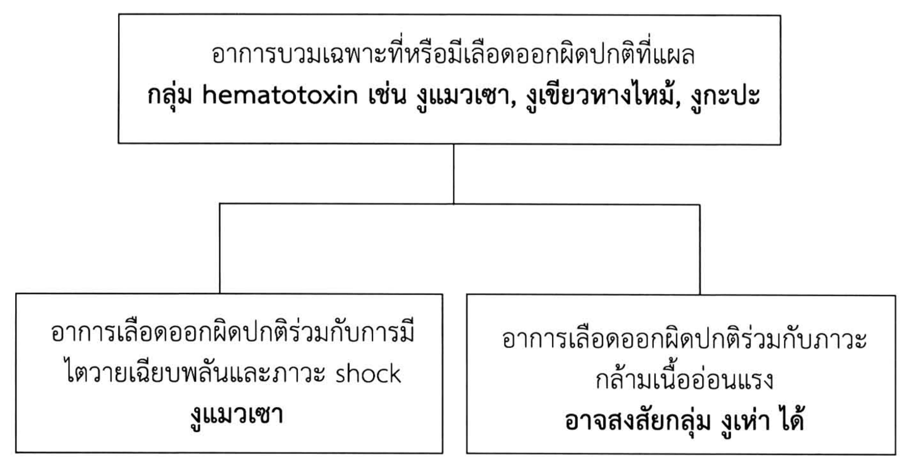
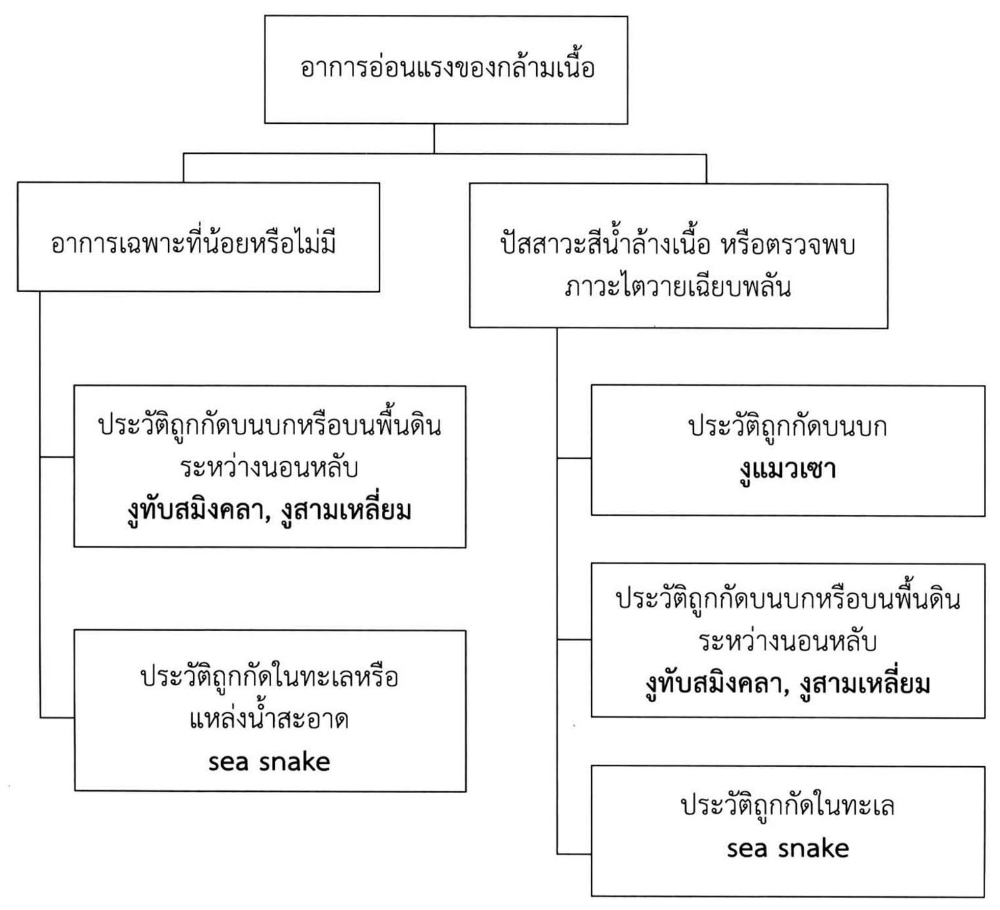

# การบาดเจ็บจากการถูกสัตว์ทำร้าย (Bite and stings)

## Contents of this file
- บทนำ (p.714)
- สุนัข แมว และสัตว์เลี้ยงลูกด้วยนม (p.714)
  - การดูแลแผล (p.714)
  - การให้ยาปฏิชีวนะ (p.714)
  - การให้วัคซีนในการป้องกันโรคบาดทะยัก (p.715)
  - การให้ post exposure rabies prophylaxis (p.715)
  - การให้ Rabies immunoglobulin (ERIG/HRIG) (p.716)
- งูพิษ (p.717)
  - งูพิษที่มีปัญหาในประเทศไทย (p.717)
  - การดูแลเบื้องต้นที่ที่เกิดเหตุ (p.717)
  - อาการแสดง (p.718)
  - การรักษาเบื้องต้น (p.719)
  - การพิจารณารับผู้ป่วยไว้รักษาในโรงพยาบาล (p.721)
  - การให้เซรุ่มต้านพิษงู (p.722)
  - การดูแลแผลงูกัด (p.723)
- ผึ้ง ต่อ แตน (p.723)
  - หลังจากถูกกัดผู้ป่วยอาจมีอาการดังต่อไปนี้ (p.724)
  - การรักษา (p.724)
- ตะขาบ (p.725)
  - การรักษา (p.725)
- เอกสารอ้างอิง (p.725)

<!-- p.713 (printed none) -->
**การบาดเจ็บจากการถูกสัตว์ทำร้าย**

**Bite and stings**

ปัณฑิตา เอี่ยมศุภนิมิตร

<!-- p.714 (printed 700) -->
**การบาดเจ็บจากการถูกสัตว์ทำร้าย**

**Bite and stings**

ปัณฑิตา เอี่ยมศุภนิมิตร

## บทนำ

การบาดเจ็บจากการถูกสัตว์หรือแมลงทำร้ายถือเป็นปัญหาที่พบได้บ่อย ซึ่งอาการที่พบมีตั้งแต่อาการไม่รุนแรงที่สามารถดูแลรักษาเป็นผู้ป่วยนอกได้ ไปจนถึงอาการรุนแรงที่ต้องเข้ารับการรักษาในโรงพยาบาล โดยเนื้อหาในบทนี้ได้รวบรวมขึ้นเพื่อให้แพทย์เวชปฏิบัติทั่วไปใช้เป็นแนวทางในการประเมินความรุนแรงและให้การรักษาผู้ป่วยถูกสัตว์และแมลงกัดอย่างเหมาะสม

## สุนัข แมว และสัตว์เลี้ยงลูกด้วยนม1, 2

### การดูแลแผล

ล้างแผลด้วยน้ำโดยล้างให้ลึกถึงก้นแผล หลีกเลี่ยงการฉีดล้างอย่างรุนแรงเนื่องจากจะทำให้เนื้อเยื่อช้ำ โดยทั่วไปไม่แนะนำให้เย็บแผลทันที ยกเว้นแผลบริเวณใบหน้าอาจจะเย็บปิดแผลหลวมๆ ได้ทันที หรือบางครั้งอาจแนะนำให้เย็บปิดแผล 4-5 วันหลังจากโดนกัด เมื่อแน่ใจแล้วว่าไม่มีการติดเชื้อ

### การให้ยาปฏิชีวนะ

พบว่าแผลแมวกัดมักมีขนาดเล็กและลึกกว่าแผลสุนัข เนื่องจากลักษณะเขี้ยวที่เล็กและคมกว่า ทำให้มีโอกาสเจาะทะลุเข้าข้อได้มากกว่าและมักทำให้ผู้ป่วยมาพบแพทย์ช้ากว่า การติดเชื้อมักเกิดจากเชื้อโรคในกลุ่ม Pasteurella organism เพื่อป้องกันการติดเชื้อพิจารณาให้ยาปฏิชีวนะ 3-5 วัน ในกรณีบาดแผลขนาดใหญ่ บาดแผลบริเวณนิ้วมือ ใบหน้า บาดแผลลึกถึงกระดูก ผู้ป่วยที่มีภาวะภูมิคุ้มกันบกพร่อง ผู้ป่วยไตวาย เบาหวานที่ควบคุมไม่ดี และผู้ป่วยที่ตัดม้ามแล้ว โดยให้ยา amoxicillin ถ้าแพ้ยา penicillin ให้ doxycycline หรือพิจารณาใช้ second และ third generation cephalosporin ในกรณีที่แพ้

<!-- p.715 (printed 701) -->
penicillin ไม่รุนแรง ในกรณีมีการติดเชื้อแล้วอาจเลือกให้ amoxicillin, amoxicillin/clavulanate, ampicillin/sulbactam, second /third generation cephalosporin ไม่ควรใช้ cloxacillin, erythromycin, first generation cephalosporin และ clindamycin ในการรักษา

### การให้วัคซีนในการป้องกันโรคบาดทะยัก

พิจารณาฉีด tetanus toxoid ในกรณีไม่เคยได้หรือเคยได้วัคซีนป้องกันบาดทะยักแต่น้อยกว่า 3 ครั้ง หรือกรณีเคยได้วัคซีนมากกว่า 3 ครั้ง แต่เข็มสุดท้ายเกิน 5 ปีมาแล้ว

### การให้ post exposure rabies prophylaxis

การให้ post exposure rabies prophylaxis อ้างอิงตามแนวทางการให้การดูแลรักษาผู้ป่วยสัมผัสโรคพิษสุนัขบ้าปี 2559 สถานเสาวภา สภากาชาดไทย

1. กรณีผู้ป่วยไม่เคยได้รับการฉีดวัคซีนพิษสุนัขบ้ามาก่อน พิจารณาตามระดับการสัมผัสโรคพิษสุนัขบ้าขององค์การอนามัยโลก (ตารางที่ 1)

**ตารางที่ 1** ระดับการสัมผัสโรคพิษสุนัขบ้า

| ระดับการสัมผัสโรค | การให้การป้องกันโรคพิษสุนัขบ้า |
| --- | --- |
| สัมผัสโรคระดับ 1 (WHO category I) สัมผัสสัตว์โดยผิวหนังปกติไม่มีบาดแผล | ยังไม่จำเป็นต้องให้ post exposure rabies prophylaxis |
| สัมผัสโรคระดับ 2 (WHO category II) สัตว์กัดหรือข่วนเป็นรอยช้ำ เป็นแผลถลอก สัตว์เลียบาดแผล | ให้การรักษาด้วย rabies vaccine |
| สัมผัสโรคระดับ 3 (WHO category III) สัตว์กัดหรือข่วนมีเลือดออกชัดเจน น้ำลายสัตว์ถูกเยื่อบุ หรือบาดแผลเปิด บริโภคผลิตภัณฑ์จากสัตว์ที่สงสัยว่าเป็นโรคพิษสุนัขบ้าโดยไม่ทำให้สุก รวมทั้งค้างคาวกัดหรือข่วน | ให้การรักษาด้วย rabies vaccine ร่วมกับการให้ rabies immunoglobulin (ERIG/HRIG) |

การให้วัคซีนสำหรับการรักษา post exposure prophylaxis การให้วัคซีนในช่วงวันแรก จะกระตุ้นให้ร่างกายสร้างภูมิคุ้มกันในระดับที่เพียงพอต่อการป้องกันโรคได้ภายใน

<!-- p.716 (printed 702) -->
10-14 วัน ในกรณีมาผิดนัด โดยทั่วไปให้ฉีดเข็มต่อไปได้เลยโดยไม่ต้องเริ่มใหม่ แต่ทั้งนี้แล้วแต่ดุลพินิจของแพทย์ ซึ่งวัคซีนสามารถให้ได้โดย

  a. การฉีดเข้ากล้ามเนื้อ (intramuscular regimen) สูตร ESSEN (standard WHO intramuscular regimen) 1 เข็ม เข้าบริเวณกล้ามเนื้อต้นแขน ในวันที่ 0, 3, 7, 14 และ 28

  b. การฉีดเข้าในหนัง (intradermal regimen) สูตร TRC-ID ฉีดเข้าในหนังบริเวณต้นแขน 2 ข้าง ข้างละ 1 จุด จุดละ 0.1 มล. ในวันที่ 0, 3, 7 และ 28

2. กรณีผู้ป่วยเคยได้รับการฉีดวัคซีนพิษสุนัขบ้ามาก่อน

กรณีผู้ป่วยเคยได้รับการฉีดวัคซีนพิษสุนัขบ้ามาก่อนอย่างน้อย 3 เข็ม (วันที่ 0, 3, 7) หรือ complete pre-exposure rabies vaccine ถ้าบาดแผลเป็น WHO category II หรือ III สามารถให้การรักษาโดยการฉีดวัคซีนเข็มกระตุ้น โดยไม่ต้องให้ Rabies Immunoglobulin โดย

  a. กรณีที่ได้รับวัคซีนเข็มสุดท้ายมาน้อยกว่า 6 เดือน ให้ฉีดเข็มกระตุ้นโดยฉีดวัคซีนเข้ากล้ามเนื้อต้นแขน 1 เข็ม หรือฉีดวัคซีนเข้าในหนัง 0.1 ml 1จุด วันที่ 0

  b. กรณีที่ได้รับวัคซีนเข็มสุดท้ายมานานกว่า 6 เดือน ให้ฉีดเข็มกระตุ้น โดยฉีดวัคซีนเข้ากล้ามเนื้อ 1 เข็ม วันที่ 0, 3 หรือฉีดวัคซีนเข้าในหนังบริเวณต้นแขน 0.1 ml 1 จุด วันที่ 0, 3

### การให้ Rabies immunoglobulin (ERIG/HRIG)

การให้ ERIG/HRIG ควรฉีดเร็วที่สุดในวันแรกพร้อมการให้วัคซีน ในกรณีไม่สามารถให้ได้ควรพิจารณาให้ในวันต่อมา แต่ไม่ควรให้หลังวันที่ 7 ของการให้วัคซีน เพราะจะมีผลในการกดภูมิคุ้มกันจากการให้วัคซีน โดยแนะนำให้ฉีดบริเวณแผลทุกแผลให้มากที่สุดเท่าที่จะทำได้ แม้ว่าบาดแผลจะหายแล้วก็ตาม ส่วนที่เหลือให้ฉีดเข้ากล้ามเนื้อสะโพกหรือกล้ามเนื้อหน้าขา

1. ERIG ให้ในขนาด 40 IU/kg ก่อนฉีดแพทย์อาจพิจารณาทำ intradermal skin test โดยเจือจาง ERIG เป็น 1 : 100 ด้วย normal saline และใช้ 0.02 ml อ่านผล 15 นาที ถือว่าผลบวกเมื่อ wheal มากกว่า 10 mm

<!-- p.717 (printed 703) -->
2. HRIG ให้ในขนาด 20 IU/kg ในกรณีที่ intradermal skin test ของ ERIG ให้ผลบวกหรือเคยมีประวัติรับเซรุ่มม้า เช่น เซรุ่มแก้พิษงูมาก่อน ทั้งนี้ขึ้นอยู่กับดุลพินิจของแพทย์

ในการให้ rabies Immunoglobulin พบว่ามีข้อแตกต่างระหว่างแนวทางปฏิบัติของสถานเสาวภา สภากาชาดไทย ปี 2559 กับแนวทางปฏิบัติของ WHO ปี 2018 คือ แนวทางปฏิบัติของ WHO ไม่ได้แนะนำให้ทำ intradermal skin test ก่อนการให้ ERIG เนื่องจากผลการตรวจไม่น่าเชื่อถือ และฉีดเข้าบาดแผลให้ได้มากที่สุดโดยไม่เกิน dose ที่คำนวณตามน้ำหนักตัว และไม่ต้องนำยาที่เหลือฉีดเข้ากล้ามเนื้อ3

## งูพิษ

### งูพิษที่มีปัญหาในประเทศไทย4

1. งูที่ผลิตพิษต่อระบบประสาท (neurotoxin) เช่น งูเห่าไทย (Cobra, *Naja Kaouthia*), งูเห่าพ่นพิษ (Spitting cobra, *Naja siamensis*), งูจงอาง (King cobra, *Ophiophagus hunnah*), งูสามเหลี่ยม (Banded krait, *Bungarus fasciatus*), งูทับสมิงคลา (Malayan krait, *Bungarus candidus*)

2. งูที่ผลิตพิษต่อระบบเลือด (hematotoxin) เช่น งูแมวเซา (Russell's viper, *Daboia russelli*), งูกะปะ (Malayan pit viper, *Calloselasma rhodostoma*), งูเขียวหางไหม้ (Green pit viper, *Trimeresurus spp.*)

3. งูที่ผลิตพิษต่อระบบกล้ามเนื้อ (myotoxin) เช่น งูทะเล

4. อื่นๆ เช่น กลุ่มงูพิษเขี้ยวหลัง เช่น งูปล้องทอง, งูลายสาบคอแดง, งูหัวกะโหลก ซึ่งมีพิษอ่อน

### การดูแลเบื้องต้นที่ที่เกิดเหตุ5

เมื่อผู้ป่วยถูกงูกัด แนะนำการดูแลผู้ป่วยเบื้องต้นที่ที่เกิดเหตุ ดังนี้

1. แนะนำให้ผู้ป่วยอยู่นิ่งเพื่อลดการกระจายของพิษงู (immobilization)

2. แนะนำการทำแผลเบื้องต้นโดยใช้ pressure pad ไม่ควรบีบนวดหรือกรีดที่แผลและไม่ควรใช้สารเคมีหรือสมุนไพรใส่บริเวณแผลงูกัด

<!-- p.718 (printed 704) -->
3. ไม่แนะนำการทำ tourniquet ที่แน่นเกินไป เนื่องจากอาจไปกดเส้นเลือดแดงทำให้เสี่ยงต่อการสูญเสียขามากขึ้น

4. รีบนำผู้ป่วยส่งโรงพยาบาลให้เร็วที่สุด

### อาการแสดง

พบว่าในผู้ป่วยที่ตรวจพบรอยเขี้ยวงูกัด (fang marks) มีแค่ 25% เท่านั้นที่ได้รับพิษเข้าสู่ร่างกาย เพราะฉะนั้นอาการที่เกิดขึ้นบางครั้งอาจเป็นอาการจากความเครียดทำให้มีอาการเวียนศีรษะ คลื่นไส้อาเจียน หรือ vasovagal shock ทั้งที่ไม่ได้รับพิษได้2

อาการที่เกิดจากการได้รับพิษมีดังต่อไปนี้5

1. อาการเฉพาะที่ เช่น อาการบวมช้ำ, เลือดออกผิดปกติจากแผลรอยเขี้ยว, ต่อมน้ำเหลืองโต/ต่อมน้ำเหลืองอักเสบ, เนื้อเยื่อตายหรือติดเชื้อเป็นหนอง เป็นต้น

2. อาการทาง systemic

  a. Cardiovascular (พิษงูในกลุ่ม Viperidae) : การมองเห็นผิดปกติ, เวียนศีรษะ, หมดสติ, หัวใจเต้นผิดจังหวะ, กล้ามเนื้อหัวใจตายเฉียบพลัน (myocardial damage), ความดันโลหิตต่ำ (hypotension)

  b. Bleeding and clotting disorders (พิษงูในกลุ่ม Viperidae) : เลือดออกผิดปกติจากแผลรอยเขี้ยวหรือแผลเจาะเลือด, เลือดออกผิดปกติที่ผิวหนังหรือเยื่อบุ เช่น เหงือก หรือโพรงจมูก (epistaxis), intracranial hemorrhage, hematuria เป็นต้น

  c. Neurological (พิษงูในกลุ่ม Elapidae, Viperidae เช่น งูแมวเซา) : ง่วงซึม, เหน็บชา (paresthesiae), หนังตาตก, อาการอ่อนแรงของกล้ามเนื้อใบหน้าหรือกล้ามเนื้ออื่นที่เลี้ยงด้วย cranial nerve, กลืนลำบาก, กล้ามเนื้อหายใจอ่อนแรง, กล้ามเนื้อเป็นอัมพาตทั่วตัว (generalized flaccid paralysis) เป็นต้น

  d. Skeletal muscle breakdown (พิษงูในกลุ่ม krait species, sea snake) : ปวดกล้ามเนื้อทั่วตัว, pain on stretching, trismus, myoglobinuria, hyperkalemia, cardiac arrest, acute kidney injury

<!-- p.719 (printed 705) -->
  e. Renal (พิษงูในกลุ่ม Viperidae, sea snake) : hematuria, hemoglobinuria, myoglobinuria, oliguria/anuria, acute kidney injury,

### การรักษาเบื้องต้น

1. ประเมินการหายใจ ระบบไหลเวียนโลหิตเบื้องต้น

ประเมิน ABC (airway, breathing, circulation) และให้การช่วยเหลือเบื้องต้นเนื่องจากผู้ป่วยอาจมีอาการรุนแรงได้ เช่น profound hypotension/shock จาก cardiovascular effect, terminal respiratory failure, respiratory distress โดยเฉพาะถ้าผู้ป่วยได้รับการรัด tourniquet มาก่อน การปล่อย tourniquet อาจทำให้มีการไหลของพิษเข้าสู่กระแสเลือดทันทีและอาการแย่ลงอย่างเฉียบพลันได้ ดังนั้นถ้ามีผู้ป่วยที่ได้รับการพัน tourniquet มาก่อนในการปฐมพยาบาลเบื้องต้น ไม่ควรปล่อยก่อนมาถึงโรงพยาบาลและเฝ้าระวังอาการอย่างใกล้ชิดระหว่างปล่อย tourniquet5

2. การวินิจฉัย

การวินิจฉัยผู้ป่วยงูกัดอาศัยประวัติ การตรวจร่างกาย และผลการตรวจทางห้องปฏิบัติการในการยืนยันว่าถูกงูพิษกัด สามารถใช้คาดการณ์ว่าเป็นงูพิษในกลุ่มใดและได้รับพิษเข้าสู่ร่างกายหรือไม่ รวมทั้งใช้ประเมินความรุนแรงของการได้รับพิษ โดยนำข้อมูลเหล่านี้มาใช้ในการเลือกการรักษา

  2.1 ซักประวัติ

ประเมินชนิดหรือกลุ่มของงูพิษจากการถามประวัติและสถานที่ที่โดนกัดหรือประเมินจากซากงู หรือรูปที่ผู้ป่วยนำมาด้วย

  2.2 ตรวจร่างกาย

  a. Vital sign

  b. อาการเฉพาะที่ เช่น ลักษณะรอยเขี้ยว, อาการบวม, อาการเลือดออกผิดปกติจากบาดแผลที่ถูกกัด

  c. อาการทาง systemic เช่น อาการกล้ามเนื้ออ่อนแรง เช่น หนังตาตก พูดไม่ชัด กลืนลำบาก, อาการของการมีเลือดออกผิดปกติตามส่วนต่างๆ ของร่างกาย, การมีปัสสาวะสีน้ำล้างเนื้อที่บ่งชี้ถึงภาวะ rhabdomyolysis

<!-- p.720 (printed 706) -->
จากประวัติและการตรวจร่างกาย อาจช่วยแยกกลุ่มของงูพิษที่สงสัยได้ดังนี้5

> **Caption (verbatim):** แผนภูมิที่ 1
> **Text in image (verbatim):** อาการบวมเฉพาะที่หรือมีเลือดออกผิดปกติที่แผล · กลุ่ม hematotoxin เช่น งูแมวเซา, งูเขียวหางไหม้, งูกะปะ · อาการเลือดออกผิดปกติร่วมกับการมีไตวายเฉียบพลันและภาวะ shock · งูแมวเซา · อาการเลือดออกผิดปกติร่วมกับภาวะกล้ามเนื้ออ่อนแรง · อาจสงสัยกลุ่ม งูเห่า ได้
> **Description:** Tree diagram (boxes joined by plain lines, no arrowheads). The top box reads "อาการบวมเฉพาะที่หรือมีเลือดออกผิดปกติที่แผล" with the bold line "กลุ่ม hematotoxin เช่น งูแมวเซา, งูเขียวหางไหม้, งูกะปะ". A line from it splits into two lower boxes. Left box: "อาการเลือดออกผิดปกติร่วมกับการมีไตวายเฉียบพลันและภาวะ shock" with bold conclusion "งูแมวเซา". Right box: "อาการเลือดออกผิดปกติร่วมกับภาวะกล้ามเนื้ออ่อนแรง" with bold conclusion "อาจสงสัยกลุ่ม งูเห่า ได้".
> **Identifiers in image:** none

- อาการบวมเฉพาะที่หรือมีเลือดออกผิดปกติที่แผล → **กลุ่ม hematotoxin เช่น งูแมวเซา, งูเขียวหางไหม้, งูกะปะ**
  - อาการเลือดออกผิดปกติร่วมกับการมีไตวายเฉียบพลันและภาวะ shock → **งูแมวเซา**
  - อาการเลือดออกผิดปกติร่วมกับภาวะกล้ามเนื้ออ่อนแรง → **อาจสงสัยกลุ่ม งูเห่า ได้**

> **Caption (verbatim):** แผนภูมิที่ 2
> **Text in image (verbatim):** อาการอ่อนแรงของกล้ามเนื้อ · อาการเฉพาะที่น้อยหรือไม่มี · ปัสสาวะสีน้ำล้างเนื้อ หรือตรวจพบภาวะไตวายเฉียบพลัน · ประวัติถูกกัดบนบกหรือบนพื้นดินระหว่างนอนหลับ · งูทับสมิงคลา, งูสามเหลี่ยม · ประวัติถูกกัดในทะเลหรือแหล่งน้ำสะอาด · sea snake · ประวัติถูกกัดบนบก · งูแมวเซา · ประวัติถูกกัดบนบกหรือบนพื้นดินระหว่างนอนหลับ · งูทับสมิงคลา, งูสามเหลี่ยม · ประวัติถูกกัดในทะเล · sea snake
> **Description:** Tree diagram (boxes joined by plain lines, no arrowheads). Top box: "อาการอ่อนแรงของกล้ามเนื้อ". It branches into two boxes. Left branch "อาการเฉพาะที่น้อยหรือไม่มี" has a vertical line feeding two boxes: "ประวัติถูกกัดบนบกหรือบนพื้นดินระหว่างนอนหลับ" → bold "งูทับสมิงคลา, งูสามเหลี่ยม"; and "ประวัติถูกกัดในทะเลหรือแหล่งน้ำสะอาด" → bold "sea snake". Right branch "ปัสสาวะสีน้ำล้างเนื้อ หรือตรวจพบภาวะไตวายเฉียบพลัน" has a vertical line feeding three boxes: "ประวัติถูกกัดบนบก" → bold "งูแมวเซา"; "ประวัติถูกกัดบนบกหรือบนพื้นดินระหว่างนอนหลับ" → bold "งูทับสมิงคลา, งูสามเหลี่ยม"; and "ประวัติถูกกัดในทะเล" → bold "sea snake".
> **Identifiers in image:** none

- อาการอ่อนแรงของกล้ามเนื้อ
  - อาการเฉพาะที่น้อยหรือไม่มี
    - ประวัติถูกกัดบนบกหรือบนพื้นดินระหว่างนอนหลับ → **งูทับสมิงคลา, งูสามเหลี่ยม**
    - ประวัติถูกกัดในทะเลหรือแหล่งน้ำสะอาด → **sea snake**
  - ปัสสาวะสีน้ำล้างเนื้อ หรือตรวจพบภาวะไตวายเฉียบพลัน
    - ประวัติถูกกัดบนบก → **งูแมวเซา**
    - ประวัติถูกกัดบนบกหรือบนพื้นดินระหว่างนอนหลับ → **งูทับสมิงคลา, งูสามเหลี่ยม**
    - ประวัติถูกกัดในทะเล → **sea snake**

<!-- p.721 (printed 707) -->
3. การตรวจเพิ่มเติมทางห้องปฏิบัติการ พิจารณาตามชนิดของงูพิษที่สงสัย

  a. Serial peak flow metry, spirometer เพื่อวัด FEV1 และ FVC หรือใช้ single-breath counting test (SBC) ในผู้ป่วยที่สงสัยว่าได้รับพิษกลุ่ม neurotoxin โดยตรวจเป็นระยะๆ เพื่อเตรียมพร้อมการใส่ท่อช่วยหายใจ โดยข้อบ่งชี้ในการใส่ท่อช่วยหายใจ

    i. ผู้ป่วยเริ่มมีอาการกลืนลำบาก

    ii. ผู้ป่วยมีหนังตาตก palpebral fissure น้อยกว่า 0.5 cm

    iii. มีอาการกล้ามเนื้อการหายใจอ่อนแรง ได้แก่ respiratory paradox, respiratory alternans, หยุดหายใจ

    iv. Peak flow ต่ำกว่า 200 L/min

  b. 20 minutes whole blood clotting time (20WBCT) ในผู้ป่วยที่สงสัยว่าได้รับพิษกลุ่ม hematoxin

    i. 20WBCT ตรวจโดยเจาะเลือด 2-3 ml ใส่ test tube ที่ทำด้วยแก้วที่แห้งและสะอาด ตั้งทิ้งไว้ 20 นาที แล้วเอียงดู ถ้าเลือดยังไหลได้คือผิดปกติ

  c. อื่นๆ เช่น PT aPTT INR, CBC, blood film, BUN, creatinine, electrolyte, CPK, liver function test, urine analysis, Chest radiography, Electrocardiogram

### การพิจารณารับผู้ป่วยไว้รักษาในโรงพยาบาล4

1. ผู้ป่วยที่มีอาการและอาการแสดงว่าได้รับพิษเข้าสู่ร่างกาย

2. ผู้ป่วยเด็ก

3. ผู้ป่วยที่มีอาการเฉพาะที่รุนแรง เช่น บวม หรือปวดมาก

4. ผู้ป่วยที่มีอาการแสดงทั่วไปอื่นๆ เช่น เป็นลม หมดสติ ความดันโลหิตต่ำ หรืออาการแพ้พิษงู

<!-- p.722 (printed 708) -->
### การให้เซรุ่มต้านพิษงู5

พิจารณาให้เซรุ่มต้านพิษงู (antivenom) ในผู้ป่วยที่มีอาการดังต่อไปนี้

1. Hemotostatic abnormalities : เลือดออกผิดปกติในตำแหน่งที่ไกลจากบริเวณที่โดนกัด, การตรวจ 20WBCT ให้ผลผิดปกติ, INR >2, Prothrombin time มากกว่าค่าปกติเกิน 4-5 วินาที, thrombocytopenia (<100,000/cumm)

2. Neurotoxin signs : ptosis, external ophthalmoplegia, paralysis

3. Cardiovascular abnormalities : hypotension, shock, cardiac arrhythmia, abnormal ECG

4. Acute kidney injury : oliguria/anuria, rising blood BUN/creatinine

5. Hemoglobin-/myoglobinuria หรืออาการอื่นที่บ่งชี้ว่ามีภาวะ intravascular hemolysis หรือ generalized rhabdomyolysis เช่น ปวดกล้ามเนื้อทั่วทั้งตัว, pain on passive stretching, hyperkalemia

6. อาการบวมเกินกว่าครึ่งหนึ่งของรยางค์ที่โดนกัดภายใน 48 ชั่วโมง (ในกรณีไม่มีการใช้ tourniquet), มีอาการบวมของนิ้วมือหรือนิ้วเท้าที่โดนกัด

7. มีการบวมอย่างรวดเร็วภายในไม่กี่ชั่วโมงหลังโดนกัด

8. มีต่อมน้ำเหลืองบริเวณใกล้เคียงโตและกดเจ็บ

เนื่องจากส่วนใหญ่ของการแพ้เซรุ่มแก้พิษงูเกิดจาก direct dose-related complement activation มากกว่าจะเกิดจาก IgE-mediated hypersensitivity ทำให้การทำ skin และ conjunctival hepersensitivity test ไม่แม่นยำในการตรวจการแพ้และอาจทำให้การรักษาด้วยเซรุ่มล่าช้า ดังนั้นจึงไม่ได้แนะนำให้ทำการตรวจการแพ้ก่อนการให้เซรุ่ม

ในกรณีที่ผู้ป่วยมีความเสี่ยงที่จะแพ้เซรุ่ม เช่น ผู้ป่วยที่เคยมีอาการแพ้เซรุ่มที่ทำจากม้าหรือแกะมาก่อน, ผู้ป่วยที่มีประวัติ strong history of atopic disease เช่น severe asthma ซึ่งมีความเสี่ยงที่จะมีอาการรุนแรงถ้าเกิดการแพ้เซรุ่ม แนะนำให้ป้องกันอาการแพ้โดยให้ subcutaneous epinephrine (0.25 mg of 0.1% solution สำหรับผู้ใหญ่ หรือ 0.005 ml/kg body weight of 0.1% solution สำหรับเด็ก) ก่อนการให้เซรุ่ม

<!-- p.723 (printed 709) -->
### การดูแลแผลงูกัด5

1. ไม่แนะนำให้ลอกตุ่มน้ำพองออกเนื่องจากเพิ่มการติดเชื้อ สามารถใช้การดูดระบาย (aspiration) ในกรณีตุ่มน้ำพองมีขนาดใหญ่มากเสี่ยงต่อการแตก

2. พิจารณาตัดเนื้อเยื่อตาย (debridement) ในกรณีมีเนื้อเยื่อตายชัดเจนเท่านั้น ถ้าเป็นแค่กล้ามเนื้อบวมช้ำไม่แนะนำให้ทำการตัดออกเพราะกล้ามเนื้อเหล่านี้อาจจะสามารถกลับมาใช้งานได้หลังจากได้เซรุ่มแก้พิษงูแล้ว

3. ให้วัคซีนป้องกันบาดทะยักทุกราย

4. เนื่องจากการติดเชื้อจากแผลงูกัดเกิดขึ้นได้น้อยมาก การให้ยาปฏิชีวนะป้องกันการติดเชื้ออาจไม่จำเป็น ยกเว้นแผลที่ได้รับการดูแลเบื้องต้นมาอย่างไม่ถูกต้อง เช่น มีการกรีดแผล หรือประคบด้วยสมุนไพรมาก่อน ควรให้ทั้งยาปฏิชีวนะ โดยยาปฏิชีวนะที่เลือกใช้ เช่น third generation cephalosporin, amoxicillin/clavulanic acid, piperacillin/tazobactam, ciprofloxacin เป็นต้น

5. การประเมินภาวะ compartment syndrome เนื่องจากในแผลงูกัด โดยเฉพาะในกลุ่ม hematotoxin แผลและบริเวณโดยรอบมักมีอาการบวมและปวดมาก ทำให้วินิจฉัยยากว่ามีภาวะ compartment syndrome หรือไม่ เนื่องจากการทำ fasciotomy ในผู้ป่วยที่ไม่ได้มี compartment syndrome นั้นไม่ได้ลดการตายของกล้ามเนื้อและเพิ่มความเสี่ยงจากการเลือดออกจากแผลผ่าตัดโดยไม่จำเป็น จึงแนะนำให้ทำการวัดความดันใน compartment เพิ่มเติมจากการซักประวัติและการตรวจร่างกายเพื่อยืนยันการวินิจฉัยก่อนที่จะนำผู้ป่วยไปทำการผ่าตัด และพบว่าการให้เซรุ่มต้านพิษงูในกลุ่ม hematotoxin ช่วยลดการตายของกล้ามเนื้อที่เกิดจากพิษงูโดยตรง และลดอาการบวมของเนื้อเยื่อโดยรอบได้

## ผึ้ง ต่อ แตน

ผึ้ง ต่อ แตน อยู่ในอันดับ hymenoptera เดียวกัน โดยผึ้งนั้นแตกต่างกับต่อ แตน ตรงที่ผึ้งจะปล่อยเหล็กในไว้บริเวณที่โดนต่อย ส่วนต่อและแตนจะไม่ปล่อยเหล็กในทิ้งไว้ ทำให้สามารถต่อยเหยื่อต่อเนื่องได้หลายครั้ง พิษของสัตว์ในกลุ่มนี้ประกอบด้วย low molecular weight compound เช่น histamine, allergic pepetides เช่น melittin

<!-- p.724 (printed 710) -->
และ glycoprotein โดย allergen ที่มักทำให้เกิดอาการ anaphylaxis ได้แก่ phospholipase a2, hyaluronidase, acid phosphatase, serine protease และ antigen56

### หลังจากถูกกัดผู้ป่วยอาจมีอาการดังต่อไปนี้

1. อาการเฉพาะที่ เช่น ปวด, บวม, แดงรอบบริเวณที่โดนกัด ซึ่งอาการบวมมักจะน้อยกว่า 10 ซม. และหายได้เองภายใน 24 ชั่วโมง

2. อาการทาง systemic เช่น anaphylaxis, nausea/vomiting, bronchospasm, rhabdomyolysis, hemolysis, hepatic/renal dysfunction

  a. Anaphylaxis หลังถูกกัดเกิดจาก specific IgE mediated systemic allergic reaction มักจะเกิด 10-30 นาทีหลังถูกกัด ซึ่งสามารถทำให้ผู้ป่วยเสียชีวิตได้จาก airway obstruction, cardiovascular failure

### การรักษา

1. การรักษาอาการเฉพาะที่

  a. เอาเหล็กในออกจากแผลในกรณีโดนผึ้งต่อย

  b. Tropical glucocorticoid ครีมเพื่อลดการอักเสบ

  c. ให้ยาแก้ปวด หรือประคบเย็นบริเวณที่ถูกต่อยเพื่อลดอาการปวด

  d. รับประทาน antihistamine

  e. สำหรับอาการบวมที่ขนาดใหญ่มากกว่า 10 ซม. อาจให้ยา prednisolone equivalent 0.5-1 mg/Kg และลดยาลงภายใน 3-5 วัน

2. การรักษา anaphylaxis2, 6

  a. Cardiopulmonary resuscitation ในกรณีมีภาวะหัวใจหยุดเต้น

  b. Airway control

  c. Epinephrine 0.5 mg ฉีดเข้าผิวหนัง

<!-- p.725 (printed 711) -->
  d. เปิดเส้นให้สารน้ำและให้ oxygen supplement

  e. Intravenous glucocorticoid, antihistamine

  f. เนื่องจากอาการของ anaphylaxis อาจเกิดหลังจากอาการทางผิวหนังเบื้องต้นหายไปแล้วได้ จึงแนะนำว่าควรให้ผู้ป่วยที่มีความเสี่ยงจะเกิดภาวะ anaphylaxis เช่น มีประวัติเคยโดนผึ้ง ต่อ แตน ต่อยมาก่อน พักในโรงพยาบาลเพื่อดูอาการอย่างน้อย 10 ชั่วโมง

ในผู้ป่วยที่เคยมีอาการ anaphylaxis อาจมีโอกาสเกิดอาการซ้ำอย่างรุนแรงถ้าถูกพิษครั้งต่อไป จึงควรแนะนำให้พก emergency kit ที่มียา epinephrine และส่งตัวเพื่อประเมินความจำเป็นในการทำ immunoprophylaxis

## ตะขาบ

โดยปกติพิษของตะขาบจะไม่รุนแรงถึงแก่ชีวิต อาการปวด คัน บวมแดงร้อน บริเวณที่ถูกกัด ยาแก้อาการมักดีขึ้นเองภายใน 24 ชั่วโมง ในบางรายอาจมีอาการคลื่นไส้อาเจียน ปวดศีรษะ ต่อมน้ำเหลืองโต ซึ่งอาการจะหายเองได้ในที่สุด7

### การรักษา

ให้ยาแก้ปวด หรือถ้าอาการปวดเป็นมากอาจให้ประคบเย็นหรือฉีดยาชาเฉพาะที่บริเวณที่ปวด8 ร่วมกับยา amtihistamine, tetanus toxoid และอาจพิจารณาให้ยาปฏิชีวนะถ้ามีการติดเชื้อแทรกซ้อน

## เอกสารอ้างอิง

1. สถานเสาวภา สภากาชาดไทย แนวทางการให้การดูแลรักษาผู้ป่วยสัมผัสโรคพิษสุนัขบ้า 2559 .(2559ศ.พ).

2. Ernest E. Moore DVF, Kenneth L. Mattox. trauma. eighth ed. 2017.

3. World Health Organization WHO Expert Consultation on Rabies third ed. 2018.

4. สำนักพัฒนาวิชาการแพทย์ กรมการแพทย์ กระทรวงสาธารณสุข แนวทางการดูแลรักษาผู้ป่วยถูกงูพิษกัด2547 ..

<!-- p.726 (printed 712) -->
5. World Health Organization regional office of south est asia guidelines for the management of snakebites 2016.

6. Przybilla B, Rueff F. Insect stings: clinical features and management. Dtsch Arztebl Int. 2012;109(13):238-48.

7. Ombati R, Luo L, Yang S, Lai R. Centipede envenomation: Clinical importance and the underlying molecular mechanisms. Toxicon. 2018;154:60-8.

8. Chaou CH, Chen CK, Chen JC, Chiu TF, Lin CC. Comparisons of ice packs, hot water immersion, and analgesia injection for the treatment of centipede envenomations in Taiwan. Clin Toxicol (Phila). 2009;47(7):659-62.
