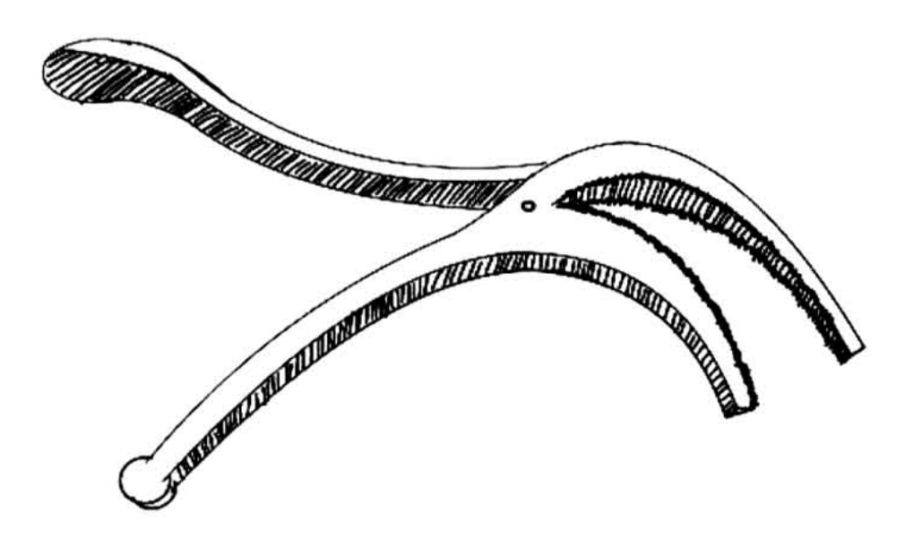
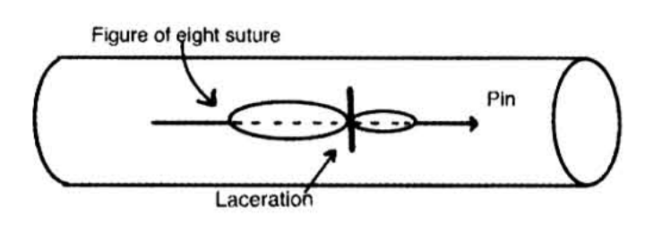
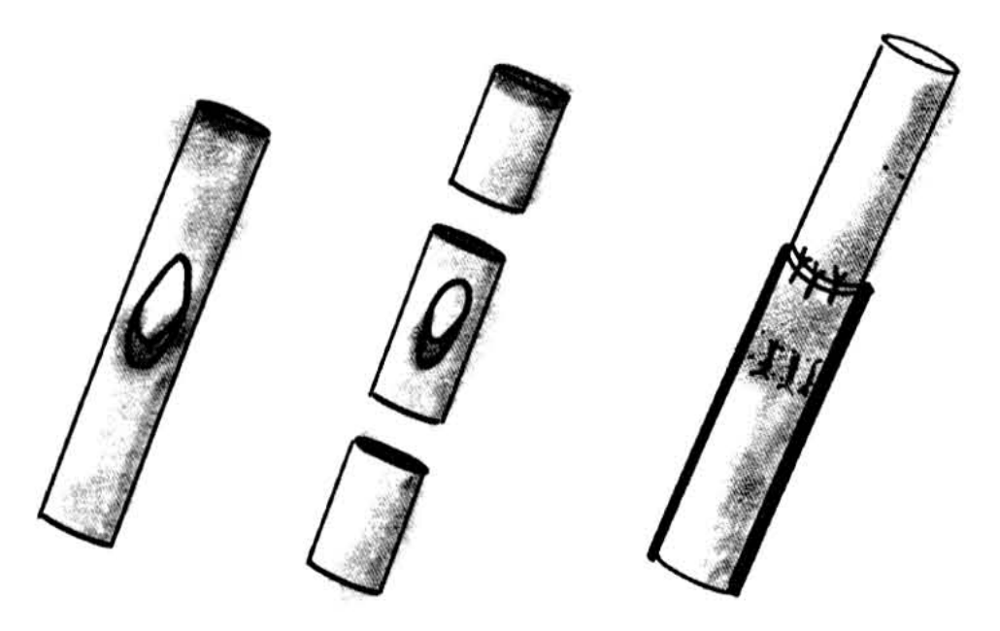
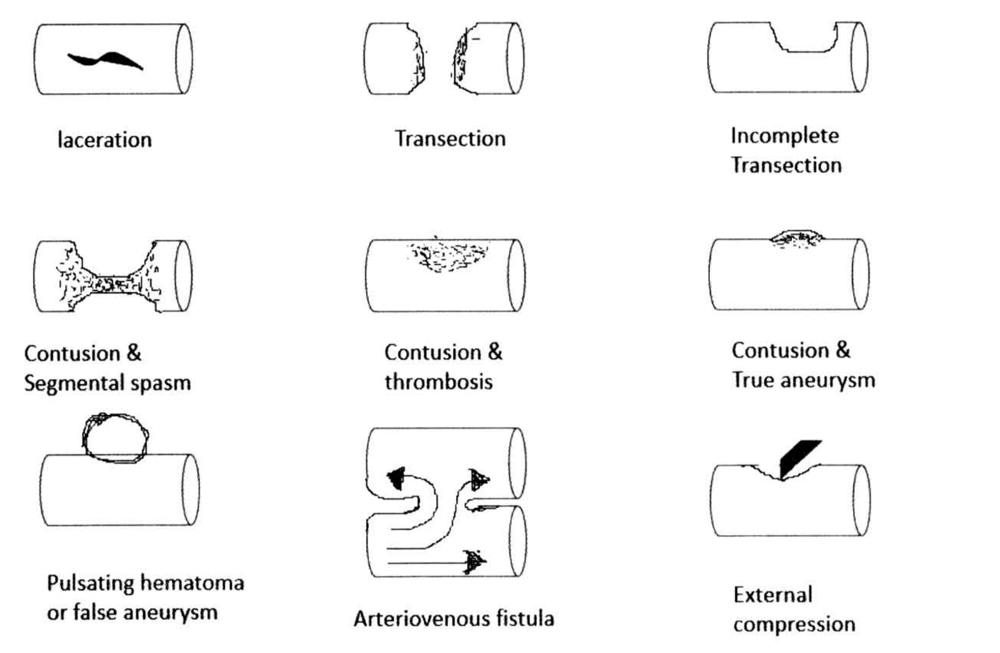
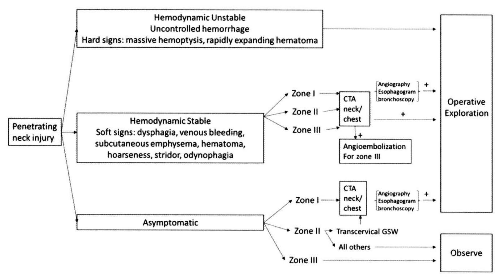
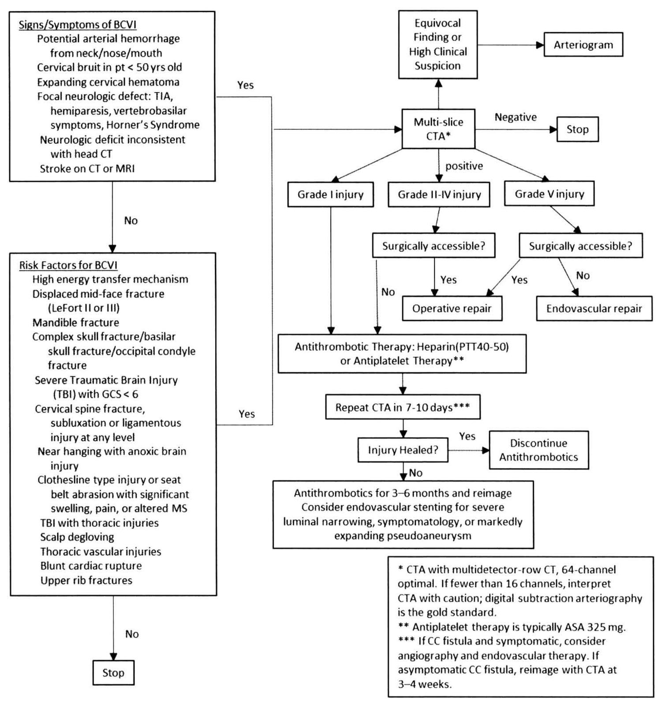

# การบาดเจ็บต่อหลอดเลือด (Vascular injury) — part 1 of 2

## Contents of this file
- ประวัติและความเป็นมา (p.728)
- ระบาดวิทยา (Epidemiology) (p.732)
- Pathophysiology (p.733)
- ปัจจัยที่มีผลต่อการรักษา (Prognostic factor) (p.735)
- อาการและอาการแสดงของการบาดเจ็บต่อหลอดเลือด (signs and symptoms) (p.736)
- การวินิจฉัย (diagnostic evaluation) (p.736)
  - ประวัติและการตรวจร่างกาย (history and physical examination) (p.736)
  - การตรวจทางรังสีวิทยา (vascular imaging) (p.738)
- การรักษา (management) (p.739)
  - การรักษาแบบไม่ผ่าตัด (non-operative management) (p.739)
  - การรักษาด้วย endovascular management (p.740)
  - การรักษาด้วยการผ่าตัด operative management (p.740)
- การบาดเจ็บต่อหลอดเลือดในตำแหน่งต่างๆ (p.740)
  - Carotid artery (p.740)
    - Penetrating injury (p.740)
      - อาการและอาการแสดง (Clinical Presentation) (p.741)
      - การวินิจฉัย (Diagnostic evaluation) (p.741)
      - การรักษา (p.742)
        - การรักษาแบบไม่ผ่าตัด (non-operative management) (p.742)
        - การรักษาด้วย Endovascular treatment (p.743)
        - การรักษาด้วยการผ่าตัด (Surgical treatment) (p.743)
    - Blunt cerebrovascular injury (BCVI) (p.744)
      - อาการและอาการแสดง (Clinical Presentation) (p.744)
      - การวินิจฉัย (diagnostic evaluation) (p.745)
        - Duplex ultrasonography (p.745)
        - Digital subtraction angiography (DSA) (p.745)
        - Computed Tomography Angiography (CTA) (p.745)
        - Magnetic Resonance Angiography (MRA) (p.745)
      - การรักษา (management) (p.747)
        - Medical treatment (p.747)
        - Endovascular therapy (p.748)
        - การรักษาด้วยการผ่าตัด (Surgical Management) (p.748)
- Vertebral artery (p.749)
  - อาการและอาการแสดง (Clinical Presentation) (p.749)
  - การวินิจฉัย (diagnostic evaluation) (p.749)
  - การรักษา (p.750)
  - Medical treatment (p.750)
  - Endovascular therapy (p.750)
  - การรักษาด้วยการผ่าตัด (Surgical Management) (p.750)
- Subclavian artery (p.751)
  - อาการและอาการแสดง (Clinical Presentation) (p.751)
  - การวินิจฉัย (diagnostic evaluation) (p.752)
  - Medical treatment (p.752)
  - Endovascular therapy (p.752)
  - การรักษาด้วยการผ่าตัด (Surgical Management) (p.753)
- Cervical venous injury (p.753)
  - อาการและอาการแสดง (Clinical Presentation) (p.754)
  - การวินิจฉัย (diagnostic evaluation) (p.754)
  - Endovascular therapy (p.754)
  - การรักษาด้วยการผ่าตัด (Surgical Management) (p.754)
- Thoracic vascular injury (p.754)
- Thoracic aortic injury (p.756)
- Blunt thoracic aortic injury (BTAI) (p.756)
- ประวัติที่สำคัญ (p.756)

<!-- p.727 (printed none) -->
**การบาดเจ็บต่อหลอดเลือด**

**Vascular injury**

ณฐวรรธ นฤพนธ์จิรกุล

<!-- p.728 (printed 714) -->
**การบาดเจ็บต่อหลอดเลือด**

**Vascular injury**

ณฐวรรธ นฤพนธ์จิรกุล

## ประวัติและความเป็นมา1

วิวัฒนาการของการรักษาการบาดเจ็บต่อหลอดเลือด พัฒนามามากกว่า 2,000 ปี โดยในสมัยอียิปต์โบราณได้มีการกล่าวถึงวิธีการหยุดเลือดไว้ใน Ebers’ papyrus โดยมีการกล่าวถึงสารที่ในการห้ามเลือด ซึ่งทำมาจากพืชและแร่ธาตุต่างๆ เช่น lead sulfate, antimony, copper sulfate ในยุคกลางของยุโรปหลายร้อยปีต่อมานิยมใช้ copper sulfate ในอินเดียมีการกล่าวถึงการกดห้ามเลือด การใช้ความเย็น การยกบริเวณที่บาดเจ็บให้สูงกว่าลำตัว การใช้น้ำมันร้อน ส่วนในจีนมีการกล่าวถึงการใช้ผ้าพันแผลและสารห้ามเลือด ต่อมาในสมัยต้นคริสตกาล การห้ามเลือดยังคงใช้การกดห้ามเลือดและการผูกหลอดเลือด (ligation) เป็นหลัก ในสมัยนั้นการทำการตัดรยางค์ (amputation) มักจะทำในบริเวณที่มีการขาดเลือดชัดเจน (demarcation) Archigenes ได้รายงานการ amputation บริเวณเหนือต่อ demarcation โดยใช้เทคนิคการผูกหลอดเลือดเพื่อห้ามเลือด Galen แพทย์ที่มีชื่อเสียงในสมัยโรมันได้แนะนำให้ใช้วิธีการกดห้ามเลือด และยังให้ข้อสังเกตอีกว่าการห้ามเลือดที่ออกจากหลอดเลือดดำ (venous bleeding) ใช้การกดหรือสารที่ทำให้เลือดแข็งตัวก็เพียงพอ แต่หากเป็นเลือดที่ออกจากหลอดเลือดแดง (arterial bleeding) มักจำเป็นต้องใช้การผูกหลอดเลือดเพื่อหยุดเลือด อย่างไรก็ตามการผูกหลอดเลือดไม่ได้ถูกกล่าวถึงอีกเป็นเวลา 1,200 ปี ต่อมาในปี ค.ศ. 1497 Jerome ได้กล่าวถึงการผูกหลอดเลือดอีกครั้ง Ambroise Pare ศัลยแพทย์ชาวฝรั่งเศสได้แสดงการทำ leg amputation บริเวณเหนือ Line of demarcation โดยใช้การผูกหลอดเลือดและเหลือส่วนของไหมที่ผูกไว้ยาว นอกจากนี้ Pare ยังได้ประดิษฐ์ bec de corbin (รูปที่ 1) ใช้สำหรับจับหลอดเลือดเพื่อทำการผูก อุปกรณ์นี้ถือเป็นต้นแบบของอุปกรณ์หยุดเลือดในปัจจุบัน อย่างไรก็ตามการผูกหลอดเลือดมีผลทำให้เกิดอาการปวดบริเวณที่ทำ amputation

<!-- p.729 (printed 715) -->
และต่อมา Haire สังเกตว่าการเหลือไหมไว้ยาวนั้นทำให้เกิดการติดเชื้อ ส่งผลให้แผลหายช้า ซึ่งในสมัยนั้นปัญหาของการรักษา คือการป้องกันการเกิดเลือดออกซ้ำ ซึ่งสาเหตุส่วนใหญ่ของการเกิดเลือดออกซ้ำมาจากการติดเชื้อ

> **Caption (verbatim):** **รูปที่ 1** bec de corbin
> **Text in image (verbatim):** none
> **Description:** Black-and-white pen line drawing with hatched shading of the bec de corbin ("crow's beak"), a hinged two-limbed instrument. Two long curved arms cross at a small pivot (a small round hole near the centre). On one side of the pivot are the handles: one long S-curved arm extending to the upper left ending in a broadened flattened tip, and one long curved arm extending to the lower left ending in a small round knob. On the other side of the pivot are two curved jaws (the "beak") arcing downward to the right, one slightly longer than the other, used, as the text states, to grasp a blood vessel for ligation.
> **Identifiers in image:** none

การใช้ tourniquet เป็นเทคนิคในการห้ามเลือดที่ได้ผลดี Morel ได้รายงานการทำขันชะเนาะในปี ค.ศ. 1674 ในปี ค.ศ. 1873 Freidrich von Esmarch ได้ใช้ elastic tourniquet ในการหยุดเลือดในภาวะสงคราม

ในช่วงต้นของคริสต์ศตวรรษที่ 19 มีการรายงานการผูกหลอดเลือดมากขึ้น โดย Coley ได้รายงานในปี ค.ศ. 1817 ถึงความสำเร็จของการผูกหลอดเลือด common carotid artery (CCA) ของ Fleming ในปี ค.ศ. 1803 (เนื่องจาก Fleming ได้เสียชีวิตอย่างรวดเร็วภายหลังการผ่าตัด) โดย Fleming ได้ทำการผูก CCA ในผู้บาดเจ็บที่ทำการปาดคอตัวเอง ต่อมาในปี ค.ศ. 1845 Ellis ได้รายงานการผูก CCA ทั้งสองข้างในผู้บาดเจ็บถูกยิง โดยผูก CCA ข้างซ้ายหลังจากการบาดเจ็บ 1 สัปดาห์ เนื่องจากมีเลือดออกมากขึ้น หลังจากนั้นประมาณ 4 วันครึ่ง ได้เกิดเลือดออกซ้ำอีก Ellis พบว่าเลือดออกช้าลงเมื่อกดที่ CCA ข้างขวา เขาจึงทำการผูก CCA ข้างขวา โดยผู้บาดเจ็บสามารถกลับไปใช้ชีวิตประจำวันได้ตามปกติ ซึ่ง concept ของ collateral circulation ได้ถูกกล่าวถึงมานานกว่า 2,000 ปี โดย Antyllus ส่วนในยุคสมัยใหม่ Halsted (1912) รายงานการรักษา iliofemoral aneurysm ด้วยการผูกหลอดเลือดด้วย aluminium band พบว่าขาสามารถใช้การได้ปกติ และ Halsted แสดงการเกิด collateral circulation โดยทำการทดลองในสุนัขด้วยการค่อยๆ เพิ่มการอุดตันของ aorta

<!-- p.730 (printed 716) -->
ในปี ค.ศ. 1759 มีการกล่าวถึงการผ่าตัดซ่อมแซมหลอดเลือดครั้งแรกของ Hallowell ซึ่งได้รับคำแนะนำจาก Lambert โดย Hollowell ทำการผ่าตัดซ่อม brachial artery โดยใช้เข็มยึดหลอดเลือดเข้าด้วยกัน แล้วใช้ figure of eight suture ยึดเข็มไว้ เรียกว่า farrier’s stitch (รูปที่ 2)

> **Caption (verbatim):** **รูปที่ 2** farrier’s stitch
> **Text in image (verbatim):** Figure of eight suture · Pin · Laceration
> **Description:** Simple black-and-white line diagram of a blood vessel drawn as a horizontal open cylinder (open end shown as an ellipse on the right). A short vertical line across the middle of the vessel marks the transverse laceration (arrow labelled "Laceration" from below). A straight pin runs lengthwise along the vessel surface across the laceration, ending in an arrowhead on the right (labelled "Pin"). A figure-of-eight suture is drawn as two loops (a larger one on the left and a smaller one on the right of the laceration) wound around the pin, with a dashed line showing the pin passing beneath; a curved arrow from the label "Figure of eight suture" above points to the left loop.
> **Identifiers in image:** none

**ตารางที่ 1** Vascular Repair Before 1900

| Technique | Year | Surgeon |
| --- | --- | --- |
| Pin and Thread | 1759 | Hallowell |
| Small ivory clamps | 1883 | Gluck |
| Fine needles and silk | 1889 | Jassinowsky |
| Continuous suture | 1890 | Burci |
| Invagination | 1896 | Murphy |
| Suture all layers | 1899 | Dorfler |

Murphy ทำการศึกษาในปี ค.ศ. 1897 ทำ end-to-end anastomosis สำเร็จ โดยทำการ invaginate proximal artery เข้าไปต่อกับ distal end (รูปที่ 3) นอกจากนี้ Murphy ยังศึกษาเกี่ยวกับระยะห่างที่ยังสามารถนำหลอดเลือดมาต่อกันแบบ end-to-end ได้ Murphy พบว่าระยะห่างประมาณ 1 นิ้วของหลอดเลือดบริเวณน่อง สามารถนำมาต่อกันได้ ซึ่งสรุปได้ว่าหากการบาดเจ็บที่มีระยะไม่เกิน ¾ นิ้ว สามารถทำ end-to-end anastomosis ได้

<!-- p.731 (printed 717) -->

> **Caption (verbatim):** **รูปที่ 3** ภาพแสดง end-to-end anastomosis
> **Text in image (verbatim):** none
> **Description:** Shaded pencil-style drawing in three stages, each showing an arterial segment as a diagonal cylinder. Left: an intact vessel segment with an oval hole (wound) in its wall. Middle: the vessel after excision of the injured part, drawn as three separate pieces: the upper (one) end, the excised middle segment containing the oval hole, and the lower (other) end. Right: the two remaining ends rejoined, with the upper segment inserted (invaginated) into the lower segment and held by several short stitches around the junction, consistent with Murphy's invagination end-to-end anastomosis described in the text.
> **Identifiers in image:** none

ในปี ค.ศ. 1903 Matas ได้รายงาน endoaneurysmorrhaphy technique ในปี ค.ศ. 1906 Carrel และ Guthrie ได้ทำการทดลองเกี่ยวกับการผ่าตัดซ่อมหลอดเลือดแดง การทำ vein transplantation การปลูกถ่ายหลอดเลือด อวัยวะ และรยางค์ต่างๆ นอกจากนี้ Carrel และ Guthrie ได้คิดค้นเทคนิคการต่อหลอดเลือดอีกด้วย และในปีเดียวกัน Goyanes ได้รายงานการผ่าตัดซ่อม popliteal aneurysm โดยใช้ popliteal vein เป็น conduit ต่อระหว่างปลายของหลอดเลือดแดงทั้งสองข้าง Goyanes ใช้เทคนิคการเย็บหลอดเลือดของ Carrel และ Guthrie โดยการเย็บขึงหลอดเลือดเป็นสามมุม แล้วเย็บ continuous suture ระหว่างมุมทั้งสาม

ในช่วงตอนต้นสงครามโลกครั้งที่ 1 ศัลยแพทย์ชาวเยอรมันรายงานการทำผ่าตัดซ่อมหลอดเลือดให้ผู้บาดเจ็บมากกว่า 100 ราย แต่ในระยะหลังของสงคราม มีการใช้ high velocity weapon มากขึ้น ส่งผลให้จำนวนผู้บาดเจ็บเพิ่มมากขึ้น Brenheim ศัลยแพทย์ที่มีประสบการณ์การซ่อมหลอดเลือดกล่าวถึงการผ่าตัดซ่อมหลอดเลือดว่าเป็นสิ่งที่เป็นไปไม่ได้ในภาวะสงคราม แต่เนื่องจากมีภาวะการติดเชื้อสูงและมีภาวะการขาดเลือดภายหลังการผูกหลอดเลือด Poole จึงให้ข้อสังเกตว่าการซ่อมหลอดเลือดน่าจะเป็นทางเลือกที่ดีในการรักษา เพื่อป้องกันภาวะขาดเลือดหลังการผูกหลอดเลือด และแม้ว่าการผ่าตัดซ่อมหลอดเลือดในนั้นจะไม่ได้รับความนิยม แต่ศัลยแพทย์ส่วนหนึ่งยังทำการผ่าตัดซ่อมหลอดเลือดในผู้บาดเจ็บที่มี arteriovenous fistula หรือ false aneurysm โดย Payr, Carrle และ Tuffier ได้กล่าวถึงการทำ anastomosis แบบชั่วคราว โดยใช้ Silver และ glass tube ซึ่งเทคนิคนี้ถูกนำมาใช้ได้สำเร็จโดย Makins และศัลยแพทย์ทหาร อย่างไรก็ตาม มีรายงาน patency rate สั้น ไม่เกิน 4 วันเท่านั้น

<!-- p.732 (printed 718) -->
DeBakey และ Simeone รายงานในปี ค.ศ. 1946 ว่าพบการบาดเจ็บต่อหลอดเลือดในช่วงสงครามโลกครั้งที่ 2 เป็นการบาดเจ็บต่อหลอดเลือดแดง 2,471 ราย ซึ่งผู้บาดเจ็บเกือบทั้งหมดได้รับการรักษาโดยการผูกหลอดเลือด มีอัตราการตัดรยางค์ 49% และมีผู้บาดเจ็บที่ได้รับการผ่าตัดซ่อมหลอดเลือด 81 ราย แบ่งเป็น lateral repair 78 ราย อีก 3 ราย ทำ end-to-end anastomosis มีอัตราการตัดรยางค์ 35% มีการใช้ vein grafts 40 ราย พบอัตราการตัดรยางค์ถึง 58% จากผลการรักษาข้างต้น DeBakey และ Simeone ได้สรุปว่าการผูกหลอดเลือดเป็นการรักษาการบาดเจ็บของหลอดเลือดที่เหมาะสมในภาวะสงคราม แม้ว่าโดยวัตถุประสงค์หลักคือการหยุดเลือดออก

ในสงครามเกาหลี ผลของการผ่าตัดซ่อมหลอดเลือดดีขึ้นเป็นอย่างมาก อันเนื่องมาจากหลายปัจจัย เช่น การดมยาสลบที่ดีขึ้น การให้ blood transfusion การพัฒนาของยาฆ่าเชื้อ และปัจจัยที่สำคัญ ได้แก่ การเคลื่อนย้ายผู้บาดเจ็บที่รวดเร็ว โดย Hughes รายงานในปี ค.ศ. 1958 จากผู้บาดเจ็บจำนวน 304 ราย ได้รับการผ่าตัดซ่อมหลอดเลือด 269 ราย การผูกหลอดเลือด 35 ราย อัตราการตัดรยางค์เหลือเพียง 13% ต่อมาในสงครามเวียดนามนั้น พบว่าผลการรักษาค่อนข้างดี โดยมีอัตราการตัดรยางค์ 13 % ใกล้เคียงกับในสงครามเกาหลี Cohen และคณะ ได้รายงานถึงปัญหาของการรักษาการบาดเจ็บต่อหลอดเลือด โดยอ้างอิงจากประสบการณ์จากสงครามเวียดนาม ได้แก่ 1) การบาดเจ็บของหลอดเลือดมักพบร่วมกับการบาดเจ็บของ soft tissue ที่รุนแรง 2) การอุดตันของหลอดเลือดดำ 3) การผ่าตัดหลอดเลือดซ้ำๆ 4) การบาดเจ็บร่วมกับกระดูกหักที่รุนแรง 5) การทำ tissue debridement ที่ไม่เพียงพอ 6) การบาดเจ็บต่อหลอดเลือดขนาดเล็กบริเวณขา

## ระบาดวิทยา (Epidemiology)2

ผลการศึกษาทางระบาดวิทยาพบว่า แนวโน้มอัตราการพิการและเสียชีวิตจากอุบัติเหตุมีเพิ่มมากขึ้น แต่การศึกษาทางระบาดวิทยาของการบาดเจ็บต่อหลอดเลือดในระดับโลกนั้นเป็นไปได้ยากเนื่องจากหลายสาเหตุ ได้แก่ ความแตกต่างของสาเหตุการบาดเจ็บ ลักษณะของการบาดเจ็บในแต่ละพื้นที่ ระบบการเก็บข้อมูลในแต่ละพื้นที่ใช้มาตรฐานที่แตกต่างกัน และในสถานการณ์ต่างๆ กัน เช่น ภาวะสงครามหรือในภาวะปกติ เป็นต้น ตัวอย่างการศึกษาการบาดเจ็บต่อหลอดเลือดในสหรัฐอเมริกา จากข้อมูลของ National Trauma Databank ช่วงปี ค.ศ. 2002-2006 พบอุบัติการณ์ 1.6% ของผู้บาดเจ็บทั้งหมด เป็นเพศชาย 80.2% อายุเฉลี่ย 34 ปี สาเหตุของการบาดเจ็บเกิดจาก penetrating injury 50.8% ตำแหน่งของหลอดเลือดที่บาดเจ็บพบที่บริเวณแขน 26.5% ช่องท้อง 24.8% ช่องอก 23.8%3

<!-- p.733 (printed 719) -->
การบาดเจ็บของหลอดเลือดที่เป็นภาวะแทรกซ้อนจากการดูแลรักษา (iatrogenic injury) พบได้มากขึ้น โดยเฉพาะในประเทศที่พัฒนาแล้ว มีการใช้การรักษาด้วยวิธีการทาง endovascular therapy ดังนั้น iatrogenic injury มักพบในผู้บาดเจ็บที่อายุมากขึ้นและมีโรคประจำตัวมากขึ้น จากการศึกษาใน Sweden ข้อมูลจาก National Vascular Registry ระหว่างปี ค.ศ. 1987-2005 พบการบาดเจ็บต่อหลอดเลือดที่เกิดจาก iatrogenic injury ถึง 48% ของการบาดเจ็บต่อหลอดเลือดทั้งหมด และอายุเฉลี่ยของผู้บาดเจ็บกลุ่มนี้อยู่ที่ 68 ปี สูงกว่ากลุ่มที่เกิดจาก penetrating และ blunt injury ที่อายุเฉลี่ยอยู่ที่ 35 ปี และ 40 ปี ตามลำดับ4

## Pathophysiology5

ผนังของหลอดเลือดแดงและหลอดเลือดดำ ประกอบด้วยเนื้อเยื่อทั้งหมด 3 ชั้น ได้แก่ ชั้นนอก คือ adventitia ประกอบด้วย connective tissue ชั้นกลาง คือ media ประกอบด้วย smooth muscle และ elastic fibers ส่วนชั้นใน คือ intima เมื่อเกิดการบาดเจ็บต่อหลอดเลือดสามารถทำให้เกิดพยาธิสภาพได้หลายแบบ เช่น laceration, transection, incomplete transection, contusion เป็นต้น (รูปที่ 4) ขึ้นอยู่กับกลไกการบาดเจ็บต่อหลอดเลือด (mechanism of injury) เช่น เมื่อหลอดเลือดฉีกขาดจะมีเลือดออกที่บริเวณเนื้อเยื่อรอบข้าง ทำให้มี tamponade effect และเกิด pulsatile hematoma ขึ้น ซึ่งอาจเกิดเลือดออกตามมาได้ หาก tamponade effect นั้นสูญเสียไป การบาดเจ็บต่อเฉพาะชั้น intima ซึ่งอาจเกิดจากการหักงอของหลอดเลือดอย่างรวดเร็ว เมื่อเกิด Intimal injury แล้วจะกระตุ้นให้เกิด coagulation cascade ตามมา เนื่องจากในชั้น subendothelial มีสารต่างๆ ที่กระตุ้นให้เกิด thrombus formation ซึ่งอาจหลุดลอยไปตามหลอดเลือด ทำให้เกิด distal embolization หรืออาจทำให้เกิดการอุดตันของหลอดเลือดส่วนปลายได้ นอกจากนี้การบาดเจ็บต่อชั้น intima ยังอาจทำให้เกิดลักษณะของ flap ในหลอดเลือด และเกิด dissection ตามมาได้ การบาดเจ็บต่อหลอดเลือดร่วมกับการบาดเจ็บต่อกระดูก อาจมีกระดูกบางส่วนมากดทับหลอดเลือดทำให้หลอดเลือดตีบแคบลง การหดตัวของหลอดเลือด (vasospasm) อาจเกิดจาก stretching หรือ contusion บริเวณหลอดเลือด การมีเลือดออกนอกหลอดเลือดสามารถกระตุ้นให้เกิดการหดตัวของหลอดเลือดได้จากผลของ hemoglobin ต่อผิวด้านนอกของหลอดเลือดแดง

<!-- p.734 (printed 720) -->

> **Caption (verbatim):** **รูปที่ 4**6 ลักษณะการบาดเจ็บต่อหลอดเลือด
> **Text in image (verbatim):** laceration · Transection · Incomplete Transection · Contusion & Segmental spasm · Contusion & thrombosis · Contusion & True aneurysm · Pulsating hematoma or false aneurysm · Arteriovenous fistula · External compression
> **Description:** Black-and-white line drawing in a 3 × 3 grid; each panel shows a blood vessel segment as a horizontal cylinder with one type of injury, labelled beneath. Row 1: "laceration" — a dark slit-like tear in the vessel wall; "Transection" — the vessel completely divided into two separate pieces with ragged ends; "Incomplete Transection" — a notch cut into the upper wall leaving the rest of the circumference intact. Row 2: "Contusion & Segmental spasm" — the middle of the vessel narrowed (hourglass shape) with stippled contused wall; "Contusion & thrombosis" — stippled clot within the upper part of the lumen; "Contusion & True aneurysm" — a small stippled bulge of the upper wall. Row 3: "Pulsating hematoma or false aneurysm" — a round sac sitting on top of the vessel; "Arteriovenous fistula" — two parallel vessels (one above the other) connected by a channel, with curved arrows running from the lower vessel up through the communication and turning left and right within the upper vessel, and a straight arrow continuing along the lower vessel; "External compression" — a dark wedge-shaped object pressing down and indenting the upper wall of the vessel.
> **Identifiers in image:** none

กลไกการบาดเจ็บต่อหลอดเลือดที่เกิดจาก penetrating injury มักทำให้เกิดการบาดเจ็บเฉพาะจุดมากกว่า blunt injury ซึ่งมักทำให้เกิดการบาดเจ็บเป็นบริเวณที่กว้างและมีการบาดเจ็บต่อเนื้อเยื่อรอบข้างมากกว่า ปัจจัยที่มีผลต่อความรุนแรงของการบาดเจ็บ ได้แก่ ความเร็วของวัตถุที่มากระทำ เช่น กระสุนปืน เป็นต้น ตามหลักพลังงานจลน์ ซึ่งแปรผันตามความเร็วยกกำลังสอง การบาดเจ็บแบบ penetrating injury จึงถูกแบ่งตามความเร็ว เป็น low velocity (>2,500 ft/s) เช่น จากการถูกแทง และ high velocity (>2,500 ft/s) เช่น การบาดเจ็บจากอาวุธสงคราม ส่วนอาการและอาการแสดงของการบาดเจ็บต่อหลอดเลือดนั้น นอกจากการมีเลือดออกหรือการขาดเลือดของอวัยวะส่วนปลาย ซึ่งเป็นอาการที่ชัดเจนแล้วนั้น ยังอาจแสดงอาการที่ไม่ชัดเจนได้ โดยเฉพาะในกรณีที่ลักษณะการบาดเจ็บเป็นแบบ arteriovenous fistulae ทำให้เกิดอาการบริเวณที่มีรอยโรค เช่น มีการบวม กดเจ็บ มีการขาดเลือดส่วนปลาย congestive heart failure หรือ pseudoaneurysm ซึ่งอาจทำให้เกิดการกดเบียดอวัยวะข้างเคียงหรือเกิด distal embolization ได้แต่พบได้น้อย

ลักษณะการบาดเจ็บต่อหลอดเลือดบางแบบ เช่น small intimal flap, intimal irregularities, small pseudoaneurysm หรือ small arteriovenous fistula อาจดีขึ้น

<!-- p.735 (printed 721) -->
ได้เอง แต่อย่างไรก็ตามในปัจจุบันยังไม่มีปัจจัยใดที่สามารถใช้ในการทำนายว่าการบาดเจ็บแบบใดสามารถหายได้เอง ดังนั้นการตรวจติดตามจึงมีความสำคัญ

การทนต่อการขาดเลือดของแต่ละอวัยวะขึ้นกับอัตราการใช้พลังงานสำรองของอวัยวะนั้นๆ ระยะเวลา และความรุนแรงของการขาดเลือด ซึ่งเส้นประสาทเป็นอวัยวะที่ทนต่อการขาดเลือดได้น้อย เนื่องจากเป็นอวัยวะที่ใช้พลังงานสูงและไม่มีการเก็บสะสมพลังงาน (glycogen) ด้วยตัวเอง ดังนั้นอาการจากขาดเลือดของเส้นประสาท เช่น อาการชา จึงเป็นอาการแสดงแรกๆ ของการขาดเลือด ส่วนกล้ามเนื้อทนการขาดเลือดได้ดีกว่า จากการศึกษาพบว่าการเปลี่ยนแปลงทาง histology จะพบหลังจากการขาดเลือดนานกว่า 3 ชั่วโมง นอกจากการขาดเลือดแล้ว การบาดเจ็บจาก reperfusion injury ก็มีความสำคัญ ischemic reperfusion injury เกิดจากหลายปัจจัย ได้แก่ การขาดเลือดของ endothelial glycocalyx ทำให้ normal endothelial cell เปลี่ยน phenotype จาก anti-coagulant และ anti-inflammatory ไปเป็น procoagulant และ pro-inflammatory มีหลักฐานพบว่ามีการกระตุ้น compliment และ Kinin cascade จาก neutrophils ที่ถูกกระตุ้น นอกจากนั้นการบาดเจ็บยังทำให้เกิดการบวมน้ำ นำไปสู่ no reflow phenomenon, compartment syndromes, myonecrosis หรือ rhabdomyolysis ทำให้มี myoglobin และ potassium ไหลกลับเข้ากระแสเลือด ซึ่งสามารถทำให้เกิด cardiac arrhythmia ได้

## ปัจจัยที่มีผลต่อการรักษา (Prognostic factor)

ปัจจัยที่สำคัญที่สุดที่มีผลต่อการรักษาผู้บาดเจ็บที่หลอดเลือด คือระยะเวลาตั้งแต่การบาดเจ็บจนถึงระยะเวลาที่ได้รับการรักษา ซึ่งหมายถึงการทำให้เลือดไปเลี้ยงขา (restorative of flow) ไม่ได้หมายถึงการผ่าตัดซ่อมแซมหลอดเลือด หลักฐานจากการศึกษาทดลองแนะนำว่าควรรักษาเพื่อนำเลือดไปเลี้ยงอวัยวะส่วนปลายภายใน 3 ชั่วโมง เพื่อหลีกเลี่ยงการขาดเลือดต่อเส้นประสาทและกล้ามเนื้อ หากการรักษาล่าช้าเกินกว่า 6 ชั่วโมง อาจให้ผลการรักษาที่ไม่ดี ส่วนปัจจัยอื่นๆ ที่มีผลกับการรักษา อาทิเช่น การบาดเจ็บจาก blunt mechanism, hypovolemic shock, มีการบาดเจ็บต่อเส้นประสาทร่วม, มีการบาดเจ็บต่อกระดูกร่วมด้วย และโรคประจำตัวของผู้บาดเจ็บ

<!-- p.736 (printed 722) -->
## อาการและอาการแสดงของการบาดเจ็บต่อหลอดเลือด (signs and symptoms)

ผู้บาดเจ็บที่ได้รับการบาดเจ็บต่อหลอดเลือดมีอาการที่สำคัญและรุนแรงที่สุด ได้แก่ การมีเลือดออก ซึ่งเป็นสาเหตุที่ทำให้ผู้บาดเจ็บเสียชีวิตได้ในระยะเวลาอันสั้น การบาดเจ็บต่อหลอดเลือดยังทำให้เกิดการขาดเลือดต่ออวัยวะส่วนปลาย ส่งผลให้เกิดการตายของอวัยวะนั้นๆ การบาดเจ็บที่เกิดจาก penetrating injury มักไม่พบการบาดเจ็บต่ออวัยวะหรือเนื้อเยื่อรอบข้างมากนัก ซึ่งต่างจากการบาดเจ็บที่เกิดจาก blunt injury ซึ่งมักพบการบาดเจ็บต่อเนื้อเยื่อรอบข้างร่วมด้วย เช่น กระดูกหัก กล้ามเนื้อฉีกขาด ระดับของการบาดเจ็บจาก blunt injury มักเป็นไปตามแรงที่มากระทำโดยตรง

## การวินิจฉัย (diagnostic evaluation)

### ประวัติและการตรวจร่างกาย (history and physical examination)

การซักประวัติและการตรวจร่างกายที่ดียังมีส่วนสำคัญในการดูแลรักษาผู้บาดเจ็บ ประวัติที่สำคัญ ได้แก่ กลไกการบาดเจ็บ (mechanism of injury) เวลาที่เกิดการบาดเจ็บ โรคประจำตัว ประวัติการใช้ยา ประวัติการใช้ยาเสพติด ประวัติโรคทางหลอดเลือด เช่น หลอดเลือดอุดตัน

การตรวจร่างกายเริ่มต้นตั้งแต่สัญญาณชีพ vital sign เนื่องจากความดันโลหิต (blood pressure) และอุณหภูมิร่างกาย (body temperature) มีผลต่อการประเมินการบาดเจ็บของหลอดเลือด เช่น ในภาวะ hypotension อาจคลำชีพจรได้เบาลง หรือในภาวะ hypothermia ทำให้เกิด prolonged capillary refill ได้ ซึ่งการ resuscitation ที่ดีจะทำให้คลำชีพจรได้ดี และมี capillary refill ดีขึ้น โดยเฉพาะในรยางค์ข้างที่ไม่มีการบาดเจ็บ แต่อาจจะมีผลน้อยหรือไม่มีผลเลยต่อรยางค์ที่มีการบาดเจ็บของหลอดเลือดร่วมด้วย การตรวจหาอาการแสดงที่บ่งบอกถึงการบาดเจ็บต่อหลอดเลือดแบ่งเป็น Hard signs และ Soft signs ตามตารางที่ 2 Hard signs ได้แก่ pulsatile bleeding, expanding hematoma, palpable thrill, audible bruit และ evidence of regional ischemia หากพบ hard signs มักบ่งบอกถึงการบาดเจ็บต่อหลอดเลือดและจำเป็นต้องรักษาด้วยการผ่าตัด ส่วน soft signs ได้แก่ ประวัติการมีเลือดออกมาก การบาดเจ็บร่วม เช่น กระดูกหัก ข้อเคลื่อน บาดแผลถูกยิงหรือถูกแทงในตำแหน่งที่ใกล้เคียงกับหลอดเลือด การคลำชีพจรได้เบาลง การทำงานของเส้นประสาทส่วนปลายผิดปกติ

<!-- p.737 (printed 723) -->
ซึ่งอาจเกิดจากการบาดเจ็บโดยตรงหรือการขาดเลือด เมื่อตรวจพบ soft signs ให้สงสัยว่ามีโอกาสเกิดการบาดเจ็บต่อหลอดเลือดและส่งตรวจเพิ่มเติมเพื่อยืนยันการวินิจฉัย การตรวจนี้ควรทำทั้งรยางค์ข้างที่สงสัยการบาดเจ็บและข้างที่ปกติเพื่อเปรียบเทียบกัน อย่างไรก็ตามเรามักพบว่าการตรวจคลำชีพจรนั้นมีโอกาสผิดพลาดได้ ขึ้นกับประสบการณ์ของผู้ตรวจ การใช้ handheld doppler ultrasound สามารถช่วยเพิ่มความถูกต้องของการตรวจชีพจรได้ โดยเทคนิคการตรวจ คือวางหัวตรวจทำมุมประมาณ 45 องศากับทิศทางการไหลของเลือด โดย doppler signal ของหลอดเลือดแดงปกติจะเป็น triphasic หากมีการลดลงของ flow จะพบเป็น biphasic หรือ monophasic และในกรณีที่มีการบาดเจ็บของหลอดเลือดจนไม่มีการไหลของเลือดมาเลี้ยงจะตรวจไม่พบ signal ส่วนในกรณีของหลอดเลือดดำ จะให้ signal ที่ไม่เป็น pulsatile และสามารถ augment ได้ด้วยการบีบบริเวณปลายขาหรือการทำ valsava maneuver นอกจากการฟัง doppler signal เปลี่ยนแปลงไปแล้ว การวัด arterial pressure index (API) คำนวณด้วย systolic blood pressure (SBP) ของแขนหรือขาข้างที่สงสัยว่ามีการบาดเจ็บ หารด้วย SBP ของแขนข้างปกติ หากค่าผล API น้อยกว่า 0.9 แสดงว่ามี sensitivity 95% และ specificity 97%(7) ในการตรวจหาการบาดเจ็บต่อหลอดเลือด โดยทั่วไป SBP ของรยางค์ปกติเทียบกัน 2 ข้าง ไม่ควรต่างกันเกิน 20 mmHg หากพบว่า SBP ต่ำกว่า 50-60 mmHg บ่งชี้ว่ารยางค์ข้างนั้นมีการขาดเลือดที่รุนแรง

**ตารางที่ 2**5 Hard signs and soft signs of vascular injuries

| Hard signs | Soft signs |
| --- | --- |
| Pulsatile bleeding | History of moderate hemorrhage |
| Expanding hematoma | Injury (fracture, dislocation, or penetrating wound) |
| Palpable thrill | Diminished but palpable pulse |
| Audible bruit | Peripheral nerve deposit |
| Evidences of regional ischemia |  |

<!-- p.738 (printed 724) -->
### การตรวจทางรังสีวิทยา (vascular imaging)5

การทำ conventional angiography เป็น gold standard ของการวินิจฉัยการบาดเจ็บของหลอดเลือด แต่ในปัจจุบัน conventional angiography ถูกทดแทนด้วย multidetector computed tomography angiography (CTA) ซึ่ง invasive น้อยกว่า นอกจากนั้นยังให้รายละเอียดการบาดเจ็บของอวัยวะข้างเคียง การทำ CTA สำหรับหลอดเลือดในรยางค์ (extremities) ควรใช้ 64 slice CTA เป็นอย่างน้อย เพื่อให้ได้รายละเอียดที่ชัดเจน อย่างไรก็ตามการส่ง CTA นั้น มีข้อจำกัดในผู้บาดเจ็บที่มี hemodynamic unstable ข้อบ่งชี้ในการตรวจโดยทั่วไป ได้แก่ ผู้บาดเจ็บที่มีการตรวจพบ soft sign ของการบาดเจ็บต่อหลอดเลือด หรือในผู้บาดเจ็บที่มี hard sign ของการบาดเจ็บต่อหลอดเลือด แต่ตำแหน่งของการบาดเจ็บต่อหลอดเลือดแน่ชัด ซึ่งมีผลต่อการตัดสินในการผ่าตัดรักษา เช่น ผู้บาดเจ็บที่ได้รับบาดเจ็บบริเวณ axillo-subclavian arteries หรือในผู้บาดเจ็บที่มี penetrating injury หลายตำแหน่ง เป็นต้น ตารางที่ 3 แสดงตัวอย่างข้อบ่งชี้ของการตรวจ angiography (รวมทั้ง CTA และ conventional angiography) ในผู้บาดเจ็บที่สงสัยการบาดเจ็บต่อหลอดเลือดของแขน-ขา

**ตารางที่ 3**5 Indications for Arteriography in Patients with Extremity Injuries

| Blunt force injury | Penetrating injury |
| --- | --- |
| Multilevel extremity fractures with distal ischemia | Significant hematoma in proximity to wound with intact distal flow |
| Crush injury with diminished blood flow | Multilevel penetration from a shotgun blast |
| Extensive hematoma with intact distal flow | Presence of a thrill or bruit over an area of injury |
| Presence of a thrill or bruit over an area of injury | |

การตรวจด้วย color duplex ultrasonography ยังมีประโยชน์ต่อการวินิจฉัยการบาดเจ็บต่อหลอดเลือดในภาวะเฉียบพลันไม่มากนัก เนื่องจากการทำต้องอาศัยผู้เชี่ยวชาญและการแปลผลขึ้นกับผู้ทำเป็นหลัก แต่นิยมใช้ในการวินิจฉัย Pseudoaneurysm หรือ arteriovenous fistula ซึ่งได้ผลดีและยังใช้ในการตรวจติดตามการรักษาอีกด้วย

<!-- p.739 (printed 725) -->
ในผู้บาดเจ็บที่มี hemodynamic unstable หรือจำเป็นต้องรับการผ่าตัดอื่นๆ ร่วมด้วย อาจพิจารณาที่การทำ single-shot extremity arteriography รายละเอียดดังตารางที่ 4

**ตารางที่ 4** Technique for “Single-Shot” Extremity Arteriography

| |
| --- |
| Place a radiograph cassette beneath the area of concern in the extremity |
| Insert and hold steady an 18 gauge needle or short 16 gauge catheter in the femoral or axially artery |
| Aspirate blood to the level of the syringe containing contrast to avoid air bubbles |
| Rapidly inject 20 mL of full-strength intravenous contrast agent for the leg, and 10 mL for the arm |
| Delay x-ray exposure for 2 seconds for the proximal upper extremity and proximal thigh, 3 seconds for the forearm and distal thigh, 4 seconds for the popliteal level, and 5 seconds for the tibial vessels |
| Fluoroscopy with the digital subtraction angiography mode may also be used |

## การรักษา (management)

### การรักษาแบบไม่ผ่าตัด (non-operative management)

ผู้บาดเจ็บที่มีการบาดเจ็บต่อหลอดเลือดระดับไม่มาก (minimal vascular injury) ซึ่งมักไม่มีอาการและมีโอกาสที่จะหายได้เอง ได้แก่ intimal irregularities (intimal flap), small arteriovenous fistulae, focal spasm with minimal narrowing และ small pseudoaneurysms โดยผลตรวจมักได้จากการทำ CTA ผู้บาดเจ็บในกลุ่มนี้ประมาณ 5-15% มีอาการที่ต้องการการรักษา ซึ่งโดยส่วนใหญ่จะเกิดในระยะเวลาไม่นานหลังจากการบาดเจ็บ จากหลักฐานพบว่าการรักษาแบบไม่ผ่าตัดใน minimal vascular injury สามารถทำได้ แต่ต้องการการตรวจติดตามในระยะยาว

<!-- p.740 (printed 726) -->
### การรักษาด้วย endovascular management

วิธีการรักษาด้วย endovascular management หมายรวมถึงการใส่ coil embolization, vasodilator infusion และการใส่ covered หรือ uncovered stent ในปัจจุบันการใช้ endovascular technique ในการรักษาการบาดเจ็บต่อหลอดเลือดที่เป็นที่ยอมรับ ได้แก่ การใส่ covered stent เพื่อรักษา blunt traumatic aortic injury การทำ embolization เพื่อหยุดเลือดออกจากการบาดเจ็บของหลอดเลือดในตับและในช่องเชิงกราน ส่วนการรักษาการบาดเจ็บต่อหลอดเลือดในส่วนอื่นๆ นั้น จำเป็นต้องพิจารณาเป็นรายๆ ไป

### การรักษาด้วยการผ่าตัด operative management

วัตถุประสงค์หลักของการผ่าตัดเพื่อรักษาการบาดเจ็บของหลอดเลือด ได้แก่ การหยุดเลือดออกและการรีบนำเลือดไปเลี้ยงอวัยวะส่วนปลายอย่างรวดเร็ว การพิจารณาการซ่อมหลอดเลือดนั้นขึ้นอยู่กับสภาวะของผู้บาดเจ็บ หากผู้บาดเจ็บมี vital sign instability การผ่าตัดซ่อมหลอดเลือด (definitive repair) อาจเป็นการรักษาที่ไม่เหมาะสม ควรพิจารณาทำ damage control surgery มากกว่า เช่น การใส่ temporary vascular shunt การใช้ tourniquet เป็นต้น

## การบาดเจ็บต่อหลอดเลือดในตำแหน่งต่างๆ

การบาดเจ็บต่อหลอดเลือดในตำแหน่งต่างๆ ที่เกิดจากกลไกการบาดเจ็บที่แตกต่างกัน มีทั้งการรักษาแบบไม่ผ่าตัด การรักษาด้วยการผ่าตัด และการรักษาด้วย endovascular treatment ดังนี้

### Carotid artery8

#### Penetrating injury

การบาดเจ็บจาก penetrating injury ต่อหลอดเลือดบริเวณลำคอ ทำให้เกิด stroke ประมาณ 7-27% และมีอัตราตาย 7-25% โดยผู้บาดเจ็บที่เสียชีวิต 80% มีสาเหตุมาจาก stroke

<!-- p.741 (printed 727) -->
##### อาการและอาการแสดง (Clinical Presentation)

อาการของการบาดเจ็บต่อ carotid artery สามารถแสดงอาการตั้งแต่กระทั่งเลือดออกรุนแรง ซึ่งทำให้ผู้บาดเจ็บเสียชีวิตโดยเร็ว และอาการอื่นๆ เช่น การบวมบริเวณลำคอจากการมี hematoma อาการเสียงแหบ (hoarseness of voice) จากการบาดเจ็บต่อทางเดินหายใจ กลืนเจ็บ กลืนลำบาก มีน้ำลายไหลออกมาจากแผลที่มีการบาดเจ็บต่อทางเดินอาหาร เป็นต้น มีแนวทางในการพิจารณาการบาดเจ็บ โดยแบ่งผู้บาดเจ็บออกเป็น 3 กลุ่มตามอาการ ได้แก่ 1) ผู้บาดเจ็บที่มีสัญญาณชีพไม่ปกติ มีเลือดออกรุนแรง ซึ่งอาจทำให้ผู้บาดเจ็บเสียชีวิตอย่างรวดเร็ว ผู้บาดเจ็บกลุ่มนี้จำเป็นต้องรับการรักษาอย่างทันท่วงที 2) ผู้บาดเจ็บที่มี soft signs ของการบาดเจ็บต่อหลอดเลือด แต่มีสัญญาณชีพที่ค่อนข้างดี และมีอาการที่ชวนสงสัยการบาดเจ็บต่ออวัยวะอื่นๆ บริเวณลำคอ เช่น การกลืนลำบาก (dysphagia) การกลืนเจ็บ (odynophagia) การบวมจาก hematoma เสียงแหบ การหายใจมีเสียง stridor การตรวจพบ subcutaneous emphysema และอาการของการบาดเจ็บต่อเส้นประสาทสมอง (cranial nerve IX, X, XI และ XII) และการบาดเจ็บต่อ brachial plexus และ 3) ผู้บาดเจ็บกลุ่มที่ไม่มีอาการ

การพิจารณาการบาดเจ็บต่อหลอดเลือดบริเวณลำคอนิยมแบ่งเป็น zone ได้แก่ zone I หมายถึงบริเวณใต้ต่อ sternal notch ลงมา Zone II เหนือ sternal notch จนถึง angle of mandible และ Zone III คือบริเวณเหนือ angle of mandible โดยส่วนใหญ่การบาดเจ็บมักเกิดในบริเวณ zone II มากที่สุด กลไกการบาดเจ็บมีส่วนช่วยในการวินิจฉัยการบาดเจ็บ เช่น การบาดเจ็บบริเวณลำคอที่เกิดจาก shotgun, blast injury และ transverse cervical gunshot wound มีโอกาสพบการบาดเจ็บต่อหลอดเลือดได้สูง

##### การวินิจฉัย (Diagnostic evaluation)

ในผู้บาดเจ็บกลุ่มที่มีสัญญาณชีพผิดปกติ (vital sign unstable) หรือมี hard signs ของการบาดเจ็บ ควรรีบนำผู้บาดเจ็บไปรับการผ่าตัด โดยไม่เสียเวลาทำการตรวจเพิ่มเติม เนื่องจากไม่มีผลต่อการเลือกการรักษา ดังนั้นการส่งตรวจวินิจฉัยเพิ่มเติมจึงควรพิจารณาในผู้บาดเจ็บที่มี soft signs ของการบาดเจ็บดังที่กล่าวไปข้างต้น ในปัจจุบันไม่แนะนำให้ทำการ routine neck exploration ในการบาดเจ็บบริเวณ zone II เนื่องจากพบ negative rate สูงถึง 50-90%

<!-- p.742 (printed 728) -->
แนวทางการวินิจฉัย (รูปที่ 5) ในปัจจุบันการทำ CT มีประโยชน์ในการช่วยวินิจฉัยการบาดเจ็บในผู้บาดเจ็บที่ไม่มี hard sign และมี vital sign stable เนื่องจากสามารถให้รายละเอียดการบาดเจ็บของทุกอวัยวะ สำหรับ CTA ใน penetrating injury มี sensitivity 90% และ specificity 100% ในการตรวจหาการบาดเจ็บต่อหลอดเลือดบริเวณลำคอ อย่างไรก็ตามข้อจำกัดของ CTA เช่น การบาดเจ็บจากกระสุนปืนหรือการบาดเจ็บที่มีกระดูกหักร่วมด้วยอาจทำให้การวินิจฉัยยากขึ้น ซึ่งอาจมีความจำเป็นต้องทำ conventional angiography ช่วย ส่วนการทำ ultrasonography ในบริบทของการวินิจฉัยค่อนข้างจำกัด

> **Caption (verbatim):** **รูปที่ 5**9 แนวทางการวินิจฉัยและรักษาการบาดเจ็บที่คอ จาก penetrating injury
> **Text in image (verbatim):** Penetrating neck injury · Hemodynamic Unstable · Uncontrolled hemorrhage · Hard signs: massive hemoptysis, rapidly expanding hematoma · Hemodynamic Stable · Soft signs: dysphagia, venous bleeding, subcutaneous emphysema, hematoma, hoarseness, stridor, odynophagia · Asymptomatic · Zone I · Zone II · Zone III · CTA neck/ chest · Angiography · Esophagogram · bronchoscopy · + · Angioembolization For zone III · Transcervical GSW · All others · Operative Exploration · Observe
> **Description:** Flowchart (left to right) for penetrating neck injury. The end-point boxes on the right are a tall box "Operative Exploration" and a smaller box "Observe" below it. The flow is transcribed as a list below the figure.
> **Identifiers in image:** none

Flowchart transcription:

- Penetrating neck injury → three branches:
  - Hemodynamic Unstable / Uncontrolled hemorrhage / Hard signs: massive hemoptysis, rapidly expanding hematoma → Operative Exploration
  - Hemodynamic Stable / Soft signs: dysphagia, venous bleeding, subcutaneous emphysema, hematoma, hoarseness, stridor, odynophagia → Zone I, Zone II, Zone III → each → CTA neck/chest
    - CTA neck/chest → bracketed group (Angiography, Esophagogram, bronchoscopy) → "+" → Operative Exploration
    - CTA neck/chest → "+" → Operative Exploration
    - CTA neck/chest → "+" → Angioembolization For zone III
  - Asymptomatic → three branches:
    - Zone I → CTA neck/chest → bracketed group (Angiography, Esophagogram, bronchoscopy) → "+" → Operative Exploration
    - Zone II → Transcervical GSW → (arrow up to) CTA neck/chest; Zone II → All others → Observe
    - Zone III → Observe

##### การรักษา

###### การรักษาแบบไม่ผ่าตัด (non-operative management)

การพิจารณาการรักษาแบบไม่ผ่าตัดสามารถทำได้ในการบาดเจ็บที่ไม่มาก (occult injury) เช่น Intimal flap, dissection และ pseudoaneurysm ซึ่ง Intimal flap และ dissection พบได้น้อยเพียงประมาณ 2% occult injury ที่พบบ่อยใน penetrating injury ได้แก่ pseudoaneurysm ซึ่ง small pseudoaneurysm สามารถรักษาได้ด้วย antithrombotic therapy อย่างไรก็ตามต้องติดตามการรักษาอย่างต่อเนื่อง เนื่องจากยังไม่มีรายงานการดำเนินของโรคในระยะยาวที่ชัดเจน

<!-- p.743 (printed 729) -->
###### การรักษาด้วย Endovascular treatment

การรักษาด้วย endovascular technique มีประโยชน์โดยเฉพาะต่อการบาดเจ็บในตำแหน่ง zone I และ Zone III ซึ่งหากการรักษาด้วยการผ่าตัดทำได้ยาก โดย endovascular technique สามารถใช้รักษา aneurysm, partial transaction และ arteriovenous fistula ได้ ส่วนใน zone II แนะนำให้รักษาด้วยการผ่าตัดมากกว่า

###### การรักษาด้วยการผ่าตัด (Surgical treatment)

การผ่าตัดซ่อมแซมหลอดเลือดแดง carotid ในแต่ละ zone มีความแตกต่างกันในการทำ proximal และ distal control ควรเตรียมบริเวณต้นขาของผู้บาดเจ็บ เพราะอาจมีความจำเป็นต้องใช้ greater saphenous vein graft บริเวณหน้าอกไปจนถึงกกหู โดยทั่วไปการทำ proximal และ distal control ของหลอดเลือดบริเวณคอ มักทำได้โดยผ่าน cervical incision หน้ากล้ามเนื้อ sternocleidomastoid โดยเฉพาะในบริเวณ Zone II และอาจจะขยายแผลผ่าตัดลงไปที่บริเวณช่องอก (median sternotomy incision) หรือขยายแผลขึ้นไปที่กกหู เพื่อเข้าถึงหลอดเลือดบริเวณ zone III บางรายต้องทำ mandible subluxation เพื่อซ่อมแซมการบาดเจ็บ

การบาดเจ็บต่อหลอดเลือด carotid ควรพยายามทำการซ่อมแซมการทำการผูกหลอดเลือดแดง external carotid และหลอดเลือดดำ internal jugular ซึ่งสามารถทำได้โดยไม่ก่อให้เกิด morbidity ที่มากเกินไป แต่การผูกหลอดเลือดแดง internal carotid มีอัตราตาย 45% โดยทั่วไปการซ่อมหลอดเลือดบริเวณคอมักทำได้โดยวิธี primary repair แต่หากมีการฉีกขาดของหลอดเลือดที่กว้างมาก อาจจำเป็นต้องทำ interposition graft โดยทั่วไปจะเลือกใช้ great saphenous vein สำหรับ internal และ external carotid artery สำหรับหลอดเลือด common carotid artery สามารถใช้ PTFE หรือ polyester graft เนื่องจากสามารถเลือกขนาดที่ใกล้เคียงกับหลอดเลือดได้ การใช้ saphenous vein อาจมีขนาดเล็กเกินไป ในผู้บาดเจ็บที่มี hemodynamic unstable อาจจะพิจารณาทำการใส่ intravascular shunt ก่อน

<!-- p.744 (printed 730) -->
#### Blunt cerebrovascular injury (BCVI)

อุบัติการณ์ของ BCVI พบน้อยกว่า 1% ของการบาดเจ็บจาก blunt injury ทั้งหมด แต่มีโอกาสเกิด stroke 25-58% และอัตราการเสียชีวิต (mortality rate) 31-59% และพบว่าหากทำ screening เพื่อหา BCVI จะมีอุบัติการณ์เพิ่มขึ้นจาก 0.19-0.67% เป็น 0.6-1.07%

กลไกที่อธิบายการบาดเจ็บต่อหลอดเลือดบริเวณลำคอ ได้แก่ 1) hyperextension และ rotation 2) การถูกกระแทกโดยตรง (direct injury) และ 3) เกิดจากการถูกกระแทกจากกระดูกที่หัก โดยกลไกที่พบมากที่สุด คือการมี hyperextension ของหลอดเลือดบน lateral articular process ของกระดูก C1-C3 ซึ่งมักพบใน high speed motor vehicle accident ส่วนการถูกกระแทกโดยตรงพบในการบาดเจ็บจาก seat-belt injury

กลไกการบาดเจ็บที่พบบ่อย ได้แก่ อุบัติเหตุทางรถยนต์ motor vehicle crash (41% to 70%) การถูกกระแทกโดยตรง (10-20%) คนเดินถนนถูกรถชน automobile versus pedestrian (12-18%) ตกจากที่สูง (5-15%) และการแขวนคอ (5%) นอกจากนี้ BCVI มักพบร่วมกับการบาดเจ็บอื่นๆ เช่น การบาดเจ็บที่ศีรษะ closed head injury (50-65%) กระดูกใบหน้าหัก facial fractures (60%) กระดูกที่คอบาดเจ็บ cervical spine fractures (50%) การบาดเจ็บในช่องอก thoracic injuries (40-51%)

##### อาการและอาการแสดง (Clinical Presentation)

ผู้บาดเจ็บอาจมาด้วยอาการของการอ่อนแรงหรือชาแขนขาด้านตรงข้ามกับอวัยวะที่ได้รับบาดเจ็บ อาการทางระบบประสาทที่ไม่สามารถอธิบายการบาดเจ็บโดยตรงที่ศีรษะ หรืออาการของการเกิด carotid-cavernous fistula ซึ่งอาจมีอาการและอาการแสดง ได้แก่ ปวดตา (Orbital pain) ตาบวมยื่นมาด้านหน้า (proptosis) ตาแดง (hyperemia) ในผู้บาดเจ็บบางรายพบสมองบวม (cerebral edema) และอาการชัก (seizure) อย่างไรก็ตามผู้บาดเจ็บ BCVI อาจไม่แสดงอาการหรือประเมินได้ยาก เนื่องจากมีการบาดเจ็บร่วมอื่นๆ ที่รุนแรง

ผู้บาดเจ็บจะแสดงอาการได้ตั้งแต่ระยะเริ่มแรกของการบาดเจ็บหรืออาจแสดงอาการภายหลังได้ โดยพบว่าผู้บาดเจ็บที่รอดชีวิต ได้รับการวินิจฉัยในเวลาที่สั้นกว่ากลุ่มที่เสียชีวิต ที่ 12.5 ชั่วโมง เทียบกับ 19.5 ชั่วโมงในกลุ่มที่เสียชีวิต(10) และในผู้บาดเจ็บที่ได้รับการรักษาด้วย antithrombotic มี stroke rate <1% เทียบกับ 20% ในกลุ่มที่ไม่ได้รักษา จึงมีการ

<!-- p.745 (printed 731) -->
กำหนดข้อบ่งชี้ของการตรวจหาผู้บาดเจ็บ BCVI โดยมี screening criteria ที่ได้รับความนิยม คือ Modified Denver Criteria(11) (รูปที่ 6) สามารถทำให้มีโอกาสตรวจพบ BCVI ได้มากขึ้น และลดโอกาส missed injury ลง

##### การวินิจฉัย (diagnostic evaluation)

การวินิจฉัย BCVI ต้องอาศัยประวัติการบาดเจ็บ การตรวจร่างกาย อาศัย high index of suspicious และการตรวจเพิ่มเติม เช่น duplex ultrasonography, digital subtraction angiography, CTA และ MRA

###### Duplex ultrasonography

การทำ Duplex ultrasonography มีข้อดีคือ ไม่จำเป็นต้องใช้รังสี สามารถทำซ้ำได้ ใช้เวลาไม่นาน แต่สำหรับการวินิจฉัย BCVI แต่มีข้อจำกัด คือการทำ ultrasound บริเวณคอจะเห็นภาพชัดเฉพาะบริเวณ zone II และพบว่ามี sensitivity ในการวินิจฉัย BCVI 38-86%

###### Digital subtraction angiography (DSA)

แม้ว่าการทำ angiography เป็น gold standard ในการวินิจฉัยการบาดเจ็บต่อหลอดเลือด แต่มีข้อจำกัดหลายอย่าง ได้แก่ เป็น invasive procedure และมีโอกาสเกิด stroke ได้ (<1%)

###### Computed Tomography Angiography (CTA)

CTA เป็นเครื่องมือหลักในการช่วยวินิจฉัย BCVI เนื่องจากทำได้เร็ว ให้รายละเอียดการบาดเจ็บได้ดี Less invasive อย่างไรก็ตามความไวและความถูกต้องของการตรวจ CTA ขึ้นกับความละเอียดของการตรวจด้วย จากการศึกษาหนึ่งพบว่า 16 slice CTA จะให้ sensitivity และ specificity 100% เมื่อเทียบกับ DSA

###### Magnetic Resonance Angiography (MRA)

MRA มีข้อดีเนื่องจากเป็น Non-invasive procedure ให้รายละเอียดทางกายวิภาคที่ชัดเจน โดยเฉพาะใน intracranial region แต่ข้อเสียที่สำคัญ คือใช้เวลาทำนาน จึงไม่เหมาะในผู้บาดเจ็บที่ได้รับการบาดเจ็บต่อหลอดเลือด

<!-- p.746 (printed 732) -->

> **Caption (verbatim):** **รูปที่ 6**12 Screening and treatment algorithm for blunt cerebrovascular injuries (BCVIs). ASA = acetylsalicylic acid; BRB = bright red blood; CHI = closed head injury; C-spine = cervical spine; CT = computed tomography; DAI = diffuse axonal injury; GCS = Glasgow Coma Scale score; MRI = magnetic resonance imaging; MS = mental status; Neg = negative; pt = patient; PTT = partial thromboplastin time; TIA = transient ischemic attack
> **Text in image (verbatim):** Signs/Symptoms of BCVI · Potential arterial hemorrhage from neck/nose/mouth · Cervical bruit in pt < 50 yrs old · Expanding cervical hematoma · Focal neurologic defect: TIA, hemiparesis, vertebrobasilar symptoms, Horner’s Syndrome · Neurologic deficit inconsistent with head CT · Stroke on CT or MRI · Yes · No · Risk Factors for BCVI · High energy transfer mechanism · Displaced mid-face fracture (LeFort II or III) · Mandible fracture · Complex skull fracture/basilar skull fracture/occipital condyle fracture · Severe Traumatic Brain Injury (TBI) with GCS < 6 · Cervical spine fracture, subluxation or ligamentous injury at any level · Near hanging with anoxic brain injury · Clothesline type injury or seat belt abrasion with significant swelling, pain, or altered MS · TBI with thoracic injuries · Scalp degloving · Thoracic vascular injuries · Blunt cardiac rupture · Upper rib fractures · Yes · No · Stop · Multi-slice CTA\* · Negative · Stop · Equivocal Finding or High Clinical Suspicion · Arteriogram · positive · Grade I injury · Grade II-IV injury · Grade V injury · Surgically accessible? · Yes · No · Operative repair · Surgically accessible? · Yes · No · Endovascular repair · Antithrombotic Therapy: Heparin(PTT40-50) or Antiplatelet Therapy\*\* · Repeat CTA in 7-10 days\*\*\* · Injury Healed? · Yes · Discontinue Antithrombotics · No · Antithrombotics for 3–6 months and reimage Consider endovascular stenting for severe luminal narrowing, symptomatology, or markedly expanding pseudoaneurysm · \* CTA with multidetector-row CT, 64-channel optimal. If fewer than 16 channels, interpret CTA with caution; digital subtraction arteriography is the gold standard. · \*\* Antiplatelet therapy is typically ASA 325 mg. · \*\*\* If CC fistula and symptomatic, consider angiography and endovascular therapy. If asymptomatic CC fistula, reimage with CTA at 3–4 weeks.
> **Description:** Full-page flowchart (screening on the left, treatment on the right). A footnote box at the lower right explains the asterisks (*, **, ***) as listed in the text above. The flow is transcribed as a list below the figure.
> **Identifiers in image:** none

Flowchart transcription:

- Signs/Symptoms of BCVI (box listing: Potential arterial hemorrhage from neck/nose/mouth; Cervical bruit in pt < 50 yrs old; Expanding cervical hematoma; Focal neurologic defect: TIA, hemiparesis, vertebrobasilar symptoms, Horner’s Syndrome; Neurologic deficit inconsistent with head CT; Stroke on CT or MRI)
  - Yes → Multi-slice CTA\*
  - No → Risk Factors for BCVI (box listing: High energy transfer mechanism; Displaced mid-face fracture (LeFort II or III); Mandible fracture; Complex skull fracture/basilar skull fracture/occipital condyle fracture; Severe Traumatic Brain Injury (TBI) with GCS < 6; Cervical spine fracture, subluxation or ligamentous injury at any level; Near hanging with anoxic brain injury; Clothesline type injury or seat belt abrasion with significant swelling, pain, or altered MS; TBI with thoracic injuries; Scalp degloving; Thoracic vascular injuries; Blunt cardiac rupture; Upper rib fractures)
    - Yes → Multi-slice CTA\*
    - No → Stop
- Multi-slice CTA\*
  - Negative → Stop
  - (arrow up) → Equivocal Finding or High Clinical Suspicion → Arteriogram
  - positive → Grade I injury / Grade II-IV injury / Grade V injury
    - Grade I injury → Antithrombotic Therapy: Heparin(PTT40-50) or Antiplatelet Therapy\*\*
    - Grade II-IV injury → Surgically accessible? → Yes → Operative repair; No → Antithrombotic Therapy: Heparin(PTT40-50) or Antiplatelet Therapy\*\*
    - Grade V injury → Surgically accessible? → Yes → Operative repair; No → Endovascular repair
- Antithrombotic Therapy: Heparin(PTT40-50) or Antiplatelet Therapy\*\* → Repeat CTA in 7-10 days\*\*\* → Injury Healed?
  - Yes → Discontinue Antithrombotics
  - No → Antithrombotics for 3–6 months and reimage Consider endovascular stenting for severe luminal narrowing, symptomatology, or markedly expanding pseudoaneurysm

<!-- p.747 (printed 733) -->
**ตารางที่ 5** Denver Grading Scale of BCVI

| |
| --- |
| Grade I : irregularity of the vessel wall or a dissection/intramural hematoma with 25% luminal stenosis |
| Grade II : intraluminal thrombus or raised intimal flap is visualized, or dissection/intramural hematoma with 25% or more luminal narrowing |
| Grade III : pseudoaneurysm |
| Grade IV : vessel occlusion |
| Grade V : vessel transection |

##### การรักษา (management)

###### Medical treatment

จากหลายการศึกษาพบว่าการให้ antithrombotic therapy ช่วยลดอัตราการเกิด stroke และอัตราการเสียชีวิตได้13 นอกจากนั้นยังพบว่าในผู้บาดเจ็บ BCVI ที่มี neurological deficit จะมีการฟื้นตัวที่ดีกว่าในรายที่ได้รับ anticoagulant เมื่อเทียบกับกลุ่มที่ไม่ได้รับ14 อย่างไรก็ดีการให้ anticoagulation มีภาวะแทรกซ้อนที่สำคัญ คือ bleeding โดยเฉพาะ intracranial hemorrhage จึงมีการพยายามศึกษาการใช้ antiplatelet ในการรักษาผู้บาดเจ็บ BCVI ในปัจจุบันยังไม่มีการศึกษา randomized control trial เปรียบเทียบโดยตรง จากรายงานโดยส่วนใหญ่พบว่าไม่มีความแตกต่างกันในแง่ของการเกิด stroke มีเพียงการศึกษาเดียวพบว่าการให้ anticoagulant มีอัตราการเกิด stroke ที่ต่ำกว่าการให้ antiplatelet

จากหลักฐานดังกล่าว การรักษาด้วย medical treatment ควรเริ่มด้วย anticoagulant หากไม่มีข้อห้าม โดยให้ heparin โดยมี target PTT ที่ 50-60 seconds หลังจากนั้นเปลี่ยนเป็น warfarin โดยมี target INR ที่ 2.0 เป็นเวลา 3 เดือน การให้ antiplatelet ก็ควรให้เป็นระยะเวลาเท่าๆ กัน

ผู้บาดเจ็บที่ได้ medical treatment จำเป็นต้องได้รับการตรวจติดตามด้วย CTA ที่ 1 สัปดาห์ และ 3 เดือน โดยพบว่าที่ระยะเวลา 3 เดือน ผู้บาดเจ็บ grade I injury มี 72%

<!-- p.748 (printed 734) -->
ที่ตรวจไม่พบการบาดเจ็บ ใน grade II พบว่า 33% ดีขึ้น 33% รอยโรคเท่าเดิม 33% รอยโรคกลายเป็น pseudoaneurysm ส่วนใน grade III พบว่าคงที่ 50% และ 40% pseudoaneurysm ใหญ่ขึ้น ส่วน grade IV นั้นมักจะไม่ดีขึ้น อาจไม่จำเป็นต้องส่งตรวจเพื่อติดตามการรักษา

###### Endovascular therapy

การรักษาด้วย endovascular therapy ในการบาดเจ็บต่อ carotid artery จะใช้ในบริเวณที่การผ่าตัดเข้าถึงได้ยาก จากหลายการศึกษารายงานว่า การใส่ stent ในการบาดเจ็บต่อ carotid artery นั้นสามารถทำได้ แต่ภาวะแทรกซ้อนที่สำคัญ คือการเกิด stent thrombosis เนื่องจากการศึกษาเหล่านี้มีจำนวนผู้บาดเจ็บไม่มากและการติดตามการรักษาไม่นานพอ การรักษาด้วยวิธีนี้จึงต้องการการศึกษาเพิ่มเติมต่อไป

###### การรักษาด้วยการผ่าตัด (Surgical Management)

การรักษาด้วยการผ่าตัดยังเป็นการรักษาหลักในการบาดเจ็บต่อหลอดเลือด carotid โดยส่วนมากทำผ่าน cervical incision หน้าต่อ sternocleidomastoid muscle หลังจากเปิดชั้น subcutaneous tissue และ Platysma muscle แล้ว retract sternocleidomastoid ไปด้านข้าง ตัดผ่าน omohyoid muscle หลังจากนั้นจะพบ internal jugular vein หลังจากนั้นมองหา facial vein ทำการผูกและตัด retract internal jugular vein ไปด้านข้าง จะสามารถเข้าถึง common carotid artery ให้มองหา vagus nerve ระวังไม่ให้เกิดการบาดเจ็บต่อเส้นประสาท ควรให้ heparin หากไม่มีข้อห้ามอื่น หลังจากนั้นทำการ proximal และ distal control การเลือกวิธีการซ่อมแซมหลอดเลือดพิจารณาจากการบาดเจ็บของหลอดเลือด หากเป็นบาดแผลเล็ก ผนังหลอดเลือดไม่ช้ำมาก อาจพิจารณาทำ primary repair ได้ แต่หากผนังหลอดเลือดมีการบอบช้ำมาก อาจพิจารณาทำ interposition graft โดย graft ที่ใช้ หากเป็นการบาดเจ็บที่ Common carotid artery มักใช้ PTFE graft การเลือกใช้ vein graft อาจไม่เหมาะสม เนื่องจากขนาดต่างกันมาก (size mismatch) ส่วนบริเวณ internal carotid artery สามารถใช้ vein graft ได้

หากผู้บาดเจ็บมี vital sign ที่ไม่ stable จำเป็นต้องทำ damage control surgery ให้พิจารณาใส่ temporary intravascular shunt การผูกหลอดเลือดแดง carotid ไม่แนะนำให้ทำแม้จะมีรายงานว่าสามารถทำได้

<!-- p.749 (printed 735) -->
## Vertebral artery

การบาดเจ็บต่อ Vertebral artery นั้นพบได้น้อย การผ่าตัดเข้าถึงในส่วนของ V1 (ก่อนเข้า bony foramen) ทำได้ไม่ยาก แต่การรักษาในส่วนอื่นนั้นทำได้ค่อนข้างยากใน V2 (bony foramen of the cervical canal), V3 (ส่วนที่อยู่ระหว่าง bony foramen กับ base of skull) และ V4 (intracranial portion)

### อาการและอาการแสดง (Clinical Presentation)

การบาดเจ็บต่อ vertebral artery ส่วนมากเกิดจาก penetrating injury อย่างไรก็ตาม การบาดเจ็บต่อหลอดเลือดแดง vertebral เพียงเส้นเดียว (isolated injury) มี Mortality เพียง 4% หากผู้บาดเจ็บเสียเลือดมากมักพบการบาดเจ็บต่อหลอดเลือดเส้นอื่น เช่น carotid artery, subclavian artery หรือ internal jugular vein ร่วมด้วย ผู้บาดเจ็บส่วนมากมักไม่มีอาการหรือเกิดอาการ neurologic symptom ซึ่งอาจเกิด hematoma กดหรือการบาดเจ็บโดยตรง

ส่วนการบาดเจ็บจาก blunt mechanism มักพบร่วมกับการหักของ transverse foramen ของ C2-C7 และเนื่องจาก vertebral artery ถูกยึดอยู่กับกระดูกคอ ทำให้ V2 segment มีโอกาสเกิดการบาดเจ็บจาก hyperflexion/extension ส่วนมากผู้ป่วยมักไม่มีอาการเนื่องจากมี collateral vessel มาก ผู้บาดเจ็บอาจมีอาการปวดคอ ปวดศีรษะด้านหลัง อาการจาก vertebrobasilar ischemia เช่น เวียนศีรษะ คลื่นไส้อาเจียน พูดไม่ชัด กลืนลำบาก เดินเซ เสียงแหบ มี visual deficit หากมีการบาดเจ็บทั้ง 2 ข้าง อาจมีอาการที่รุนแรงกว่า เช่น coma, fixed pupils และ loss of respiratory drive

### การวินิจฉัย (diagnostic evaluation)

ในผู้บาดเจ็บที่ได้รับการบาดเจ็บจาก penetrating injury ที่มี vital sign unstable นั้น ควรรีบนำผู้บาดเจ็บเข้าห้องผ่าตัด การวินิจฉัยการบาดเจ็บจะเกิดในระหว่างการผ่าตัดไปด้วย ส่วนในผู้บาดเจ็บที่มี vital sign stable ต้องอาศัยประวัติและการตรวจร่างกายเพื่อพิจารณาการส่งตรวจวินิจฉัย กล่าวคือหากสงสัยทิศทางของการบาดเจ็บจากการถูกแทงหรือถูกยิงว่ามีโอกาสเกิดการบาดเจ็บหรือไม่ ควรทำการส่งตรวจ CTA

ส่วนการบาดเจ็บที่เกิดจาก blunt injury จะใช้ screening criteria เดียวกับการวินิจฉัย BCVI อย่างไรก็ตามมีรายงานพบว่าการมีกระดูก cervical spine fracture สัมพันธ์

<!-- p.750 (printed 736) -->
กับการบาดเจ็บต่อ vertebral injury โดยทั่วไปมักส่งตรวจ CTA เพื่อการวินิจฉัย แต่หากส่งแล้วยังมีข้อสงสัยอาจพิจารณาส่ง DSA ได้

### การรักษา

### Medical treatment

การรักษาด้วย antithrombotic ไม่มีบทบาทใน penetrating injury ใน blunt vertebral artery injury มีโอกาสเกิด posterior circulation stroke 24% และมีอัตราตาย ประมาณ 8% ในผู้บาดเจ็บที่ไม่มีข้อห้ามอื่นควรเริ่มการรักษาด้วยการให้ heparin ซึ่งมีรายงานว่าในผู้บาดเจ็บที่ไม่มีอาการสามารถลด neurologic event ลงได้จาก 20-35% เหลือประมาณ 0-14% ในรายที่ไม่สามารถให้ heparin ได้ ควรพิจารณาให้ antiplatelet เช่น aspirin มีการศึกษาว่าได้ผลการรักษาใกล้เคียงกัน ในผู้บาดเจ็บที่มีอาการควรได้รับ anticoagulant เป็นเวลา 3-6 เดือน และติดตามการรักษาด้วย imaging สำหรับในรายที่ไม่มีอาการแนะนำให้ anticoagulant หรือ dual antiplatelet เป็นเวลา 3-6 เดือน

### Endovascular therapy

การใช้ endovascular therapy เพื่อหยุดเลือดออกในส่วนที่เข้าทำการผ่าตัดได้ยาก ใช้สำหรับการรักษา pseudoaneurysm หรือในผู้บาดเจ็บที่มีอาการแต่ไม่สามารถรับการรักษาด้วย anticoagulant ได้ ซึ่งนิยมการทำ embolization แต่หากพิจารณาแล้วพบว่าจำเป็นต้อง preserve vertebral artery ไว้ อาจทำการใส่ stent แต่เนื่องจากการบาดเจ็บลักษณะนี้พบได้น้อยมาก จึงไม่มีข้อมูลรองรับผลของการใส่ stent ใน vertebral artery

### การรักษาด้วยการผ่าตัด (Surgical Management)

การรักษาด้วยการผ่าตัดทำในผู้บาดเจ็บที่มี active bleeding แต่เนื่องจาก vertebral artery เป็นหลอดเลือดที่เข้าทำการผ่าตัดได้ยาก ผู้บาดเจ็บ penetrating vertebral injury จึงจำเป็นต้องได้รับการทำ endovascular embolization เพื่อการหยุดเลือดออก15 วิธีการหยุดเลือดออกมักต้องใช้การผูก ligation ซึ่งมีรายงานว่าการผูกหลอดเลือด vertebral artery 1 ข้าง จะมีโอกาสเกิด stroke ประมาณ 3-5%

การผ่าตัดเริ่มด้วยวิธีเดียวกับการทำ neck exploration และหลังจากเข้าถึง sternocleidomastoid muscle ให้ตัดกล้ามเนื้อออกจาก sternum และ clavicle

<!-- p.751 (printed 737) -->
จะสามารถเข้าถึง V1 segment ได้ ต่อมาจะพบ internal jugular vein และ scalene fat pad ให้แยก fat pad ออกตามแนวตั้ง และระวังการบาดเจ็บต่อ phrenic nerve ที่จะวิ่งจากด้านนอกเข้าใน บน anterior scalene muscle ตัดกล้ามเนื้อนี้ออกจาก first rib จะเข้าถึง first part ของ subclavian artery และ origin ของ vertebral artery ทางด้านขวา ให้ระวังการบาดเจ็บต่อ recurrent laryngeal nerve ส่วนด้านซ้ายให้ระวัง thoracic duct หากมีความจำเป็นสามารถตัดกระดูก clavicle ออกบางส่วนเพื่อเพิ่ม exposure ในการผ่าตัดได้

การเข้าถึง V2 segment นั้น ทำได้โดย retract sternocleidomastoid muscle ไปด้านข้าง ตัด omohyoid muscle และ retract carotid sheath ไปด้านใน มองหา cervical spine ระวังการบาดเจ็บต่อ sympathetic ganglion แยก anterior longitudinal ligament และ Paraspinous muscle ตามยาว เปิดด้านหน้าของ transverse process โดยใช้ rongeur จะสามารถเข้าถึงหลอดเลือดได้ การหยุดเลือดออกในตำแหน่งนี้ส่วนใหญ่ทำโดย proximal ligation และ distal หากสามารถทำได้ใช้ bone wax pack เข้าไปใน bony canal อาจจำเป็นต้องทำ post-operative embolization distal vertebral artery

การเข้าถึง V3 segment นั้น ทำได้โดยการขยายแผลไปบริเวณหลังใบหูที่ mastoid process ให้ retract sternocleidomastoid muscle ไปด้านในหรืออาจตัดออกจาก base of skull ให้ระวังการบาดเจ็บต่อ spinal accessory nerve จะมองเห็น transverse process ของ C1 ให้ลอกกล้ามเนื้อที่อยู่ระหว่าง C1 และ C2 ออก ตัด lateral process of C1 จะเข้าถึงหลอดเลือดได้

## Subclavian artery

การบาดเจ็บของหลอดเลือดบริเวณ thoracic outlet นั้นมี mortality rate สูง ผู้บาดเจ็บ 50-80% เสียชีวิตก่อนมาถึงโรงพยาบาล และผู้บาดเจ็บอีก 15% เสียชีวิตในระหว่างการรักษา

### อาการและอาการแสดง (Clinical Presentation)

การบาดเจ็บของ subclavian artery ส่วนใหญ่เกิดจาก penetrating injury การบาดเจ็บจาก blunt mechanism พบได้น้อย แต่มักพบร่วมกับ clavicular fracture,

<!-- p.752 (printed 738) -->
mediastinal injury และ Pulmonary contusion ผู้บาดเจ็บอาจมาด้วย cardiac arrest, hard sign หรือ soft sign ของ vascular injury อย่างไรก็ตามการคลำ radial pulse ได้ไม่สามารถบอกได้ว่าไม่มีการบาดเจ็บของหลอดเลือดบริเวณ axillosubclavian

การบาดเจ็บบริเวณนี้ส่วนมากมักไม่เกิดการขาดเลือดที่รุนแรงของแขน เนื่องจากมี collateral circulation มาก prognosis มักขึ้นกับการบาดเจ็บของ brachial plexus มากกว่า ซึ่งมีสาเหตุมาจากทั้ง penetrating, blunt และ iatrogenic injury ระหว่างการผ่าตัดได้

### การวินิจฉัย (diagnostic evaluation)

ในผู้บาดเจ็บที่มี vital sign unstable การวินิจฉัยมักเกิดขึ้นในห้องผ่าตัด ส่วนในผู้บาดเจ็บที่มี vital signs stable และสงสัยการบาดเจ็บควรได้รับการตรวจร่างกายอย่างละเอียด คลำชีพจร วัดความดันของแขนทั้ง 2 ข้าง ตรวจการทำงานของเส้นประสาทส่วนปลายอย่างละเอียด หากสงสัยการบาดเจ็บควรส่งตรวจเพิ่มเติมโดย CTA ซึ่งเป็นทางเลือกที่ดีในการช่วยวินิจฉัย วางแผนการรักษา อีกทั้งยังให้รายละเอียดการบาดเจ็บอื่นร่วมด้วย

### Medical treatment

ในกรณีที่การบาดเจ็บไม่มาก เช่น intimal flap หรือ dissection อาจให้การรักษาแบบไม่ผ่าตัดได้ อาจพิจารณาให้ anticoagulation หรือ antiplatelet อย่างไรก็ตามต้องติดตามการรักษาอย่างใกล้ชิด

### Endovascular therapy

ประโยชน์ของการใช้ endovascular technique ในการรักษาการบาดเจ็บต่อหลอดเลือดบริเวณนี้ คือหลีกเลี่ยงการผ่าตัดใหญ่ ซึ่งมีโอกาสเกิดภาวะแทรกซ้อน เช่น เสียเลือด การบาดเจ็บต่อเส้นประสาท มีรายงานว่าสามารถใช้รักษา pseudoaneurysm, laceration, arteriovenous fistula และ complete transection ได้ ประมาณ 42-50% ของผู้บาดเจ็บ สามารถรักษาด้วย endovascular technique ได้ การทำ endovascular technique สามารถทำได้โดย transfemoral, transbrachial หรือทั้งสองอย่างร่วมกัน การบาดเจ็บส่วนใหญ่สามารถรักษาได้ด้วยการใส่ covered stent ข้อควรพิจารณาของ endovascular treatment คือผู้บาดเจ็บต้องมี vital sign stable บางรายงานพิจารณาว่า

<!-- p.753 (printed 739) -->
เคสที่มี Hematoma ขนาดใหญ่กดเบียด brachial plexus อาจจำเป็นต้องผ่าตัดเปิด อย่างไรก็ตามในกรณีนี้สามารถใช้ endovascular ร่วมกับการผ่าตัด remove hematoma ได้ ส่วน subclavian artery มีการคลื่นไหวค่อนข้างมาก ถูกกดจาก clavicle และ first rib มีโอกาสทำให้เกิด stent thrombosis ในระยะยาว มีโอกาสต้องทำ stent explantation แต่โอกาสเกิด iatrogenic nerve injury ลดลงกว่าการผ่าตัดใน acute phase

กล่าวโดยสรุปการทำ endovascular therapy สำหรับบริเวณ thoracic outlet มีข้อดีคือ less invasive สามารถทำได้เร็วและหลีกเลี่ยงการบาดเจ็บต่อ brachial plexus ในระหว่างผ่าตัด

### การรักษาด้วยการผ่าตัด (Surgical Management)

การผ่าตัดในบริเวณนี้จำเป็นต้องอาศัยความชำนาญ เนื่องจากการทำ proximal control ในการบาดเจ็บต่อหลอดเลือด innominate artery หรือ right subclavian artery มักทำ median sternotomy หากบาดเจ็บต่อหลอดเลือด left subclavian artery ทำ left high anterior lateral thoracotomy ส่วนการบาดเจ็บต่อหลอดเลือด subclavian artery อาจจำเป็นต้อง remove head of clavicle ในการผ่าตัดซ่อมหลอดเลือดอาจใช้การทำ primary repair หรือ interposition graft ขึ้นอยู่กับพยาธิสภาพที่พบ โดยสามารถใช้ PTFE ได้ในกรณีที่ผู้บาดเจ็บมี vital sign unstable ซึ่งอาจจำเป็นต้องทำการผูก subclavian artery แต่โอกาสเกิดขึ้นน้อยมาก (การผูก subclavian artery ทำให้เกิดการขาดเลือดต่อ upper extremity ไม่มาก)

## Cervical venous injury

การบาดเจ็บต่อหลอดเลือดดำบริเวณลำคอส่วนใหญ่เกิดจาก penetrating injury การบาดเจ็บจาก blunt injury พบได้น้อยกว่า โดยมักพบร่วมกับ sternal และ clavicle fracture การบาดเจ็บต่อ internal jugular vein พบประมาณ 20% ของ penetrating neck trauma ส่วน subclavian vein injury พบได้ 50% ของ penetrating subclavian injury

<!-- p.754 (printed 740) -->
### อาการและอาการแสดง (Clinical Presentation)

หากผู้บาดเจ็บมาด้วย vital sign unstable นิยมทำการวินิจฉัยในห้องผ่าตัด ส่วนการบาดเจ็บต่อ isolated venous injury จะมาด้วย hard หรือ soft sign ของ vascular injury แต่มักไม่ทำให้เกิดความดันโลหิตต่ำ

### การวินิจฉัย (diagnostic evaluation)

การเลือกการวินิจฉัยใช้แนวทางเดียวกับการวินิจฉัยการบาดเจ็บต่อหลอดเลือดแดง ซึ่งนิยมส่งตรวจ CT

### Endovascular therapy

การใช้ endovascular stent มีการใช้มากขึ้นในการรักษา chronic thrombosis ของ subclavian และ superior vena cava ส่วนการใช้รักษาผู้บาดเจ็บที่ได้รับการบาดเจ็บมีรายงานเป็น case report

### การรักษาด้วยการผ่าตัด (Surgical Management)

การผ่าตัดรักษาหลอดเลือดดำใช้การผ่าตัดลักษณะเดียวกับหลอดเลือดแดง ในผู้บาดเจ็บที่มี vital sign unstable สามารถผูกหลอดเลือดดำทิ้งได้ แม้จะทำการผูก internal jugular vein ทั้งสองข้าง ยังพบอาการบวมของสมองได้น้อย แต่จำเป็นต้องติดตามอาการเสมอหลังการผูก internal jugular vein หากทำการผูกหลอดเลือด subclavian vein ควรยกแขนผู้บาดเจ็บและใช้ compression bandage หรือ stocking โดยทั่วไปอาการบวมจะเป็นอยู่ไม่นานและดีขึ้นเอง ส่วนใหญ่การซ่อมหลอดเลือดดำมักใช้การเย็บซ่อม primary repair หากสามารถทำได้ ส่วนการใช้ interposition graft มักไม่นิยมทำ โดยเฉพาะผู้บาดเจ็บที่ vital sign unstable

## Thoracic vascular injury16

การบาดเจ็บต่อหลอดเลือดบริเวณช่องอกเกิดได้ทั้งจาก penetrating และ blunt injury การบาดเจ็บที่ทำให้เกิดเลือดออกในช่องอกส่วนมากไม่จำเป็นต้องรับการรักษาด้วยการผ่าตัด กล่าวคือสามารถให้การรักษาด้วยการใส่ท่อระบายเลือดในช่องอก มีประมาณ

<!-- p.755 (printed 741) -->
14% ของการบาดเจ็บจากการถูกแทง (stab wound) และ 15-20% ของการบาดเจ็บจาก Gun shot wound ที่จำเป็นต้องได้รับการผ่าตัดรักษา

การบาดเจ็บต่อหลอดเลือดบริเวณช่องอกโดยเฉพาะหลอดเลือดใหญ่นั้นทำให้ผู้บาดเจ็บเสียชีวิตได้สูง ผู้บาดเจ็บจำนวนหนึ่งเสียชีวิตในที่เกิดเหตุ ในช่วงที่ผ่านมามีการพัฒนาด้านการรักษาผู้บาดเจ็บที่ได้รับบาดเจ็บที่หลอดเลือดแดงใหญ่ในช่องอกขึ้นตามลำดับ เช่น การใช้ endovascular stent ในการรักษา blunt thoracic aortic injury เป็นต้น

การวินิจฉัยการบาดเจ็บต่อหลอดเลือดบริเวณช่องอกต้องอาศัยประวัติตรวจร่างกายเช่นเดียวกับการบาดเจ็บต่อหลอดเลือดบริเวณอื่น การประเมินผู้บาดเจ็บอาศัยแนวทางตาม advance trauma life support (ATLS) guideline ในผู้บาดเจ็บที่มี vital sign unstable มักจำเป็นต้องได้รับการผ่าตัดอย่างเร่งด่วน ส่วนในรายที่มี stable vital sign มักมีเวลาสำหรับการส่งตรวจเพิ่มเติม

การส่งตรวจวินิจฉัยเบื้องต้น ได้แก่ การทำ chest x-ray (CXR) ซึ่งสามารถให้ข้อมูลเกี่ยวกับการบาดเจ็บเบื้องต้นได้ดี เช่น เลือดออกในช่องอก (hemothorax) ลมรั่วในช่องอก (pneumothorax) กระดูกซี่โครงหัก (rib fractures) ความผิดปกติของ mediastinum การตรวจ CXR ช่วยทำให้แพทย์สงสัยการบาดเจ็บเพิ่มเติมและพิจารณาการส่งตรวจเพิ่มเติมต่อได้ Computed tomography angiography (CTA) เป็นการตรวจที่ได้รับความนิยมสูงเนื่องจากทำได้เร็ว ความถูกต้องสูง นอกจากนี้ยังมีการตรวจ Intravascular Ultrasonography (IVUS) ซึ่งภาพ 360 องศา โดยใช้คลื่นความถี่ 10 MHz การทำ IVUS อาจมีบทบาทในกรณีที่การทำ CTA ให้ผลไม่ชัดเจน (equivocal) ข้อดีคือไม่จำเป็นต้องใช้รังสีหรือสารทึบรังสีในการตรวจ ข้อเสียคือเป็น Invasive procedure มีค่าใช้จ่ายที่สูงขึ้น การตรวจด้วย conventional angiography หรือ aortography ปัจจุบันมีบทบาทในการวินิจฉัยน้อย เนื่องจาก CTA มีบทบาทมากขึ้น การทำ aortography มักมีบทบาทในการใช้ร่วมกับการรักษาโดย endovascular technique มากกว่า

ข้อบ่งชี้ของการทำ emergency operation ในผู้บาดเจ็บที่ได้รับบาดเจ็บบริเวณช่องอก ได้แก่ การมี unstable vital sign มีเลือดออกจาก chest tube >1,500 ml ทันทีหลังการใส่ มีเลือดออกจาก chest tube >200 ml ต่อชั่วโมง ต่อเนื่องกันเกิน 3 ชั่วโมง massive air leak หรือ massive air embolism

<!-- p.756 (printed 742) -->
การเลือกลงแผลผ่าตัดบริเวณช่องอกขึ้นอยู่กับ vital signs ของผู้บาดเจ็บและการบาดเจ็บเป็นหลัก ในผู้บาดเจ็บที่มี vital signs unstable ควรเลือกทำ left anterolateral thoracotomy เนื่องจากทำได้เร็ว สามารถขยายแผลไปด้านตรงข้าม (clamshell thoracotomy) ขยายเป็น trapdoor incision ได้เมื่อมีข้อบ่งชี้ ใช้ทำหัตถการได้หลายอย่าง เช่น aortic cross clamping, pericardiotomy, internal cardiac massage, lung tractotomy, repair heart เป็นต้น ข้อเสียของการทำ anterolateral thoracotomy คือการเข้าถึงอวัยวะบริเวณ Posterior thorax ทำได้ลำบาก ส่วนในผู้บาดเจ็บที่มี hemodynamic stable สามารถมีเวลาในการส่งตรวจเพิ่มเติมว่ามีการบาดเจ็บตรงบริเวณส่วนไหน เช่น median sternotomy สามารถทำให้เข้าถึง heart และ great vessels ได้ดี

## Thoracic aortic injury

การบาดเจ็บต่อหลอดเลือดแดง aorta ในช่องอกเป็นการบาดเจ็บรุนแรง เกิดได้ทั้งจาก penetrating และ blunt mechanism ส่วนใหญ่ผู้บาดเจ็บมักเสียชีวิตในที่เกิดเหตุ ในที่นี้จะขอกล่าวถึงการบาดเจ็บจาก blunt mechanism เป็นหลัก เนื่องจากมีโอกาสวินิจฉัยผิดพลาดหรือไม่ได้รับการวินิจฉัยในช่วงแรกของการรักษา (missed injury) ซึ่งอาจทำให้ผู้บาดเจ็บมีอันตรายถึงเสียชีวิตได้

## Blunt thoracic aortic injury (BTAI)16, 17

BTAI เป็นสาเหตุการเสียชีวิตอันดับที่ 2 ของผู้บาดเจ็บที่ได้รับการบาดเจ็บจาก blunt mechanism ดังที่กล่าวไปข้างต้นผู้บาดเจ็บส่วนใหญ่เสียชีวิตก่อนมาถึงโรงพยาบาล การพัฒนาการรักษาที่ดีขึ้นทำให้ผู้บาดเจ็บที่รอดชีวิตมาถึงโรงพยาบาลมีโอกาสรอดชีวิตมากขึ้น สิ่งที่สำคัญในการดูแลรักษาผู้บาดเจ็บเหล่านี้คือการวินิจฉัยที่ถูกต้องและรวดเร็ว

## ประวัติที่สำคัญ

ประวัติเกี่ยวกับความรุนแรงของอุบัติเหตุที่ทำให้เกิดการบาดเจ็บ มีความสำคัญอย่างยิ่งในการช่วยวินิจฉัย BTAI เช่น ประวัติเกี่ยวกับอุบัติเหตุรถยนต์พบว่าประมาณ 50% ของ BTAI เกิดจากการชนแบบ side door impact ประวัติอื่นๆ ที่เคยมีรายงาน
