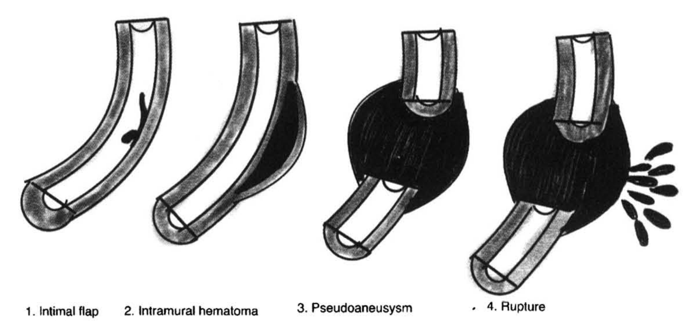
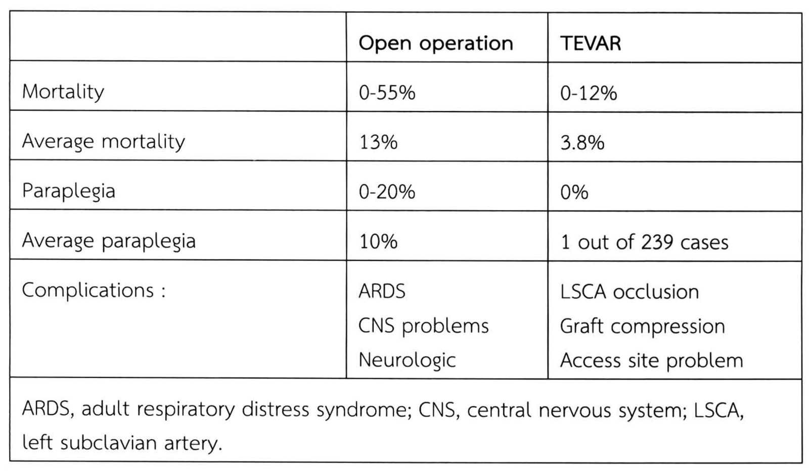
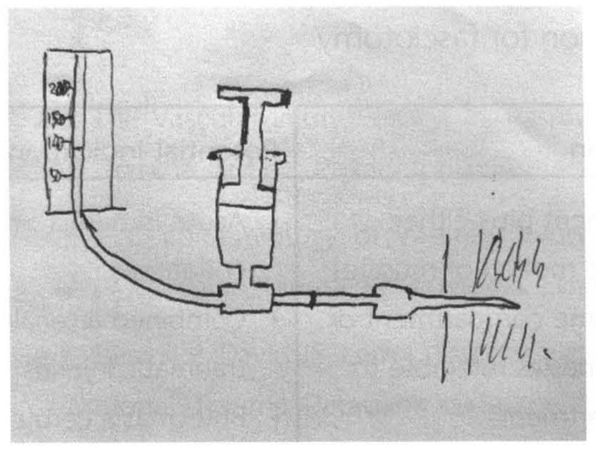
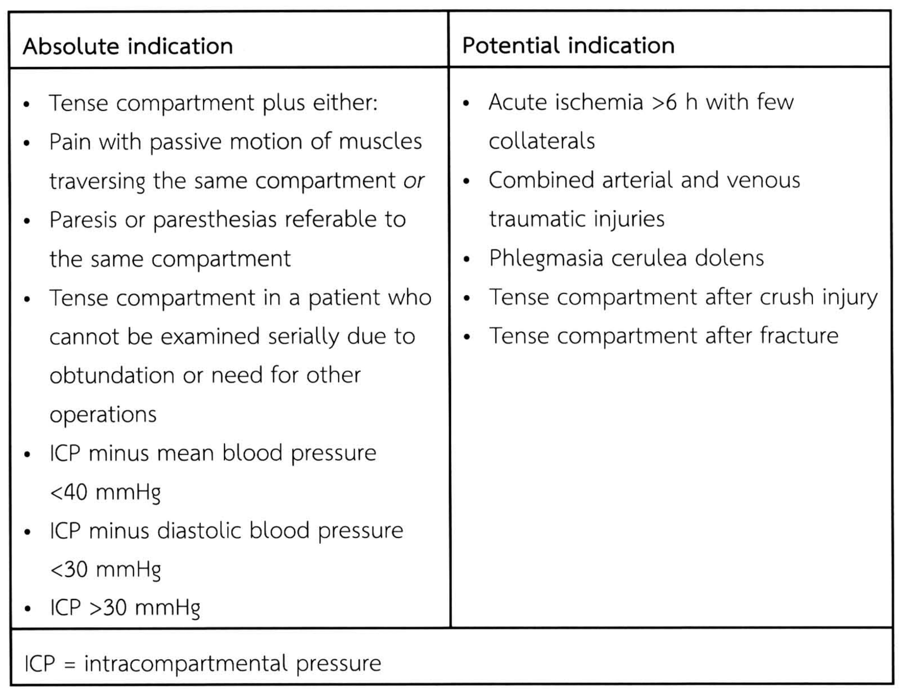

# การบาดเจ็บต่อหลอดเลือด (Vascular injury) — part 2 of 2

## Contents of this file
  - อาการและอาการแสดง (Clinical Presentation) (p.757)
  - Chest radiography (CXR) (p.758)
  - Computed tomography angiography (CTA) (p.759)
  - การรักษาแบบไม่ผ่าตัด (non-operative management) (p.760)
  - Medical treatment (p.761)
  - Endovascular therapy (p.761)
  - การรักษาด้วยการผ่าตัด (Surgical Management) (p.762)
- Ascending Aorta and Transverse Arch (p.763)
- Innominate artery (p.763)
- การบาดเจ็บต่อหลอดเลือดในช่องท้อง (Abdominal vascular injury) (p.764)
  - อาการและอาการแสดง (Clinical Presentation) (p.764)
  - การวินิจฉัย (diagnostic evaluation) (p.765)
  - Abdominal Aorta (p.766)
    - อาการและอาการแสดง (Clinical Presentation) (p.766)
    - Endovascular treatment (p.766)
    - การรักษาด้วยการผ่าตัด (surgical management) (p.767)
  - Celiac artery (p.767)
  - Superior mesenteric artery (SMA) (p.768)
    - การรักษาด้วยการผ่าตัด (surgical treatment) (p.768)
- Renovascular injury (p.769)
  - Endovascular treatment (p.770)
  - การรักษาด้วยการผ่าตัด (Surgical treatment) (p.770)
- Inferior mesenteric artery (IMA) (p.770)
- Iliac vessel (p.770)
  - Endovascular treatment (p.771)
  - การรักษาด้วยการผ่าตัด (surgical treatment) (p.771)
- Inferior vena cava (IVC) (p.772)
  - การรักษาโดยการผ่าตัด (Surgical treatment) (p.772)
- Portal venous system injury (p.772)
  - การรักษาโดยการผ่าตัด (Surgical treatment) (p.773)
- การบาดเจ็บต่อหลอดเลือดบริเวณ Extremities (p.773)
  - อาการและอาการแสดง (clinical presentation) (p.774)
- หลักการรักษา (p.775)
  - การรักษาแบบไม่ผ่าตัด (non-operative management) (p.775)
  - Endovascular treatment (p.775)
  - การรักษาด้วยการผ่าตัด (surgical treatment) (p.776)
- Axillary artery (p.777)
- Brachial artery (p.778)
- Femoral artery (p.779)
- Popliteal และ Tibial artery (p.779)
- Compartment syndrome (p.780)
- Fasciotomy (p.781)
- เอกสารอ้างอิง (p.783)

<!-- p.757 (printed 743) -->
ว่าเป็นสาเหตุของ BTAI เช่น อุบัติเหตุคนเดินถนนโดนรถชน อุบัติเหตุจากการขี่ม้า Blast injury หรือตกจากที่สูงมากกว่า 30 feet

### อาการและอาการแสดง (Clinical Presentation)

อาการและอาการแสดงของผู้บาดเจ็บกลุ่มนี้มีได้หลากหลาย ตั้งแต่ไม่มีอาการเจ็บหน้าอก ปวดหลังร้าวไปคอหรือไหล่ ผู้บาดเจ็บอาจมี hemodynamic stable หรือ unstable ก็ได้ ในผู้บาดเจ็บ BTAI มักพบการบาดเจ็บอื่นร่วมด้วยเสมอ อาทิเช่น rib fracture, lung contusion, sternum fracture, hemopneumothorax, thoracic spine fracture, head injury, abdominal injury ซึ่งการบาดเจ็บร่วมเหล่านี้อาจทำให้แพทย์ผู้ให้การรักษาวินิจฉัย BTAI ผิดพลาดได้ การตรวจร่างกายที่สำคัญที่อาจบ่งชี้ถึงการบาดเจ็บต่อหลอดเลือดใหญ่บริเวณช่องอก ได้แก่

- Hypotension
- Upper extremity hypertension
- Unequal blood pressures or pulses in the extremities (upper extremity from innominate or subclavian injury, or lower extremity from pseudocoarctation syndrome)
- External evidence of major chest trauma (eg, steering wheel imprint on chest)
- Expanding hematoma at the thoracic outlet
- Intra-scapular murmur
- Palpable fracture of the sternum
- Palpable fracture of the thoracic spine
- Left flail chest

<!-- p.758 (printed 744) -->
### Chest radiography (CXR)

การทำ CXR ในผู้บาดเจ็บนิยมส่งตรวจในท่า anteroposterior (AP) โดยหลอดรังสีห่างจากผู้บาดเจ็บ 36 นิ้ว เนื่องจากผู้บาดเจ็บมักไม่สามารถถูกเคลื่อนย้ายไปทำ CXR ท่า posterior-anterior ได้ การแปลผล CXR ควรมองหาลักษณะต่างๆ ดังต่อไปนี้ โดย sign ที่น่าเชื่อถือที่สุด คือ “funny looking mediastinum” คือการมองไม่เห็น aortic knob contour หรือเห็นซ้อนกันเป็น 2 วง การพบ positive signs เหล่านี้ เป็นข้อบ่งชี้ในการส่งตรวจเพิ่มเติมเพื่อทำการวินิจฉัย BTAI ต่อไป ข้อควรระวังในการตรวจ CXR คือ เราสามารถพบ false negative ได้ หมายถึงผู้บาดเจ็บมี BTAI จริง แต่ CXR ให้ผลปกติ ซึ่งพบได้ มีการศึกษาจาก Gutierrez และคณะ ศึกษาในผู้บาดเจ็บ 3,728 ราย พบ CXR มี mediastinum ผิดปกติ 200 ราย มี BTAI ทั้งหมด 17 ราย แต่มีเพียง 7 รายที่มี mediastinum ผิดปกติ จาก CXR มีถึง 10 รายที่มี BTAI แต่ CXR ปกติ

- Fractures
  - Sternum
  - Scapula
  - Multiple left ribs
  - Clavicle in multisystem injured patients
  - (?) First rib
- Mediastinal clues
  - Obliteration/double shadow of aortic knob contour
  - Widening of the mediastinum >8 cm
  - Depression of the left mainstem bronchus >140° from trachea
  - Loss of paravertebral pleural stripe
  - Calcium layering at aortic knob

<!-- p.759 (printed 745) -->
  - “Funny-looking” mediastinum
  - Deviation of nasogastric tube in the esophagus
  - Lateral displacement of the trachea
- Lateral chest x-ray
  - Anterior displacement of the trachea
  - Loss of the aorta/pulmonary window
- Other findings
  - Apical pleural hematoma
  - Massive left hemothorax
  - Obvious blunt injury to the diaphragm

### Computed tomography angiography (CTA)

การตรวจด้วย CTA มี sensitivity 95-100% และ negative predictive value 99-100% ในปัจจุบัน CTA เป็นวิธีการหลักในการวินิจฉัย BTAI นอกจากประโยชน์ในการวินิจฉัยแล้ว ยังช่วยในการวางแผนการรักษาอีกด้วย ช่วยบอกระดับของการบาดเจ็บ (grading of injury, รูปที่ 7)

<!-- p.760 (printed 746) -->

> **Caption (verbatim):** **รูปที่ 7** BTAI grading (Grade1 : intimal flap, Grade2 : intramural hematoma, Grade3 : Pseudoaneurysm, Grade4 : rupture)
> **Text in image (verbatim):** 1. Intimal flap · 2. Intramural hematoma · 3. Pseudoaneusysm · 4. Rupture
> **Description:** Line drawing (black and grey shading) of four curved segments of the aorta, shown as tubes with a grey-shaded wall cut open lengthwise, arranged left to right as the four grades of blunt thoracic aortic injury. 1. Intimal flap: a small dark flap of intima projects from the inner wall into the lumen; the wall is otherwise intact. 2. Intramural hematoma: a dark crescent-shaped collection lies within/along the outer side of the wall, bulging it outward without disrupting the lumen. 3. Pseudoaneurysm: the aortic tube is divided into upper and lower segments separated by a large round black mass (contained hematoma/pseudoaneurysm) surrounding the gap. 4. Rupture: similar large round black mass between the two separated segments, with multiple black droplet shapes spraying out from its right side, depicting free bleeding. (The label under drawing 3 is printed "Pseudoaneusysm" in the image.)
> **Identifiers in image:** none

### การรักษาแบบไม่ผ่าตัด (non-operative management)

การรักษาแบบไม่ผ่าตัดมักพิจารณาในผู้บาดเจ็บที่มีการบาดเจ็บอื่นร่วมรุนแรง และอาจไม่ได้ประโยชน์จากการรักษา BTAI เช่นในรายที่มีภาวะต่างๆ ดังนี้

- Severe head injury
- Risk factors for infection
  - Major burns
  - Sepsis
  - Heavily contaminated wounds
- Severe multisystem trauma with hemodynamic instability and/or poor physiologic reserve

นอกจากนี้การรักษาแบบไม่ผ่าตัดยังมีที่ใช้ในการบาดเจ็บที่ไม่มาก ได้แก่ intimal flap (grade I injury) อย่างไรก็ตามจำเป็นต้องติดตามการรักษาอย่างต่อเนื่อง

<!-- p.761 (printed 747) -->
### Medical treatment

การรักษาด้วย medical treatment ซึ่งอาจเป็น definitive therapy ในกรณีที่ใช้ non-operative management หรือเป็น bridging therapy ก่อนการผ่าตัดต่อไป จุดมุ่งหมายของการให้ยาเพื่อลดแรงที่มากระทำต่อบริเวณที่บาดเจ็บบนผนังหลอดเลือด โดยมีการศึกษาพบว่าช่วยลดการแตกของ BTAI จาก 12% เหลือ 1.5% ในปัจจุบันมักใช้ยา Beta-blocker ในการควบคุมความดัน target systolic blood pressure ให้ไปเกิน 100 mmHg หรือ mean arterial pressure ไม่เกิน 80 mmHg ในผู้บาดเจ็บที่ไม่มีการบาดเจ็บต่อ central nervous system หากมีการบาดเจ็บต่อสมองร่วมด้วยอาจต้องพิจารณาติดตาม cerebral perfusion pressure ร่วมด้วย

### Endovascular therapy

ปัจจุบันการทำ Thoracic Endovascular Aortic Repair (TEVAR) ถือเป็นการรักษาหลักในการรักษา BTAI จากการศึกษาโดย aortic trauma foundation ในปี 2008-2013 ใน BTAI 382 พบว่า 76.4% ได้รับการรักษาโดย TEVAR อีก 23.6% ได้รับการผ่าตัด18 เนื่องจากภาวะแทรกซ้อนจากการผ่าตัดเปิดพบได้มากกว่า (ตารางที่ 5)

**ตารางที่ 5** Comparison of open operation vs TEVAR for BTAI

|  | **Open operation** | **TEVAR** |
| --- | --- | --- |
| Mortality | 0-55% | 0-12% |
| Average mortality | 13% | 3.8% |
| Paraplegia | 0-20% | 0% |
| Average paraplegia | 10% | 1 out of 239 cases |
| Complications : | ARDS CNS problems Neurologic | LSCA occlusion Graft compression Access site problem |

ARDS, adult respiratory distress syndrome; CNS, central nervous system; LSCA, left subclavian artery.

> **Caption (verbatim):** ตารางที่ 5 Comparison of open operation vs TEVAR for BTAI
> **Text in image (verbatim):** Open operation · TEVAR · Mortality · 0-55% · 0-12% · Average mortality · 13% · 3.8% · Paraplegia · 0-20% · 0% · Average paraplegia · 10% · 1 out of 239 cases · Complications : · ARDS · CNS problems · Neurologic · LSCA occlusion · Graft compression · Access site problem · ARDS, adult respiratory distress syndrome; CNS, central nervous system; LSCA, left subclavian artery.
> **Description:** Bordered table with three columns (row label, Open operation, TEVAR) and five data rows comparing open operation with TEVAR for blunt thoracic aortic injury: mortality 0-55% vs 0-12%; average mortality 13% vs 3.8%; paraplegia 0-20% vs 0%; average paraplegia 10% vs 1 out of 239 cases; complications ARDS, CNS problems, Neurologic for open operation vs LSCA occlusion, Graft compression, Access site problem for TEVAR. A final row spanning all three columns gives the abbreviations. Saved as a figure because the abbreviation row is a merged cell.
> **Identifiers in image:** none

<!-- p.762 (printed 748) -->
แม้ว่าการทำ TEVAR จะมีข้อดีหลายประการดังกล่าวข้างต้น แต่การยังมีข้อควรพิจารณาหลายประการเช่นเดียวกัน ได้แก่ เส้นผ่านศูนย์กลางของ aorta ที่มีการบาดเจ็บเฉลี่ยที่ 19.3 cm ซึ่งถือว่าค่อนข้างเล็กเมื่อเทียบกับขนาดของ endograft ที่ออกแบบมาเพื่อรักษา thoracic aortic aneurysm การเลือกขนาด endograft ที่ใหญ่กว่าขนาดของหลอดเลือด (oversizing) ที่มากเกินไป มีรายงานว่าทำให้เกิด Infolding ของ endograft ได้ ต่อมาผู้บาดเจ็บส่วนใหญ่อยู่ในวัยรุ่นถึงวัยกลางคน ซึ่งตรงบริเวณ aorta มีความโค้งเป็นมุมมาก (angulation) ทำให้ endograft ไม่แนบสนิทกับหลอดเลือด เกิด infolding หรือ endograft หักงอได้ ข้อต่อมาการฉีกขาดของ aorta มักเกิดขึ้นห่างจาก origin ของ left subclavian artery ไม่เกิน 1 cm ซึ่งในการทำ TEVAR อาจจำเป็นต้องมีการปิด left subclavian artery ซึ่งอาจมีผลต่อ cerebral และ spinal circulation และเนื่องจากผู้บาดเจ็บมักอายุไม่มาก ขนาดของ access site มักมีขนาดเล็ก

การพิจารณาทำ TEVAR นั้น ไม่จำเป็นต้องรีบทำทันทีที่ผู้บาดเจ็บมาถึงโรงพยาบาล ขึ้นอยู่กับความพร้อมของผู้บาดเจ็บ หากมีภาวะที่จำเป็นต้องรักษาเร่งด่วน เช่น การบาดเจ็บต่อช่องท้อง การบาดเจ็บต่อศีรษะที่ต้องผ่าตัด ให้ทำการรักษาภาวะเร่งด่วนก่อนได้ อย่างไรก็ตามควรทำการรักษาทันทีเมื่อผู้บาดเจ็บพร้อม ขั้นตอนการทำเริ่มจากการ cut down หลอดเลือด common femoral artery ข้างที่ใช้สำหรับใส่ endograft (มักเป็นข้างขวา) ข้างตรงข้ามมักใช้ percutaneous access เพื่อใส่ diagnostic catheter พิจารณาให้ heparinization หากไม่มีข้อห้ามอื่น หลังจากนั้นใส่ soft wire ผ่าน aortic arch ใส่ catheter แล้วทำ diagnostic angiogram หรือบางแห่งอาจใช้ IVUS เพื่อดูตำแหน่งการบาดเจ็บและยืนยันขนาดของ aorta ในระหว่างผ่าตัดอีกครั้ง

ผลการรักษาหลังผ่าตัดในระยะสั้นและระยะกลางของ TEVAR ให้ผลที่ดี แต่ยังไม่มีรายงานถึงผลการรักษาในระยะยาวเมื่อผู้บาดเจ็บอายุมากขึ้น และ aorta ขยายขนาดขึ้น หลังการรักษาด้วย TEVAR ควรติดตามการรักษาด้วยการตรวจร่างกายและทำ CT ที่ 1, 6, 12 เดือน หลังจากนั้นปีละ 1 ครั้ง

### การรักษาด้วยการผ่าตัด (Surgical Management)

ข้อบ่งชี้ในการรักษาด้วยการผ่าตัดรักษา BTAI ในปัจจุบัน คือผู้บาดเจ็บที่มี vital sign unstable อย่างมาก หรือมีข้อจำกัดอื่นจนไม่สามารถทำ TEVAR ได้ เช่น anatomy ไม่เหมาะสม เมื่อจำเป็นต้องทำการผ่าตัด ขึ้นกับสภาพของผู้บาดเจ็บและตำแหน่งการบาดเจ็บ หากผู้บาดเจ็บมี hemodynamic ที่ดี และตำแหน่งการบาดเจ็บอยู่ที่ isthmus มักเลือก

<!-- p.763 (printed 749) -->
ลงแผลเป็น posterolateral thoracotomy ที่ intercostal space ที่ 4 การผ่าตัดสามารถทำได้ทั้ง ‘clamp and sew technique’ หรือใช้ left heart bypass โดยการ cannulate inferior pulmonary vein และ distal aorta ในกรณีที่จำเป็นอาจต้องทำ full cardiopulmonary bypass (ซึ่งกรณีนี้พบได้น้อยมาก) ข้อเสียที่สำคัญของการทำ open repair คือโอกาสเกิด spinal cord ischemia ซึ่งมีปัจจัยที่ส่งผลให้เกิดได้ดังนี้ ระยะเวลาของ aortic cross-clamping ระดับและความยาวของ aortic segment ที่ถูก cross-clamping ระยะเวลาของการมีความดันโลหิตต่ำ ความดันบริเวณ distal aorta และจำนวน intercostal branch ที่ถูกผูกไป วิธีป้องกัน spinal cord ischemia มีกล่าวถึงอยู่หลายวิธี เช่น cerebrospinal fluid drainage การให้ steroid การทำ generalized หรือ localized hypothermia หรือการ Implant intercostal arteries

## Ascending Aorta and Transverse Arch

การบาดเจ็บต่อ ascending aorta และ transverse arch พบได้น้อยมากและผู้บาดเจ็บมักเสียชีวิตจึงไม่ทราบอุบัติการณ์ที่ชัดเจน อาการและอาการแสดงที่พบ ได้แก่ widen mediastinum หรือ cardiac tamponade หรืออาจไม่มีอาการก็ได้ การรักษา ascending aortic rupture มักใช้การผ่าตัดเป็นหลัก โดยทำ median sternotomy, cardiopulmonary bypass และ systemic heparinization ควรมองหาการบาดเจ็บต่อ aortic valve ว่ามีหรือไม่ การรักษาการบาดเจ็บที่ transverse arch อาจต้องทำ hypothermic circulatory arrest ร่วมกับ antegrade และ retrograde cerebral perfusion ผลการรักษามักขึ้นกับความรุนแรงของการบาดเจ็บ

## Innominate artery

การบาดเจ็บต่อ innominate artery จาก blunt mechanism พบได้เป็นอันดับที่ 2 รองจากการบาดเจ็บบริเวณ isthmus มักพบการฉีกขาดบริเวณ base ของ innominate artery การผ่าตัดทำผ่าน median sternotomy อาจร่วมกับ right cervical extension การซ่อมแซมมักต้องทำ bypass จาก ascending aorta to distal innominate และเย็บปิด proximal stump การผ่าตัดมักไม่จำเป็นต้องทำ cardiopulmonary bypass

<!-- p.764 (printed 750) -->
## การบาดเจ็บต่อหลอดเลือดในช่องท้อง (Abdominal vascular injury)9, 19, 20

การบาดเจ็บต่อหลอดเลือดในช่องท้องเป็นสาเหตุการเสียชีวิตที่สำคัญ โดยเฉพาะในผู้บาดเจ็บที่ได้รับการบาดเจ็บจาก penetrating mechanism ที่ช่องท้อง การวินิจฉัยและให้การรักษาที่รวดเร็วจึงมีความสำคัญอย่างยิ่ง การบาดเจ็บในบริเวณนี้มักแบ่งออกเป็นการบาดเจ็บใน intraperitoneal space และ retroperitoneal space โดยเราสามารถแบ่ง retroperitoneal space ออกเป็น 3 zones ได้ดังนี้

- Zone I : อยู่บริเวณส่วนกลาง โดยขอบเขตด้านบนอยู่ที่ aortic hiatus จนถึง aortic bifurcation ด้านข้างอยู่ที่ไตทั้ง 2 ข้าง และยังถูกแบ่งเป็น supramesocolic และ inframesocolic หลอดเลือดที่สำคัญในบริเวณนี้ ได้แก่ aorta, vena cava, celiac axis, superior mesenteric artery, superior mesenteric vein และ portal vein
- Zone II : อยู่ขนาบทั้ง 2 ข้างของ Zone I หลอดเลือดที่สำคัญ ได้แก่ renal arteries และ veins
- Zone III : บริเวณ pelvic cavity มีหลอดเลือดที่สำคัญ ได้แก่ iliac arteries และ veins

การบาดเจ็บต่อหลอดเลือดในช่องท้องส่วนมากมาจาก penetrating mechanism โดยพบว่าผู้บาดเจ็บที่ได้รับการผ่าตัด exploratory laparotomy ที่มีการบาดเจ็บต่อหลอดเลือด เกิดจาก gun shot wound 14.3% stab wound 10% และ blunt injury 3%

การบาดเจ็บจาก blunt mechanism อาจเกิดจาก acceleration deceleration หรือการถูกกระแทกโดยตรง หรือการฉีกขาดจากกระดูกหัก เป็นต้น

### อาการและอาการแสดง (Clinical Presentation)

หากมีการบาดเจ็บที่รุนแรงต่อหลอดเลือดในช่องท้อง ผู้บาดเจ็บมักเสียชีวิตในที่เกิดเหตุ ผู้บาดเจ็บที่ได้รับบาดเจ็บจาก penetrating injury บริเวณท้องแล้วมีความดันโลหิตต่ำร่วมด้วย มักมีการบาดเจ็บต่อหลอดเลือดในช่องท้องร่วมด้วย หรือการคลำชีพจรที่ femoral pulse ไม่ได้หรือได้ไม่เท่ากัน อาจบ่งบอกถึงการบาดเจ็บต่อหลอดเลือดแดง iliac อย่างไรก็ตามผู้บาดเจ็บอาจมี vital signs stable ได้ เนื่องจาก vessel thrombosis หรือการบาดเจ็บอยู่ใน retroperitoneal space

<!-- p.765 (printed 751) -->
### การวินิจฉัย (diagnostic evaluation)

ในผู้บาดเจ็บที่มีการบาดเจ็บที่ช่องท้องร่วมกับ hemodynamic instability หรือมี peritonitis ไม่มีความจำเป็นต้องส่งตรวจเพิ่มเติม ควรนำผู้บาดเจ็บไปทำการผ่าตัดโดยเร็ว การวินิจฉัยมักทำในห้องผ่าตัด แต่หากไม่มีข้อบ่งชี้ในการผ่าตัดเร่งด่วนสามารถส่งตรวจ CT ซึ่งให้รายละเอียดและใช้วางแผนการรักษาได้ดี ในรายที่ได้รับบาดเจ็บจาก blunt mechanism และมี hemodynamic instability แต่ตรวจ focus assessment sonography for trauma (FAST) แล้วไม่พบ free fluid อาจจำเป็นต้องทำ diagnostic peritoneal aspiration/lavage เพื่อหาการบาดเจ็บในช่องท้อง

การรักษามีจุดมุ่งหมาย คือการหยุดเลือดออกให้เร็วที่สุด ซึ่งหมายถึงการนำผู้บาดเจ็บไปถึงโรงพยาบาลหรือห้องผ่าตัดให้เร็วที่สุด การให้ adequate resuscitation โดยมีการศึกษาพบว่าการบาดเจ็บจาก penetrating mechanism บริเวณท้อง ควร resuscitation ไม่ให้ความดันโลหิตสูงเกินไป โดยตั้งไว้ที่ 80-90 mmHg ผู้บาดเจ็บควรมี conscious ดี มีปัสสาวะออก ซึ่งหมายถึงเลือดไปเลี้ยงอวัยวะสำคัญเพียงพอ

หลักการรักษา คือการพยายามหยุดเลือดออกให้เร็วที่สุด หากผู้บาดเจ็บมีเลือดออกมากและ vital signs unstable อาจจำเป็นต้องทำ aortic cross clamping และรีบหาจุดเลือดออกให้เร็วที่สุด การรักษา retroperitoneal hematoma พิจารณาการบาดเจ็บว่าเกิดจาก penetrating หรือ blunt โดย retroperitoneal hematoma ในทุก zone ที่เกิดจาก penetrating mechanism ควรได้รับการ explore ส่วนใน blunt injury ควรทำ explore ใน zone I ส่วนใน zone II และ III ให้ทำ explore เฉพาะในกรณีที่เป็น Pulsatile expanding hematoma หรือคลำ femoral pulse ได้ไม่เท่ากัน เป็นข้อบ่งชี้ในการ explore zone III retroperitoneal hematoma

การผ่าตัดเพื่อ explore retroperitoneal hematoma มักอาศัยการทำ medial visceral rotation ซึ่งแบ่งเป็น 2 ข้าง 1) Right medial visceral rotation หรือ Cattell-Braasch maneuver วิธีนี้สามารถทำให้เข้าถึง inferior vena cava, right renal pedicle, right iliac artery และ vein วิธีทำเริ่มจากการ mobilization hepatic flexure และ full Kocher maneuver ตัด white line of Toldt ยก right colon และ small bowel ขึ้น โดย dissect ไปได้ถึง root of mesentery และ 2) Left medial visceral rotation หรือ Mattox maneuver ทำให้สามารถเข้าถึง aorta, celiac axis, superior mesenteric artery, left renal pedicle, left iliac artery และ vein วิธีการทำเริ่มจาก

<!-- p.766 (printed 752) -->
ตัดแยก splenorenal ligament ตัด white line of Toldt ยก left side colon, small bowel, spleen, pancreas และ stomach ขึ้น (modified Mattox maneuver ไม่ยก Left kidney ขึ้น)

### Abdominal Aorta

Abdominal aorta เข้าสู่ช่องท้องผ่าน aortic hiatus ของ diaphragm ที่บริเวณ T12-L1 ลงไป แตกเป็น common iliac arteries แขนงแรกของ abdominal aorta ได้แก่ phrenic arteries ต่อมาเป็น celiac axis, superior mesenteric artery, renal arteries, inferior mesenteric artery การบาดเจ็บส่วนมากเกิดจาก Penetrating mechanism ใน blunt injury พบว่าการมี thoracolumbar spine fracture ร่วมกับพบ seat belt sign มีโอกาสพบการบาดเจ็บต่อ abdominal aorta ร่วมด้วย

#### อาการและอาการแสดง (Clinical Presentation)

ในผู้บาดเจ็บจาก blunt trauma อาจพบเลือดออกหรือการขาดเลือดของ lower extremities หรือบางรายอาจตรวจพบจาก CT scan เนื่องจากมีการบาดเจ็บที่ไม่ทำให้เกิดการอุดตันของหลอดเลือด เช่น intimal flap, pseudoaneurysm เป็นต้น ส่วนใน penetrating injury ผู้บาดเจ็บมักมี vital signs unstable มีเพียงประมาณ 18% ที่มีเลือดออกใน retroperitoneum และมี vital signs stable ข้อควรระวังในผู้บาดเจ็บกลุ่มที่มี vital sign stable ควรตรวจเพิ่มเติมให้แน่ใจว่าไม่มีการบาดเจ็บจริง เนื่องจากบางส่วนอาจมีอาการตามมาภายหลัง เช่น กลายเป็น pseudoaneurysm หรือเป็น arteriovenous fistula ได้

#### Endovascular treatment

การใช้ endovascular treatment มักจำกัดอยู่บริเวณ Infrarenal aorta เท่านั้น และมีรายงานว่าสามารถทำได้ในการบาดเจ็บที่มี pseudoaneurysm, aortocaval fistula, large intimal flap เป็นต้น

<!-- p.767 (printed 753) -->
#### การรักษาด้วยการผ่าตัด (surgical management)

การผ่าตัดเพื่อซ่อมแซมหลอดเลือดแดง aorta หากผู้บาดเจ็บอยู่ในภาวะ vital signs unstable ควรพิจารณาทำ aortic cross clamping ตำแหน่งของการ cross clamping ขึ้นอยู่กับตำแหน่งที่สงสัยการบาดเจ็บ หากสงสัยการบาดเจ็บในบริเวณ supramesocolic zone I หรือหากไม่แน่ใจ ควรทำ supraceliac cross clamping โดยการ retract abdominal esophagus (คลำหา Nasogastric tube) ไปทางด้านซ้าย retract หรือ mobilize left lobe liver มาทางด้านขวา เปิด peritoneum ตามแนวยาว ตัด crus diaphragm ที่ตำแหน่ง 2 นาฬิกา จะสามารถเข้าถึง supraceliac part ของ aorta และทำการ cross clamping ได้ (ไม่จำเป็นต้อง encircle aorta) หลังจากนั้นมองหาการบาดเจ็บเตรียมทำ infrarenal cross clamping ในกรณีที่คิดว่าการบาดเจ็บอยู่ที่ infrarenal aorta โดยการ eviscerate small bowel ออกมาจากช่องท้อง ตัดเปิด peritoneum โดยเยื้องไปทางขวาของ aorta เพื่อระวังการบาดเจ็บต่อ Inferior mesenteric artery มองหา left renal vein ตำแหน่งที่จะ cross clamping อยู่ใต้ต่อ left renal vein หากแน่ใจว่าไม่มีการบาดเจ็บบริเวณ suprarenal aorta สามารถเปลี่ยนตำแหน่ง (walk the clamp) ลงมา cross clamp ที่ infrarenal aorta ได้ ส่วนมากการเย็บซ่อม aorta โดยตรงมักสามารถทำได้ มีส่วนน้อยที่จำเป็นต้องทำ interposition graft

### Celiac artery

หลอดเลือดแดง celiac เป็นแขนงที่แยกออกมาด้านหน้าของ abdominal aorta ที่บริเวณ T12-L1 มีความยาว 1-1.5 cm ก่อนแยกเป็น 3 แขนง (the tripod of Haller; common hepatic artery, left gastric artery, splenic artery) การบาดเจ็บต่อ celiac artery พบได้น้อยมากและมักจะเกิดจาก penetrating เป็นส่วนใหญ่

การรักษามักต้องใช้การผ่าตัด ซึ่งอาจผ่าตัดผ่าน lesser sac หรือทำ medial visceral rotation โดยทั่วไปแนะนำให้พยายามทำการซ่อมแซม แต่หากผู้บาดเจ็บอยู่ในภาวะเร่งด่วนมาก สามารถผูกทิ้งได้ เนื่องจากมี collateral circulation รอบๆ ค่อนข้างมาก

<!-- p.768 (printed 754) -->
### Superior mesenteric artery (SMA)

SMA แตกแขนงออกมาด้านหน้าต่อ abdominal aorta ใต้ต่อ celiac axis บริเวณ L1 ใต้ต่อ pancreas ทอดข้าม uncinate process และ 3rd part duodenum แขนงของ SMA ได้แก่ inferior pancreaticoduodenal artery, middle colic artery, 12-18 intestinal branch, right colic artery, ileocolic artery การบาดเจ็บของ SMA แบ่งเป็น 4 zone

Zone 1 : อยู่ระหว่าง aortic origin จนถึง inferior pancreaticoduodenal artery

Zone 2 : ระหว่าง Inferior pancreaticoduodenal artery จนถึง Middle colic artery

Zone 3 : หลังจาก middle colic artery

Zone 4 : segmental intestinal branch

การบาดเจ็บในบริเวณ zone 1 และ 2 จำเป็นต้องได้รับการซ่อมแซม การผูก SMA บริเวณนี้จะทำให้เกิดการขาดเลือดของ small bowel และ right colon การบาดเจ็บโดยส่วนใหญ่เกิดจาก penetrating injury การบาดเจ็บต่อ SMA จาก blunt injury พบว่ามีอุบัติการณ์เป็นอันดับที่ 2 รองจาก renovascular injury โดยอาจเกิดจากแรงกระแทกโดยตรง acceleration deceleration หรือ seat-belt injury โดยทั่วไปการบาดเจ็บจาก penetrating injury มักทำให้เกิดเลือดออกในช่องท้อง ผู้บาดเจ็บอาจมี vital sign unstable (vital sign stable ไม่สามารถใช้ในการ rule out การบาดเจ็บต่อหลอดเลือดได้) ส่วนการบาดเจ็บจาก blunt injury ซึ่งอาจทำให้เกิด thrombosis ของหลอดเลือด ควรได้รับการวินิจฉัยจากการส่งตรวจ CT หากสงสัยการบาดเจ็บ ซึ่งผู้บาดเจ็บอาจมาด้วย late thrombosis หรือ bowel ischemia ภายหลังได้

#### การรักษาด้วยการผ่าตัด (surgical treatment)

การผ่าตัดเพื่อเข้าหา retropancreatic SMA มักทำโดย left medial visceral rotation หรือในกรณีเร่งด่วนอาจตัดเปิด neck of pancreas เข้าไปโดยตรง ในส่วน infrapancreatic part ทำได้โดยการยกขอบล่างของ pancreas ขึ้น หรือเปิดเข้าไปทาง root of mesentery ตัด ligament of Treitz ทำ extensive Kocher maneuver

<!-- p.769 (printed 755) -->
การเลือกวิธีการซ่อมแซมขึ้นกับตำแหน่งการบาดเจ็บ พยาธิสภาพที่พบ ภาวะของผู้บาดเจ็บ และสภาพของลำไส้ในขณะที่ทำการผ่าตัด ดังที่กล่าวไปข้างต้นการบาดเจ็บใน zone 1 และ 2 ควรทำการซ่อมหลอดเลือด ยกเว้นในรายที่ลำไส้ขาดเลือดจน necrosis แล้ว ในขณะที่ zone 3 และ 4 สามารถผูกทิ้งได้ ในส่วนของพยาธิสภาพของการบาดเจ็บหากเป็น small laceration อาจทำการเย็บซ่อมได้ หากการบาดเจ็บมีระยะทางยาวจำเป็นต้องทำ interposition graft อาจใช้ vein graft หรือ PTFE ในกรณีที่ผู้บาดเจ็บมีภาวะ hemodynamic instability มาก อาจจำเป็นต้องใส่ temporary vascular shunt ไว้ก่อน แล้วทำการผ่าตัดซ่อมแซมหลังจากผู้บาดเจ็บมี hemodynamic ที่ดีขึ้น หลังผ่าตัดต้องเฝ้าระวัง bowel necrosis และเนื่องจากการบาดเจ็บต่อ SMA มักเป็นการบาดเจ็บที่รุนแรง ในการผ่าตัดมักทำ temporary closure abdomen เพื่อทำ second look และลดโอกาสเกิด abdominal compartment syndrome

## Renovascular injury

Renal arteries แตกแขนงออกจาก aorta ที่บริเวณ L2 โดยประมาณ 30% ของประชากร จะมี renal artery มากกว่า 1 เส้น ส่วนใหญ่จะมี accessory renal artery ไปเลี้ยง Lower pole ส่วน renal vein วิ่งอยู่หน้า aorta ด้าน left renal vein มีความยาวกว่า right renal vein และมีแขนงมาจาก left adrenal vein, left gonadal vein และ descending lumbar vein

การบาดเจ็บต่อ renal artery พบได้ประมาณ 0.05% ในผู้บาดเจ็บที่รับการรักษาตัวในโรงพยาบาลด้วย blunt injury การบาดเจ็บมักเกิดกับข้างซ้ายมากกว่าข้างขวา ซึ่งอาจจะอธิบายได้จากการที่ right renal artery วางอยู่ใต้ IVC พยาธิสภาพการบาดเจ็บจะพบ thrombosis หรือ Intimal flap ประมาณ 50% ของ blunt renal artery injury พบ avulsion ประมาณ 12% และพบว่า 9-14% มีการบาดเจ็บทั้ง 2 ข้าง

การวินิจฉัยในการบาดเจ็บจาก penetrating injury มักเกิดในห้องผ่าตัด โดยเฉพาะในกรณีที่ผู้บาดเจ็บมีข้อบ่งชี้อื่นในการผ่าตัดช่องท้อง ส่วนในรายที่ไม่มีข้อบ่งชี้ในการผ่าตัด การส่งตรวจ CT จะช่วยในการวินิจฉัย

<!-- p.770 (printed 756) -->
### Endovascular treatment

การรักษา endovascular treatment สามารถใช้ได้โดยเฉพาะใน blunt injury โดยใช้รักษาพยาธิสภาพต่างๆ เช่น Intimal flap, thrombosis, pseudoaneurysm, arteriovenous fistula เป็นต้น ปัญหาของการรักษาด้วย endovascular ในการบาดเจ็บต่อ renal artery ได้แก่ การวินิจฉัยที่ล่าช้า ซึ่งทำให้การทำ revascularization ไม่ได้ประโยชน์ หากมีการอุดตันทั้งหมดของ renal artery นานกว่า 3 ชั่วโมง การทำงานของไตหรืออุดตันเพียงบางส่วน นานกว่า 6 ชั่วโมง จะทำให้การทำงานของไตลดลงอย่างมาก การพิจารณา revascularization หลังการขาดเลือดนานเกิน 6 ชั่วโมง จึงอาจพิจารณาเฉพาะในรายที่มีการบาดเจ็บที่ไตทั้ง 2 ข้าง หรือผู้บาดเจ็บที่มีไตข้างเดียว

### การรักษาด้วยการผ่าตัด (Surgical treatment)

การรักษาด้วยการผ่าตัดฉุกเฉิน การเลือกพิจารณาทำการซ่อม renal artery หรือพิจารณาทำ nephrectomy ขึ้นกับสภาพของผู้บาดเจ็บเป็นสำคัญ ลักษณะการบาดเจ็บ พยาธิสภาพของหลอดเลือดไตและไต ความผิดปกติของไตฝั่งตรงข้าม การซ่อมหลอดเลือดแดง renal artery ขึ้นกับการบาดเจ็บเป็นหลัก การบาดเจ็บต่อ renal vein หากพบในระหว่างผ่าตัดควรทำการเย็บซ่อมหากทำได้ หากการบาดเจ็บรุนแรงมากสามารถทำ Ligation ได้ ข้อแนะนำในการผูก left renal vein ควรผูกบริเวณใกล้กับ IVC เพื่อรักษา venous drainage ทาง left gonadal, adrenal และ lumbar vein

## Inferior mesenteric artery (IMA)

IMA แตกแขนงออกจาก aorta ทางด้านหน้าเยื้องไปทางซ้ายที่ระดับ 3-4 cm เหนือ aortic bifurcation การรักษาการบาดเจ็บต่อ IMA ทำได้โดยการ ligation โอกาสการเกิด colonic ischemia ในผู้ที่ได้รับบาดเจ็บที่ได้รับการรักษาโดยการผูกหลอดเลือด IMA พบได้น้อยมาก

## Iliac vessel

Common iliac artery (CIA) แตกแขนงที่ aortic bifurcation ที่บริเวณ L4-5 แตกแขนงเป็น External iliac artery (EIA) และ internal iliac artery (IIA, hypogastric

<!-- p.771 (printed 757) -->
artery) ส่วน Common iliac vein 2 ข้าง มารวมกันที่บริเวณ L5 ใต้ต่อ aortic bifurcation การบาดเจ็บส่วนใหญ่เกิดจาก penetrating mechanism การบาดเจ็บต่อ CIA และ EIA ใน blunt injury พบได้ไม่มาก มักเกิดร่วมกับกระดูก pelvis หัก จนทำให้เกิด overstretching ของหลอดเลือด และมี intimal tear หรือ late thrombosis ตามมา หรืออาจเกิดการบาดเจ็บจากกระดูกหักมาโดนหลอดเลือด ผู้บาดเจ็บอาจมาด้วยอาการ shock ท้องอืด หรือการขาดเลือดของ lower extremities การตรวจร่างกายพบชีพจรที่ common femoral artery เบาลงหรือคลำไม่พบชีพจร

### Endovascular treatment

มักมีบทบาทในการรักษา pseudoaneurysm, arteriovenous fistula และ large intimal flap ของ CIA โดยเฉพาะในกรณีที่เป็นการบาดเจ็บจาก blunt injury ที่ไม่มีข้อบ่งชี้อื่นๆ ในการผ่าตัดช่องท้อง

### การรักษาด้วยการผ่าตัด (surgical treatment)

ข้อบ่งชี้ในการ explore zone III hematoma ใน blunt injury ได้แก่ pulsatile hematoma, rapid expanding hematoma และ absent femoral pulse ส่วนใน penetrating injury ควร explore ทุกกรณี การผ่าตัดเข้าหาหลอดเลือดบริเวณนี้ ควรระวังไม่ให้เกิด Iatrogenic injury ต่อหลอดเลือดดำที่อยู่ใต้ต่อหลอดเลือดแดงหรือ ureter

การผ่าตัดซ่อมแซมหลอดเลือด iliac arteries ขึ้นอยู่กับการบาดเจ็บ อาจทำเป็น primary repair, interposition graft การผ่าตัด complex extra-anatomic bypass นั้นมักไม่มีที่ใช้ในผู้บาดเจ็บที่มักอยู่ในภาวะเร่งด่วน ในกรณีที่ผู้บาดเจ็บมี hemodynamic instability มาก ไม่สามารถทำ definitive repair ไหว ควรพิจารณาใส่ temporary intravascular shunt ได้ การผูกหลอดเลือด CIA หรือ EIA ไม่ควรทำเนื่องจากมีโอกาสทำให้ขาข้างนั้นขาดเลือดได้มาก ส่วนการผ่าตัดเพื่อเข้าถึงหลอดเลือดดำ common iliac vein อาจจำเป็นต้องตัดหลอดเลือดแดง CIA โดยทั่วไปแนะนำให้เย็บซ่อม (lateral repair) อย่างไรก็ตามหากหลังการซ่อมแล้วเกิด severe stenosis อาจจำเป็นต้อง ligation หลอดเลือดดำนั้น เพื่อลดโอกาสเกิด pulmonary embolism หลังการผูกหลอดเลือดดำมักทำให้ขาบวมชั่วคราว อย่างไรก็ตามควรเฝ้าระวัง compartment syndrome เสมอ แม้ว่าจะพบได้น้อยก็ตาม

<!-- p.772 (printed 758) -->
## Inferior vena cava (IVC)

IVC เกิดจากการรวมกันของ common iliac vein 2 ข้าง ที่บริเวณ L5 ใต้ right CIA แขนงของ IVC ได้แก่ lumbar vein 4-5 คู่, right gonadal vein, renal vein 2 ข้าง, right adrenal vein, hepatic veins และ phrenic veins โดยผู้บาดเจ็บที่มีการบาดเจ็บต่อ IVC ที่มาถึงโรงพยาบาลประมาณครึ่งหนึ่งจะมีภาวะ hypotension ในกรณีที่มีเลือดออกเฉพาะใน retroperitoneal space อาจมี stable vital sign ได้

### การรักษาโดยการผ่าตัด (Surgical treatment)

การผ่าตัดเพื่อเข้าถึง infrarenal และ Juxtarenal IVC สามารถทำได้โดย right medial visceral rotation ดังที่กล่าวไปข้างต้น ในการผ่าตัดเพื่อเข้าถึง retrohepatic IVC นั้นทำได้ยากกว่า ต้องอาศัยการทำ extensive mobilization liver อาจจำเป็นต้องขยายแผลเข้าไปในช่องอกด้านขวา การผ่าตัดเพื่อเข้าไปหา retrohepatic IVC นั้นจึงแนะนำให้ทำเฉพาะในกรณีที่ทำ perihepatic packing แล้วไม่สามารถหยุดเลือดออกได้ หากทำการขยายแผลผ่าตัดแล้วยังไม่สามารถหยุดเลือดออกได้ อาจต้องทำ hepatic vascular isolation (คือการ cross clamping infradiaphragmatic aorta, suprahepatic IVC, infrahepatic IVC เหนือ renal veins และ portal triad) หรือการทำ Atriocaval shunt (โดยการใส่ท่อผ่าน right atrium ลงไปใน IVC ผ่านบริเวณที่มีการบาดเจ็บลงไป แล้วใส่ tourniquet บริเวณ intrapericardial IVC และ Suprarenal IVC เพื่อไม่ให้เลือดไหลผ่านบริเวณที่มีการบาดเจ็บ)

การบาดเจ็บต่อ IVC ส่วนใหญ่สามารถเย็บซ่อม (lateral venorrhaphy) ได้ ในกรณีที่มีการบาดเจ็บทั้งด้านหน้าและด้านหลังของ IVC การเย็บซ่อมผนังด้านหลังสามารถทำได้ผ่านแผลจากการบาดเจ็บด้านหน้าโดยไม่จำเป็นต้องพลิก IVC ขึ้น ในกรณีที่การบาดเจ็บรุนแรงมาก ในส่วน infrarenal IVC สามารถทำการ ligation ได้ แต่ต้องเฝ้าระวังเรื่อง compartment syndrome ของขา การทำ ligation ในส่วน suprarenal IVC นั้นไม่สามารถทำได้เนื่องจากจะทำให้เกิดภาวะไตวายตามมา

## Portal venous system injury

Portal vein มีความยาวประมาณ 6-10 cm เกิดจากการรวมกันของ superior mesenteric vein กับ splenic vein ที่บริเวณหลังต่อ neck of pancreas ด้านซ้ายต่อ

<!-- p.773 (printed 759) -->
IVC วิ่งผ่านหลัง 1st part duodenum แล้วเข้าไปยัง hepatoduodenal ligament โดยวิ่งอยู่หลังต่อ hepatic artery (ด้านซ้าย) และ common bile duct (ด้านขวา) portal vein เป็นหลอดเลือดดำที่ไม่มี valve และนำเลือดไปเลี้ยงตับเป็นปริมาณมากถึง 80% การบาดเจ็บต่อ portal vein พบได้น้อยและส่วนใหญ่เกิดจาก penetrating mechanism เนื่องจากตำแหน่งของ Portal vein อยู่ใกล้หลอดเลือดสำคัญจำนวนมาก จึงพบการบาดเจ็บต่อหลอดเลือดอื่นร่วมด้วย 70-90%

### การรักษาโดยการผ่าตัด (Surgical treatment)

การผ่าตัดเพื่อเข้าหา portal vein โดยเฉพาะบริเวณหลังต่อ pancreas และ duodenum ใช้ Right medial visceral rotation และ extensive Kocher maneuver หากมีความจำเป็นอาจตัดแยก neck of pancreas เพื่อทำการเข้าหา portal vein จากด้านหน้าได้ การรักษาส่วนมากนิยมเย็บซ่อม lateral repair หรือ primary repair ถ้าทำได้ การทำ complex repair นั้นไม่ควรทำเพราะใช้เวลานาน ผู้บาดเจ็บมักมีภาวะ hemodynamic unstable มาก อย่างไรก็ตามอาจพิจารณาทำในกรณีที่มีการบาดเจ็บต่อ hepatic artery ที่ไม่สามารถซ่อมแซมได้ เนื่องจากการผูกหลอดเลือด portal vein พร้อมกับ hepatic artery นั้นไม่สามารถทำให้ผู้บาดเจ็บมีชีวิตรอดได้ (incompatible with life) ส่วนการผูกหลอดเลือด Portal vein นั้นมีรายงานว่าบางส่วนสามารถรอดชีวิตได้ และในผู้ที่รอดชีวิตมีบางรายที่ไม่มีภาวะ Portal hypertension แต่หลังการผูก portal vein อาจเกิด small bowel necrosis ได้ จึงจำเป็นต้องเฝ้าระวังภาวะดังกล่าวและให้การ resuscitation ที่เหมาะสมและเพียงพอ

## การบาดเจ็บต่อหลอดเลือดบริเวณ Extremities21

การบาดเจ็บต่อหลอดเลือดตาม Extremities พบได้ 0.5-1% ของการบาดเจ็บทั้งหมด แต่คิดเป็น 20-50% ของการบาดเจ็บต่อหลอดเลือดทั้งหมด ส่วนใหญ่ผู้บาดเจ็บมักเป็นเพศชายและอายุไม่มาก การบาดเจ็บจาก blunt mechanism บริเวณ extremity มีอัตราตาย 2-5% ส่วน penetrating injury มีอัตราการเสียชีวิตน้อยกว่า เนื่องจากการบาดเจ็บจาก blunt mechanism มีการบาดเจ็บของอวัยวะอื่นที่ไม่ใช่เฉพาะหลอดเลือดมากกว่า penetrating mechanism ในส่วนของ amputation rate การบาดเจ็บต่อหลอดเลือดบริเวณแขนขามี amputation rate 7-30% โดยส่วนใหญ่เกิดใน blunt mechanism เกิดจากแรงที่มากพอมากระทำต่อรยางค์นั้นๆ จนทำให้เกิดการบาดเจ็บต่อหลอดเลือด

<!-- p.774 (printed 760) -->
จึงมีความเสี่ยงต่อการถูก amputation การบาดเจ็บที่บริเวณ popliteal artery ที่ขา และส่วนของ forearm มีโอกาสถูก amputation สูงมากกว่าบริเวณอื่น

การบาดเจ็บต่อหลอดเลือดที่บริเวณแขนและขามีอุบัติการณ์ใกล้เคียงกัน การบาดเจ็บที่แขนส่วนใหญ่เกิดที่ forearm ส่วนที่ขาพบการบาดเจ็บมากที่สุดที่ popliteal artery (blunt injury) และ superficial femoral artery (penetrating injury) และหากเปรียบเทียบจากสาเหตุจะพบว่า blunt injury เกิดที่บริเวณขามากกว่าแขน และการบาดเจ็บที่บริเวณขานั้นมีโอกาสเกิดการบาดเจ็บของ soft tissue ร่วม การเกิดภาวะแทรกซ้อนและมีอัตราการเสียชีวิตที่มากกว่า

การบาดเจ็บของ soft tissue อื่นๆ ร่วม จะพบว่าใน blunt injury พบกระดูกหักร่วมได้สูง บางรายงานพบถึง 80-100% ส่วนใน Penetrating injury พบได้ 15-40% มีรายงานพบว่าเมื่อพบ comminuted fracture ร่วมกับการบาดเจ็บต่อหลอดเลือด จะมี amputation rate ที่สูงขึ้น การบาดเจ็บของหลอดเลือดดำร่วมพบได้ประมาณ 15-35% อย่างไรก็ตามไม่พบว่ามีความสัมพันธ์ระหว่างการเกิดขาบวมกับการซ่อมหรือไม่ซ่อมหลอดเลือดดำ ส่วนการบาดเจ็บต่อเส้นประสาทส่วนปลายร่วม มักทำการประเมินได้ยากโดยเฉพาะในผู้บาดเจ็บที่ไม่รู้สึกตัว การรายงานอุบัติการณ์อาจต่ำกว่าความเป็นจริง โดยรายงานในการบาดเจ็บที่บริเวณขามีอุบัติการณ์ประมาณ 10% ที่บริเวณแขนมีประมาณ 40-50% และหากมีการบาดเจ็บที่รุนแรงของ soft tissue เช่น มีการขาดออกจากกันหรือการขาดหายไปของ soft tissue บางส่วนมีรายงานในการบาดเจ็บที่แขนมากกว่าที่ขา 40-70% เทียบกับ 30% และพบว่าหากเกิดการบาดเจ็บที่รุนแรงในลักษณะนี้ โอกาสที่จะต้องทำ amputation มีค่อนข้างสูง

### อาการและอาการแสดง (clinical presentation)

อาการและอาการแสดงของผู้บาดเจ็บต่อหลอดเลือดที่แขนขามีอาการที่ชัดเจน ได้แก่ Hard signs ดังกล่าวไปข้างต้น หรืออาการที่ไม่ชัดเจน (soft signs) การซักประวัติและการตรวจร่างกายจึงมุ่งเน้นในการหาอาการแสดงเหล่านี้ การตรวจร่างกายที่สำคัญ ได้แก่ การคลำชีพจร ควรทำเทียบกันทุกรยางค์ ตรวจด้วย doppler ultrasound เพื่อหา arterial pressure index (systolic blood pressure ของรยางค์ที่สงสัยการบาดเจ็บเทียบกับแขนหรือรยางค์ที่ไม่บาดเจ็บ) การตรวจดูการทำงานของเส้นประสาทส่วนปลาย ตรวจดูตำแหน่งของแผล มองหาว่ามีกระดูกหักหรือข้อเคลื่อนหรือไม่ เป็นต้น การซักประวัติและตรวจร่างกายที่ดีจะนำไปสู่การวินิจฉัยที่รวดเร็วและถูกต้อง

<!-- p.775 (printed 761) -->
การส่งตรวจเพิ่มเติมมักทำในกรณีที่ตรวจพบ soft signs หรือในกรณีที่มี hard sign แต่ตำแหน่งของการบาดเจ็บไม่ชัดเจน อย่างไรก็ดีการส่งตรวจเพิ่มเติมนั้น ควรทำเฉพาะในผู้บาดเจ็บที่มี vital sign stable เท่านั้น การส่งตรวจที่ได้รับความนิยมมากที่สุดในปัจจุบันได้แก่ CTA เนื่องจากให้รายละเอียดการบาดเจ็บต่อหลอดเลือด การบาดเจ็บต่อ soft tissue รอบข้างได้ชัดเจน ข้อจำกัดของ CTA คืออาจเกิด artifact ในกรณีที่มีวัตถุที่ทำจากโลหะ เช่น กระสุนปืนในภาพหรือกระดูกหักเข้าไปใกล้บริเวณหลอดเลือด จำเป็นต้องได้รับรังสีและสารทึบรังสีในการตรวจ

ส่วนการตรวจอื่นๆ ได้แก่ duplex ultrasonography (DUS) แม้ว่ามีข้อดี คือ non-invasive และไม่จำเป็นต้องได้รับรังสี แต่การใช้วินิจฉัยการบาดเจ็บต่อหลอดเลือดบริเวณแขนขาจำเป็นต้องอาศัยความชำนาญในการทำและใช้เวลาค่อนข้างมาก บทบาทของ DUS จึงมักใช้ในการตรวจติดตามการรักษา (surveillance)

Conventional angiography เป็น gold standard ในการวินิจฉัย แต่ในปัจจุบันมีบทบาทลดลงมาก เนื่องจากเป็น invasive procedure จึงถูกทดแทนด้วย CTA เป็นส่วนใหญ่ conventional angiography จึงมักถูกใช้ในกรณีที่มีข้อสงสัยในการวินิจฉัยจากการตรวจด้วยวิธีการอื่นๆ มาแล้ว

## หลักการรักษา

### การรักษาแบบไม่ผ่าตัด (non-operative management)

การรักษาแบบไม่ผ่าตัดอาจทำได้ในกรณีที่ไม่มาก เช่น small non-flow-limiting intimal flap, small aneurysm หรือ arteriovenous fistula โดยที่ผู้บาดเจ็บไม่มีอาการของการขาดเลือดของแขนหรือขา ซึ่งการติดตามการรักษาเป็นสิ่งสำคัญมาก เนื่องจากการพยากรณ์โรคในอนาคตนั้นอาจกลายเป็น pseudoaneurysm ขนาดใหญ่ อาจเกิด ischemic complication ได้ หรือส่วนหนึ่งอาจหายได้เอง ในกรณีที่ไม่สามารถติดตามการรักษาได้ การรักษาด้วยการผ่าตัดจึงเหมาะสมกว่า

### Endovascular treatment

การรักษาด้วยวิธีการ endovascular treatment พัฒนาขึ้นอย่างมากในการรักษาโรคทางหลอดเลือด การรักษาในผู้บาดเจ็บบาดเจ็บมักใช้ในการรักษาหลอดเลือดขนาดใหญ่

<!-- p.776 (printed 762) -->
เช่น thoracic aorta, subclavian, iliac vessel เป็นต้น โดยการใส่ stent หรือใช้ในการหยุดเลือดในการบาดเจ็บต่อหลอดเลือดที่เข้าถึงได้ยาก เช่น การบาดเจ็บในตับหรือการบาดเจ็บในบริเวณเชิงกราน โดยวิธีการทำ embolization ส่วนการใช้ในการรักษาการบาดเจ็บต่อหลอดเลือดบริเวณแขนขานั้นยังมีข้อจำกัดหลายประการ เช่น หลอดเลือดมักมีขนาดเล็ก แขนและขาเป็นบริเวณที่มีการขยับพับงอสูงจึงอาจทำให้ patency rate ลดลงหรือเกิดภาวะแทรกซ้อน เช่น การอุดตันในตัว stent ได้ง่าย จึงยังไม่เป็นที่นิยมนักในปัจจุบัน

### การรักษาด้วยการผ่าตัด (surgical treatment)

การผ่าตัดเป็นการรักษาหลักของการบาดเจ็บต่อหลอดเลือดบริเวณรยางค์ การเตรียมการผ่าตัดหากเป็นไปได้ควรทำในห้องที่มีเตียงผ่าตัดที่สามารถใช้ร่วมกับ fluoroscope ได้ เพื่อใช้ในการทำ intraoperative angiography หรือการ fixation ของศัลยแพทย์กระดูกในกรณีที่จำเป็น การเตรียมการผ่าตัดควรเตรียมเผื่อความจำเป็นที่จะต้องใช้ vein graft เสมอ โดยทั่วไปมักแนะนำให้ใช้ greater saphenous vein จากขาข้างที่ไม่มีการบาดเจ็บ เพื่อหลีกเลี่ยงการบวมของขาข้างที่มีการบาดเจ็บ แต่ไม่มีหลักฐานการศึกษายืนยันประโยชน์ของการใช้ vein จากขาข้างตรงข้าม หากมีความจำเป็นอาจพิจารณาใช้ vein graft จากขาข้างเดียวกันได้

หลักการผ่าตัดซ่อมหลอดเลือด ได้แก่ การทำ proximal และ distal control ในบริบทของผู้บาดเจ็บซึ่งอาจมีเลือดออกตลอดเวลา หรือมีก้อนเลือดขนาดใหญ่อยู่บริเวณที่บาดเจ็บ การใช้ tourniquet เป็นทางเลือกที่ดีในการหยุดเลือดบริเวณแขนขา เพื่อให้ทำการผ่าตัดง่ายขึ้น เมื่อทำ proximal และ distal control ได้แล้ว ควรทำการตัดเนื้อเยื่อที่มีการบาดเจ็บรุนแรงออก รวมถึงหลอดเลือดที่ช้ำออกด้วย ก่อนทำการซ่อมหลอดเลือดควรทำ thrombectomy เพื่อกำจัด thrombus ออก และดูว่าหลอดเลือดส่วนปลายมี patency ดี

การผ่าตัดซ่อมหลอดเลือดนั้น ควรพิจารณาสภาวะของผู้บาดเจ็บขณะผ่าตัดด้วย หากผู้บาดเจ็บมี hemodynamic instability มาก ไม่สามารถทำ definitive repair ได้ อาจพิจารณาใส่ temporary intravascular shunt ไว้ก่อน หรือหลอดเลือดบางตำแหน่งอาจทำ ligation ได้ โดยไม่เกิดการขาดเลือดของส่วนปลายหรือในรายที่ขาดเลือดนานจนแขนหรือขาเน่าตาย (irreversible ischemia) ในกรณีนี้ไม่ควรผ่าตัด revascularization เพราะนอกจากจะไม่สามารถรักษาแขนหรือขาไว้ได้แล้ว ยังอาจทำให้ผู้บาดเจ็บเสียชีวิตจาก

<!-- p.777 (printed 763) -->
ischemic reperfusion injury อีกด้วย การซ่อมหลอดเลือดขึ้นกับพยาธิสภาพของหลอดเลือด อาจใช้การเย็บซ่อม primary repair ในกรณีที่ความยาวของการบาดเจ็บสั้น หากการบาดเจ็บยาวหรือมีระยะระหว่างหลอดเลือดมากกว่า 2 cm มักจำเป็นต้องใช้ interposition graft ซึ่งมักเลือกใช้ autogenous vein graft หากสามารถทำได้

การใส่ temporary shunting มีประโยชน์อย่างมากในการใช้ลด ischemic time ของอวัยวะส่วนปลาย มักใช้ในกรณีที่ไม่สามารถซ่อมแซมหลอดเลือดได้โดยเร็ว เช่น ผู้บาดเจ็บมีการบาดเจ็บอื่นร่วม มี hemodynamic unstable หรือใช้ในกรณีที่มีกระดูกหักร่วมด้วย โดยใส่ temporary shunt ก่อน ต่อจากนั้นทำการ fix bone หลังจากเสร็จแล้วจึงทำการซ่อมแซมหลอดเลือดต่อไป

การรักษาการบาดเจ็บต่อหลอดเลือดดำในบริเวณแขนและขา ยังเป็นข้อถกเถียงว่าควรจะเย็บซ่อมหรือทำการผูกทิ้งได้ ในปัจจุบันยังไม่มีรายงานความสัมพันธ์ระหว่างการผูกหลอดเลือดดำกับการถูกทำ Amputation มีรายงานว่าการเย็บซ่อมหลอดเลือดดำมักมีโอกาสเกิด thrombosis ได้ ซึ่งพบว่าการอุดตันเหล่านี้มีส่วนหนึ่งหายได้เอง ความเสี่ยงของการผูกหลอดเลือดดำ คือมีโอกาสเกิดขาบวม โดยพบว่าส่วนมากมักเกิดจากการผูก popliteal vein มากกว่าหลอดเลือดดำที่ต้นขา แล้วพบว่าส่วนใหญ่เป็นการบวมชั่วคราว ส่วนโอกาสเกิด Pulmonary embolism นั้นใกล้เคียงกันระหว่างการทำ ligation และซ่อมแซมหลอดเลือดดำ ส่วนมากการเลือกว่าจะซ่อมแซมหรือจะผูกหลอดเลือดขึ้นกับสภาพผู้บาดเจ็บเป็นสำคัญ หากผู้บาดเจ็บมี vital sign unstable ไม่สามารถทำการเย็บซ่อมได้โดยเร็วแนะนำให้ทำการผูกหลอดเลือดดำได้ หลังผ่าตัดต้องเฝ้าระวังอาการขาบวม และ compartment syndrome

## Axillary artery

การบาดเจ็บส่วนใหญ่เกิดจาก penetrating injury และเนื่องจากตำแหน่งของหลอดเลือดอยู่ใกล้กับ brachial plexus จึงพบการบาดเจ็บของเส้นประสาทร่วมมากถึง 1 ใน 3 ของการบาดเจ็บต่อหลอดเลือด axillary การบาดเจ็บต่อหลอดเลือด axillary อาจไม่ทำให้เกิดการขาดเลือดของแขน การวินิจฉัยอาศัย high index of suspicion เป็นสำคัญ โดยเฉพาะหากตรวจพบการทำงานของ brachial plexus ผิดปกติ

<!-- p.778 (printed 764) -->
การรักษาส่วนมากใช้วิธีการผ่าตัด การผ่าตัดเพื่อเข้าหาหลอดเลือด axillary ทำผ่าน transverse infraclavicular incision ต่อมาแหวกผ่านกล้ามเนื้อ pectoralis major ตัด pectoral minor tendon บริเวณ coracoid process จะพบหลอดเลือดอยู่ใต้กล้ามเนื้อ ให้ระวังการบาดเจ็บต่อ brachial plexus ในระหว่างผ่าตัด การบาดเจ็บต่อหลอดเลือดต่อหลอดเลือด axillary มักไม่สามารถใช้วิธี Primary repair ได้ มักจำเป็นต้องใช้ Interposition graft ซึ่งอาจเลือกใช้ PTFE graft เพื่อลดการเกิด size mismatch ระหว่างหลอดเลือดและ graft เนื่องจากการผ่าตัดในบริเวณนี้มีโอกาสเกิดภาวะแทรกซ้อน เช่น การบาดเจ็บต่อ brachial plexus จึงมีความพยายามใช้ endovascular stent ในการรักษา ในปัจจุบันยังไม่มีการศึกษาเปรียบเทียบระหว่างการผ่าตัดและการใส่ endovascular stent ที่ดีเพียงพอ

## Brachial artery

การบาดเจ็บต่อหลอดเลือด brachial ส่วนใหญ่เกิดจาก penetrating injury และพบว่า supracondylar fracture มักเป็นการบาดเจ็บที่พบร่วมกับหลอดเลือด brachial

การรักษาใช้การผ่าตัดเป็นหลัก การผ่าตัดเริ่มด้วยการลงแผลผ่าตัดตามแนวยาวตามแนวของหลอดเลือดด้านในของแขน การทำ proximal control อาจจำเป็นต้องทำที่หลอดเลือด axillary ในกรณีที่การบาดเจ็บอยู่ในส่วนต้นของหลอดเลือด การลงแผลบริเวณข้อศอกให้ทำเป็น S shape เพื่อลงไปหาหลอดเลือด ulnar และ radial อาจใช้ tourniquet ในกรณีที่มีเลือดออกมาก การซ่อมแซมหลอดเลือดในกรณีที่เป็น simple laceration อาจทำการเย็บซ่อมหรือหากจำเป็นอาจใช้ saphenous vein graft หลังจากการทำผ่าตัดซ่อมแซมต้องเฝ้าระวังการเกิด compartment syndrome เสมอ

หลอดเลือด ulna มีขนาดใหญ่กว่าหลอดเลือด radial โดยเฉพาะในบริเวณบนของ forearm แล้วให้แขนงหลอดเลือด intraosseous และหลอดเลือดแดง ulna เป็นหลอดเลือดหลักที่เลี้ยงมือ พบว่า palmar arch ไม่ครบวงประมาณ 30%

การผ่าตัดให้ลงแผลแนวยาวด้าน volar ของ forearm ระวังการบาดเจ็บต่อเส้นประสาท หากมีการบาดเจ็บต่อทั้งหลอดเลือด ulna และ radial พร้อมกัน ควรทำการเย็บซ่อมหลอดเลือดอย่างน้อย 1 เส้น หากการบาดเจ็บอยู่ในส่วนต้นของ forearm มักเลือกทำ vein graft interposition สำหรับการบาดเจ็บต่อหลอดเลือด ulna ในส่วนปลายแขนควรเลือกซ่อมหลอดเลือดที่บาดเจ็บน้อยกว่าและสามารถเย็บซ่อมได้ง่าย

<!-- p.779 (printed 765) -->
## Femoral artery

การบาดเจ็บต่อหลอดเลือด common femoral artery และ superficial femoral artery ส่วนใหญ่ทำให้เกิดอาการของการขาดเลือดไปเลี้ยงขา ส่วนการบาดเจ็บต่อหลอดเลือด profunda femoris artery อาจตรวจไม่พบการขาดเลือดของขาส่วนปลาย แต่อาจพบก้อนเลือดขนาดใหญ่หรือมีประวัติเลือดออกมากได้ การบาดเจ็บส่วนใหญ่เกิดจาก penetrating mechanism

การผ่าตัดทำโดยลงแผลผ่าตัดตามแนวของหลอดเลือด common femoral artery คือตำแหน่งกึ่งกลางระหว่าง Pubic symphysis และ anterior superior iliac spine จะพบ common femoral artery อยู่นอกต่อ Common femoral vein ในบางรายอาจจำเป็นต้องตัดแยก inguinal ligament เพื่อทำการ proximal control การซ่อมหลอดเลือดขึ้นกับสภาพที่พบ

ส่วน superficial femoral artery นั้นอยู่ต่อจาก common femoral artery มาทางด้านในของขา บริเวณส่วนกลางของต้นขา superficial femoral artery จะอยู่ใต้ต่อกล้ามเนื้อ sartorius การซ่อมแซมหลอดเลือดมักใช้ saphenous vein หากจำเป็นต้องทำ Interposition graft

Profunda artery อาจทำการผูกทิ้งได้ หากผู้บาดเจ็บมี vital sign unstable แต่หากเย็บซ่อมได้โดยไม่ยากจนเกินไปก็ควรทำการเย็บซ่อม

## Popliteal และ Tibial artery

หลอดเลือด Popliteal artery เป็นหลอดเลือดที่ค่อนข้างถูก fix อยู่กับที่ด้วย adductor tendon, geniculate collateral และ gastrocnemius ทำให้เกิดการบาดเจ็บได้ง่ายหากเกิด knee dislocation หรือการบาดเจ็บบริเวณรอบเข่า มีรายงานว่าอัตราการตัดขาที่สูงถึง 20-30% ในกรณีที่เกิด posterior knee dislocation การพิจารณาส่งตรวจเพิ่มเติมเพื่อวินิจฉัยจึงมีความสำคัญ

การผ่าตัดเพื่อเข้าหาหลอดเลือด Popliteal artery โดยจัดท่า supine ใช้หมอนรองบริเวณหัวเข่าให้เข่าแบะออกและเข่างอประมาณ 30 องศา ลงแผลผ่าตัดตามยาวบนขอบหน้าของกล้ามเนื้อ sartorius ยาวลงมาถึงขอบด้านในของ tibia โดยระวังไม่ให้เกิด

<!-- p.780 (printed 766) -->
การบาดเจ็บต่อ greater saphenous vein หลังจากนั้นต้องตัดกล้ามเนื้อ sartorius, semimembranosus, gracilis and semitendinosus muscles บริเวณใกล้กับ tibia ตัด medial head of gastrocnemius ใกล้กับ medial femoral condyle หลังจากนั้นจะพบหลอดเลือด popliteal vein และ artery การซ่อมหลอดเลือด popliteal artery มักต้องอาศัย interposition graft โดยใช้ great saphenous vein

ส่วนในการบาดเจ็บต่อ tibial artery นั้นสามารถทำการผูกทิ้งได้หากมีหลอดเลือดอื่นปกติและไม่มีการขาดเลือดของขา โดยทั่วไป tibial artery เพียงเส้นเดียวก็สามารถนำเลือดไปเลี้ยงส่วนปลายได้เพียงพอ

## Compartment syndrome9, 22

Compartment syndrome ในที่นี้หมายถึงการเพิ่มขึ้นของความดันใน muscle compartment บริเวณแขนหรือขา เกิดจากการบวมของกล้ามเนื้อ การบาดเจ็บโดยตรงหรือการขาดเลือด จนทำให้เกิดการกด venous และ lymphatic outflow ทำให้บวมมากขึ้นอีก ส่งผลให้เกิดการขาดเลือดของเส้นประสาท กล้ามเนื้อ compartment syndrome มักพบที่บริเวณขามากที่สุด และ anterior compartment มีความเสี่ยงที่จะเกิด compartment syndrome มากที่สุด หากมีการบาดเจ็บต่อหลอดเลือด popliteal vein หรือจำเป็นต้องทำการผูก popliteal vein จะทำให้มีโอกาสเกิด compartment syndrome สูง

การวินิจฉัยเริ่มตั้งแต่ประวัติการบาดเจ็บ ได้แก่ การบาดเจ็บโดยตรงบริเวณขา การบาดเจ็บต่อเข่า การขาดเลือดเป็นเวลานาน การตรวจร่างกาย มีภาวะ shock มีอาการปวดบริเวณขา มีการบวม กดเจ็บบริเวณ compartment มีอาการชาบริเวณ 1st web space วัดความดันใน compartment อาจทำโดยใช้ hand-held Stryker device หรือใช้ Whiteside technique โดยการต่อสายเข้ากับ sphygmomanometer และ syringe ปลายสายอีกด้านต่อกับเข็มแล้วใส่น้ำเข้าไปในสายดันอากาศใน syringe จนเห็นน้ำในสายฝั่งที่ต่อเข้ากับ compartment ขยับและอ่านค่าที่ sphygmomanometer (รูปที่ 10) Normal compartment มีค่า 10-12 mmHg

<!-- p.781 (printed 767) -->

> **Caption (verbatim):** **รูปที่ 10** Whiteside technique
> **Text in image (verbatim):** 200 · 150 · [unclear: 140] · [unclear: 50]
> **Description:** Hand-drawn line sketch (scanned, grey background) of the Whiteside technique for measuring compartment pressure. On the left is an upright manometer (sphygmomanometer column) with a hand-written scale (200, 150, a value read as 140, and 50 from top to bottom) and a fluid column inside it. From the bottom of the manometer a curved tube runs down and to the right into a three-way connector (T-piece). A syringe stands vertically on top of the connector, plunger up, with its barrel partly filled. From the right side of the connector a short tube leads to a needle hub and needle, whose tip passes through a vertical line representing the skin/fascia into a hatched area on the right representing the muscle compartment. No arrows or other labels.
> **Identifiers in image:** none

## Fasciotomy

ข้อบ่งชี้ในการทำ fasciotomy อาจแบ่งเป็นข้อบ่งชี้ที่ทำเพื่อทำการรักษา (absolute) หรือเป็นการทำในกลุ่มที่มีโอกาสเกิด compartment syndrome สูง หรืออาจแบ่งตามอาการ (clinical) และตาม compartment pressure ที่วัดได้ (ตารางที่ 6) ข้อบ่งชี้ตามอาการ ได้แก่ การปวด บวม เจ็บ บริเวณ compartment นั้นๆ หรือมีอาการชาที่เกิดจากการกดเส้นประสาทใน compartment นั้นๆ หรือในกรณีที่มีข้อสงสัยแต่ไม่สามารถตรวจติดตามได้ เช่น ผู้บาดเจ็บที่มีการบาดเจ็บต่อสมอง การขาดเลือดนานเกิน 6 ชั่วโมง การบาดเจ็บต่อทั้งหลอดเลือดแดงและหลอดเลือดดำ โดยเฉพาะ Popliteal vessel หรือการบาดเจ็บจาก crush injury

ส่วนข้อห้ามในการทำ fasciotomy ได้แก่ non-viable limb หรือ severe crush injury โดยเฉพาะในผู้บาดเจ็บที่อยู่ในภาวะ hemodynamic instability

<!-- p.782 (printed 768) -->
**ตารางที่ 6** indication for fasciotomy

| Absolute indication | Potential indication |
| --- | --- |
| • Tense compartment plus either: • Pain with passive motion of muscles traversing the same compartment *or* • Paresis or paresthesias referable to the same compartment • Tense compartment in a patient who cannot be examined serially due to obtundation or need for other operations • ICP minus mean blood pressure <40 mmHg • ICP minus diastolic blood pressure <30 mmHg • ICP >30 mmHg | • Acute ischemia >6 h with few collaterals • Combined arterial and venous traumatic injuries • Phlegmasia cerulea dolens • Tense compartment after crush injury • Tense compartment after fracture |

ICP = intracompartmental pressure

> **Caption (verbatim):** **ตารางที่ 6** indication for fasciotomy
> **Text in image (verbatim):** Absolute indication · Potential indication · Tense compartment plus either: · Pain with passive motion of muscles traversing the same compartment *or* · Paresis or paresthesias referable to the same compartment · Tense compartment in a patient who cannot be examined serially due to obtundation or need for other operations · ICP minus mean blood pressure <40 mmHg · ICP minus diastolic blood pressure <30 mmHg · ICP >30 mmHg · Acute ischemia >6 h with few collaterals · Combined arterial and venous traumatic injuries · Phlegmasia cerulea dolens · Tense compartment after crush injury · Tense compartment after fracture · ICP = intracompartmental pressure
> **Description:** Image of Table 6, saved because its footnote row is a merged cell spanning both columns. Two-column bordered table: left column "Absolute indication" with seven bullets, right column "Potential indication" with five bullets; a full-width bottom row holds the abbreviation note "ICP = intracompartmental pressure". The table is transcribed in full above.
> **Identifiers in image:** none

การทำ fasciotomy ที่ขานั้นแนะนำให้ทำ 2 incision 4-compartment fasciotomy โดยแผลผ่าตัดด้าน lateral จะอยู่ตรงกึ่งกลางระหว่าง tibia และ fibular ยาวตั้งแต่ใต้ต่อ fibular head จนถึงเหนือต่อ lateral malleolus โดยต้องระวังการบาดเจ็บต่อ peroneal nerve และ superficial peroneal nerve หลังจากนั้นมองหา intercompartmental septum ระหว่าง anterior และ lateral compartment ตัดเปิด fascia ของทั้ง 2 compartment ตามแนวยาว ส่วนแผลผ่าตัดด้าน medial นั้น ตำแหน่งอยู่ใต้ต่อขอบ tibia ลงมาประมาณ 1-2 cm หรือต่อลงมาจากแผลที่ทำการผ่าตัด popliteal vessel ยาวลงไปถึงเหนือ medial malleolus การเปิด fascia ของกล้ามเนื้อ gastrocnemius ตามแนวยาวเพื่อ release superficial posterior compartment และตัดแยกกล้ามเนื้อ soleus ออกจาก tibia เพื่อ release deep posterior compartment

<!-- p.783 (printed 769) -->
## เอกสารอ้างอิง

1. Rich NM, Walker, A.J. The Vascular Injury Legacy. In: Rasmussen TE, Tai, N.R.M., editor. Rich’s Vascular Trauma. 3rd ed. Philadelphia: Elsevier; 2016. p. 1-12.
2. Tai NRM, Rasmussen, T.E. Epidemiology of Vascular Injury. In: Rasmussen TE, Tai, N.R.M., editor. Rich’s Vascular Trauma. Philadelphia: Elsevier; 2016. p. 13-20.
3. Barmparas G, Inaba K, Talving P, David JS, Lam L, Plurad D, et al. Pediatric vs adult vascular trauma: a National Trauma Databank review. J Pediatr Surg 2010;45: 1404-12.
4. Rudstrom H, Bergqvist D, Ogren M, Bjorck M. Iatrogenic vascular injuries in Sweden. A nationwide study 1987-2005. Eur J Vasc Endovasc Surg 2008;35:131-8.
5. Shackford SR, Sise MJ. Peripheral Vascular Injury. In: Moore EE FD, Mattox KL, editor. Trauma. 8th ed. McGraw-Hill; 2017. p. 837-56.
6. Rich NM, Leppaniemi A. Vascular trauma: a 40-year experience with extremity vascular emphasis. Scand J Surg 2002;91:109-26.
7. Johansen K, Lynch K, Paun M, Copass M. Non-invasive vascular tests reliably exclude occult arterial trauma in injured extremities. J Trauma 1991;31:515-9; discussion 9-22.
8. W. SB, M. AZ. Vascular Trauma: Head and Neck. In: N. SA, A. PB, editors. Rutherford’s Vascular Surgery and Endovascular Therapy. 9th ed. Philadelphia: Elsevier; 2019. p. 2365-77.
9. Burlew CC, Moore EE. Trauma. In: FC B, editor. Schwartz’s Principles of Surgery. 11th ed. McGraw-Hill; 2019. p. 183-250.
10. Berne JD, Norwood SH, McAuley CE, Vallina VL, Creath RG, McLarty J. The high morbidity of blunt cerebrovascular injury in an unscreened population: more evidence of the need for mandatory screening protocols. J Am Coll Surg 2001;192:314-21.
11. Burlew CC, Biffl WL, Moore EE, Barnett CC, Johnson JL, Bensard DD. Blunt cerebrovascular injuries: redefining screening criteria in the era of noninvasive diagnosis. J Trauma Acute Care Surg 2012;72:330-5; discussion 6-7, quiz 539.

<!-- p.784 (printed 770) -->
12. Geddes AE, Burlew CC, Wagenaar AE, Biffl WL, Johnson JL, Pieracci FM, et al. Expanded screening criteria for blunt cerebrovascular injury: a bigger impact than anticipated. Am J Surg 2016;212:1167-74.
13. Fabian TC, Patton JH, Jr., Croce MA, Minard G, Kudsk KA, Pritchard FE. Blunt carotid injury. Importance of early diagnosis and anticoagulant therapy. Ann Surg 1996;223:513-22; discussion 22-5.
14. Biffl WL, Moore EE, Ryu RK, Offner PJ, Novak Z, Coldwell DM, et al. The unrecognized epidemic of blunt carotid arterial injuries: early diagnosis improves neurologic outcome. Ann Surg 1998;228:462-70.
15. Mwipatayi BP, Jeffery P, Beningfield SJ, Motale P, Tunnicliffe J, Navsaria PH. Management of extra-cranial vertebral artery injuries. Eur J Vasc Endovasc Surg 2004;27:157-62.
16. DuBose JJ, Azizzadeh A. Thoracic Vascular Trauma. In: N. SA, A. PB, editors. Rutherford’s Vascular Surgery and Endovascular Therapy. 9th ed. Philadelphia: Elsevier; 2019. p. 2378-90.
17. Jr WMJ, I. TP, L. MK. Heart and Thoracic Vascular Injuries. In: Moore EE FD, Mattox KL, editor. Trauma. 8th ed: McGraw-Hill; 2017. p. 493- 522.
18. DuBose JJ, Leake SS, Brenner M, Pasley J, O’Callaghan T, Luo-Owen X, et al. Contemporary management and outcomes of blunt thoracic aortic injury: a multicenter retrospective study. J Trauma Acute Care Surg 2015;78:360-9.
19. Demetriades D, Inaba K. Vascular Trauma :Abdominal. In: N. SA, A. PB, editors. Rutherford’s Vascular Surgery and Endovascular Therapy. 9th ed. Philadelphia: Elsevier; 2019. p. 2391-409.
20. Asensio JA, Feliciano DV. Abdominal Vascular Injury. In: Moore EE FD, Mattox KL, editor. Trauma: McGraw-Hill; 2017. p. 651-76.
21. Kauvar DS, Kraiss LW. Vascular Trauma: Extremity. In: N. SA, A. PB, editors. Rutherford’s Vascular Surgery and Endovascular Therapy. 9th ed. Philadelphia: Elsevier; 2019. p. 2410-22.
22. JG M. Compartment Syndrome and Its Management. In: Sidawy AN PB, editor. Rutherford’s Vascular Surgery and Endovascular Therapy. 9th ed. Philadelphia: Elsevier; 2019. p. 1344-53.

<!-- p.785 (printed none) -->
*[blank page]*
