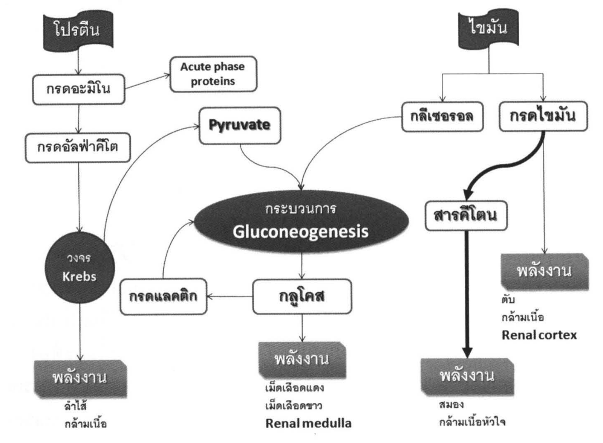
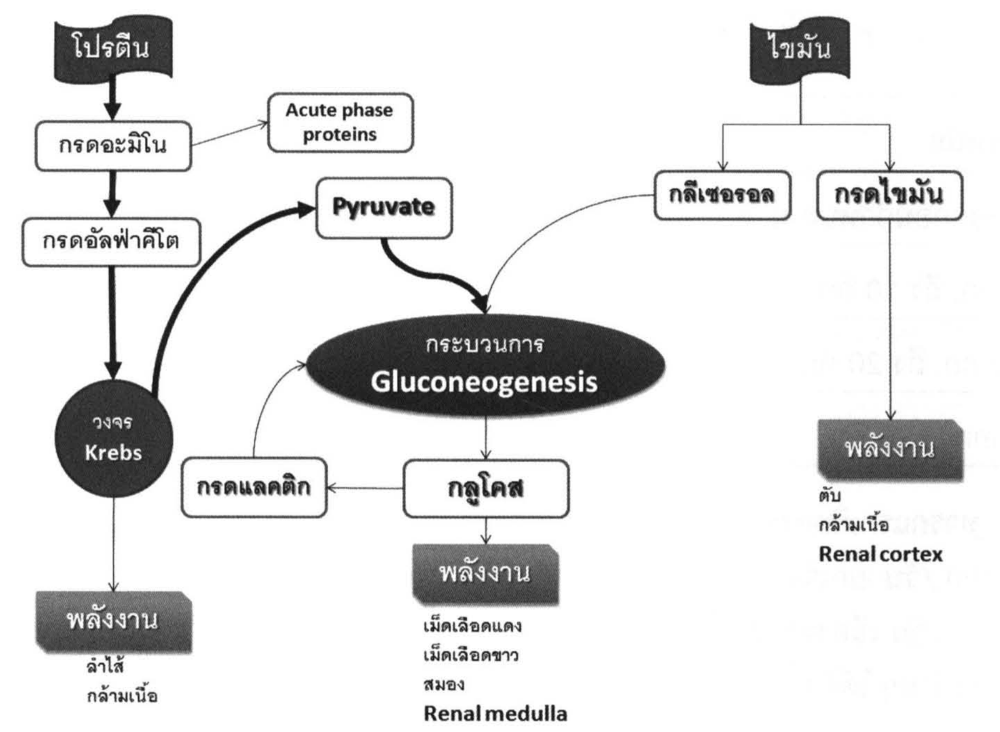
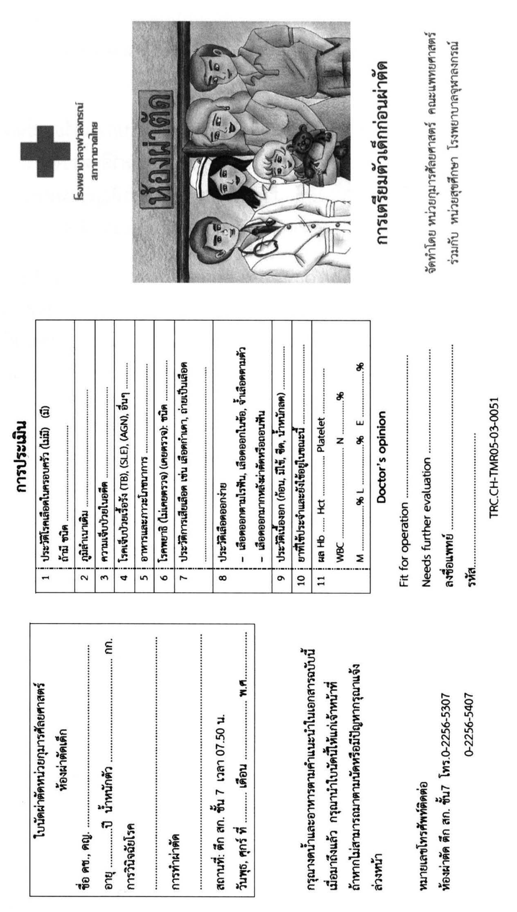
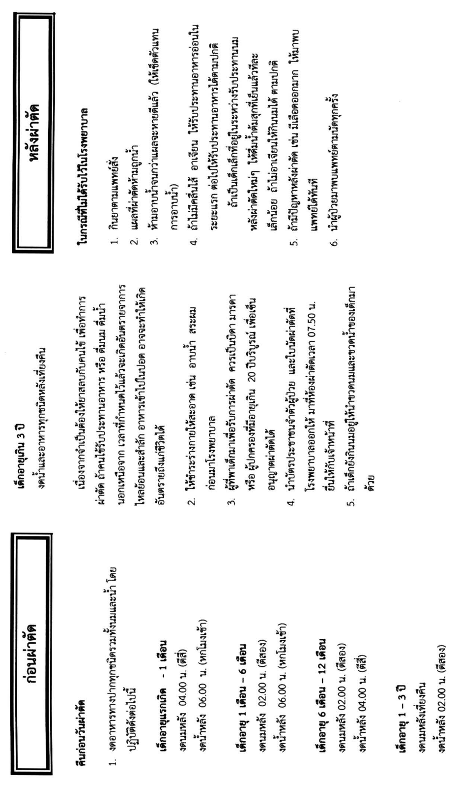

# ความรู้เบื้องต้นในด้านกุมารศัลยศาสตร์ (Basic Knowledge in Pediatric Surgery)

## Contents of this file
- บทนำ (p.790)
- ระบบหลอดเลือดและหัวใจ (p.790)
- ระบบควบคุมอุณหภูมิของร่างกาย (p.791)
- ระบบการหายใจ (p.792)
- ระบบไต (p.794)
- ระบบภูมิคุ้มกัน (p.794)
- ระบบเมตาบอลิก (p.795)
- สารน้ำ และเกลือแร่ (p.797)
- ระบบสมดุลกรดด่าง (p.799)
- การให้เลือด (p.801)
- ภาวะโภชนาการ (p.802)
  - การให้อาหารผ่านทางเดินอาหาร (Enteral nutrition) (p.803)
  - การให้อาหารทางหลอดเลือดดำ (Total Parenteral Nutrition หรือ TPN) (p.803)
- การผ่าตัดแบบ day-case surgery (p.804)
- สรุป (p.808)
- เอกสารอ้างอิง (p.809)

<!-- p.789 (printed none) -->
**ความรู้เบื้องต้นในด้านกุมารศัลยศาสตร์**

**Basic Knowledge in Pediatric Surgery**

ไพศาล เวชชพิพัฒน์

<!-- p.790 (printed 776) -->
**ความรู้เบื้องต้นในด้านกุมารศัลยศาสตร์**

**Basic Knowledge in Pediatric Surgery**

ไพศาล เวชชพิพัฒน์

## บทนำ

กุมารศัลยศาสตร์ คือ ศาสตร์ของการดูแลรักษาผู้ป่วยเด็กที่เป็นโรคทางศัลยกรรมในช่วงอายุต่างๆ ได้แก่ ทารกแรกเกิด (neonate), ทารก (infant), เด็ก (children), และวัยรุ่น (adolescent) ซึ่งแตกต่างจากผู้ใหญ่ทั้งทางกายภาพและทางสรีรวิทยา ไม่ว่าจะเป็นระบบหลอดเลือดและหัวใจ ระบบการควบคุมอุณหภูมิ ระบบหายใจ ระบบไต ระบบภูมิคุ้มกัน และระบบต่อมไร้ท่อ รวมถึงการให้สารน้ำและอาหารแก่ผู้ป่วยเด็กที่ได้รับการผ่าตัด ดังนั้นแพทย์หรือศัลยแพทย์ที่ให้การดูแลทารกและเด็กที่ได้รับการผ่าตัด จำเป็นที่จะต้องมีความรู้พื้นฐานในด้านต่างๆ เหล่านี้ไว้ เพื่อให้ผลการรักษาผู้ป่วยด้านกุมารศัลยศาสตร์มีประสิทธิผลสูงสุด

## ระบบหลอดเลือดและหัวใจ

หลังจากที่ทารกคลอดออกมา ระบบไหลเวียนโลหิตของทารกในครรภ์ (fetal circulation) จะมีการเปลี่ยนแปลงไปเป็นระบบไหลเวียนโลหิตหลังคลอด (postnatal circulation) โดยจะมีการปิดของ foramen ovale และ ductus arteriosus หลังจากที่เด็กทารกเริ่มหายใจเป็นครั้งแรก การตรวจร่างกายทารกและเด็กอย่างละเอียดสามารถพบความผิดปกติที่บ่งว่าอาจจะมีโรคหัวใจแต่กำเนิด (congenital heart disease) ได้ เช่น คลำได้ thrill, ฟังพบเสียงหัวใจที่ผิดปกติ, หัวใจโต, มีน้ำหนักน้อย, ตัวเขียว, ไอเรื้อรัง, หายใจมีเสียงหวีด (wheezing), หัวใจเต้นเร็ว, dysmorphic features, หรือมีความผิดรูปอื่นร่วมด้วยเป็นต้น

การเปลี่ยนแปลงของ cardiac output ในทารกและเด็กนั้น ขึ้นอยู่กับอัตราการเต้นของหัวใจเป็นหลัก (heart rate dependent) โดยไม่ค่อยขึ้นกับ stroke volume เนื่องจากห้องหัวใจในทารกและเด็กมีขนาดค่อนข้างเล็กทำให้ stroke volume มีการเปลี่ยนแปลงได้น้อย1 ดังนั้นในบางภาวะที่ทารกหรือเด็กจำเป็นจะต้องเพิ่ม cardiac output เช่น มีไข้

<!-- p.791 (printed 777) -->
ซีด หรือเสียเลือด จะอาศัยการเพิ่มของอัตราการเต้นของหัวใจเพื่อเพิ่ม cardiac output เป็นสำคัญ1

ภาวะ shock จะทำให้ปริมาณการไหลของเลือดที่ไปยังระบบทางเดินอาหารลดลง2 และเมื่อเด็กได้รับการรักษาให้ปริมาณการไหลของเลือดที่ไปยังทางเดินอาหารกลับมาเป็นปกติ ก็อาจทำให้เกิดภาวะที่เรียกว่า intestinal reperfusion3 ซึ่งนอกจากจะทำให้เกิดการบาดเจ็บต่อลำไส้เองเพิ่มขึ้น ยังส่งผลเสียต่อการทำงานของอวัยวะอื่น เช่น ตับ4 ปอด5 ไต และหัวใจ6 อีกด้วย ในทารกที่มี capillary refill นานเกิน 2 วินาที (ค่าปกติควรน้อยกว่า 1 วินาที) แสดงว่าทารกนั้นอาจมีภาวะที่มีการลัดเลือดจากผิวหนังไปยังอวัยวะอื่นที่สำคัญ เช่น สมองและตับ ซึ่งจะพบได้ในภาวะ cardiogenic shock หรือภาวะสูญเสียเลือด เป็นต้น

สำหรับในภาวะออกซิเจนในเลือดต่ำ (hypoxemia) ภาวะเลือดเป็นกรด (acidosis) หรือในภาวะให้สารน้ำเกิน (fluid overload) นั้น จะทำให้ทารกมีความดันเลือดใน pulmonary artery เพิ่มขึ้น ส่งผลให้เกิดการคงอยู่ (patent) ของ foramen ovale หรือ ductus arteriosus หลังคลอดทารกนั้นจะมีภาวะ right-to-left shunt ได้ อย่างไรก็ตามทารกที่ไม่มีความพิการของหัวใจแต่กำเนิด หรือความผิดปกติแต่กำเนิดของ aortic arch มักจะทนต่อการผ่าตัดที่ไม่มีความซับซ้อนได้ดี

## ระบบควบคุมอุณหภูมิของร่างกาย

การควบคุมอุณหภูมิสิ่งแวดล้อมให้เหมาะสม (neutral thermal environment) คือ การปรับอุณหภูมิของสิ่งแวดล้อมรอบๆ ตัวเด็กทารก ที่จะทำให้ทารกมีอัตราการใช้พลังงาน (metabolic rate) และการใช้ออกซิเจน (oxygen consumption) ต่ำที่สุด7 อุณหภูมินี้มีค่าแตกต่างกันตามน้ำหนักตัวและอายุหลังคลอด ซึ่งอยู่ระหว่าง 29 องศาเซลเซียส สำหรับทารกน้ำหนักปกติถึง 36 องศาเซลเซียส สำหรับทารกคลอดก่อนกำหนดและน้ำหนักน้อย อุณหภูมิรอบตัวเด็กที่เหมาะสมนี้ ทำให้ความต้องการพลังงานในการควบคุมอุณหภูมิร่างกายของทารกอยู่ในระดับต่ำ ซึ่งจะส่งผลทำให้ความต้องการใช้ออกซิเจนในการสร้างความร้อนลดลงด้วย ซึ่ง neutral thermal environment นี้มีความสำคัญอย่างยิ่งในระหว่างการเคลื่อนย้ายเด็กทารกไปยังห้องผ่าตัด หรือการย้ายเด็กไปยังโรงพยาบาลอื่น

เด็กทารกจะมีสัดส่วนพื้นที่ผิว (body surface area) ต่อน้ำหนักตัวมากกว่าผู้ใหญ่ ทำให้มีโอกาสสูญเสียความร้อนของร่างกายได้ง่ายกว่าผู้ใหญ่ นอกจากนี้ทารกยังมี ผม ขน

<!-- p.792 (printed 778) -->
และไขมันใต้ผิวหนังน้อย ทำให้ทารกมี insensible water loss มากกว่าผู้ใหญ่ ส่งผลให้เด็กมีโอกาสเสี่ยงต่อภาวะอุณหภูมิร่างกายต่ำ (hypothermia) และอาจทำให้หยุดหายใจ (apnea) และเสียชีวิตได้

ในกรณีที่อุณหภูมิสิ่งแวดล้อมต่ำกว่า neutral thermal environment มาก จะทำให้ทารกมีภาวะเครียดจากอุณหภูมิร่างกายต่ำ (cold stress) ซึ่งทารกแรกเกิดจะมีกลไกการควบคุมอุณหภูมิของร่างกายโดยการสลายไขมันสีน้ำตาล (brown fat) บริเวณต้นคอ รักแร้ mediastinum และไขมันที่อยู่รอบๆ ไต มาเป็นพลังงาน กระบวนการนี้เรียกว่า ‘nonshivering thermogenesis’ ซึ่งหากทารกนั้นต้องอยู่ในภาวะ cold stress นี้นานๆ จะทำให้การทำงานของหัวใจผิดปกติ และ cardiac output ลดลงจากการขาดพลังงาน ส่งผลให้เกิดภาวะเลือดเป็นกรด (acidosis) ตามมาได้7

## ระบบการหายใจ

ปอดของทารกแรกเกิดครบกำหนดยังเจริญเติบโตไม่เต็มที่ จะยังมีการสร้าง terminal bronchiole และ alveoli เพิ่มขึ้นอีกเป็นระยะเวลาอีกหลายเดือนหลังจากคลอดแล้ว ส่วนทารกที่คลอดก่อนกำหนดจะมีจำนวน pneumocyte type II (มีหน้าที่สร้างและหลั่งสาร surfactant) น้อยกว่าปกติ ซึ่งจะส่งผลทำให้ทารกนั้นมีสาร surfactant น้อย และมีโอกาสเสี่ยงต่อการมีปอดแฟบ (atelectasis) และ barotrauma ต่อปอดได้8 สำหรับ tidal volume ของปอดในทารกแรกเกิดมีค่าปกติเท่ากับ 6-10 มล./กก.

เส้นผ่านศูนย์กลางของท่อลม trachea ของทารกมีขนาดค่อนข้างเล็ก คือ 2.5 มิลลิเมตร ถึง 4 มิลลิเมตร ทำให้ง่ายต่อการอุดตันของทางเดินหายใจส่วนบน นอกจากนี้ทารกจะหายใจทางจมูกและใช้กะบังลมในการหายใจเป็นหลัก ไม่สามารถหายใจทางปากได้ยกเว้นตอนร้องไห้ ดังนั้นหากจำเป็นที่จะต้องใส่สายเพื่อระบายของเหลวจากกระเพาะอาหารในทารก ควรที่จะใส่สายเข้าทางปาก (oro-gastric tube) ไม่ควรใส่เข้าทางจมูก (naso-gastric tube) ดังเช่นในผู้ใหญ่9

ค่าความดันก๊าซในเลือดของทารกแรกเกิดในระยะแรกจะมีค่าไม่เท่ากับในผู้ใหญ่ ซึ่งเป็นผลมาจากการคงอยู่ของ foramen ovale และ ductus arteriosus ทำให้ ค่าปกติของความดันของออกซิเจนในเลือดแดง หรือ PaO2 ของ preductal (จากเส้นเลือดแดง radial ข้างขวา) ของทารกคือ 75-80 มิลลิเมตรปรอท และค่าปกติของความดันของออกซิเจนในเลือดแดง postductal (เช่น จากเส้นเลือดแดง umbilical) เป็น 30-35

<!-- p.793 (printed 779) -->
มิลลิเมตรปรอท ในขณะที่ค่าปกติของความดันก๊าซคาร์บอนไดออกไซด์ในเลือดแดง หรือ PaCO2 จะอยู่ที่ 30-35 มิลลิเมตรปรอท เนื่องจากอัตราการหายใจที่เร็วของทารก (40-60 ครั้งต่อนาที)

ภาวะ persistent pulmonary hypertension (PPHN) คือภาวะที่ pulmonary vascular resistance มีค่าเท่ากับหรือสูงกว่า systemic vascular resistance ซึ่งจะทำให้เกิดภาวะ hypoxemia จากการลัดเลือดจากขวาไปซ้ายนอกปอด (extra-pulmonary right-to-left shunt) ซึ่งตัวอย่างของทารกที่มีโอกาสเสี่ยงต่อการเกิด PPHN คือ ทารกที่มีภาวะเลือดข้น (hyperviscosity) หรือไส้เลื่อนกะบังลมแต่กำเนิด

ในทารกคลอดก่อนกำหนดจะเสี่ยงต่อการหยุดหายใจ (apnea) หลังการดมยาสลบได้ ดังนั้นจำเป็นต้องเฝ้าระวังอย่างใกล้ชิดเป็นเวลาอย่างน้อย 24 ชม. หลังการผ่าตัด นอกจากนี้ภาวะท้องอืด ภาวะช็อก และการติดเชื้อในกระแสเลือด อาจจะทำให้ระบบการหายใจของทารกและเด็กมีการทำงานลดลง อาจต้องใส่ท่อช่วยหายใจและใช้เครื่องช่วยหายใจ

ในกรณีที่จำเป็นต้องใส่ท่อช่วยหายใจในเด็ก แพทย์ผู้ดูแลรักษาจะต้องทราบขนาดของเส้นผ่านศูนย์กลางของท่อที่จะใส่ให้แก่เด็กในอายุต่างๆ สำหรับขนาดของท่อช่วยหายใจ (endotracheal tube) ในเด็กมีดังนี้ (ตารางที่ 1)

**ตารางที่ 1** ขนาดของท่อช่วยหายใจ (endotracheal tube) ในเด็กอายุต่างๆ

| **อายุของเด็ก** | **เส้นผ่านศูนย์กลางภายในของท่อช่วยหายใจ** |
| --- | --- |
| ทารกคลอดก่อนกำหนด | 2.5 มิลลิเมตร |
| 0-3 เดือน | 3.0 มิลลิเมตร |
| 3-7 เดือน | 3.5 มิลลิเมตร |
| 7-15 เดือน | 4.0 มิลลิเมตร |
| 15-24 เดือน | 4.5 มิลลิเมตร |
| 2-10 ปี | 16+ อายุ (ปี)/4 = ... มิลลิเมตร |
| 10-19 ปี | 6.0-8.0 มิลลิเมตร |

<!-- p.794 (printed 780) -->
## ระบบไต

โดยทั่วไปแล้ว ไตของเด็กทารกจะมีประสิทธิภาพในการทำงานได้ไม่เท่าผู้ใหญ่ ทารกแรกเกิดสามารถผลิตปัสสาวะที่มีความเข้มข้นเพียง 500-600 มิลลิออสโมล (mOsm) ในขณะที่ผู้ใหญ่สามารถผลิตปัสสาวะที่มีความเข้มเข้นถึง 1200 มิลลิออสโมล ทำให้เด็กทารกทนต่อการเปลี่ยนแปลงของการขาดน้ำหรือการให้น้ำเกินไม่ค่อยได้ อย่างไรก็ตามภาวะนี้มักจะไม่เป็นปัญหาต่อการผ่าตัดทั่วไปในทารกที่แข็งแรง สำหรับปริมาณเลือดที่ไปเลี้ยงไต (renal blood flow) ในทารกจะมีค่าเพียงร้อยละ 6 ของ cardiac output ในขณะที่เด็กโตและในผู้ใหญ่จะมีค่าถึงร้อยละ 25 โดยที่ใน 3 เดือนแรกจะเพิ่มเป็นร้อยละ 12 ของ cardiac output หลังจากนั้นจะค่อยๆ เพิ่มขึ้นเท่ากับผู้ใหญ่คือ ร้อยละ 25 เมื่ออายุ 1-2 ปี ซึ่งการที่ทารกมีสัดส่วนปริมาณเลือดที่ไปเลี้ยงไตค่อนข้างต่ำ ส่งผลทำให้ glomerular filtration rate (GFR) ต่ำตามไปด้วย ทำให้การขับของเสียทำได้ช้า และมีความไวต่อการขาดเลือดไปเลี้ยงไตมากกว่าเมื่อเทียบกับในผู้ใหญ่10

ค่าปกติของปริมาณปัสสาวะ (urine output) ในเด็กทารกเท่ากับ 1-2 มล./กก./ชม. ในขณะที่ ของผู้ใหญ่เท่ากับ 0.5 มล./กก./ชม. โดยที่ไตของเด็กจะมีประสิทธิภาพในการขับถ่ายของเสียและทำให้ปัสสาวะเข้มข้นใกล้เคียงกับผู้ใหญ่เมื่ออายุ 2 ปี

## ระบบภูมิคุ้มกัน

ระบบภูมิคุ้มกันของทารกแรกเกิดค่อนข้างอ่อนแอ แต่ก็เป็นปัจจัยสำคัญในการต่อสู้กับการติดเชื้อในระยะแรกของการมีชีวิต ทารกแรกเกิดจะมีความเสี่ยงต่อการติดเชื้อได้ง่ายเมื่อเทียบกับผู้ใหญ่ เนื่องจากมีระดับ opsonin, IgA, IgG, IgM และ C3b ค่อนข้างต่ำ โดยเฉพาะอย่างยิ่งในทารกคลอดก่อนกำหนด โดยที่มีเชื้อแบคทีเรีย Group B beta-streptococci และ E. Coli เป็นเชื้อที่พบบ่อยที่ทำให้เกิดการติดเชื้อรุนแรง นอกจากนี้ทารกคลอดก่อนกำหนดจะมีระดับของ tumor necrosis factor-alpha, interferon alpha, และ interleukins ในซีรั่ม มีระดับต่ำกว่า เมื่อเทียบกับทารกครบกำหนดและในผู้ใหญ่11 ทำให้การตอบสนองต่อการติดเชื้อช้าและประสิทธิภาพต่ำ

ในเด็กที่ได้รับการผ่าตัดนั้น การมีลิ่มเลือด (hematoma), seroma, หรือเนื้อเยื่อที่ได้รับบาดเจ็บในแผลผ่าตัด เป็นอาหารอย่างดีสำหรับเชื้อโรคที่อยู่ในแผลผ่าตัด จึงจำเป็นที่แพทย์ผู้ดูแลรักษาผู้ป่วยที่ได้รับการผ่าตัด จะต้องกำจัดสิ่งเหล่านี้ให้เหลือน้อยที่สุดเท่าที่จะเป็นไปได้เพื่อลดโอกาสของการติดเชื้อหลังผ่าตัด

<!-- p.795 (printed 781) -->
ภาวะถุงน้ำคร่ำแตกก่อนกำหนด (premature rupture of membranes), ภาวะขาดออกซิเจนระหว่างคลอด (perinatal asphyxia), และการติดเชื้อของแม่เด็กระหว่างคลอด (maternal peripartum infection) เป็นปัจจัยเสี่ยงที่สำคัญที่ให้เกิดการติดเชื้อในทารกแรกเกิด และเกิด multiple organ dysfunction ตามมาได้11,12

## ระบบเมตาบอลิก

ทารกในครรภ์มารดา (fetus) ใช้กลูโคสเป็นพลังงานหลัก โดยได้รับสารอาหารจากมารดา โดยกระบวนการแพร่ผ่านทางรก (facilitated transplacental diffusion) และเมื่อคลอดแล้วทารกจะได้รับพลังงานจากการสลาย glycogen ที่เก็บไว้ในตับ (hepatic glycogenolysis) ซึ่งจะใช้จนหมดไปภายใน 2-3 ชั่วโมง หลังจากนั้นจะต้องอาศัยกระบวนการสร้างกลูโคส (gluconeogenesis) จากการทำงานของตับ ซึ่งทำให้ทารกแรกเกิดเสี่ยงต่อภาวะน้ำตาลในเลือดต่ำ โดยเฉพาะอย่างยิ่งทารกที่เป็น small for gestational age, ทารกคลอดก่อนกำหนด, ทารกที่มารดาเป็นโรคเบาหวาน, และทารกที่ได้รับการผ่าตัดและหลังผ่าตัดไม่สามารถกินนมได้13 เนื่องจาก glycogen ที่สะสมที่ตับมีน้อยและถูกใช้หมดไปอย่างรวดเร็ว

ภาวะน้ำตาลในเลือดต่ำ (serum glucose น้อยกว่า 20 mg% ในทารกคลอดก่อนกำหนดหรือน้อยกว่า 30 mg% ในทารกคลอดครบกำหนด) เป็นสาเหตุสำคัญที่ทำให้เกิดการชักในทารกแรกเกิด และถ้าได้รับการรักษาไม่ทันท่วงที อาจจะทำให้เกิดภาวะสมองพิการถาวร (permanent brain damage) ได้

ในภาวะที่เด็กอดอาหาร (simple starvation) ในระยะแรก สมองต้องการสารกลูโคสไปเป็นพลังงานมากที่สุด หลังจากนั้นจะค่อยๆ ปรับตัวโดยกระบวนการ keto-adaptation ซึ่งจะทำให้สมองสามารถใช้คีโตน (ketone bodies) เป็นสารให้พลังงานได้ สารคีโตนนั้นจะได้มาจากกระบวนการ ketogenesis ในตับ ซึ่งเปลี่ยนกรดไขมัน (fatty acids) เป็นสารคีโตน ผลลัพธ์ที่ได้จะทำให้ร่างกายสลายโปรตีนในร่างกายเพื่อเป็นพลังงานลดลง (รูปที่ 1)

<!-- p.796 (printed 782) -->

> **Caption (verbatim):** **รูปที่ 1** แผนภาพแสดงการสลายสารอาหารเพื่อให้ได้พลังงานในภาวะขาดอาหารธรรมดา (simple starvation) จะเห็นว่ากระบวนการ keto-adaptation จะทำให้อัตราการสลายโปรตีนเพื่อกลายเป็นพลังงานลดลง
> **Text in image (verbatim):** โปรตีน · กรดอะมิโน · Acute phase proteins · กรดอัลฟ่าคีโต · วงจร Krebs · Pyruvate · กระบวนการ Gluconeogenesis · กรดแลคติก · กลูโคส · พลังงาน · ลำไส้ · กล้ามเนื้อ · พลังงาน · เม็ดเลือดแดง · เม็ดเลือดขาว · Renal medulla · ไขมัน · กลีเซอรอล · กรดไขมัน · สารคีโตน · พลังงาน · สมอง · กล้ามเนื้อหัวใจ · พลังงาน · ตับ · กล้ามเนื้อ · Renal cortex
> **Description:** Flow diagram (boxes and arrows) of fuel breakdown in simple starvation. Left column: "โปรตีน" (dark banner) → "กรดอะมิโน"; กรดอะมิโน → "Acute phase proteins" (side arrow) and → "กรดอัลฟ่าคีโต" → dark circle "วงจร Krebs" → grey box "พลังงาน" labelled below "ลำไส้, กล้ามเนื้อ". A curved arrow runs from วงจร Krebs up to "Pyruvate". Centre: "Pyruvate" → dark oval "กระบวนการ Gluconeogenesis" → "กลูโคส" → grey box "พลังงาน" labelled below "เม็ดเลือดแดง, เม็ดเลือดขาว, Renal medulla". กลูโคส → "กรดแลคติก", and a curved arrow from กรดแลคติก goes back into กระบวนการ Gluconeogenesis. Right column: "ไขมัน" (dark banner) splits into "กลีเซอรอล" and "กรดไขมัน"; a curved arrow from กลีเซอรอล goes into กระบวนการ Gluconeogenesis. From กรดไขมัน a thick bold arrow → "สารคีโตน" → thick bold arrow → grey box "พลังงาน" labelled below "สมอง, กล้ามเนื้อหัวใจ"; a thin arrow from กรดไขมัน goes directly to another grey box "พลังงาน" labelled below "ตับ, กล้ามเนื้อ, Renal cortex". The thick arrows emphasise the fat → ketone pathway (keto-adaptation) as the dominant energy route.
> **Identifiers in image:** none

แต่ในภาวะเครียด (stress catabolism) เช่น หลังผ่าตัดใหญ่ กระบวนการ ketoadaptation จะถูกยับยั้งทำให้ร่างกายต้องสลายโปรตีน (proteolysis) เพิ่มขึ้นเพื่อให้ได้กรดอะมิโน ซึ่งส่วนใหญ่จะเข้าสู่กระบวนการ gluconeogenesis ส่วนกรดอะมิโนที่เหลือจะใช้ในการสร้าง acute phase proteins และกลายเป็นกรดอัลฟ่าคีโตเพื่อเข้าสู่วงจร Krebs เพื่อให้ได้พลังงานต่อไป (รูปที่ 2)

นอกจากนี้จะพบว่าทารกคลอดก่อนกำหนดยังมีความเสี่ยงต่อการเกิดภาวะน้ำตาลในเลือดต่ำมากกว่าทารกคลอดครบกำหนด เนื่องจาก glycogen store ที่น้อยกว่าทารกคลอดครบกำหนดถึงร้อยละ 70, อัตราการสร้าง glucose จากกระบวนการ gluconeogenesis ที่ช้ากว่า, และปริมาณโปรตีนและไขมันต่อน้ำหนักตัว (เพื่อสร้างเป็นพลังงาน) มีระดับที่ต่ำกว่าทารกคลอดครบกำหนด

การผ่าตัดเป็น major stress อีกทั้งการตอบสนองต่อการผ่าตัดจะรุนแรงกว่าในเด็กเมื่อเทียบกับผู้ใหญ่ โดยจะพบว่าในระหว่างการผ่าตัดจะมีการเพิ่มขึ้นของระดับ adrenaline, noradrenaline, insulin, glucagon, glucose, lactate, pyruvate และ alanine

<!-- p.797 (printed 783) -->
ในพลาสมา และหลังการผ่าตัดจะพบมีการเพิ่มขึ้นของระดับ cortisol, prolactin, interleukin-6 และ interleukin-8 ในพลาสมา และจะยิ่งเพิ่มขึ้นเมื่อมีภาวะแทรกซ้อนจากการผ่าตัดเกิดขึ้น ความเข้าใจระบบเมตาบอลิกของทารกและเด็กที่ได้รับการผ่าตัดจึงมีความสำคัญในการดูแลผู้ป่วยเด็กทั้งก่อนผ่าตัด ระหว่างผ่าตัด และหลังผ่าตัด

> **Caption (verbatim):** **รูปที่ 2** แผนภาพแสดงการสลายสารอาหารเพื่อให้ได้พลังงานในภาวะเครียด (stress catabolism) จะเห็นว่าอัตราการสลายโปรตีนเพื่อให้เกิดเป็นพลังงานสูงเพิ่มขึ้น
> **Text in image (verbatim):** โปรตีน · กรดอะมิโน · Acute phase proteins · กรดอัลฟ่าคีโต · วงจร Krebs · Pyruvate · กระบวนการ Gluconeogenesis · กรดแลคติก · กลูโคส · พลังงาน · ลำไส้ · กล้ามเนื้อ · พลังงาน · เม็ดเลือดแดง · เม็ดเลือดขาว · สมอง · Renal medulla · ไขมัน · กลีเซอรอล · กรดไขมัน · พลังงาน · ตับ · กล้ามเนื้อ · Renal cortex
> **Description:** Flow diagram with the same layout as รูปที่ 1, redrawn for stress catabolism. Left column: "โปรตีน" (dark banner) → thick arrow → "กรดอะมิโน" → thick arrow → "กรดอัลฟ่าคีโต" → thick arrow → dark circle "วงจร Krebs"; กรดอะมิโน also → thin arrow → "Acute phase proteins"; วงจร Krebs → thin arrow → grey box "พลังงาน" labelled below "ลำไส้, กล้ามเนื้อ". A thick curved arrow goes from วงจร Krebs to "Pyruvate", and a thick curved arrow from Pyruvate into the dark oval "กระบวนการ Gluconeogenesis". Gluconeogenesis → "กลูโคส" → grey box "พลังงาน" labelled below "เม็ดเลือดแดง, เม็ดเลือดขาว, สมอง, Renal medulla"; กลูโคส → "กรดแลคติก", which returns by a thin curved arrow into Gluconeogenesis. Right column: "ไขมัน" (dark banner) splits into "กลีเซอรอล" and "กรดไขมัน"; กลีเซอรอล → thin curved arrow into Gluconeogenesis; กรดไขมัน → thin arrow → grey box "พลังงาน" labelled below "ตับ, กล้ามเนื้อ, Renal cortex". Unlike รูปที่ 1 there is no สารคีโตน (ketone) box, and สมอง is now listed under the glucose-derived energy; the thick arrows emphasise the protein → amino acid → Krebs → pyruvate → gluconeogenesis pathway.
> **Identifiers in image:** none

## สารน้ำ และเกลือแร่

หัวใจในการดูแลรักษาผู้ป่วยเด็กทางกุมารศัลยศาสตร์ที่สำคัญมากอย่างหนึ่งก็คือ การเข้าใจในหลักการให้สารน้ำและเกลือแร่ ในทารกคลอดครบกำหนดนั้น ร้อยละ 80 ของน้ำหนักตัวเป็นน้ำ และประมาณครึ่งหนึ่งของน้ำหนักตัวเป็นน้ำที่อยู่นอกเซลล์ (extracellular water) และค่าเหล่านี้จะค่อยๆ ลดลงเรื่อยๆ โดยเมื่อเป็นผู้ใหญ่ ร้อยละ 60 ของน้ำหนักตัวจะเป็นน้ำและร้อยละ 20 ของน้ำหนักตัวจะเป็นน้ำที่อยู่นอกเซลล์14

ทารกมี insensible water loss เท่ากับ 30-35 มล./กก./วัน ซึ่งสูงกว่าผู้ใหญ่ที่มี insensible water loss เท่ากับ 15 มล./กก./วัน ส่วนในทารกคลอดก่อนกำหนดนั้น

<!-- p.798 (printed 784) -->
จะมี insensible loss สูงถึง 45-60 มล./กก./วัน นอกจากนี้แล้ว ความร้อนจาก radiant warmer, การรักษาด้วย phototherapy ภาวะที่มีไข้ และการมีภาวะหายใจเร็วล้วนทำให้ทารกมี insensible water loss เพิ่มขึ้น สำหรับความต้องการสารน้ำของเด็กโดยทั่วไป (ตารางที่ 2) มีหลักการดังนี้14

**ตารางที่ 2** ความต้องการสารน้ำของเด็กคิดตามน้ำหนักของเด็ก

| **น้ำหนัก** | **ปริมาณ** |
| --- | --- |
| คลอดก่อนกำหนด น้ำหนักน้อยกว่า 2 กก. | 140-150 มล./กก./วัน |
| 2 กก. ถึง 10 กก. | 100 มล./กก./วัน |
| 10 กก. ถึง 20 กก. | 1000 มล. + 50 มล./กก./วัน |
| มากกว่า 20 กก. | 1500 มล. + 20 มล./กก./วัน |

ทารกแรกเกิดครบกำหนดในเดือนแรกอาจต้องให้ maintenance fluid อยู่ที่ 120 มล./กก./วัน ยกเว้นใน 2-5 วันแรกหลังจากคลอด อาจให้อยู่ที่ประมาณ 65 ถึง 80 มล./กก./วัน เนื่องจากทารกแรกคลอดจะมีภาวะน้ำเกินเล็กน้อยอยู่แล้ว หรืออาจสามารถคำนวณง่ายๆ ได้ดังนี้

น้ำหนัก 10 กก. แรก = 4 มล./กก./ชม.

น้ำหนัก 11-20 กก. = 2 มล./กก./ชม.

มากกว่า 20 กก. = 1 มล./กก./ชม.

ยกตัวอย่างเช่น เด็กน้ำหนัก 25 กก. จะสามารถให้สารน้ำ maintenance เท่ากับ (10x4) + (10x2) + (5x1) = 65 มล./ชม.

เมื่อต้องให้สารน้ำแก่ทารกแรกเกิดน้ำหนักปกติ เรามักจะเริ่มต้นด้วย 5%-10% D/N/4 ในปริมาณที่เท่ากับ maintenance + insensible loss (เช่น มีไข้สูง) + ongoing loss (เช่น ท้องเสีย)

<!-- p.799 (printed 785) -->
ความต้องการเกลือแร่ โซเดียม คือ 2 mEq/กก./วัน ในทารกคลอดครบกำหนด และอาจจะเพิ่มได้มากถึง 5 mEq/กก./วัน ในทารกคลอดก่อนกำหนดที่อยู่ในภาวะวิกฤต ส่วนความต้องการโพแทสเซียมจะอยู่ที่ 2-3 mEq/กก./วัน ส่วนแคลเซียมและแมกนีเซียมก็มีความจำเป็นที่จะต้องให้ผสมในสารน้ำที่ให้ทางหลอดเลือดดำเพื่อป้องกันภาวะ laryngospasm การชักและหัวใจเต้นผิดจังหวะ อย่างไรก็ดี พึงระลึกไว้เสมอว่าผู้ป่วยเด็กที่ได้รับการผ่าตัดใหญ่ ในระยะหลังผ่าตัดอาจจะต้องการสารน้ำน้อยกว่าปกติเนื่องจากร่างกายจะมีการหลั่ง anti-diuretic hormone และ cortisol ออกมามากหลังผ่าตัด เป็นกลไกเพื่อเก็บน้ำไว้ในร่างกาย ดังนั้นการประเมินผู้ป่วยอย่างใกล้ชิดจึงเป็นสิ่งจำเป็น ในปัจจุบันการให้สารน้ำหลังผ่าตัดในเด็กเล็กและเด็กโตในระยะ 3-4 วันแรก นิยมให้เป็นสารน้ำ isotonic เช่น normal saline หรือ Ringer’s lactate ร่วมกับการให้กลูโคสและโพแทสเซียมที่เหมาะสม เป็น maintenance fluid เพื่อลดโอกาสเกิดภาวะ hyponatremia หลังการผ่าตัด15

การประเมินภาวะน้ำของทารกและเด็ก ดูได้จากน้ำหนักตัวที่เปลี่ยนไป ความยืดหยุ่นของผิวหนัง ปริมาณและความเข้มข้นของปัสสาวะ นอกจากนี้ การคำนวณปริมาณสารน้ำและเกลือแร่นั้นยังต้องคำนึงถึง insensible loss ที่เปลี่ยนไป เช่น ไข้ และ ongoing loss เช่น การเสียน้ำจากสาย nasogastric หรือท้องเสียด้วย โดยที่จะต้องทดแทนสารน้ำและเกลือแร่ที่สูญเสียไปทาง insensible loss และ ongoing loss นี้ด้วย14

## ระบบสมดุลกรดด่าง

ภาวะ acute metabolic acidosis ในเด็กมักเกิดจากภาวะที่ระบบหมุนเวียนโลหิตไปให้แก่เนื้อเยื่อไม่เพียงพอ (inadequate tissue perfusion) โรคทางกุมารศัลยศาสตร์ที่ทำให้เกิดภาวะ metabolic acidosis อย่างเฉียบพลัน มักเกิดจากภาวะขาดเลือดหรือภาวะเน่าตายของลำไส้ที่ทำให้เกิดการติดเชื้อรุนแรงตามมา หรือภาวะเสียเลือดหรือสารน้ำของร่างกายที่สำคัญ ได้แก่ โรคลำไส้เน่าตายในทารก (necrotizing enterocolitis), โรคลำไส้ส่วน midgut บิดหมุน (midgut volvulus), และภาวะไส้เลื่อนติด (incarcerated hernia) เป็นต้น ซึ่งการรักษาภาวะเหล่านี้ก็คือการแก้ไขสาเหตุเพื่อให้การไหลเวียนโลหิตไปยังเนื้อเยื่อต่างๆ กลับมาเป็นปกติ แล้วสมดุลกรดด่างก็จะกลับมาเป็นปกติได้เองจากกลไกแก้ไขของร่างกายเด็ก แต่ในกรณีที่ metabolic acidosis แบบเฉียบพลันและมีความรุนแรง (pH ในเลือดแดงน้อยกว่า 7.25) ก็อาจจะต้องแก้ไขก่อนด้วยการให้ sodium bicarbonate เพื่อให้เด็กดีขึ้นก่อน

<!-- p.800 (printed 786) -->
ภาวะ metabolic acidosis แบบเรื้อรังมักเกิดจากการสูญเสียด่างแบบเรื้อรัง เช่น ท้องเสียเรื้อรัง หรือ การเป็นโรคไตวายเรื้อรัง เป็นต้น ส่วนภาวะ respiratory acidosis นั้นเกิดจากภาวะความผิดปกติของการหายใจ เช่น ทางเดินหายใจอุดตัน ภาวะปอดติดเชื้อ และภาวะบาดเจ็บต่อช่องทรวงอก

ทารกที่เป็นไพลอรัสตีบ (infantile hypertrophic pyloric stenosis) จะมีการอาเจียนมากจนขาดน้ำ (dehydration) ร่วมกับการสูญเสียกรดไฮโดรคลอริก (HCl) จากกระเพาะอาหาร และสูญเสียโพแทสเซียมจากการแลกกับ H+ ที่ไต ทำให้เกิดภาวะ hypokalemic hypochloremic metabolic alkalosis ได้ ซึ่งสามารถแก้ไขได้โดยการให้สารน้ำ 5% dextrose N/2 และ โพแทสเซียมคลอไรด์ 20 mEq/ลิตร โดยก่อนที่จะให้โพแทสเซียมจะต้องมั่นใจว่า ปริมาณปัสสาวะกลับมาเป็นปกติแล้ว ซึ่งสาเหตุของความผิดปกติของสมดุลกรด-ด่างในทางกุมารศัลยศาสตร์ที่พบบ่อย แสดงดังตารางที่ 3

**ตารางที่ 3** แสดงสาเหตุของความผิดปกติของสมดุลกรด-ด่าง ในกุมารศัลยศาสตร์ที่พบบ่อย

| **ภาวะ** | **ตัวอย่างสาเหตุในผู้ป่วยทางกุมารศัลยศาสตร์** |
| --- | --- |
| **Metabolic acidosis** | ลำไส้เน่าตายในทารกแรกเกิด (necrotizing enterocolitis) ลำไส้ส่วน midgut บิดหมุน (midgut volvulus) Shock Sepsis ท้องเสีย Enterocutaneous fistula |
| **Metabolic alkalosis** | Infantile hypertrophic pyloric stenosis |
| **Respiratory acidosis** | ไส้เลื่อนกะบังลมแต่กำเนิด Congenital cystic adenomatoid malformation Pneumothorax |
| **Respiratory alkalosis** | หายใจเร็ว (hyperventilation) |

<!-- p.801 (printed 787) -->
## การให้เลือด

ปริมาณเลือดของร่างกายในเด็กทารกเท่ากับร้อยละ 8 ของน้ำหนักตัวหรือ 80 ml/kg และลดลงเหลือเท่ากับผู้ใหญ่ (ร้อยละ 5) เมื่อเป็นเด็กโต (รายละเอียดดังตารางที่ 4)

**ตารางที่ 4** แสดงปริมาตรของเลือดในเด็กตามอายุ

| **กลุ่ม** | **ปริมาตรของเลือด (มล./กก.)** |
| --- | --- |
| ทารกคลอดก่อนกำหนด | 85-100 |
| ทารกคลอดครบกำหนด | 80-85 |
| อายุเกิน 1 เดือน | 75 |
| อายุเกิน 3 เดือน | 70 |

การตัดสินใจว่าจะให้เลือดหรือไม่ให้เลือดแก่เด็กที่ได้รับการผ่าตัดนั้น ขึ้นอยู่กับหลายปัจจัย เช่น อายุ โรคของเด็ก ปริมาณของเลือดที่ออก ภาวะเลือดออกง่าย ภาวะขาดออกซิเจนในเลือด สัญญาณชีพ ภาวะเลือดเป็นกรด และอื่นๆ16 สำหรับแนวทางการให้เลือดและส่วนประกอบของเลือด มีดังนี้ (ตารางที่ 5)

**ตารางที่ 5** แสดงวิธีการให้องค์ประกอบต่างๆ ของเลือด

| **องค์ประกอบ** | **วิธีการให้** |
| --- | --- |
| Packed red cells (PRCs) | 3 × น้ำหนัก (กก.) × (target hemoglobin (Hb)-current Hb) หน่วยเป็น มล. หรือ 10-20 มล./กก./ครั้ง พิจารณาตามความรุนแรงของอาการเลือดออก โดยให้ตามหมู่เลือด ABO |
| Whole blood | 6 × น้ำหนัก (กก.) × (target Hb-current Hb) หน่วยเป็น มล. หรือ 10-20 มล./กก./ครั้ง พิจารณาตามความรุนแรงของอาการเลือดออก โดยให้ตามหมู่เลือด ABO |

<!-- p.802 (printed 788) -->
*(ตารางที่ 5 continued; the header row is not reprinted on this page and is repeated below from p.801)*

| **องค์ประกอบ** | **วิธีการให้** |
| --- | --- |
| Fresh frozen plasma (FFP) | Clotting factors replacement ให้ 10 มล./กก. ส่วน volume expansion (ปัจจุบันไม่ควรใช้ ข้อบ่งชี้นี้ถ้าไม่จำเป็นจริงๆ) ให้ 10–20 มล./กก. โดยให้ภายในครึ่งถึง 1 ชั่วโมง |
| เกล็ดเลือด (Platelets) | เกล็ดเลือดเข้มข้น 0.1-0.2 ยูนิต/กก. จะเพิ่มเกล็ดเลือดได้ 20,000-50,000/ไมโครลิตร อาจเพิ่มได้ถึง 0.4 ยูนิต/กก. ให้ซ้ำได้ทุก 1-3 วัน |

## ภาวะโภชนาการ

ทารกแรกเกิดมีความต้องการพลังงานต่อน้ำหนักเท่ากับ 120 แคลอรี่/กก./วัน ซึ่งมากกว่าผู้ใหญ่ถึง 2.5 เท่า เพื่อใช้ในการเจริญเติบโตและควบคุมอุณหภูมิร่างกาย นมทารกโดยทั่วไปมีพลังงานเท่ากับ 20 แคลอรี/ออนซ์ (30 มล.) ดังนั้นใน 1 วัน ทารกปกติต้องการนม = น้ำหนัก (กก.) x 6 ออนซ์ แต่ในภาวะติดเชื้อและการบาดเจ็บ ความต้องการพลังงานจะเพิ่มมากขึ้นอีก โดยมีสัดส่วนของการให้สารอาหารแก่ทารกในภาวะปกติคือ ร้อยละ 50 เป็นคาร์โบไฮเดรต ร้อยละ 35 เป็นไขมัน และร้อยละ 15 เป็นโปรตีน ความต้องการพลังงานและโปรตีนของเด็กปกติทั่วไป มีดังตารางที่ 6

**ตารางที่ 6** แสดงความต้องการพลังงานและโปรตีนของเด็กปกติทั่วไปแบ่งตามอายุ

| **อายุ (ปี)** | **พลังงาน (แคลอรีต่อ กก. ต่อวัน)** | **โปรตีน (กรัมต่อ กก. ต่อวัน)** |
| --- | --- | --- |
| 0-1 | 90-124 | 2.0-3.5 |
| 1-7 | 75-90 | 2.0-2.5 |
| 7-12 | 60-75 | 2.0 |
| 12-18 | 30-60 | 1.5 |
| >18 | 25-30 | 1.0 |

<!-- p.803 (printed 789) -->
หลังการผ่าตัดร่างกายจะต้องการพลังงานและโปรตีนเพิ่มขึ้น เพื่อซ่อมแซมส่วนที่สึกหรอและเพื่อการเจริญเติบโต ดังนั้นในการดูแลผู้ป่วยเด็กที่ได้รับการผ่าตัดใหญ่ ให้ได้รับพลังงานและโปรตีนให้เพียงพอต่อร่างกาย จำเป็นต้องคำนึงถึงปัจจัยข้อนี้ด้วย

### การให้อาหารผ่านทางเดินอาหาร (Enteral nutrition)

ในบางกรณีผู้ป่วยไม่สามารถกินอาหารเองได้เพียงพอกับที่ร่างกายต้องการ จำเป็นที่จะต้องให้อาหารผ่านทางสายทางเดินอาหาร เช่น nasogastric tube, gastrostomy หรือ jejunostomy เป็นต้น สำหรับข้อบ่งชี้ของการให้อาหารผ่านทางสายทางเดินอาหาร คือ ภาวะใดก็ตามที่ทางเดินอาหารยังสามารถดูดซึมอาหารได้ตามปกติ แต่ไม่สามารถกลืนกินอาหารได้เองอย่างเพียงพอ

### การให้อาหารทางหลอดเลือดดำ (Total Parenteral Nutrition หรือ TPN)

การให้ TPN มีอยู่หลายสูตร โดยทั่วไปมักจะค่อยๆ เพิ่มความเข้มข้นของกลูโคสจนถึง 17-18% ในทารกแรกเกิด หรือ 25% ในเด็กโต ให้กรดอะมิโน 2.5-3.0 กรัม/กก./วัน ในทารกแรกเกิด, หรือ 3.5 กรัม/กก./วัน ในเด็กโต, และให้ไขมันในรูปของ 10%-20% fat emulsion ไม่เกิน 4 กรัม/กก./วัน โดยให้สัดส่วนของ non-protein calorie ต่อกรัมของ protein nitrogen อยู่ที่ 150-200 ต่อ 1 ซึ่งจะทำให้เด็กได้พลังงานประมาณ 120-130 แคลอรี/กก./วัน ตัวอย่างของโรคทางศัลยกรรมทารกที่ต้องได้รับการรักษาโดยการให้สารอาหารทางหลอดเลือดดำ ได้แก่ short bowel syndrome, necrotizing enterocolitis, และ gastroschisis เป็นต้น17

ในกรณีที่ทารกมีภาวะ cholestatic jaundice หรือมี serum triglycerides มากกว่า 200 mg% ให้ลดไขมันลงเหลือ 0.5 กรัม/กก./วัน นอกจากนี้ภาวะ cholestatic jaundice ในทารกที่ได้รับอาหารทางหลอดเลือดดำเป็นเวลานานเป็นปัญหาที่สำคัญ มักพบในทารกคลอดก่อนกำหนดที่มีภาวะ sepsis โดยเฉพาะจากการอักเสบในช่องท้อง (peritonitis) เชื่อว่าเกิดจากการได้รับกรดอะมิโนทางหลอดเลือดดำมากเกินกำลังที่เอนไซม์ของตับ ซึ่งยังไม่เติบโตเต็มที่ (immature) จะสามารถรับได้ ซึ่งภาวะนี้มักจะดีขึ้นเองเมื่อทารกกลับมารับสารอาหารได้จากทางเดินอาหารปกติ

<!-- p.804 (printed 790) -->
ส่วนในกรณีที่ทารกมีภาวะหายใจล้มเหลวร่วมด้วย อาจต้องลดปริมาณ carbohydrate ลง เพื่อป้องกันการเกิดภาวะ hypercarbia จากการสะสมก๊าซคาร์บอนไดออกไซด์ที่เกิดจากการสันดาปสารคาร์โบไฮเดรตที่ได้รับเข้าไป

ในส่วนของความต้องการโซเดียมและโพแทสเซียมนั้น ร่างการเด็กต้องการโซเดียมอยู่ที่ 3-4 mEq/กก./วัน และโพแทสเซียมอยู่ที่ 2-3 mEq/กก./วัน โดยคำนวณให้อยู่ในปริมาณของสารน้ำที่ให้ในแต่ละวัน รวมทั้งต้องให้ multivitamin, calcium, phosphorus, magnesium, zinc, copper และ folate เป็นครั้งคราวด้วย18

การให้ TPN มักให้ผ่านทางหลอดเลือดดำ external jugular, internal jugular, femoral หรือ subclavian โดยใช้ Broviac หรือ Hickman catherter ในบางครั้งอาจจำเป็นต้องทำ cutdown เส้นเลือดดำ cephalic, facial หรือ saphenous เพื่อให้สารอาหารทดแทน

ภาวะแทรกซ้อนจากการให้อาหารทางหลอดเลือดดำมีตั้งแต่ภาวะแทรกซ้อนของการแทงหลอดเลือดดำใหญ่ เช่น เลือดออก pneumothorax ไปจนถึง catheter-related sepsis, venous thrombosis หรือ pulmonary embolism นอกจากนี้ก็ยังมีภาวะแทรกซ้อนทางด้านเมตาบอลิก เช่น hyperglycemia, hypoglycemia, cholestatic jaundice เป็นต้น

## การผ่าตัดแบบ day-case surgery

การผ่าตัดในเด็กแม้จะเป็นเพียงการผ่าตัดเล็กน้อย แต่ในทางปฏิบัติเกือบทุกรายต้องได้รับการให้ยาสลบ (general anesthesia) เพราะไม่ต้องการให้เด็กเกิดความกลัวฝังใจเป็น psychic trauma การจับเด็กหรือมัดเด็กขณะผ่าตัด โดยไม่ให้ยาชา หรือให้ยาสลบนั้นเป็นสิ่งที่ควรหลีกเลี่ยงอย่างยิ่ง ส่วนสำหรับเด็กโตแพทย์อาจสามารถทำความเข้าใจกับเด็กอธิบายวิธีการให้ยาชาเฉพาะที่ ทำให้เด็กร่วมมือและสามารถทำการผ่าตัดโดยไม่ต้องให้ยาสลบได้

การผ่าตัดแบบ day-case surgery คือการผ่าตัดที่ผู้ป่วยสามารถกลับบ้านได้ในวันนั้นเลย หลังจากได้รับยาสลบและผ่าตัดเสร็จเรียบร้อยแล้ว โดยจะให้ผู้ป่วยงดอาหารและน้ำมาจากบ้าน และให้ผู้ปกครองพาผู้ป่วยเด็กมายังห้องผ่าตัด เช้าของวันที่จะทำผ่าตัด เมื่อผ่าตัดเสร็จเรียบร้อยแล้ว ก็จะสังเกตอาการต่อระยะหนึ่ง ถ้าพิจารณาแล้วเห็นว่าเด็กฟื้น

<!-- p.805 (printed 791) -->
ดีแล้ว ก็ให้รับประทานอาหารและน้ำที่เตรียมมา ต่อจากนั้นก็จะให้กลับไปพักฟื้นต่อที่บ้าน โดยให้ยาแก้ปวด หรือยาที่จำเป็นอื่นๆ แก่ผู้ป่วยด้วย แล้วจึงนัดมาตรวจติดตามผล 7-14 วันต่อมา

การเตรียมผู้ป่วยก่อนผ่าตัดแบบผู้ป่วยนอก โดยทั่วไปจะได้รับการเตรียมเช่นเดียวกับการผ่าตัดทั่วไป คือ ประเมินสภาพร่างกายผู้ป่วยด้วยการซักประวัติ ตรวจร่างกายอย่างละเอียด ญาติผู้ป่วยจะได้รับคำแนะนำจากศัลยแพทย์และวิสัญญีแพทย์เมื่อมาถึงโรงพยาบาลตอนเช้าของวันที่จะทำการผ่าตัด ดังตัวอย่างแผ่นพับในรูปที่ 3

ลักษณะของการให้ยาสลบแบบ day-case surgery จะเป็นแบบทั่วไป (general anesthesia) ซึ่งกระทำโดยวิสัญญีแพทย์ ซึ่งได้รับการยอมรับเป็นมาตรฐานสากลว่ามีความปลอดภัยและภาวะแทรกซ้อนหลังให้ยาสลบต่ำ นอกจากนี้ก่อนเริ่มลงมือผ่าตัด หรือหลังจากเสร็จสิ้นการผ่าตัด ศัลยแพทย์ยังสามารถใช้วิธีให้ยาชาเฉพาะที่ร่วมไปด้วย ซึ่งช่วยให้เด็กลดความเจ็บปวดหลังผ่าตัดลงได้อีก

สำหรับการผ่าตัดแบบ day-case surgery ในเด็ก ที่ทำกันเป็นมาตรฐานในปัจจุบันมักเป็นหัตถการที่ไม่ซับซ้อนและใช้เวลาการผ่าตัดไม่นาน และตัวเด็กเองเป็นเด็กแข็งแรงไม่มีโรคประจำตัวที่มีความเสี่ยงต่อการดมยาสลบ ตัวอย่างของชนิดการผ่าตัดเหล่านี้ เช่น การตัดไฝ, การตัดถุงน้ำไขมัน, การขลิบหนังหุ้มปลายอวัยวะเพศ (circumcision), การผ่าตัดรักษาไส้เลื่อน (herniotomy), การขยายหลอดอาหาร, การตัดต่อมน้ำเหลืองที่คอ, การส่องกล้องกระเพาะอาหาร, และการส่องกล้องกระเพาะปัสสาวะ เป็นต้น

<!-- p.806 (printed 792) -->

> **Caption (verbatim):** **รูปที่ 3** แสดงแผ่นพับข้อมูลการเตรียมตัวก่อนผ่าตัดแบบ day-case surgery สำหรับผู้ปกครองของเด็กที่มารับการผ่าตัด ณ โรงพยาบาลจุฬาลงกรณ์ สภากาชาดไทย
> **Text in image (verbatim):** ใบนัดผ่าตัดหน่วยกุมารศัลยศาสตร์ · ห้องผ่าตัดเด็ก · ชื่อ ดช., ดญ. ........ · อายุ ........ปี น้ำหนักตัว ........ กก. · การวินิจฉัยโรค ........ · การทำผ่าตัด ........ · สถานที่: ตึก สก. ชั้น 7 เวลา 07.50 น. · วันพุธ, ศุกร์ ที่ ........ เดือน ........ พ.ศ........ · กรุณางดน้ำและอาหารตามคำแนะนำในเอกสารฉบับนี้ · เมื่อมาถึงแล้ว กรุณานำใบนัดนี้ให้แก่เจ้าหน้าที่ · ถ้าหากไม่สามารถมาตามนัดหรือมีปัญหากรุณาแจ้งล่วงหน้า · หมายเลขโทรศัพท์ติดต่อ · ห้องผ่าตัด ตึก สก. ชั้น7 โทร.0-2256-5307 · 0-2256-5407 · การประเมิน · 1 ประวัติโรคเลือดในครอบครัว (ไม่มี) (มี) ถ้ามี ชนิด ........ · 2 ภูมิลำเนาเดิม ........ · 3 ความเจ็บป่วยในอดีต ........ · 4 โรคเจ็บป่วยเรื้อรัง (TB), (SLE), (AGN), อื่นๆ ........ · 5 อาหารและภาวะโภชนาการ ........ · 6 โรคพยาธิ (ไม่เคยตรวจ) (เคยตรวจ): ชนิด ........ · 7 ประวัติการเสียเลือด เช่น เลือดกำเดา, ถ่ายเป็นเลือด ........ · 8 ประวัติเลือดออกง่าย – เลือดออกตามไรฟัน, เลือดออกในข้อ, จ้ำเลือดตามตัว – เลือดออกมากหลังผ่าตัดหรือถอนฟัน · 9 ประวัติเนื้องอก (ก้อน, มีไข้, ซีด, น้ำหนักลด) ........ · 10 ยาที่ใช้ประจำและยังใช้อยู่ในขณะนี้ ........ · 11 ผล Hb ........ Hct ........ Platelet ........ WBC ........ N ........% M ........% L ........% E ........% · Doctor's opinion · Fit for operation ........ · Needs further evaluation ........ · ลงชื่อแพทย์ ........ · รหัส........ · TRC.CH-TMR05-03-0051 · โรงพยาบาลจุฬาลงกรณ์ สภากาชาดไทย · ห้องผ่าตัด · การเตรียมตัวเด็กก่อนผ่าตัด · จัดทำโดย หน่วยกุมารศัลยศาสตร์ คณะแพทยศาสตร์ ร่วมกับ หน่วยสุขศึกษา โรงพยาบาลจุฬาลงกรณ์
> **Description:** Scan of an unfolded, blank (unfilled) three-panel patient-information leaflet, printed rotated 90° on the page (text reads bottom-to-top). Left panel (bottom of the page): a boxed appointment slip for the pediatric surgery unit's children's operating room with blank dotted fields for the child's name, age, weight, diagnosis, operation and appointment date (location ตึก สก. ชั้น 7, time 07.50 น., Wednesdays and Fridays), followed by instructions to fast from water and food as advised in the leaflet, to hand the slip to staff on arrival and to notify in advance if unable to attend, plus the operating-room contact telephone numbers. Middle panel: an assessment form "การประเมิน" — an 11-row numbered table with blank dotted fields covering family history of blood disease, hometown, past illness, chronic illness (TB, SLE, AGN, others), diet and nutrition, parasitic disease (checked or not), history of blood loss (epistaxis, bloody stool), bleeding tendency (gum bleeding, joint bleeding, bruising; heavy bleeding after surgery or tooth extraction), history of tumour (mass, fever, pallor, weight loss), current regular medications, and laboratory results (Hb, Hct, platelet, WBC with N, M, L, E percentages); below it a "Doctor's opinion" section (Fit for operation / Needs further evaluation, doctor's signature and code) and the form code TRC.CH-TMR05-03-0051. Right panel (cover): the red-cross logo of โรงพยาบาลจุฬาลงกรณ์ สภากาชาดไทย, a cartoon-style drawing of a doctor with a stethoscope, a nurse in a cap, a mother and a father standing with a small child holding a teddy bear in front of a door signed "ห้องผ่าตัด", the leaflet title "การเตรียมตัวเด็กก่อนผ่าตัด", and the credit line naming the pediatric surgery unit of the Faculty of Medicine with the health education unit of Chulalongkorn Hospital. The people in the illustration are drawn cartoon figures, not photographs; the form fields are empty. Dotted fill-in lines are rendered as "........".
> **Identifiers in image:** none

<!-- p.807 (printed 793) -->

> **Caption (verbatim):** **รูปที่ 3** (ต่อ) แสดงแผ่นพับข้อมูลการเตรียมตัวก่อนผ่าตัดแบบ day-case surgery สำหรับผู้ปกครองของเด็กที่มารับการผ่าตัด ณ โรงพยาบาลจุฬาลงกรณ์ สภากาชาดไทย
> **Text in image (verbatim):** ก่อนผ่าตัด · คืนก่อนวันผ่าตัด · 1. งดอาหารทางปากทุกชนิดรวมทั้งนมและน้ำ โดยปฏิบัติดังต่อไปนี้ · เด็กอายุแรกเกิด - 1 เดือน · งดนมหลัง 04.00 น. (ตีสี่) · งดน้ำหลัง 06.00 น. (หกโมงเช้า) · เด็กอายุ 1 เดือน – 6 เดือน · งดนมหลัง 02.00 น. (ตีสอง) · งดน้ำหลัง 06.00 น. (หกโมงเช้า) · เด็กอายุ 6 เดือน – 12 เดือน · งดนมหลัง 02.00 น. (ตีสอง) · งดน้ำหลัง 04.00 น. (ตีสี่) · เด็กอายุ 1 – 3 ปี · งดนมหลังเที่ยงคืน · งดน้ำหลัง 02.00 น. (ตีสอง) · เด็กอายุเกิน 3 ปี · งดน้ำและอาหารทุกชนิดหลังเที่ยงคืน · เนื่องจากจำเป็นต้องให้ยาสลบกับคนไข้ เพื่อทำการผ่าตัด ถ้าคนไข้รับประทานอาหาร หรือ ดื่มนม ดื่มน้ำนอกเหนือจาก เวลาที่กำหนดไว้แล้วจะเกิดอันตรายจากการไหลย้อนและสำลัก อาหารเข้าไปในปอด อาจจะทำให้เกิดอันตรายถึงแก่ชีวิตได้ · 2. ให้ชำระร่างกายให้สะอาด เช่น อาบน้ำ สระผม ก่อนมาโรงพยาบาล · 3. ผู้ที่พาเด็กมาเพื่อรับการผ่าตัด ควรเป็นบิดา มารดา หรือ ผู้ปกครองที่มีอายุเกิน 20 ปีบริบูรณ์ เพื่อเซ็นอนุญาตผ่าตัดได้ · 4. นำบัตรประชาชนจำตัวผู้ป่วย และใบนัดผ่าตัดที่โรงพยาบาลออกให้ มาที่ห้องผ่าตัดเวลา 07.50 น. ยื่นให้กับเจ้าหน้าที่ · 5. ถ้าเด็กยังกินนมอยู่ให้นำขวดนมและขวดน้ำของเด็กมาด้วย · หลังผ่าตัด · ในกรณีที่ไม่ได้รับไว้ในโรงพยาบาล · 1. กินยาตามแพทย์สั่ง · 2. แผลที่ผ่าตัดห้ามถูกน้ำ · 3. ห้ามอาบน้ำจนกว่าแผลจะหายดีแล้ว (ให้เช็ดตัวแทนการอาบน้ำ) · 4. ถ้าไม่มีคลื่นไส้ อาเจียน ให้รับประทานอาหารอ่อนในระยะแรก ต่อไปให้รับประทานอาหารได้ตามปกติ ถ้าเป็นเด็กเล็กที่อยู่ในระหว่างรับประทานนมหลังผ่าตัดใหม่ๆ ให้ดื่มน้ำต้มสุกที่เย็นแล้วทีละเล็กน้อย ถ้าไม่อาเจียนให้กินนมได้ ตามปกติ · 5. ถ้ามีปัญหาหลังผ่าตัด เช่น มีเลือดออกมาก ให้มาพบแพทย์ได้ทันที · 6. นำผู้ป่วยมาพบแพทย์ตามนัดทุกครั้ง
> **Description:** Scan of the inner side of the same three-panel leaflet as รูปที่ 3, printed rotated 90° on the page (text reads bottom-to-top). It is text only, with two framed panel titles. "ก่อนผ่าตัด" (before surgery) covers the night before surgery: item 1 gives fasting times by age group (birth–1 month: no milk after 04.00, no water after 06.00; 1–6 months: no milk after 02.00, no water after 06.00; 6–12 months: no milk after 02.00, no water after 04.00; 1–3 years: no milk after midnight, no water after 02.00; over 3 years: no water or food of any kind after midnight), followed by a paragraph explaining that eating or drinking outside these times before anaesthesia risks reflux and aspiration into the lungs, which may be life-threatening. Items 2–5 cover bathing and hair washing before coming, the child being brought by a parent or guardian aged over 20 years who can sign surgical consent, bringing the patient's ID card and appointment slip to the operating room at 07.50 น., and bringing the child's milk and water bottles if the child is still on milk. "หลังผ่าตัด" (after surgery), for children not admitted, lists six instructions: take medicines as prescribed; keep the wound dry; no bathing until the wound has healed (sponge instead); soft food at first if there is no nausea or vomiting, then a normal diet, and for infants still on milk, small sips of cooled boiled water first, then milk as usual if there is no vomiting; come to the doctor immediately if there are problems such as heavy bleeding; attend every follow-up appointment. No people, pictures or patient data appear in this part.
> **Identifiers in image:** none

<!-- p.808 (printed 794) -->
อย่างไรก็ดี พึงระลึกไว้เสมอว่าหลังการผ่าตัดและดมยาสลบ ทารกอาจมีความเสี่ยงต่อการหยุดหายใจ (apnea) ได้ เช่น ทารกคลอดครบกำหนด ที่มี post-conceptual age (PCA) น้อยกว่า 46 สัปดาห์ หรือทารกคลอดก่อนกำหนดที่มี PCA น้อยกว่า 60 สัปดาห์19 หรือเด็กที่มีโรคปอด โรคหัวใจ ก็ควรต้องรับผู้ป่วยเหล่านี้ไว้ในโรงพยาบาล ดูแลเฝ้าระวังเป็นเวลาอย่างน้อย 24 ชม. หลังการผ่าตัด ในทางปฏิบัติหากเป็นการผ่าตัดที่ไม่เร่งด่วนมากนักก็มักจะแนะนำให้รอจนกว่าเด็กที่คลอดก่อนกำหนดจะมี PCA มากกว่า 60 สัปดาห์ก่อนเพื่อที่จะทำการผ่าตัดแบบ day-case surgery ได้ ส่วนในเด็กที่เป็นหวัดแนะนำให้เลื่อนการผ่าตัดไป 2 สัปดาห์หลังจากหายเป็นหวัดแล้ว และในเด็กที่เป็นปอดอักเสบจะแนะนำให้เลื่อนการผ่าตัดออกไป 4-6 สัปดาห์ หลังจากหายจากปอดอักเสบแล้ว

## สรุป

จะเห็นได้ว่าความเข้าใจในพยาธิสรีรวิทยาพื้นฐานของเด็กทั้งในภาวะปกติและไม่ปกติเป็นปัจจัยสำคัญที่จะทำให้ผลการดูแลรักษาเด็กที่เป็นโรคทางกุมารศัลยศาสตร์มีประสิทธิภาพสูงสุด เช่น cardiac output ในเด็กขึ้นกับอัตราการเต้นของหัวใจ เด็กมีแนวโน้มที่จะมีอุณหภูมิร่างกายต่ำ, น้ำตาลในเลือดต่ำ, และภูมิคุ้มกันต่อการติดเชื้อต่ำกว่าผู้ใหญ่ เด็กมีอัตราการใช้พลังงานในการดำรงชีวิตมากกว่าผู้ใหญ่ เนื่องจากต้องใช้ในการเจริญเติบโตด้วย นอกจากนี้ ในปัจจุบัน day-case-surgery ถือเป็นการดูแลรักษามาตรฐานอย่างหนึ่งสำหรับโรคทางกุมารศัลยศาสตร์ที่พบบ่อยและการผ่าตัดรักษาไม่ซับซ้อน

<!-- p.809 (printed 795) -->
## เอกสารอ้างอิง

1. Lees MH, King DH. Cardiogenic shock in the neonate. Pediatr Rev 1988;9:258-66.
2. Vejchapipat P, Theamboonlers A, Chongsrisawat V, Poovorawan Y. An evidence of intestinal mucosal injury in dengue infection. Southeast Asian J Trop Med Public Health 2006;37:79-82.
3. Vejchapipat P, Williams SR, Spitz L, Pierro A. Intestinal metabolism after ischemia-reperfusion. J Pediatr Surg 2000;35:759-64.
4. Vejchapipat P, Williams SR, Proctor E, Lauro V, Spitz L, Pierro A. Moderate hypothermia ameliorates liver energy failure after intestinal ischaemia-reperfusion in anaesthetised rats. J Pediatr Surg 2001;36:269-75.
5. Vinardi S, Pierro A, Parkinson EJ, et al. Hypothermia throughout intestinal ischaemia-reperfusion injury attenuates lung neutrophil infiltration. J Pediatr Surg 2003;38:88-91; discussion 88-91.
6. Stefanutti G, Vejchapipat P, Williams SR, Pierro A, Eaton S. Heart energy metabolism after intestinal ischaemia and reperfusion. J Pediatr Surg 2004;39:179-83; discussion -83.
7. Carney DE, Hamrick MC. Pediatric thermoregulation and metabolism. In: Ladd AP, Rescorla FJ, Grosfeld JL, eds. Handbook of pediatric surgical patient care. Singapore: World Scientific; 2014:3-6.
8. Berdan EA, Segura BJ, Saltzman DA. Physiology of the newborn. In: Holcomb III GW, Murphy JP, Ostlie DJ, eds. Ashcraft’s pediatric surgery. 6 ed. London: Elsevier Saunders; 2014:3-18.
9. Stasic AF. Perioperative implications of common respiratory problems. Semin Pediatr Surg 2004;13:174-80.
10. Alon US, Warady BA. Renal impairment. In: Holcomb III GW, Murphy JP, Ostlie DJ, eds. Ashcraft’s pediatric surgery. 6 ed. London: Elsevier Saunders; 2014:52-64.
11. Goldstein B, Giroir B, Randolph A, International Consensus Conference on Pediatric S. International pediatric sepsis consensus conference: definitions for sepsis and organ dysfunction in pediatrics. Pediatr Crit Care Med 2005;6:2-8.

<!-- p.810 (printed 796) -->
12. Vejchapipat P, Eaton S, Fukumoto K, Parkes HG, Spitz L, Pierro A. Hepatic glutamine metabolism during endotoxemia in neonatal rats. Nutrition 2002;18:293-7.
13. Pierro A. Metabolism and nutritional support in the surgical neonate. J Pediatr Surg 2002;37:811-22.
14. Holliday MA, Ray PE, Friedman AL. Fluid therapy for children: facts, fashions and questions. Arch Dis Child 2007;92:546-50.
15. Feld LG, Neuspiel DR, Foster BA, et al. Clinical Practice Guideline: Maintenance Intravenous Fluids in Children. Pediatrics 2018;142.
16. Presson RG, Jr., Hillier SC. Perioperative fluid and transfusion management. Semin Pediatr Surg 1992;1:22-31.
17. Koletzko B, Goulet O, Hunt J, et al. 1. Guidelines on Paediatric Parenteral Nutrition of the European Society of Paediatric Gastroenterology, Hepatology and Nutrition (ESPGHAN) and the European Society for Clinical Nutrition and Metabolism (ESPEN), Supported by the European Society of Paediatric Research (ESPR). J Pediatr Gastroenterol Nutr 2005;41 Suppl 2:S1-87.
18. Mehta NM, Jaksci T. Nutritional support for the pediatric patient. In: Holcomb III GW, Murphy JP, Ostlie DJ, eds. Ashcraft’s pediatric surgery. 6 ed. London: Elsevier Saunders; 2014:19-33.
19. Weintraub AY, Maxwell LG. Preoperative assessment and preparation. In: Mattei P, Nichol PF, Rollins II MD, Muratore CS, eds. Fundamentals of pediatric surgery. 2 ed. New York: Springer International Publishing; 2017:3-16.
