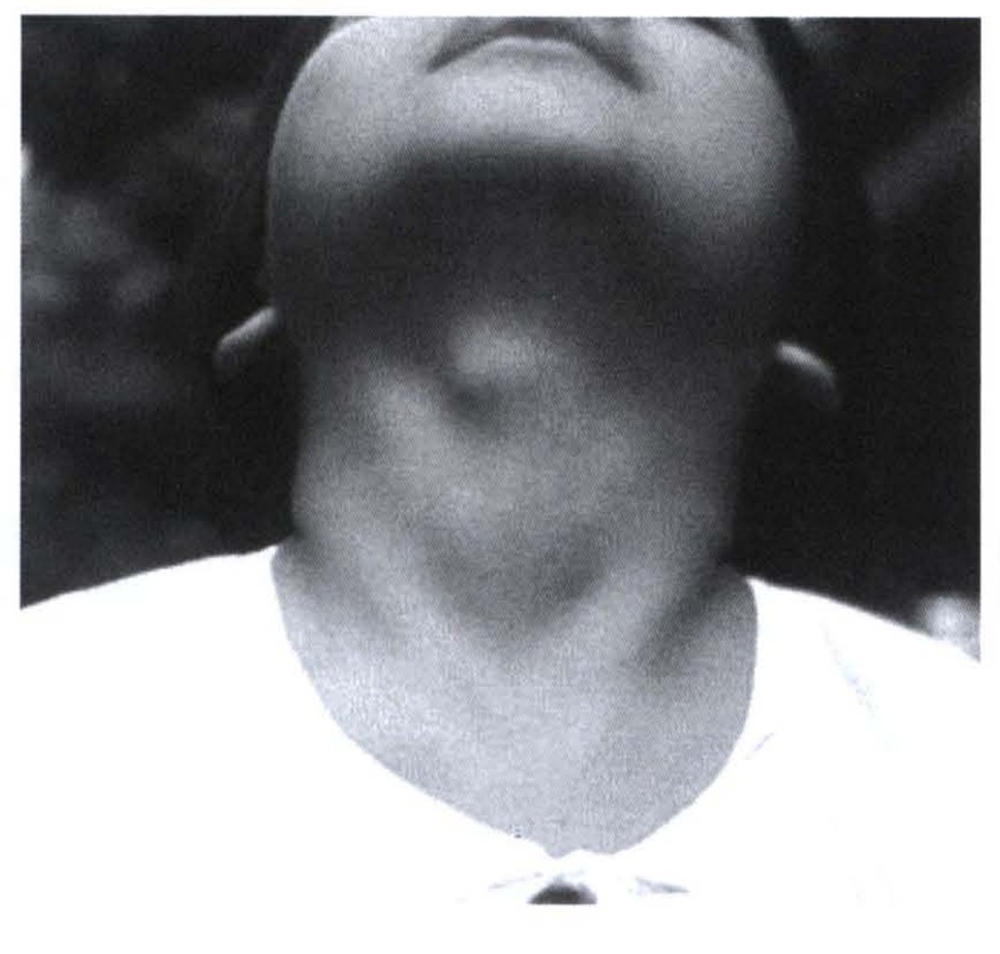
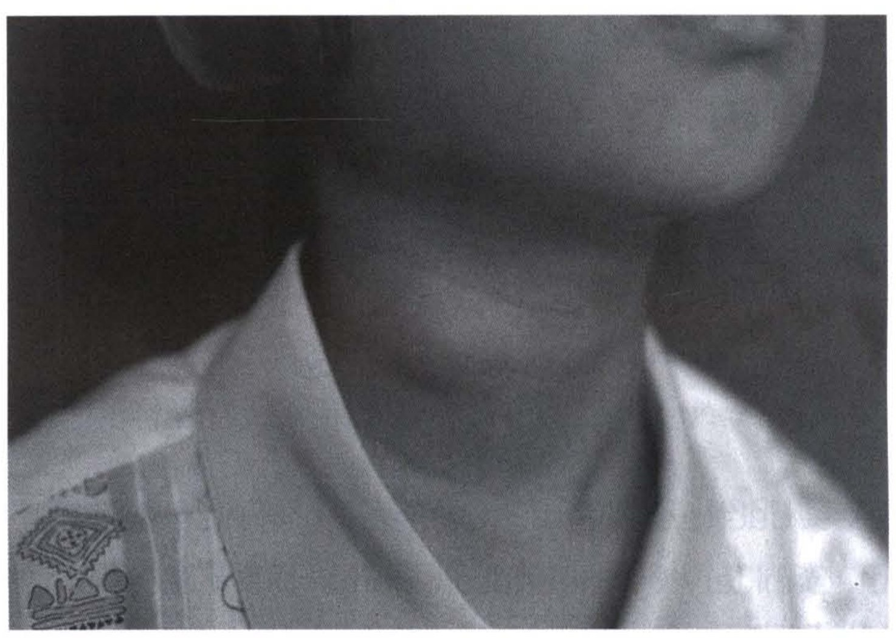
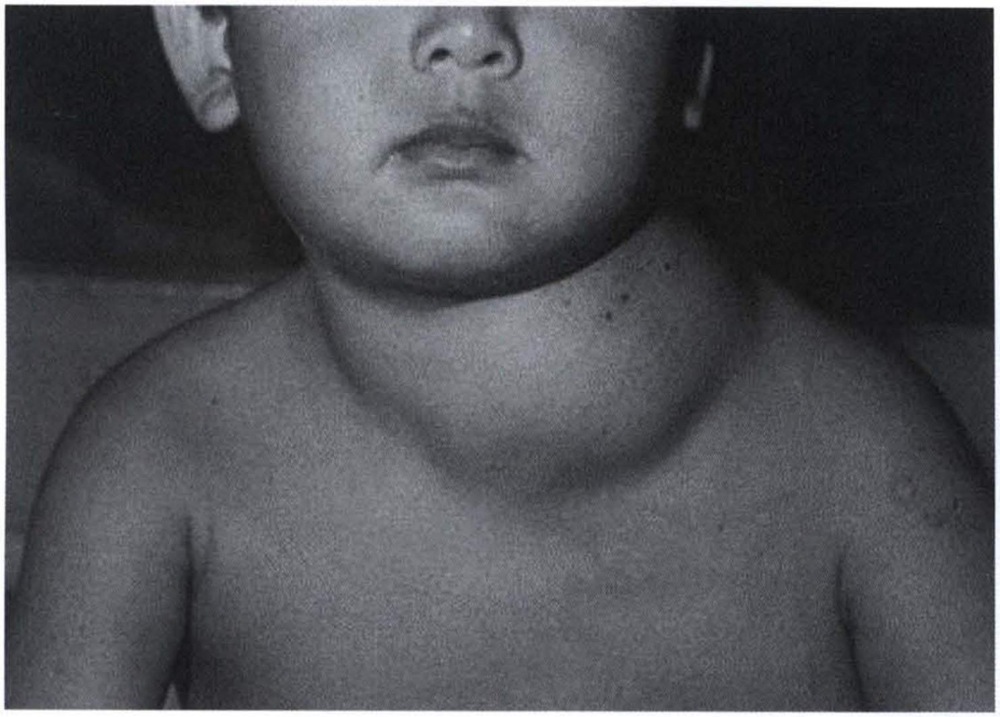
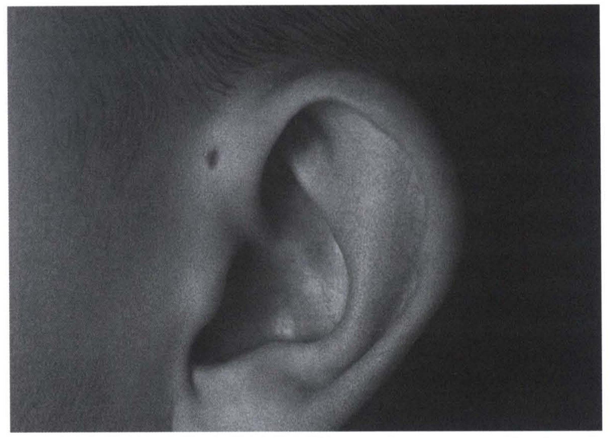
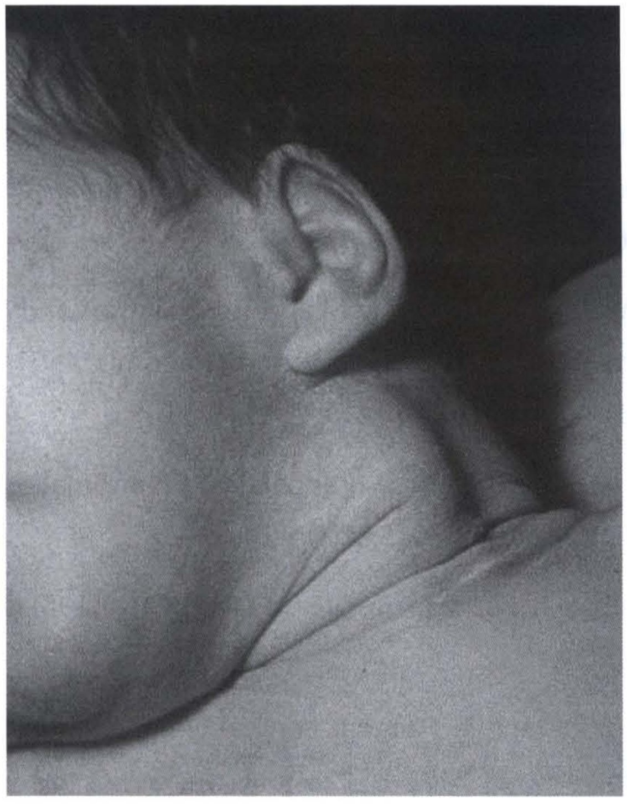

# รอยโรคบริเวณศีรษะและคอ (Head and Neck Lesions)

## Contents of this file
- ก้อนบริเวณคอ (p.812)
  - Thyroglossal duct Cyst (p.812)
  - Branchial Cleft Anomalies (p.813)
  - Dermoid and Epidermoid cysts (p.815)
  - Lymphadenopathy (p.815)
  - Lymphatic malformation (p.816)
  - Preauricular Sinus (p.817)
  - Torticollis (p.818)
- สรุป (p.819)
- บรรณานุกรม (p.820)

<!-- p.811 (printed none) -->
**รอยโรคบริเวณศีรษะและคอ**

**Head and Neck Lesions**

ประภาพรรณ รัชตะปีติ

<!-- p.812 (printed 798) -->
**รอยโรคบริเวณศีรษะและคอ**

**Head and Neck Lesions**

ประภาพรรณ รัชตะปีติ

รอยโรคบริเวณศีรษะและคอเป็นปัญหาที่พบได้บ่อยในคลินิกผู้ป่วยนอก ประมาณครึ่งหนึ่งมีสาเหตุการเจริญผิดปกติขณะเป็น embryo สาเหตุอื่น ได้แก่ การติดเชื้อ หรือเป็นเนื้องอก

## ก้อนบริเวณคอ

การวินิจฉัยและการรักษาก้อนที่คอในเด็ก ขึ้นกับประวัติว่าพบก้อนมานานเท่าใด มีอาการอื่นร่วมด้วยหรือไม่ ก้อนที่มีสาเหตุจากการเจริญผิดปกติแต่กำเนิดมักให้ประวัติโตช้า หากก้อนโตขึ้น ร่วมกับมีอาการเจ็บ และมี fluctuation ให้คิดถึงภาวะอักเสบติดเชื้อ และให้สงสัยเนื้อร้ายหากก้อนค่อย ๆ โตขึ้นจนใหญ่มากในเวลาไม่นานนัก

ตำแหน่งก็มีความสำคัญต่อการวินิจฉัยแยกโรค โดยแบ่งเป็นก้อนบริเวณกึ่งกลาง หรือด้านข้างของลำคอ ก้อนบริเวณกึ่งกลางที่พบได้บ่อยในเด็ก ได้แก่ thyroglossal duct cyst และ dermoid cyst ส่วนก้อนที่พบด้านข้าง ได้แก่ branchial cleft anomalies, lymphatic malformations หรือ lymphadenopathy

### Thyroglossal duct Cyst

เป็นก้อนผิดปกติแต่กำเนิดบริเวณคอที่พบได้บ่อยที่สุด เกิดจากการคงอยู่ของ thyroglossal duct ซึ่งในภาวะปกติควรจะปิดไปหลังจากเคลื่อนจากบริเวณโคนลิ้น (foramen caecum) ไปยังตำแหน่งของต่อมไทรอยด์ด้านหน้าของคอ

อาการแสดง พบเป็นก้อนนิ่ม cystic consistency บริเวณกลางลำคอ มักอยู่ในระดับเดียวกันกับกระดูก hyoid หรือต่ำกว่าเล็กน้อย ก้อนเคลื่อนที่ได้เวลากลืนหรือแลบลิ้น ก้อนอาจเกิดการอักเสบ บวมแดง หากแตกออกอาจพบลักษณะเป็นหนองปนเมือก การตรวจ

<!-- p.813 (printed 799) -->
ร่างกายนอกจากคลำบริเวณก้อนแล้วควรคลำบริเวณตำแหน่งต่อมไทรอยด์ หากคลำไม่พบ ควรต้องคำนึงถึง ectopic thyroid และยืนยันการวินิจฉัยด้วย ultrasound เพื่อหาต่อมไทรอยด์และดูลักษณะของก้อน

> **Caption (verbatim):** Thyroglossal duct cyt
> **Text in image (verbatim):** none
> **Description:** Black-and-white clinical photograph of a child's anterior neck taken from below with the head extended backward (chin up), so that only the underside of the chin, the lower edge of the lips and the ears are visible. A rounded, smooth, dome-shaped swelling sits in the midline of the upper anterior neck, just below the chin, at about the level of the hyoid region. The skin over it appears intact. The child wears a light-coloured garment.
> **Identifiers in image:** none

Thyroglossal duct cyst หากไม่รักษา อาจเกิดการติดเชื้อเป็นๆ หายๆ นอกจากนั้นยังอาจกลายเป็น papillary cystadenocarcinoma ได้อีกด้วย (น้อยกว่าร้อยละ 1)1, 2 การรักษาแนะนำให้ผ่าตัด Sistrunk’s operation ทำโดยเลาะถุงน้ำ และตามช่องทางติดต่อไปถึงบริเวณโคนลิ้น โดยต้องตัดส่วนกลางของกระดูก hyoid ออกไปด้วย เนื่องจากทางเดินของท่อมักจะผ่านหรืออยู่ชิดกับกระดูก หากไม่ตัดกระดูก hyoid ออก จะมีโอกาสอักเสบหรือเกิดก้อนซ้ำได้สูง นอกจากนี้ในรายที่มีการอักเสบบริเวณถุงน้ำมาก่อนก็มีโอกาสเกิดซ้ำสูงขึ้นเช่นกัน

### Branchial Cleft Anomalies

เป็นความผิดปกติที่เกิดจากการคงอยู่ของ branchial clefts ขณะเป็นตัวอ่อน branchial cleft 4 คู่จะเจริญไปเป็นส่วนต่างๆ บริเวณคอ ผู้ป่วยมักมาด้วยพบรูเปิดเล็กๆ บริเวณคอ (fistula) หรือมีก้อนบริเวณด้านข้างคอ ลักษณะเป็น cystic consistency หรืออาจมาด้วยการอักเสบติดเชื้อ3

<!-- p.814 (printed 800) -->
**First cleft anomalies** พบน้อยกว่าร้อยละ 1 อาจพบเป็นรูเปิดบริเวณขากรรไกรล่าง (mandible) หรือเป็น cyst พบได้ตั้งแต่บริเวณหน้าหูจนถึงบริเวณใต้ต่อ mandible ทางเดินของท่อจะผ่านต่อมน้ำลาย parotid ไปยังรูหูส่วนนอก (external auditory canal)

**Second cleft anomalies** เป็นชนิดที่พบบ่อยที่สุด (ร้อยละ 95) พบเป็นทั้งสองข้างได้ร้อยละ 10 รูเปิด หรือ cyst จะอยู่บริเวณด้านข้างของคอหน้าต่อกล้ามเนื้อ sternocleidomastoid ในส่วนล่าง (lower third) ของคอ ทางเดินของ fistula จะผ่าน platysma และ cervical fascia ขึ้นไปตามแนวของ carotid sheath ผ่านหน้าต่อเส้นประสาท hypoglossal และไปสิ้นสุดบริเวณ tonsillar fossa

> **Caption (verbatim):** second branchial cleft cyst
> **Text in image (verbatim):** none
> **Description:** Black-and-white clinical photograph of a child's neck, oblique view with the head turned slightly toward the image right; only the chin, the edge of the lower lip and an earlobe are in frame (no eyes). A smooth, oval, soft-looking bulge is visible on the lateral side of the neck below the angle of the jaw, along the anterior border region of the sternocleidomastoid. The skin over it appears intact. The child wears a light shirt with a printed pattern on the collar/front.
> **Identifiers in image:** none

**Third cleft anomalies** พบได้น้อยมาก รอยโรคมักอยู่บริเวณใกล้เคียงกับ Second cleft anomalies แต่ทางเดินของท่อต่างกัน คือจะผ่านไปด้านหลังต่อหลอดเลือดแดง carotid และอาจผ่านต่อมไทรอยด์ไปสิ้นสุดที่ pyriform sinus พบข้างซ้ายมากกว่าข้างขวา

**Forth cleft anomalies** พบน้อยที่สุด ทางเดินของท่อหากเป็นข้างซ้ายจะลงไปอ้อม aortic arch ขณะที่ด้านขวาจะไปคล้องใต้หลอดเลือดแดง subclavian และไปสิ้นสุดที่ pyriform sinus

<!-- p.815 (printed 801) -->
แม้จะพบได้น้อย แต่หากผู้ป่วยมักมาด้วยก้อนที่ค่อยๆ โตขึ้น ร่วมกับมีการอักเสบซ้ำๆ บริเวณด้านล่างของลำคอ หรือมีประวัติ thyroiditis ควรนึกถึง third หรือ forth cleft anomaly

การวินิจฉัยอาศัยประวัติ การตรวจร่างกาย และในบางกรณีควรตรวจเพิ่มเติมด้วย ultrasound หรือ CT scan เพื่อหาทางเดินของท่อและบอกชนิดของความผิดปกติ ช่วยในการวินิจฉัยและวางแผนการผ่าตัดรักษา หากมีลักษณะอักเสบบริเวณรอยโรคควรให้ยาปฏิชีวนะให้ดีขึ้นก่อน การผ่าตัดต้องเลาะทางเดิน fistula ออกให้หมดเพื่อป้องกันการกลับเป็นซ้ำ ในกรณีของ third หรือ forth cleft anomaly อาจต้องทำ thyroid lobectomy ร่วมด้วย

### Dermoid and Epidermoid cysts

Dermoid cyst ส่วนมากพบก่อนอายุ 5 ปี4 เป็นก้อนลักษณะกลม ขอบเขตชัดเจน ไม่เจ็บ พบบ่อยที่สุดบริเวณหางคิ้ว และอาจยึดติดกับเยื่อหุ้มกระดูก บางรายพบบริเวณแนวกลางลำคอ (midline neck mass) หรือหลังหู การรักษาทำโดยผ่าตัดเลาะก้อนออก ภายในก้อนมักประกอบด้วย sebaceous gland ต่อมขน และ connective tissue

### Lymphadenopathy

ต่อมน้ำเหลืองที่คอโตเป็นสาเหตุของก้อนบริเวณคอที่พบได้บ่อยที่สุดในเด็ก ส่วนมากเกิดจากการติดเชื้อแบคทีเรีย หรือไวรัส5, 6 ขนาดของต่อมน้ำเหลืองที่โตผิดปกติคือมากกว่า 1 ซม. การรักษาขึ้นกับสาเหตุที่ทำให้ต่อมน้ำเหลืองโต

ประวัติมีส่วนสำคัญต่อการวินิจฉัยสาเหตุ ในรายที่อาการเป็นมาน้อยกว่า 2 สัปดาห์ (acute) มักเกิดจากการติดเชื้อไวรัส หรือแบคทีเรีย หากพบต่อมน้ำเหลืองโตเพียงข้างเดียวให้นึกถึงเชื้อ *Staphylococcus aureus* หรือ *Streptococcus pyogenes* หรือหากมีประวัติทางทันตกรรมอาจเกิดจากเชื้อ anaerobes ถ้าคลำพบต่อมน้ำเหลืองโตทั้งสองข้างมีโอกาสเกิดจากเชื้อไวรัส โดยเฉพาะเมื่อมีอาการ ไอ น้ำมูกไหล เยื่อบุตาอักเสบ หรือเจ็บคอร่วมด้วย ในกลุ่ม subacute (2-6 สัปดาห์) อาจเกิดจาก nontuberculous mycobacterium, cat- scratch หรือ TB

<!-- p.816 (printed 802) -->
ในประเทศที่เป็น endemic area ของ TB เช่นประเทศไทย ต้องคำนึงถึงเสมอ โดยผู้ป่วยมักมีประวัติคนในครอบครัวเป็นโรค ควรซักประวัติการรับวัคซีน ถ่ายภาพรังสีทรวงอกเพื่อหารอยโรคในปอด ตรวจ tuberculin test อาจจำเป็นต้องตัดต่อมน้ำเหลืองมาตรวจหาเชื้อโดยการย้อมชิ้นเนื้อ เพาะเชื้อ และหาสารพันธุกรรม การรักษาหลักคือการให้ยารักษาวัณโรค

การวินิจฉัยสาเหตุของต่อมน้ำเหลืองโตอาศัย ประวัติและการตรวจร่างกายเป็นหลัก การตัดชิ้นเนื้อเพื่อส่งตรวจทางพยาธิวิทยาอาจจำเป็นถ้ามีลักษณะต่อไปนี้ คือ

- สงสัยเป็นก้อนมะเร็ง
- ต่อมน้ำเหลืองโตนานกว่า 4-6 สัปดาห์ แม้ได้รับยาปฏิชีวนะที่เหมาะสมแล้ว
- ต่อมน้ำเหลืองมีขนาดโตขึ้นมากใน 2 สัปดาห์
- ต่อมน้ำเหลืองบริเวณ supraclavicular
- พบความผิดปกติจากภาพถ่ายรังสีทรวงอก
- มีอาการเบื่ออาหาร น้ำหนักลด อ่อนเพลีย ตับม้ามโตร่วมด้วย

การรักษา

- Acute lymphadenitis รักษาด้วยการให้ยาปฏิชีวนะ พิจารณาเจาะหรือกรีดระบายหนองหากคลำได้ fluctuation หรือเป็นฝี
- Subacute/chronic lymphadenitis หากวินิจฉัยเป็น nontuberculous mycobacterial adenitis ให้พิจารณาตัดต่อมน้ำเหลืองออก

### Lymphatic malformation

Lymphatic malformation ในอดีตมีชื่อเรียกว่า cystic hygroma หรือ lymphangioma เป็นการเจริญผิดปกติของท่อน้ำเหลือง พบได้ทั่วร่างกาย โดยประมาณครึ่งหนึ่งพบบริเวณศีรษะและคอ อาจประกอบด้วยถุงน้ำเล็ก ๆ จำนวนมาก (microcystic) หรือเป็นถุงน้ำขนาดใหญ่มากกว่า 1 ซม. (macrocystic) ก้อนมักสังเกตเห็นตั้งแต่แรกเกิด มีลักษณะนิ่ม พบการติดเชื้อในก้อนได้บ่อย

<!-- p.817 (printed 803) -->

> **Caption (verbatim):** cystic hygroma
> **Text in image (verbatim):** none
> **Description:** Black-and-white clinical photograph of an infant/young child, frontal view, framed from the nose down (the eyes are outside the frame) to the upper chest and shoulders, with both ears partly visible. A large, smooth, rounded soft-tissue swelling occupies the lower neck on the image right (the child's left side in this frontal view), extending from below the jaw toward the base of the neck and supraclavicular area and bulging over the neck contour. The overlying skin appears intact with a few small dark spots.
> **Identifiers in image:** none

การตรวจเพิ่มเติมด้วย ultrasound หรือ MRI จะช่วยบอกขอบเขตของโรค ซึ่งอาจแทรกไปตามเนื้อเยื่อต่างๆ เช่นหลอดเลือดได้

การรักษา มี 3 วิธีหลัก คือสังเกตอาการ การผ่าตัดเอาก้อนออก หรือฉีดสาร sclerosing เช่น bleomycin, OK432 ปัจจัยที่ต้องคำนึงถึงในการเลือกวิธีการรักษาขึ้นกับตำแหน่ง ขนาด และชนิดของก้อน ก้อนชนิด microcystic มักรักษายาก โดยเฉพาะถ้าเป็นแบบ diffuse มีการแทรกไปตามเนื้อเยื่อต่างๆ การผ่าตัดต้องระวังไม่ตัดเนื้อเยื่อปกติที่อยู่ข้างเคียงออก เนื่องจากพยาธิสภาพของ lymphatic malformations ไม่ใช่เนื้อร้าย

### Preauricular Sinus

Preauricular Sinus เป็นรูเปิดบริเวณหน้าหู เหนือกระดูกอ่อน tragus พบข้างขวาได้บ่อยกว่า เกิดจากการม้วนตัวของ ectoderm ที่เจริญไปเป็นใบหู ผู้ป่วยมักมาด้วยมีน้ำออกจากรูเปิด หรือมีอาการบวม อักเสบ การรักษาทำโดยผ่าตัดเลาะ tract ซึ่งมักจะสั้นและไปสิ้นสุดบริเวณ tragus พบกลับเป็นซ้ำได้บ่อยหากเลาะออกไม่หมด

<!-- p.818 (printed 804) -->

> **Caption (verbatim):** preauricular sinus
> **Text in image (verbatim):** none
> **Description:** Black-and-white close-up clinical photograph of the side of a child's head showing the external ear (auricle) and the adjacent preauricular skin, with some hair at the top. A small dark pit-like opening is visible on the skin just in front of the ear, at the anterior root of the helix above the tragus. The auricle itself appears normally formed.
> **Identifiers in image:** none

### Torticollis

Torticollis อาจเป็นมาแต่กำเนิด หรือเกิดขึ้นภายหลัง2,7 ที่พบบ่อยที่สุดเกิดจากมี fibrosis ของกล้ามเนื้อ sternocleidomastoid ทำให้เกิดการหดรั้ง สามารถวินิจฉัยได้จากการตรวจร่างกาย และอาจต้องตรวจเพิ่มเติมเพื่อเหตุนำอื่นๆ เช่น ความผิดปกติของกระดูกสันหลังบริเวณคอ ความผิดปกติของการมองเห็น retropharyngeal abscess เป็นต้น

เด็กมักมาพบแพทย์ด้วยเรื่องก้อนที่คอ หรือคอเอียงเมื่ออายุได้ 2-4 สัปดาห์ โดยพบบริเวณกล้ามเนื้อ sternocleidomastoid เด็กจะหันหน้าไปด้านตรงข้ามกับที่มีก้อน และศีรษะเอียงเล็กน้อยมาทางด้านที่มีก้อน หากพยายามหมุนคอเด็ก จะหันมาด้านที่มีก้อนได้น้อยลง จากการที่ถูกกล้ามเนื้อดึงรั้ง

<!-- p.819 (printed 805) -->

> **Caption (verbatim):** Torticollis
> **Text in image (verbatim):** none
> **Description:** Black-and-white clinical photograph of an infant, lateral close-up of one side of the head and neck: part of the cheek and jaw at the left edge (eyes not in frame), the ear, hair, and the neck down to the shoulder. A prominent, tense, cord-like ridge runs obliquely from just below and behind the ear down the side of the neck toward the base of the neck/shoulder, along the course of the sternocleidomastoid, with skin creases across the lower neck.
> **Identifiers in image:** none

การรักษา ร้อยละ 90 ของเด็กที่มีภาวะนี้ จะหายได้เองภายในอายุ 1 ปี โดยอาจให้ผู้ปกครองช่วยยืดกล้ามเนื้อ (stretching) โดยการหมุนคอเพิ่ม range-of-motion หรือเปลี่ยนท่าอุ้มพยายามให้เด็กหันคอไปด้านที่ไม่คุ้นชิน อาจพิจารณาผ่าตัดแก้ไขโดยตัดแยกกล้ามเนื้อ sternocleidomastoid ส่วนที่เป็นพังผืดออกจากกัน เมื่ออายุมากกว่า 1 ปี หรือสังเกตเห็นใบหน้า 2 ข้างไม่สมมาตรกัน (hemi-facial hypoplasia) หรือศีรษะเบี้ยว (plagiocephaly) หลังผ่าตัดควรใส่ soft collar 2-3 สัปดาห์เพื่อป้องกันการกลับเป็นซ้ำ

## สรุป

รอยโรคบริเวณศีรษะและคอเป็นปัญหาที่พบได้บ่อยในเด็ก สาเหตุที่พบบ่อยที่สุดคือต่อมน้ำเหลืองโต การรักษาขึ้นกับสาเหตุ ส่วนมากหายได้โดยไม่ต้องผ่าตัด ก้อนบริเวณคอชนิดอื่นๆ มักสัมพันธ์กับการเจริญที่ผิดปกติขณะอยู่ในครรภ์มารดา อาการมักมาด้วยมีก้อนหรือการอักเสบ ตำแหน่งของรอยโรคมักช่วยบอกสาเหตุของโรคได้

<!-- p.820 (printed 806) -->
## บรรณานุกรม

1. Thompson L. D. R., Herrera H. B., Lau S. K. Thyroglossal Duct Cyst Carcinomas in Pediatric Patients: Report of Two Cases with a Comprehensive Literature Review. Head Neck Pathol. 2017;11(4):442-9.
2. Dellinger MB, Waldhausen JHT. Head and Neck Sinuses and Masses. In: Holcomb III GW, Murphy JP, St.Peter SD, editors. Holcomb and Ashcraft’s pediatric surgery. 7 ed. London: Elsevier; 2019. p. 1171-85.
3. Prosser J. D., Myer C. M., 3rd. Branchial cleft anomalies and thymic cysts. Otolaryngol Clin North Am. 2015;48(1):1-14.
4. Quintanilla-Dieck L., Penn E. B., Jr. Congenital Neck Masses. Clin Perinatol. 2018;45(4):769-85.
5. Rosenberg T. L., Nolder A. R. Pediatric cervical lymphadenopathy. Otolaryngol Clin North Am. 2014;47(5):721-31.
6. Kille TL. Benign neck masses. In: Mattei P, Nichol P, Rollins II M, Muratore C, editors. Fundamentals of Pediatric Surgery. 2 ed: Springer, Cham; 2017. p. 233-41.
7. Beasley SW. Torticollis. In: Coran AG, Adzick HS, Krummel TM, Laberge JM, Shamberger RC, Caldamone AA, editors. Pediatric surgery. 7 ed. Philadelphia: Elsevier Saunders; 2012. p. 763-7.
