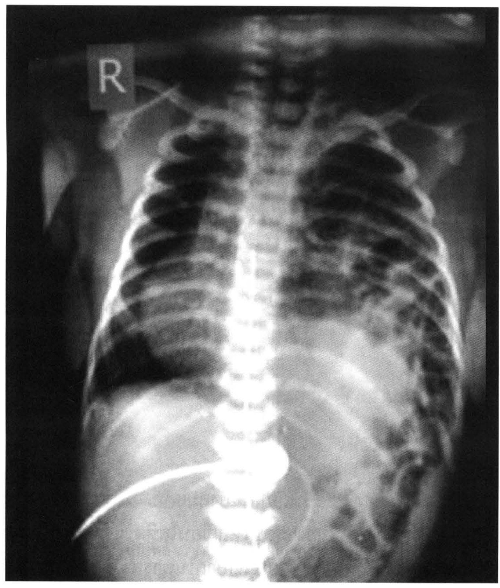
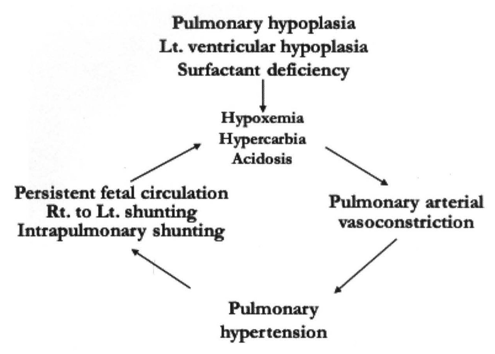
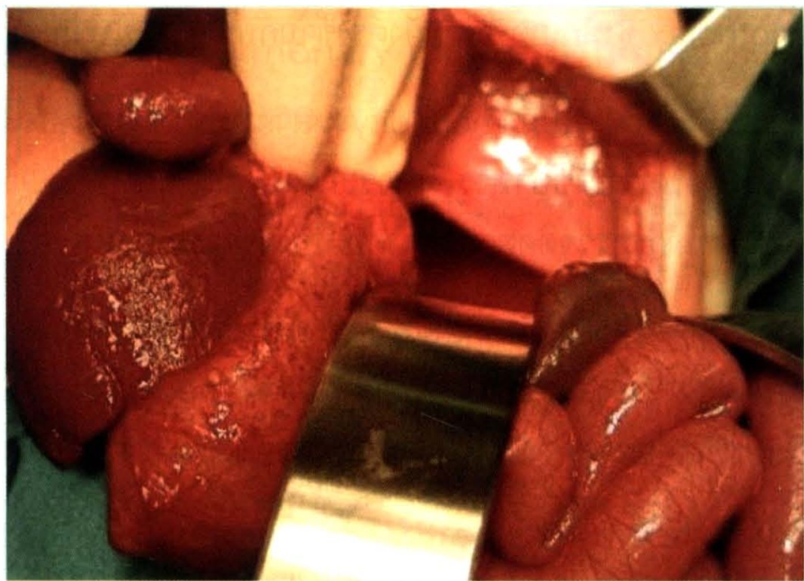
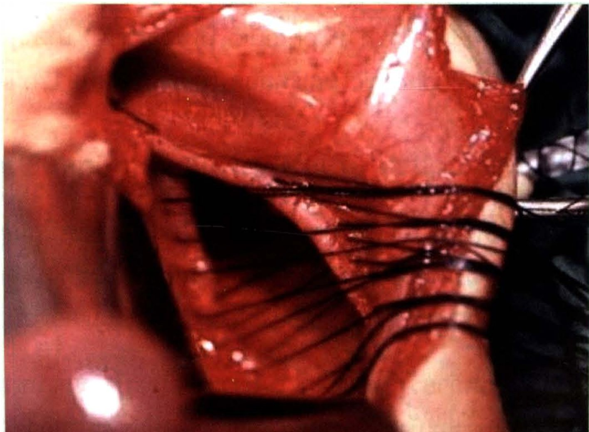

# กะบังลมและปอด (Diaphragm and Lungs)

## Contents of this file
- ไส้เลื่อนกะบังลมแต่กำเนิด (Congenital Diaphragmatic Hernia ; CDH) (p.822)
- ภาวะกะบังลมยกสูง (Eventration of diaphragm) (p.826)
- Congenital bronchopulmonary malformations ความผิดปกติแต่กำเนิดของปอด (p.827)
- Congenital Pulmonary Airway Malformation (CPAM) (p.827)
- Congenital Lobar Emphysema (CLE) (p.829)
- Bronchopulmonary sequestration (BPS) (p.829)
- Bronchogenic cyst (p.830)
- Bronchiectasis (p.831)
- สรุป (p.831)
- บรรณานุกรม (p.831)

<!-- p.821 (printed none) -->
**กะบังลมและปอด**

**Diaphragm and Lungs**

ประภาพรรณ รัชตะปีติ

<!-- p.822 (printed 808) -->
**กะบังลมและปอด**

**Diaphragm and Lungs**

ประภาพรรณ รัชตะปีติ

บทนี้จะกล่าวถึงความผิดปกติของกะบังลมและปอดที่พบได้ในเด็ก แม้อุบัติการจะไม่มาก แต่ต้องการการวินิจฉัยที่แม่นยำ เพื่อให้การรักษาที่ถูกต้อง ป้องกันการเกิดภาวะแทรกซ้อน เช่น ภาวะหายใจล้มเหลว หรือมีผลต่อระบบทางเดินหายใจในระยะยาว

## ไส้เลื่อนกะบังลมแต่กำเนิด (Congenital Diaphragmatic Hernia ; CDH)

ไส้เลื่อนกะบังลมแต่กำเนิด (CDH) เกิดจากความผิดปกติในการสร้างกะบังลมขณะเป็น embryo ส่งผลต่อการเจริญและพัฒนาของปอด CDH พบได้ไม่บ่อย แต่พบมีอัตราการเสียชีวิตสูง ตำแหน่งที่พบไส้เลื่อนได้บ่อยที่สุดคือบริเวณ posterolateral ข้างซ้าย มีชื่อเรียกว่า Bochdalek’s hernia โดยพบได้ร้อยละ 85 นอกจากนี้อาจพบที่ข้างขวา หรือบริเวณหลังต่อ sternum (Morgagni’s hernia)

การวินิจฉัยอาจตรวจพบได้จากการตรวจ prenatal ultrasonography ตั้งแต่ต้นไตรมาสที่สอง ลักษณะคือไม่พบกระเพาะอาหารในช่องท้อง หรือเห็นลำไส้ในช่องอก มี polyhydramnios การตรวจนี้ยังสามารถช่วยบอกความรุนแรงของโรคได้โดยประเมินจากตำแหน่งของตับ และสัดส่วนระหว่างขนาดของปอดกับเส้นรอบศีรษะ (lung-to-head ratio ; LHR) หากพบตับเคลื่อนไปอยู่ในช่องอก (liver herniation) หรือ LHR มีค่าน้อยมักเป็นตัวชี้ว่าการพยากรณ์โรคไม่ดี1,2

อาการและอาการแสดง ทารกที่มีภาวะไส้เลื่อนกะบังลมแต่กำเนิด จะมีอาการหายใจลำบาก ตัวเขียว การตรวจร่างกายอาจสังเกตเห็นหน้าท้องแฟบ (scaphoid abdomen) ฟังเสียงหัวใจได้บริเวณทรวงอกด้านขวา เนื่องจากถูกอวัยวะที่เคลื่อนขึ้นไปในช่องอกดันทารกอาจจะมีอาการตั้งแต่แรกคลอดซึ่งมักบ่งว่าโรคมีความรุนแรง การพยากรณ์โรคไม่ดีเมื่อเทียบกับทารกที่มีอาการภายหลัง ในภาพถ่ายรังสีของทรวงอกจะพบเงาอากาศในลำไส้ภายในช่องทรวงอกต่อมาถึงช่องท้อง เงาหัวใจถูกเบียดไปด้านขวา (รูปที่ 1)

<!-- p.823 (printed 809) -->

> **Caption (verbatim):** รูปที่ 1 ภาพถ่ายรังสีบริเวณทรวงอกในทารกที่มี CDH เห็นเงาอากาศในลำไส้จากช่องท้องต่อเข้าไปในช่องทรวงอกด้านซ้าย
> **Text in image (verbatim):** R
> **Description:** Plain radiograph, frontal (AP) view of the chest and upper abdomen of an infant, with a side marker "R" at the upper left of the image (patient's right). The left hemithorax is filled with multiple rounded/tubular air-filled bowel loops (bubbly lucencies) that continue down into the abdomen, consistent with the caption's statement of intestinal gas extending from the abdomen into the left chest. The right lung field appears comparatively aerated and darker. No normal cardiac silhouette is seen on the left side. A thin, curved, bright radiopaque line (a tube/catheter) runs obliquely across the lower right part of the image towards the midline. The upper abdomen below appears relatively gasless on the right.
> **Identifiers in image:** none

CDH เป็นภาวะที่ต้องได้รับการรักษาอย่างเร่งด่วน เนื่องจากพยาธิสรีรวิทยาของโรครุนแรง มีภาวะ respiratory acidosis ร่วมกับ pulmonary hypertension และ pulmonary hypoplasia เป็น vicious cycle ดังแสดงในรูปที่ 22

<!-- p.824 (printed 810) -->
- Pulmonary hypoplasia / Lt. ventricular hypoplasia / Surfactant deficiency → Hypoxemia / Hypercarbia / Acidosis
- Hypoxemia / Hypercarbia / Acidosis → Pulmonary arterial vasoconstriction
- Pulmonary arterial vasoconstriction → Pulmonary hypertension
- Pulmonary hypertension → Persistent fetal circulation / Rt. to Lt. shunting / Intrapulmonary shunting
- Persistent fetal circulation / Rt. to Lt. shunting / Intrapulmonary shunting → Hypoxemia / Hypercarbia / Acidosis

> **Caption (verbatim):** รูปที่ 2 พยาธิสรีรวิทยาของภาวะไส้เลื่อนกะบังลมแต่กำเนิด
> **Text in image (verbatim):** Pulmonary hypoplasia · Lt. ventricular hypoplasia · Surfactant deficiency · Hypoxemia · Hypercarbia · Acidosis · Pulmonary arterial vasoconstriction · Pulmonary hypertension · Persistent fetal circulation · Rt. to Lt. shunting · Intrapulmonary shunting
> **Description:** Line diagram of a vicious cycle (no boxes, text groups joined by arrows). At the top, the group "Pulmonary hypoplasia / Lt. ventricular hypoplasia / Surfactant deficiency" has a downward arrow into the central-upper group "Hypoxemia / Hypercarbia / Acidosis". From there a clockwise cycle of four nodes is formed: an arrow down-right to "Pulmonary arterial vasoconstriction" (right), an arrow down-left to "Pulmonary hypertension" (bottom), an arrow up-left to "Persistent fetal circulation / Rt. to Lt. shunting / Intrapulmonary shunting" (left), and an arrow up-right back to "Hypoxemia / Hypercarbia / Acidosis", closing the loop.
> **Identifiers in image:** none

แนวทางในการดูแลรักษาผู้ป่วยไส้เลื่อนกะบังลมแต่กำเนิด3-5 คือ resuscitation และ stabilization ได้แก่ รักษาสมดุลของระบบไหลเวียนโลหิต และสมดุลกรด-ด่างในเลือดให้ใกล้เคียงค่าปกติ หากสงสัยว่าภาวะหายใจลำบากในทารกเกิดจาก CDH ให้พิจารณาใส่ endotracheal tube ทันที ไม่ควรช่วยหายใจโดยการใช้ positive pressure ผ่านหน้ากาก (mask) เนื่องจากลมจะเข้าไปในกะเพาะและลำไส้ ทำให้กดเบียดปอดมากขึ้นได้ นอกจากนี้ต้องแก้ไขความปิดปกติของน้ำและเกลือแร่ ภาวะเลือดเป็นกรด ทารกส่วนมากมักต้องใช้เครื่องช่วยหายใจ ซึ่งต้องระวังไม่ให้แรงดันสูงเกินไปเพราะจะเกิด barotrauma ต่อปอดได้ เป้าหมายในการ resuscitation ต้องการได้ preductal arterial saturation (SaO2) ในช่วงร้อยละ 80 ถึง 90 และ ค่า pH มากกว่า 7.2 ก่อน จึงไปผ่าตัดปิดรูโหว่กะบังลม หากการช่วยหายใจด้วย conventional ventilator ไม่สามารถแก้ไขภาวะ hypercarbia และ hypoxemia ได้ อาจต้องใช้เครื่องช่วยหายใจชนิด high-frequency oscillatory ventilation (HFOV) ภาวะ pulmonary hypertension เป็นภาวะแทรกซ้อนที่สำคัญและเกิดได้บ่อยในเด็กที่มี CDH อาจแก้ไขด้วยการใช้ Nitric oxide หรือเครื่องปอดเทียม Extracoporeal membrane oxygenator (ECMO)

ในปัจจุบันแนะนำให้ผ่าตัดปิดช่องโหว่กะบังลมเมื่อทารกมีสภาวะคงที่แล้ว ซึ่งอาจเป็นเวลาหลายวันหลังคลอด การผ่าตัดแบบเปิดนิยมลงแผลผ่าตัดบริเวณต่ำกว่าชายโครง

<!-- p.825 (printed 811) -->
นำลำไส้ กระเพาะอาหาร หรืออาจรวมถึงม้ามและตับที่ยื่นเข้าไปในช่องอก กลับเข้ามาในช่องท้อง สำรวจดูลักษณะปอด หาขอบกะบังลม และเย็บปิดด้วยไหมชนิดไม่ละลาย (รูปที่ 3 และ 4) หากช่องโหว่มีขนาดใหญ่อาจต้องปิดด้วยวัสดุสังเคราะห์ หากทำผ่าตัดด้วยกล้องส่องมักทำผ่านช่องอก (thoracoscopic hernia repair)

> **Caption (verbatim):** รูปที่ 3 แสดงรูโหว่กะบังลมหลังจากนำกระเพาะอาหารและลำไส้กลับลงมาในช่องท้องแล้ว
> **Text in image (verbatim):** none
> **Description:** Colour intraoperative photograph through an open abdominal incision. A metal retractor blade crosses the lower centre of the field and a second metal retractor is at the upper right, with green drapes at the edges. On the left lies a dark red solid organ and adjacent reddish viscera; on the lower right are pink, glistening small-bowel loops that have been brought back into the abdomen. In the upper centre/right, behind the retractor, a pale pink smooth surface is seen through an opening, corresponding to the diaphragmatic defect described in the caption. A gloved finger/hand is partly visible at the top left.
> **Identifiers in image:** none

> **Caption (verbatim):** รูปที่ 4 แสดงการเย็บปิดรูโหว่กะบังลมด้วยไหมชนิดไม่ละลาย
> **Text in image (verbatim):** none
> **Description:** Colour close-up intraoperative photograph of the diaphragmatic defect. Red muscular diaphragm edges frame a dark triangular opening in the centre. Multiple dark (black) suture threads are placed across the defect, passing from one edge to the other in parallel and gathered together towards the right side where an instrument holds them, showing interrupted non-absorbable sutures placed before tying. A rounded pink viscus with a light reflection is at the lower left, and a metal instrument is at the upper right. A small date stamp printed in the bottom-right corner of the original photo was cropped out (identifier label cropped out).
> **Identifiers in image:** none

<!-- p.826 (printed 812) -->
หลังผ่าตัดผู้ป่วยต้องได้รับการดูแลอย่างใกล้ชิดในหอผู้ป่วยวิกฤต โดยเฉพาะการดูแลระบบหายใจและการไหลเวียนโลหิต โดยใช้หลักการเดียวกับก่อนผ่าตัด คือ gentle ventilation ควบคุม peak inspiration pressure (PIP) ให้ไม่สูงกว่า 25 มม.น้ำ preductal arterial saturation (SaO2) มากกว่าร้อยละ 90 อาจยอมให้ pCO2 สูงกว่าปกติได้เล็กน้อย ไม่ควรให้ออกซิเจนมากเกินไป เพื่อป้องกันการเกิด barotrauma ระวังการเกิด pneumothorax ซึ่งมักเกิดที่ปอดฝั่งตรงข้ามกับข้างที่มีรูโหว่กะบังลม

เด็กที่รอดชีวิตหลังผ่าตัด พบมี morbidity หลายระบบ นอกจากระบบหายใจแล้วยังพบมีปัญหาของระบบทางเดินอาหาร มีภาวะกรดไหลย้อนได้บ่อย การพัฒนาระบบประสาทล่าช้า จึงต้องมีการตรวจติดตามอย่างต่อเนื่องจากแพทย์สหสาขา

Morgagni hernia คือความผิดปกติบริเวณกะบังลมด้านหน้า พบได้ไม่บ่อย มักไม่มีอาการ และตรวจพบโดยบังเอิญจากภาพถ่ายรังสีทรวงอกเห็นเงาลมในลำไส้หลังต่อ sternum การรักษาทำโดยผ่าตัดปิดรูโหว่ผ่านทางช่องท้อง

## ภาวะกะบังลมยกสูง (Eventration of diaphragm)

ภาวะกะบังลมยกสูง6 คือการที่กะบังลมข้างใดข้างหนึ่งยกสูงขึ้นผิดปกติ ส่งผลให้เกิด paradoxical movement ขณะหายใจเข้า-ออก สาเหตุอาจเกิดจาก (1) การเจริญผิดปกติของกล้ามเนื้อกะบังลมหรือเส้นประสาท phrenic ไม่พัฒนา (2) เกิดขึ้นภายหลัง เช่น การบาดเจ็บต่อเส้นประสาท phrenic ขณะคลอด (มักพบร่วมกับ Erb’s palsy) หรือจากการผ่าตัดในช่องอก

อาการและอาการแสดง ในรายที่มีอาการมากจะมาด้วยภาวะหายใจลำบาก หากมีอาการในกลุ่มทารกแรกเกิดจะแยกได้ยากจากภาวะไส้เลื่อนกะบังลมชนิดมีถุงหุ้ม ในเด็กโตมักไม่มีอาการรุนแรง อาจมาด้วยอาการเหนื่อยง่ายกว่าปกติ หรือมีการติดเชื้อในทางเดินหายใจซ้ำๆ อย่างไรก็ดีพบว่าผู้ป่วยส่วนมากมักไม่มีอาการชัดเจน

การวินิจฉัยอาศัยภาพถ่ายรังสีทรวงอก ในภาวะปกติกะบังลมด้านขวาจะอยู่สูงกว่าด้านซ้ายเล็กน้อย หากพบว่ากะบังลมข้างใดข้างหนึ่งสูงกว่าอีกข้างมากกว่า 2 intercostal spaces บ่งว่ามีความผิดปกติ ยืนยันด้วยการดูการเคลื่อนไหวของกะบังลมขณะหายใจว่ามีลักษณะ paradoxical หรือไม่ โดยอาศัย fluoroscopic x-ray หรือ ultrasonography

<!-- p.827 (printed 813) -->
การรักษาในรายที่ไม่มีอาการหรืออาการน้อย แนะนำให้รักษาแบบประคับประคอง ร่างกายอาจปรับตัวและดีขึ้นได้เอง แต่หากมีอาการหายใจลำบาก หรือมีการติดเชื้อบ่อยก็ควรผ่าตัดแก้ไข การผ่าตัดอาจทำผ่านแผลบริเวณช่องอกหรือช่องท้องก็ได้ โดยเข้าไปเย็บจีบ (plication) กะบังลมให้ตึงขึ้น ลดการเกิด paradoxical movement

## Congenital bronchopulmonary malformations ความผิดปกติแต่กำเนิดของปอด

ความผิดปกติในการเจริญเติบโตของ bronchopulmonary system พบได้หลากหลาย อาทิ congenital pulmonary airway malformation (CPAM), congenital lobar emphysema, bronchopulmonary sequestration และ bronchogenic cyst ในปัจจุบันมักวินิจฉัยได้ตั้งแต่อยู่ในครรภ์มารดา ทำให้สามารถวางแผนการดูแลก่อนคลอดจนถึงหลังคลอดที่เหมาะสมได้

การพัฒนาของ bronchopulmonary tree เริ่มตั้งแต่ตัวอ่อนมีอายุได้ 5 สัปดาห์ โดยเริ่มจากการเจริญของ laryngotracheal bud ระยะต่อมามีการแตกแขนงของหลอดลม ตามมาด้วยการเจริญของหลอดเลือด capillary ควบคู่ไปกับ respiratory epithelium ในราวสัปดาห์ที่ 24 เริ่มมีการขยายของถุงลมส่วนปลาย จนถึงระดับ alveoli เมื่อใกล้ครบกำหนดคลอด การพัฒนาในระยะสุดท้ายมีการดำเนินต่อหลังทารกคลอดจากครรภ์มารดาจนถึงอายุประมาณ 1 ปี

## Congenital Pulmonary Airway Malformation (CPAM)

Congenital Pulmonary Airway Malformation (CPAM) เป็นความผิดปกติที่พบได้บ่อยที่สุด มีลักษณะเป็น cystic lesion ลักษณะทาง histology พบ alveoli ที่ผิดปกติ และมี overgrowth ของ terminal bronchioles ในปัจจุบัน CPAM แบ่งเป็น 5 ชนิด ตามตำแหน่งและลักษณะทางพยาธิ7,8 ดังนี้

<!-- p.828 (printed 814) -->
| Type | Incidence (%) | Size of cysts | Epithelial lining |
| --- | --- | --- | --- |
| 0 | <2 | Varies | Ciliated pseudostratified columnar |
| 1 | 60-70 | Single or multiples, >2 cm | Ciliated pseudostratified columnar |
| 2 | 15-20 | Multiple, <1 cm | Ciliated cuboidal or columnar |
| 3 | 5-10 | Scattered thin wall cysts | Cuboidal |
| 4 | 10 | Variable | Alveolar type I or II |

ในแง่ของการดูแลรักษาและการพยากรณ์โรคขึ้นกับขนาดของ CPAM มากกว่าชนิดของ CPAM โดยแบ่งได้เป็น 2 กลุ่ม จากการตรวจวินิจฉัยด้วยคลื่นเสียงความถี่สูงขณะอยู่ในครรภ์ คือ macrocystic ประกอบด้วย cyst ขนาดใหญ่กว่าหรือเท่ากับ 5 ซม. หรือ microcystic ซึ่งพบลักษณะคล้ายเป็น solid echogenic mass

ลักษณะทางคลินิก CPAM พบได้เท่ากันทั้งปอดซ้ายและขวา มักเป็นที่ lower lobe มากกว่า lobe อื่น

การเกิด CPAM ที่ปอดทั้ง 2 ข้างพบได้น้อย การตรวจ prenatal ultrasonography มักให้การวินิจฉัยได้ตั้งแต่อายุครรภ์น้อยกว่า 24 สัปดาห์ ส่วนใหญ่มักไม่มีผลกระทบต่อการเจริญเติบโตของทารกในครรภ์ มีเพียงส่วนน้อยที่เกิด mediastinal shift หรือ hydrops ในระยะหลังคลอดทารกส่วนมากจะไม่มีอาการ มีเพียง 1 ใน 4 ที่อาจมีอาการหายใจลำบาก และอาจต้องใช้เครื่องช่วยหายใจในช่วงสัปดาห์แรกหลังคลอด มักพบในรายที่มีพยาธิสภาพขนาดใหญ่ และมี mediastinal shift

การวินิจฉัยหากไม่มีประวัติตรวจพบจาก prenatal ultrasonography การถ่ายภาพรังสีทรวงอกจะสามารถเห็นรอยโรคได้ และควรตรวจเพิ่มเติมด้วย CT scan เพื่อประเมินความรุนแรงและวางแผนการรักษา ในรายที่ไม่มีอาการอาจรอจนอายุ 6-8 สัปดาห์ ก่อนตรวจ CT scan เนื่องจากจะมีโอกาสแยก solid และ cystic lesion ออกจากกันได้มากขึ้น

<!-- p.829 (printed 815) -->
การรักษาในรายที่มีอาการ พิจารณาตัดปอดกลีบที่มีรอยโรคออก ส่วนรายที่ไม่มีอาการในระยะแรก แนะนำให้ทำการผ่าตัดเมื่ออายุมากกว่า 6 สัปดาห์ หรือภายในไม่เกินอายุ 6 เดือน ไม่แนะนำให้รักษาด้วยการสังเกตอาการ เพราะมักเกิดการติดเชื้อซ้ำซาก การผ่าตัดทำได้ยากขึ้นเนื่องจากปอดเคยมีการอักเสบ นอกจากนี้ยังอาจเกิดภาวะแทรกซ้อนอื่น เช่น pneumothorax ไอเป็นเลือด และยังมีรายงานว่า CPAM กลายเป็นมะเร็งได้อีกด้วย

## Congenital Lobar Emphysema (CLE)

CLE คือ ภาวะที่มีการขยายตัวมากผิดปกติ (overinflation, distension) ของปอดกลีบใดกลีบหนึ่งจากการเกิด one-way valve mechanism ทำให้อากาศถูกขังในปอดบริเวณที่มีรอยโรค พบได้บ่อยที่ปอดกลีบซ้ายบน สาเหตุอาจเกิดจาก broncho-malacia ทางเดินหายใจโดนกดจากก้อนภายนอก หรืออาจเกิดจากการอุดตันใน endobronchial อย่างไรก็ดีประมาณครึ่งหนึ่งของ CLE ไม่พบสาเหตุที่ชัดเจน ขณะอยู่ในครรภ์มารดา CLE อาจมีขนาดใหญ่ขึ้น เนื่องจากน้ำคร่ำไปขังอยู่ แต่มักไม่ส่งผลต่อ prenatal pathophysiology

อาการแสดง เด็กมีอาการหายใจลำบาก ตรวจพบเสียหายใจลดลงในปอดข้างที่มีรอยโรค หากถ่ายภาพรังสีทรวงอกจะพบลักษณะ hyperlucency และมักพบ mediastinal shift ร่วมด้วย ความรุนแรงของอาการขึ้นกับขนาดและการกดเบียดอวัยวะข้างเคียง พบว่าผู้ป่วยที่มีอาการมักแสดงปัญหาภายใน 6 เดือนแรกหลังคลอด และหนึ่งในสี่มีอาการทันทีหลังคลอด ควรรักษาโดยตัดปอดกลีบที่มีปัญหาออก (lobectomy) เมื่อมีอาการ ในเด็กส่วนน้อยที่ไม่มีอาการหรือมีอาการน้อย ไม่ต้องการ oxygen support และไม่มีผลกระทบต่อการเจริญเติบโต อาจพิจารณารักษาโดยไม่ผ่าตัดได้และรอยโรคอาจหายได้เองเมื่อเด็กโตขึ้น

## Bronchopulmonary sequestration (BPS)

BPS เป็นความผิดปกติแต่กำเนิดของปอด โดยมีลักษณะคือ มีส่วนของเนื้อปอดที่ไม่มีทางติดต่อกับ bronchopulmonary tree ปกติ หลอดเลือดที่มาเลี้ยง sequestration มาจาก systemic blood circulation แต่หลอดเลือดดำอาจไหลกับเข้า systemic หรือ pulmonary system ก็ได้ ด้วยลักษณะทางกายวิภาคดังกล่าวทำให้ไม่มีการแลกเปลี่ยนก๊าซในปอดส่วนที่มีพยาธิสภาพนี้

<!-- p.830 (printed 816) -->
BPS แบ่งเป็น 2 ชนิด ได้แก่

- intralobar BPS แทรกอยู่กับปอดส่วนที่ปกติ และมี visceral pleural คลุม หลอดเลือดดำไหลกลับเข้า pulmonary system
- extralobar BPS ก้อนอยู่แยกจากเนื้อปอดปกติโดยสิ้นเชิง พบบริเวณด้านล่างของช่องอกด้านซ้ายได้บ่อยที่สุด

ลักษณะทางคลินิก เด็กที่มี BPS มักไม่แสดงอาการ วินิจฉัยได้จากการตรวจพบโดยบังเอิญจากภาพถ่ายรังสีทรวงอก สำหรับ intralobar BPS จะเห็นเงาปอดผิดปกติ หรือมีอาการคล้ายปอดอักเสบ ในกรณี extralobar BPS มักพบเงาผิดปกติอยู่บริเวณ paraspinal หากสงสัยว่าเงาผิดปกติเกิดจาก BPS ควรตรวจเพิ่มเติมด้วยการทำ CT scan ร่วมกับการฉีดสารทึบรังสี เพื่อเป็นการประเมินหลอดเลือดที่มาเลี้ยงก้อน BPS การรักษาทำโดยตัดปอดที่มี intralobar BPS ออก หรือตัดก้อนออกใน extralobar BPS

BPS อาจพบร่วมกับ CPAM ได้ โดยเฉพาะในรายที่สังเกตเห็น cystic area จากการทำ imaging หากพบร่วมกับ intralobar BPS มีชื่อเรียกว่า hybrid lesion

Extralobar BPS ที่อยู่ในตำแหน่งใต้กะบังลม ควรวินิจฉัยแยกโรคจาก neuroblastoma ด้วย

## Bronchogenic cyst

Bronchogenic cyst เกิดจากการเจริญที่ผิดปกติของ tracheal diverticulum เกิดเป็นถุงที่บุด้วย bronchial epithelium และมีทางเชื่อมต่อหลอดลม หรือ bronchus การตรวจคลื่นเสียงความถี่สูงขณะอยู่ในครรภ์มารดาพบเป็นลักษณะถุงน้ำอยู่บริเวณ mediastinum เด็กมักมีอาการทางเดินหายใจส่วนต้นอุดกั้น หรือมีอาการติดเชื้อได้ การรักษาควรตัดก้อนออกเมื่อวินิจฉัยได้ แม้ไม่มีอาการก็ตาม

<!-- p.831 (printed 817) -->
## Bronchiectasis

Bronchiectasis เป็นภาวะที่มีหลอดลม bronchi หรือ bronchiole ส่วนหนึ่งโป่งพอง เกิดจากการที่มีการติดเชื้อเรื้อรังทำให้เกิดการบาดเจ็บต่อเยื่อบุ ผู้ป่วยมักมาด้วยอาการไอ มีเสมหะ และอ่อนเพลีย เนื่องจากไม่มีอาการเฉพาะโรคการวินิจฉัยจึงมักทำได้ยาก ภาพถ่ายรังสีบริเวณทรวงอก อาจเห็นเงาทึบหรือฝ้าบริเวณที่มีพยาธิสภาพ การตรวจวินิจฉัยที่ดีที่สุด ได้แก่ การทำ CT scan ซึ่งจะเห็นตำแหน่งที่มีการโป่งพองได้

แนวทางการดูแลคือ พยายามหาสาเหตุ เช่น อาจมีสิ่งแปลกปลอมอุดกั้น มีภาวะ immune deficiency รักษาโดยการให้ยาลดการอักเสบและการขจัดเสมหะ พิจารณาผ่าตัดเมื่อการรักษาแบบประคับประคองไม่ได้ผลแล้วเท่านั้น

## สรุป

ความผิดปกติพบได้ไม่บ่อย ส่วนมากสามารถให้การวินิจฉัยได้ตั้งแต่อยู่ในครรภ์มารดา ภาวะไส้เลื่อนกะบังลม เป็นภาวะที่รุนแรงและต้องการการดูแลอย่างเหมาะสมทันทีหลังคลอด ส่วนรอยโรคไปปอด มักมาด้วยอาการหายใจลำบาก หรือติดเชื้อในปอดเป็นๆหายๆ การวินิจฉัยที่ถูกต้องโดยอาศัยประวัติร่วมกับการตรวจภาพรังสีหรือ CT scan ทรวงอก ช่วยให้สามารถวางแผนการรักษาได้เหมาะสม

## บรรณานุกรม

1. Harting MT, Tsao K. Congenital Diaphragmatic Hernia. In: Mattei P, Nichol P, Rollins II M, Muratore C, editors. Fundamentals of Pediatric Surgery. 2 ed: Springer, Cham; 2017. p. 585-92.
2. Harting MT, Hollinger LE, Lally KP. Congenital Diaphragmatic Hernia and Eventration. In: Holcomb III GW, Murphy JP, St.Peter SD, editors. Holcomb and Ashcraft’s pediatric surgery. 7 ed. London: Elsevier; 2019. p. 378-402.
3. Lally K. P. Congenital diaphragmatic hernia - the past 25 (or so) years. J Pediatr Surg. 2016;51(5):695-8.
4. McHoney M. Congenital diaphragmatic hernia, management in the newborn. Pediatr Surg Int. 2015;31(11):1005-13.

<!-- p.832 (printed 818) -->
5. Sluiter I., van de Ven C. P., Wijnen R. M. H., Tibboel D. Congenital diaphragmatic hernia: Still a moving target. Seminars in Fetal and Neonatal Medicine. 2011;16(3):139-44.
6. Dassinger MS, Gurien LA. Eventration of the Diaphragm. In: Mattei P, Nichol P, Rollins II M, Muratore C, editors. Fundamentals of Pediatric Surgery. 2 ed: Springer, Cham; 2017. p. 581-4.
7. Symposium 24: Non-neoplastic lung disease. Histopathology. 2002;41(S2):424-58.
8. Laje P, Flake AW. Congenital bronchopulmonary malformations. In: Holcomb III GW, Murphy JP, St.Peter SD, editors. Holcomb and Ashcraft’s pediatric surgery. 7 ed. London: Elsevier; 2019. p. 348-60.
