# ภาวะลำไส้อุดตันในทารกแรกเกิด

## Contents of this file
- 1. โรคหลอดอาหารตัน (Esophageal atresia) (p.835)
  - การวินิจฉัยโรค (p.838)
  - การรักษา (p.842)
  - การผ่าตัดรักษา (p.842)
- 2. โรคกระเพาะอาหารส่วนพัยลอรัสตีบ (Infantile Hypertrophic Pyloric Stenosis) (p.844)
  - ระบาดวิทยา (p.844)
  - สาเหตุและปัจจัยการเกิดโรค (p.845)
  - อาการและอาการแสดง (p.845)
  - การวินิจฉัยโรค (p.846)
  - การวินิจฉัยแยกโรค (p.847)
  - การรักษา (p.848)
  - ภาวะแทรกซ้อน (p.849)
- 3. โรคความผิดปกติของการหมุนตัวของลำไส้ (Intestinal malrotation) (p.850)
  - ระบาดวิทยา (p.850)
  - คัพภวิทยา (p.850)
  - อาการและอาการแสดง (p.852)
  - การวินิจฉัยโรค (p.855)
  - การรักษา (p.859)
  - ภาวะแทรกซ้อน (p.861)
- เอกสารอ้างอิง (p.862)

<!-- p.833 (printed none) -->
**ภาวะลำไส้อุดตันในทารกแรกเกิด**

กตเวที เดชอรัญ

<!-- p.834 (printed 820) -->
**ภาวะลำไส้อุดตันในทารกแรกเกิด**

กตเวที เดชอรัญ

ภาวะลำไส้อุดตันในทารกแรกเกิดเป็นสาเหตุหลักของการผ่าตัดฉุกเฉิน ซึ่งมีอุบัติการณ์การเกิดประมาณ 1 ราย ต่อทารกแรกเกิด 1,500 ราย1 แพทย์จำเป็นต้องวินิจฉัยได้อย่างถูกต้องรวดเร็วตามขั้นตอน และต้องผ่าตัดรักษาอย่างทันท่วงที เพราะไม่เช่นนั้นจะทำให้เกิดภาวะแทรกซ้อนตามมาหลังผ่าตัดหรืออันตรายถึงแก่ชีวิตได้ เนื่องจากเป็นภาวะที่เกิดกับทารกแรกเกิด จึงทำให้ไม่สามารถซักประวัติจากผู้ป่วยได้ ดังนั้นจึงต้องอาศัยประวัติจากการฝากครรภ์ ประวัติจากบิดามารดา หรือผู้ดูแล ร่วมกับการตรวจร่างกายอย่างละเอียด และการตรวจพิเศษต่างๆ โดยทั่วไปการตรวจ plain abdominal radiograph ก็สามารถทำให้วินิจฉัยโรคได้โดยดูจากลักษณะของลมในลำไส้ส่วนต่างๆ ว่ามีการอุดตันตำแหน่งใด ถ้าไม่สามารถวินิจฉัยได้จะทำให้เกิดการสำลัก การติดเชื้อในกระแสโลหิต ลำไส้อักเสบ หรือลำไส้ขาดเลือดไปเลี้ยงจนทำให้เกิดภาวะลำไส้สั้นตามมาได้ในภายหลัง

อาการแสดงสำคัญ (cardinal signs) ที่บ่งชี้ว่าทารกแรกเกิดมีภาวะลำไส้อุดตันมี 4 อย่างคือ

1. มารดามีประวัติครรภ์แฝดน้ำ (maternal polyhydraminios)
2. อาเจียนปนน้ำดี (bilious vomiting)
3. ท้องอืด (abdominal distension)
4. ไม่ถ่ายขี้เทาภายใน 24 ชั่วโมง หลังคลอด

โรคหรือภาวะที่ทำให้เกิดลำไส้อุดตันในทารกแรกเกิดมีดังนี้

1. Esophageal atresia
2. Pyloric atresia
3. Infantile hypertrophic pyloric stenosis

<!-- p.835 (printed 821) -->
4. Duodenal obstruction
  4.1 Intrinsic duodenal obstruction: Duodenal atresia and stenosis
  4.2 Intestinal malrotation with or without midgut volvulus
5. Jejuno-ileal atresia and stenosis
6. Meconium ileus
7. Colonic obstruction
  7.1 Colonic atresia
  7.2 Hirschsprung disease
  7.3 Meconium plug syndrome
  7.4 Small left colon syndrome
8. Anorectal malformations

ในบทนี้จะกล่าวถึง 3 โรค คือ esophageal atresia, infantile hypertrophic pyloric stenosis และ Intestinal malrotation with or without midgut volvulus

## 1. โรคหลอดอาหารตัน (Esophageal atresia)

โรคหลอดอาหารตันเป็นโรคที่พบบ่อยที่สุดของความผิดปกติของหลอดอาหารตั้งแต่กำเนิด จากการเก็บข้อมูลระหว่างประเทศทั่วโลกในช่วง 3-4 ทศวรรษพบอุบัติการณ์การเกิดโรค 2.12 ราย ต่อทารกแรกเกิดมีชีพ 10,000 ราย ในปี 1980-1995 (27 registries) และอุบัติการณ์การเกิดโรค 2.08 ราย ต่อทารกแรกเกิดมีชีพ 10,000 ราย ในปี 1995-2009 (43 registries)2, 3 ร้อยละ 55 ของผู้ป่วยมีความผิดปกติของระบบอวัยวะอื่นๆ ร่วมด้วย2 และมีถึงร้อยละ 10 ที่มี VACTERL association (Vertebral defects, Anorectal malformations, Cardiac defects, TE fistula, Renal anomalies, Limb anomalies)

ถึงแม้ปัจจุบันยังไม่ทราบแน่ชัดของความผิดปกติระดับยีนในคนไข้หลอดอาหารตัน แต่ร้อยละ 6 ในผู้ป่วยพบร่วมกับ trisomy 18 (Edwards syndrome), ร้อยละ 1-3 พบ

<!-- p.836 (printed 822) -->
ร่วมกับ trisomy 21 (Down syndrome) และร้อยละ 1 พบร่วมกับ CHARGE syndrome (Coloboma, Heart defects, Atresia choanae, Retarded growth, Genital hypoplasia, Ear abnormalities)

ความผิดปกติของอวัยวะอื่นๆ ที่พบร่วมกับหลอดอาหารตัน4

1. ความผิดปกติของระบบหัวใจและหลอดเลือด (พบได้ร้อยละ 29)

   ได้แก่ TOF, ASD, VSD, transposition of the great artery และ vascular malformations

2. ความผิดปกติของระบบทางเดินอาหาร (พบได้ร้อยละ 16)

   ได้แก่ anorectal malformations, duodenal atrsia, intestinal malrotation, heterotopic pancreas และ hypertrophic pyloric stenosis, dumping syndrome

3. ความผิดปกติของไตและระบบทางเดินปัสสาวะ (พบได้ร้อยละ 16)

   ได้แก่ renal agenesis, cystic kidneys และ ureteral anomalies

4. ความผิดปกติของกล้ามเนื้อและกระดูก (พบได้ร้อยละ 13)

   ได้แก่ vertebral and/or rib anomalies and limb reduction deficiencies, tethered cords

5. ความผิดปกติของระบบการหายใจ

   ได้แก่ laryngotracheomalacia พบมากกว่าร้อยละ 17 laryngeal cleft พบร้อยละ 5 vocal cord paresis พบร้อยละ 24 ร้อยละ 7 เป็นทั้งสองข้าง และ subglottic stenosis พบร้อยละ 16

6. ความผิดปกติของผิวหนัง (พบได้ร้อยละ 21)

   ได้แก่ skin anomalies and clinodactyly ซึ่งพบร่วมกับโรคหลอดอาหารตัน Type A และ malformations ของหู

<!-- p.837 (printed 823) -->
โรคหลอดอาหารตัน (EA) แบ่งเป็น 5 ชนิด ตามลักษณะการแบ่งของ Gross ดังนี้

1. Type A : EA without tracheo-esophageal fistula พบประมาณร้อยละ 7-8
2. Type B : EA with proximal tracheo-esophageal fistula พบประมาณร้อยละ 1-4
3. Type C : EA with distal tracheo-esophageal fistula พบประมาณร้อยละ 82-85
4. Type D : EA with proximal and distal tracheo-esophageal fistula พบประมาณร้อยละ 3-4
5. Type E : Tracheo-esophageal fistula without EA (H-type) พบประมาณร้อยละ 3-44

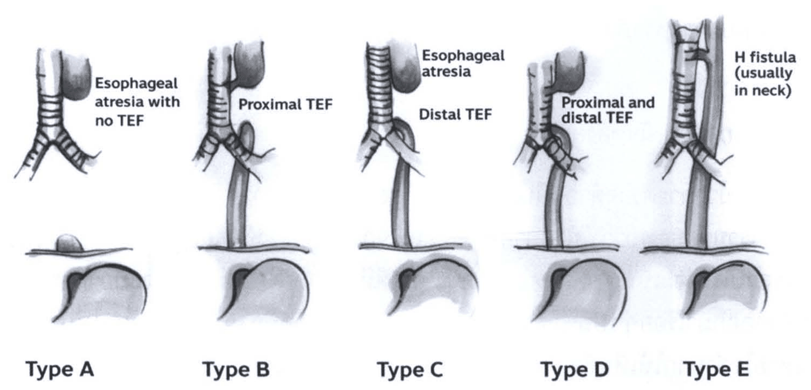

> **Caption (verbatim):** **รูปที่ 1** ชนิดของหลอดอาหารตัน
> **Text in image (verbatim):** Esophageal atresia with no TEF · Proximal TEF · Esophageal atresia · Distal TEF · Proximal and distal TEF · H fistula (usually in neck) · Type A · Type B · Type C · Type D · Type E
> **Description:** Five side-by-side shaded line drawings of the trachea (with its bifurcation into the main bronchi), the esophagus, the diaphragm (horizontal line) and the stomach below it, one for each Gross type. Type A ("Esophageal atresia with no TEF"): a blind-ending upper esophageal pouch beside the trachea, no connection to the trachea; the distal esophagus is only a small stump above the diaphragm, and the stomach is small. Type B ("Proximal TEF"): the upper esophageal pouch connects to the trachea by a fistula; the lower esophagus runs separately from below the tracheal bifurcation down through the diaphragm to the stomach. Type C ("Esophageal atresia", "Distal TEF"): blind upper pouch; the lower esophagus arises from the trachea near the carina and runs down to the stomach. Type D ("Proximal and distal TEF"): both the upper pouch and the lower esophagus connect to the trachea. Type E ("H fistula (usually in neck)"): the esophagus is continuous from top to stomach, with a short H-shaped fistula between the trachea and esophagus high up.
> **Identifiers in image:** none

<!-- p.838 (printed 824) -->
### การวินิจฉัยโรค

1. การวินิจฉัยก่อนคลอด

สามารถวินิจฉัยโรคนี้ได้ตั้งแต่ก่อนคลอดโดยวิธีตรวจด้วยคลื่นเสียงความถี่สูง ลักษณะที่ตรวจพบจากคลื่นเสียงความถี่สูง ได้แก่ การเห็นขนาดกระเพาะอาหารที่เล็กกว่าปกติหรือไม่เห็นเงาของกระเพาะอาหาร ร่วมกับการมีภาวะครรภ์แฝดน้ำ (Polyhydraminos) ในช่วงอายุครรภ์ 14-24 สัปดาห์ ลักษณะดังกล่าวอาจพบในผู้ป่วย intestinal atresia, lung hypoplasia, twin-to-twin transfusion syndrome, หรือความผิดปกติของโครโมโซมต่างๆ ซึ่งถ้าติดตามการตรวจคลื่นเสียงความถี่สูงไปในช่วงไตรมาสที่ 3 ถ้ามีภาวะหลอดอาหารตันก็จะเห็นหลอดอาหารมีการขยายโป่งพองเป็นปลายตันลักษณะเป็น echoic area บริเวณตรงคอเมื่อผู้ป่วยกำลังกลืน เรียกว่า upper neck pouch sign5 โดยทั่วไปถ้าเป็นหลอดอาหารตันชนิดที่ไม่มี trachea-esophageal fistula (TEF) จะตรวจพบจากคลื่นเสียงความถี่สูงได้ร้อยละ 10-706 แต่ถ้าเป็นหลอดอาหารตันที่มี TEF จะตรวจพบได้น้อยลง เพราะน้ำคร่ำผู้ป่วยจะสามารถผ่านจาก TEF ไปยังกระเพาะอาหารได้ ผู้ป่วยจึงตรวจไม่พบภาวะครรภ์แฝดน้ำ และมีของเหลวอยู่ในกระเพาะอาหารทำให้ไม่เห็น stomach bubble

2. การวินิจฉัยหลังคลอด

ถึงแม้ว่าการตรวจด้วยคลื่นเสียงความถี่สูงก่อนคลอดสามารถวินิจฉัยโรคนี้ได้ แต่การเก็บรวบรวมข้อมูลพบว่า ผู้ป่วยมากกว่าร้อยละ 90 ได้รับการวินิจฉัยโรคนี้หลังคลอด7 เพราะผู้ป่วยส่วนใหญ่จะเป็นโรคหลอดอาหารตันชนิดที่มี TEF หลังคลอดผู้ป่วยจะมีอาการน้ำลายฟูมปากออกมาเรื่อยๆ เป็นฟอง และมีหายใจลำบาก ซึ่งมักมีอาการหลังคลอดไม่นาน หรือเริ่มหายใจลำบากให้เห็นชัดเจนหลังได้กินนมมื้อแรก การวินิจฉัยสามารถทำได้โดยการใส่สาย nasogastric tube แล้วสายไม่สามารถผ่านลงไปในกระเพาะอาหาร และติดอยู่ที่ประมาณ 9-12 เซนติเมตรจากจมูก การยืนยันการวินิจฉัยโดยการตรวจทางรังสีวิทยา จะทำให้เห็นหลอดอาหารส่วนต้นที่เป็นลักษณะท่อปลายตันและมี nasogastric tube ขดอยู่ระดับกระดูก T2-T4 ถ้าพบว่ามีอากาศอยู่ในกระเพาะอาหารแสดงว่าเป็นโรคหลอดอาหารตันชนิดที่มี TEF แต่ถ้าตรวจไม่พบว่ามีอากาศเข้าไปในกระเพาะอาหารหรือลำไส้ แสดงว่าเป็นโรคหลอดอาหารตันชนิดที่ไม่มี TEF และส่วนกรณีที่ผู้ป่วยเป็น tracheo-esophageal fistula without EA จะวินิจฉัยได้ภายหลังที่มีอาการแทรกซ้อนเกิดขึ้น เพราะมักจะมีอาการ

<!-- p.839 (printed 825) -->
ปกติหลังคลอด แต่ต่อมาจะมีอาการหายใจเร็ว หายใจลำบากจาก recurrent pneumonia และจำเป็นต้องตรวจพิเศษทางรังสีวิทยาหรือ bronchoscopy จึงจะสามารถวินิจฉัยโรคนี้ได้

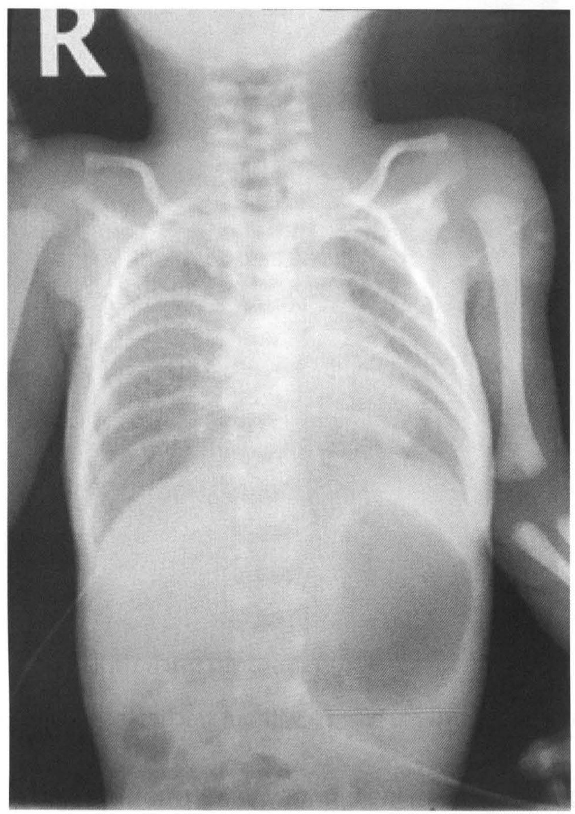

> **Caption (verbatim):** **รูปที่ 2** การตรวจทางรังสีวิทยา ของ EA with distal tracheo-esophageal fistula (Type C)
> **Text in image (verbatim):** R
> **Description:** Frontal (AP) plain radiograph of an infant covering the neck, chest and upper abdomen, with a side marker "R" at the top left. Both lungs, ribs, clavicles and upper arms are visible. In the left upper abdomen below the left hemidiaphragm there is a large, rounded, dark (gas-filled) stomach shadow, with some smaller gas shadows in the bowel lower down. Thin linear lines cross the lower abdomen and left side of the image. No other labels or arrows.
> **Identifiers in image:** none

<!-- p.840 (printed 826) -->
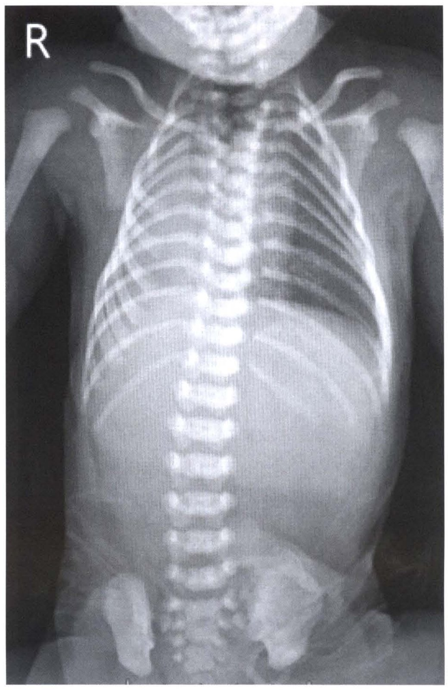

> **Caption (verbatim):** **รูปที่ 3** การตรวจทางรังสีวิทยาของ EA without tracheo-esophageal (Type A)
> **Text in image (verbatim):** R
> **Description:** Frontal (AP) plain radiograph of an infant from the lower jaw/neck down to the pelvis, with a side marker "R" at the top left. The spine, ribs, clavicles, upper arms, both lungs and iliac bones are visible. The abdomen below the diaphragm appears uniformly grey and dense, with no visible gas-filled stomach or bowel loops (in contrast to Figure 2). No arrows or other labels.
> **Identifiers in image:** none

3. การตรวจวินิจฉัยเพื่อหาความผิดปกติของระบบอื่นที่พบร่วม
  3.1 ความผิดปกติของระบบหัวใจและหลอดเลือด
    - ตรวจร่างกายอย่างละเอียด ฟังเสียงหัวใจว่าผิดปกติหรือไม่ ถ้าตรวจพบหรือสงสัยว่าจะมีความผิดปกติก็ตรวจเพิ่มเติม โดยการทำ EKG และ echocardiography
    - ถ้ามีอาการกลืนลำบาก หายใจเหนื่อย cyanosis สงสัยอาจจะมี vascular malformations อาจพิจารณาส่งตรวจ CT scan หรือ MRI

<!-- p.841 (printed 827) -->
  3.2 ความผิดปกติของระบบทางเดินอาหาร
    - ตรวจดูรูทวารหนักว่ามีความผิดปกติหรือไม่ ส่วนใหญ่สามารถวินิจฉัยโรค anorectal malformations จากการตรวจร่างกาย และตรวจทางรังสีวิทยาท่า prone lateral crosstable กรณีที่ตรวจไม่พบว่ามี fistula
    - Duodenal atresia ตรวจทางรังสีวิทยาพบ double bubble sign
    - Intestinal malformation ถ้าสงสัย จำเป็นต้องตรวจเพิ่มเติมโดยการตรวจพิเศษ UGIS
    - Heterotopic pancreas and hypertrophic pyloric stenosis ตรวจเบื้องต้นโดยการตรวจด้วยคลื่นเสียงความถี่สูงถ้าจำเป็น
    - Dumping syndrome ถ้าจำเป็นตรวจเบื้องต้นใช้ oral glucose tolerance test

  3.3 ความผิดปกติของไตและระบบทางเดินปัสสาวะ

ตรวจเบื้องต้นโดยคลื่นเสียงความถี่สูงว่าผู้ป่วยมีความผิดปกติของระบบนี้ร่วมด้วยหรือไม่

  3.4 ความผิดปกติของกล้ามเนื้อและกระดูก

ตรวจดูว่ามีการผิดรูปของกระดูกแขนขาหรือบริเวณต่างๆ หรือไม่ และตรวจเพิ่มเติมทางรังสีวิทยา ถ้าผู้ป่วยตรวจพบว่ามี anorectal malformations ร่วมด้วยควรพิจารณาตรวจคลื่นเสียงความถี่สูงบริเวณส่วน sacrum เพื่อดูว่ามีภาวะ tethered cords หรือไม่

  3.5 ความผิดปกติของระบบการหายใจ

กรณีที่ผู้ป่วยมีอาการและสงสัยว่ามีความผิดปกติของระบบการหายใจ อาจพิจารณาตรวจเพิ่มเติม โดยการส่องกล้องดู (laryngotracheobronchoscopy)

  3.6 ความผิดปกติของผิวหนัง

วินิจฉัยจากการตรวจร่างกายอย่างละเอียด

<!-- p.842 (printed 828) -->
### การรักษา

1. จัดท่าให้ผู้ป่วยนอนตะแคงและยกศีรษะสูง 30-45 องศา เพื่อป้องกันการสำลัก
2. งดน้ำ งดอาหาร และให้น้ำเกลือหรือสารอาหารทางเส้นเลือดดำ
3. ใส่สารทางจมูกขนาด 10 French ในบริเวณหลอดอาหารส่วนต้นที่ตันและต่อเครื่องมือดูดน้ำลายตลอดเวลา เพื่อป้องกันการสำลักน้ำลาย ลงไปในปอด
4. ให้ยาปฏิชีวนะ (ampicillin ร่วมกับ gentamicin)
5. ตรวจและรักษาความผิดปกติของระบบอื่นๆ ที่พบร่วมจนผู้ป่วยมีความพร้อมสำหรับการผ่าตัดรักษา
6. ผู้ป่วยที่มีปัญหาหายใจลำบาก จำเป็นต้องใส่ท่อช่วยหายใจและช่วยการหายใจแบบ low-pressure หรือบางกรณีจำเป็นต้องใช้ high frequency ventilation ก่อนการผ่าตัดรักษา

### การผ่าตัดรักษา

ควรพิจารณาทำการส่องกล้องหลอดลม (bronchoscopy) ก่อนทำการผ่าตัด เพื่อระบุตำแหน่งของ distal fistula และช่วยยืนยันว่าผู้ป่วยมี upper pouch fistula ด้วยหรือไม่ (EA with proximal and distal tracheo-esophageal fistula) บางครั้งการส่องกล้องหลอดลมทำให้พบความผิดปกติอย่างอื่นร่วมด้วย เช่น มี second proximal fistula, laryngotracheoesophageal cleft, tracheal stenosis หรือมี treacheal bronchus อยู่บริเวณกลีบปอดขวาบน นอกจากนี้ควรทำ echocardiography เพื่อประเมินความผิดปกติของหัวใจ ที่อาจจะพบร่วมด้วย และดูว่าผู้ป่วยมี aortic arch ด้านซ้ายหรือขวา พบว่าร้อยละ 2.5 ของผู้ป่วย อาจมี right sided aortic arch ซึ่งการผ่าตัดแก้ไขอาจพิจารณาเข้าทางช่องทรวงอกซ้ายแทน8

การผ่าตัดในปัจจุบันสามารถใช้วิธีผ่าตัดเปิดลงไปในช่องทรวงอก (thoracotomy) และการผ่าตัดส่องกล้อง (thoracoscopic approach) ในกรณีที่ผู้ป่วยเป็นโรคหลอดอาหารตันชนิด esophageal atresia with distal trachea-esophageal fistula (Type C) ซึ่งเป็นชนิดที่พบบ่อยที่สุด การผ่าตัดแก้ไขทำได้โดยให้ผู้ป่วยนอนตะแคงเอาช่องอกด้านขวาขึ้น ผ่าตัดเปิดลงไปในช่องอกด้านขวาแบบไม่เข้าไปในช่องปอด (extrapleural approach)

<!-- p.843 (printed 829) -->
เพื่อเข้าไปผูก distal TEF แล้วนำหลอดอาหารส่วนปลาย (ที่แยกออกมาจากหลอดลมแล้ว) มาต่อกับหลอดอาหารส่วนบนที่ตัน (primary end-to-end anastomosis)

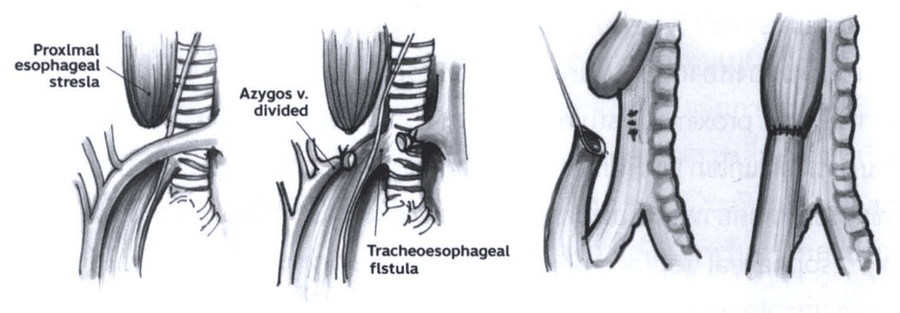

> **Caption (verbatim):** **รูปที่ 4** เทคนิคการผ่าตัด esophagoesophagostomy
> **Text in image (verbatim):** Proxlmal esophageal stresla · Azygos v. divided · Tracheoesophageal flstula
> **Description:** Four sequential shaded line drawings of the operative field (right-sided view) showing repair of esophageal atresia with distal tracheo-esophageal fistula. Panel 1: the blind-ending proximal esophageal pouch (label "Proxlmal esophageal stresla", as printed) lies above, beside the ringed trachea, with the azygos vein crossing horizontally over the field and the distal esophagus below. Panel 2: the azygos vein has been ligated and cut (label "Azygos v. divided", pointer to the tied stump), exposing the fistula between the distal esophagus and the trachea (label "Tracheoesophageal flstula", as printed). Panel 3: the distal esophagus has been detached from the trachea, the opening in the trachea closed with sutures (small stitch marks on the tracheal wall), and the upper pouch is pulled/held by a traction suture beside the lower esophageal end. Panel 4: the upper and lower esophageal segments joined end to end, with a row of sutures at the anastomosis, lying next to the trachea. Typos in the labels are reproduced as printed.
> **Identifiers in image:** none

การผ่าตัด primary anastomosis ได้หรือไม่ ขึ้นอยู่กับช่องระยะห่างระหว่างหลอดอาหารส่วนต้น และส่วนปลายดังนี้

1. ถ้าระยะห่างไม่เกิน 2 vertebrae สามารถทำ primary anastomosis ได้เลย
2. ถ้าระยะห่าง 2-6 vertebrae แนะนำทำ delayed primary anastomosis โดยการผ่าตัดครั้งแรกเข้าไปผูก TEF ก่อน และทำ gastrostomy ไว้ก่อน
3. ถ้าระยะห่างเกิน 6 vertebrae พิจารณาทำ esophageal replacement และแนะนำทำ gastrostomy ก่อนในการผ่าตัดครั้งแรก

มีรายงานการผ่าตัดส่องกล้องในช่องอกสำหรับรักษาโรคหลอดอาหารตันตั้งแต่ปี ค.ศ. 2000 โดยจัดท่าผู้ป่วยนอนตะแคงขวาขึ้น 30 องศา ทำการผ่าตัดผ่านกล้อง โดยใช้เครื่องมือขนาดเล็กขนาด 3-4 มิลลิเมตร วางตำแหน่ง ports 3-4 ตำแหน่ง มีรายงานว่ามีข้อดีกว่าเมื่อเปรียบเทียบกับการผ่าตัดเปิดช่องอก ในแง่ของเวลาที่ใช้ผ่าตัด (ผ่าตัดโดยแพทย์ที่มีประสบการณ์) การรั่วและการตีบของหลอดอาหารหลังผ่าตัด และการปวดแผลหลังผ่าตัดน้อยกว่า ลดการผิดรูปของซี่โครงหลังผ่าตัด และมีแผลเป็นน้อยกว่า ถึงอย่างไรก็ตาม การผ่าตัดส่องกล้องในช่องอกยังไม่สามารถมาแทนที่การผ่าตัดเปิดได้ในปัจจุบัน เนื่องจากแพทย์ที่ผ่าตัดจำเป็นต้องได้รับการฝึกฝนและเรียนรู้เทคนิคการผ่าตัดมาเป็นอย่างดี และมีความจำเป็นต้องมีห้องผ่าตัดที่จำเพาะและมีเครื่องมือที่เหมาะสมอย่างเพียบพร้อม

<!-- p.844 (printed 830) -->
นอกจากนี้การผ่าตัดเปิดโดยใช้ extrapleural approach ช่องปกป้อง pleura ในกรณีที่มี anastomosis leak ได้ด้วย10

ในกรณีที่ผู้ป่วยเป็นโรคหลอดอาหารตันชนิด esophageal atresia without trachea-esophageal fistula (Type A) แนะนำผ่าตัดทำ gastrostomy หลังคลอดไว้ก่อน และมีความจำเป็นต้องส่องกล้อง (laryngotracheobronchoscopy) ดูทุกราย เพราะมีอุบัติการณ์การมี proximal fistula ค่อนข้างสูง ร่วมกับตรวจหาความผิดปกติอย่างอื่นที่พบร่วม การผ่าตัดแก้ไขภายหลังมีหลายวิธี โดยหลักการอาจใช้หลอดอาหารเท่าที่มีอยู่มาต่อกันโดยใช้การยืดหลอดอาหารหรือใช้เทคนิคการผ่าตัดต่างๆ และถ้าไม่สามารถทำได้ก็จำเป็นต้องทำ esophageal replacement โดยใช้กระเพาะอาหาร ลำไส้ใหญ่ ลำไส้เล็กส่วน jejunum และ ileum มาแทนหลอดอาหารที่ตัน

## 2. โรคกระเพาะอาหารส่วนพัยลอรัสตีบ (Infantile Hypertrophic Pyloric Stenosis)

โรคกระเพาะอาหารส่วนพัยลอรัสตีบ เป็นโรคที่เกิดจากการหนาตัวและเพิ่มจำนวนของเซลล์ที่อยู่ในชั้นกล้ามเนื้อตำแหน่งพัยลอรัส ทำให้ตำแหน่งส่วนปลายของกระเพาะอาหารแคบและยาวออกไป ส่งผลให้เกิดภาวะการอุดตันเรียกว่า gastric outlet obstruction โดยปกติพัยลอรัสจะประกอบด้วย pyloric antrum และ pyloric muscle เชื่อมระหว่างกระเพาะอาหารและลำไส้เล็กส่วนดูโอดีนัม ชั้นกล้ามเนื้อพัยลอรัสประกอบด้วยชั้น circular และ longitudinal ควบคุมการทำงานโดยระบบประสาทซิมพาเตติก (sympathetic nervous system) ทำหน้าที่ป้องกันไม่ให้อาหารที่ยังไม่ย่อยเข้าไปในลำไส้เล็กร่วมกับป้องกันไม่ให้อาหารเข้ามาในกระเพาะอาหารในช่วงที่ลำไส้เล็กกำลังบีบตัว และเมื่อกล้ามเนื้อคลายตัวก็จะทำให้อาหารผ่านไปยังลำไส้เล็กส่วนดูโอดีนัมได้ ในคนที่เป็นโรคนี้เมื่อชั้นกล้ามเนื้อค่อยๆ หนาตัวขึ้นเรื่อยๆ จนสุดท้ายจะทำให้ เกิดภาวะอุดตันเกือบสมบูรณ์ (near complete obstruction) และจะแสดงอาการอาเจียนออกมา

### ระบาดวิทยา

อุบัติการณ์ของโรคพบได้แตกต่างกันทั่วโลก พบบ่อยในชาวตะวันตกประมาณ 2-5 รายต่อทารกแรกเกิดมีชีพ 1,000 ราย พบน้อยในชาวเอเชียและแอฟริกา พบในเพศชายต่อเพศหญิงในสัดส่วน 4-5:1 ถ้าบิดาหรือมารดาเป็นโรค บุตรชายหรือบุตรสาวก็มีโอกาส

<!-- p.845 (printed 831) -->
เป็นโรคนี้มากกว่าคนปกติทั่วไป บุตรคนแรกของครอบครัวมีความเสี่ยงต่อการเป็นโรคนี้มากกว่าบุตรคนถัดไป 1.8 เท่า11

### สาเหตุและปัจจัยการเกิดโรค

ปัจจุบันยังไม่ทราบสาเหตุและปัจจัยที่แน่ชัดทั้งๆ ที่ได้มีการศึกษาและวิจัยในด้านต่างๆ มากมาย แต่เชื่อว่าเกิดจากสาเหตุหลายอย่างรวมกัน (multifactorial) ปัจจัยทางด้านพันธุกรรมและสิ่งแวดล้อมต่างก็มีผลทำให้เกิดโรค ปัจจัยภายนอกที่เสี่ยงต่อการเกิดโรคมีหลายอย่าง มีการรายงานพบว่า ทารกที่กินนมขวดมีความเสี่ยงต่อการเป็นโรคมากกว่าทารกที่กินนมแม่ 4.6 เท่า12 ซึ่งอาจจะอธิบายได้จาก นมแม่มีระดับของ vasoactive intestinal peptide (VIP) สูง และ VIP เป็นปัจจัยสำคัญสำหรับการคลายตัวของกล้ามเนื้อเรียบในระบบทางเดินอาหาร endogenous VIP ในนมแม่ อาจมีส่วนไปคลายตัวของกล้ามเนื้อพัยลอรัส นอกจากนี้มีรายงานการตรวจพบฮอร์โมนส์ motilin ในทารกหลังกินนมขวด13 ซึ่งมีผลทำให้เกิดการบีบตัวของผนังลำไส้ ดังนั้นอาจเป็นไปได้ว่าการกินนมขวดไปเพิ่มการหดเกร็งตัวของพัยลอรัส จนหนาตัวขึ้นในที่สุด นอกจากนี้การใช้ยาบางตัวอาจมีผลทำให้เกิดโรค เช่น การใช้ยา erythromycin ซึ่งยาออกฤทธิ์เหมือน motilin agonist อาจไปมีผลทำให้มีการหดตัวอย่างต่อเนื่องของกล้ามเนื้อพัยลอรัสส่งผลทำให้มีการหนาตัวตามมา14 นอกจากนี้การใช้ยา erythromycin ของมารดาในช่วง 10 สัปดาห์สุดท้ายของการตั้งครรภ์และขณะให้นมบุตรก็มีผลเช่นเดียวกัน15 มีรายงานพบว่าทารกที่มารดาสูบบุหรี่มีความเสี่ยงสัมพัทธ์ (relative risk) ต่อการเกิดโรคนี้ 2 เท่า16

ปัจจัยทางด้านพันธุกรรม ในปัจจุบันยังไม่ทราบรูปแบบการถ่ายทอดทางพันธุกรรมที่แน่ชัด อาจเป็นทั้ง isolated หรือ multiple genetic syndromes17 และพบว่ามีความเสี่ยงในการเกิดโรคเพิ่มขึ้น 20 เท่า ถ้ามีพี่น้องเป็นโรคนี้

### อาการและอาการแสดง

1. อาการอาเจียน

ผู้ป่วยมีอาการอาเจียนเป็นนมที่กิน หลังจากกินไปแล้วประมาณ 15-20 นาที ช่วงแรกอาเจียนไม่บ่อย ต่อมาอาการอาเจียนบ่อยครั้งขึ้น จนมีอาการอาเจียนทุกครั้งที่กินนมและลักษณะอาเจียนพุ่ง (projectile vomiting) หลังอาเจียนเสร็จก็สามารถกินนมได้อีกทันทีหลังจากนั้น มักจะมีอาการในช่วง 3 สัปดาห์ ถึง 3 เดือนหลังคลอด ถ้ามีอาการอาเจียนมากก็จะมีอาการขาดน้ำตามมาได้ อาจพบมีอาเจียนเป็นเลือดจากการมีการแตกของเส้นเลือดฝอยในตัวผนังกระเพาะอาหาร

<!-- p.846 (printed 832) -->
การตรวจร่างกายพบมีอาการท้องอืดบริเวณท้องส่วนบน บางครั้งจะพบการบีบตัวของกระเพาะอาหารมากกว่าปกติ ทำให้เห็นเป็นลอนเคลื่อนจากซ้ายไปขวา (peristaltic wave) เมื่อคลำจะพบก้อนขนาดเท่าลูกมะกอก (olive mass) บริเวณลิ้นปี่ การใส่สายสวนทางกระเพาะอาหารเพื่อดูดนมที่ค้างออก จะสามารถทำให้ตรวจพบก้อนได้ชัดเจนขึ้น หรือไม่ก็อาจใช้วิธียกขาทั้งสองข้างขึ้น ขยับงอข้อเข่า และข้อสะโพกขณะตรวจ เพื่อให้กล้ามเนื้อหน้าท้องหย่อน มีการศึกษาในประเทศแคนาดาพบว่ามีเพียง ร้อยละ 13.6 ของผู้ป่วย คลำเจอก้อนซึ่งต่างจากรายงานเดิมที่พบว่าร้อยละ 50 ของผู้ป่วยจะคลำก้อนได้18 จากการอาเจียนและขาดน้ำทำให้ผู้ป่วยมีภาวะ hypochloremic hypokalemic metabolic alkalosis ร่างกายจะตอบสนองโดยการทำงานของไตเพื่อปรับสมดุลยกรดด่างในกระแสเลือด ทำให้ปัสสาวะออกมาเป็นด่าง มีรายงานว่าตรวจพบความผิดปกติของเกลือแร่ดังกล่าว ร้อยละ 50 ของผู้ป่วย โดยผู้ป่วยทารกส่วนใหญ่มักจะตรวจไม่พบความผิดปกติของเกลือแร่ แต่จะตรวจพบภาวะ metabolic alkalosis ในผู้ป่วยที่มีอายุมากขึ้น (older infant)19

### การวินิจฉัยโรค

1. จากประวัติเด็กทารกในช่วงอายุ 3 สัปดาห์ ถึง 3 เดือน ที่มีอาการอาเจียนพุ่งเป็นนม ไม่มีน้ำดีปน

2. การตรวจหน้าท้องพบก้อนขนาดเท่าลูกมะกอกบริเวณลิ้นปี่

3. การตรวจทางรังสีวิทยา

   3.1 การตรวจทางรังสีวิทยา (plain abdominal radiograph)

   พบลักษณะเงาของกระเพาะอาหารขนาดใหญ่กว่าปกติ แต่ยังสามารถเห็นเงาลมบริเวณลำไส้เล็กส่วนปลายที่ต่ำไปจากบริเวณกระเพาะอาหาร

   3.2 การตรวจด้วยคลื่นเสียงความถี่สูง

   พบมีการหนาตัวของกล้ามเนื้อพัยลอรัสมากกว่า 4 มิลลิเมตร และมีความยาวมากกว่า 16 มิลลิเมตร หรือมีการหนาตัวของกล้ามเนื้อพัยลอรัสมากกว่า 3 มิลลิเมตร ในผู้ป่วยที่มีอายุต่ำกว่า 30 วัน ก็ถือว่าเป็นโรคนี้

<!-- p.847 (printed 833) -->
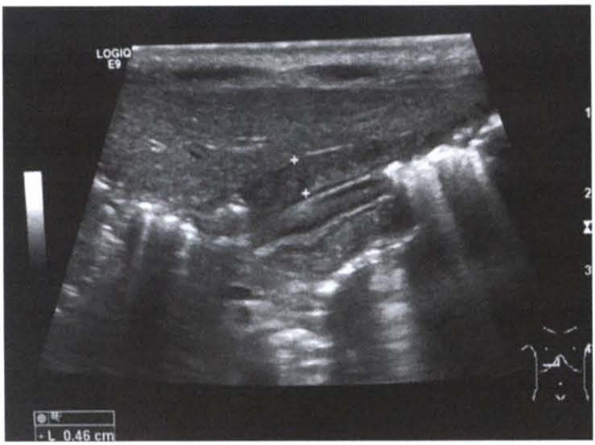

> **Caption (verbatim):** รูปที่ 5 และ 6 แสดงการตรวจด้วยคลื่นเสียงความถี่สูง พบมีการหนาตัวของกล้ามเนื้อพัยลอรัสมากกว่า 4 มิลลิเมตร และมีความยาวมากกว่า 16 มิลลิเมตร
> **Text in image (verbatim):** LOGIQ E9 · 1 · 2 · 3 · L 0.46 cm
> **Description:** Grayscale abdominal ultrasound image (left image of the pair, รูปที่ 5). Two "+" calipers are placed across the wall of the pyloric muscle in the centre of the image, and the measurement box at the bottom left reads L 0.46 cm (pyloric muscle thickness). A depth scale (1, 2, 3) runs down the right edge, a grayscale bar is at the left, and a probe-orientation body marker is at the bottom right. Bright echogenic areas with posterior acoustic shadowing are seen to the right and lower part of the image.
> **Identifiers in image:** none

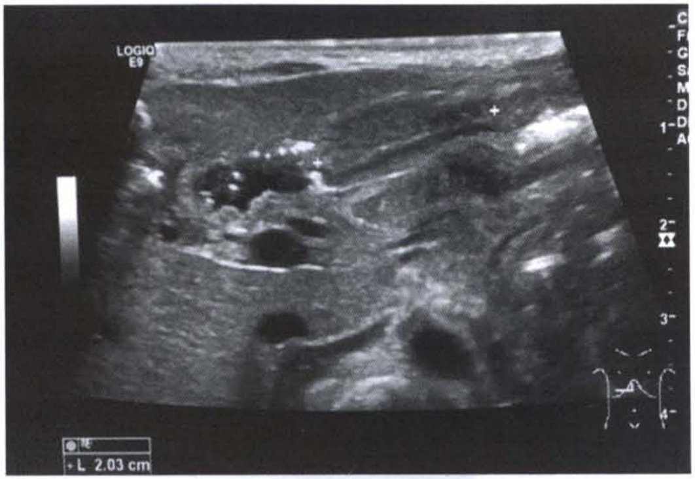

> **Caption (verbatim):** รูปที่ 5 และ 6 แสดงการตรวจด้วยคลื่นเสียงความถี่สูง พบมีการหนาตัวของกล้ามเนื้อพัยลอรัสมากกว่า 4 มิลลิเมตร และมีความยาวมากกว่า 16 มิลลิเมตร
> **Text in image (verbatim):** LOGIQ E9 · C · F · G · S · M · D · D · A · 1 · 2 · 3 · 4 · L 2.03 cm
> **Description:** Grayscale abdominal ultrasound image (right image of the pair, รูปที่ 6). Two "+" calipers mark the two ends of the elongated pyloric channel/muscle running obliquely across the upper middle of the image, and the measurement box at the bottom left reads L 2.03 cm (pyloric length). Fluid-filled, anechoic rounded structures with bright echogenic content lie to the left of the pylorus. A depth scale (1–4) runs down the right edge, with partly cut-off single letters (C, F, G, S, M, D, D, A) at the top right, a grayscale bar at the left and a probe-orientation body marker at the bottom right.
> **Identifiers in image:** none

3.3 การตรวจ upper gastrointestinal contrast studies

ตรวจพบสารทึบรังสีฉาบตามขอบ pyloric canal เป็นลักษณะเส้นยาวเรียกว่า sting sign มีการหนาตัวของกล้ามเนื้อพัยลอรัส ทำให้มีการกดบริเวณแอนทรัม (antrum) เป็นลักษณะคล้ายบ่าคน (shoulder sign)

ปัจจุบันการตรวจร่างกายพบก้อนก็ยังเป็นหลักสำคัญในการวินิจฉัยโรค (99% positive predictive value) และควรตรวจยืนยันด้วยคลื่นเสียงความถี่สูง โดยเฉพาะในรายที่ตรวจร่างกายไม่เจอก้อน (98% specificity และ 100% sensitivity) แต่ถึงอย่างไรก็ตามในผู้ป่วยบางรายที่มีอายุน้อยกว่า 3 สัปดาห์ อาจวินิจฉัยยากก็ควรสังเกตอาการ และประเมินซ้ำอีก 1-2 วัน ข้อบ่งชี้สำหรับการตรวจพิเศษ upper gastrointestinal contrast studies เพื่อการวินิจฉัยโรคนี้ก็ต่อเมื่อไม่สามารถตรวจด้วยคลื่นเสียงความถี่สูงได้ ผู้ป่วยมาพบแพทย์ตอนอายุค่อนข้างมาก (late onset) หรือสงสัย reflux20

### การวินิจฉัยแยกโรค

ควรวินิจฉัยแยกโรคจาก pylorospasm, gastroesophageal reflux, gastroenteritis, increase intracranial pressure, metabolic disorder, anatomic cause : antral web, foregut duplication cyst, gastric tumor, tumor causing extrinsic gastric compression

<!-- p.848 (printed 834) -->
### การรักษา

1. การปรับสมดุลของสารน้ำและเกลือแร่

ประเมินภาวะการขาดน้ำจากการตรวจร่างกาย วัดปริมาณปัสสาวะ ผู้ป่วยที่มีภาวะ hypochloremic hypokalemic metabolic alkalosis จำเป็นต้องแก้สารน้ำเกลือแร่ให้ดีขึ้นก่อน จึงจะนำผู้ป่วยไปผ่าตัดรักษา ค่าของไบคาร์บอเนตต้องน้อยกว่า 30 mmol /L, คลอไรด์ต้องมากกว่า 100 mmol/L และโพแทสเซียม ประมาณ 4.5-5.5 mmol/L, ช่วงเริ่มต้นอาจให้ 10-20 ml/kg ของ normal saline หลังจากนั้นให้น้ำเกลือในรูปของ D5/1/2 NS เมื่อปัสสาวะออกดีแล้วจะผสม KCL 20-30 mEq/L โดยให้สารน้ำประมาณมากกว่าปกติ 1.25-2 เท่า21

2. การผ่าตัดรักษา

   2.1 การผ่าตัดแบบเปิด

   Conrad Ramstedt ศัลยแพทย์ชาวเยอรมันเป็นผู้คิดค้นวิธีการผ่าตัดเป็นท่านแรกตั้งแต่ปี ค.ศ. 1912 และเป็นวิธีการผ่าตัดมาตรฐานที่ใช้กันมาจนถึงปัจจุบันเป็นเวลามากกว่า 100 ปี จึงเรียกเทคนิคการผ่าตัดว่า Ramstedt pyloromyotomy เป็นการผ่าตัดกรีดเปิดตามแนวยาวของกล้ามเนื้อพัยลอรัสจนถึงชั้น mucosa เพื่อคลายอาการตีบ และเปิดแผลทิ้งไว้โดยไม่เย็บชั้นกล้ามเนื้อกลับเข้าหากัน

   วิธีการเปิดแผลทางหน้าท้องมี 2 วิธี คือ

     1. การลงแผลแบบมาตรฐาน คือ การเปิดแผลแนวขวางด้านขวาบน ค้นพบโดย Roberton และ Rickham ตั้งแต่ปี ค.ศ. 1940

     2. การลงแผลบริเวณสะดือ ข้อดีคือหลังจากแผลหาย ก็แทบจะมองไม่เห็นบาดแผลที่ผ่าตัดไป ค้นพบโดย Tan และ Bianchi ในปี ค.ศ. 1986

<!-- p.849 (printed 835) -->
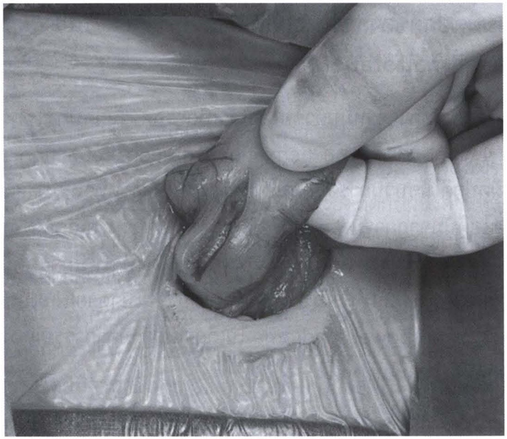

> **Caption (verbatim):** รูปที่ 7 ภาพแสดงการผ่าตัด Ramstedt pyloromyotomy ผ่านแผลสะดือ
> **Text in image (verbatim):** none
> **Description:** Black-and-white intraoperative photograph. A small round incision through a transparent adhesive drape is seen in the lower centre of the image; a gloved hand (fingers at upper right) holds and delivers the pylorus out through the wound. On the exteriorised, thickened pyloric olive a longitudinal incision is visible through the muscle layer, with its edges spread apart (the pyloromyotomy). Surrounding drapes fill the background. No patient face or body region other than the operative field is visible.
> **Identifiers in image:** none

   2.2 การผ่าตัดส่องกล้อง

   Alain และคณะได้เสนอวิธีการผ่าตัดโดยการส่องกล้องเป็นครั้งแรกในปี ค.ศ. 1991 และเป็นวิธีการผ่าตัดที่เป็นที่ยอมรับในปัจจุบันโดยเฉพาะชาวตะวันตก ข้อดีของการผ่าตัดส่องกล้องคือหลังจากแผลหายก็แทบจะมองไม่เห็นแผลผ่าตัด ลดระยะเวลาพักฟื้น และเวลาที่ต้องนอนในโรงพยาบาล ลดอาการปวดแผลหลังผ่าตัด และเกิดภาวะแทรกซ้อนน้อยกว่า22-23

### ภาวะแทรกซ้อน

อาการอาเจียนหลังผ่าตัด, incomplete pyloromyotomy, mucosal perforation, แผลติดเชื้อ, duodenal perforation, incisional hernia, wound dehiscence พบได้ร้อยละ 4.6-12

<!-- p.850 (printed 836) -->
## 3. โรคความผิดปกติของการหมุนตัวของลำไส้ (Intestinal malrotation)

โรคความผิดปกติของการหมุนตัวของลำไส้ เกิดจากความผิดปกติในการหมุนตัวของลำไส้โดยผ่าน 4 ขั้นตอนสำคัญ คือ herniation, rotation, retraction และ fixation ถ้าเกิดมีความผิดปกติในขบวนการขั้นตอนใดขั้นตอนหนึ่ง ส่งผลทำให้เกิดการอุดตันบริเวณลำไส้เล็กส่วนดูโอดีนัมจากการมี Ladd’s band พาดผ่าน หรือเกิดการอุดตันของลำไส้ตามมาจากภาวะลำไส้บิดพัน (midgut volvulus) ซึ่งทำให้มีการกดรัด superior mesenteric artery ส่งผลให้ลำไส้ขาดเลือดไปเลี้ยงจนเน่าตายและเป็นสาเหตุสำคัญของการเกิดภาวะ short bowel syndrome ในเด็ก และถ้ามีอาการรุนแรงหรือวินิจฉัยได้ไม่ทันท่วงทีก็ทำให้ผู้ป่วยเสียชีวิตได้

### ระบาดวิทยา

มีอุบัติการณ์การเกิดโรคประมาณ 1 ราย ต่อทารกแรกเกิดมีชีพ 2,500-6,000 ราย จากข้อมูลการชันสูตรพลิกศพพบว่าอุบัติการณ์ที่แท้จริงน่าจะสูงถึงร้อยละ 0.2-1 ของจำนวนประชากร24 โรคหรือความผิดปกติของระบบอื่นที่พบร่วม ได้แก่ โรคลำไส้เล็กตีบตันตั้งแต่กำเนิด โรคลำไส้เล็กส่วนดูโอดีนัมตีบตัน โรคความผิดปกติของระบบหัวใจและหลอดเลือด ความผิดรูปแต่กำเนิดของทวารหนัก โรคไส้เลื่อน Meckel diverticulum และ trisomy 21

### คัพภวิทยา

ขั้นตอนการหมุนตัวของลำไส้จะมีการแบ่งเป็น 2 ส่วนใหญ่ คือ ส่วน cephalic limb (duodenojejunal limb) และส่วน caudal limb (cecocolic limb) ซึ่งการหมุนของทั้งสองส่วนจะเกิดขึ้นในช่วงเวลาเดียวกัน แต่ต่างส่วนต่างแยกกันหมุน เนื่องจากในช่วงปฏิสนธิสัปดาห์ที่ 4 ในครรภ์มารดาจะมีการเจริญเติบโตและยืดยาวขึ้นของลำไส้ส่วน midgut (คือลำไส้เล็กส่วน duodenum ถึงลำไส้ใหญ่ส่วน mid transverse) เป็นอย่างมาก และไม่เป็นสัดส่วนที่เหมาะสมกับผนังช่องว่างในท้อง จึงทำให้ลำไส้เลื่อนออกนอกช่องท้อง (herniation) ผ่านเข้าไปใน extraembryonic coelom พร้อมกับมีการหมุนทวนเข็มนาฬิกาของลำไส้รอบละ 90 องศา จำนวน 3 รอบ โดยรอบแรกมีการหมุนทวนเข็มนาฬิกา 90 องศา ในช่วงที่มีการ herniation รอบที่สองมีการหมุนทวนเข็มนาฬิกาอีก 90 องศา ในช่วงที่ลำไส้เลื่อนกลับเข้ามาในช่องท้องในระหว่างสัปดาห์ที่ 10 ของการปฏิสนธิ และมี

<!-- p.851 (printed 837) -->
การหมุนรอบสุดท้ายทวนเข็มนาฬิกาอีก 90 องศา ในช่วงที่ลำไส้เข้าไปอยู่ในช่องท้องเรียบร้อยแล้ว รวมทั้งสิ้นจะมีการหมุนทวนเข็มนาฬิกาไปทางขวาทั้งหมด 270 องศา รอบ superior mesenteric artery (SMA) จนกระทั่ง duodenojejunal loop มาอยู่ด้านซ้ายของ SMA จากนั้นจะยึดติดกับ retroperitoneum ไว้ด้วย ligament of Treitz ส่วน cecocolic limb ซึ่งตอนแรกอยู่ใต้ต่อ SMA ก็มีการหมุนรอบ mesenteric root axis แบบทวนเข็มนาฬิการวมทั้งสิ้น 270 องศา เช่นเดียวกัน และเกิดการยึดติดกับผนังด้านหลังของช่องท้อง (fixation) บริเวณลำไส้ใหญ่ส่วน ascending และ descending ส่งผลให้ลำไส้ใหญ่ทั้งหมดเรียงตัวเป็นรูปคล้ายเกือกม้า ถ้าลำไส้มีการหมุนตัวตามปกติจะพบว่าลำไส้เล็กส่วนดูโอดีนัมส่วนใหญ่อยู่บริเวณ retroperitoneum ส่วนของ DJ junction อยู่ด้านซ้ายบนของช่องท้อง ลำไส้เล็กถูกตรึงกับ posterior abdominal wall ด้วย mesentery ซึ่งมีลักษณะแผ่ออกคล้ายพัด โดยมีฐาน (root of mesentery) ทอดในแนวเฉียงจากซ้ายบน (DJ junction) ไปยังขวาล่าง (cecum) ลักษณะปกติที่ฐานของขั้วลำไส้กว้างและสั้นนี้ จะทำให้ไม่เกิดการบิดพันของลำไส้ (volvulus)

ชนิดของความผิดปกติของการหมุนตัวของลำไส้

1. Nonrotation

ลำไส้จะไม่มีการหมุนทวนเข็มนาฬิกา 270 องศา รอบ SMA ดังนั้น duodenojejunal limb จะอยู่บริเวณ ด้านขวาของช่องท้อง ลำไส้เล็กส่วนดูโอดีนัมจะวางตัวลงตรงไปยังด้านขวาโดยไม่เกิดเป็น C-loop และไม่ได้อยู่บริเวณ retroperitoneum ส่วน cecocolic limb จะอยู่ด้านซ้ายของช่องท้อง ความผิดปกติแบบนี้มีโอกาสการเกิดลำไส้บิดพันได้น้อย พบร่วมกับผู้ป่วย abdominal wall defect และ congenital diaphragmatic hernia

2. Incomplete rotation

เป็นชนิดที่พบบ่อยที่สุด โดยลำไส้จะมีการหมุนทวนเข็มนาฬิกา 180 องศา แล้วหยุดหมุนไปก่อนที่การหมุนตัวจะเสร็จสิ้นสมบูรณ์ ส่งผลให้ลำไส้ใหญ่ส่วน cecum และ right colon อยู่บริเวณด้านขวาบนของช่องท้องโดยมี peritoneal band ยึดใต้ตับพาดผ่านไปกดลำไส้เล็กส่วนดูโอดีนัม (congenital band นี้มีชื่อจำเพาะว่า Ladd’s band) ส่วน duodenojejunal limb มักจะวางตัวไปทางด้านขวาของช่องท้องและลอยอยู่ในช่องท้อง ส่งผลให้ส่วน root of mesentery ลำไส้ใหญ่ส่วน cecum และ right colon อยู่ใกล้กัน และฐานของลำไส้แคบกว่าปกติ มีโอกาสเกิดลำไส้บิดพันได้ง่าย

<!-- p.852 (printed 838) -->
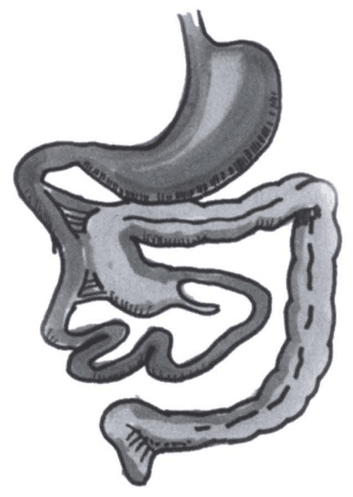

> **Caption (verbatim):** รูปที่ 8 ภาพแสดงลักษณะของ incomplete rotation
> **Text in image (verbatim):** none
> **Description:** Unlabelled shaded hand-drawn illustration of the gastrointestinal tract seen from the front. The esophagus and stomach are at the top; from the stomach the duodenum curves toward the image's left side and descends without forming a normal C-loop, continuing into dark-shaded small-bowel loops that lie in the left and lower-middle part of the image. The lighter-shaded large bowel (drawn with a dashed line along it) starts with a broad segment in the upper middle of the image just below the stomach, near the duodenum, runs across to the right, then down the image's right side and back across the bottom, ending in a flared segment at the bottom. Hatched band-like attachments are drawn at the image's left between the large bowel near the top and the region of the duodenum, crossing over the duodenum. No labels or arrows.
> **Identifiers in image:** none

3. Reverse rotation

ลำไส้เกิดการหมุนกลับทิศ คือมีการหมุนตามเข็มนาฬิกา 90 องศา ส่งผลให้ลำไส้ใหญ่ส่วน cecum และ transverse อยู่ด้านขวาของ SMA และเคลื่อนผ่าน retroduodenal tunnel ไปอยู่บริเวณด้านหลังของลำไส้เล็กส่วนดูโอดีนัมและเจจูนัม อาจส่งผลให้เกิดการอุดตันบริเวณลำไส้ใหญ่ส่วน transverse จากการถูกกดทับ นอกจากนี้ยังเสี่ยงต่อการเกิด internal hernia

### อาการและอาการแสดง

ผู้ป่วยสามารถแสดงอาการได้หลากหลายและไม่เฉพาะเจาะจง ขึ้นอยู่กับว่าผู้ป่วยเป็น malrotation ชนิดใด อาการแสดงที่สำคัญและพบบ่อยที่สุดคือการอาเจียนมีน้ำดีปน โดยเฉพาะในช่วง 1 เดือนแรกหลังคลอด ดังนั้นถ้าทารกมีอาการอาเจียนมีน้ำดีปนแบบทันทีทันใดให้นึกถึงโรคนี้ไว้ด้วยเสมอ จนกว่าจะพิสูจน์ได้ว่าเป็นหรือไม่เป็นโรคนี้จากการตรวจเพิ่มเติมอื่นๆ ที่จะกล่าวต่อไป

<!-- p.853 (printed 839) -->
ผู้ป่วยรายที่มี malrotation ร่วมกับ midgut volvulus ร้อยละ 75 ของผู้ป่วยมักจะแสดงอาการภายใน 1 เดือนแรกหลังคลอด ในระยะแรกผู้ป่วยอาจจะมีแค่อาเจียนมีน้ำดีปน ท้องไม่อืดหรือมีอาการท้องอืดเฉพาะหน้าท้องส่วนบน แต่ถ้าไม่สามารถวินิจฉัยในระยะแรกได้ ต่อมาผู้ป่วยจะมีอาการท้องอืดมากขึ้น อาจคลำได้ก้อนบริเวณกลางท้อง มีอาการถ่ายเป็นเลือดสด และมีภาวะ peritonitis ตามมา

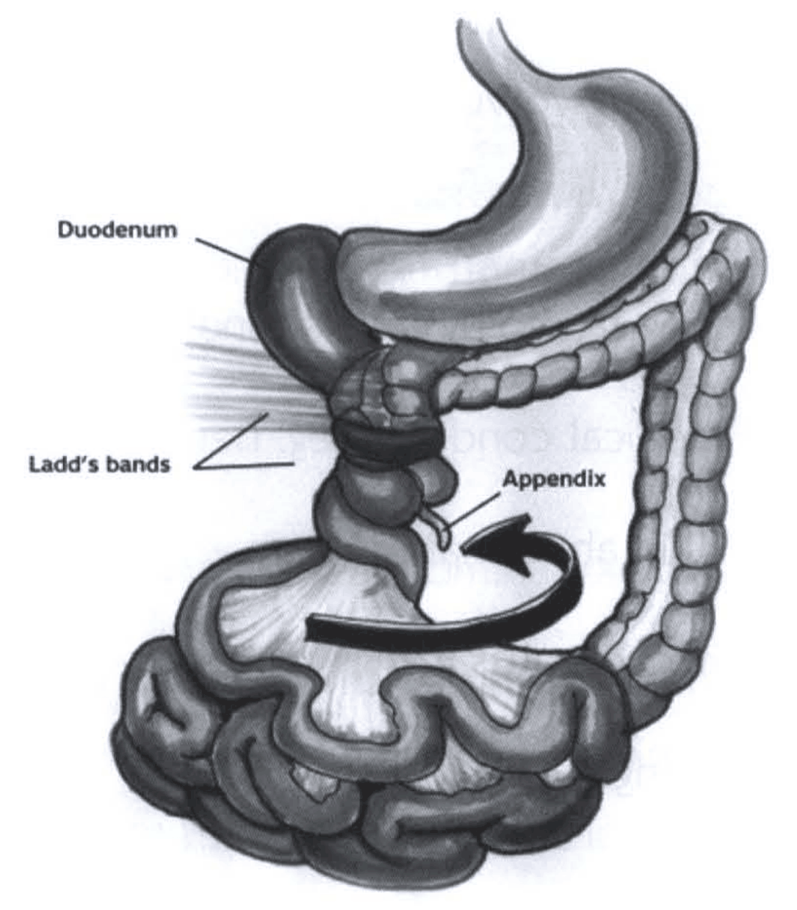

> **Caption (verbatim):** รูปที่ 9 แสดงลักษณะของ midgut volvulus
> **Text in image (verbatim):** Duodenum · Ladd’s bands · Appendix
> **Description:** Shaded anatomical illustration of the abdominal gut seen from the front. The stomach is at the top centre. The dilated, dark-shaded duodenum (label "Duodenum") lies to the image's left of the stomach and descends into a narrowed, twisted segment encircled by a dark constricting ring. Fine streaks fanning out from the image's left toward this region are labelled "Ladd’s bands" (two leader lines). Below the twist the bowel is twisted around its narrow mesenteric pedicle; the small appendix (label "Appendix") hangs near the twist. A large black curved arrow circles around the mesenteric base, indicating the direction of rotation of the twisted midgut. The small-bowel loops lie in a heap at the bottom, with their fan-shaped mesentery converging to the twisted pedicle, and the haustrated large bowel runs from near the twist across under the stomach and down the image's right side to the bottom.
> **Identifiers in image:** none

ผู้ป่วย malrotation ที่มีการอุดตันบริเวณลำไส้เล็กส่วนดูโอดีนัมจาก Ladd’s band อาจจะมีอาการแค่อาเจียนมีน้ำดีปน ผู้ป่วยบางรายที่มีอาการลำไส้อุดตันแบบเรื้อรังก็จะมีอาการไม่เฉพาะเจาะจงต่างๆ เช่น failure to thrive, gastroesophageal reflux, malnutrition ซึ่งทำให้ยากต่อการวินิจฉัยว่าเป็นโรคนี้ อาการและอาการแสดงของโรคความผิดปกติของการหมุนตัวของลำไส้สามารถแบ่งเป็นกลุ่มต่างๆ ดังต่อไปนี้25

<!-- p.854 (printed 840) -->
1. **Nonrotation**
   - Asymptomatic
   - Associated motility disorder
   - Associated condition (eg. abdominal wall defect, diaphragmatic hernia, heterotaxia)
   - Appendicitis in abnormal location
2. **Malrotation without volvulus**
   - Asymptomatic
   - Bilious vomiting caused by Ladd’s band or associated duodenal web
   - Associate medical condition (eg. heterotaxia syndrome)
   - Appendicitis in abnormal location
3. **Malrotation with volvulus**
   - Bilious vomiting
   - Abdominal pain
   - Hematochezia
   - Peritonitis
   - Death
4. **Malrotation with partial or intermittent volvulus**
   - Protein-losing enteropathy
   - Abdominal pain
   - Failure to thrive

<!-- p.855 (printed 841) -->
- Malnutrition
- Occult gastrointestinal bleeding

### การวินิจฉัยโรค

เนื่องจากอาการและอาการแสดงของผู้ป่วยค่อนข้างหลากหลาย และไม่เฉพาะเจาะจง ดังนั้นการตรวจเพิ่มเติมทางรังสีวิทยาจึงมีบทบาทสำคัญอย่างมากในการช่วยวินิจฉัยโรคนี้

1. การวินิจฉัยก่อนคลอด

ปัจจุบันการตรวจด้วยคลื่นเสียงความถี่สูงก่อนคลอดยังไม่สามารถวินิจฉัยความผิดปกติของการหมุนตัวของลำไส้ได้ แต่อาจพบลักษณะผิดปกติในผู้ป่วยบางรายที่มีภาวะ prenatal midgut volvulus ร่วมด้วย โดยจะตรวจพบลักษณะการขยายตัวของลำไส้ผิดปกติ มี meconium peritonitis หรือมี ascites25

2. การวินิจฉัยหลังคลอด

2.1 การตรวจทางรังสีวิทยา (abdominal radiograph)

ใช้เป็นการตรวจวินิจฉัยเบื้องต้น แต่ไม่สามารถบอกได้แน่ชัดว่าเป็นโรคนี้ เพราะในระยะแรกของโรคอาจตรวจไม่พบความผิดปกติจากการตรวจทางรังสีวิทยาได้ ต่อมาอาจตรวจพบเงาลมในกระเพาะอาหารมีขนาดขยายใหญ่กว่าปกติ ลักษณะที่ช่วยยืนยันว่ามี malrotation ร่วมกับ midgut volvulus คือการเห็นเงาลมในกระเพาะอาหารและลำไส้เล็กส่วนดูโอดีนัม แต่ไม่พบเงาลมของลำไส้ส่วนอื่นที่อยู่ต่ำกว่าลำไส้เล็กส่วนดูโอดีนัมเลย และในรายที่มีอาการรุนแรงจะมี peritonitis จะตรวจไม่พบเงาลมในช่องท้อง (gasless abdomen) ส่วนในรายที่มี malrotation ร่วมกับ midgut volvulus แต่เป็นลักษณะ incomplete obstruction อาจตรวจพบลักษณะของลำไส้อุดตันส่วนปลายและไม่เห็นลมในลำไส้ใหญ่

<!-- p.856 (printed 842) -->
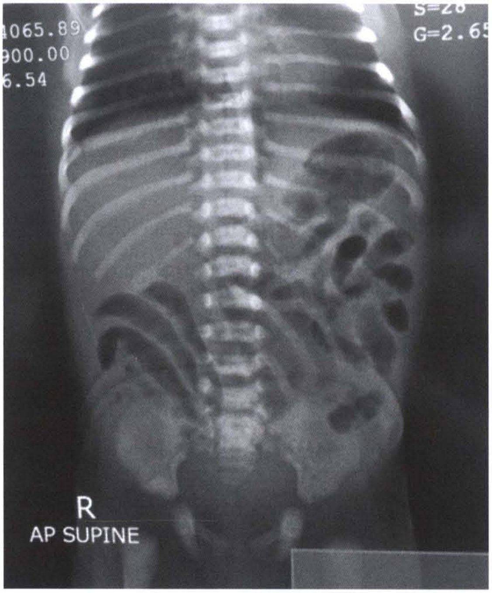

> **Caption (verbatim):** รูปที่ 10 การตรวจทางรังสีวิทยาพบลักษณะของลำไส้อุดตันส่วนปลาย และไม่เห็นลมในลำไส้ใหญ่ในผู้ป่วย midgut volvulus
> **Text in image (verbatim):** 4065.89 · 900.00 · 6.54 · S=28 · G=2.65 · R · AP SUPINE
> **Description:** Plain abdominal radiograph of an infant, AP supine projection, with the "R" side marker at the lower left of the image (patient's right on the image's left). The lower chest (ribs) down to the pelvis and upper femora is included, with the spine in the midline. Multiple gas-filled, mildly distended bowel loops are seen, clustered mostly in the image's right (patient's left) upper and mid abdomen, with further curved gas-filled loops in the image's left (patient's right) mid-lower abdomen and a few small gas loops in the lower abdomen; per the caption, the pattern is that of distal bowel obstruction with no gas seen in the large bowel. Partly cut-off technical numbers are burned in at the top left and top right corners (not patient identifiers), and a plain grey rectangle covers the bottom right corner.
> **Identifiers in image:** none

2.2 การตรวจ upper gastrointestinal contrast studies (UGIS)

ถือเป็น gold standard ในการวินิจฉัยโรคนี้ ลักษณะการตรวจปกติจะพบว่าตำแหน่งของ ligament of Treitz อยู่ด้านซ้ายของ spinal pedicles และอยู่ในระดับเดียวกับ gastric outlet ส่วนตำแหน่งของลำไส้เล็กส่วนดูโอดีนัมก็ควรอยู่บริเวณ retroperitoneum ด้านหลัง ถ้ามีความผิดปกติของการหมุนตัวของลำไส้ จะตรวจพบ low-lying ligament of Treitz หรือตำแหน่งไม่ได้อยู่บริเวณด้านซ้ายของ spinal pedicles ตามปกติที่บริเวณตรงกับกระดูกสันหลังระดับ L2 ร่วมกับ low-lying pylorus ถ้าผู้ป่วยมี malrotation ร่วมกับ midgut volvulus ที่ยังไม่เกิดการอุดตันของลำไส้ที่สมบูรณ์ (incomplete obstruction) จะตรวจพบลักษณะจำเพาะเรียกว่า coil spring หรือ corkscrew configuration แต่ถ้าเกิดมีการอุดตันของลำไส้อย่างสมบูรณ์แล้วจะตรวจพบลักษณะ bird beak

ผู้ป่วยที่มีอาการ peritonitis ก็ควรรีบผ่าตัดอย่างเร่งด่วนโดยไม่จำเป็นต้องตรวจ UGIS เพื่อยืนยันการวินิจฉัยให้เสียเวลา

<!-- p.857 (printed 843) -->
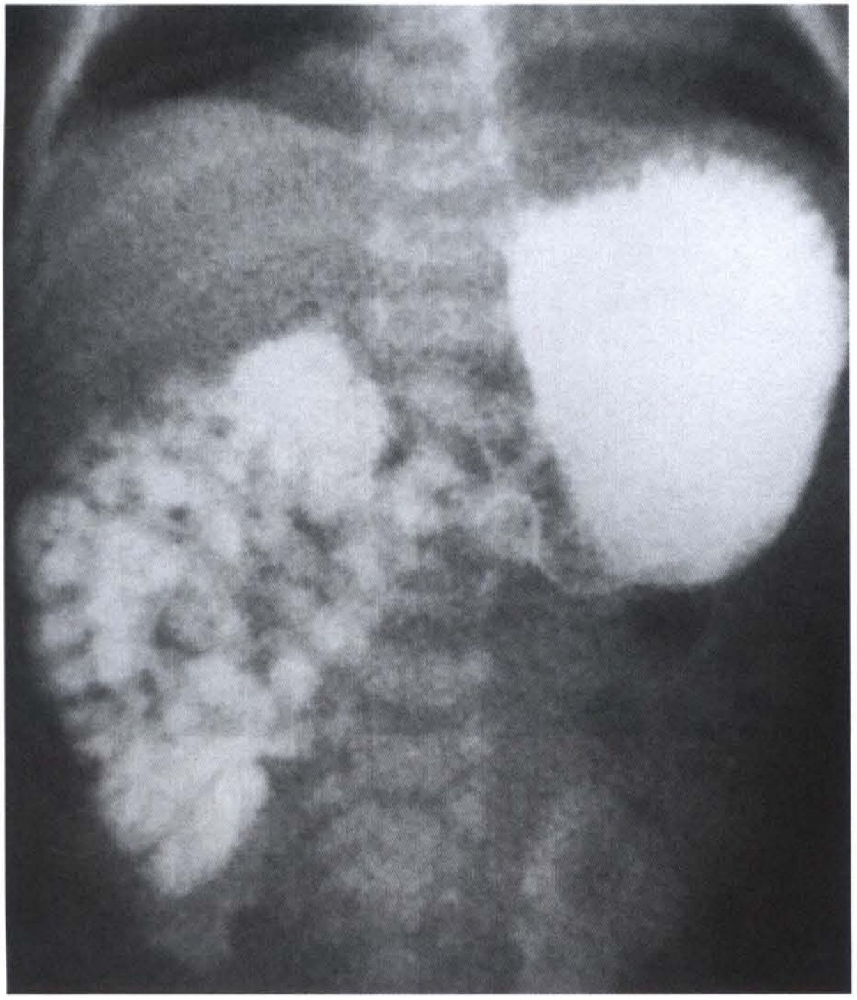

> **Caption (verbatim):** รูปที่ 11 การตรวจ UGIS พบ intestinal malrotation ตรวจพบลำไส้เล็กและตำแหน่ง ligament of Treitz อยู่ด้านขวาของ spinal pedicles
> **Text in image (verbatim):** none
> **Description:** Frontal radiograph of an infant's upper abdomen taken during an upper gastrointestinal contrast study (UGIS). The lower ribs and the spine are visible in the upper middle of the image. A large, densely contrast-filled stomach occupies the image's upper right (patient's left upper abdomen). Contrast-filled small-bowel loops with a mottled/feathery pattern are clustered entirely in the image's left side (patient's right abdomen), lateral to and overlapping the spine on that side, extending from the mid abdomen downward; no contrast-filled small bowel is seen on the image's right (patient's left) of the spine below the stomach. Per the caption, this shows intestinal malrotation with the small bowel and the ligament of Treitz to the right of the spinal pedicles. No labels or arrows.
> **Identifiers in image:** none

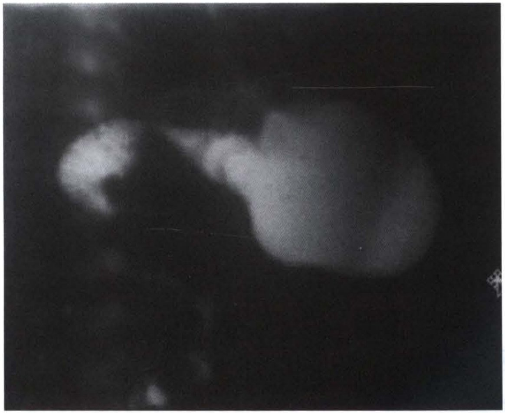

> **Caption (verbatim):** รูปที่ 12 การตรวจ UGIS พบลักษณะ corkscrew
> **Text in image (verbatim):** none
> **Description:** Dark, low-contrast fluoroscopic image from an upper gastrointestinal contrast study (UGIS). A large, rounded, contrast-filled stomach lies in the centre-right of the image; from its left end a narrower contrast-filled segment extends toward the image's left, and a separate irregular, curled contrast-filled bowel segment lies further to the image's left. Faint vertebral bodies are seen in a vertical column along the left part of the image. A small cross-hatched marker is at the right edge. Per the caption, the study shows the corkscrew appearance. No text labels or arrows.
> **Identifiers in image:** none

<!-- p.858 (printed 844) -->
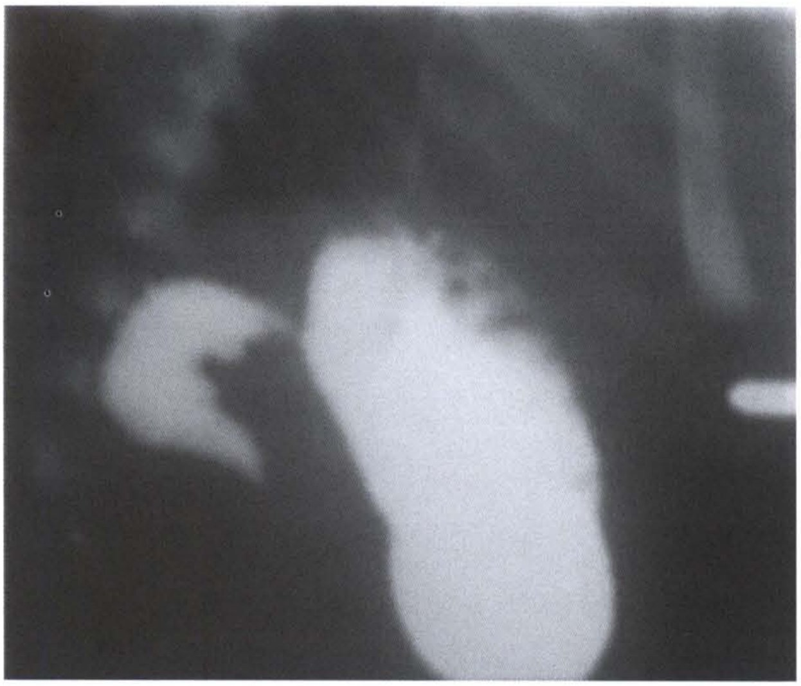

> **Caption (verbatim):** รูปที่ 13 การตรวจ UGIS พบลักษณะ bird beak
> **Text in image (verbatim):** none
> **Description:** Fluoroscopic image from an upper gastrointestinal contrast study (UGIS). A large, elongated, densely contrast-filled stomach runs obliquely down the centre-right of the image. To the image's left of it lies a separate curved contrast-filled segment (proximal duodenum) whose lower end tapers to a pointed, beak-like tip, with no contrast seen passing beyond it. A small bright oval opacity is at the right edge of the image. Per the caption, this is the bird beak appearance. No text labels or arrows.
> **Identifiers in image:** none

2.3 การตรวจด้วยคลื่นเสียงความถี่สูง

ในปัจจุบันมีการนำการตรวจคลื่นเสียงความถี่สูงมาช่วยในการวินิจฉัยมากขึ้น โดยมีข้อดีกว่าการตรวจ UGIS คือผู้ป่วยไม่ต้องโดนรังสี ลดความเสี่ยงของการเกิด hypothermia การจัดท่าในการตรวจ UGIS ค่อนข้างลำบากกว่า บางครั้งหลังการตรวจ UGIS แล้วก็ยังหาข้อสรุปที่ชัดเจนไม่ได้ แต่ถึงอย่างไรก็ตาม การตรวจด้วยคลื่นเสียงความถี่สูงยังไม่ถือว่าเป็น gold standard ในการวินิจฉัยโรคนี้และมีข้อด้อย คือ sensitivity และ specificity ต่ำกว่าการตรวจด้วย UGIS การวินิจฉัย intestinal malrotaion ร่วมกับ midgut volvulus ในการตรวจด้วยคลื่นเสียงความถี่สูงจะตรวจพบลักษณะ 3 อย่าง ที่สำคัญคือ26

1. ตรวจพบการสลับตำแหน่งระหว่าง superior mesenteric artery กับ superior mesenteric vein

2. การตรวจพบ whirlpool sign คือมีการหมุนของ mesentery และ superior mesenteric vein รอบ superior mesenteric artery ลักษณะตามเข็มนาฬิกา (clockwise)

3. ตรวจพบ retroperitoneal transverse duodenum

<!-- p.859 (printed 845) -->
### การรักษา

1. การรักษาเบื้องต้นก่อนผ่าตัดรักษา

ผู้ป่วยจะมีการขาดน้ำและสารเกลือแร่ต่างๆ ในร่างกาย จึงจำเป็นต้องได้รับการให้สารน้ำและเกลือแร่ทางเส้นเลือดดำ มีการใส่สายเข้าไประบายสิ่งคัดหลั่งจากกระเพาะอาหาร ให้ยาปฏิชีวนะที่เป็น broad-spectrum และรีบนำผู้ป่วยเข้าห้องผ่าตัดฉุกเฉินเพื่อผ่าตัดรักษา

2. การผ่าตัดรักษา

2.1 การผ่าตัดแบบเปิด

วิธีการผ่าตัดแก้ไขความผิดปกติของการหมุนตัวของลำไส้มีชื่อเรียกว่า Ladd procedure ตามชื่อศัลย์แพทย์ William Ladd ซึ่งคิดค้นวิธีการผ่าตัดตั้งแต่ปี ค.ศ. 1936 การผ่าตัดในปัจจุบันแตกต่างจากวิธีการผ่าตัดโดยแบบดั้งเดิมเล็กน้อย ซึ่งมี 6 ขั้นตอนดังนี้

1. การผ่าตัดเปิดช่องท้องส่วนบนตามแนวขวางและเอาส่วนของลำไส้ออกมาอยู่บริเวณนอกช่องท้อง

2. การคลายการบิดหมุนของลำไส้ทิศทวนเข็มนาฬิกา (counterclockwise detorsion)

3. การตัด Ladd’s band

4. การทำให้ฐานของ mesentery กว้างขึ้น (broadening of the mesentery)

5. การตัดไส้ติ่ง

6. การจัดให้ลำไส้เล็กอยู่ทางด้านขวาของช่องท้องและปล่อยให้ลำไส้ใหญ่ทั้งหมดรวมทั้งส่วน cecum หมุนกลับไปอยู่ทางด้านซ้ายของช่องท้อง

<!-- p.860 (printed 846) -->
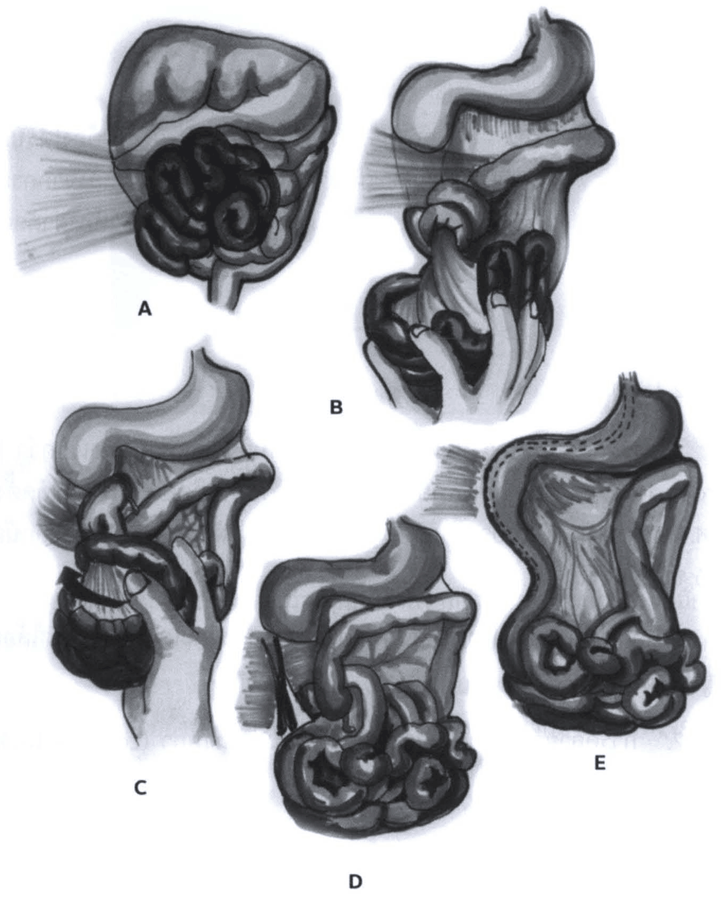

> **Caption (verbatim):** รูปที่ 14 การผ่าตัด Ladd procedure
> **Text in image (verbatim):** A · B · C · D · E
> **Description:** Five shaded surgical illustrations labelled A to E showing the steps of the Ladd procedure. A: the midgut seen from the front, with dark (congested) small-bowel loops twisted together in a cluster beneath the colon, a fan of bands drawn to the image's left, and a narrow mesenteric stalk at the bottom. B: the stomach and duodenum at the top; a hand grasps and lifts the dark small-bowel loops, exposing the twisted narrow mesenteric pedicle and the bands drawn to the image's left. C: the stomach at the top, with the colon crossing below it; a hand holds the dark bowel mass and a curved arrow at the left indicates rotating it to untwist the volvulus. D: the stomach and duodenum at the top with the bowel untwisted; at the image's left, a pair of scissors (or similar instrument) is shown at the bands crossing the duodenum, and the small-bowel loops lie below. E: the final position, with the stomach at the top, the duodenum running straight down along the image's left side (outlined by a dashed line), the broad, fan-shaped mesentery in the centre, and the small-bowel loops and colon gathered at the bottom; short hatched lines at the upper left mark the divided bands. No other labels.
> **Identifiers in image:** none

ในกรณีที่เปิดผ่าตัดแล้วพบว่ามีลำไส้เน่าตายไปแล้วอย่างเห็นได้ชัด ก็ควรตัดลำไส้ส่วนที่เน่าตายทิ้ง และยกลำไส้ส่วนต้นต่อส่วนที่เน่าตายออกมาเปิดบริเวณหน้าท้องเป็นการชั่วคราวไว้ก่อน แต่ถ้าไม่แน่ใจว่า ลำไส้ที่ขาดเลือดเน่าตายจริง หรืออาจสามารถกลับฟื้นตัวขึ้นมาได้ภายหลัง แนะนำให้ผ่าตัดปิดหน้าท้องเป็นการชั่วคราวหรือใส่ silo ไว้ก่อน แล้วค่อยนำผู้ป่วยมาผ่าตัดรอบที่สองเพื่อประเมินการกลับฟื้นตัวของลำไส้ที่เหลือทั้งหมดภายใน 24-48 ชั่วโมงหลังการผ่าตัดครั้งแรก (second-look operation)

<!-- p.861 (printed 847) -->
ส่วนในกรณีที่เปิดผ่าตัดแล้วพบว่ามีลำไส้เน่าตายจากการขาดเลือดไปเลี้ยงทั้งหมด อาจเลือกผ่าตัดปิดแผลหน้าท้องโดยไม่ตัดลำไส้ส่วนหนึ่งส่วนใดทิ้ง หลังจากที่ได้คุยกับบิดามารดาของผู้ป่วยถึงการพยากรณ์ของโรคว่าผู้ป่วยจะเสียชีวิตในที่สุด

2.2 การผ่าตัดส่องกล้อง

ศัลยแพทย์สองท่านแรกที่คิดค้นวิธีการผ่าตัดส่องกล้องคือศัลยแพทย์ van der Zee และ Bax ในปี ค.ศ. 199527 ปัจจุบันผลการผ่าตัดก็เป็นที่น่าพอใจ โดยเฉพาะในกลุ่มคนไข้ที่มี intestinal malrotation เพียงอย่างเดียว ในกรณีที่ผู้ป่วยมี intestinal malrotation ร่วมกับ midgut volvulus การผ่าตัดส่องกล้องอาจยากและทำการผ่าตัดได้ไม่ง่าย ถือเป็นการท้าทายต่อศัลยแพทย์เป็นอย่างมาก เพราะลำไส้ส่วนที่มีการขยายตัวจากการขาดเลือดจะไปบดบังพื้นที่ในช่องท้องเกือบหมด ร่วมกับบางรายอาจมี chylous ascites ทำให้การผ่าตัดยากยิ่งขึ้น อาจทำให้เกิดลำไส้ทะลุ มีการบาดเจ็บของอวัยวะต่างๆ โดยไม่ตั้งใจจากตัวเครื่องมือผ่าตัดส่องกล้อง ในกรณีเช่นนี้ควรเปลี่ยนมาผ่าตัดแบบเปิดแทน โดยอาจผ่าตัดแบบเปิดผ่านการขยายแผลที่ใส่ port บริเวณสะดือถ้าสามารถทำได้ หรือผ่าตัดเปิดช่องท้องส่วนบนตามแนวขวางตามวิธีการผ่าตัดแบบมาตรฐาน

### ภาวะแทรกซ้อน

ภาวะแทรกซ้อนที่พบ ได้แก่ adhesive small bowel obstruction (พบได้ร้อยละ 6-10), incisional hernia, perforated viscus และ recurrent volvulus28 สำหรับผู้ป่วยที่ลำไส้เน่าตายและต้องตัดลำไส้ไปจำนวนมาก (extended or subtotal small bowel resection) หลังผ่าตัดต้องเผชิญกับปัญหา short bowel syndrome ผู้ป่วยกลุ่มนี้จำเป็นต้องได้รับ total parenteral nutrition จนกว่าลำไส้ส่วนที่เหลือทั้งหมดจะมี adapation และ compensatory growth

<!-- p.862 (printed 848) -->
## เอกสารอ้างอิง

1. Wyllie R. ‘Intestinal atresia, stenosis and malrotation’, In: Kliegman RM, Behrman RE, Jenson HB, Stanton BF (editors) Nelson’s textbook of Paediatrics, 18th ed, vol-2, Philadelphia: Saunders-Elseiver, 2008;1558-62.
2. Pedersen RN, Calzolari E, Husby S, et al. Oesophageal atresia: prevalence, prenatal diagnosis and associated anomalies in 23 European regions. Arch Dis Child 2012;97:227-32.
3. Sfeir R, Michaud L, Salleron J, et al. Epidemiology of esophageal atresia. Dis Esophagus 2013;26(4):354-55.
4. van Lennep M, Singendonk MMJ, Dall’Oglio L, et al. Oesophageal atresia. Nat Rev Dis Primers 2019;5(1):1-21.
5. Eyheremendy, E&Pfister M. Antenatal real-time diagnosis of esophageal atresias. J Clin Ultrasound 1983;11:395-97.
6. Pardy C, D’Antonio F, Khalil A, et al. Prenatal detection of esophageal atresia: a systematic review and meta-analysis. Acta Obstet Gynecol Scand 2019;98(6):689-699.
7. Current status of prenatal diagnosis, operative management and outcome of esophageal atresia/trachea-esophageal fistula. Prenat Diagn 2008;28:667-75.
8. Babu R, Pierro A, Spitz L, et al. The management of oesophageal atresia in neonates with right sided aortic arch. J Pediatr Surg 2000;35:56-8.
9. Yanchar NL, Gordon R, Cooper M, et al. Significance of the clinical course and early upper gastrointestinal studies in predicting complications associated with repair of esophageal atresia. J Pediatr Surg 2001;36:815-22.
10. Zani A. International survey on the management of esophageal atresia. Eur J Pediatr Surg 2014;24:3-8.
11. McAteer JP, Ledbetter DJ, Goldin AB, et al. Role of bottle feeding in the etiology of hypertrophic pyloric stenosis. JAMA Pediatr 2013;167(12):1143-9.
12. Krogh C, Biggar RJ, Fischer TK, et al. Bottle-feeding and the risk of pyloric stenosis. Pediatrics 2012;130(4):e943-9.

<!-- p.863 (printed 849) -->
13. Lucas A, Sarson DL, Blackburn AM, et al. Breast vs bottle: endocrine responses are different with formula feeding. Lancet 1980;1(8181):1267-9.
14. Cooper WO, Ray WA, Griffin MR, et al. Prenatal prescription of macrolide antibiotics and infantile hypertrophic pyloric stenosis. Obstet Gynecol 2002;100(1):101-6.
15. Christina P. New insights into the pathogenesis of infantile hypertrophic pyloric stenosis. Pediatr Surg Int 2009;25:1043-52.
16. Sorenson HT, Norgard B, Pedersen L, et al. Maternal smoking and risk of infantile hypertrophic pyloric stenosis: 10 year population based cohort study. BMJ 2002;325(7371):1011-12.
17. Peeters B, Benninga MA, Hennekam RC, et al. Infantile hypertropic pyloric stenosis—genetics and syndromes. Nat Rev Gastroenterol Hepatol 2012;9(11):646-60.
18. Glatstein M, Carbell G, Boddu SK, et al. The changing clinical presentation of hypertrophic pyloric stenosis: the experience of a large, tertiary care pediatric hospital. Clin Pediatr (Phila) 2011;50(3):192-5.
19. Tutay GJ, Capraro G, Spirko B, et al. Electrolyte profile of pediatric patients with hypertrophic pyloric stenosis. Pediatr Emerg Care 2013;29(4):456-8.
20. Hernanz-Schulman M. Pyloric stenosis: role of imaging. Pediatr Radiol 2009;39:134-39.
21. Coran AG, Caldamone A, Adzick NS, et al. Hypertrophic pyloric stenosis. In: Pediatric Surgery. Elsevier Saunders, Philadelphia, PA, USA 2012;1021-8.
22. Hall NJ, Pacilli M, Eaton S, et al. Recovery after open versus laparoscopic pyloromyotomy for pyloric stenosis: a double-blind multicenter randomized controlled trial. Lancet 2009;373(9661):390-8.
23. St Peter SD, Holcomb GW 3rd, Calkins CM, et al. Open versus laparoscopic pyloromyotomy for pyloric stenosis: a prospective randomized trial. Ann Surg 2006;244(3):363-70.
24. Adams SD, Stanton MP. Malrotation and intestinal atresias. Early Hum Dev 2014;90(12):921-5.
25. Langer JC. Intestinal rotation abnormalities and midgut volvulus. Surg Clin North Am 2017;97(1):147-159.

<!-- p.864 (printed 850) -->
26. Zhou LY, Li SR, Wang W, et al. Usefulness of sonograghy in evaluating children suspected of malrotation: comparison with an upper gastrointestinal contrast study. J Ultrasound Med 2015;34:1825-1832.
27. van der Zee DC, Bax NMA. Laparoscopic repair of acute volvulus in a neonate with malrotation. Sur Endsc 1995;9:1123-1124.
28. Gohary Y, Alagtal M, Gillick J. Long-term complications following operative intervention for intestinal malrotation: a 10-year review. Pediatr Surg Int 2010;26:203-206.
