# โรคลำไส้ตีบตันในทารกแรกเกิด (Duodenal, intestinal, and colonic atresia and stenosis)

## Contents of this file
- 1. โรคลำไส้เล็กส่วนดูโอดีนัมตีบตัน (Duodenal atresia and stenosis) (p.866)
  - ลักษณะทางคลินิก (p.867)
  - การวินิจฉัยโรค (p.867)
  - การรักษา (p.871)
- 2. โรคลำไส้เล็กตีบตัน (Intestinal atresia and stenosis) (p.872)
  - ลักษณะทางคลินิก (p.874)
  - การวินิจฉัยโรค (p.874)
  - การรักษา (p.876)
- 3. โรคลำไส้ใหญ่ตีบตัน (Colonic atresia and stenosis) (p.880)
  - ลักษณะอาการทางคลินิก (p.881)
  - การวินิจฉัยโรค (p.881)
  - การรักษา (p.882)
- เอกสารอ้างอิง (p.883)

<!-- p.865 (printed none) -->
**โรคลำไส้ตีบตันในทารกแรกเกิด**

**Duodenal, intestinal, and colonic atresia and stenosis**

กตเวที เดชอรัญ

<!-- p.866 (printed 852) -->
**โรคลำไส้ตีบตันในทารกแรกเกิด**

**Duodenal, intestinal, and colonic atresia and stenosis**

กตเวที เดชอรัญ

## 1. โรคลำไส้เล็กส่วนดูโอดีนัมตีบตัน (Duodenal atresia and stenosis)

อุบัติการณ์การเกิดโรคประมาณ 1 ราย ต่อทารกแรกเกิดมีชีพ 5,000-10,000 ราย และพบประมาณร้อยละ 60 ของโรคลำไส้อุดตันทั้งหมด1 พบในทารกเพศชายมากกว่าทารกเพศหญิงในสัดส่วน 1.4:1 ตรวจพบความผิดปกติของระบบอวัยวะอื่นๆ ร่วมด้วยได้หลายระบบ เช่น พบความผิดปกติของระบบหัวใจและหลอดเลือดร้อยละ 25 มีความสัมพันธ์กับโรค Down syndrome สูงถึงร้อยละ 30-50 และพบลำไส้ส่วนอื่นตีบตันร้อยละ 72 นอกจากนี้พบความผิดปกติอื่นๆ เช่น annular pancreas, esophageal atresia, VACTERL association, urinary tract malformation และ mandibulofacial anomalies1

Tandler ได้อธิบายสมมติฐานของการเกิดโรคว่าเกิดจากความล้มเหลวของพัฒนาการ re-canalize ในช่วงสัปดาห์ที่ 8-10 ของการตั้งครรภ์หรือมีการ proliferation ผิดปกติไปมีผลทำให้ท่อ (lumen) ของลำไส้เล็กส่วนดูโอดีนัมตีบตัน มักพบความผิดปกติบริเวณต่ำกว่าตำแหน่งดูโอดีนัมส่วนที่ 2 ลำไส้เล็กส่วนดูโอดีนัมส่วนต้นตีบตันแบ่งได้เป็น 4 ชนิด ได้แก่

1. Type I ดูจากลักษณะภายนอกเหมือนลำไส้ปกติไม่มีรอยตีบตันให้เห็นภายนอก แต่ท่อภายในลำไส้มี complete mucosal membrane ซึ่งมีส่วนประกอบของชั้น muscularis และ serosa กั้นอยู่

2. Type II มี fibrous cord เชื่อมกลางระหว่างส่วนที่ตันทั้งสองส่วน

3. Type III ส่วนที่ตันส่วนต้นและส่วนปลายไม่มี fibrous cord เชื่อม

4. Type IV ส่วนที่ตันมีหลายตำแหน่ง

<!-- p.867 (printed 853) -->
### ลักษณะทางคลินิก

1. อาการอาเจียน

ผู้ป่วยจะเริ่มมีอาการอาเจียนตั้งแต่แรกหลังคลอดโดยมักมีจะอาการภายใน 24 ถึง 48 ชั่วโมงหลังจากการกินนมมื้อแรก และอาการอาเจียนรุนแรงมากขึ้นเรื่อยๆ ลักษณะอาเจียนจะมีน้ำดีปน เพราะตำแหน่งที่ตีบตันมักจะอยู่ต่ำกว่าดูโอดีนัมส่วนที่ 2 มีประมาณร้อยละ 20 ของผู้ป่วยที่ตำแหน่งตีบตันอยู่สูงกว่าดูโอดีนัมส่วนที่ 2 ซึ่งลักษณะอาเจียนจะเป็นนมที่กินเข้าไป

2. ไม่ถ่ายขี้เทา

โดยปกติเด็กทารกจะมีการถ่ายขี้เทาภายใน 24 ชั่วโมงหลังคลอด เนื่องจากมีการตีบตัน ผู้ป่วยก็จะไม่ถ่ายขี้เทา ถ่ายขี้เทาออกมาปริมาณน้อยกว่าปกติ หรือสีของขี้เทามีสีจางและซีดกว่าปกติ

3. อาการท้องอืด

ผู้ป่วยที่มีโรคลำไส้เล็กส่วนดูโอดีนัมตัน (Duodenal atresia) ท้องจะค่อนข้างแฟบ และมักจะไม่มีอาการท้องอืดหรือถ้ามีอาการท้องอืดก็จะอืดเฉพาะหน้าท้องส่วนบน จะพบอาการท้องอืดในผู้ป่วยที่มีโรคลำไส้เล็กส่วนดูโอดีนัมตีบ (Duodenal stenosis)

4. อาการอื่นๆ เช่น อาการตัวเหลือง การเจริญเติบโตต่ำกว่าเกณฑ์มาตรฐาน

### การวินิจฉัยโรค

1. ปัจจุบันสามารถวินิจฉัยโรคนี้ได้ตั้งแต่ก่อนคลอดโดยวิธีตรวจด้วยคลื่นเสียงความถี่สูง ลักษณะที่ตรวจพบจากคลื่นเสียงความถี่สูง

1.1 Double bubble sign พบในผู้ป่วยทุกราย เห็นเป็นลักษณะคล้ายถุงน้ำสองอันที่มีการเชื่อมต่อกันอยู่ ซึ่งเกิดจากการขยายโป่งพองของกระเพาะอาหารและลำไส้เล็กส่วนดูโอดีนัมส่วนต้น ทารกปกติจะไม่สามารถเห็นน้ำในลำไส้เล็กส่วนดูโอดีนัมได้ สามารถตรวจพบได้ตั้งแต่อายุครรภ์ก่อน 24 สัปดาห์

<!-- p.868 (printed 854) -->
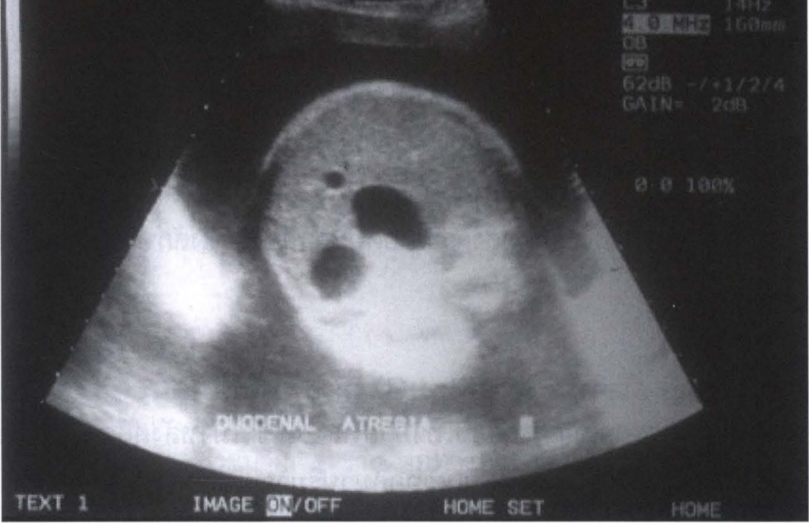

> **Caption (verbatim):** **รูปที่ 1** Prenatal ultrasonograghy พบลักษณะ double bubble sign
> **Text in image (verbatim):** C3 · 14Hz · 4.0 MHz · 160mm · OB · 62dB -/+1/2/4 · GAIN= 2dB · [unclear: 0.0 100%] · DUODENAL ATRESIA · TEXT 1 · IMAGE ON/OFF · HOME SET · HOME
> **Description:** Prenatal (obstetric) ultrasound image, sector/fan-shaped grey-scale view, labelled on the screen "DUODENAL ATRESIA". In the centre is a round cross-section of the fetal abdomen surrounded by darker amniotic fluid. Inside the fetal abdomen are two larger rounded anechoic (black) fluid-filled structures, an upper-right one that is larger and lobulated and a lower-left rounder one, which together form the double bubble appearance the caption refers to; a small additional dark dot lies above-left of them. A bright echogenic area lies to the left outside the fetal abdomen. Machine settings are shown at the upper right and soft-key labels along the bottom edge. The original image's header line (hospital name and a blank "PT:" field) and the exam date/time were cropped off the top; identifier label cropped out.
> **Identifiers in image:** none

1.2 ครรภ์แฝดน้ำ (Polyhydraminos) เกิดจากความบกพร่องของการดูดซึมในส่วนของกระเพาะอาหาร และลำไส้เล็กส่วนดูโอดีนัมส่วนต้น มักจะเห็นชัดในช่วงท้ายของการตั้งครรภ์ พบได้ร้อยละ 50 ของผู้ป่วย4

2. การตรวจทางรังสีวิทยา

2.1 การตรวจทางรังสีวิทยา (plain abdominal radiograph) จะพบลักษณะ double bubble ซึ่งเป็น bubble ส่วนของกระเพาะอาหารและลำไส้เล็กส่วนดูโอดีนัมตันและตรวจไม่พบลมเข้าไปในลำไส้ส่วนปลายอื่นๆ แต่ถ้ามีอาการลำไส้เล็กส่วนดูโอดีนัมตีบจะยังตรวจพบลมเข้าไปในลำไส้ส่วนปลายอื่นๆ (incomplete obstruction)

<!-- p.869 (printed 855) -->
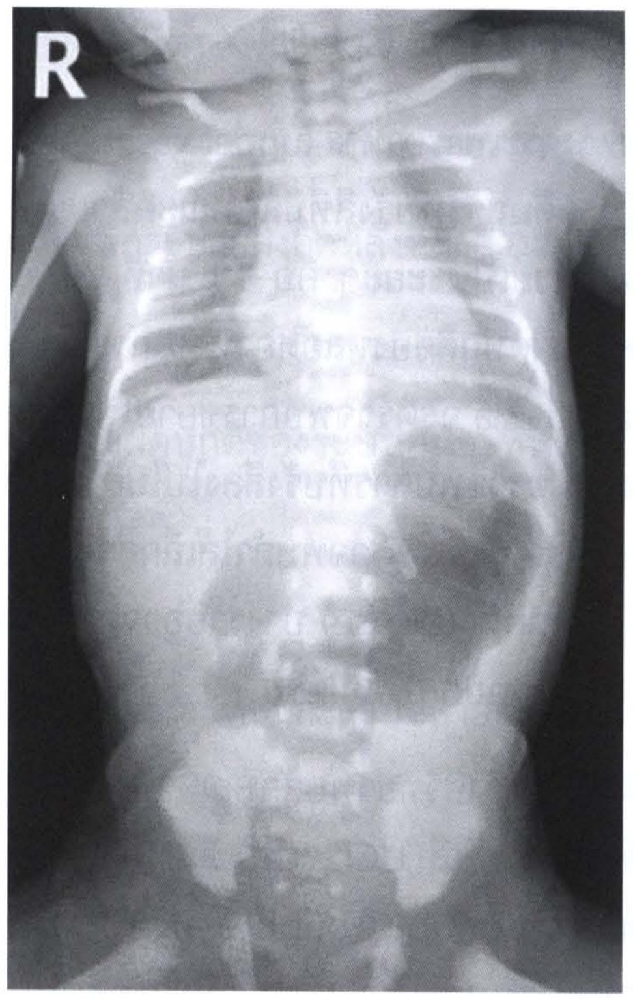

> **Caption (verbatim):** **รูปที่ 2** ผู้ป่วยเป็นโรคลำไส้เล็กส่วนดูโอดีนัมตัน ตรวจพบลักษณะ double bubble
> **Text in image (verbatim):** R
> **Description:** Frontal plain radiograph of a newborn from the neck/clavicles down to the pelvis and upper thighs, with a side marker "R" at the upper left. In the upper abdomen there are two gas-filled bubbles: a large rounded gas lucency in the left upper abdomen (stomach side) and a smaller gas lucency to the right of the spine, forming the double bubble described in the caption. The rest of the abdomen and the pelvis show no gas-filled bowel loops (homogeneous soft-tissue density). The lungs, ribs, spine, clavicles and pelvic bones are visible. Faint text from the reverse side of the page shows through the image.
> **Identifiers in image:** none

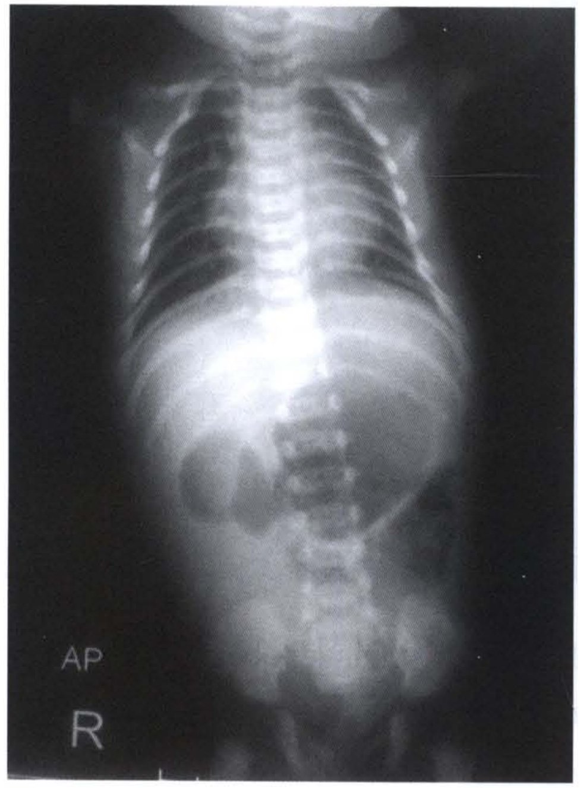

> **Caption (verbatim):** **รูปที่ 3** ผู้ป่วยเป็นโรคลำไส้เล็กส่วนดูโอดีนัมตีบ ตรวจพบลมเข้าไปในลำไส้ส่วนปลายอื่นๆ
> **Text in image (verbatim):** AP · R
> **Description:** Frontal (AP) plain radiograph of a newborn from the lower neck to the pelvis, with markers "AP" and "R" at the lower left. The upper abdomen shows a gas-distended stomach and proximal bowel, and gas is also seen in several rounded bowel loops further down in the mid and lower abdomen, i.e. gas has passed into more distal bowel as the caption states. The lungs, ribs and spine are visible.
> **Identifiers in image:** none

<!-- p.870 (printed 856) -->
2.2 การตรวจพิเศษทางรังสี (special X-ray)

การตรวจพิเศษทางกระเพาะอาหาร (upper gastrointestinal contrast studies : UGIS) คือการให้ผู้ป่วยดื่มสารทึบรังสีที่มีลักษณะคล้ายแป้งหรือการให้ผ่านสายทางจมูกแล้วถ่ายภาพเอกซเรย์เป็นระยะๆ คือ 15 นาที, 30 นาที, 45 นาที, 1 ชั่วโมง เป็นต้น ใช้ตรวจดูความผิดปกติของหลอดอาหาร กระเพาะอาหาร ลำไส้เล็กส่วนต้น ในผู้ป่วย duodenal atresia จะตรวจพบการขยายโป่งพองของกระเพาะอาหารและลำไส้เล็กส่วนต้น และไม่ตรวจพบสารทึบรังสีลงไปในลำไส้เล็กส่วนปลายกว่าส่วนที่ตัน หรือผู้ป่วย duodenal stenosis ตรวจพบลำไส้เล็กส่วนที่ต่ำกว่าส่วนที่ตีบมีขนาดเล็กกว่าปกติจากการที่ไม่ได้ถูกใช้ (disuse) บางรายอาจตรวจพบมีความผิดปกติของการหมุนตัวของลำไส้ (malrotation) ร่วมด้วย

โดยทั่วไปถ้าตรวจทางรังสีวิทยาพบลักษณะ double bubble sign ก็ไม่มีความจำเป็นต้องตรวจพิเศษทางรังสี UGIS เพิ่มเติมเพื่อยืนยันการวินิจฉัย แต่ถ้าตรวจเอกซเรย์แล้วพบลักษณะ double bubble sign แต่ยังเห็นลมเข้าไปในลำไส้เล็กส่วนอื่นที่ต่ำกว่าส่วนดูโอดีนัมได้อีก แสดงว่ามีการอุดตันไม่สมบูรณ์ จำเป็นต้องทำ UGIS เพื่อแยกโรค duodenal stenosis จาก intestinal malrotation, annular pancreas บางรายอาจตรวจพบมีความผิดปกติหลายอย่างร่วมกัน

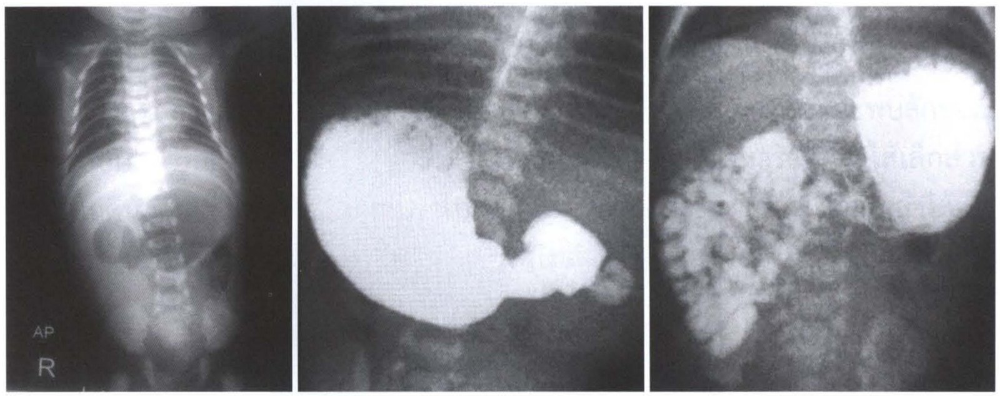

> **Caption (verbatim):** **รูปที่ 4, 5 และ 6** ผู้ป่วยเป็นโรคลำไส้เล็กส่วนดูโอดีนัมตีบที่ตรวจ UGIS พบว่ามี intestinal malrotation ร่วมด้วย
> **Text in image (verbatim):** AP · R
> **Description:** Three radiographs side by side (figures 4, 5 and 6 from left to right). Left (รูปที่ 4): frontal (AP) plain radiograph of a newborn's chest and abdomen with markers "AP" and "R" at the lower left; the upper abdomen shows gas-distended stomach/proximal bowel and some gas in rounded bowel loops lower in the abdomen. Middle (รูปที่ 5): upper GI contrast study showing a large, markedly distended stomach densely filled with white contrast on the image left, with contrast passing into a dilated rounded proximal duodenal segment to the right of it beside the spine; a small amount of contrast is seen just beyond this segment, and no contrast-filled bowel is seen further down. Right (รูปที่ 6): a later contrast image showing the contrast-filled stomach at the upper image right and many contrast-filled small bowel loops with a feathery mucosal pattern clustered on the image left of the spine in the mid-abdomen.
> **Identifiers in image:** none

<!-- p.871 (printed 857) -->
### การรักษา

1. งดน้ำ งดอาหารและให้น้ำเกลือหรือสารอาหารทางเส้นเลือดดำ

2. การใส่สารทางจมูกเพื่อระบายสิ่งคัดหลั่งที่คั่งค้างและเพื่อป้องกันการสำลัก

3. ให้ยาปฏิชีวนะ (ampicillin ร่วมกับ gentamicin)

4. ตรวจและรักษาความผิดปกติของระบบอื่นๆ ที่พบร่วมจนผู้ป่วยมีความพร้อมสำหรับการผ่าตัดรักษา

5. การผ่าตัดรักษา

โดยใช้เทคนิคการเย็บต่อลำไส้ส่วนต้นและส่วนปลายที่ตันเข้าหากันโดยมีลักษณะคล้ายรูปทรงของเพชร (diamond-shaped duodenoduodenostomy) โดยไม่ตัดลำไส้ส่วนใดส่วนหนึ่งทิ้ง

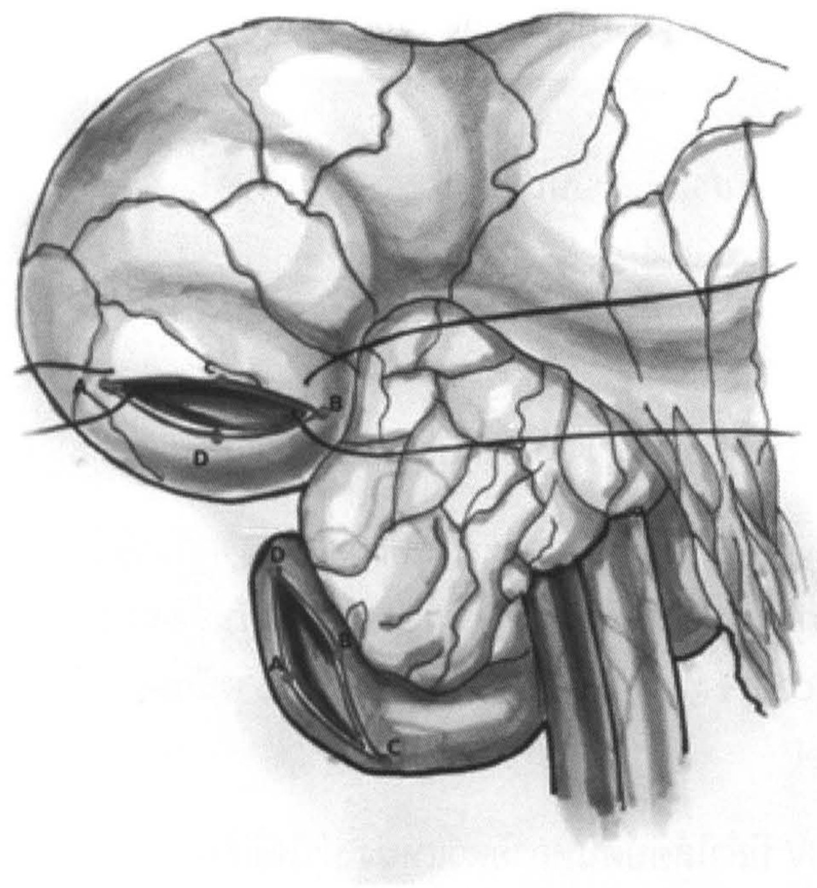

> **Caption (verbatim):** **รูปที่ 7** เทคนิคการผ่าตัด duodenoduodenostomy (diamond-shaped)
> **Text in image (verbatim):** A · C · B · D · D · B · A · C
> **Description:** Shaded surgical illustration of the diamond-shaped duodenoduodenostomy. The large dilated proximal duodenum/stomach occupies the upper part of the drawing, with blood vessels drawn over its surface; on its lower left part is a transverse (horizontal) incision whose ends are labelled A (left) and B (right), with C marking the upper edge and D the lower edge of the opening. Below it, the small collapsed distal duodenum curves round beneath an unlabelled lobulated structure and carries a longitudinal (vertical) incision whose points are labelled D (top), B and A (middle sides) and C (bottom). Two stay sutures run horizontally across the drawing through the upper incision towards the right. Mesenteric vessels descend at the lower right. The same letters A, B, C, D appear on both incisions, marking corresponding points of the transverse proximal and longitudinal distal openings.
> **Identifiers in image:** none

<!-- p.872 (printed 858) -->
## 2. โรคลำไส้เล็กตีบตัน (Intestinal atresia and stenosis)

อุบัติการณ์การเกิดโรคประมาณ 1-3 ราย ต่อทารกแรกเกิดมีชีพ 10,000 ราย1 พบในทารกเพศชายในสัดส่วนเท่ากับทารกเพศหญิง ตรวจพบความผิดปกติของระบบอวัยวะอื่นๆ ร่วมด้วยประมาณร้อยละ 10 ความผิดปกติที่พบบ่อย ได้แก่ intestinal malrotation, gastroschisis และ cystic fibrosis4 มีความสัมพันธ์กับน้ำหนักตัวแรกเกิดต่ำกว่า 2,500 กรัม และมารดาที่เคยมีประวัติตั้งครรภ์หลายครั้ง พบความสัมพันธ์กับมารดาที่สูบบุหรี่และใช้โคเคน5 นอกจากนี้พบการถ่ายทอดทางพันธุกรรมแบบ autosomal recessive ใน hereditary multiple intestinal atresia (HMIA) ในชนชาติ French Canadians6

สมมติฐานการเกิดโรคเชื่อว่าเกิดจากผลของการขาดเลือดไปเลี้ยงส่วนบริเวณลำไส้ที่มีการตีบตันในช่วงระหว่างอยู่ในครรภ์มารดาซึ่งอาจเกิดจากสาเหตุต่างๆ เช่น ภาวะลำไส้กลืนกัน (intussusception) ลำไส้ทะลุ, การบิดของลำไส้ (volvulus), internal hernia หรือ thromboembolism ลำไส้เล็กตีบตันแบ่งเป็น 4 ชนิด ได้แก่

1. Type I มีเนื้อเยื่อ (web) ที่ประกอบด้วยส่วน mucosa และ submucosa กั้นภายในท่อลำไส้โดยที่ยังมีชั้น muscular เชื่อมต่อระหว่างส่วนต้นและส่วนปลายที่ตันอยู่โดยไม่มี mesenteric defect

2. Type II ส่วนต้นและส่วนปลายแยกจากกันชัดเจนแต่มี fibrous cord บางๆ เชื่อมกันอยู่โดยไม่มี mesenteric defect

3. Type III มี 2 ชนิดย่อย

3.1 Type IIIa ส่วนต้นและส่วนปลายแยกจากกันชัดเจนร่วมกับมี mesenteric gap

3.2 Type IIIb ส่วนต้นและส่วนปลายแยกจากกันชัดเจนร่วมกับมี extensive mesenteric gap ทำให้ลำไส้ส่วนปลายโอบพันล้อมเส้นเลือดแดง (ileocolic หรือ right colic) ที่มาเลี้ยงเพียงเส้นเดียว มีรูปร่างลักษณะคล้ายต้นคริสต์มาส หรือ apple peel

4. Type IV มีลำไส้ตีบตันหลายตำแหน่ง ทำให้มีลักษณะคล้าย string of sausage

<!-- p.873 (printed 859) -->
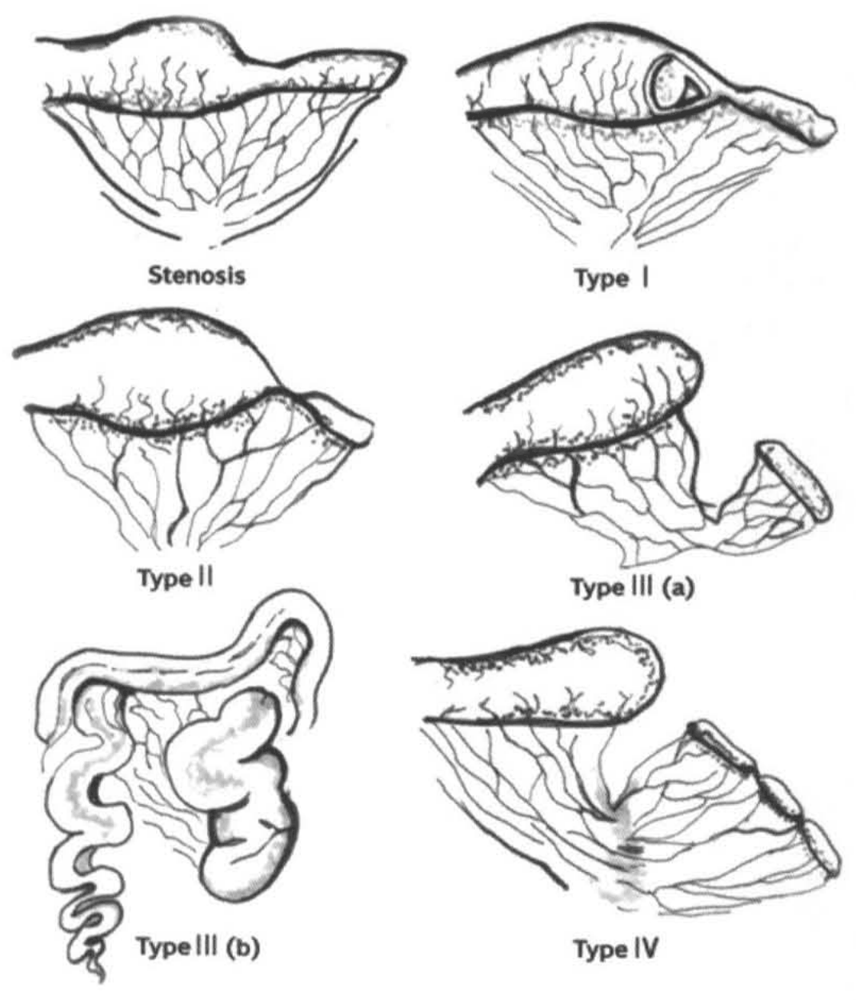

> **Caption (verbatim):** **รูปที่ 8** การแบ่งชนิดของลำไส้ตีบตัน
> **Text in image (verbatim):** Stenosis · Type I · Type II · Type III (a) · Type III (b) · Type IV
> **Description:** Line drawing in six panels (three rows of two) showing a segment of small bowel with its fan-shaped mesentery and vessels for each category. Stenosis (top left): bowel in continuity with a narrowed segment and an intact mesentery. Type I (top right): bowel in continuity externally, with a membrane/web drawn inside the lumen (shown in a cut-away window), the bowel beyond it narrower; mesentery intact. Type II (middle left): dilated proximal blind end joined to the narrower distal end by a thin cord, mesentery intact. Type III (a) (middle right): proximal and distal blind ends completely separated, with a V-shaped gap in the mesentery between them. Type III (b) (bottom left): dilated proximal bowel and a distal small bowel that coils around a single vessel in a spiral (apple-peel) arrangement, with a large mesenteric defect. Type IV (bottom right): proximal blind end separated from a distal segment that shows several consecutive atresias, giving a chain of short segments.
> **Identifiers in image:** none

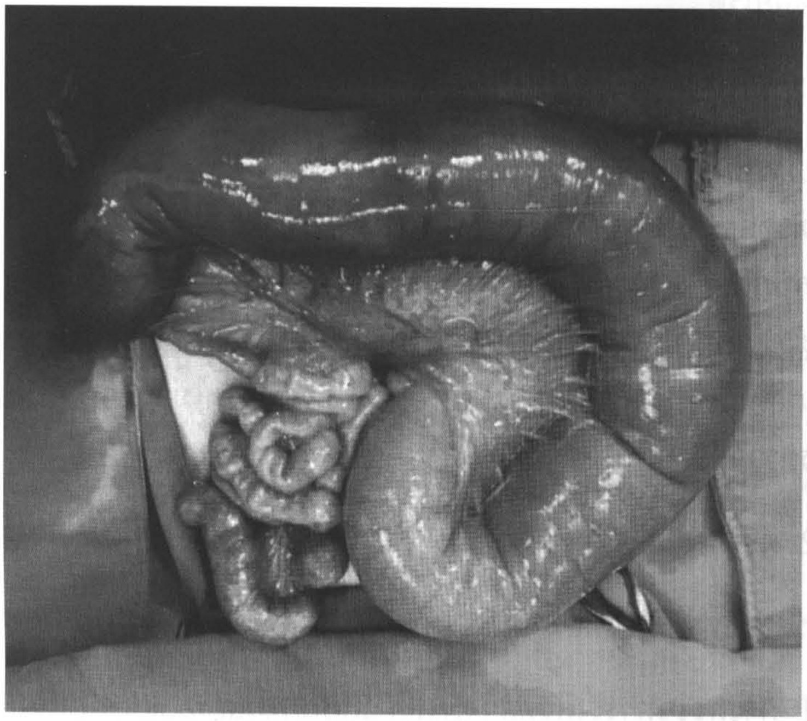

> **Caption (verbatim):** **รูปที่ 9** Intestinal atresia type IIIa
> **Text in image (verbatim):** none
> **Description:** Black-and-white intraoperative photograph of the small bowel delivered out of the abdomen onto surgical drapes. A long, markedly dilated, shiny bowel loop arches across the top of the picture and curves down on the right into a large, rounded dilated loop in the lower middle. To the lower left, beside it, lie collapsed, much thinner, small-calibre bowel loops coiled together. No labels or arrows are present.
> **Identifiers in image:** none

<!-- p.874 (printed 860) -->
### ลักษณะทางคลินิก

1. อาการอาเจียน

ผู้ป่วยจะเริ่มมีอาการอาเจียนตั้งแต่แรกหลังคลอด โดยมักจะมีอาการภายใน 24 ถึง 48 ชั่วโมง หลังจากการกินนมมื้อแรก

2. ไม่ถ่ายขี้เทา

ผู้ป่วยจะไม่ถ่ายขี้เทา ถ่ายขี้เทาออกมาปริมาณน้อยกว่าปกติ สีของขี้เทาอาจมีสีจางและซีดกว่าปกติซึ่งจะพบในผู้ป่วยลำไส้ตีบตันส่วนค่อนข้างปลาย ถ้ามีลำไส้ตีบตันส่วนต้นๆ อาจจะมีการถ่ายขี้เทาได้ปกติ เนื่องจากมีการหลั่ง succus entericus

3. อาการท้องอืด

อาการท้องอืดจะมีมากหรือน้อยขึ้นอยู่กับระดับของการตีบตัน โดยถ้าตำแหน่งที่ตีบตันอยู่สูง จะแสดงอาการน้อย แต่ถ้าตำแหน่งตีบตันยิ่งอยู่ส่วนปลายเท่าไหร่ อาการท้องอืดก็จะยิ่งมากขึ้นเท่านั้น

### การวินิจฉัยโรค

1. การตรวจด้วยคลื่นเสียงความถี่สูงก่อนคลอด (prenatal ultrasonography)

1.1 ตรวจพบมีการขยายโป่งพองของลำไส้ที่มีของเหลวค้างอยู่ ร่วมกับมีการบีบตัวของลำไส้มากกว่าปกติ (increased peristalsis) ความไวของการตรวจพบความผิกปกติจะเพิ่มมากขึ้นในกรณีที่ตำแหน่งลำไส้เล็กที่ตีบตันอยู่สูง รายงานจากต่างประเทศพบว่า สามารถวินิจฉัยได้ร้อยละ 28 ใน jejunoileal atresia, ร้อยละ 40 ใน jejunal atresia, แต่ใน ileal atresia ปัจจุบันก็ยังไม่สามารถวินิจฉัยก่อนคลอดด้วยการตรวจด้วยคลื่นเสียงความถี่สูง7

1.2 ตรวจพบครรภ์แฝดน้ำ

2. การตรวจทางรังสีวิทยา

2.1 การตรวจทางรังสีวิทยา (plain abdominal radiography)

2.1.1 Jejunal atresia จะเห็นลักษณะของลมในกระเพาะอาหาร ลำไส้เล็กส่วนดูโอดีนัมและ ลำไส้เล็กส่วนเจจูนัมเป็น bubble ขนาดใหญ่จำนวน

<!-- p.875 (printed 861) -->
3-5 อัน แต่ไม่เห็นลมในลำไส้เล็กหรือลำไส้ใหญ่ ส่วนอื่นๆ ถ้าเป็น jejunoileal atresia จะเห็นลมไปจนถึงลำไส้เล็กเหมือนลักษณะ small bowel dilatation และเห็นลมใน loop สุดท้ายก่อนจะถึงจุดตีบตันใหญ่กว่า loop อื่นๆ

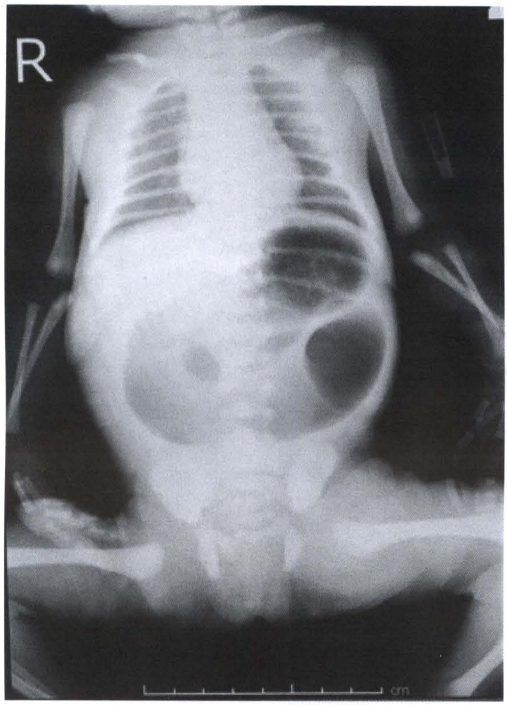

> **Caption (verbatim):** **รูปที่ 10** การตรวจทางรังสีวิทยาของผู้ป่วย Jejunal atresia
> **Text in image (verbatim):** R · cm
> **Description:** Plain radiograph (frontal view) of a newborn covering the chest, abdomen and pelvis, with a side marker "R" at the upper left and a centimetre scale bar along the bottom edge. The abdomen is distended. In the left upper abdomen there are several dilated gas-filled bowel loops, and below them, in the left mid-abdomen, one large, round, markedly dilated gas-filled loop that is bigger than the other loops. The rest of the abdomen and the pelvis are largely gasless and of soft-tissue density, with only a small faint round lucency in the right mid-abdomen. Both lungs, the ribs, and the upper and lower limbs are visible; the head is outside the field.
> **Identifiers in image:** none

    2.1.2 เห็น calcifications ในบริเวณเยื่อบุช่องท้อง ตรวจพบได้ร้อยละ 12 ในผู้ป่วยทั้งหมด8 ถ้าเห็นลักษณะดังกล่าวแสดงว่าผู้ป่วยมี meconium peritonitis ซึ่งมีสาเหตุจากลำไส้แตกทะลุตั้งแต่อยู่ในครรภ์มารดาแล้วทำให้เกิดลำไส้เล็กตีบตันตามมา

  2.2 การตรวจพิเศษทางรังสีลำไส้ใหญ่ (contrast enema)

วิธีการตรวจจะใช้การดันลมหรือใส่สารทึบรังสี เช่น barium, water soluble contrast เข้าไปทางทวารหนักโดยผ่านสายสวน จะเห็นลักษณะของลำไส้มีขนาดเล็กตั้งแต่ลำไส้ใหญ่ (microcolon) จนถึงลำไส้เล็กส่วนปลายที่ตีบตัน โดยสารทึบรังสี

<!-- p.876 (printed 862) -->
ไม่สามารถเข้าไปในลำไส้เล็กส่วนต้นที่ตีบได้ นิยมตรวจเพื่อยืนยันการวินิจฉัยในผู้ป่วยลำไส้เล็กส่วนปลายตีบที่แยกโรคจาก total colonic aganglionosis หรือ colonic atresia ไม่ได้จาก plain abdominal radiograph

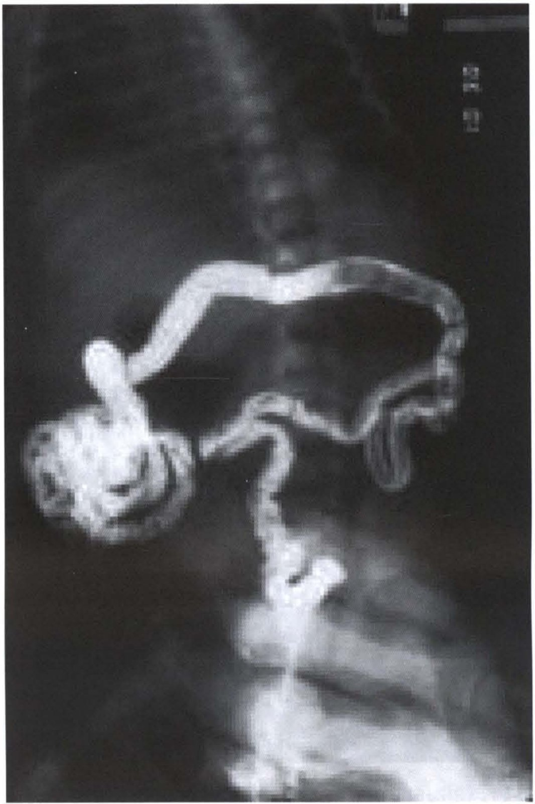

> **Caption (verbatim):** **รูปที่ 11** ตัวอย่างการตรวจ water soluble contrast ของ intestinal atresia
> **Text in image (verbatim):** [illegible] (two tiny pixelated marks near the upper right edge)
> **Description:** Contrast enema radiograph of an infant's abdomen with water-soluble contrast. Contrast fills a narrow, small-calibre bowel: from the lower centre (rectal/pelvic region) a thin, slightly irregular contrast-filled tube ascends to the mid-image, where a thin loop goes to the right and hangs down on the right side; above it a long arch of contrast-filled bowel crosses the upper abdomen from right to left and then descends on the left to a coiled cluster of densely contrast-filled loops at the left mid-image. The spine is faintly visible in the upper centre and the pelvic region at the bottom.
> **Identifiers in image:** none

### การรักษา

1. งดน้ำ งดอาหารและให้น้ำเกลือหรือสารอาหารทางเส้นเลือดดำ

2. การใส่สารทางจมูกเพื่อระบายสิ่งคัดหลั่งที่คั่งค้างและเพื่อป้องกันการสำลัก

3. ให้ยาปฏิชีวนะ (ampicillin ร่วมกับ gentamicin)

4. การผ่าตัดรักษา

<!-- p.877 (printed 863) -->
  4.1 Primary anastomosis

หลักการทั่วไปคือการผ่าตัดแผลเปิดและตัดต่อลำไส้เล็กที่ตีบตันมาต่อกัน โดยลงแผลในแนวขวางลำตัวด้านบน หรือลงแผลบริเวณสะดือ9 ในระหว่างผ่าตัดจำเป็นต้องดูอย่างละเอียดถี่ถ้วนทั้งลำไส้เล็กและลำไส้ใหญ่ เพื่อประเมินความยาวของลำไส้เล็กทั้งหมด เพราะในผู้ป่วยลำไส้เล็กตีบตันอาจจะมีลำไส้เล็กสั้นกว่าปกติทั่วไปได้ ควรมีการเช็คตำแหน่งที่มีอาการตีบตันส่วนปลายว่ามีกี่ตำแหน่งโดยการใส่สายเข้าไปใน lumen ลำไส้ และฉีดน้ำเกลือเข้าไปดูว่าน้ำเกลือสามารถไหลเข้าไปจนถึงลำไส้ใหญ่ได้หรือไม่ ถ้าพบว่ามีการตีบตันหลายตำแหน่งก็ควรตัดต่อลำไส้ที่ตีบตันให้ครบทุกตำแหน่ง โดยทั่วไปความยาวของลำไส้เล็กจะยาวประมาณ 250 เซนติเมตร ในทารกแรกเกิด และยาวประมาณ 160-240 เซนติเมตร ในทารกคลอดก่อนกำหนด ในกรณีที่ลำไส้เล็กส่วนต้นที่ตีบตันมีขนาดใหญ่กว่าปกติมากอาจจำเป็นต้องตัดส่วนที่ขยายใหญ่ทิ้ง เพราะลำไส้ส่วนนั้นมักจะมี dysmotility ทำให้ไม่มีการเคลื่อนไหวหลังการตัดต่อลำไส้ อาจทำให้เกิดภาวะ functional small bowel obstruction ร่วมด้วย หรือ tapering ส่วนที่ขยายให้มีขนาดเล็กลง ก่อนตัดต่อลำไส้ส่วนที่ตีบตันส่วนต้นและส่วนปลายมาเชื่อมต่อกัน หลังตัดต่อลำไส้ควรจะมีความยาวของลำไส้เล็กอย่างน้อย 100 เซนติเมตร เพื่อที่จะได้กินอาหารทางปากได้ตามปกติโดยไม่จำเป็นต้องให้ parenteral nutrition ในอนาคต

ข้อบ่งห้ามสำหรับการทำ primary anastomosis ได้แก่ผู้ป่วยมีภาวะ peritonitis, volvulus, meconium ileus หรือเป็นความผิดปกติชนิด IIIb ถ้ามีภาวะดังกล่าวควรผ่าตัดยกเอาลำไส้เล็กที่ตีบตันมาไว้ที่หน้าท้องเป็นการชั่วคราวก่อน แล้วค่อยผ่าตัดตัดต่อลำไส้ภายหลัง

<!-- p.878 (printed 864) -->
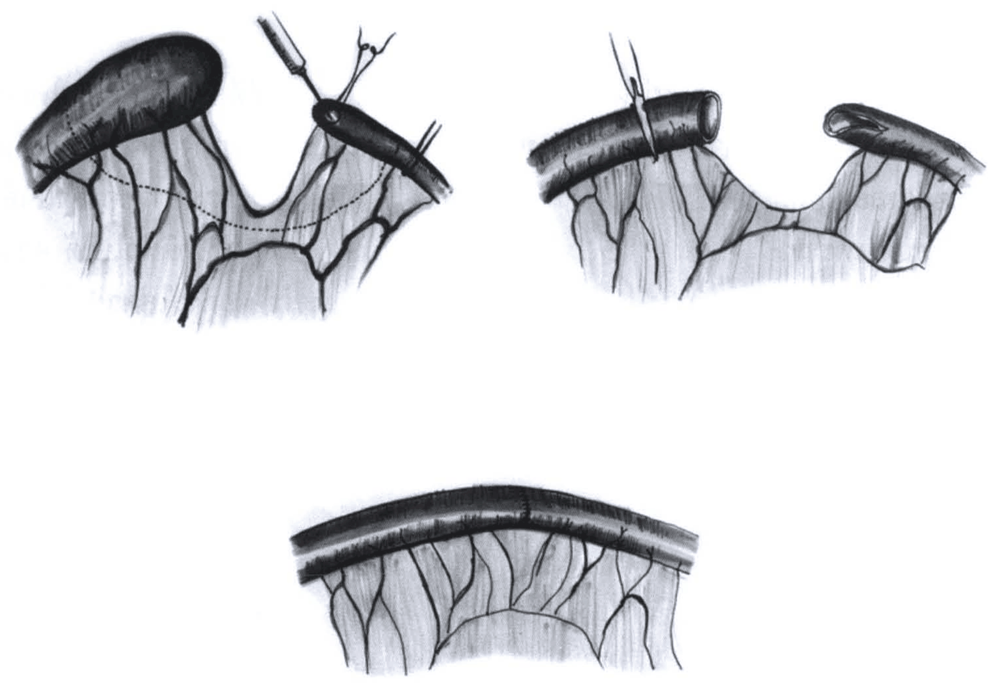

> **Caption (verbatim):** **รูปที่ 12** วิธีการผ่าตัด primary anastomosis แบบ end to end anastomosis
> **Text in image (verbatim):** none
> **Description:** Three-step shaded line drawing of small bowel with its mesentery and mesenteric vessels. Top left: a markedly dilated, bulbous proximal bowel segment (left) and a narrow distal segment (right) with a deep V-shaped notch of mesentery between them; a dotted line marks the planned line of resection running across the mesentery from the dilated segment to the distal segment; a needle holder/clamp and suture are applied at the opened end of the narrow distal segment, and a small instrument is at its far side. Top right: after resection, two bowel ends of similar calibre face each other — the left end is cut squarely open with a clamp/instrument across it, and the right end is opened obliquely (an antimesenteric slit), with the shortened mesentery between them. Bottom: the completed end-to-end anastomosis — a single continuous bowel loop with a fine suture line across it at the join, and the mesentery closed beneath it.
> **Identifiers in image:** none

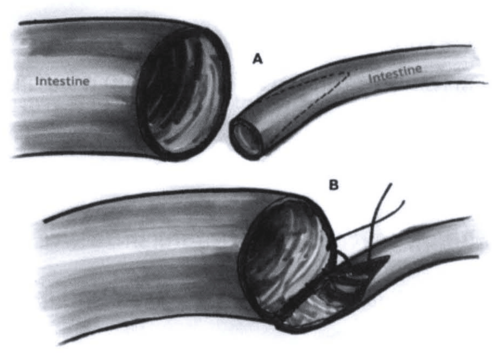

> **Caption (verbatim):** **รูปที่ 13** วิธีการผ่าตัด primary anastomosis แบบ end to side anastomosis
> **Text in image (verbatim):** A · Intestine · Intestine · B
> **Description:** Two-panel shaded drawing. A: on the left, a wide-calibre bowel segment labelled "Intestine" with its open cut end facing right; on the right, a narrow-calibre bowel segment labelled "Intestine" with its open end facing the wide segment, and a dashed line along its side marking where it will be opened lengthwise. B: the open end of the wide segment is sewn onto the opened side of the narrow segment, with suture threads at the anastomosis, forming an end-to-side join.
> **Identifiers in image:** none

<!-- p.879 (printed 865) -->
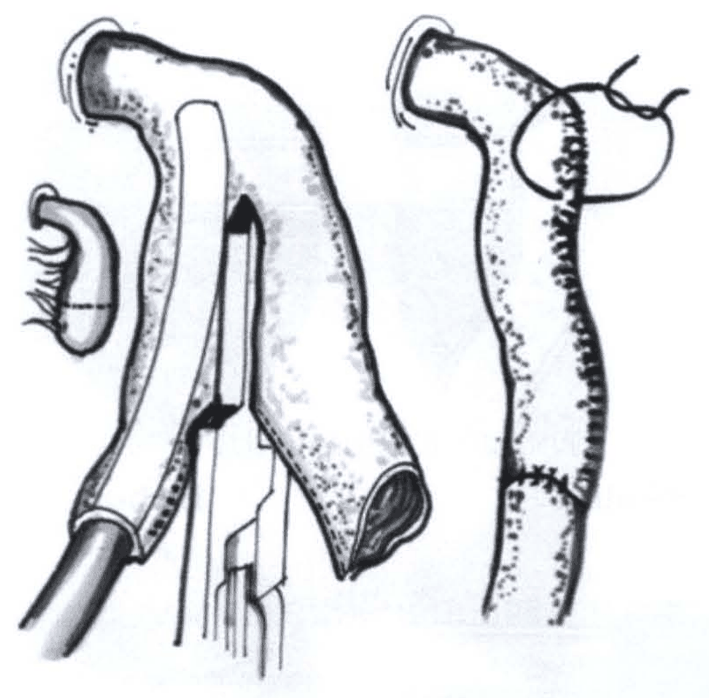

> **Caption (verbatim):** **รูปที่ 14** วิธีการผ่าตัด primary anastomosis โดยมีการ tapering enteroplasty ร่วมด้วย
> **Text in image (verbatim):** none
> **Description:** Two-part line drawing. Left: a dilated bowel segment with a tube/catheter inserted into its lumen from below on the left side; a linear stapler (long jaws) is applied lengthwise along the bowel next to the tube, dividing the bowel into a narrow channel around the tube and an excess strip of wall on the right, whose open cut end is shown at the lower right. A small separate bowel end with a dotted line across it and hanging strands is drawn at the far left. Right: the result after tapering — a narrower bowel segment with a long staple/suture line running down its antimesenteric border, a transverse suture line near the bottom (the anastomosis), and a loop of suture thread at the upper right.
> **Identifiers in image:** none

  4.2 Diverting stoma

เป็นการผ่าตัดยกเอาลำไส้เล็กส่วนที่ตีบตันมาเปิดไว้ที่หน้าท้องเป็นการชั่วคราว มีหลายเทคนิคการผ่าตัด ได้แก่ Mikulicz, Bishop-Koop หรือ Santulli เทคนิคที่นิยมคือ Bishop-Koop procedure คือการเอาลำไส้ส่วนที่ตีบตันส่วนต้นมาต่อกับส่วนปลายโดยวิธีการต่อแบบ end-to-side อยู่ภายในช่องท้องและยกลำไส้ส่วนปลายที่ตีบตันมาเปิดเป็น enterostomy ที่หน้าท้องเป็นการชั่วคราว

<!-- p.880 (printed 866) -->
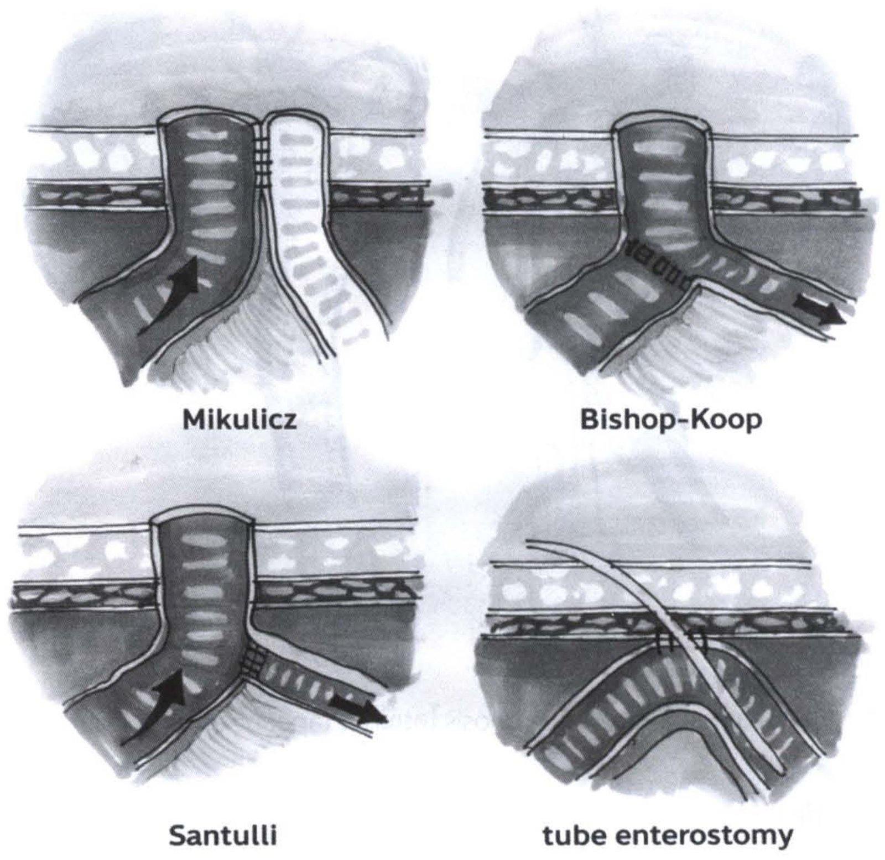

> **Caption (verbatim):** **รูปที่ 15** เทคนิคการผ่าตัด diverting stoma แบบต่างๆ
> **Text in image (verbatim):** Mikulicz · Bishop-Koop · Santulli · tube enterostomy
> **Description:** Four shaded cross-sectional drawings of the abdominal wall (horizontal layers: skin, subcutaneous fat, fascia/muscle) with bowel beneath, each showing a different diverting stoma. Mikulicz (top left): two bowel limbs, the dark proximal limb and the paler distal limb, are brought up side by side through the abdominal wall as a double-barrelled stoma, sutured to each other along their adjacent walls; a curved arrow shows flow coming up the proximal limb. Bishop-Koop (top right): the proximal limb joins the side of the distal limb below the abdominal wall (end-to-side anastomosis with a suture line), and the distal limb is brought out through the wall as the stoma; an arrow points along the distal bowel away from the junction. Santulli (bottom left): the proximal limb is brought out through the abdominal wall as the stoma, and the distal limb is joined end-to-side to the proximal limb below the wall (suture line at the junction); a curved arrow shows flow up the proximal limb and another arrow points along the distal limb. Tube enterostomy (bottom right): a bowel loop lies beneath the abdominal wall, fixed to it with sutures, and a tube passes obliquely through the abdominal wall into the bowel lumen.
> **Identifiers in image:** none

## 3. โรคลำไส้ใหญ่ตีบตัน (Colonic atresia and stenosis)

อุบัติการณ์การเกิดโรคมีความหลากหลายตั้งแต่ประมาณ 1 ราย ต่อทารกแรกเกิดมีชีพ 5,000 ราย จนถึงประมาณ 1 ราย ต่อทารกแรกเกิดมีชีพ 60,000 ราย10-13 และพบประมาณร้อยละ 1.8-15 ของโรคลำไส้อุดตันทั้งหมด ผู้ป่วยอาจมีความผิดปกติเพียงลำไส้ใหญ่ตีบตัน หรือพบความผิดปกติของอวัยวะอื่นร่วมด้วย ซึ่งพบประมาณ 1 ใน 3 ของผู้ป่วยทั้งหมด ได้แก่ โรค gastroschisis, โรคลำไส้เล็กตีบตัน, โรคลำไส้โป่งพองตั้งแต่กำเนิด, โรคความผิดปกติตั้งแต่กำเนิดของรูทวารหนัก, congenital varicella syndrome, และความผิดปกติเกี่ยวกับโครงกระดูก14

<!-- p.881 (printed 867) -->
โรคลำไส้ใหญ่ตีบตันมีการแบ่งเป็นหลายรูปแบบ ที่นิยมจะแบ่งเป็น 3 ชนิด ได้แก่

1. Type I มีเนื้อเยื่อ (web) ที่ประกอบด้วยส่วน mucosa และ submucosa กั้นภายในท่อลำไส้โดยที่ยังมีชั้น muscular เชื่อมต่อระหว่างส่วนต้นและส่วนปลายที่ตันอยู่โดยไม่มี mesenteric defect

2. Type II ส่วนต้นและส่วนปลายแยกจากกันชัดเจนแต่มี fibrous cord บางๆ เชื่อมกันอยู่โดยไม่มี mesenteric defect

3. Type III ส่วนต้นและส่วนปลายแยกจากกันชัดเจนร่วมกับมี mesenteric gap เป็นรูปตัว V

ผู้ป่วยส่วนใหญ่มักจะเป็น type III ส่วนที่ตีบตันมักจะอยู่บริเวณ right colon รองลงมาคือ type I ถ้าตรวจพบว่าเป็น type I และ type II พยาธิสภาพมักจะอยู่บริเวณลำไส้ใหญ่ส่วนต่ำกว่า splenic flexure15

### ลักษณะอาการทางคลินิก

1. อาการท้องอืด

2. อาการอาเจียนมีน้ำดีปน

3. ไม่ถ่ายขี้เทาภายใน 24 ชั่วโมงหลังคลอด

### การวินิจฉัยโรค

เนื่องจากโรคลำไส้ใหญ่ตีบตันเป็นโรคที่พบไม่บ่อย (rare) จากการเก็บข้อมูลพบว่ามีผู้ป่วยถึง 2 ใน 3 วินิจฉัยโรคนี้ได้ในระหว่างกำลังผ่าตัดรักษา แพทย์ไม่สามารถวินิจฉัยได้ก่อนผ่าตัดรักษาถ้าไม่ได้ส่งตรวจพิเศษทางรังสีลำไส้ใหญ่เพิ่มเติม16

1. การตรวจทางรังสีวิทยา

จะตรวจพบมีการขยายโป่งพองบริเวณลำไส้ใหญ่ส่วนต้นที่ตีบตันขนาดใหญ่มาก และสามารถไล่หาตำแหน่งของ ileocecal valve ได้ ซึ่งต่างจากการตีบตันของลำไส้เล็กส่วนปลาย (ileal atresia) ที่มีการขยายโป่งพองน้อยกว่าและไม่สามารถระบุตำแหน่ง ileocecal valveได้17 บางครั้งมีการขยายโป่งพองมากจนแยกยากจากภาวะ pneumoperitoneum

<!-- p.882 (printed 868) -->
2. การตรวจพิเศษทางรังสีลำไส้ใหญ่

ตรวจพบลำไส้ใหญ่ส่วนปลายมีขนาดเล็กกว่าปกติ (microcolon) โดยสารทึบรังสีไม่สามารถเข้าไปในลำไส้ใหญ่ส่วนต้นที่ตันและมีขนาดใหญ่ได้

### การรักษา

1. งดน้ำ งดอาหารและให้น้ำเกลือ ใส่สารทางจมูกเพื่อระบายสิ่งคัดหลั่งที่คั่งค้างและเพื่อป้องกันการสำลัก

2. ให้ยาปฏิชีวนะ (ampicillin ร่วมกับ gentamicin)

3. การผ่าตัดรักษา

การผ่าตัดโรคลำไส้ใหญ่ตีบตันถือเป็นการผ่าตัดเร่งด่วน (urgent operation) เพราะถ้าปล่อยทิ้งไว้ โดยไม่ผ่าตัดรักษามีโอกาสลำไส้แตกทะลุสูงมากกว่าโรคลำไส้เล็กตีบตัน การเลือกวิธีการผ่าตัดขึ้นอยู่กับลักษณะอาการทางคลินิกในขณะนั้น ตำแหน่งของการตีบตัน ความผิดปกติร่วมของลำไส้เล็กที่อาจมีการตีบตันร่วมด้วยและขนาดของลำไส้ใหญ่ส่วนปลายว่ามีขนาดเล็กมากน้อยแค่ไหน การผ่าตัดรักษา ได้แก่

1. Staged approach

เป็นการผ่าตัดยกเอาลำไส้ใหญ่ส่วนที่ตีบตันส่วนต้นมาเปิดที่หน้าท้องและยกลำไส้ใหญ่ส่วนปลาย เปิดเป็น mucous fistula ไว้เป็นการชั่วคราว (initial colostomy) โดยตัดปลายตันส่วนต้นและส่วนปลายออกบางส่วนเพราะพบว่ามีความผิดปกติแต่กำเนิดของเส้นประสาทและเส้นเลือดที่ไปเลี้ยงลำไส้ใหญ่ส่วนนั้นร่วมด้วย ซึ่งถ้าเก็บส่วนปลายทั้งสองไว้และมาเชื่อมต่อในการผ่าตัดครั้งต่อไป อาจทำให้ลำไส้ใหญ่ส่วนนี้ทำงานผิดปกติมีปัญหาตามมาภายหลังได้18 แนะนำใช้วิธีนี้ในผู้ป่วยที่มีลำไส้ใหญ่ตีบตันบริเวณ left colon

2. Primary anastomosis

เป็นการผ่าตัดโดยตัดเอาปลายตีบตันส่วนต้นและส่วนปลายออกแล้วมาเชื่อมต่อกันในการผ่าตัดครั้งแรกเพียงครั้งเดียว แต่เนื่องจากมีการตรวจพบว่าโรคลำไส้ใหญ่ตีบตันมีความสัมพันธ์กับโรคลำไส้โป่งพองแต่กำเนิด จากรายงานพบอุบัติการณ์การเกิดร่วมร้อยละ 2-9.719-20 จึงแนะนำให้ทำ frozen section เพื่อเอาชิ้นเนื้อบริเวณลำไส้ใหญ่ส่วน rectum ไปตรวจเช็คให้แน่ใจว่ามีปมประสาทปกติก่อนที่จะเชื่อมต่อลำไส้ใหญ่ส่วนที่ตีบตันทั้งสอง

<!-- p.883 (printed 869) -->
ข้างเข้าหากัน เพราะถ้าตรวจพบว่าเป็นทั้งสองโรคร่วมกัน การเชื่อมต่อลำไส้ใหญ่จะทำให้เกิดภาวะแทรกซ้อนคือ anastomosis leakage และ functional obstruction ตามมาในภายหลังได้ ส่วนใหญ่แนะนำการผ่าตัดวิธีนี้ในผู้ป่วยที่มีลำไส้ใหญ่ตีบตันบริเวณ right colon หรือ transverse colon

## เอกสารอ้างอิง

1. Best KE, Tennant PWG, Addor MC, et al. Epidemiology of small intestinal atresia in Europe: a register-based study. Arch Dis Child Fetal Neonatal Ed 2012;97:353-8.

2. Choudhry MS, Rahman N, Boyd P, et al. Duodenal atresia: associated anomalies, prenatal diagnosis and outcome. Pediatr Surg Int 2009;25:727-30.

3. Brantberg A, Blaas HG, Salvesen KA, et al. Fetal duodenal obetructions: increase risk of prenatal sudden death. Ultrasound Obstet Gynecol 2002;20(5):439-446.

4. Dalla VLK, Grosfeld JL, West KW, et al. Intestinal atresia and stenosis: a 25-year experience with 277 cases. Arch Surg 1998;133(5):490-496.

5. Werler MM, Sheehan JE, Mitchell AA, et al. Maternal medication use and risks of gastroschisis and small intestinal atresia. Am J Epidemiol 2002;155(1):26-31.

6. Fernandez I, Patey N, Marchand V, et al. Multiple intestinal atresia with combined immune deficiency related to TTC7A defect is a multiorgan pathology: study of French-Canadian-based cohort. Medicine ( Baltimore ) 2014;93(29), e327.

7. Hemming V, Rankin J. Small intestinal atresia in a defined population: occurrence, prenatal diagnosis and survival. Prenat Diagn 2007(13):1205-1211.

8. Frischer JS, Azizkhan RG. Jejunoileal atresia and stenosis. In:Coran AG, editor. Pediatric surgery. 7th ed. Philadelphia, PA:Elsevier Saunders; 2012.

9. Suri M, Langer JC. A comparison of circumumbilical and transverse abdominal incision for neonatal abdominal surgery. J Pediatr Surg 2011;46:1076-1080.

10. Powell RW, Raffensperger JG. Congenital colonic atresia. J Pediatr Surg 1982;17: 166-70.

11. Croaker GD, Harvey JG, Cass DT. Hirschsprung’s disease, colonic atresia, and absent hand: A new triad. J Pediatr Surg 1997;32:1368-70.

<!-- p.884 (printed 870) -->
12. Kim PC, Superina RA, Ein S. Colonic atresia combined with Hirschsprung’s disease: A diagnostic and therapeutic challenge. J Pediatr Surg 1995;30:1216-17.

13. Davenport M, Bianchi A, Doig CM, et al. Colonic atresia: Current results of treatment. J R Coll Surg Edinb 1990;35:25-8.

14. Haxhija EQ, Schalamon J, Hollwarth ME. Management of isolated and associated colonic atresia. Pediatr Surg Int 2011;27(4):411-416.

15. Karnak I, Ciftci AO, Senocak ME, et al. Colonic atresia: Surgical management and outcome. Pediatr Surg Int 2001;17:631-635.

16. El-Asmar KM, Abdel-Latif M, El-Kassaby AA, et al. Colonic atresia: Association with other anomalies. J Neonatal Surg 2016;5:47.

17. Zhou JL, Fang YL, Tian S, et al. Radiological feature of colonic atresia. Arch Dis Child Fetal Neonatal Ed 2018;103(3):F263.

18. Watts AC, Sabharwal AJ, Mackinlay GA, et al. Congenital colonic atresia: Should primary anastomosis always be the goal? Pediatr Surg Int 2003;19:14-17.

19. Dassinger M, Jackson R, Smith S, et al. Management of colonic atresia with primary resection and anastomosis. Pediatr Surg Int 2009;25:579-582.

20. Seo T, Ando H, Wantanabe Y, et al. Colonic atresia and Hirschsprung’s disease: important of histologic examination of the distal bowel. J Pediatr Surg 2002;37:E19.
