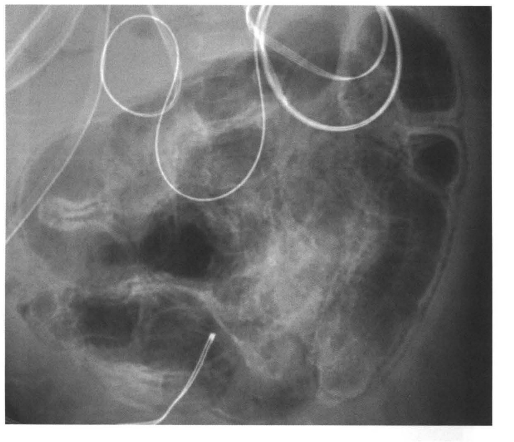
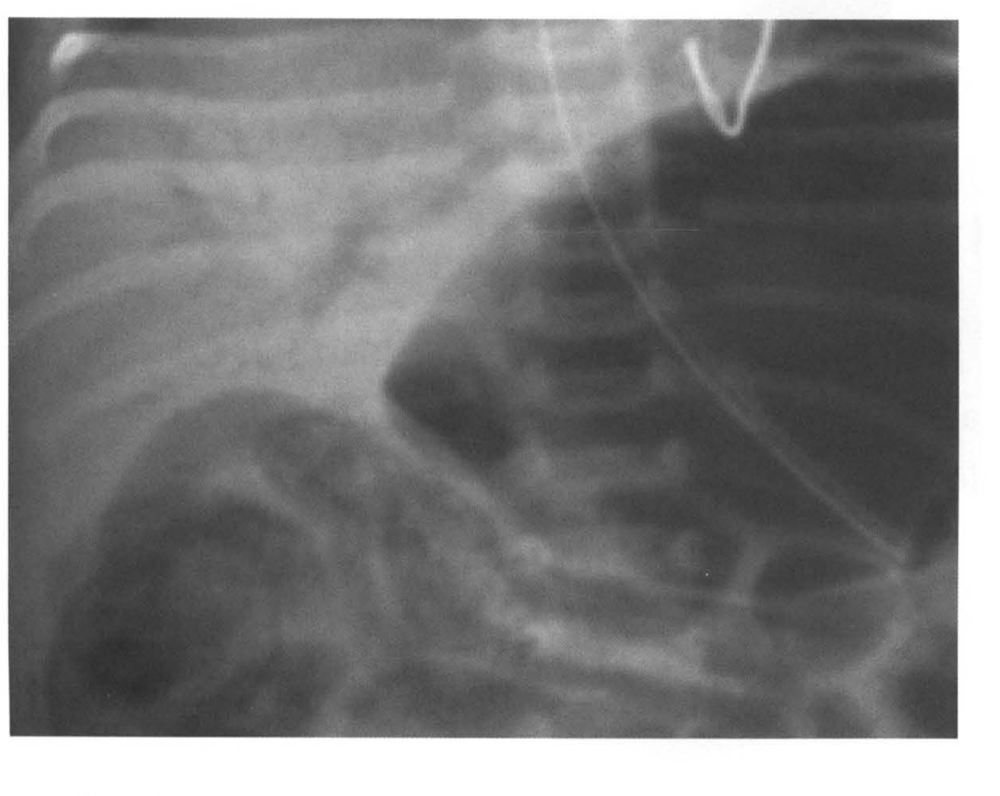
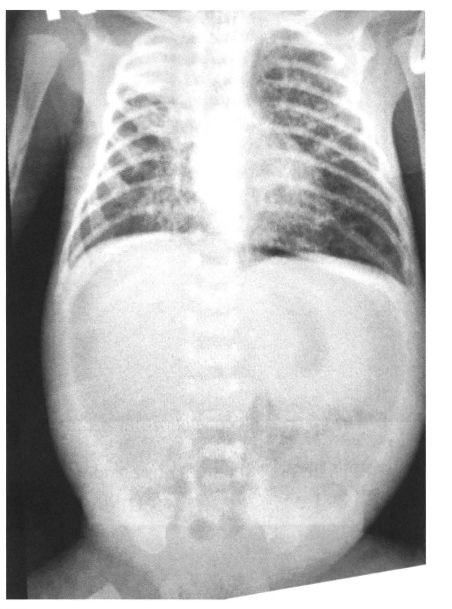
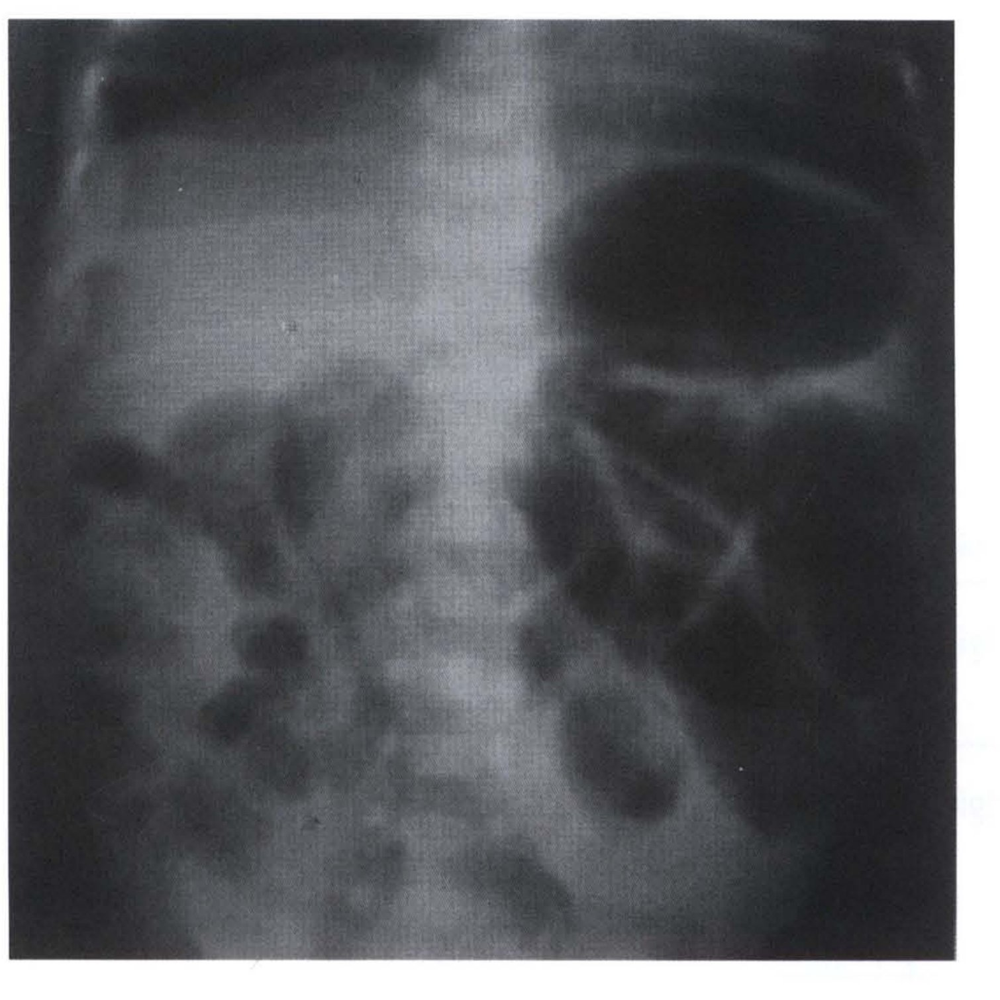
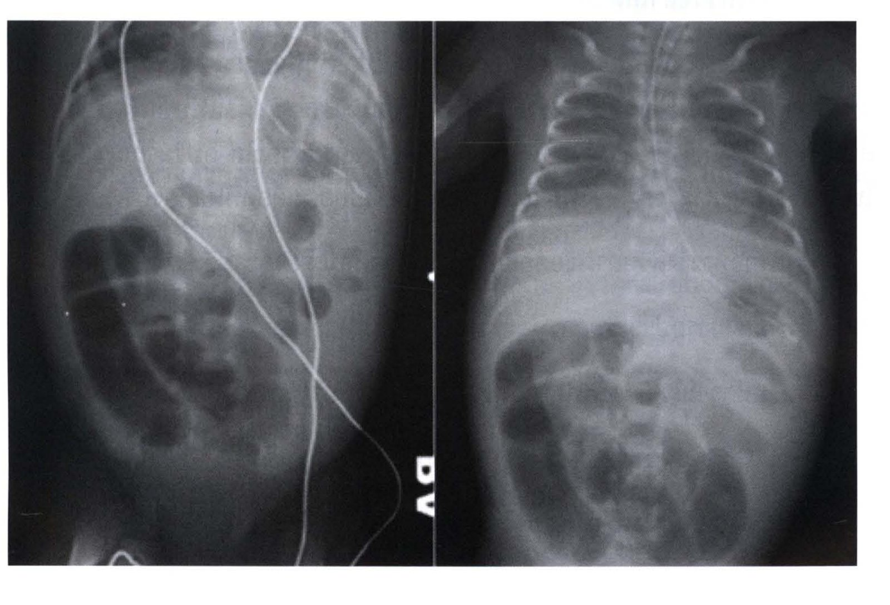
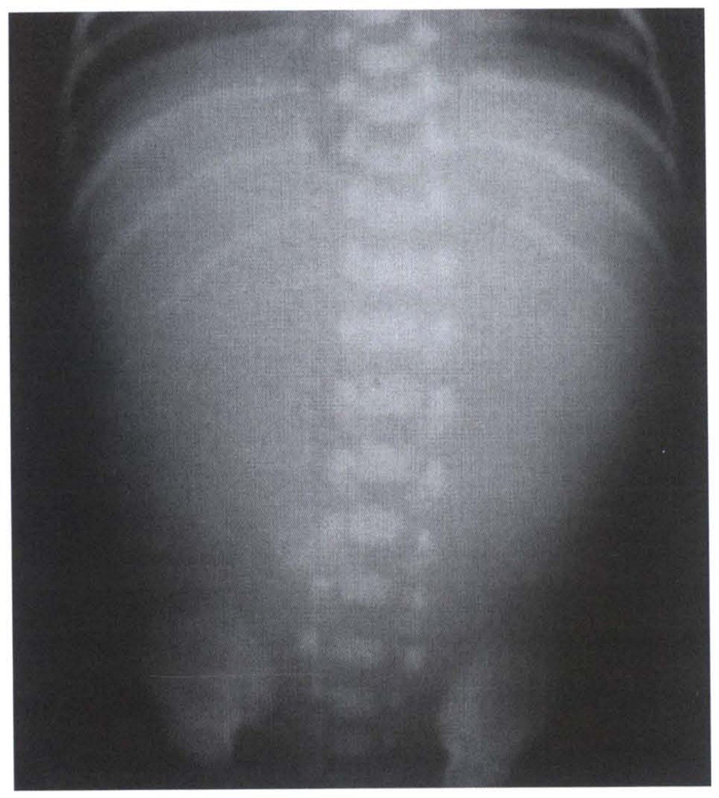
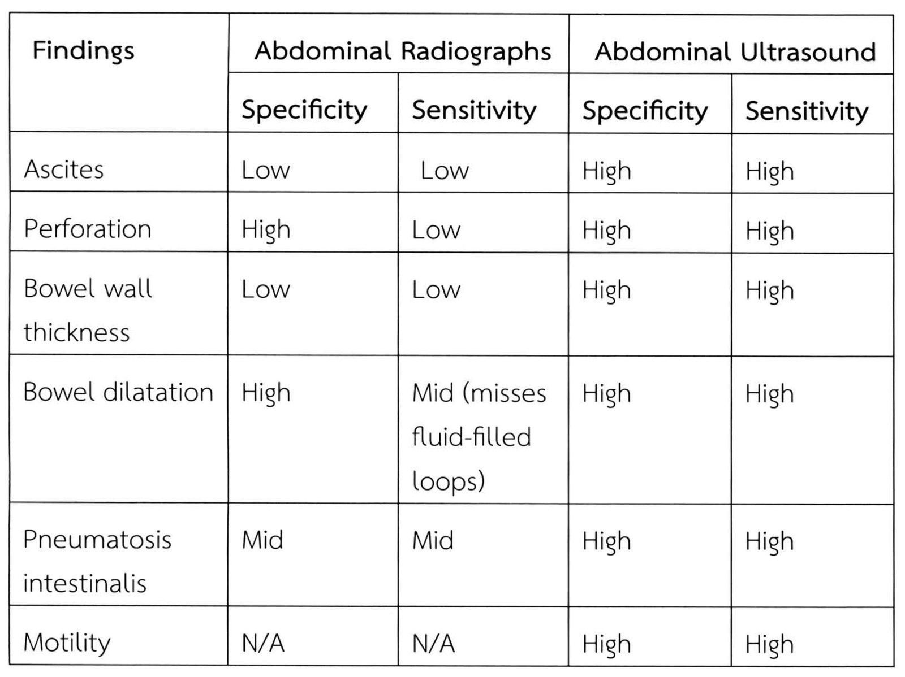

# Necrotizing enterocolitis

## Contents of this file
- ระบาดวิทยา (p.886)
- ปัจจัยที่มีผลต่อการเกิดโรค (p.887)
- พยาธิกำเนิด (p.887)
- 1. การไม่เจริญเต็มวัยของลำไส้ (p.888)
- 2. ความไม่สมดุลของจุลินทรีย์ภายในร่างกาย (microbial dysbiosis) (p.889)
- 3. การให้นมผสม (formula feeding) (p.889)
- ลักษณะอาการทางคลินิก (p.889)
- 1. การกินนมได้น้อยลง (feeding intolerance) (p.889)
- 2. มีกระบวนการทำงานของร่างกายเปลี่ยนแปลง (p.889)
- การตรวจเพิ่มเติมทางรังสีวิทยา (p.890)
- 1. การตรวจทางรังสีวิทยา (plain abdominal radiograph) (p.890)
  - 1.1 Pneumatosis intestinalis (p.890)
  - 1.2 Portal vein gas (p.890)
  - 1.3 Pneumoperitoneum (p.890)
- 2. การตรวจลำไส้ด้วยคลื่นเสียงความถี่สูง (Bowel ultrasound) (p.894)
- 3. การตรวจด้วยพลังงานคลื่นแม่เหล็กไฟฟ้าย่านความถี่ Near infrared (Near infrared spectroscopy : NIRS) (p.895)
- การตรวจทางห้องปฏิบัติการ (p.895)
- การวินิจฉัยรักษา (p.896)
- การรักษา (p.898)
- เทคนิคการผ่าตัด (p.899)
- ภาวะแทรกซ้อนหลังการผ่าตัดรักษา (p.900)
- เอกสารอ้างอิง (p.901)

<!-- p.885 (printed none) -->
**Necrotizing enterocolitis**

กตเวที เดชอรัญ

<!-- p.886 (printed 872) -->
**Necrotizing enterocolitis**

กตเวที เดชอรัญ

โรคลำไส้เน่าอักเสบ (necrotizing enterocolitis) เป็นโรคที่พบบ่อยและเป็นสาเหตุสำคัญของความผิดปกติของระบบทางเดินอาหารและการตายในทารกคลอดก่อนกำหนด ถึงแม้ว่าในปัจจุบันจะมีความก้าวหน้าทางการแพทย์มากขึ้น แต่พบว่าอุบัติการณ์การเกิดโรคและอัตราการตายก็ยังคงที่แถมยังมีรายงานเพิ่มสูงขึ้นในบางประเทศ ทั้งนี้อาจเนื่องมาจากความเจริญก้าวหน้าในการดูแลผู้ป่วยที่มีปัญหาทางการหายใจ โดยเฉพาะผู้ป่วยที่จำเป็นต้องใช้เครื่องช่วยหายใจ ทำให้ทารกที่คลอดก่อนกำหนดที่มีน้ำหนักน้อยมาก มีอัตราการรอดชีวิตสูงขึ้น จึงทำให้มีผู้ป่วยที่วินิจฉัยและรักษาโรคลำไส้เน่าอักเสบเพิ่มสูงขึ้นตามไปด้วย

หลักการดูแลรักษาผู้ป่วยประกอบด้วยการดูแลเบื้องต้น การใช้ยาปฏิชีวนะที่เหมาะสม และการผ่าตัดรักษาในกรณีที่ผู้ป่วยมีอาการรุนแรงซึ่งไม่ตอบสนองต่อการใช้ยาปฏิชีวนะ รวมทั้งการป้องกัน และรักษาภาวะแทรกซ้อนที่ตามมาต่างๆ ซึ่งจะมีผลกระทบต่อผู้ป่วยต่อไปในระยะยาว

## ระบาดวิทยา

ในปัจจุบันยังไม่ทราบอุบัติการณ์การเกิดโรคลำไส้เน่าอักเสบอย่างชัดเจน เพราะยังมีข้อโต้แย้งและการไม่ลงรอยกันในการวินิจฉัยโรคนี้ สำหรับผู้ป่วยที่มีอาการของโรคชัดเจน (Bell’s stage II-III) มีอุบัติการณ์การเกิดโรคประมาณ 1-3 ราย ต่อทารกแรกเกิดมีชีพ 1,000 ราย1 ร้อยละ 90 ของผู้ป่วยพบในทารกคลอดก่อนกำหนดโดยเฉพาะในทารกที่มีน้ำหนักตัวน้อยกว่า 1,500 กรัม2 (VLBW, นิยามของการจำแนกน้ำหนักดังตารางที่ 1) พบอุบัติการณ์การเกิดโรคร้อยละ 7-13 ต่อทารกคลอดก่อนกำหนดที่มีอายุครรภ์น้อยกว่า 37 สัปดาห์ (มีอัตราการตายสูงถึงร้อยละ 35 ) และร้อยละ 10 ต่อทารกที่คลอดครบกำหนดที่มีอายุครรภ์ระหว่าง 37-42 สัปดาห์3

<!-- p.887 (printed 873) -->
**ตารางที่ 1** Birth weight classification4

| Classifications | Birth weight |
| --- | --- |
| Low birth weight (LBW) | Less than 2,500 g (5.5 lb) |
| Very low birth weight (VLBW) | Less than 1,500 g (3.3 lb) |
| Extremely low birth weight (ELBW) | Less than 1,000 g (2.2 lb) |

## ปัจจัยที่มีผลต่อการเกิดโรค

มีรายงานพบว่าโรคหัวใจพิการแต่กำเนิดมักจะมีความสัมพันธ์กับโรคลำไส้เน่าอักเสบที่พบในทารกคลอดครบกำหนดหรือทารกที่มีน้ำหนักตัวปกติ5 เพราะโรคหัวใจพิการมีผลทำให้เลือดไปเลี้ยงหลอดเลือดของลำไส้น้อยลงในขณะที่ทารกได้รับ enteral feed นอกจากนี้ปัจจัยอื่นที่มีผลต่อการเกิดโรค ได้แก่ ภาวะ low flow state และการได้รับยา vasoactive 6

## พยาธิกำเนิด

ปัจจุบันยังไม่ทราบพยาธิกำเนิดที่ชัดเจน แต่เชื่อว่าเกิดจากปัจจัยหลายอย่าง (multifactorial) ร่วมกัน ปัจจัยที่สำคัญ 3 อย่าง ได้แก่

1. การไม่เจริญเต็มวัยของลำไส้ (intestinal immaturity)
2. ความไม่สมดุลของจุลินทรีย์ภายในร่างกาย (microbial dysbiosis)

   คือระบบทางเดินอาหารมีเชื้อจุลินทรีย์ที่ไม่ดีมากกว่าเชื้อจุลินทรีย์ที่ดี
3. การให้นมผสม (formula feeding)

<!-- p.888 (printed 874) -->
## 1. การไม่เจริญเต็มวัยของลำไส้

ปัจจัยสำคัญที่ทำให้เกิดโรคลำไส้เน่าอักเสบคือการที่ intestinal barrier ถูกทำลาย เกิดมีการโยกย้ายของเชื้อแบคทีเรียเข้าสู่ผนังลำไส้ (bacterial translocation) ก่อให้เกิด microvascular thrombosis และ coagulation necrosis เชื้อโรคที่แพร่กระจายก่อให้เกิดก๊าซซึ่งสามารถแทรกไปตามผนังลำไส้และเข้าสู่ระบบเลือดดำ portal

เนื้อเยื่อบุผิวของลำไส้มีหน้าที่ป้องกันสิ่งแปลกปลอมต่างๆ ไม่ให้เข้าไปส่วนลึกของเนื้อเยื่อผ่าน enterocytes, tight junctions, goblet cells และ pattern recognition receptors

การไม่เจริญเต็มวัยของ enterocytes มีผลกระทบต่อ tight junctions ส่งผลให้มีการเพิ่มการซึมผ่าน (increased permeability) การโยกย้าย และแทรกซึมของแบคทีเรีย, lipopolysaccharide ที่เป็น endotoxin ในเยื่อหุ้มเซลล์แบคทีเรียกระตุ้นให้เยื่อบุผิวลำไส้หลั่ง inflammatory cytokinesได้แก่ TNF-α, interferon-γ, IL-6 และ IL-8 โดย enterocytes, ทำให้มีการผลิต nitric oxide มากเกินไป ส่งผลให้ผนังลำไส้มีการเกิด epithelial apoptosis ลดการเกิด epithelial proliferation และ migration

Goblet cells ที่อยู่บริเวณ crypts จะหลั่ง glycoproteins ที่เรียกว่า mucin เพื่อส่งเสริม immune homeostasis ในผนังลำไส้และยีน MUC2 มีบทบาทในการควบคุมรูปร่างลักษณะของ goblet cells และการผลิต mucin มีหลักฐานพบว่าการลดการแสดงออกของยีน MUC2 น่าจะเป็นปัจจัยสำคัญของการเกิดโรคลำไส้เน่าอักเสบ7

Pattern recognition receptors มีความสามารถในการรับรู้โมเลกุลที่ก่อโรคในกระบวนการของการอักเสบ toll-like receptors (TLRs) เป็น transmembrane receptors ที่ริเริ่มการตอบสนองของระบบอิมมูนภายใน enterocytes เพื่อต่อต้านการแทรกซึมของแบคทีเรีย มีหลักฐานสนับสนุนว่าการแสดงออกของ TLRs โดยเฉพาะ toll-like receptor 4 (TLR4) มีความเกี่ยวพันกับการเกิดโรคลำไส้เน่าอักเสบโดยการไม่เจริญเต็มวัยของลำไส้ทำให้มีการแสดงออกและการส่งสัญญาณของ toll-like receptor 4 (TLR4) ที่มากเกินไป ทำให้มีการเพิ่มการหลั่ง inflammatory cytokines ส่งผลให้ผนังลำไส้มีการเพิ่ม epithelial apoptosis, epithelial breakdown และมี bacterial translocation รวมทั้งลดการเกิด epithelial proliferation และ migration

<!-- p.889 (printed 875) -->
## 2. ความไม่สมดุลของจุลินทรีย์ภายในร่างกาย (microbial dysbiosis)

ความไม่สมดุลของจุลินทรีย์ภายในร่างกายมีส่วนสนับสนุนให้เกิด mucosal injury ก่อให้เกิดการตอบสนองของร่างกายต่อการอักเสบ ส่งผลให้มีการเพิ่มการซึมผ่าน (increased permeability) การโยกย้าย และแทรกซึมของแบคทีเรียตามมา8

## 3. การให้นมผสม (formula feeding)

มีหลักฐานแสดงว่านมผสมทำให้ pH ในลำไส้ทารกสูงกว่านมแม่ ซึ่ง pH ที่สูงกว่าจะเป็นสภาวะที่ไม่เอื้ออำนวยต่อการเจริญเติบโตของแบคทีเรียประจำถิ่น (commensal bacteria ) นอกจากนี้เยื่อเมือกที่เคลือบผิวลำไส้เล็กก็ถูกทำลายมากกว่า เกิดการคั่งของนมในลำไส้ (intestinal stasis) มากกว่า ทำให้มีการเพิ่มการซึมผ่านมากกว่าเมื่อได้รับนมผสม ซึ่งมีผลต่อการตอบสนองของระบบอิมมูนทำให้มีการหลั่ง inflammatory cytokines ตามมา9,10

## ลักษณะอาการทางคลินิก

โรคลำไส้เน่าอักเสบมีอาการแสดงหลากหลายตั้งแต่มีอาการเล็กน้อยไปจนถึงมีภาวะ septic shock ขึ้นอยู่กับความรุนแรงของพยาธิสภาพ และความผิดปกติของระบบร่างกายอื่นๆ ที่พบร่วมกัน อาการแสดงที่ตรวจพบมักจะเป็นอาการที่ไม่จำเพาะเจาะจง ได้แก่

## 1. การกินนมได้น้อยลง (feeding intolerance)

ทารกอาจมีอาการท้องอืด กินนมแล้วมีอาการแหวะหรือสำลัก มีอาการอาเจียนเป็นน้ำดี มีอาการถ่ายเหลวหรืออุจจาระมีเลือดปน

## 2. มีกระบวนการทำงานของร่างกายเปลี่ยนแปลง

ได้แก่ ชีพจรเต้นช้าลง (bradycardia) มีภาวะหยุดหายใจชั่วขณะ มีความดันโลหิตต่ำกว่าค่าปกติ มีอุณหภูมิของร่างกายไม่สม่ำเสมอ มีอาการซึมลง ผิวหนังมีรอยเป็นจ้ำๆ มีอาการหายใจเร็วหรือร่างกายต้องการออกซิเจนมากขึ้น

อายุครรภ์ของทารกมีส่วนสำคัญต่อระยะเวลาในการเกิดโรค จากการเก็บข้อมูลพบว่าอายุเฉลี่ยขณะวินิจฉัยอยู่ประมาณ 10-28 วัน หลังคลอด อายุเฉลี่ยในผู้ป่วยทารกคลอดก่อนกำหนดที่มีอายุครรภ์น้อยกว่า 26 สัปดาห์ คือประมาณ 3 สัปดาห์หลังคลอด ในขณะที่

<!-- p.890 (printed 876) -->
อายุเฉลี่ยในผู้ป่วยทารกคลอดก่อนกำหนด ที่มีอายุครรภ์มากกว่า 31 สัปดาห์ คือประมาณ 10 วันหลังคลอด11

การตรวจร่างกายมีส่วนสำคัญอย่างมากในการช่วยวินิจฉัยโรคและกำหนดแนวทางในการรักษา อาการเริ่มต้นจะตรวจพบว่ามีอาการท้องอืดและกดเจ็บบริเวณท้อง อาจสังเกตเห็นลักษณะของลำไส้บีบตัวมากกว่าปกติผ่านทางหน้าท้อง ในรายที่มีอาการรุนแรงมากขึ้นจะมีน้ำในช่องท้อง หน้าท้องมีลักษณะเปลี่ยนเป็นสีคล้ำขึ้นและมีอาการบวม

## การตรวจเพิ่มเติมทางรังสีวิทยา

## 1. การตรวจทางรังสีวิทยา (plain abdominal radiograph)

ลักษณะที่ตรวจพบมีทั้งเฉพาะเจาะจงหรือลักษณะทั่วๆ ไป ขึ้นอยู่กับระดับความรุนแรงของโรคลำไส้เน่าอักเสบ โดยลักษณะสำคัญดังต่อไปนี้

### 1.1 Pneumatosis intestinalis

คือ pathognomonic sign ของโรค เกิดจากการมี air แทรกอยู่บริเวณผนังลำไส้ส่วนที่มีพยาธิสภาพ (รูปที่ 1)

### 1.2 Portal vein gas

คือภาวะที่ตรวจพบ air ในเส้นเลือดดำ portal แสดงว่าเชื้อโรคมีการแพร่กระจายไปยังระบบเลือดดำ portal มีความรุนแรงของโรคมากกว่าการตรวจพบ pneumatosis intestinalis (รูปที่ 2)

### 1.3 Pneumoperitoneum

คือภาวะที่มี air อยู่ใน peritoneal cavity เกิดจากการ perforation ของลำไส้ส่วนที่มีพยาธิสภาพ ถ้ามี air ปริมาณน้อยอาจตรวจไม่พบจากการตรวจทางรังสีในท่า supine เพียงอย่างเดียว แนะนำให้ตรวจท่า cross-table left lateral decubitus ร่วมด้วย ซึ่งจะทำให้เห็น air อยู่ระหว่างผนังช่องท้องและตับ ถ้ามี air ในปริมาณมากจะเห็นเป็น double wall sign คือเห็นผนังลำไส้ชัดเจนทั้งด้านในและด้านนอก หรือเห็นเป็น football sign (รูปที่ 3)

<!-- p.891 (printed 877) -->

> **Caption (verbatim):** รูปที่ 1 Pneumatosis intestinalis
> **Text in image (verbatim):** none
> **Description:** Plain radiograph of an infant's abdomen, cropped close to the abdomen (no labels or arrows). Several thin radiopaque tubes/wires loop across the upper part of the image, and one catheter enters from the lower edge and ends with a bright tip in the lower-central abdomen. Multiple gas-filled bowel loops fill the abdomen; centrally and to the right the bowel shows a mottled, bubbly/foamy pattern of small gas lucencies within the bowel wall area, and rounded dark gas-filled loops lie along the right side and lower left. The book uses this image to illustrate pneumatosis intestinalis (air within the bowel wall).
> **Identifiers in image:** none

> **Caption (verbatim):** รูปที่ 2 Portal vein gas
> **Text in image (verbatim):** none
> **Description:** Plain radiograph of an infant, cropped to the lower chest and upper abdomen (no labels or arrows). Ribs run across the upper-left part of the image over a relatively dense (lighter grey) area; a large dark gas-filled structure occupies the upper-right portion, and a thin radiopaque tube/line curves down diagonally across it from top centre toward the lower right, with another small looped wire at the top. Gas-containing bowel loops are seen in the lower half. The book uses this image to illustrate portal vein gas; the image itself has no marker indicating where the gas is.
> **Identifiers in image:** none

<!-- p.892 (printed 878) -->

> **Caption (verbatim):** รูปที่ 3 Pneumoperitoneum
> **Text in image (verbatim):** none
> **Description:** Frontal (AP) radiograph of an infant covering the chest and abdomen (no labels or arrows). The upper half shows both lungs with ribs and the bright central mediastinum/spine. The abdomen below is markedly distended and rounded, bulging out to the flanks; a large, fairly uniform lucent area outlines the abdomen beneath both hemidiaphragms, and individual bowel loops are only faintly seen within it, with the spine and pelvis visible at the bottom. The book uses this image to illustrate pneumoperitoneum (air in the peritoneal cavity).
> **Identifiers in image:** none

1.4 ตรวจพบลักษณะความผิดปกติอื่นๆ ได้แก่ bowel distension and ileus, focal thickening of bowel loops, fixed bowel loops (sentinel loops) และ gasless abdomen (รูปที่ 4-6)

<!-- p.893 (printed 879) -->

> **Caption (verbatim):** รูปที่ 4 Thickening of bowel loops
> **Text in image (verbatim):** none
> **Description:** Frontal plain radiograph of an infant's abdomen, cropped to the abdomen (no labels or arrows). The spine runs vertically down the centre. A large oval gas-filled structure lies in the upper part on the right side of the image. Below it and across the mid and lower abdomen are multiple small, rounded and tubular gas-filled bowel loops separated by grey soft-tissue bands that appear thickened between adjacent loops. The book uses this image to illustrate thickening of bowel loops.
> **Identifiers in image:** none

> **Caption (verbatim):** รูปที่ 5 Fixed bowel loops (sentinel loops)
> **Text in image (verbatim):** [unclear: AP] (rotated radiographic position marker at the right edge of the left panel)
> **Description:** Two frontal radiographs of an infant placed side by side (no arrows). Left panel: abdomen with two thin radiopaque lines/wires running down across it; a cluster of dilated gas-filled bowel loops lies in the lower left part of the abdomen, while the rest of the abdomen shows smaller scattered gas lucencies. Right panel: chest and abdomen of an infant with the ribs, a tube in the midline of the chest, and a distended abdomen containing a group of dilated gas-filled loops in the lower abdomen, mainly toward the lower left. The book uses this pair to illustrate fixed bowel loops (sentinel loops).
> **Identifiers in image:** none

<!-- p.894 (printed 880) -->

> **Caption (verbatim):** รูปที่ 6 Gasless abdomen
> **Text in image (verbatim):** none
> **Description:** Plain abdominal radiograph (frontal/AP view) of an infant. The abdomen appears diffusely grey and homogeneous with almost no visible bowel gas lucencies (gasless abdomen); the flanks are bulging. The spine runs vertically down the midline, the lower ribs are visible at the top, and the upper pelvis/iliac bones at the bottom.
> **Identifiers in image:** none

## 2. การตรวจลำไส้ด้วยคลื่นเสียงความถี่สูง (Bowel ultrasound)

มีการใช้การตรวจคลื่นเสียงความถี่สูงมาช่วยในการวินิจฉัยโรคลำไส้เน่าอักเสบอย่างแพร่หลายมากขึ้นในปัจจุบัน เพราะสามารถให้ข้อมูลประมวลผลแบบทันทีตามเวลาจริง สามารถประเมินการบีบตัวของลำไส้ ความหนาบางของผนังลำไส้ ดูปริมาณน้ำ (ascites) ในช่องท้อง และสามารถดูการเปลี่ยนแปลงการไหลเวียนของเลือดที่ไปเลี้ยงบริเวณลำไส้ได้12

การตรวจทางรังสีวิทยามีข้อด้อยกว่าการตรวจคลื่นเสียงความถี่สูงดังต่อไปนี้

1. ไม่สามารถประเมินการทำงานของลำไส้แบบ dynamic ได้
2. ไม่มีความไว (insensitivity) ในการตรวจพบภาวะลำไส้ทะลุ
3. มีความแม่นยำน้อยกว่าในการตรวจพบ pneumatosis intestinalis
4. อาจมีการ overdiagnosis ว่าเป็น suspected NEC

<!-- p.895 (printed 881) -->
**ตารางที่ 2 ตารางเปรียบเทียบความจำเพาะ (specificity) และความไว (sensitivity) ระหว่างการตรวจด้วย คลื่นเสียงความถี่สูงและการตรวจทางรังสีวิทยา13**

| Findings | Abdominal Radiographs Specificity | Abdominal Radiographs Sensitivity | Abdominal Ultrasound Specificity | Abdominal Ultrasound Sensitivity |
| --- | --- | --- | --- | --- |
| Ascites | Low | Low | High | High |
| Perforation | High | Low | High | High |
| Bowel wall thickness | Low | Low | High | High |
| Bowel dilatation | High | Mid (misses fluid-filled loops) | High | High |
| Pneumatosis intestinalis | Mid | Mid | High | High |
| Motility | N/A | N/A | High | High |

> **Caption (verbatim):** ตารางที่ 2 ตารางเปรียบเทียบความจำเพาะ (specificity) และความไว (sensitivity) ระหว่างการตรวจด้วย คลื่นเสียงความถี่สูงและการตรวจทางรังสีวิทยา13
> **Text in image (verbatim):** Findings · Abdominal Radiographs · Abdominal Ultrasound · Specificity · Sensitivity · Specificity · Sensitivity · Ascites · Low · Low · High · High · Perforation · High · Low · High · High · Bowel wall thickness · Low · Low · High · High · Bowel dilatation · High · Mid (misses fluid-filled loops) · High · High · Pneumatosis intestinalis · Mid · Mid · High · High · Motility · N/A · N/A · High · High
> **Description:** Image of Table 2 with merged header cells: the "Findings" column spans two header rows; "Abdominal Radiographs" and "Abdominal Ultrasound" each span two sub-columns (Specificity, Sensitivity). Six findings are rated. Abdominal ultrasound is rated High for both specificity and sensitivity for every finding. Abdominal radiographs: ascites Low/Low; perforation High/Low; bowel wall thickness Low/Low; bowel dilatation High/Mid (misses fluid-filled loops); pneumatosis intestinalis Mid/Mid; motility N/A/N/A. Saved as a figure because of the merged header cells.
> **Identifiers in image:** none

## 3. การตรวจด้วยพลังงานคลื่นแม่เหล็กไฟฟ้าย่านความถี่ Near infrared (Near infrared spectroscopy : NIRS)

เป็นเครื่องมือ noninvasive ที่ใช้ในต่างประเทศเพื่อวัด local abdominal tissue oxygenation เพื่อดู perfusion ของลำไส้ มีประโยชน์ในการ early detection ภาวะลำไส้ขาดเลือด

## การตรวจทางห้องปฏิบัติการ

ได้แก่ การตรวจ complete blood count (CBC) with platelet count, C-reactive protein, lactate level และ serum glucose ผลเลือดต่างๆ ใช้บ่งบอกความรุนแรงของโรค ช่วยประเมิน วางแผนและติดตามการรักษา ปัจจุบันได้มีการศึกษาและวิจัยอย่าง

<!-- p.896 (printed 882) -->
กว้างขวางเกี่ยวกับ biomarkers และ cytokines ซึ่ง biomarkers จะเป็นตัวช่วยบ่งชี้ถึงภาวะ enterocyte injury และ intestinal barrier dysfunction ได้แก่ fecal calprotectin, claudin-3 และ intestinal fatty acid binding protein (I-FABP) ส่วน cytokines ที่เกี่ยวข้อง ได้แก่ TNFa, IL-6, IL-8 และ C-reactive protein ซึ่งมีส่วนในการช่วยทำนายความจำเป็นที่จะต้องผ่าตัดรักษาผู้ป่วย

## การวินิจฉัยรักษา

มีการใช้ Bell’s criteria ในการวินิจฉัยรักษาและช่วยกำหนดความรุนแรงของโรค ตั้งแต่ปี 1978 และต่อมาได้มีการดัดแปลง (Modified Bell’s staging criteria) โดยพิจารณาจาก 3 ปัจจัย คือลักษณะอาการทางคลินิก อาการทาง systemic และการตรวจเพิ่มเติมทางรังสีวิทยา (ตารางที่ 3)

**ตารางที่ 3 Modified Bell’s staging criteria for NEC**

| Stage | Systemic signs | Intestinal signs | Radiologic signs |
| --- | --- | --- | --- |
| IA - suspected NEC | Temperature instability, apnea, bradycardia, lethargy | Elevated pregavage residuals, mild abdominal distension, emesis, guaiac-positive stool | Normal or intestinal dilation, mild ileus |
| IB - suspected NEC | Same as IA | Same as&nbsp;above plus bright red blood in stool | Same as IA |
| IIA- definite NEC (mildly ill) | Same as IA | IA and IB plus absent bowel sounds. Patient also may have abdominal tenderness. | Intestinal dilatation, ileus, pneumatosis intestinalis |

<!-- p.897 (printed 883) -->
<!-- continuation of ตารางที่ 3 from p.896; the page prints no header row, header repeated for Markdown -->
| Stage | Systemic signs | Intestinal signs | Radiologic signs |
| --- | --- | --- | --- |
| IIB- definite NEC (moderate ill) | Same as IA plus mild metabolic acidosis and mild thrombocytopenia | IA, IB, and IIA signs. Patient also may have abdominal cellulitis or right lower quadrant mass. | Same as IIA plus portal vein gas. Patient also may have ascites |
| IIIA- advanced NEC (severely ill- bowel intact) | Same as IIB plus hypotension, bradycardia, respiratory acidosis, metabolic acidosis, disseminated intravascular coagulation, and neutropenia | IA, IB, IIA, IIB signs plus peritonitis, marked abdominal tenderness and distension | Same as IIB plus definite ascites |
| IIIB- advanced NEC (severely ill- bowel perforation) | Same as IIIA | Same as IIIA | Same as IIB plus pneumoperitoneum |

ในปัจจุบันมีข้อโต้แย้งมากขึ้นจากการใช้ Modified Bell’s staging criteria เพราะพบว่ามีผู้ป่วยที่ได้รับการวินิจฉัยว่าเป็นโรคลำไส้เน่าอักเสบที่มากกว่าความเป็นจริง (overdiagnosis) เพราะความคลุมเครือของ Bell’s stage I ดังนั้นใน NEC symposium ที่จัดขึ้นในปี 2017 จึงได้มีการคิดการวินิจฉัยขึ้นมาใหม่ใช้ชื่อว่า “Two out of three”14 มีรายละเอียดดังต่อไปนี้

<!-- p.898 (printed 884) -->
The two out of three rule for bedside diagnosis of preterm NEC15

ผู้ป่วยมีอาการ abdominal distension, ileus and/or bloody stools และมี criteria ครบอย่างน้อย 2 ใน 3 ข้อ ดังต่อไปนี้

1. มีการตรวจพบ pneumatosis and/or portal air ในการตรวจทางรังสีวิทยาหรือการตรวจด้วยคลื่นเสียงความถี่สูงในขณะที่มีอาการ
2. Persistent platelet consumption คือมีภาวะเกล็ดเลือดต่ำกว่า 150,000 เซลล์/ลบ.มม. ติดต่อกัน 3 วันนับจากวันแรกที่มีอาการ
3. Post-menstrual age at disease onset is more consistent with NEC than spontaneous intestinal perforation (SIP)

ผู้ป่วยดังต่อไปนี้ไม่รวมการวินิจฉัยว่าเป็น pretem NEC

1. ทารกแรกเกิดที่มี SIP
2. ทารกที่มีความผิดปกติซับซ้อนของอวัยวะอื่นๆ ร่วมด้วย
3. ทารกที่ได้รับนมน้อยกว่า 80 ml/kg/day
4. ทารกที่มีอายุครรภ์มารดามากกว่า 36 สัปดาห์

## การรักษา

1. การรักษาประคับประคองโดยการใช้ยา ได้แก่

1.1 การงดน้ำ งดอาหารเพื่อพักการทำงานของลำไส้

1.2 การใส่สารทางจมูกเพื่อระบายสิ่งคัดหลั่งที่คั่งค้าง

1.3 การให้สารน้ำทดแทน การให้สารอาหารทางเส้นเลือดดำ การแก้ภาวะซีดหรือเกล็ดเลือดต่ำ การแก้ความผิดปกติของเมตาบอลิซึม การให้ยาเพิ่มการบีบตัวของหัวใจและหลอดเลือด รวมทั้งการใส่เครื่องช่วยหายใจในกรณีที่มีข้อบ่งชี้

1.4 การให้ยาปฏิชีวนะอย่างเหมาะสม (broad spectrum empiric antibiotics) เชื้อที่สัมพันธ์กับการเกิดโรค ได้แก่ *Clostridia, Klebsiella pneumoniae, Escherichia coli, Enterobacter, Pseudomonas, Clostridium difficile,* และ

<!-- p.899 (printed 885) -->
*Staphylococcus epidermidis*8 ควรให้ยาปฏิชีวนะที่ครอบคลุมทั้งเชื้อ gram-positive และ gram-negative เช่น ampicillin และ gentamicin

จากการเก็บข้อมูลพบว่าร้อยละ 60-80 ของผู้ป่วยโรคลำไส้เน่าอักเสบสามารถฟื้นตัวจากโรคได้โดยไม่จำเป็นต้องผ่าตัดรักษา16 ในระหว่างการรักษา ควรเฝ้าติดตามการเปลี่ยนแปลงของโรคในผู้ป่วยอย่างใกล้ชิด ส่งตรวจภาพถ่ายทางรังสีวิทยาซ้ำเป็นระยะๆ ทุก 6-12 ชั่วโมง

2. การผ่าตัดรักษา

ข้อบ่งชี้ในการผ่าตัดรักษา

1. ลำไส้ทะลุ

   วินิจฉัยได้จากการตรวจเอกซเรย์ช่องท้องหรือคลื่นเสียงความถี่สูงแล้วพบ free air
2. รักษาโดยการประคับประคองและใช้ยาอย่างเต็มที่แล้วแต่อาการผู้ป่วยไม่ดีขึ้น

## เทคนิคการผ่าตัด

1. Primary peritoneal drainage ( PPD )

เทคนิคการผ่าตัดคือการฉีดยาชาเฉพาะที่ ลงแผลบริเวณหน้าท้องส่วนล่างเป็นแผลขนาดเล็กพอที่จะสอดท่อระบาย (soft drain หรือ penrose drain) เข้าไปในช่องท้องและคาท่อระบายเอาไว้ระบายน้ำในช่องท้อง ลำไส้ส่วนที่เน่าตาย และอุจจาระที่ทะลุออกมาอยู่นอกลำไส้

PPD ในอดีตใช้รักษาผู้ป่วยที่ต้องการให้โรคคงที่ไม่แย่ลง และรอเวลาให้ผู้ป่วยพร้อมเพียงพอ สำหรับการผ่าตัดเปิดช่องท้องในอนาคต แต่ก็มีรายงานว่าผู้ป่วยบางรายรักษาโดยวิธีนี้สำเร็จโดยไม่จำเป็นต้องผ่าตัดเพิ่มเติมภายหลัง วิธีนี้ในช่วงแรกนิยมใช้รักษาในผู้ป่วยที่น้ำหนักน้อยกว่า 1,000 กรัม ปัจจุบันใช้รักษาผู้ป่วยที่มีอาการไม่คงที่และมีความเสี่ยงสูงที่จะเสียชีวิตถ้านำผู้ป่วยไปผ่าตัดเปิดช่องท้องโดยวิธีดมยาสลบ หรือในผู้ป่วยที่มีน้ำหนักต่ำกว่า 1,500 กรัม (very low birth weight, VLBW) ที่มีอาการคงที่และสันนิษฐานว่ามีลำไส้เน่าอักเสบอยู่เฉพาะส่วน

<!-- p.900 (printed 886) -->
2. การผ่าตัดเปิดช่องท้อง (Laparotomy)

หลักการในการผ่าตัดรักษาคือการผ่าตัดเปิดเข้าไปในช่องท้องโดยวิธีดมยาสลบ ตัดลำไส้ส่วนที่เน่าตายซึ่งเป็นต้นเหตุของการอักเสบติดเชื้อทิ้ง และยกลำไส้ส่วนต้นออกมาเปิดบริเวณหน้าท้องไว้เป็นการชั่วคราว โดยเน้นการ conservative approach คือเลือกตัดเฉพาะลำไส้ส่วนที่เน่าตายชัดเจน ส่วนลำไส้ส่วนที่ยังไม่แน่ใจว่าเน่าตายจริงหรือไม่ ซึ่งอาจจะดีขึ้นได้จากการ resuscitation และ abdominal decompression ควรเก็บไว้ก่อน เลือกใช้วิธีผ่าตัดเปิดเข้าไปประเมินหลายครั้ง ( multiple-look laparotomies) เพื่อเก็บรักษาลำไส้ไว้ให้มีความยาวมากที่สุดเท่าที่จะเป็นไปได้ นอกจากนี้มีการรายงานเทคนิคการผ่าตัดอีกหลายวิธี เช่น “ clip and drop-back ”17, “ patch drain and wait ”18

ในผู้ป่วยบางกรณี เช่น ผู้ป่วยที่มีลำไส้เน่าเฉพาะส่วนซึ่งมีการปนเปื้อนเชื้อโรคในช่องท้องน้อย สามารถเลือกวิธีการผ่าตัดเอาลำไส้ส่วนที่เน่าตายออกแล้วเอาลำไส้ส่วนที่ดีมาต่อกันแบบ primary anastomosis ได้

## ภาวะแทรกซ้อนหลังการผ่าตัดรักษา

1. การตกเลือดใต้ผิวตับ (subcapsular hematoma)

อาจเกิดจากเทคนิคการผ่าตัดที่ไม่ได้ระมัดระวังเพียงพอ หรือเป็นผลจากความผิดปกติของการแข็งตัวของเลือด สืบเนื่องมาจากการติดเชื้อในกระแสเลือด เป็นสาเหตุของการเสียชีวิตหลังผ่าตัด

2. การเป็นโรคลำไส้เน่าอักเสบซ้ำ (recurrent NEC)

พบประมาณร้อยละ 5-10 โดยทั่วไปจะมีระยะห่างหลังจากเป็นโรคครั้งแรก 1 เดือน แต่มีรายงานผู้ป่วยที่เป็นซ้ำหลังจากการเป็นโรคครั้งแรกเป็นเวลาถึง 5 เดือน19

3. การตีบของลำไส้

พบรายงานว่าหลังจากผู้ป่วยหายจากโรคลำไส้อักเสบ จะมีลำไส้ตีบตามมาสูงถึงร้อยละ 40 โดยรอยโรคที่พบบ่อยคือบริเวณลำไส้ใหญ่ร้อยละ 80 และลำไส้เล็กส่วน ileum ร้อยละ 16 ส่วนใหญ่จะเกิดหลังการเกิดโรค 1 เดือน20

<!-- p.901 (printed 887) -->
4. ภาวะแทรกซ้อนของแผลผ่าตัด ได้แก่ แผลแยก แผลติดเชื้อ

5. ภาวะแทรกซ้อนของการยกลำไส้ออกมาเปิดบริเวณหน้าท้อง เช่น stricture, prolapse, retraction, revision, parastomal hernia, intussusception

6. กลุ่มอาการลำไส้สั้น (short bowel syndrome)

โรคลำไส้เน่าอักเสบเป็นสาเหตุหลักของกลุ่มอาการลำไส้สั้นในเด็ก

## เอกสารอ้างอิง

1. Stoll BJ, Hanson NI, Bell EF, et al. Trends in care practices, morbidity, and mortality of extremely preterm neonates, 1993-2012. JAMA 2015;314:1039-1051.
2. Stoll BJ, Hanson NI, Bell EF, et al. Neonatal outcome of extremely preterm infants from the NICHD Neonatal Research Network. Pediatrics 2010;126:443-456.
3. Agnoni A, Amendola LC. Necrotizing enterocolitis: Current concepts in practice. JAAPA 2017;30(8):16-21.
4. Battaglia FC, Lubchenco LO. A practical classification of newborn infants by weight and gestational age. J Pediatr 1967;71(2):159-163.
5. Ostlie DJ, Spilde TL, St Peter SD, et al. Necrotizing enterocolitis in full term infants. J Pediatr Surg 2003;38:1039-1042.
6. Coombs CR, Morgan EIM, Durbin MG, et al. Abnormal gut blood flow velocities in neonates at risk of necrotizing enterocolitis. J Pediatr Gastroenterol Nutr 1992;15:13-19.
7. Deplancke B, Gaskins HR. Microbial modulation of innate defense: goblet cells and the intestinal mucus layer. Am J Clin Nutr 2001;73:1131S-1141S.
8. Morowitz MJ, Poroyko V, Caplan M, et al. Redefining the role of intestinal microbes in the pathogenesis of necrotizing enterocolitis. Pediatrics 2010;125:777-785.
9. Le Doare K, Holder B, Bassett A, et al. Mother’s milk: a purposeful contribution to the development of the infant microbiota and immunity. Front Immunol 2018;9:361.

<!-- p.902 (printed 888) -->
10. Caplan M. Is EGF the holy grail for NEC? J Pediatr 2007;150:329-330.
11. Yee WH, Soraisham AS, Shah VS, et al. Incidence and timing of presentation of necrotizing enterocolitis in preterm infants. Pediatrics 2012;129:e298-e304.
12. Esposito F, Maamone R, Di Serafino M, et al. Diagnostic imaging features of necrotizing enterocolitis: a narrative review. Quant Imaging Med Surg 2017;7: 336-344.
13. Kim JH. Role of abdominal US in diagnostic of NEC. Clin Perinatol 2019;46(1): 119-127.
14. Gephart SM, Gordon PV, Penn AH, et al. Changing the paradigm of defining, detecting, and diagnosing NEC: Perspectives on Bell’s stages and biomarkers for NEC. Sem Pediatr Surg 2018;27(1):3-10.
15. Gordon PV, Swanson JR, MacQueen BC, et al. A critical question for NEC researchers: can we create a consensus definition of NEC that facilitates research progress? Semin Perinatol 2017;41(1):7-14.
16. Berman L, Moss RL. Necrotizing enterocolitis: an update. Semin Fetal Neonatal Med 2011;16:145-150.
17. Vaughan WG, Grosfeld JL, West K, et al. Avoidance of stomas and delayed anastomosis for bowel necrosis: the “Clip and drop-back” technique. J Pediatr Surg 1996;31:542-545.
18. Moore TC. Successful use of the “patch, drain, and wait” laparotomy approach to perforated necrotizing enterocolitis: is hypoxia-triggered “good angiogenesis” involved? Pediatr Surg Int 2000;16:356-363.
19. Stringer MD, Brereton RJ, Drake DP, et al. Recurrent necrotizing enterocolitis. J Pediatr Surg 1993;28:979-981.
20. Schimpl G, Hollwarth ME, Fotter R, et al. Late intestinal strictures following successful treatment of necrotizing enterocolitis. Acta Paediatr 1994;396:80-83.
