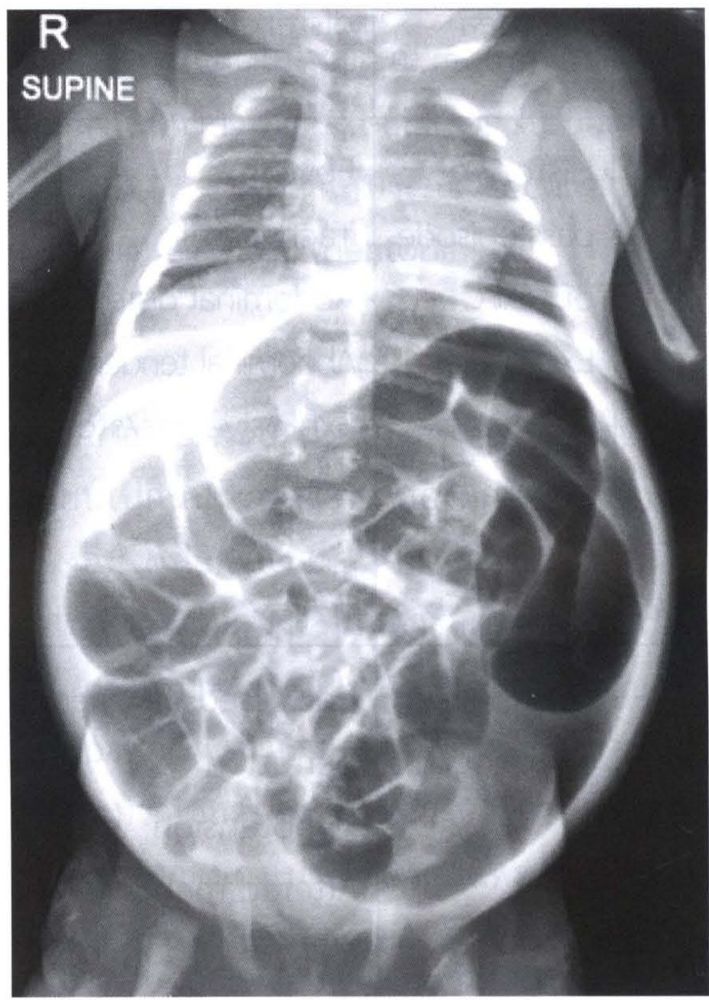
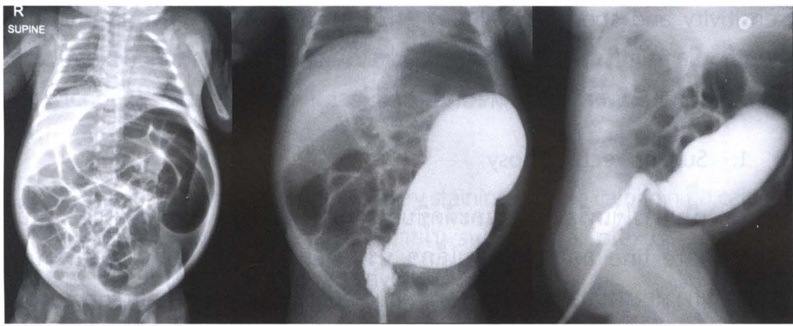
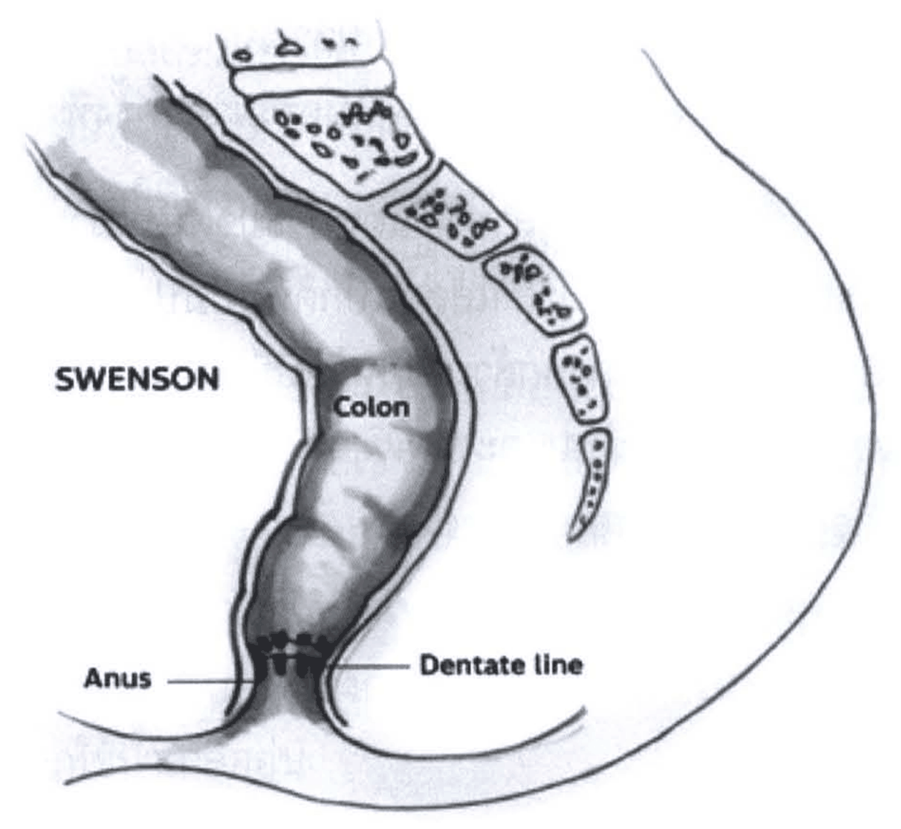
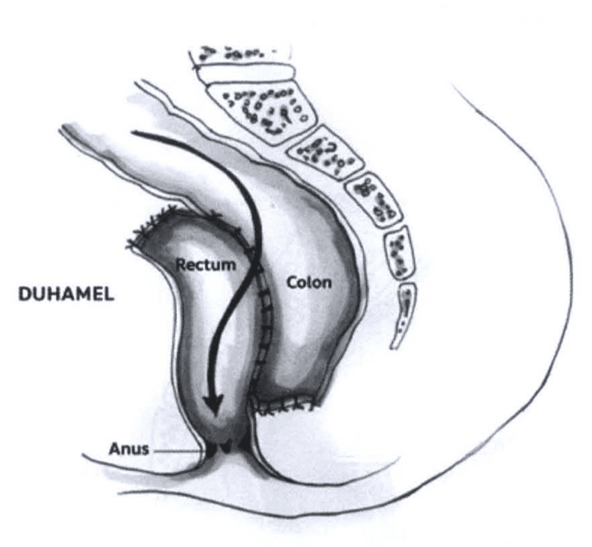
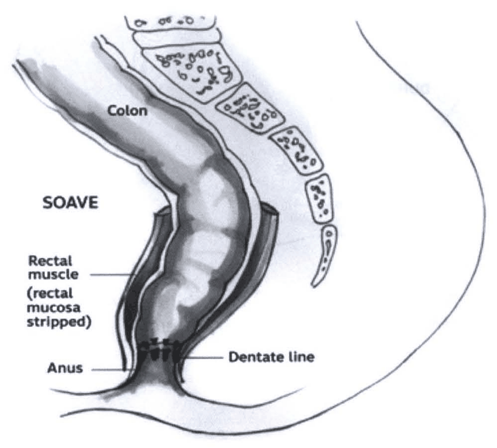
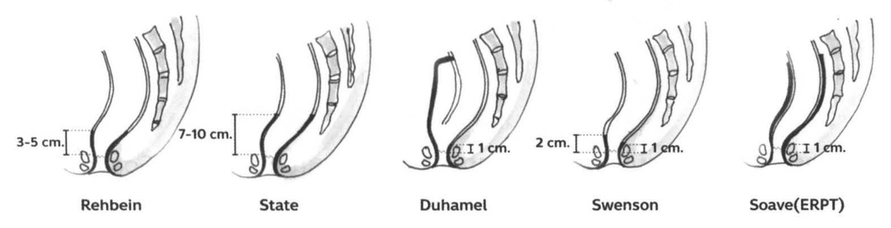
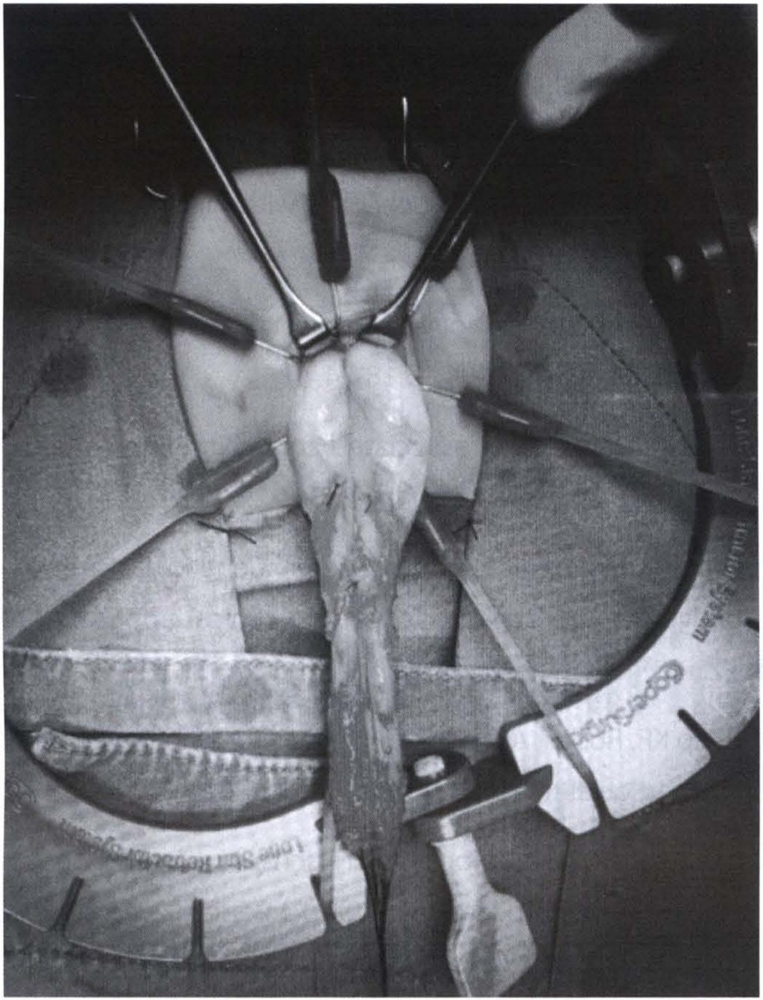

# โรคลำไส้โป่งพองแต่กำเนิด (Hirschsprung disease)

## Contents of this file
- ระบาดวิทยา (p.904)
- พันธุศาสตร์ของโรค (p.905)
- ลักษณะทางคลินิค (p.905)
- 1. อาการลำไส้อุดตัน (p.906)
- 2. อาการท้องผูก (p.906)
- 3. อาการลำไส้อักเสบ (Hirschsprung-associated enterocolitis : HAEC) (p.906)
- การวินิจฉัยโรค (p.907)
- 1. การตรวจวินิจฉัยทางรังสีวิทยา (p.907)
  - 1.1 การส่งตรวจ plain abdominal x-ray (p.907)
  - 1.2 การส่งตรวจ water-soluble contrast enema หรือ barium enema (p.908)
- 2. การตรวจการเคลื่อนไหวของทางเดินอาหารส่วนปลาย (anorectal manometry) (p.909)
- 3. การส่งชิ้นเนื้อส่งตรวจทางพยาธิวิทยา (p.910)
  - 1. Suction rectal biopsy (p.910)
  - 2. Open rectal biopsy (p.910)
  - 3. Endoscopic rectal biopsy (p.911)
- การตรวจทางพยาธิวิทยา (p.911)
- การรักษา (p.911)
- 1. การรักษาเบื้องต้น (p.911)
  - 2. การผ่าตัดรักษา (p.913)
    - Swenson procedure (rectosigmoidectomy) (p.914)
    - Duhamel procedure (retrorectal pull-through) (p.915)
    - Soave - Boley procedure (endorectal pull-through) (p.916)
    - Rebhein and State procedure (p.917)
    - Laparoscopic assisted transanal endorectal pull-through (LATEP) (p.917)
    - Transanal endorectal pull-through (TERPT) (p.918)
- เอกสารอ้างอิง (p.919)

<!-- p.903 (printed none) -->
**โรคลำไส้โป่งพองแต่กำเนิด**

**Hirschsprung disease**

กตเวที เดชอรัญ

<!-- p.904 (printed 890) -->
**โรคลำไส้โป่งพองแต่กำเนิด**

**Hirschsprung disease**

กตเวที เดชอรัญ

โรคลำไส้โป่งพองแต่กำเนิด คือโรคที่ลำไส้ใหญ่ไม่มีปมประสาท (ganglion cell) ในชั้น myenteric และ submucosal plexus ส่งผลให้ลำไส้ส่วนที่มีพยาธิสภาพเคลื่อนไหวผิดปกติ ทำให้อุจจาระผ่านไปได้อย่างยากลำบาก ลำไส้ใหญ่ที่อยู่ส่วนต้นกว่าพยาธิสภาพมีการขยายโป่งพองและหนาตัวขึ้นเรื่อยๆ จนทำให้เกิดภาวะลำไส้อุดตัน (functional obstruction) ตามมา ตามคัพภกำเนิดปกติ เซลล์ต้นกำเนิดของปมประสาทอพยพในทิศทาง craniocaudal จนถึงปลายสุดของทางเดินอาหารในสัปดาห์ที่ 12 ถ้าเซลล์ไม่อพยพลงมาตามปกติหรืออพยพลงมาแต่ไม่สามารถพัฒนาเป็นเซลล์ปมประสาทที่สมบูรณ์ได้ ก็จะทำให้โรคนี้ขึ้น ดังนั้นความรุนแรงของโรคจึงขึ้นอยู่กับความยาวของลำไส้ใหญ่ส่วนที่ขาดปมประสาท และจะไม่มีการก้าวกระโดดของรอยโรค (skip lesion) ผู้ป่วยส่วนใหญ่พบความผิดปกติของลำไส้ส่วน rectosigmoid แต่ถ้ารอยโรคมีความรุนแรงตั้งแต่ลำไส้ใหญ่ส่วนปลายจนถึงลำไส้เล็กส่วนปลาย (terminal ileum) ก็จะมีชื่อเรียกเฉพาะว่า total colonic aganglionosis (TCA)

## ระบาดวิทยา

มีรายงานอุบัติการณ์ของโรคอยู่ที่ 1-2 รายต่อทารกแรกเกิด มีชีพ 10,000 ราย1 ผู้ป่วยร้อยละ 90 มักจะแสดงอาการผิดปกติภายใน 1 เดือนหลังคลอด2 ส่วนใหญ่จะเกิดกับผู้ป่วยที่มีประวัติคลอดครบกำหนด พบเพียงร้อยละ 6 ในทารกคลอดก่อนกำหนด3 พบในเพศชายมากกว่าเพศหญิงในอัตราส่วน 2-5 : 11, 2, 4 อัตราส่วนเพศชายต่อเพศหญิงจะลดลงในผู้ป่วยกลุ่ม long segment (1.2-1.9 : 1) เมื่อเทียบกับกลุ่ม short segment (4.2-4.4 : 1)5 พบผู้ป่วยที่มีรอยโรคบริเวณลำไส้ใหญ่ส่วน rectum หรือ rectosigmoid ร้อยละ 80 รอยโรคสูงกว่าตำแหน่งนี้พบร้อยละ 10 และมีเพียงร้อยละ 5-10 ที่เป็น TCA คนที่มีประวัติในครอบครัว จะมีความเสี่ยงเป็นโรคมากกว่าคนปกติทั่วไป 200 เท่า6 และพบผู้ป่วยร้อยละ 5-20 มีประวัติในครอบครัว ผู้ป่วยที่มีรอยโรคบริเวณลำไส้ใหญ่ส่วน rectum หรือ rectosigmoid มีความเสี่ยงที่จะถ่ายทอดให้บุตรร้อยละ 3.6-7.8 7

<!-- p.905 (printed 891) -->
จากการเก็บรวบรวมข้อมูลพบว่า มีความผิดปกติที่พบร่วมกับโรคลำไส้โป่งพองแต่กำเนิดตั้งแต่ร้อยละ 5-32 (ค่าเฉลี่ยคือร้อยละ 21.1)6, 8 ได้แก่ Down syndrome พบร้อยละ 1.7-151 Neurocristopathy syndrome, Goldberg-Shprintzen syndrome, Smith-Lemli-Opitz syndrome, Multiple endocrine neoplasia 2, Congenital central hypoventilation syndrome นอกจากนี้ยังพบความผิดปกติร่วมกับระบบหัวใจ ระบบทางเดินปัสสาวะ ระบบทางเดินอาหารและลำไส้ ระบบสายตา ระบบสมองและประสาท และระบบอื่นๆ

## พันธุศาสตร์ของโรค

โรคลำไส้โป่งพองแต่กำเนิดมีสาเหตุเกิดจากปัจจัยหลายอย่าง จากการศึกษาข้อมูลทางพันธุกรรม พบลักษณะการถ่ายทอดทางพันธุกรรมต่างแบบ (genetic heterogeneity) ขึ้นอยู่กับความรุนแรงของโรค ในกลุ่ม long segment พบการถ่ายทอดทางพันธุกรรมแบบ autosomal dominant ในขณะที่กลุ่ม short segment พบการถ่ายทอดแบบ autosomal recessive หรือ multifactorial inheritance

ในปัจจุบันได้ค้นพบยีนที่มีการเกี่ยวข้องกับการเกิดโรคมากกว่า 10 ยีน แต่มีเพียงร้อยละ 30 ของผู้ป่วยที่มีการกลายพันธุ์ของยีนแสดงว่าอาจมียีนอื่นๆ ที่อาจเป็นสาเหตุของโรค โดยยีนที่ค้นพบสามารถแบ่งเป็น 3 กลุ่มใหญ่คือ

1. กลุ่มที่เกี่ยวข้องกับ RET activation pathways ได้แก่ GDNF, GFRα1, PSPN, NTN, RET
2. กลุ่มที่เกี่ยวข้องกับ EDNRB pathways ได้แก่ EDNRB, ECE-1, EDN3
3. กลุ่ม transcription factors ที่มีผลต่อ RET/EDNRB pathways ได้แก่ ZFXH1B, PHOX2B, SOX109

## ลักษณะทางคลินิค

ผู้ป่วยโรคลำไส้โป่งพองแต่กำเนิดมักจะมีอาการแสดงสำคัญ 3 อย่างคือ อาการลำไส้อุดตัน ท้องผูกและลำไส้อักเสบ (enterocolitis)

<!-- p.906 (printed 892) -->
## 1. อาการลำไส้อุดตัน

ร้อยละ 90 ของผู้ป่วยจะมีประวัติไม่ถ่ายขี้เทาภายใน 24 ชั่วโมงหลังคลอด มีอาการแสดงของภาวะลำไส้ส่วนปลายอุดตัน ได้แก่ อาการท้องอืด ไม่ถ่ายอุจจาระ ร้องกวนไม่ทราบสาเหตุ รู้สึกไม่สุขสบายท้องจึงกินนมได้ไม่เต็มที่ มีอาการแหวะ หรืออาเจียนออกมามีน้ำดีปน และอาจมีการกดการหายใจจากความดันในช่องท้องที่เพิ่มขึ้น การตรวจร่างกายจะพบว่าผู้ป่วยจะมีอาการท้องอืดชัดเจน ตรวจทางทวารหนัก จะพบกล้ามเนื้อหูรูดแน่นขึ้นกว่าปกติ คลำไม่พบอุจจาระบริเวณลำไส้ใหญ่ส่วน rectum แต่เมื่อดึงนิ้วออกมา อาจมีลมหรืออุจจาระพุ่งตามออกมาเป็นจำนวนมาก (burst of stool) ผู้ป่วยบางรายอาจมีลำไส้ส่วนปลายอุดตันทันทีหลังคลอด ทำให้ลำไส้บริเวณ cecum หรือไส้ติ่งทะลุ เมื่อตรวจร่างกายจะพบภาวะเยื่อบุช่องท้องอักเสบ (peritonitis)

## 2. อาการท้องผูก

ผู้ป่วยส่วนหนึ่งมีการถ่ายอุจจาระปกติในช่วงที่ทานนมมารดา แต่จะมีการถ่ายอุจจาระลำบากมากขึ้นเมื่อเปลี่ยนไปกินนมวัว อาการท้องผูกจะรุนแรงมากขึ้นเรื่อยๆ เมื่อเริ่มกินข้าวและอาหารอย่างอื่น ผู้ปกครองอาจให้กินยาระบายหรือมีการสวนอุจจาระเพื่อบรรเทาอาการให้เป็นครั้งคราว ในผู้ป่วยที่มีพยาธิสภาพของโรคน้อย อาจแสดงอาการท้องผูกตอนโตขึ้น ในวัยหัดเดินหรือในวัยเรียน ผู้ป่วยกลุ่มนี้บางครั้งวินิจฉัยแยกโรคจาก functional constipation ได้ลำบาก แต่ควรสงสัยว่าอาจเกิดจากโรคลำไส้โป่งพองแต่กำเนิด เมื่อซักประวัติพบว่าไม่ถ่ายขี้เทาภายใน 24 ชั่วโมงหลังคลอด ถึงท้องผูกมากขนาดไหนก็ไม่เคยมีอุจจาระติดกางเกงใน (soiling) แพทย์รักษาอาการท้องผูกเต็มที่แล้วก็ยังไม่ดีขึ้นหรือเลี้ยงไม่โต (failure to thrive)

## 3. อาการลำไส้อักเสบ (Hirschsprung-associated enterocolitis : HAEC)

ผู้ป่วยจะมีอาการแสดงที่สำคัญ อาการไข้ ท้องอืดและถ่ายเหลว นอกจากนี้อาจพบอาการอาเจียน ถ่ายอุจจาระออกมามีเลือดปน อ่อนเพลีย ไม่มีแรง อาการที่กล่าวมาทั้งหมดไม่ได้เป็นอาการที่เฉพาะเจาะจง ดังนั้นในผู้ป่วยที่มีอาการไม่รุนแรงมักจะวินิจฉัยแยกโรคจากโรคที่พบบ่อยในเด็ก เช่น viral gastroenteritis ได้ค่อนข้างลำบาก จึงจำเป็นต้องซักประวัติ ตรวจร่างกาย ร่วมกับการตรวจวินิจฉัยทางรังสีวิทยาเพื่อแยกระดับความรุนแรงและเพื่อเป็นแนวทางในการรักษา มีการแบ่งระดับความรุนแรงของอาการลำไส้อักเสบเป็น 3 ระดับดังตาราง10

<!-- p.907 (printed 893) -->
**ตารางที่ 1 แนวทางการวินิจฉัยและระดับความรุนแรงของอาการลำไส้อักเสบ**

| Grade | Description | Clinical history | Physical examination | Radiographic finding |
| --- | --- | --- | --- | --- |
| I | Possible HAEC | Anorecxia Diarrhea | Mild abdominal distension | Normal Mild ileus gas pattern |
| II | Definite HAEC | History of pass episode of HAEC Explosive diarrhea Fever Lethargy | Fever Tachycardia Abdominal distension Abdominal tenderness Explosive gas/stool on DRE | Ileus gas pattern Air/fluid levels Dilated loops of bowel Recto-sigmoid cutoff |
| III | Severe HAEC | Obstipation Obtunded | Decreased peripheral perfusion Hypotension Altered mentation Marked abdominal distension Peritonitis | Pneumatosis Pneumoperitoneum |

## การวินิจฉัยโรค

## 1. การตรวจวินิจฉัยทางรังสีวิทยา

### 1.1 การส่งตรวจ plain abdominal x-ray

จะพบการขยายตัวโป่งพองของลำไส้เล็ก และลำไส้ใหญ่ส่วนต้นโดยทั่วๆ และไม่มีลมในลำไส้ใหญ่ส่วน rectum ถ้าผู้ป่วยมาพบแพทย์ด้วยอาการท้องผูก ฟิล์มเอกซเรย์

<!-- p.908 (printed 894) -->
จะพบลักษณะ อุจจาระค้างปริมาณมากอยู่ในบริเวณลำไส้ใหญ่ส่วนปลาย และถ้าผู้ป่วยมาพบแพทย์ด้วยอาการลำไส้อักเสบ ฟิล์มเอกซเรย์อาจพบลักษณะปกติ พบลักษณะลมในลำไส้ค่อนข้างมากกว่าปกติ พบมี air/fluid level หรือตรวจพบมีการขยายตัวของลำไส้ทั่วๆ ในผู้ป่วยรายที่มีอาการลำไส้อักเสบค่อนข้างรุนแรงอาจตรวจพบลักษณะ pneumatosis หรือ pneumoperitoneum

> **Caption (verbatim):** **รูปที่ 1** Plain abdominal x-ray พบลักษณะของลำไส้ใหญ่ส่วนปลายขยายใหญ่ และไม่พบ air ในบริเวณลำไส้ใหญ่ส่วน rectum
> **Text in image (verbatim):** R · SUPINE
> **Description:** Plain radiograph of an infant, frontal (AP) supine view, covering the chest, abdomen and upper pelvis, with the marker "R" and "SUPINE" in the upper left corner (patient's right on the image left). The abdomen is markedly distended and rounded. Numerous gas-filled, dilated bowel loops fill the abdomen; the largest, darkest gas-filled loop runs along the left side of the abdomen from the left upper quadrant down to the left lower quadrant. No gas is seen projecting over the pelvis / rectal region at the bottom of the abdomen. Both lungs, ribs and the upper limbs are visible at the top of the image. Faint show-through of printed text from the reverse of the page is visible over the upper abdomen.
> **Identifiers in image:** none

### 1.2 การส่งตรวจ water-soluble contrast enema หรือ barium enema

พยาธิสภาพที่เป็นลักษณะเฉพาะ (pathognomonic finding) คือการเห็นความแตกต่างระหว่างขนาดลำไส้ส่วนที่ไม่มีปมประสาทซึ่งมีขนาดเล็กกว่าปกติ กับลำไส้ส่วนต้นซึ่งมีการโป่งพองมากกว่าปกติ ทำให้ส่วนของลำไส้ที่อยู่ระหว่างสองส่วนนี้มีลักษณะเรียวขยายตัวจากเล็กไปใหญ่คล้ายรูปกรวยที่เรียกว่า transitional zone

<!-- p.909 (printed 895) -->
อย่างไรก็ตามความไวของการวินิจฉัย (sensitivity) จะลดลงในผู้ป่วยที่ได้รับการสวนระบายอุจจาระอย่างสม่ำเสมอ ผู้ป่วยที่มีพยาธิสภาพที่น้อยมาก (short segment) หรือยาวมาก (TCA) ผู้ป่วยที่ผ่าตัดเปิดลำไส้บริเวณหน้าท้องไว้แล้วเป็นการชั่วคราว และผู้ป่วยที่มีอายุน้อยกว่า 1 เดือน นอกจากนี้อาจตรวจพบสารทึบรังสีค้างอยู่ในลำไส้นานเกินกว่า 24 ชั่วโมงจากการถ่าย 24-hour delayed film เมื่อวัดขนาดของลำไส้ใหญ่บริเวณ sigmoid แล้วพบว่ามีขนาดใหญ่กว่าลำไส้ใหญ่บริเวณ rectum (rectosigmoid index <1) พบลักษณะของเยื่อบุผิวของลำไส้ใหญ่เหมือนลำไส้เล็กคือลักษณะคล้ายขนนก (jejunization) และตรวจพบความผิดปกติของการบีบรัดตัวบริเวณลำไส้ใหญ่

> **Caption (verbatim):** **รูปที่ 2** (จากซ้ายไปขวา) Plain abdominal x-ray พบลักษณะของลำไส้ใหญ่ส่วนปลายขยายใหญ่ รูปที่ 3 และ 4 แสดงการส่งตรวจ water-soluble contrast enema พบลักษณะ transitional zone บริเวณลำไส้ใหญ่ส่วน rectosigmoid
> **Text in image (verbatim):** R · SUPINE
> **Description:** Three radiographs of an infant placed side by side. Left: frontal supine plain abdominal radiograph (marker "R" and "SUPINE" at upper left) showing a markedly distended abdomen filled with many gas-dilated bowel loops, the largest dark gas-filled loop on the left side of the abdomen, extending into the left lower abdomen. Middle: frontal contrast enema image; a thin catheter enters from the bottom through the anus, the distal bowel (rectum) filled with contrast is narrow and irregular just above the catheter tip, and above it the contrast-filled colon widens abruptly into a large, bulbous, dilated segment on the left side of the abdomen (funnel-shaped transition from narrow to wide); gas-filled dilated loops fill the rest of the abdomen. Right: lateral contrast enema image; the catheter enters from the lower left, a narrow contrast-filled distal segment leads upward into a markedly wider, dilated contrast-filled segment above it (transition from narrow rectum to dilated rectosigmoid), with gas-filled bowel loops above. Faint show-through of printed text from the reverse of the page is visible over the middle and right images.
> **Identifiers in image:** none

## 2. การตรวจการเคลื่อนไหวของทางเดินอาหารส่วนปลาย (anorectal manometry)

กลไกการขับถ่ายอุจจาระในคนปกติ เมื่ออุจจาระเคลื่อนที่ลงมาจนถึงลำไส้ใหญ่ส่วน rectum ก็จะมีแรงดันใน rectum เพิ่มขึ้น ส่งผลให้กล้ามเนื้อหูรูด (internal anal sphincter) มีการคลายตัว ซึ่งเรียกกลไกนี้ว่ามี recto-anal inhibitory reflex (RAIR) ทำให้ถ่ายอุจจาระออกมาได้ตามปกติ anorectal manometry เป็นประเมินการตอบสนองของกล้ามเนื้อหูรูดต่อการเพิ่มความดันใน anal canal ผู้ป่วยที่เป็นโรคลำไส้โป่งพองแต่กำเนิดจะตรวจไม่พบ recto-anal inhibitory reflex (no RAIR)

<!-- p.910 (printed 896) -->
การตรวจวิธีนี้มีข้อจำกัดในทารกแรกเกิด เพราะ RAIR ยังอาจไม่พัฒนาเต็มที่ สรีระของทวารหนักที่เล็กและสั้น ส่งผลให้ probe ที่ใส่เคลื่อนจากบริเวณที่ต้องการวัดได้ง่าย จึงก่อให้เกิดผล false negative นอกจากนี้เด็กเล็กมักจะไม่ยินยอมให้ความร่วมมือในการตรวจ ทำให้การแปลผลลำบากและผิดพลาดได้

## 3. การส่งชิ้นเนื้อส่งตรวจทางพยาธิวิทยา

การตัดชิ้นเนื้อบริเวณ rectum ส่งตรวจทางพยาธิวิทยาถือเป็นการวินิจฉัยขั้นสุดท้าย (definitive diagnosis) ผู้ป่วยมีความจำเป็นต้องยืนยันการวินิจฉัยทางพยาธิวิทยาก่อนผ่าตัดทุกราย การตรวจวินิจฉัยทางรังสีวิทยาและการตรวจการเคลื่อนไหวของทางเดินอาหารส่วนปลายมักจะใช้เป็นการตรวจคัดกรอง เพราะมีความไวและความจำเพาะ (sensitivity and specitivity) น้อยกว่า ผู้ป่วยบางรายการวินิจฉัยโรคนี้ค่อนข้างยาก จำเป็นต้องมีการซักประวัติ ตรวจร่างกาย และส่งตรวจหลายๆ อย่างมาใช้เพื่อประกอบในการวินิจฉัย ในปัจจุบันมีเทคนิคการตัดชิ้นเนื้อ 3 วิธีคือ

### 1. Suction rectal biopsy

เป็นการใช้เครื่องมือดูดและตัดชิ้นเนื้อบริเวณตำแหน่ง 1-2 เซนติเมตร เหนือ dentate line ออกมาเป็นชิ้นเล็กๆ ประมาณ 2-3 ชิ้น โดยชิ้นเนื้อที่ได้ต้องมีความกว้างอย่างน้อย 3 มิลลิเมตร ประกอบด้วยชั้น mucosa ร่วมกับชั้น submucosa และชั้น submucosa ที่ได้ต้องครอบคลุมอย่างน้อย 1 ใน 3 ของความหนาของชั้น submucosa ทั้งหมด ข้อดีของเทคนิคนี้คือ สามารถทำได้โดยไม่ต้องนำผู้ป่วยไปดมยาสลบ ภาวะแทรกซ้อนน้อย แต่มีข้อเสียคือ ถ้าทำโดยมีเทคนิคการดูดและตัดที่ไม่เหมาะสม อายุของผู้ป่วยที่มากเกินไป อาจได้ชิ้นเนื้อมาน้อยเกินไปและไม่เพียงพอต่อการตรวจทางพยาธิวิทยา จากการเก็บข้อมูลพบว่ามีผู้ป่วยที่จำเป็นต้องเก็บชิ้นเนื้อซ้ำ (repeat biopsy) ร้อยละ 8-2611 ในปัจจุบันจึงแนะนำทำ suction rectal biopsy ในผู้ป่วยที่อายุน้อยกว่า 6 เดือน

### 2. Open rectal biopsy

เป็นการผ่าตัดเอาชิ้นเนื้อมาตรวจ โดยวิธีนี้จำเป็นต้องนำผู้ป่วยมาดมยาสลบ ข้อดีคือได้ชิ้นเนื้อที่มีขนาดใหญ่เพียงพอต่อการอ่านผลทางพยาธิวิทยา และประกอบด้วยชิ้นเนื้อทุกชิ้น (full thickness) นิยมใช้วิธีนี้เมื่อใช้เทคนิคอื่นตัดชิ้นเนื้อก่อนหน้านี้แล้วอ่านผลไม่ได้ และใช้เมื่อผู้ป่วยเป็นเด็กโตอายุมากกว่า 6 เดือน

<!-- p.911 (printed 897) -->
### 3. Endoscopic rectal biopsy

เป็นการใช้เครื่องมือส่องกล้องเข้าไปในช่องท้องและตัดเอาชิ้นเนื้อออกมา ในปัจจุบันวิธีนี้ยังไม่มีข้อได้เปรียบแต่อย่างใดเมื่อเทียบกับเทคนิค open rectal biopsy เพราะจำเป็นต้องนำผู้ป่วยมาดมยาสลบเหมือนกัน และมักจะได้ชิ้นเนื้อขนาดต่ำกว่าขนาดมาตรฐานที่ pathologist กำหนด11

## การตรวจทางพยาธิวิทยา

1. Hematoxylin and eosin staining (HE staining) จะตรวจไม่พบปมประสาทใน myenteric plexus (Auerbach’s plexus) และ submucosal plexus (Meissner’s plexus) ร่วมกับมี hypertrophic nerve trunk
2. ย้อมพิเศษทาง immune-histochemistry เพื่อดู activity ของเอนไซม์ acetylcholinesterase บริเวณชั้น lamina propria ถ้าเพิ่มมากขึ้นแสดงว่าส่วนนั้นไม่มีปมประสาท
3. Caritinin immune-histochemistry staining โดยปกติ calritinin คือ calcium binding protein ซึ่งอยู่ในเซลล์ประสาทภายใน submucosal plexus ผู้ป่วยไม่มีปมประสาทจึงย้อมไม่ติดสี (caritinin negative)
4. การย้อมด้วยวิธีอื่น เช่น lactase dehydrogenase, succinate dehydrogenase และ nicotinamide adenine dinucleotide phosphate-diaphorase ซึ่งไม่เป็นที่นิยม

## การรักษา

## 1. การรักษาเบื้องต้น

ผู้ป่วยที่มีอาการลำไส้อุดตันควรงดน้ำ งดอาหาร ใส่สายทางจมูก เพื่อระบายสารคัดหลั่งที่คั่งค้างออกมานอกร่างกาย และให้สารน้ำทางเส้นเลือด ระวังและแก้ไขภาวะขาดน้ำและเสียสมดุลเกลือแร่ต่างๆ พิจารณาให้ยาปฏิชีวนะในกรณีที่มีอาการลำไส้อักเสบร่วมด้วย ปัญหาที่สำคัญในผู้ป่วยกลุ่มนี้คือ การอุจจาระลำบากหรือท้องผูก จำเป็นต้องมีการแก้ปัญหาชั่วคราวก่อนผ่าตัดรักษา โดยรายที่มีอาการไม่มากอาจให้ยากระตุ้นการขับถ่าย (rectal stimulation) หรือการสวนล้างลำไส้ใหญ่ส่วนล่าง (rectal irrigation) เพื่อไม่ให้มีอุจจาระค้างไปจนกว่าจะถึงวันผ่าตัดรักษา ผู้ป่วยที่มีอาการลำไส้อักเสบ นอกจากการให้ยาปฏิชีวนะแล้ว

<!-- p.912 (printed 898) -->
ยังมีความจำเป็นต้องสวนล้างลำไส้ส่วนล่างไปจนกว่าอาการลำไส้อักเสบหายเป็นปกติดีแล้วจึงค่อยมาพิจารณาผ่าตัดรักษาในภายหลัง ในรายที่มี impact feces ก็ควรทำ fecal evacuation หรือให้กินยาระบาย เพื่อทำความสะอาดลำไส้และเอาอุจจาระที่คั่งค้างออกไปให้หมด ในผู้ป่วยเด็กโตที่มีการขยายโป่งพองของลำไส้ใหญ่มากจากการที่มีการอุดกั้นมาเป็นเวลานาน ก็ควรทำการสวนล้างลำไส้ใหญ่ส่วนล่างจนกว่าการขยายโป่งพองดีขึ้น แล้วค่อยมาพิจารณาการผ่าตัด ซึ่งอาจใช้เวลานานเป็นสัปดาห์หรือเดือน ถ้าการสวนล้างลำไส้ใหญ่ส่วนล่างยังไม่สามารถทำให้การขยายโป่งพองของลำไส้ใหญ่ดีขึ้นได้ อาจพิจารณาผ่าตัดยกลำไส้ใหญ่ออกมาทางหน้าท้อง (colostomy) เป็นการชั่วคราว เพื่อ decompression โดยทั่วไปจะพิจารณาทำการผ่าตัดยกลำไส้ใหญ่ออกมาทางหน้าท้องในรายที่มี severe enterocolitis มีภาวะลำไส้ทะลุ (perforation) มีภาวะทุพโภชนาการซึ่งต้องใช้เวลานานในการฟื้นฟูร่างกาย มีการขยายโป่งพองของลำไส้มาก (massive dilated proximal bowel) หรือในกรณีที่โรงพยาบาลที่ทำการผ่าตัดรักษาไม่มีพยาธิแพทย์ที่สามารถอ่านผล frozen section ในระหว่างการผ่าตัดแก้ไขในครั้งเดียว (primary pull through) ได้

การสวนล้างลำไส้ใหญ่ส่วนล่าง คือการใช้น้ำเกลือ (normal saline) ปริมาณครั้งละ 50 มิลลิลิตรต่อน้ำหนักตัว 1 กิโลกรัม ใส่เข้าไปในลำไส้ใหญ่ส่วน rectum โดยผ่านทางสายยาง (rectal tube) ต่อกับ syringe ครั้งละ 10-20 มิลลิลิตรในทารกแรกเกิด หรือครั้งละ 30-50 มิลลิลิตรในเด็กโต เมื่อใส่น้ำเกลือเข้าไปในปริมาณเท่าใดก็ดูดอุจจาระที่โดนชะล้างด้วยน้ำเกลือออกมาในปริมาณที่ใกล้เคียงกันออกมาเท่านั้น ในทารกแรกเกิดที่สูญเสียความร้อนได้ง่ายควรเลือกใช้น้ำเกลืออุ่น

การผ่าตัดยกลำไส้ใหญ่ออกมาทางหน้าท้อง คือการผ่าตัดเอาลำไส้ส่วนต้นที่มีปมประสาทออกมาเปิดบริเวณหน้าท้องส่วนล่างด้านซ้ายเป็นการชั่วคราว มักจะเลือกบริเวณที่อยู่เหนือต่อ transitional zone ขึ้นไป เมื่อทำการผ่าตัดขั้นสำเร็จ (definitive surgery) ก็จะนำลำไส้ส่วนที่เป็น colostomy ลงไปต่อกับลำไส้ใหญ่ส่วน rectum ได้เลย ปัจจุบันนิยมทำเป็นแบบ double-end colostomy ถ้าผู้ป่วยเป็น TCA จะเลือกลำไส้ส่วนต้นที่มีปมประสาทบริเวณ terminal ileum ออกมาเปิดทางหน้าท้องส่วนล่างด้านขวา (ileostomy) เป็นการชั่วคราวแทน

<!-- p.913 (printed 899) -->
### 2. การผ่าตัดรักษา

ผู้ป่วยที่เป็นโรคลำไส้โป่งพองแต่กำเนิดมีหลักการรักษา 3 แนวทางดังนี้คือ

1. การผ่าตัด 1 ขั้นตอน (One-stage procedure หรือ Primary pull-through) คือการผ่าตัดขั้นสำเร็จในครั้งเดียว

2. การผ่าตัด 2 ขั้นตอน (Two-stage procedure) คือการทำ colostomy ไว้ก่อนแล้วค่อยมาทำการผ่าตัดขั้นสำเร็จภายหลัง

3. การผ่าตัด 3 ขั้นตอน (Three-stage procedure) คือการทำ colostomy ไว้ก่อน หลังจากนั้นนัดมาทำการผ่าตัดขั้นสำเร็จในครั้งที่ 2 โดยยังเหลือ protective colostomy แล้วค่อยปิด colostomy ในการผ่าตัดครั้งที่ 3

การผ่าตัดขั้นสำเร็จมีได้หลายวิธี แต่ทุกวิธีมีจุดมุ่งหมายคือการตัดเอาลำไส้ส่วนที่ไม่มีปมประสาทออก แล้วนำลำไส้ส่วนปกติที่มีปมประสาทมาต่อเข้ากับรูทวารหนักส่วนปลาย โดยต้องไม่ทำลายกล้ามเนื้อหูรูดที่มีอยู่เดิม เทคนิคการผ่าตัดที่เป็นที่นิยมได้แก่ Swenson, Duhamel และ Soave procedure นอกจากนี้ยังมีการผ่าตัดวิธีอื่น เช่น Rebhein and State procedure

<!-- p.914 (printed 900) -->
#### Swenson procedure (rectosigmoidectomy)

ศัลยแพทย์ Orvar Swenson เป็นผู้คิดค้นวิธีการผ่าตัดตั้งแต่ปี 1948 โดยการตัดลำไส้ส่วนปลายที่ไม่มีปมประสาทออกทั้งหมดและนำลำไส้ส่วนต้นที่มีปมประสาทปกติมาต่อเหนือ dentate line ประมาณ 1-2 เซนติเมตร ข้อดีของการผ่าตัดนี้คือ สามารถเอาชิ้นเนื้อส่วนที่เป็นโรคออกไปได้หมด แต่การผ่าตัดต้องทำด้วยความระมัดระวังและประณีต เพราะการเลาะทางด้านหน้าอาจทำให้เกิดอันตรายต่อระบบประสาทอัตโนมัติที่อยู่ทางด้านหลังของกระเพาะปัสสาวะ และอาจโดนกล้ามเนื้อหูรูดได้

> **Caption (verbatim):** **รูปที่ 5** เทคนิคการผ่าตัด Swenson procedure
> **Text in image (verbatim):** SWENSON · Colon · Anus · Dentate line
> **Description:** Shaded line drawing of a sagittal (side) view of the pelvis after a Swenson procedure. The colon descends in a curve along the front of the sacrum and coccyx (drawn as a column of vertebral segments with dotted marrow on the right/posterior side) down to the anal canal. A row of small dark stitches crosses the bowel just above the anal opening, marking the anastomosis; the label "Dentate line" points to this suture line from the right, and the label "Anus" points to the anal opening from the left. "Colon" labels the pulled-down bowel, and "SWENSON" is written on the left. The outline of the buttock/perineum curves around the lower right.
> **Identifiers in image:** none

<!-- p.915 (printed 901) -->
#### Duhamel procedure (retrorectal pull-through)

ศัลยแพทย์ Bernard Duhamel คิดค้นวิธีการผ่าตัดในปี 1956 เป็นการผ่าตัดนำลำไส้ส่วนที่มีปมประสาทปกติมาต่อกับลำไส้ใหญ่ส่วน rectum ทางด้านหลัง โดยไม่ได้ตัดลำไส้ใหญ่ส่วนปลายที่ไม่มีปมประสาททางด้านหน้าที่อยู่ติดกับกระเพาะปัสสาวะออก และมีการต่อแบบ side-to-side หลังผ่าตัดเสร็จสมบูรณ์ ลำไส้ใหญ่ส่วน rectum ก็ประกอบด้วยส่วนที่ไม่มีปมประสาททางด้านหน้าและส่วนที่ปกติอยู่ทางด้านหลัง ข้อดีของการผ่าตัดนี้คือไม่มีการเลาะทางด้านหน้า จึงไม่มีโอกาสทำลายระบบประสาทอัตโนมัติ ข้อเสียคือยังคงมีลำไส้ส่วนที่เป็นโรคอยู่ มีโอกาสที่อุจจาระจะคั่งค้างเกิดเป็น fecaloma ได้ในภายหลัง

> **Caption (verbatim):** **รูปที่ 6** เทคนิคการผ่าตัด Duhamel procedure
> **Text in image (verbatim):** DUHAMEL · Rectum · Colon · Anus
> **Description:** Shaded line drawing of a sagittal (side) view of the pelvis after a Duhamel procedure. The native rectum ("Rectum", anterior/left) is left in place and its upper end is closed with a row of stitches. The pulled-through colon ("Colon") lies behind it (posterior/right), in front of the sacrum and coccyx (drawn as vertebral segments on the right). A vertical line of stitches runs between the posterior wall of the rectum and the anterior wall of the colon, showing the side-to-side anastomosis that joins them into one channel, and a short row of stitches joins the lower end of the colon to the back wall of the anal canal. A large curved black arrow runs from above, down through the rectum to just above the anus, showing the path of stool through the common channel. "Anus" labels the anal opening; "DUHAMEL" is written on the left. The buttock/perineum outline curves around the lower right.
> **Identifiers in image:** none

<!-- p.916 (printed 902) -->
#### Soave - Boley procedure (endorectal pull-through)

ศัลยแพทย์ Soave คิดค้นวิธีการผ่าตัดในปี 1963 และในปีถัดมาคือปี 1964 ศาสตราจารย์ Boley ได้ดัดแปลงวิธีการผ่าตัดจากการผ่าตัด 2 ขั้นตอน ให้เป็นการผ่าตัดเสร็จใน 1 ขั้นตอน โดยหลักการคือ การตัดลำไส้ใหญ่ส่วน rectum ที่เป็นชั้น mucosa ออกไป โดยเหลือชั้น muscular cuff ไว้ แล้วเอาลำไส้ส่วนที่มีปมประสาทปกติมาต่อบริเวณเหนือ dentate line เหมือนเทคนิคการผ่าตัดแบบ Swenson procedure ดังนั้นหลังผ่าตัดเสร็จลำไส้ส่วนปลายที่ต่อกับรูทวารหนักก็จะมี muscular cuff ครอบอยู่ในชั้นนอก ข้อดีของการผ่าตัดวิธีนี้คือไม่มีการเลาะทำลายระบบประสาทอัตโนมัติ แต่มีข้อเสียคือถ้า muscular cuff ยาวเกินไป อาจทำให้เกิด obstructive symptom หลังผ่าตัดได้ ศัลยแพทย์ในปัจจุบันที่ใช้วิธีนี้ผ่าตัดจึงแนะนำให้เหลือ muscular cuff ไว้ไม่เกิน 2 เซนติเมตร

> **Caption (verbatim):** **รูปที่ 7** เทคนิคการผ่าตัด Soave - Boley procedure
> **Text in image (verbatim):** Colon · SOAVE · Rectal muscle (rectal mucosa stripped) · Dentate line · Anus
> **Description:** Shaded line drawing of a sagittal (side) view of the pelvis after a Soave (endorectal) pull-through. The colon ("Colon") descends in front of the sacrum and coccyx (vertebral segments on the right) and passes down inside a short open-topped sleeve of rectal wall, drawn as a dark tube surrounding the lower colon; this sleeve is labelled "Rectal muscle (rectal mucosa stripped)", i.e. the muscular cuff left after the mucosa is removed. A row of stitches just above the anal opening marks the anastomosis of the pulled-through colon, labelled "Dentate line" from the right; "Anus" labels the anal opening from the left. "SOAVE" is written on the left. The buttock/perineum outline curves around the lower right.
> **Identifiers in image:** none

<!-- p.917 (printed 903) -->
#### Rebhein and State procedure

การผ่าตัดวิธีนี้คือการผ่าตัดเข้าไปในช่องท้อง แล้วตัดลำไส้ส่วนที่ขยายใหญ่กว่าปกติรวมทั้งส่วนที่ไม่มีปมประสาทที่ดูตีบแคบออก และเลาะลำไส้ส่วน upper rectum ลึกลงไปใน pelvic cavity ประมาณ 2 เซนติเมตรจาก peritoneal reflection เนื่องจากวิธีนี้จะเหลือลำไส้ใหญ่ส่วน lower rectum 3-5 เซนติเมตร ที่ไม่มีปมประสาทอยู่ จึงทำให้ผู้ป่วยจะมีปัญหา internal anal sphincter achalasia หลังผ่าตัดได้ จึงจำเป็นต้องขยายก้นกันอย่างเข้มข้นจริงจัง โดยศัลยแพทย์ State ได้อธิบายวิธีการผ่าตัด low anterior resection ไว้ตั้งแต่ปี 1952 โดยในตอนนั้นหลังผ่าตัดจะเหลือลำไส้ใหญ่ส่วน lower rectum 7-10 เซนติเมตร และต่อมาได้ถูกดัดแปลงโดยศัลยแพทย์ Rebhein ในปี 1958 ให้เหลือลำไส้ใหญ่ ส่วน lower rectum ที่ไม่มีปมประสาท 3-5 เซนติเมตร วิธีการผ่าตัดวิธีนี้ไม่เป็นที่นิยมในปัจจุบัน

> **Caption (verbatim):** **รูปที่ 8** เทคนิคการผ่าตัดชนิดต่างๆ
> **Text in image (verbatim):** 3-5 cm. · Rehbein · 7-10 cm. · State · 1 cm. · Duhamel · 2 cm. · 1 cm. · Swenson · 1 cm. · Soave(ERPT)
> **Description:** Row of five small schematic sagittal line drawings of the pelvis (sacrum/coccyx as segmented vertebrae on the right, rectum curving down to the anus with small ovals marking the anal sphincter), each showing where the anastomosis/remaining rectum lies after a different pull-through operation; the pulled-through bowel is drawn as a thick dark line. From left to right: "Rehbein" — a bracket on the left marks "3-5 cm." of rectum retained above the anal canal; "State" — a taller bracket marks "7-10 cm." of retained rectum; "Duhamel" — the native rectum's upper end is closed (thick bent line at top) and the pulled-through bowel runs behind it down to about "1 cm." above the anal canal on the posterior side; "Swenson" — bracket "2 cm." on the anterior side and "1 cm." on the posterior side above the anal canal; "Soave(ERPT)" — the pulled-through bowel lies inside a retained rectal sleeve drawn as a thick outer line, with the anastomosis "1 cm." above the anal canal.
> **Identifiers in image:** none

#### Laparoscopic assisted transanal endorectal pull-through (LATEP)

ศัลยแพทย์ Georgeson คิดค้นวิธีการผ่าตัดในปี 199512 เทคนิคการผ่าตัดส่องกล้องเริ่มต้นด้วยการลงแผลเล็กบริเวณใกล้สะดือ แล้ววาง trocar 4 ตำแหน่งไว้ใส่เครื่องมือขนาด 5 มิลลิเมตร เข้าไปผ่าตัดในช่องท้อง เริ่มต้นด้วยการระบุตำแหน่ง transitional zone และตัดชิ้นเนื้อ (seromuscular biopsy) เพื่อหาตำแหน่งที่มีปมประสาทปกติ และตัดลำไส้ใหญ่ส่วนที่ไม่มีปมประสาทที่อยู่ในช่องท้องโดยการจี้เส้นเลือด superior rectal artery เลาะไปถึงลำไส้ใหญ่ส่วน rectum ใต้บริเวณ peritoneal reflection 1-2 เซนติเมตร หลังจากนั้นทำการเลาะลำไส้ใหญ่ส่วนปลาย

<!-- p.918 (printed 904) -->
ล่างสุดที่เหลือผ่านทางรูทวารหนัก โดยลงแผล 1-2 เซนติเมตรเหนือบริเวณ dentate line แล้วดึงลำไส้ใหญ่ส่วนที่ไม่มีปมประสาททั้งหมดออกมาทางก้นและทำการต่อลำไส้ใหญ่ส่วนที่มีปมประสาทกับบริเวณรูทวารหนัก ข้อดีของการผ่าตัดส่องกล้องคือแผลเล็ก ปวดแผลน้อยกว่า มีการฟื้นตัวเร็วหลังผ่าตัด ทำให้ลดระยะเวลาในการนอนโรงพยาบาล

#### Transanal endorectal pull-through (TERPT)

เป็นการผ่าตัด one-stage procedure ที่ผ่าตัดผ่านทางรูทวารหนักโดยไม่มีแผลผ่าตัดในช่องท้อง ศัลยแพทย์ de la Torre และ Ortega ได้รายงานการผ่าตัดวิธีนี้ปี 199813 และศัลยแพทย์ Langer ในปี 199914 เป็นวิธีการผ่าตัดที่ได้รับความนิยมมากที่สุดในปัจจุบัน กุมารศัลยแพทย์ที่ไม่มีความชำนาญในการผ่าตัดส่องกล้อง หรืออยู่ในโรงพยาบาลที่ไม่มีความพร้อมเกี่ยวกับอุปกรณ์การผ่าตัดส่องกล้อง ก็สามารถผ่าตัดวิธีนี้ได้ดี มีรายงานผลการผ่าตัดเป็นที่น่าพอใจ มีภาวะแทรกซ้อนต่ำ มีการปวดแผลน้อยและฟื้นตัวได้เร็ว ใช้ผ่าตัดรักษาผู้ป่วยที่รอยโรคอยู่บริเวณลำไส้ใหญ่ส่วน rectum, rectosigmoid และ sigmoid (ถ้ารอยโรคอยู่สูงกว่านั้นอาจจำเป็นต้องใช้การผ่าตัดส่องกล้อง หรือการเปิดแผลผ่าตัดในช่องท้องร่วมด้วย) ลงแผลผ่าตัดเป็นรูปวงกลมรอบรูทวารหนักบริเวณเหนือตำแหน่ง dentate line 0.5-1 เซนติเมตร ทำการเลาะลำไส้ส่วนที่ไม่มีปมประสาทออก อาจใช้เทคนิคการเลาะแบบ Soave (แบบวิธีดั้งเดิม) หรือแบบ Swenson และจะทำการผ่าตัดในท่านอนหงายหรือนอนคว่ำตามความชำนาญของศัลยแพทย์ ลำไส้ใหญ่ส่วนที่ไม่มีปมประสาทจะถูกเลาะออกมาผ่านรูทวารหนัก และทำการตัดชิ้นเนื้อไปส่งตรวจในระหว่างผ่าตัด (frozen section) เพื่อระบุตำแหน่งที่มีปมประสาท และนำลำไส้ใหญ่ส่วนนั้นมาต่อกับรูทวารหนัก

<!-- p.919 (printed 905) -->

> **Caption (verbatim):** **รูปที่ 9** ภาพการผ่าตัด transanal endorectal pull-through
> **Text in image (verbatim):** Lone Star Retractor System · CooperSurgical (printed on the retractor ring, partly mirrored/blurred)
> **Description:** Black-and-white intraoperative photograph of a transanal endorectal pull-through, taken looking at the perineum of an infant. The buttocks are draped, and a ring retractor (Lone Star Retractor System) surrounds the operative field with several elastic hooks stretching the anal opening outward in a radial pattern. The mobilised rectum/colon has been pulled out through the anus and hangs down the middle of the picture as a long tubular segment of bowel, held at its base near the anus by two curved clamps (forceps) coming from above. Stay sutures are visible on the bowel wall. A gloved finger is at the upper right corner, and a metal instrument handle lies at the bottom centre.
> **Identifiers in image:** none

## เอกสารอ้างอิง

1. Anderson JE, Vanover MA, Saadai P, et al. Epidemiology of Hirschsprung disease in California from 1995 to 2013. Pediatr Surg Int 2018;34(12):1299-1303.

2. Bradnock TJ, Knight M, Kenny S, et al. Hirschsprung’s disease in the UK and Ireland: incidence and anomalies. Arch Dis Child 2017;102(8):722-727.

3. Duess JW, Hofmann AD, Puri P. Prevalence of Hirschsprung’s disease in premature infants: a systematic review. Pediatr Surg Int 2014;30:791-5.

4. Best KE, Addor MC, Arriola L,et al. Hirschsprung’s disease prevalence in Europe: a register based study. Birth Defects Res A Clin Mol Teratol 2014;100(9):695-702.

<!-- p.920 (printed 906) -->
5. Amiel J, Sproat-Emison E, Garcia-Barcelo M, et al. Hirschprung disease, associated syndromes and genetics: a review. J Med Genet 2008;45:1-4.

6. Slavikova T, Zabojnikova L, Babala J, et al. An embryological point of view on associated congenital anomalies of children with Hirschsprung disease. Bratisl Lek Listy 2015;116(11):640-7.

7. Puri P, Shinkai T. Pathogenesis of Hirschsprung’s disease and its variants: recent progress. Simin Pediatr Surg 2004;13:18-24.

8. Moore SW. The contribution of associated congenital anomalies in understanding Hirschsprung’s disease. Pediatr Surg Int 2006;22:305-315.

9. Bahrami A, Joodi M, Moetamani-Ahmadi M,et al. Genetic background of Hirschsprung disease: a bridge between basic science and clinical application. J Cell Biochem 2018;119(1):28-33.

10. Ankush G, Philip KF, Robert AC, et al. Guidelines for the diagnosis and management of Hirschsprung-associated enterocolitis. Pediatr Surg Int 2017;33:517-521.

11. Muise ED, Cowles RA. Rectal biopsy for Hirschsprung’s disease: a review of technique, pathology, and complications. World J Pediatr 2016;12(2):135-141.

12. Georgeson KE, Fuenfer MM, Hardin WD. Primary laparoscopic pull- through for Hirschsprung’s disease in infants and children. J Pediatr Surg 1995;30:1017-1021.

13. De la Torre-Mondragon L, Ortega-Salgado JA. Transanal endorectal pull-through for Hirschsprung’s disease. J Pediatr Surg 1998;33:1283-1286.

14. Langer JC, Minkes RK, Mazziotti MV, et al. Transanal one-stage Soave procedure for infants with Hirschsprung disease. J Pediatr Surg 1999;34:148-152.
