# ความผิดรูปแต่กำเนิดของทวารหนัก (Anorectal malformations : ARMs)

## Contents of this file
- Major clinical groups (p.923)
  - Perineal fistula (p.923)
  - Rectourethral fistula/rectovesical fistula (p.924)
  - Vestibular fistula (p.924)
  - Cloaca (p.925)
  - No fistula (p.926)
  - Anal stenosis (p.926)
- Rare/regional variants (p.927)
  - Pouch colon (p.927)
  - Rectal atresia/stenosis (p.928)
  - Rectovaginal fistula (p.929)
  - H fistula (p.930)
- 1. ความผิดปกติของระบบหัวใจและหลอดเลือด (p.930)
- 2. ความผิดปกติของไขสันหลัง กระดูกสันหลังและกระดูกเชิงกราน (p.931)
- 3. ความผิดปกติของไต ทางเดินปัสสาวะและระบบสืบพันธ์ (p.931)
- 4. ความผิดปกติของแขนขา (p.931)
- 5. ความผิดปกติของระบบทางเดินอาหาร (p.931)
- การวินิจฉัย (p.932)
- การผ่าตัดรักษา (p.933)
- การผ่าตัดสร้างทวารหนักให้สมบูรณ์ (p.937)
- เอกสารอ้างอิง (p.938)

<!-- p.921 (printed none) -->
**ความผิดรูปแต่กำเนิดของทวารหนัก**

**Anorectal malformations : ARMs**

กตเวที เดชอรัญ

<!-- p.922 (printed 908) -->
**ความผิดรูปแต่กำเนิดของทวารหนัก**

**Anorectal malformations : ARMs**

กตเวที เดชอรัญ

ความผิดรูปแต่กำเนิดของทวารหนักเป็นกลุ่มโรคที่มีความผิดปกติที่มีอุบัติการณ์เกิดประมาณ 1 รายต่อทารกแรกเกิดมีชีพ 2,000-5,000 ราย1 และพบในทารกเพศชายมากกว่าเพศหญิง ปัจจุบันยังไม่ทราบสาเหตุที่แน่ชัดของการเกิดโรค แต่อาจเกิดจากปัจจัยหลายอย่าง (multifactorial) รวมทั้งเกิดจากความผิดปกติของโครโมโซมแบบ autosomal dominant ดังกลุ่มอาการต่อไปนี้

1. Townes-Brocks syndrome เกิดจากการกลายพันธุ์ของยีน *SALL1* ซึ่งจะมีความผิดปกติของหู แขนขา ทวารหนัก ระบบทางเดินปัสสาวะและระบบหัวใจและหลอดเลือด2

2. Currarino syndrome เกิดจากการกลายพันธุ์ของยีน *HLXB9* ซึ่งประกอบด้วย sacral agenesis, presacral mass และความผิดรูปแต่กำเนิดของทวารหนัก3

3. Pallister-Hall syndrome เกิดจากการกลายพันธุ์ของยีน *GLI3*4 จะพบความผิดปกติคือมีนิ้วเสริม และผิวหนังระหว่างนิ้วหรือเท้าอาจหลอมรวมกัน, hypothalamic hamartoma, bifid epiglottis และความผิดรูปแต่กำเนิดของทวารหนัก

นอกจากนี้ยังพบความผิดปกติของโครโมโซมอื่นๆ ได้แก่ Trisomy 21, Partial trisomy 11, Neurofibromatosis Type 1, Goldenhar syndrome, Johanson-Blizzard syndrome, Meckel-Gruber syndrome, Antley-Bixler syndrome, Opitz G/BBB syndrome และ non-specific dysmorphism5

ปัจจุบันได้มีการแบ่งความผิดรูปแต่กำเนิดของทวารหนักออกเป็นสองกลุ่มใหญ่ตาม Krickenbeck classification 6 ดังนี้คือ

<!-- p.923 (printed 909) -->
| Major clinical groups | Rare/regional variants |
| --- | --- |
| Perineal (cutaneous) fistula | Pouch colon |
| Rectourethral fistula | Rectal atresia/stenosis |
| &nbsp;Prostatic | Rectovaginal fistula |
| &nbsp;Bulbar | H fistula |
| Rectovesical fistula | Others |
| Vestibular fistula | |
| Cloaca | |
| No fistula | |
| Anal stenosis | |

## Major clinical groups

### Perineal fistula

เป็นความผิดปกติชนิดที่พบทั้งทารกเพศชายและเพศหญิง ตรวจร่างกายจะเห็นลำไส้ใหญ่ส่วน rectum เปิดเป็น fistulous tract บริเวณ perineum บริเวณด้านหน้าต่อ anal dimple ตรวจไม่พบว่ามีทางเชื่อมกับระบบทางเดินปัสสาวะ ผู้ป่วยจะถ่ายขี้เทาออกมาจากรูเปิดภายใน 24 ชั่วโมงหลังคลอด ผู้ป่วยบางรายจะตรวจพบ bucket handle deformity หรือตรวจพบขี้เทาตลอดบริเวณ midline raphe

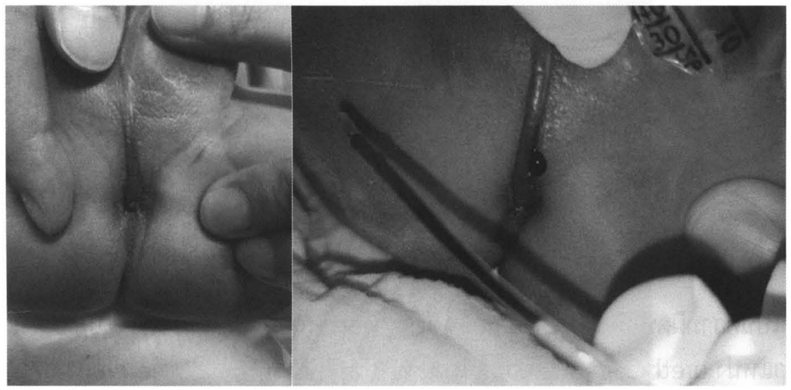

> **Caption (verbatim):** รูปที่ 1 Perineal fistula
> **Text in image (verbatim):** none
> **Description:** Two black-and-white clinical photographs side by side of the perineum of a newborn. Left panel: the examiner's fingers spread the buttocks, showing the perineal skin with the midline raphe and a small dark pinpoint opening in the midline of the perineum; no normally sited anal opening is seen. Right panel: closer view in which a thin dark tubular streak runs along the midline raphe with a dark bead at one point along it; a fine instrument (probe/forceps) lies alongside it, and gloved fingers hold the skin. A partly visible clear packet/tag with illegible printing is at the upper right corner.
> **Identifiers in image:** none

<!-- p.924 (printed 910) -->
### Rectourethral fistula/rectovesical fistula

จะพบในทารกเพศชายที่มีความผิดรูปแต่กำเนิดของทวารหนัก ที่เมื่อสังเกตอาการภายใน 24 ชั่วโมงหลังคลอด พบว่ามีขี้เทาปนออกมาเวลาถ่ายปัสสาวะ หรือพบว่ามีขี้เทาติดอยู่บริเวณปลายอวัยวะเพศ ซึ่งเป็นการบ่งบอกว่าลำไส้ใหญ่ส่วน rectum มีการเชื่อมต่อกับระบบทางเดินปัสสาวะ แต่ไม่สามารถแยกได้ว่าเป็นชนิดใด อาจเป็น rectourethral bulbar fistula, rectourethral prostatic fistula หรือ rectovesical fistula แพทย์จะทราบว่าเป็นชนิดใด จากการตรวจพิเศษ high pressure colostogram ซึ่งจะทำหลังการผ่าตัดยกลำไส้ใหญ่ออกมาเปิดบริเวณหน้าท้อง (colostomy) เป็นชนิดที่พบบ่อยที่สุดในทารกเพศชายและส่วนใหญ่จะเป็นชนิด rectourethral bulbar fistula

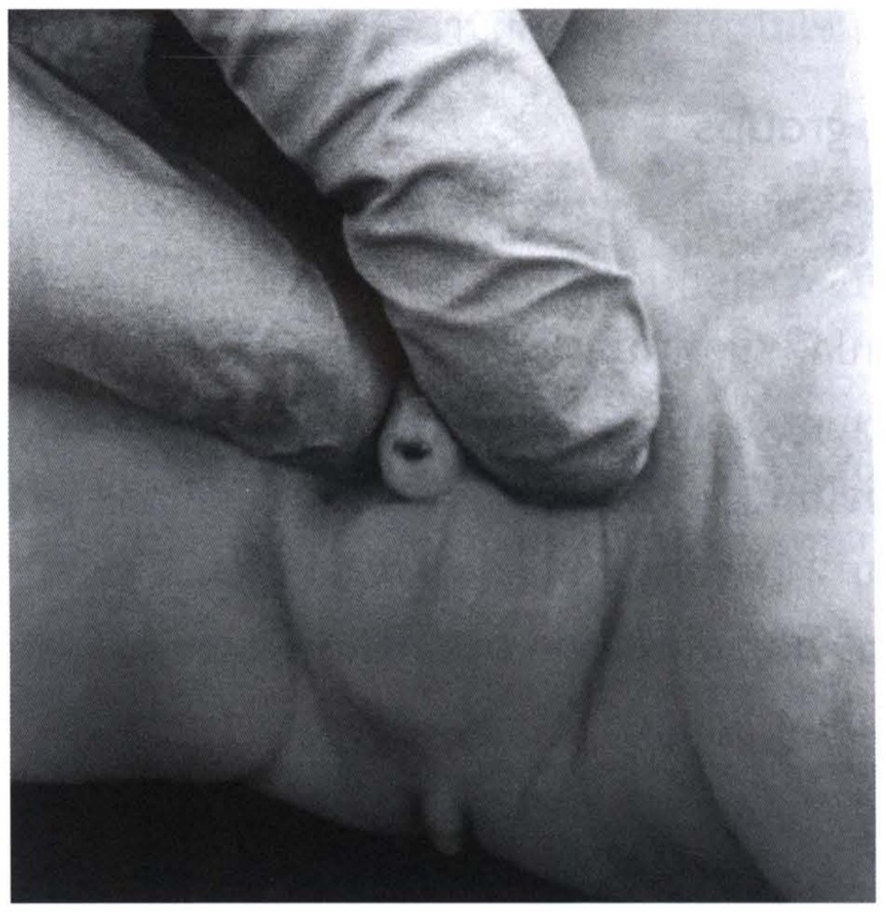

> **Caption (verbatim):** รูปที่ 2 Rectourethral fistula/rectovesical fistula
> **Text in image (verbatim):** none
> **Description:** Black-and-white close-up clinical photograph of the genitalia and perineum of a male newborn. Gloved fingers hold the penis so that the tip of the glans with the small urethral opening is seen at the centre. Below it the perineal skin is smooth with a faint midline raphe and no visible anal opening or perineal fistula; a small skin tag/fold is seen at the lower midline. Thighs are at the sides.
> **Identifiers in image:** none

### Vestibular fistula

เป็นความผิดปกติชนิดที่พบบ่อยที่สุดในทารกเพศหญิง จะตรวจพบมีรูเปิด 3 ตำแหน่ง คือตำแหน่ง urethra, vagina และ fistulous tract บริเวณ vestibule เมื่อสังเกตอาการภายใน 24 ชั่วโมงหลังคลอด พบว่ามีขี้เทาออกมาในบริเวณ vestibule

<!-- p.925 (printed 911) -->
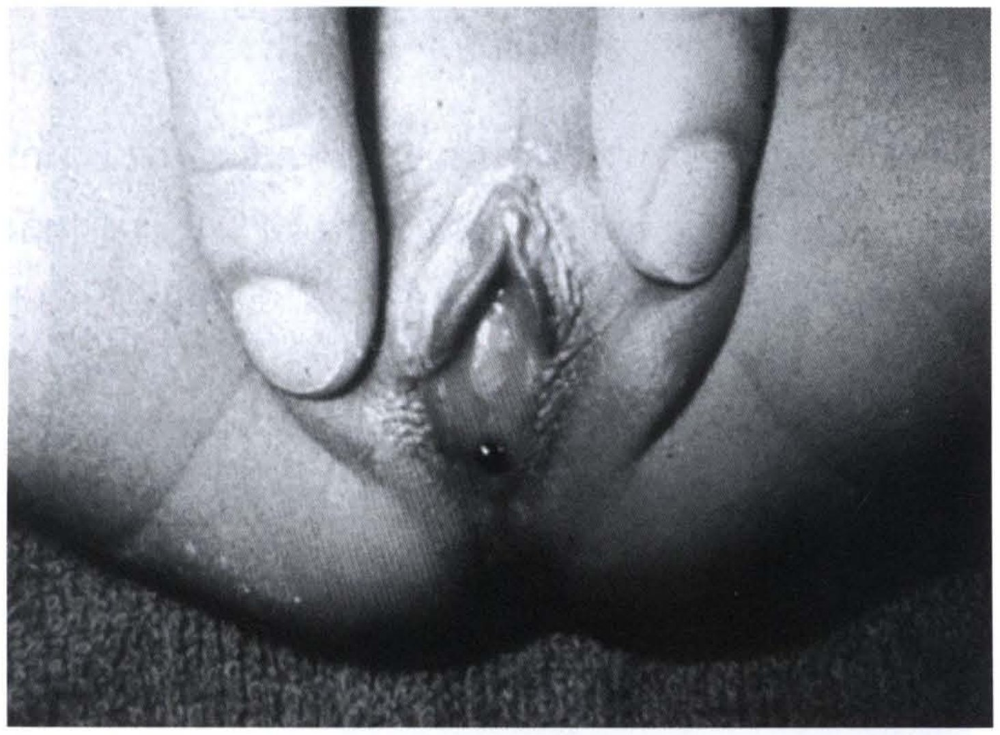

> **Caption (verbatim):** รูปที่ 3 Vestibular fistula
> **Text in image (verbatim):** none
> **Description:** Black-and-white clinical photograph of the perineum of a female newborn lying on a towel, with the examiner's two fingers spreading the labia apart from above. The labia minora and vestibule are seen in the midline; at the lower (posterior) end of the vestibule, just inside the posterior fourchette, there is a small round dark opening (the fistula). Below this the perineal skin between the buttocks shows no normal anal opening.
> **Identifiers in image:** none

### Cloaca

เป็นความผิดปกติชนิดที่พบเฉพาะในทารกเพศหญิง ตรวจร่างกายจะไม่พบรูทวารหนัก โดย urethra, vagina, และ rectum จะเปิดรวมกันเป็นรูเปิดเพียงรูเดียว บริเวณ perineum

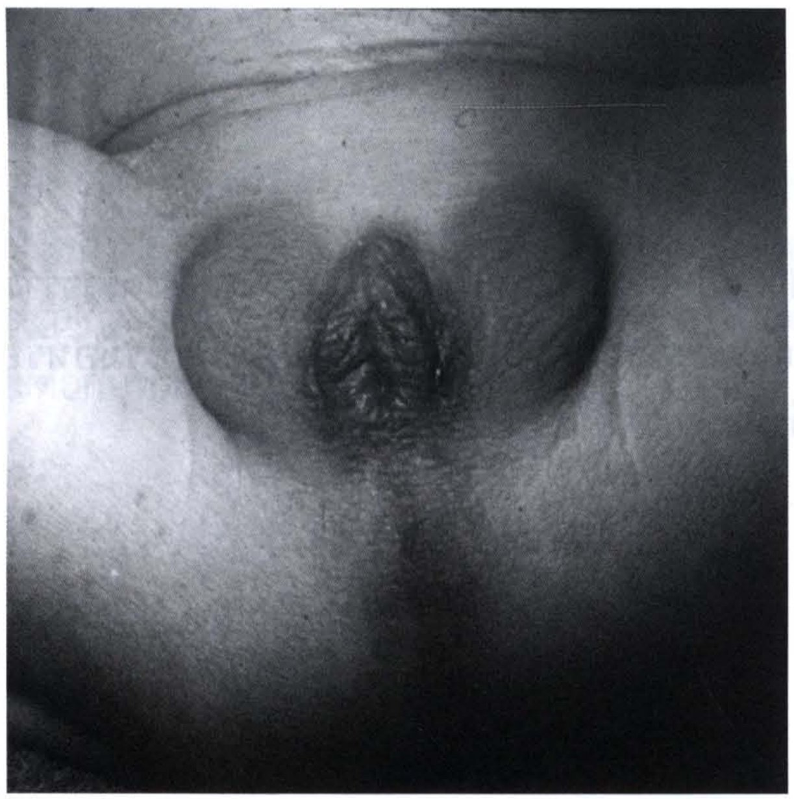

> **Caption (verbatim):** รูปที่ 4 Cloaca
> **Text in image (verbatim):** none
> **Description:** Black-and-white clinical photograph of the perineum of a female infant with legs apart. Between two rounded labial swellings there is a single small, wrinkled, mucosa-lined opening in the midline of the perineum; no separate urethral, vaginal or anal openings are seen, and the skin of the natal cleft below is smooth without an anus.
> **Identifiers in image:** none

<!-- p.926 (printed 912) -->
### No fistula

เป็นความผิดปกติชนิดที่พบทั้งทารกเพศชายและเพศหญิง ตรวจร่างกายจะไม่พบทั้งรูทวารหนักและ fistulous tract เมื่อสังเกตอาการภายใน 24 ชั่วโมงหลังคลอดก็ตรวจไม่พบขี้เทาออกมาตรงตำแหน่งใด ส่วนใหญ่จะพบความผิดปกตินี้ในผู้ป่วย trisomy 21

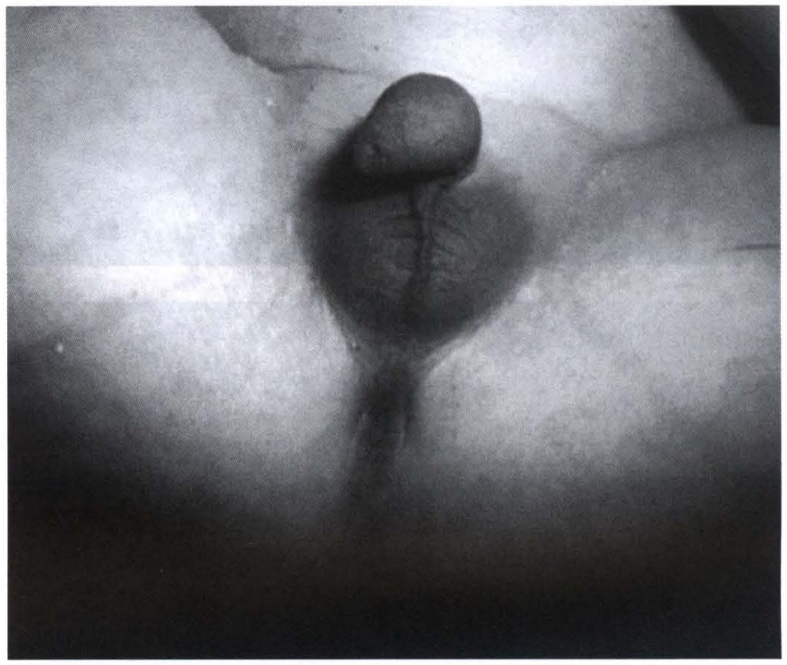

> **Caption (verbatim):** รูปที่ 5 No fistula
> **Text in image (verbatim):** none
> **Description:** Black-and-white clinical photograph of the perineum of a male newborn, legs apart. The penis and scrotum (with its midline raphe) are at the top centre; below them the perineal midline shows a skin crease/raphe running down into the natal cleft, with no anal opening and no visible fistula opening or meconium on the perineum.
> **Identifiers in image:** none

### Anal stenosis

เป็นความผิดปกติชนิดที่พบทั้งทารกเพศชายและเพศหญิง ตรวจร่างกายพบรูทวารหนักตรงตำแหน่งปกติและมีกล้ามเนื้อหูรูดปกติ แต่เมื่อแหย่นิ้วมือหรืออุปกรณ์เข้าไปในรูทวารหนักจะพบว่ามีอาการตีบของรูทวารหนัก

<!-- p.927 (printed 913) -->
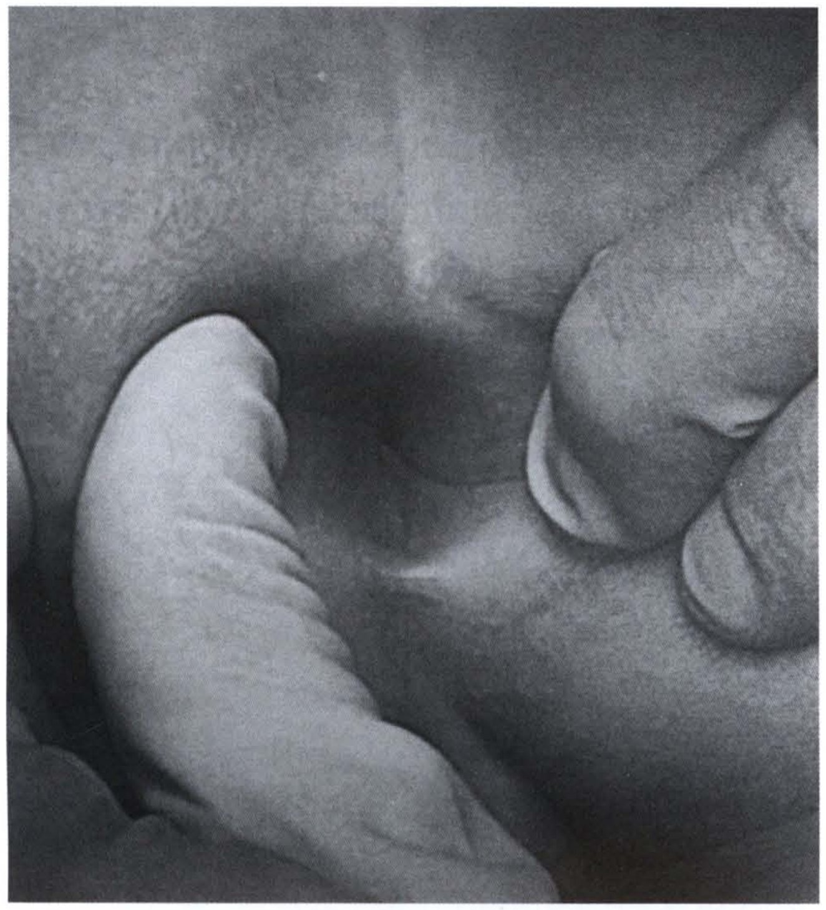

> **Caption (verbatim):** รูปที่ 6 Anal stenosis
> **Text in image (verbatim):** none
> **Description:** Black-and-white close-up clinical photograph of an infant's perineum, with the examiner's fingers spreading the buttocks. A faint midline raphe runs down from the top toward a small, puckered anal opening at the centre, which lies in the normal anal position but appears tiny/narrow, set in a shallow depression between the fingers.
> **Identifiers in image:** none

## Rare/regional variants

### Pouch colon

เป็นความผิดปกติชนิดที่พบทั้งทารกเพศชายและเพศหญิง ลำไส้ใหญ่มีลักษณะสั้นและเป็นกระเปาะโป่งพอง (pouch) ในทารกเพศชาย pouch จะเชื่อมต่อกับกระเพาะปัสสาวะ (colovesical fistula) บริเวณส่วนต้นต่อตำแหน่ง bladder neck ในทารกเพศหญิง pouch จะต่อกับท่อปัสสาวะหรือ vestibule

<!-- p.928 (printed 914) -->
### Rectal atresia/stenosis

เป็นความผิดปกติชนิดที่พบทั้งทารกเพศชายและเพศหญิง ตรวจร่างกายพบมีรูทวารหนักตรงตำแหน่งปกติและมีกล้ามเนื้อหูรูดปกติ แต่รูปร่างรูทวารหนักเป็นรูปกรวย (funnel-liked) และเป็นปลายตัน

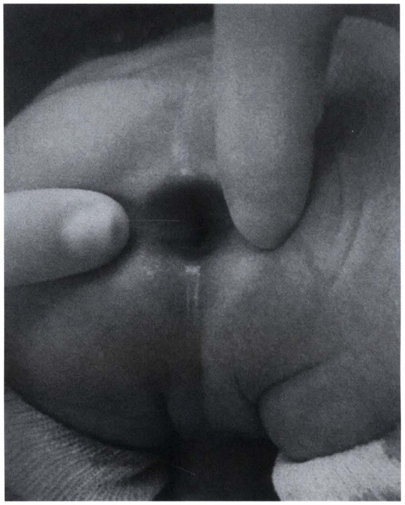

> **Caption (verbatim):** รูปที่ 7 Rectal atresia/stenosis
> **Text in image (verbatim):** none
> **Description:** Black-and-white close-up clinical photograph of an infant's perineum with the buttocks spread apart by the examiner's fingers (left and upper right). An anal opening is present in the normal position on the midline raphe; it appears as a dark, funnel-shaped depression at the centre of the image. The natal cleft continues below it toward a towel at the bottom.
> **Identifiers in image:** none

<!-- p.929 (printed 915) -->
### Rectovaginal fistula

เป็นความผิดปกติชนิดที่พบได้น้อยในทารกเพศหญิง ตรวจร่างกายจะไม่พบรูทวารหนัก และ fistulous tract จะต่อกับช่องคลอดบริเวณด้านหลัง (ส่วนใหญ่จะวินิจฉัยผิดว่าเป็น rectovaginal fistula ทั้งที่จริงเป็นชนิด vestibular fistula)

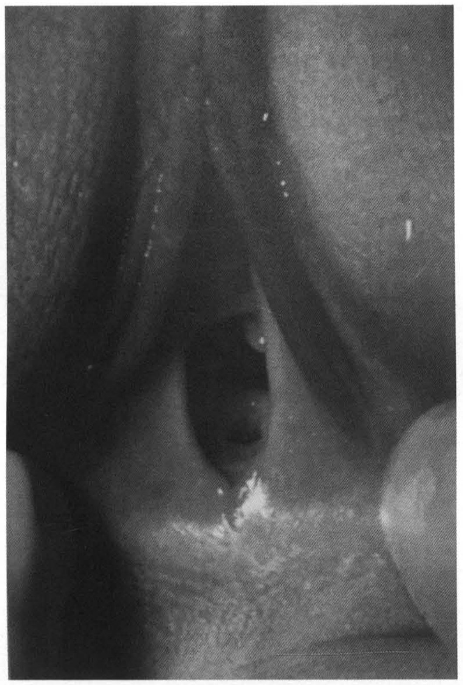

> **Caption (verbatim):** รูปที่ 8 Rectovaginal fistula
> **Text in image (verbatim):** none
> **Description:** Black-and-white close-up clinical photograph of the external genitalia of a female infant, with fingertips at the lower left and lower right edges spreading the labia. The labia converge at the top; in the centre the vaginal introitus is seen as a dark oval opening, and below it the perineal skin is smooth with whitish material/meconium-like debris at the posterior fourchette and no anal opening visible on the perineum.
> **Identifiers in image:** none

<!-- p.930 (printed 916) -->
### H fistula

เป็นความผิดปกติชนิดที่พบได้น้อยในทารกเพศหญิง ตรวจร่างกายจะพบว่าทารกมีท่อปัสสาวะ ช่องคลอด และรูทวารหนักปกติ แต่มีขี้เทาหรืออุจจาระออกมาอยู่บริเวณระหว่างช่องคลอดและรูทวารหนัก เพราะมี fistulous tract ระหว่าง vestibule และ anal crypt ของ dentate line ซึ่งตรวจพบโดยการแยง lacrimal probe

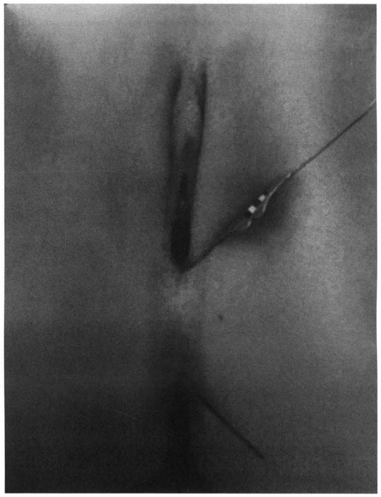

> **Caption (verbatim):** รูปที่ 9 H fistula
> **Text in image (verbatim):** none
> **Description:** Black-and-white clinical photograph of the perineum of a female infant. The labia/vulval cleft runs vertically in the upper centre. A thin metal probe (lacrimal probe) enters from the upper right, and its tip passes into the lower (posterior) end of the vestibule. Lower down, in the natal cleft at the bottom centre (anal region), a second short straight segment of the probe is seen, consistent with the probe traversing a tract from the vestibule to the anal canal.
> **Identifiers in image:** none

ความผิดปกติที่พบร่วม5, 7, 8, 9

## 1. ความผิดปกติของระบบหัวใจและหลอดเลือด7

ได้แก่ Patent foramen ovale (PFO) พบร้อยละ 58.0, Patent ductus arteriosus (PDA) พบร้อยละ 43.8, Atrial septal defect (ASD) พบร้อยละ 20.7, Ventricular septal defect (VSD) พบร้อยละ 12.3, นอกจากนี้ ได้แก่ Tricuspid regurgitation, Right-side aortic arch, Tetralogy of Fallot, Coarctation of aorta, Bicuspid

<!-- p.931 (printed none) -->
aortic valve, Transposition of great vessels, Aortic stenosis และ Total anomalous pulmonary venous drainage (TAPVD)

## 2. ความผิดปกติของไขสันหลัง กระดูกสันหลังและกระดูกเชิงกราน7

ได้แก่ Tethered cord พบร้อยละ 20.6, Sacral dysplasia/hemisacrum พบร้อยละ 17.8, Fatty filum พบร้อยละ 13.8, Low conus พบร้อยละ 9.9, Hemivertebrae พบร้อยละ 5.7 นอกจากนี้ ได้แก่ Sacral agenesis, Myelomeningocele/Spina bifida, Caudal regression และ Presacral mass

## 3. ความผิดปกติของไต ทางเดินปัสสาวะและระบบสืบพันธ์5, 7

ความผิดปกติของไตและทางเดินปัสสาวะ ได้แก่ Vesicoureteric reflux (VUR) พบร้อยละ 255, Hydronephrosis พบร้อยละ 22.7, Renal agenesis พบร้อยละ 6.8, Dysplastic kidney พบร้อยละ 6.0 นอกจากนี้ ได้แก่ Pelvicaliectasis, Horseshoe kidney, Duplicated kidney/collecting system, Pelviureteric junction, Vesicoureteric junction และ Posterior urethral valve

ความผิดปกติของระบบสืบพันธ์5 ได้แก่ Cryptorchidism, Bifid scrotum, Hypospadias, Penoscrotal transposition, Duplicated penis, Chordee, Persistent urogenital sinus, Uterine atresia, Uterine didelphys,Vaginal atresia และ Vaginal septum

## 4. ความผิดปกติของแขนขา

ได้แก่ Absent radius พบร้อยละ 7.9, Polydactyly พบร้อยละ 5.3 นอกจากนี้ ได้แก่ Absent thumb, Congenital dislocation hips, Syndactyly และ Talipes

## 5. ความผิดปกติของระบบทางเดินอาหาร8

ได้แก่ Esophageal atresia พบร้อยละ 3-169, Colonic atresia, Ileal atresia, Malrotation, Duodenal atresia, Meckel’s diverticulum และ Omphalocele

<!-- p.932 (printed 918) -->
## การวินิจฉัย

โดยปกติทั่วไปทารกจะมีการถ่ายขี้เทาภายใน 24 ชั่วโมงแรกหลังคลอด ผู้ป่วยที่มีความผิดรูปแต่กำเนิดของทวารหนักอาจตรวจไม่พบ fistulous tract ที่บริเวณใดบริเวณหนึ่งทันทีหลังคลอด จำเป็นต้องรอเวลาให้มีแรงดันภายในลำไส้เพื่อขับเคลื่อนให้ขี้เทาผ่านออกมา ดังนั้นจึงจำเป็นต้องตรวจร่างกายอย่างละเอียดซ้ำ ถ้าตรวจพบว่ามีขี้เทาออกมาบริเวณ perineum ด้านหน้าต่อ anal dimple แสดงว่าผู้ป่วยมีความผิดปกติชนิด perineal fistula การตรวจพบขี้เทาออกมาในบริเวณ vestibule แสดงว่าผู้ป่วยมีความผิดปกติชนิด vestibular fistula และถ้าผู้ป่วยมีขี้เทาปนออกมากับปัสสาวะ ก็แสดงว่าลำไส้ใหญ่ที่มีความผิดรูปส่วน rectum มีส่วนเชื่อมต่อกับ urinary tract ประมาณร้อยละ 80-90 ของผู้ป่วยจะมีความผิดปกติชนิดมี fistulous tract เพียงส่วนน้อยที่ไม่มี fistulous tract ดังนั้นถ้าหลังคลอดครบ 24 ชั่วโมงแล้ว ผู้ป่วยยังไม่ถ่ายขี้เทาออกมา จำเป็นต้องตรวจทางรังสีวิทยาเพิ่มเติมท่า prone cross-table lateral เพื่อดูเงาลมในลำไส้ใหญ่ส่วน rectum ว่าอยู่บริเวณไหนและอยู่ห่างจาก perineum กี่เซนติเมตร จะได้วางแผนรักษาต่อไปในอนาคต ร่วมกับการตรวจหาความผิดปกติของร่างกายระบบอื่นๆ อย่างเป็นระบบเพื่อหาภาวะที่อาจเป็น life-threatening ซึ่งจำเป็นต้องได้รับแก้ไขอย่างเร่งด่วน

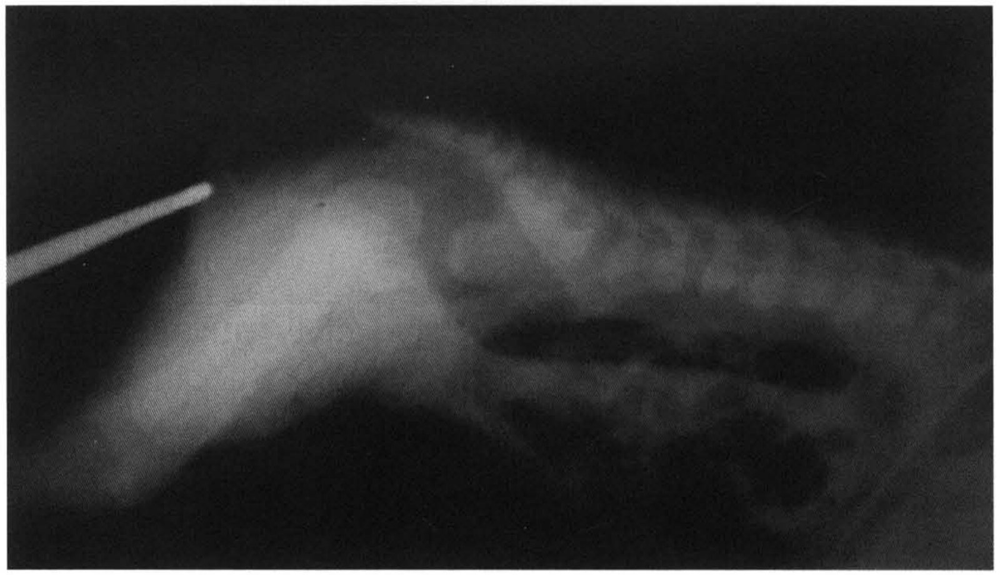

> **Caption (verbatim):** **รูปที่ 10** ภาพการตรวจทางรังสีวิทยาท่า prone cross-table lateral พบว่า blind pouch อยู่ห่างจากผิวหนังบริเวณที่คาดว่าน่าจะเป็นรูทวารหนักน้อยกว่า 1 เซนติเมตร
> **Text in image (verbatim):** none
> **Description:** Black-and-white plain radiograph of an infant taken in the prone cross-table lateral position, shown horizontally. A thin radio-opaque linear marker enters from the left edge and its tip ends at the skin surface of the perineum/buttock region at upper left. The pelvis and sacral bones appear as a bright area on the left-centre; gas-filled bowel loops (dark lucencies) and soft-tissue/stool shadows extend toward the right. Per the caption, the gas-filled blind pouch of the rectum lies less than 1 cm from the skin at the expected anal site (marked by the marker tip). No labels or arrows on the image.
> **Identifiers in image:** none

<!-- p.933 (printed 919) -->
การตรวจหาความผิดปกติที่พบร่วมที่พบบ่อย ได้แก่ VACTERL (vertebral defects, ARMs, cardiac defects, tracheoesophageal fistula, renal anomalies, and limb abnormalities) โดยการส่งตรวจเพิ่มเติมดังต่อไปนี้

1.1 การตรวจทางรังสีวิทยาเพื่อดูความผิดปกติของกระดูกบริเวณคอ สันหลัง เอวและใต้กระเบนเหน็บ ความผิดปกติที่พบบ่อย ได้แก่ hemivertebra , hemisacrum

1.2 การตรวจร่างกายเพื่อดูว่ามีความผิดปกติของระบบหัวใจและหลอดเลือดหรือไม่ ถ้าตรวจพบความผิดปกติก็ส่งตรวจ echocardiography ต่อไป

1.3 การใส่ NG decompression ถ้าใส่ลงไปในกระเพราะอาหารได้ แสดงว่าผู้ป่วยไม่มีหลอดอาหารตัน แต่ถ้าใส่แล้วไม่เข้าไปในกระเพาะอาหาร ค้างอยู่ตรงตำแหน่ง 9-12 เซนติเมตร แสดงว่ามี esophageal atresia with or without tracheoesophageal fistula

1.4 การตรวจด้วยคลื่นเสียงความถี่สูง เพื่อหาความผิดปกติของไต ระบบทางเดินปัสสาวะและความผิดปกติของไขสันหลัง (renal and spinal ultrasonography) ในผู้ป่วยเพศหญิงบางราย จำเป็นต้องตรวจบริเวณช่องท้องและอุ้งเชิงกราน เพื่อดูว่ามี hydrocolpos ร่วมด้วยหรือไม่

## การผ่าตัดรักษา

การผ่าตัดรักษาความผิดรูปแต่กำเนิดของทวารหนักแบ่งเป็น 2 กลุ่มคือ

1. กลุ่มที่สามารถสร้างทวารหนักให้สมบูรณ์หลังคลอดได้เลย (Primary repair)
2. กลุ่มที่จำเป็นต้องผ่าตัด 3 ขั้นตอน (Three-stage procedure)

การผ่าตัด 3 ขั้นตอน ขั้นตอนแรกคือการยกลำไส้ใหญ่ออกมาเปิดบริเวณหน้าท้อง (colostomy) หลังคลอดเป็นการชั่วคราวก่อน ขั้นตอนต่อไปคือการสร้างทวารหนักให้สมบูรณ์ภายหลัง ประมาณ 8-10 สัปดาห์หลังจากนั้น และขั้นตอนสุดท้ายคือการเย็บปิดลำไส้ใหญ่ที่เปิดเอาไว้กลับเข้าไปในช่องท้อง (closure colostomy) หลังการผ่าตัดสร้างทวารหนักให้สมบูรณ์แล้ว 6-12 สัปดาห์

<!-- p.934 (printed 920) -->
แนวทางในการดูแลรักษาทารกแรกเกิดเพศชายที่มีความผิดรูปแต่กำเนิดของทวารหนักสามารถสรุปได้ ดังแผนภูมิต่อไปนี้10

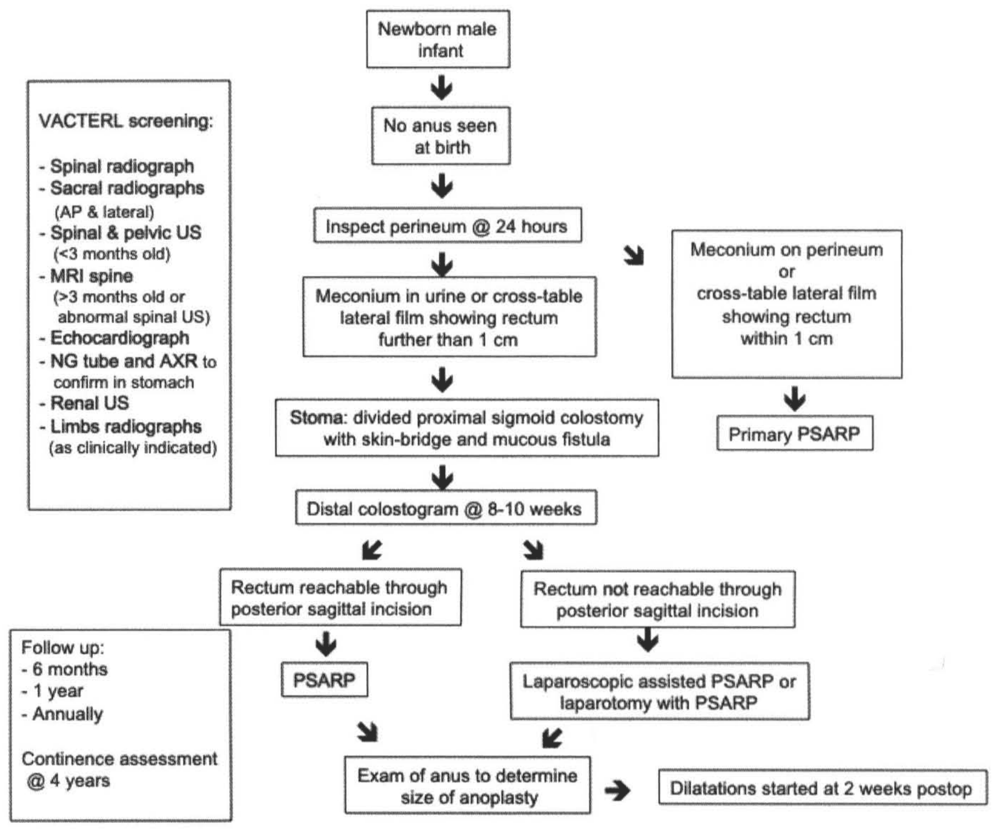

> **Caption (verbatim):** none
> **Text in image (verbatim):** Newborn male infant · No anus seen at birth · Inspect perineum @ 24 hours · Meconium in urine or cross-table lateral film showing rectum further than 1 cm · Meconium on perineum or cross-table lateral film showing rectum within 1 cm · Primary PSARP · Stoma: divided proximal sigmoid colostomy with skin-bridge and mucous fistula · Distal colostogram @ 8-10 weeks · Rectum reachable through posterior sagittal incision · Rectum not reachable through posterior sagittal incision · PSARP · Laparoscopic assisted PSARP or laparotomy with PSARP · Exam of anus to determine size of anoplasty · Dilatations started at 2 weeks postop · VACTERL screening: · - Spinal radiograph · - Sacral radiographs (AP & lateral) · - Spinal & pelvic US (<3 months old) · - MRI spine (>3 months old or abnormal spinal US) · - Echocardiograph · - NG tube and AXR to confirm in stomach · - Renal US · - Limbs radiographs (as clinically indicated) · Follow up: · - 6 months · - 1 year · - Annually · Continence assessment @ 4 years
> **Description:** Black-and-white flowchart of boxes connected by bold arrows (management algorithm for a newborn male with anorectal malformation). The main column runs top to bottom; two free-standing boxes on the left (not connected by arrows) list VACTERL screening (upper left) and follow-up (lower left). Flow: Newborn male infant → No anus seen at birth → Inspect perineum @ 24 hours; ↓ (straight down) Meconium in urine or cross-table lateral film showing rectum further than 1 cm → **Stoma:** divided proximal sigmoid colostomy with skin-bridge and mucous fistula → Distal colostogram @ 8-10 weeks; ↙ Rectum reachable through posterior sagittal incision → PSARP → ↘ Exam of anus to determine size of anoplasty; ↘ Rectum not reachable through posterior sagittal incision → Laparoscopic assisted PSARP or laparotomy with PSARP → ↙ Exam of anus to determine size of anoplasty; Exam of anus to determine size of anoplasty → (right arrow) Dilatations started at 2 weeks postop; ↘ (diagonal to the right) Meconium on perineum or cross-table lateral film showing rectum within 1 cm → Primary PSARP; Box "VACTERL screening:" — Spinal radiograph; Sacral radiographs (AP & lateral); Spinal & pelvic US (<3 months old); MRI spine (>3 months old or abnormal spinal US); Echocardiograph; NG tube and AXR to confirm in stomach; Renal US; Limbs radiographs (as clinically indicated).; Box "Follow up:" — 6 months; 1 year; Annually; Continence assessment @ 4 years.
> **Identifiers in image:** none

- Newborn male infant → No anus seen at birth → Inspect perineum @ 24 hours
  - → Meconium in urine or cross-table lateral film showing rectum further than 1 cm → **Stoma:** divided proximal sigmoid colostomy with skin-bridge and mucous fistula → Distal colostogram @ 8-10 weeks
    - → Rectum reachable through posterior sagittal incision → PSARP → Exam of anus to determine size of anoplasty → Dilatations started at 2 weeks postop
    - → Rectum not reachable through posterior sagittal incision → Laparoscopic assisted PSARP or laparotomy with PSARP → Exam of anus to determine size of anoplasty → Dilatations started at 2 weeks postop
  - → Meconium on perineum or cross-table lateral film showing rectum within 1 cm → Primary PSARP
- VACTERL screening:
  - Spinal radiograph
  - Sacral radiographs (AP & lateral)
  - Spinal & pelvic US (<3 months old)
  - MRI spine (>3 months old or abnormal spinal US)
  - Echocardiograph
  - NG tube and AXR to confirm in stomach
  - Renal US
  - Limbs radiographs (as clinically indicated)
- Follow up:
  - 6 months
  - 1 year
  - Annually
  - Continence assessment @ 4 years

<!-- p.935 (printed 921) -->
แนวทางในการดูแลรักษาทารกแรกเกิดเพศหญิงที่มีความผิดรูปแต่กำเนิดของทวารหนักสามารถสรุปได้ดังแผนภูมิต่อไปนี้10

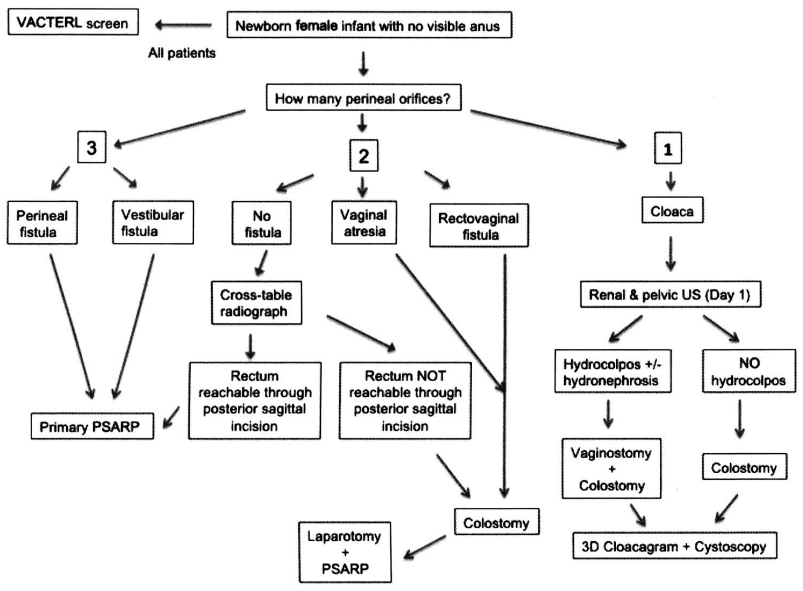

> **Caption (verbatim):** none
> **Text in image (verbatim):** VACTERL screen · All patients · Newborn female infant with no visible anus · How many perineal orifices? · 3 · 2 · 1 · Perineal fistula · Vestibular fistula · No fistula · Vaginal atresia · Rectovaginal fistula · Cloaca · Cross-table radiograph · Rectum reachable through posterior sagittal incision · Rectum NOT reachable through posterior sagittal incision · Primary PSARP · Colostomy · Laparotomy + PSARP · Renal & pelvic US (Day 1) · Hydrocolpos +/- hydronephrosis · NO hydrocolpos · Vaginostomy + Colostomy · Colostomy · 3D Cloacagram + Cystoscopy
> **Description:** Black-and-white flowchart of boxes connected by arrows (management algorithm for a newborn female with no visible anus; the word "female" is in heavier bold in the top box). Flow: Newborn female infant with no visible anus → (left arrow, labelled "All patients") VACTERL screen; Newborn female infant with no visible anus → How many perineal orifices?; → 3 → Perineal fistula → Primary PSARP; 3 → Vestibular fistula → Primary PSARP; → 2 → No fistula → Cross-table radiograph; → Rectum reachable through posterior sagittal incision → Primary PSARP; → Rectum NOT reachable through posterior sagittal incision → Colostomy; → 2 → Vaginal atresia → (long diagonal arrow joining the vertical line) Colostomy; → 2 → Rectovaginal fistula → (vertical line) Colostomy; Colostomy → Laparotomy + PSARP; → 1 → Cloaca → Renal & pelvic US (Day 1); → Hydrocolpos +/- hydronephrosis → Vaginostomy + Colostomy → 3D Cloacagram + Cystoscopy; → NO hydrocolpos → Colostomy → 3D Cloacagram + Cystoscopy
> **Identifiers in image:** none

- Newborn **female** infant with no visible anus → (All patients) VACTERL screen
- Newborn **female** infant with no visible anus → How many perineal orifices?
  - 3
    - → Perineal fistula → Primary PSARP
    - → Vestibular fistula → Primary PSARP
  - 2
    - → No fistula → Cross-table radiograph
      - → Rectum reachable through posterior sagittal incision → Primary PSARP
      - → Rectum NOT reachable through posterior sagittal incision → Colostomy → Laparotomy + PSARP
    - → Vaginal atresia → Colostomy → Laparotomy + PSARP
    - → Rectovaginal fistula → Colostomy → Laparotomy + PSARP
  - 1
    - → Cloaca → Renal & pelvic US (Day 1)
      - → Hydrocolpos +/- hydronephrosis → Vaginostomy + Colostomy → 3D Cloacagram + Cystoscopy
      - → NO hydrocolpos → Colostomy → 3D Cloacagram + Cystoscopy

ทารกแรกเกิดที่มีความผิดรูปแต่กำเนิดของทวารหนักชนิดที่สามารถผ่าตัด primary repair มีดังต่อไปนี้

1. ทารกที่มีความผิดปกติชนิด perineal fistula
2. ทารกที่มีความผิดปกติชนิด vestibular fistula (สำหรับกุมารศัลยแพทย์ที่มีประสบการณ์)
3. ทารกที่ไม่สามารถถ่ายขี้เทาหลังคลอด 24 ชั่วโมง และตรวจทางรังสีวิทยาท่า prone cross-table lateral พบว่าสามารถผ่าตัดได้หรือ blind pouch อยู่ห่างจากผิวหนังบริเวณที่คาดว่าน่าจะเป็นรูทวารหนักน้อยกว่า 1 เซนติเมตร

<!-- p.936 (printed 922) -->
สำหรับทารกแรกเกิดมีความผิดรูปแต่กำเนิดของทวารหนักชนิดอื่นๆ ที่ไม่สามารถผ่าตัด primary repair ได้ จำเป็นต้องผ่าตัดยก colostomy หลังคลอด มีดังต่อไปนี้

1. มีหลักฐานบ่งชี้ว่าทารกมีความผิดปกติชนิด rectourethral fistula หรือ rectovesical fistula
2. ทารกที่มีความผิดปกติชนิด vestibular fistula
3. ทารกที่มีความผิดปกติชนิด Cloaca
4. ทารกที่ไม่สามารถถ่ายขี้เทาหลังคลอด 24 ชั่วโมง และตรวจทางรังสีวิทยาท่า prone cross-table lateral แล้วพบว่า blind pouch อยู่ห่างจากผิวหนังบริเวณที่คาดว่าน่าจะเป็นรูทวารหนักมากกว่า 1 เซนติเมตร

ชนิดของ colostomy ที่เหมาะสมสำหรับทารกกลุ่มนี้คือ double-end colostomy บริเวณลำไส้ใหญ่ส่วน proximal sigmoid รูเปิดของลำไส้ใหญ่ส่วนต้นและส่วนปลายควรวางแยกจากกัน ไม่อยู่ชิดกันจนเกินไปโดยทำ skin bridge กั้น และสร้างรูเปิดลำไส้ส่วนปลายให้มีขนาดเล็กเพื่อป้องกันการเกิด colostomy prolapse ข้อดีของการผ่าตัดวิธีนี้คือ ทำให้ลำไส้ส่วนปลายแฟบไม่มีการขยายขนาด และเหลือความยาวของลำไส้ใหญ่ส่วนปลายไม่มากหรือน้อยจนเกินไป สำหรับการดึงลำไส้ลงมาผ่าตัดสร้างทวารหนักในภายหลัง ก่อนผ่าตัดสร้างทวารหนักให้สมบูรณ์จะมีการตรวจเพิ่มเติม high pressure distal colostogram (การฉีดสารทึบรังสีเข้าบริเวณลำไส้ใหญ่ส่วนปลายด้วยแรงดันที่สูงมากพอ) เพื่อระบุตำแหน่งของ fistulous tract ลักษณะและความยาวของลำไส้ใหญ่ส่วน rectum ให้ได้ชัดเจน ก่อนการผ่าตัดรักษา (definitive surgery) ไม่นิยมทำ colostomy ชนิด loop colostomy เพราะมีข้อเสียคือ อุจจาระบางส่วนจากลำไส้ใหญ่ส่วนต้น สามารถผ่านเข้ามาปนเปื้อนบริเวณลำไส้ใหญ่ส่วนปลาย ทำให้เกิดอุจจาระคั่งค้างเป็นก้อนแข็งอัดแน่นอยู่บริเวณส่วนปลายสุด ทารกที่มีความผิดปกติชนิด rectourethral fistula หรือ rectovesical fistula ถ้ามีอุจจาระเข้ามาปนเปื้อน จะทำให้เกิดการติดเชื้อทางเดินปัสสาวะตามมาได้ นอกจากนี้ยังพบว่า loop colostomy จะมีภาวะแทรกซ้อนหลังการผ่าตัดมากกว่าการทำ double-end colostomy โดยเฉพาะ colostomy prolapse

<!-- p.937 (printed 923) -->
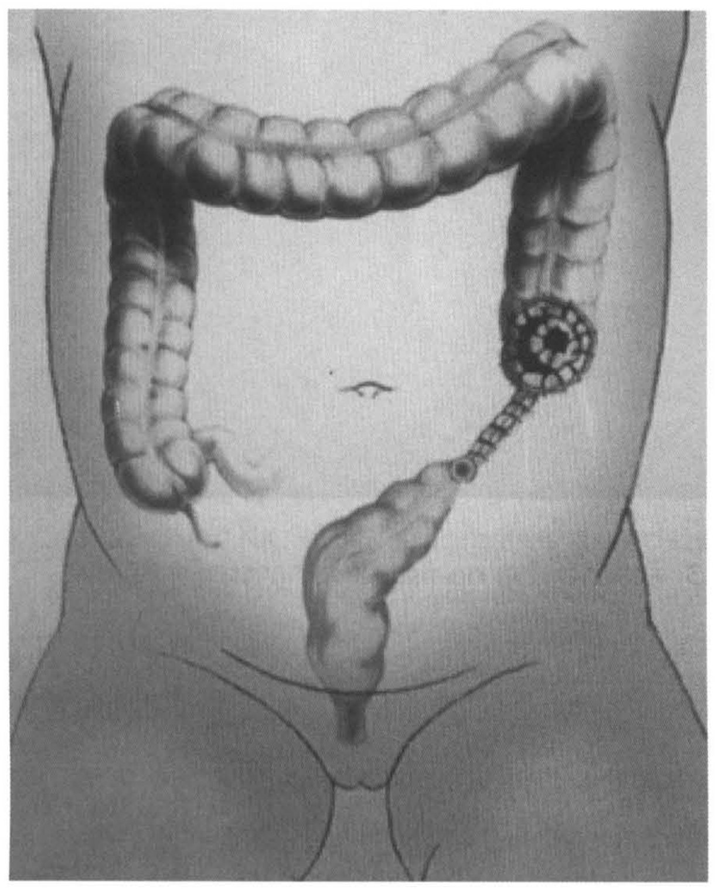

> **Caption (verbatim):** **รูปที่ 11** ลักษณะ double-end proximal sigmoid colostomy ที่เหมาะสม
> **Text in image (verbatim):** none
> **Description:** Grey-shaded medical illustration of an infant's abdomen and pelvis seen from the front (outline of the trunk, umbilicus at the centre, groin creases and upper thighs/perineum below). The colon is drawn through the abdominal wall: caecum with appendix at lower right of the patient (left of the image), ascending colon, transverse colon across the upper abdomen, and descending colon down the patient's left side ending in a large round stoma (proximal stoma) on the left abdominal wall. A segment of skin (skin bridge, drawn as a chain-like strip) separates it from a second, much smaller stoma lower and more medial (the distal mucous fistula), from which the distal sigmoid colon/rectum continues down into the pelvis ending blindly above the perineum. No labels on the image.
> **Identifiers in image:** none

## การผ่าตัดสร้างทวารหนักให้สมบูรณ์

Definitive surgery สำหรับความผิดรูปแต่กำเนิดของทวารหนักในปัจจุบันคือ การผ่าตัด PSARP หรือ posterior sagittal anorectoplasty ศัลยแพทย์ Alberto Pena ได้คิดค้นวิธีการผ่าตัดนี้ตั้งแต่ปี ค.ศ. 198211 เทคนิคการผ่าตัดคือการผ่าตัดในท่าผู้ป่วยนอนคว่ำลงแผลแนวยาวทางด้าน posterior sagittal ตั้งแต่กระดูก coccyx ไปจนถึงตำแหน่งที่ควรจะเป็นรูทวารหนักปกติ โดยมีการใช้เครื่องกระตุ้นกล้ามเนื้อช่วยระบุตำแหน่งกล้ามเนื้อหูรูดทวารหนักในระหว่างผ่าตัด และทำการผ่าตัดแยกเอาลำไส้ใหญ่ส่วน rectum ออกจากอวัยวะใกล้เคียง ทำการเย็บปิด fistulous tract และดึง rectum ออกมาไว้ในบริเวณตำแหน่ง sphincter mechanism ปกติ

<!-- p.938 (printed 924) -->
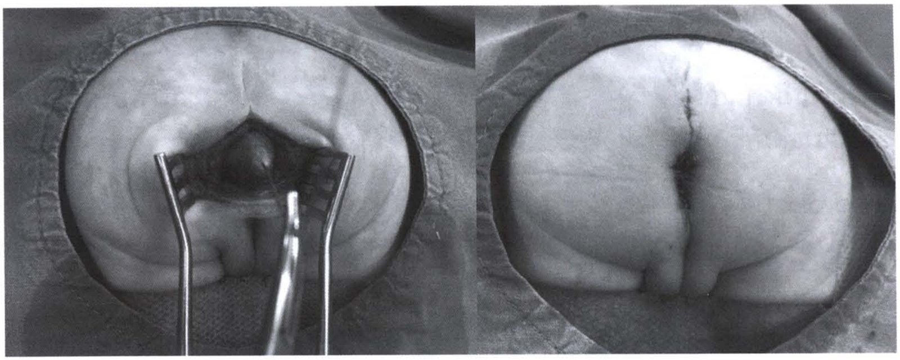

> **Caption (verbatim):** **รูปที่ 12 และ 13** ตัวอย่างผู้ป่วย no fistula ที่ทำการผ่าตัด PSARP
> **Text in image (verbatim):** none
> **Description:** Two black-and-white intraoperative photographs side by side of an infant lying prone, buttocks and perineum exposed through an opening in surgical drapes. Left (รูปที่ 12): a vertical posterior sagittal midline incision between the buttocks is held open by a self-retaining retractor with two metal arms; a curved metal instrument is inserted in the wound and a round dark structure (the mobilised rectum) is visible in the depth of the incision. Right (รูปที่ 13): the same region after closure, showing a sutured vertical midline wound in the natal cleft with the newly created anal opening at its lower end. No labels on the images.
> **Identifiers in image:** none

การผ่าตัดส่องกล้อง (laparoscopic surgery) มีบทบาทมากขึ้นในปัจจุบัน มีการนำการผ่าตัดส่องกล้องมาใช้ ในกรณีทารกเพศชายที่มีความผิดรูปแต่กำเนิดของทวารหนัก และตำแหน่งลำไส้ใหญ่ส่วน rectum อยู่ในช่องท้อง (มีเพียงประมาณร้อยละ 10) สำหรับทารกเพศหญิง แนะนำการผ่าตัดส่องกล้อง ในกรณีที่ลำไส้ใหญ่ส่วน rectum อยู่ในช่องท้องเช่นเดียวกัน หรือต้องการประเมินอวัยวะสืบพันธุ์ภายในร่วมด้วย ในปัจจุบันยังไม่มีหลักฐานชัดเจนที่จะบ่งบอกว่า การผ่าตัดส่องกล้องมีผลการรักษาเป็นที่น่าพอใจมากกว่าการผ่าตัด PSARP12 ทารกเพศชายที่มีความผิดรูปแต่กำเนิดของทวารหนักชนิดที่สามารถผ่าตัดส่องกล้องได้ ได้แก่ rectovesical fistula, rectourethral prostatic fistula และ free-floating rectum ทารกเพศหญิง ได้แก่ complex cloaca ที่มี common channel ยาวมากกว่า 3 เซนติเมตร และ vestibular fistula with absent vagina ส่วนผู้ป่วยที่มีความผิดรูปแต่กำเนิดของทวารหนักชนิด perineal fistula, rectourethral bulbar fistula, vestibular fistula, rectal atresia, cloaca โดยส่วนใหญ่ และ no fistula (ลำไส้ใหญ่ส่วน rectum มักจะอยู่บริเวณแนวเดียวกับ bulbar ของท่อปัสสาวะ) ไม่มีข้อบ่งชี้ในการผ่าตัดส่องกล้อง13

## เอกสารอ้างอิง

1. Levitt MA, Pena A. Imperforate anus and cloaca malformation. In: Holcomb III GW, Murphy JP, editors. Ashcraft’s Pediatric Surgery. 5th ed. Philadelphia, PA: Saunders Elsevier; 2010. p.468-90.

<!-- p.939 (printed 925) -->
2. Liang Y, Shen D, Cai W. Two coding single nucleotide polymorphisms in the *SALL1* gene in Townes-Brocks syndrome: a case report and review of the literature. J Pediatr Surg 2008;43:391-393.
3. Cretolle C, Pelet A, Sanlaville D, et al. Spectrum of *HLXB9* gene mutations in Currarino syndrome and genotype-phenotype correlation. Hum Mutat 2008;29: 903-910.
4. Chandra SR, Daryappa MM, Mukneem Mudabbir MA, et al. Pallister-Hall syndrome. J Pediatr Neurosci 2017;12(3):276-279.
5. Nah SA, Ong CC, Lakshmi NK, et al. Anomalies associated with anorectal malformations according to the Krickenbeck anatomic classification. J Pediatr Surg 2012;47:2273-2278.
6. Holschneider A, Hutson J, Pena A, et al. Preliminary report on the international conference for development of standards for the treatment of anorectal malformations. J Pediatr Surg 2005;40(10):1521-1526.
7. Minneci PC, Kabre RS, Mak GZ, et al. Screening practices and associated anomalies in infants with anorectal malformations: Result from the Midwest Pediatric Surgery Consortium. J Pediatr Surg 2018;53(6):1163-1167.
8. Balanesscu RN, Topor L, Moga A. Anomalies associated with anorectal malformations. Chirurgia(Bucur) 2013;108(1):38-42.
9. Fernandez E, Bischoff A, Dickie BH, et al. Esophageal atresia in patients with anorectal malformations.Pediatr Surg Int 2014;30(8):767-771.
10. Rentea RM, Levitt MA. Anorectal atresia and cloacal malformations.In: Holcomb III GW, Murphy JP, St Peter SD, editors. Holcomb and Ashcraft’s Pediatric Surgery. 7th ed. Philadelphia, PA: Saunders Elsevier; 2020. p.577-98.
11. Pena A, Devries PA. Posterior sagittal anorectoplasty: important technical considerations and new application. J Pediatr Surg 1982;17:796-811.
12. Bischoff A, Martinez-Leo B, Pena A. Laparoscopic approach in the management of anorectal malformations. Pediatr Surg Int 2015;31:431-437.
13. Cairo SB, Rothstein DH, Harmon CM. Minimally invasive surgery in the management of anorectal malformations. Clin Perinatol 2017;44(4):819-834.

<!-- p.940 (printed none) -->
*[blank page]*
