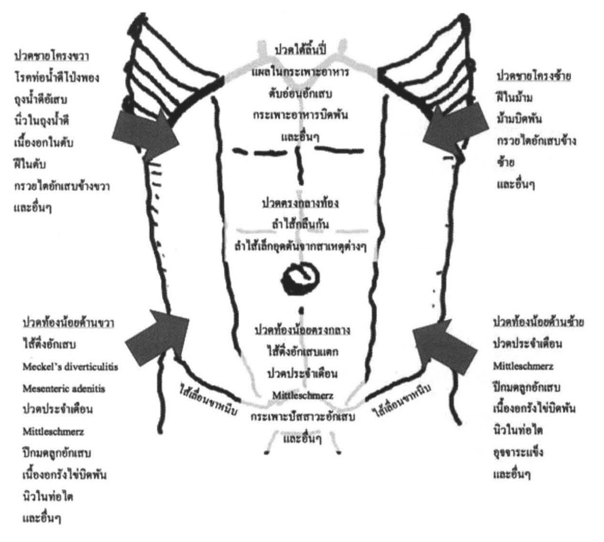
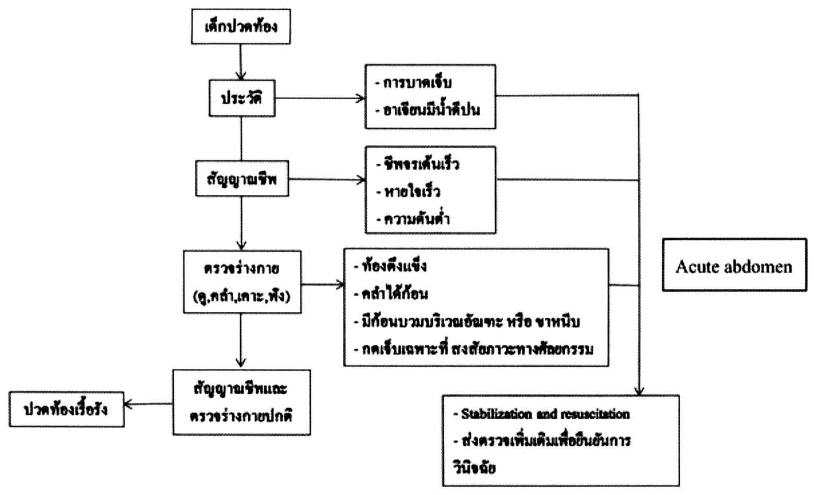
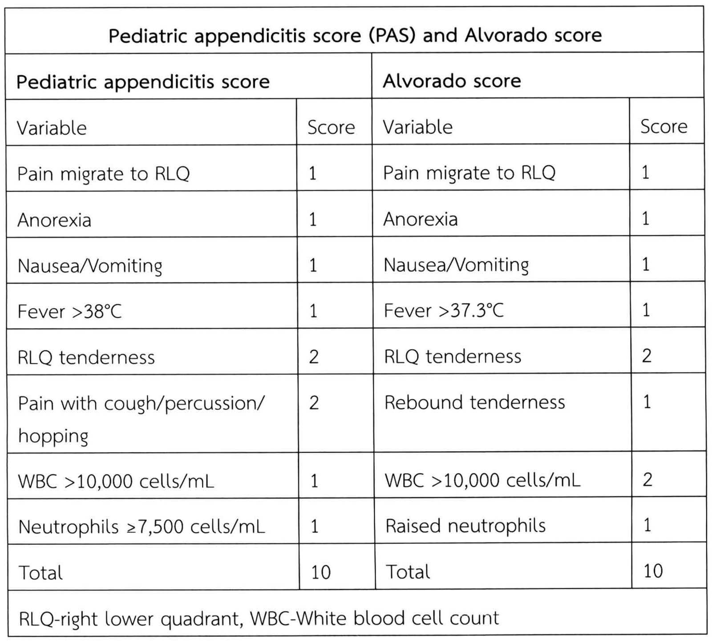
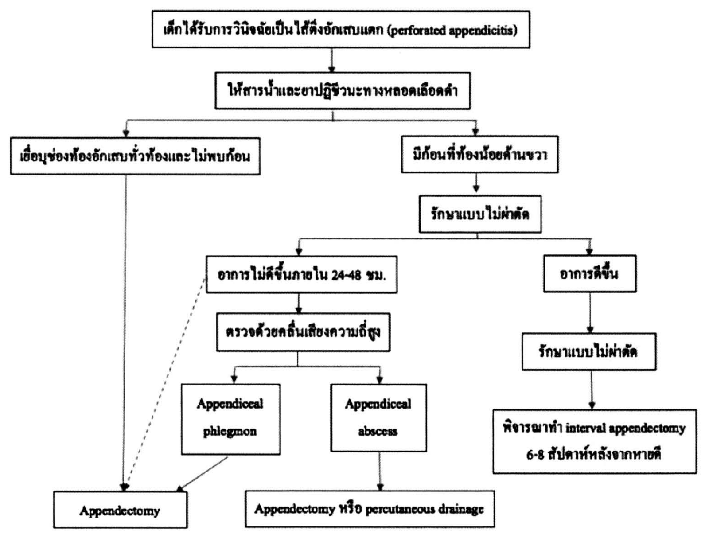
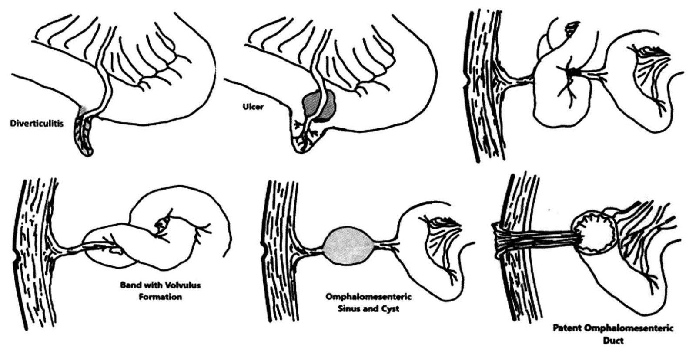
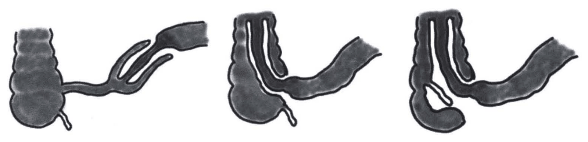
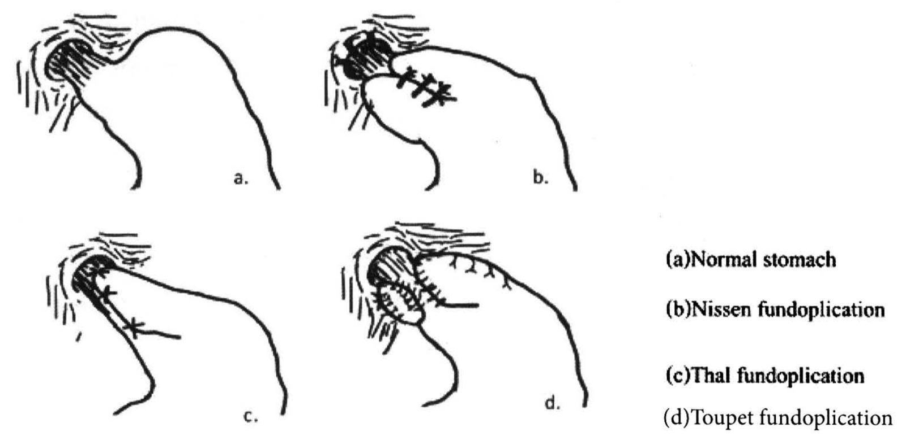

# กุมารศัลยศาสตร์ทางเดินอาหารในเด็กเล็กและเด็กโต

## Contents of this file
- ปัญหาเด็กปวดท้อง (p.942)
- ปัญหาเด็กถ่ายเป็นเลือด (p.946)
- ไส้ติ่งอักเสบ (Acute appendicitis) (p.947)
  - บทนำ (p.947)
  - อาการทางคลินิก (p.947)
  - การวินิจฉัย (p.948)
  - การรักษา (p.949)
  - ภาวะแทรกซ้อน (p.950)
  - พยากรณ์โรค (p.950)
- Meckel’s diverticulum (p.951)
  - อาการทางคลินิก การวินิจฉัย และการรักษา (p.952)
  - Meckel’s diverticulum ที่ไม่มีอาการ (Asymptomatic Meckel’s diverticulum) (p.953)
- ลำไส้กลืนกัน (Intussusception) (p.953)
  - อาการทางคลินิก (p.954)
  - การวินิจฉัย (p.954)
  - การรักษา (p.955)
  - ภาวะแทรกซ้อน (p.955)
  - พยากรณ์โรค (p.956)
- Polyps (p.956)
- แผลปริที่ผิวหนังบริเวณขอบทวารหนัก (Anal fissure) (p.957)
- ฝีคัณฑสูตร (Fistula in ano) (p.957)
- ทางเดินอาหารซ้ำซ้อน (Enteric duplication or GI duplication) (p.958)
  - อาการทางคลินิก (p.958)
  - การวินิจฉัย (p.959)
  - การรักษา (p.959)
  - การพยากรณ์โรค (p.959)
- โรคกรดไหลย้อน (Gastroesophageal Reflux disease, GERD) (p.960)
  - อาการและอาการแสดง (p.961)
  - การรักษา (p.962)
  - ภาวะแทรกซ้อน (p.964)
  - การพยากรณ์โรค (p.964)
- โรคลำไส้อักเสบเรื้อรัง (Inflammatory Bowel Disease, IBD) (p.964)
  - พยาธิกำเนิด (p.965)
  - ลักษณะทางคลินิก (p.965)
  - การวินิจฉัย (p.966)
  - การรักษา (p.967)
  - ภาวะแทรกซ้อน (p.969)
  - การพยากรณ์โรค (p.969)
- เอกสารอ้างอิง (p.969)

<!-- p.941 (printed none) -->
**กุมารศัลยศาสตร์ทางเดินอาหารในเด็กเล็กและเด็กโต**

นิมมิตา ศรีสันต์

<!-- p.942 (printed 928) -->
**กุมารศัลยศาสตร์ทางเดินอาหารในเด็กเล็กและเด็กโต**

นิมมิตา ศรีสันต์

อาการของผู้ป่วยโรคทางศัลยกรรมทางเดินอาหารในเด็กที่พบบ่อย ได้แก่ ปวดท้องและถ่ายเป็นเลือด แพทย์เวชปฏิบัติทั่วไปควรมีความรู้พื้นฐานสามารถรักษาเบื้องต้น และส่งต่อได้อย่างเหมาะสม รวมทั้งรู้จักโรคในระบบทางเดินอาหารทางศัลยกรรมที่พบบ่อยในเด็ก

## ปัญหาเด็กปวดท้อง

เด็กปวดท้อง เป็นอาการที่ผู้ปกครองพาเด็กมาพบแพทย์อยู่เสมอ สาเหตุมีทั้งโรคที่เกิดจากพยาธิสภาพภายในช่องท้องหรือเกิดจากโรคนอกช่องท้อง สิ่งสำคัญของแพทย์ผู้ตรวจคือต้องวินิจฉัยแยกโรคที่ต้องรักษาด้วยการผ่าตัด ออกจากโรคที่รักษาโดยไม่ต้องผ่าตัด แนวทางการวินิจฉัยเหมือนในผู้ใหญ่ สิ่งที่เพิ่มเติมคือผู้ป่วยเด็กมีบางโรคที่พบได้บ่อยในแต่ละกลุ่มอายุ การซักประวัติในเด็กเล็กต้องอาศัยผู้ดูแล การตรวจร่างกายอย่างละเอียด และส่งตรวจเพิ่มเติมทางห้องปฏิบัติการร่วมกับการตรวจทางรังสีวิทยา การตรวจพิเศษอื่นๆ เพื่อนำไปสู่การวินิจฉัยและการรักษาที่ถูกต้อง ปัญหาเด็กปวดท้องแบ่งได้เป็นสองกลุ่ม คือ ปวดท้องเฉียบพลัน และปวดท้องเรื้อรัง

เด็กมีอาการปวดท้องเฉียบพลัน มักมีอาการไม่นานและอาการรุนแรงขึ้นเรื่อยๆ หากวินิจฉัยหรือส่งต่อล่าช้า อาจทำให้เกิดภาวะแทรกซ้อนรุนแรงได้ สามารถแบ่งกลุ่มเด็กปวดท้องเฉียบพลันได้ดังนี้1

1. กลุ่มปวดท้องเฉพาะที่ ปวดตำแหน่งใดตำแหน่งหนึ่งในช่องท้องซึ่งอาจบ่งชี้พยาธิสภาพได้ เช่น ปวดท้องด้านขวาล่างทำให้สงสัยไส้ติ่งอักเสบมากขึ้น ปวดท้องใต้ชายโครงขวา สงสัยโรคกลุ่มตับและท่อน้ำดี เป็นต้น

<!-- p.943 (printed 929) -->
2. กลุ่มเยื่อบุช่องท้องอักเสบทั่วไป ปวดทั่วท้อง กดเจ็บ หน้าท้องแข็งเกร็ง กลุ่มนี้มักเป็นพยาธิสภาพที่มีภาวะแทรกซ้อน เช่น ไส้ติ่งอักเสบแตกทะลุ ลำไส้อักเสบแตกทะลุ
3. กลุ่มปวดท้องจากลำไส้อุดตันมักมีอาการท้องอืด อาเจียน ไม่ถ่ายอุจจาระ ไม่ผายลมร่วมด้วย ถึงแม้เด็กจะยังถ่ายอุจจาระได้ก็ไม่สามารถตัดกลุ่มลำไส้อุดตันออกได้ เช่น ลำไส้กลืนกัน ลำไส้บิดพัน
4. กลุ่มปวดท้องร่วมกับมีก้อน เช่น เนื้องอกรังไข่ที่มีภาวะแทรกซ้อน
5. กลุ่มปวดท้องหลังจากได้รับภัยอันตรายการบาดเจ็บ

ในกลุ่มเด็กปวดท้องเรื้อรังมีคำจำกัดความคืออาการปวดท้องที่เป็นมากกว่า 3 ครั้ง อาการรุนแรงจนมีผลกระทบต่อชีวิตประจำวันของผู้ป่วย และเป็นมานานกว่า 3 เดือน สามารถแบ่งได้ตามสาเหตุ คือ ปวดแบบชนิดที่มีพยาธิสภาพ (organic pain) และปวดแบบหาสาเหตุชัดเจนไม่ได้ (functional pain) อาการปวดท้องเรื้อรังที่มีพยาธิสภาพ อาจเกิดจากอวัยวะในช่องท้องหรือนอกช่องท้อง ในกลุ่มนี้มักมีประวัติน้ำหนักต่ำกว่าเกณฑ์ การเจริญเติบโตไม่สมวัย เช่น โรคกรดไหลย้อน ลำไส้กลืนกันเรื้อรัง โรคลำไส้อักเสบเรื้อรัง หรือลำไส้หมุนตัวผิดปกติร่วมกับมีการบิดพันเป็นครั้งคราว (malrotation with intermittent volvulus) เป็นต้น ส่วนการปวดท้องแบบไร้โรคทางกาย (abdominal pain-related functional gastrointestinal disorders : AP-FGIDs) มีสมมติฐานการเกิดหลายประการที่เป็นปัจจัยกระตุ้นให้เกิดความผิดปกติของการติดต่อประสานงานระหว่างระบบประสาทส่วนกลางกับระบบประสาทในทางเดินอาหาร ทำให้เกิดการบีบคลายของทางเดินอาหารที่ผิดปกติ (intestinal dysmotility) และความไวของการรับความรู้สึกเจ็บเพิ่มขึ้น (visceral hypersensitivity) ซึ่งปัจ จัยกระตุ้นภายนอก ได้แก่ การติดเชื้อทางเดินอาหาร การแพ้อาหาร การใช้ยาต่างๆ ปัจจัยภายใน เช่น ความเครียด ความกังวลของผู้ป่วย สภาพแวดล้อม การเลี้ยงดู และพันธุกรรมก็มีผลกระตุ้นความผิดปกตินี้2 อาการอื่นๆ ที่พบร่วม เช่น ท้องอืด ท้องผูกหรือท้องเสีย อาการนอกระบบทางเดินอาหาร เช่น ปวดศีรษะ ปวดแขนขา นอนไม่หลับ เป็นต้น

<!-- p.944 (printed 930) -->
**ตารางแสดงโรคที่เป็นสาเหตุของอาการปวดท้องที่พบบ่อยในแต่ละกลุ่มอายุ3-4**

| ทารกแรกเกิด (0-1 เดือน) | ทารก (1-12 เดือน) | 1-6 ปี | 6-10 ปี | 10-15 ปี |
| --- | --- | --- | --- | --- |
| Necrotizing enterocolitis Intestinal atresia Malrotation with volvulus Incarcerated inguinal hernia Hirschsprung’s disease Hypertrophic pyloric stenosis | ลำไส้กลืนกัน Hirschsprung’s disease Incarcerated inguinal hernia | ลำไส้กลืนกัน ไส้ติ่งอักเสบเฉียบพลัน Hirschsprung’s disease Meckel’s diverticulum ท่อน้ำดีโป่งพอง บาดเจ็บช่องท้อง | ไส้ติ่งอักเสบเฉียบพลัน แผลในกระเพาะอาหาร นิ่วในถุงน้ำดี เนื้องอกรังไข่บิดพัน Henoch-Schonlein purpura | ไส้ติ่งอักเสบเฉียบพลัน แผลในกระเพาะอาหาร นิ่วในถุงน้ำดี เนื้องอกรังไข่บิดพัน ปวดประจำเดือน ติดเชื้อในอุ้งเชิงกราน ติดเชื้อในทางเดินปัสสาวะ ลำไส้อักเสบเรื้อรัง (inflammatory bowel disease) |

<!-- p.945 (printed 931) -->

> **Caption (verbatim):** none
> **Text in image (verbatim):** ปวดชายโครงขวา · โรคท่อน้ำดีโป่งพอง · ถุงน้ำดีอักเสบ · นิ่วในถุงน้ำดี · เนื้องอกในตับ · ฝีในตับ · กรวยไตอักเสบข้างขวา · และอื่นๆ · ปวดใต้ลิ้นปี่ · แผลในกระเพาะอาหาร · ตับอ่อนอักเสบ · กระเพาะอาหารบิดพัน · และอื่นๆ · ปวดชายโครงซ้าย · ฝีในม้าม · ม้ามบิดพัน · กรวยไตอักเสบข้างซ้าย · และอื่นๆ · ปวดตรงกลางท้อง · ลำไส้กลืนกัน · ลำไส้เล็กอุดตันจากสาเหตุต่างๆ · ปวดท้องน้อยด้านขวา · ไส้ติ่งอักเสบ · Meckel’s diverticulitis · Mesenteric adenitis · ปวดประจำเดือน · Mittleschmerz · ปีกมดลูกอักเสบ · เนื้องอกรังไข่บิดพัน · นิวในท่อไต · และอื่นๆ · ปวดท้องน้อยตรงกลาง · ไส้ติ่งอักเสบแตก · ปวดประจำเดือน · Mittleschmerz · กระเพาะปัสสาวะอักเสบ · และอื่นๆ · ปวดท้องน้อยด้านซ้าย · ปวดประจำเดือน · Mittleschmerz · ปีกมดลูกอักเสบ · เนื้องอกรังไข่บิดพัน · นิวในท่อไต · อุจจาระแข็ง · และอื่นๆ · ไส้เลื่อนขาหนีบ · ไส้เลื่อนขาหนีบ
> **Description:** Hand-drawn line sketch of the front of a child's trunk/abdomen (rib margins hatched at the upper corners, umbilicus drawn as a circle in the middle, dashed transverse line below the epigastrium, groin lines at the bottom). Text labels map regions of pain to their causes. Large grey arrows point into the right upper quadrant (from the left-side list headed "ปวดชายโครงขวา"), the left upper quadrant (from the right-side list headed "ปวดชายโครงซ้าย"), the right lower quadrant (from the list headed "ปวดท้องน้อยด้านขวา") and the left lower quadrant (from the list headed "ปวดท้องน้อยด้านซ้าย"). Inside the abdomen, three centred lists: epigastric "ปวดใต้ลิ้นปี่" above the dashed line, "ปวดตรงกลางท้อง" around the umbilicus, and "ปวดท้องน้อยตรงกลาง" in the hypogastrium. The label "ไส้เลื่อนขาหนีบ" is written along each groin line. Region headings are underlined; each list ends with "และอื่นๆ". The ureteric stone entries are printed as "นิวในท่อไต" at the low resolution of the image.
> **Identifiers in image:** none

แผนภูมิแนวทางการตรวจรักษาผู้ป่วยเด็กที่มาด้วยอาการปวดท้อง4

- เด็กปวดท้อง
  → ประวัติ
    → - การบาดเจ็บ - อาเจียนมีน้ำดีปน → - Stabilization and resuscitation - ส่งตรวจเพิ่มเติมเพื่อยืนยันการวินิจฉัย
    → สัญญาณชีพ
      → - ชีพจรเต้นเร็ว - หายใจเร็ว - ความดันต่ำ → - Stabilization and resuscitation - ส่งตรวจเพิ่มเติมเพื่อยืนยันการวินิจฉัย
      → ตรวจร่างกาย (ดู,คลำ,เคาะ,ฟัง)
        → - ท้องตึงแข็ง - คลำได้ก้อน - มีก้อนบวมบริเวณอัณฑะ หรือ ขาหนีบ - กดเจ็บเฉพาะที่ สงสัยภาวะทางศัลยกรรม → - Stabilization and resuscitation - ส่งตรวจเพิ่มเติมเพื่อยืนยันการวินิจฉัย
        → สัญญาณชีพและตรวจร่างกายปกติ → ปวดท้องเรื้อรัง
- (กล่องข้างเส้นรวมที่นำไปสู่ Stabilization and resuscitation) Acute abdomen

> **Caption (verbatim):** แผนภูมิแนวทางการตรวจรักษาผู้ป่วยเด็กที่มาด้วยอาการปวดท้อง4
> **Text in image (verbatim):** เด็กปวดท้อง · ประวัติ · - การบาดเจ็บ · - อาเจียนมีน้ำดีปน · สัญญาณชีพ · - ชีพจรเต้นเร็ว · - หายใจเร็ว · - ความดันต่ำ · ตรวจร่างกาย (ดู,คลำ,เคาะ,ฟัง) · - ท้องตึงแข็ง · - คลำได้ก้อน · - มีก้อนบวมบริเวณอัณฑะ หรือ ขาหนีบ · - กดเจ็บเฉพาะที่ สงสัยภาวะทางศัลยกรรม · สัญญาณชีพและตรวจร่างกายปกติ · ปวดท้องเรื้อรัง · Acute abdomen · - Stabilization and resuscitation · - ส่งตรวจเพิ่มเติมเพื่อยืนยันการวินิจฉัย
> **Description:** Flowchart. A vertical spine of boxes runs downward: เด็กปวดท้อง → ประวัติ → สัญญาณชีพ → ตรวจร่างกาย (ดู,คลำ,เคาะ,ฟัง) → สัญญาณชีพและตรวจร่างกายปกติ, from which an arrow points left to the box ปวดท้องเรื้อรัง. From each of ประวัติ, สัญญาณชีพ and ตรวจร่างกาย an arrow points right to a box of abnormal findings (history: trauma, bilious vomiting; vital signs: tachycardia, tachypnoea, hypotension; examination: rigid abdomen, palpable mass, swelling at scrotum or groin, localised tenderness suggesting a surgical condition). Lines from these three finding boxes join a common vertical line on the right that ends in an arrow into the bottom box "- Stabilization and resuscitation / - ส่งตรวจเพิ่มเติมเพื่อยืนยันการวินิจฉัย". A separate box "Acute abdomen" sits to the right of that common line, labelling this pathway (no arrow drawn to it).
> **Identifiers in image:** none

<!-- p.946 (printed 932) -->
## ปัญหาเด็กถ่ายเป็นเลือด

ภาวะเลือดออกจากทางเดินอาหารส่วนล่างในเด็ก เป็นปัญหาที่พบไม่บ่อย และส่วนใหญ่มักจะหยุดเองได้ แต่บางสาเหตุอาจก่อให้เกิดอันตรายร้ายแรง เช่น เลือดออกปริมาณมากจนเสียชีวิตได้ แพทย์เวชปฏิบัติจำเป็นต้องแก้ไขปัญหาเบื้องต้นได้ และทราบว่าลักษณะใดที่ต้องส่งต่อผู้ป่วยเพื่อได้รับการวินิจฉัยและรักษาเพิ่มเติม หลักการรักษาเบื้องต้นคล้ายคลึงกับเลือดออกในทางเดินอาหารของผู้ใหญ่ คือประเมินว่าออกจากทางเดินอาหารส่วนบนหรือส่วนล่างเลือดออกมากน้อยเพียงใด

ภาวะเลือดออกทางเดินอาหารส่วนล่าง หมายถึง ภาวะเลือดออกจากทางเดินอาหารที่อยู่ต่ำกว่ารอยต่อระหว่างลำไส้เล็กส่วน duodenum และ jejunum (ligament of Treitz) การวินิจฉัยในผู้ป่วยเด็ก พิจารณาจาก 1. อายุของผู้ป่วย 2. ลักษณะเลือดที่ออก 3. อาการและอาการแสดงร่วม

กลุ่มโรคที่พบบ่อยในแต่ละช่วงอายุแสดงดังตาราง

| 0-1 เดือน | 1 เดือน-2 ปี | 2-5 ปี | 5 ปี-วัยรุ่น |
| --- | --- | --- | --- |
| Anal fissure Necrotizing enterocolitis เด็กกลืนเลือดแม่ระหว่างการคลอด Malrotation with volvulus | Anal fissure ลำไส้กลืนกัน เลือดออกจาก Meckel’s diverticulum ภาวะแพ้โปรตีนนมวัว | Anal fissure Rectal polyp หรือ Colonic polyp เลือดออกจาก Meckel’s diverticulum Infectious diarrhea | Colonic polyp Infectious colitis Inflammatory bowel disease |

ลักษณะอุจจาระและเลือดที่ออก อาจแบ่งได้เป็น 3 แบบ

1. ถ่ายเป็นเลือดสด (hematochezia) อาจหยดตามหลังการถ่ายอุจจาระหรือเคลือบบนผิว ทำให้สงสัยรอยโรคบริเวณรูก้นหรือไส้ตรง (rectum) หากมีเลือดปนอยู่ในอุจจาระมักเกิดจากรอยโรคในลำไส้ใหญ่ ส่วนการถ่ายเป็นมูกปนเลือด

<!-- p.947 (printed 933) -->
มักเกิดจากลำไส้ใหญ่อักเสบติดเชื้อ หรือมีการขาดเลือด ถ้าอุจจาระมีกลิ่นเหม็นช่วยบ่งบอกว่ามีการติดเชื้อร่วมด้วย

2. ถ่ายอุจจาระสีดำ (melena) อุจจาระเหนียวสีดำ สงสัยรอยโรคในทางเดินอาหารส่วนบน
3. Occult gastrointestinal bleeding ไม่เห็นเลือดออกด้วยตาเปล่า แต่ตรวจทางห้องปฏิบัติการพบว่ามีเลือดปนกับอุจจาระ ผู้ป่วยอาจมีอาการซีด อ่อนเพลียร่วมด้วย

อาการและอาการแสดงร่วม เช่น การมีลักษณะของลำไส้อุดตัน พบได้ในลำไส้กลืนกัน ลำไส้บิดหมุน ถ่ายเป็นเลือดสดโดยไม่ปวดท้อง พบในเลือดออกจาก Meckel’s diverticulum หรือมีอาการปวดท้องร่วมด้วยอาจเกิดจากลำไส้อักเสบขาดเลือด คลำได้ก้อนในช่องท้องอาจบ่งชี้ภาวะลำไส้กลืนกัน นอกจากนี้อาการแสดงทางร่างกายอื่นๆ ที่บ่งชี้ systemic disease เป็นต้น

## ไส้ติ่งอักเสบ (Acute appendicitis)

### บทนำ

ไส้ติ่งอักเสบ (appendicitis) เป็นสาเหตุของอาการปวดท้องที่พบได้บ่อยในเด็ก และเป็นโรคที่ต้องผ่าตัดเร่งด่วนที่พบมากที่สุด พบได้ในเด็กทุกวัย แต่พบบ่อยในช่วงอายุ 8-15 ปี life time risk of appendicitis is 7-8% ในเด็กเล็กพบได้น้อย และมักพบเป็นไส้ติ่งอักเสบที่มีภาวะแทรกซ้อน เช่น ไส้ติ่งอักเสบแตก มีภาวะลำไส้อุดตัน หรือไส้ติ่งอักเสบมีหนอง เนื่องจากยากต่อการวินิจฉัย และอาการในระยะแรกคล้ายกับลำไส้อักเสบติดเชื้อ

### อาการทางคลินิก

ระยะเริ่มต้นมักมีอาการปวดท้องไม่เฉพาะเจาะจง ปวดตื้อๆ รอบสะดือ ต่อมาย้ายมาปวดบริเวณท้องน้อยด้านขวา มีอาการคลื่นไส้ อาเจียน เบื่ออาหารร่วมด้วย ต่อมาอาจมีไข้ ตรวจร่างกาย กดเจ็บบริเวณท้องน้อยด้านขวา guarding or rebound tenderness ท้องอืด ในไส้ติ่งอักเสบที่มีภาวะแทรกซ้อน อาจคลำได้ก้อน เด็กดูซึมและไม่ขยับตัว

<!-- p.948 (printed 934) -->
### การวินิจฉัย

ประวัติและลักษณะที่ได้จากการตรวจร่างกายเป็นสิ่งสำคัญที่สุด การตรวจวินิจฉัยทางห้องปฏิบัติการ ไม่มีค่าเฉพาะตัวใดตัวหนึ่งที่บ่งชี้ภาวะไส้ติ่งอักเสบ การตรวจพื้นฐานทางห้องปฏิบัติการ ได้แก่ CBC และ UA ในผู้ป่วย 90% มักพบค่าเม็ดเลือดขาวสูงขึ้น และ shift to the left การส่งตรวจปัสสาวะเพื่อแยกจากโรคปวดท้องที่เกิดจากนิ่วในไต หรือทางเดินปัสสาวะติดเชื้อ

ในผู้ป่วยที่อาการทางคลินิกไม่ชัดเจน และเม็ดเลือดขาวอยู่ในเกณฑ์ปกติ สามารถเฝ้าดูอาการใกล้ชิด หรือส่งตรวจทางรังสีวิทยา ได้แก่ การตรวจด้วยคลื่นเสียงความถี่สูง และการตรวจด้วย computer tomography (CT scan) เพื่อช่วยการวินิจฉัย โดยอาจพบผนังไส้ติ่งบวม เส้นผ่านศูนย์กลางของไส้ติ่งจากภาพตัดขวางหนากว่า 6 มิลลิเมตร ตรวจพบลักษณะในช่องท้องอื่นๆ ที่เป็น secondary signs เช่น พบน้ำในช่องท้อง พบ appendicolith ในผู้ป่วยเด็กมักส่งตรวจด้วยคลื่นเสียงความถี่สูงมากกว่า CT scan เนื่องจากคำนึงถึงการรับรังสีจาก CT scan ของเด็ก (radiation exposure)

ปัจจุบันมีการใช้การผ่าตัดส่องกล้องเพื่อวินิจฉัยในผู้ป่วยที่ผล CT scan ไม่ชัดเจน และยังมีอาการปวดท้องน้อยด้านขวาอยู่

มีการใช้ Pediatric Appendicitis Score (PAS) เพื่อช่วยประเมินแนวโน้มที่จะเป็นไส้ติ่งอักเสบ จากการศึกษาพบว่า PAS มีความถูกต้องมากกว่า Alvorado score ในผู้ป่วยเด็ก โดยหาก PAS ≤3 คิดถึงไส้ติ่งอักเสบน้อย แต่ถ้า PAS ≥8 มีโอกาสเป็นไส้ติ่งอักเสบมาก ให้ทำการผ่าตัดรักษาต่อไป3

<!-- p.949 (printed 935) -->
**ตารางเปรียบเทียบ PAS score และ Alvorado score**

**Pediatric appendicitis score (PAS) and Alvorado score**

| Pediatric appendicitis score Variable | Pediatric appendicitis score Score | Alvorado score Variable | Alvorado score Score |
| --- | --- | --- | --- |
| Pain migrate to RLQ | 1 | Pain migrate to RLQ | 1 |
| Anorexia | 1 | Anorexia | 1 |
| Nausea/Vomiting | 1 | Nausea/Vomiting | 1 |
| Fever >38°C | 1 | Fever >37.3°C | 1 |
| RLQ tenderness | 2 | RLQ tenderness | 2 |
| Pain with cough/percussion/hopping | 2 | Rebound tenderness | 1 |
| WBC >10,000 cells/mL | 1 | WBC >10,000 cells/mL | 2 |
| Neutrophils ≥7,500 cells/mL | 1 | Raised neutrophils | 1 |
| Total | 10 | Total | 10 |

RLQ-right lower quadrant, WBC-White blood cell count

> **Caption (verbatim):** ตารางเปรียบเทียบ PAS score และ Alvorado score
> **Text in image (verbatim):** Pediatric appendicitis score (PAS) and Alvorado score · Pediatric appendicitis score · Alvorado score · Variable · Score · Variable · Score · Pain migrate to RLQ · 1 · Pain migrate to RLQ · 1 · Anorexia · 1 · Anorexia · 1 · Nausea/Vomiting · 1 · Nausea/Vomiting · 1 · Fever >38°C · 1 · Fever >37.3°C · 1 · RLQ tenderness · 2 · RLQ tenderness · 2 · Pain with cough/percussion/ hopping · 2 · Rebound tenderness · 1 · WBC >10,000 cells/mL · 1 · WBC >10,000 cells/mL · 2 · Neutrophils ≥7,500 cells/mL · 1 · Raised neutrophils · 1 · Total · 10 · Total · 10 · RLQ-right lower quadrant, WBC-White blood cell count
> **Description:** Table with a title row spanning all columns ("Pediatric appendicitis score (PAS) and Alvorado score"), then two merged group headers: "Pediatric appendicitis score" over the left two columns and "Alvorado score" over the right two columns. Each group has Variable and Score columns. Eight variable rows compare the two scores side by side, followed by a Total row (10 for each score) and a final full-width footnote row defining RLQ and WBC. Saved as a figure because of the merged header and footnote cells.
> **Identifiers in image:** none

### การรักษา

การรักษามาตรฐานสำหรับโรคไส้ติ่งอักเสบเฉียบพลัน คือการผ่าตัดเอาไส้ติ่งที่อักเสบออก (appendectomy) สามารถทำได้ทั้งผ่าตัดแบบเปิด (open appendectomy) หรือผ่าตัดแบบส่องกล้อง (laparoscopic appendectomy) ปัจจุบันมีการศึกษาเกี่ยวกับการให้ยาปฏิชีวนะอย่างเดียวโดยไม่ผ่าตัด ซึ่งยังถกเถียงกันในเรื่องข้อดีข้อเสีย การเกิดภาวะแทรกซ้อน และการผ่าตัดในภายหลัง5

ยาปฏิชีวนะสามารถให้ได้ทันที เมื่อวินิจฉัยว่าเป็นไส้ติ่งอักเสบเฉียบพลัน และสามารถหยุดได้ เมื่อผ่าตัดเอาไส้ติ่งที่อักเสบออกไปแล้ว โดยทั่วไปให้ยาปฏิชีวนะที่ครอบคลุมเชื้อโดยกว้าง ในทางปฏิบัติมักให้ Ceftriaxone และ Metronidazole

<!-- p.950 (printed 936) -->
ในกรณีไส้ติ่งอักเสบแตกทะลุ (Perforated appendicitis) ซึ่งพบได้บ่อยในเด็กเล็ก ในเด็กอายุน้อยกว่า 5 ปี อาการอาจมาด้วยปวดท้องน้อยด้านขวาร่วมกับมีการอักเสบเยื่อบุช่องท้อง เนื่องจาก omentum ยังไม่เจริญ ทำให้การอักเสบแพร่กระจาย บางรายมีอาการของลำไส้อุดตัน ในเด็กโตอาจคลำได้ก้อน เนื่องจาก omentum มาปิดคลุม

ผู้ป่วยมักมีอาการขาดน้ำ บางรายอาจมีภาวะ SIRS ร่วมด้วย ควรให้สารน้ำและยาปฏิชีวนะทันที หากผู้ป่วยมีอาการของเยื่อบุช่องท้องอักเสบทั่วท้องร่วมด้วย (generalized peritonitis) และคลำไม่ได้ก้อนหรือมีอาการของลำไส้อุดตัน การรักษาทำได้โดยการผ่าตัด ในผู้ป่วยที่ตรวจร่างกายคลำได้ก้อนที่ท้องน้อยด้านขวา (Appendiceal phlegmon หรือ Appendiceal abscess) อาจจะพิจารณาให้ยาปฏิชีวนะอย่างเดียว หรืออาจใช้ยาปฏิชีวนะร่วมกับการเจาะระบายหนอง ในรายที่ไม่ตอบสนองต่อการรักษา จึงพิจารณาผ่าตัดตามแผนภูมิ

### ภาวะแทรกซ้อน

ภาวะแทรกซ้อนที่พบหลังผ่าตัด ได้แก่ แผลติดเชื้อ, มีหนองค้างในช่องท้องหลังผ่าตัด (intra-abdominal collection), ภาวะลำไส้อุดตันจากพังผืด, ภาวะ enterocutaneous fistula

### พยากรณ์โรค

ปัจจุบันอัตราการเสียชีวิตจากการผ่าตัดไส้ติ่งลดลงมาก พบต่ำกว่าร้อยละ 1 แต่หากวินิจฉัยหรือมาพบแพทย์ล่าช้า เกิดภาวะแทรกซ้อน มีการอักเสบแตกทะลุ มีการติดเชื้อในกระแสโลหิต อัตราการเสียชีวิตจะเพิ่มสูงขึ้น

<!-- p.951 (printed 937) -->
แผนภูมิแนวทางการรักษาไส้ติ่งอักเสบ

- เด็กได้รับการวินิจฉัยเป็นไส้ติ่งอักเสบแตก (perforated appendicitis)
  → ให้สารน้ำและยาปฏิชีวนะทางหลอดเลือดดำ
    → เยื่อบุช่องท้องอักเสบทั่วท้องและไม่พบก้อน → Appendectomy
    → มีก้อนที่ท้องน้อยด้านขวา → รักษาแบบไม่ผ่าตัด
      → อาการไม่ดีขึ้นภายใน 24-48 ชม.
        ⇢ (dashed arrow) Appendectomy
        → ตรวจด้วยคลื่นเสียงความถี่สูง
          → Appendiceal phlegmon → Appendectomy
          → Appendiceal abscess → Appendectomy หรือ percutaneous drainage
      → อาการดีขึ้น → รักษาแบบไม่ผ่าตัด → พิจารณาทำ interval appendectomy 6-8 สัปดาห์หลังจากหายดี

> **Caption (verbatim):** แผนภูมิแนวทางการรักษาไส้ติ่งอักเสบ (title printed above the chart)
> **Text in image (verbatim):** เด็กได้รับการวินิจฉัยเป็นไส้ติ่งอักเสบแตก (perforated appendicitis) · ให้สารน้ำและยาปฏิชีวนะทางหลอดเลือดดำ · เยื่อบุช่องท้องอักเสบทั่วท้องและไม่พบก้อน · มีก้อนที่ท้องน้อยด้านขวา · รักษาแบบไม่ผ่าตัด · อาการไม่ดีขึ้นภายใน 24-48 ชม. · อาการดีขึ้น · ตรวจด้วยคลื่นเสียงความถี่สูง · รักษาแบบไม่ผ่าตัด · Appendiceal phlegmon · Appendiceal abscess · พิจารณาทำ interval appendectomy 6-8 สัปดาห์หลังจากหายดี · Appendectomy · Appendectomy หรือ percutaneous drainage
> **Description:** Flowchart of boxes connected by arrows, top to bottom. The top box (child diagnosed with perforated appendicitis) leads to a box for intravenous fluids and antibiotics, which splits into two branches. Left branch: generalized peritonitis with no mass found → long solid arrow straight down to the "Appendectomy" box at bottom left. Right branch: mass in the right lower abdomen → non-operative treatment, which splits again. Its left sub-branch: no improvement within 24-48 hours → high-frequency sound-wave examination (ultrasound), which splits into "Appendiceal phlegmon" (arrow to "Appendectomy") and "Appendiceal abscess" (arrow to "Appendectomy หรือ percutaneous drainage"); a dashed arrow also runs from the left edge of the "no improvement within 24-48 hours" box directly down to the "Appendectomy" box. Its right sub-branch: improvement → non-operative treatment → consider interval appendectomy 6-8 weeks after full recovery.
> **Identifiers in image:** none

## Meckel’s diverticulum

Meckel’s diverticulum เป็นความผิดปกติตั้งแต่กำเนิดของทางเดินอาหารที่พบได้บ่อยที่สุด ประมาณ 2-4% ของประชากร เกิดจากการฝ่ออย่างไม่สมบูรณ์ของ omphalomesenteric duct หรือ vitelline duct ทำให้มีส่วนที่เหลืออาจเป็น omphalomesenteric cyst, omphalomesenteric fistula, omphalomesenteric band ที่ต่อจากสะดือไป diverticulum หรือเป็นกระเปาะของลำไส้ (Meckel’s diverticulum) ในเด็กปกติส่วนนี้จะฝ่อไปตั้งแต่อยู่ในครรภ์ช่วง 3 เดือนแรก มีการให้คำบรรยาย Meckel’s diverticulum ว่าเป็นโรคของ Rule of 2s ได้แก่ พบ 2% ในประชากร มีอาการที่อายุน้อยกว่า 2 ปี มักมีความยาว 2 นิ้ว ห่างจาก ileocecal valve 2 ฟุต พบในเด็กชายมากกว่าเด็กหญิง 2 เท่า มีเนื้อเยื่อ 2 ชนิด (gastric or pancreatic) อย่างไรก็ตาม Meckel’s diverticulum ส่วนมากไม่มีอาการ และพบปัญหาจาก Meckel’s diverticulum ลดลงเมื่ออายุมากขึ้น

<!-- p.952 (printed 938) -->
### อาการทางคลินิก การวินิจฉัย และการรักษา

โดยทั่วไปมักพบอาการในช่วง 10 ปีแรก6 อาการเกิดได้ 4 ลักษณะ คือ

1. มีเลือดออกและถ่ายเป็นเลือด เกิดจากการที่มีเนื้อเยื่อของกระเพาะอาหารเจริญผิดที่ไปอยู่ใน Meckel’s diverticulum โดยผู้ป่วยไม่ปวดท้อง (painless rectal bleeding) ท้องนิ่ม ไม่อืด ไม่มีจุดกดเจ็บ คลำไม่ได้ก้อน ลักษณะอุจจาระมักเป็นเลือดสด เลือดมักหยุดเอง อาจทำให้เกิดภาวะเสียเลือดมากจนซีด หรือช็อก พบบ่อยที่อายุเฉลี่ย 2.5 ปี ส่งตรวจยืนยันด้วย Technitium-99m pertechnetate radionuclide scan (Meckel scan) ซึ่งจะพบการ uptake ของสารที่เพิ่มขึ้นบริเวณ gastric mucosa ของ diverticulum การตรวจอื่นๆ เช่น angiography, capsule endoscopy, double-balloon enteroscopy

หากผู้ป่วยยังมีเลือดออกมาก และการตรวจ Meckel’s scan ให้ผลลบ ให้ทำการผ่าตัดเพื่อวินิจฉัย (diagnostic laparoscopy หรือ laparotomy) และผ่าตัดรักษาสามารถทำแบบ open หรือ laparoscopic diverticulectomy การผ่าตัดอาจทำ diverticulectomy หรือ segmental resection ขึ้นกับลักษณะของ Meckel’s diverticulum และตำแหน่งของ ectopic gastric mucosa

2. เกิดการอักเสบ (Meckel diverticulitis) พบได้ไม่บ่อย มักมาด้วยปวดท้อง ลักษณะอาการอาจแยกจากไส้ติ่งอักเสบได้ยาก การวินิจฉัยก่อนการผ่าตัดมักพบจากการส่งตรวจคลื่นเสียงความถี่สูง หรือ CT scan เพื่อยืนยันการวินิจฉัยไส้ติ่งอักเสบ แล้วพบว่าไส้ติ่งปกติแต่มีการอักเสบของกระเปาะในลำไส้เล็ก ในรายที่วินิจฉัยไส้ติ่งอักเสบจากอาการทางคลินิก แต่เมื่อผ่าตัดแล้วเจอว่าไส้ติ่งมีลักษณะปกติ หรือหลังผ่าตัดแล้วยังมีอาการปวดท้องอยู่ ให้ส่งสัยว่ามี Meckel’s diverticulitis ในผู้ป่วยที่มีการอักเสบรุนแรงอาจตามมาด้วยการแตกทะลุของ Meckel diverticulum การรักษาทำได้โดยการผ่าตัด

3. เกิดภาวะลำไส้เล็กอุดตันจากการมีลำไส้กลืนกัน (intussusception) โดยที่มี Meckel’s diverticulum เป็นจุดนำ (leading point) หรือเกิดลำไส้บิดพันกัน (volvulus) จาก omphalomesenteric band ที่ยึดจาก diverticulum ไปยังสะดือ หรือ internal hernia ผ่านรูที่เกิดจากเส้นเลือดที่ไปเลี้ยง Meckel’s diverticulum ในผู้ป่วยเด็กที่สงสัยลำไส้กลืนกัน ส่งตรวจคลื่นเสียงความถี่สูงเพื่อยืนยัน อาจให้การรักษาแบบ enema reduction (air หรือ water-soluble contrast) ก่อน ถ้าภาวะลำไส้เล็กอุดตันไม่ได้เกิดจากลำไส้กลืนกัน การรักษาคือการผ่าตัดฉุกเฉินเพื่อแก้ไขภาวะลำไส้อุดตัน

<!-- p.953 (printed 939) -->
4. มีน้ำหรืออุจจาระออกทางสะดือเนื่องจากมี persistent omphalomesenteric duct

> **Caption (verbatim):** none
> **Text in image (verbatim):** Diverticulitis · Ulcer · Band with Volvulus Formation · Omphalomesenteric Sinus and Cyst · Patent Omphalomesenteric Duct
> **Description:** Six black-and-white line drawings in two rows of three. Top left ("Diverticulitis"): a loop of small bowel with its mesenteric vessels; a finger-like diverticulum projects from the bowel wall on the antimesenteric side, its wall cross-hatched/shaded to indicate inflammation. Top middle ("Ulcer"): a similar loop of small bowel with a short, wide-based diverticulum at its lower edge; a dark shaded area at the junction of the diverticulum and the bowel marks the ulcer. Top right (no label): the abdominal wall drawn as a vertical striated band on the left, with a thin cord running from the wall to a loop of small bowel, the bowel loops lying beside it. Bottom left ("Band with Volvulus Formation"): a cord from the abdominal wall attaches to the small bowel, and a loop of bowel is twisted around this band. Bottom middle ("Omphalomesenteric Sinus and Cyst"): a cord from the abdominal wall to the small bowel with a grey oval cyst in its middle. Bottom right ("Patent Omphalomesenteric Duct"): a wide open tube passes through the abdominal wall and connects to the lumen of the small bowel, whose opening is drawn as a circle with a wavy mucosal edge.
> **Identifiers in image:** none

หลังจากผ่าตัดแก้ไขแล้วการพยากรณ์โรคในผู้ป่วย Meckel’s diverticulum ค่อนข้างดี

### Meckel’s diverticulum ที่ไม่มีอาการ (Asymptomatic Meckel’s diverticulum)

ในผู้ป่วยที่ตรวจพบ Meckel’s diverticulum จากการตรวจพบจากภาพทางรังสีวินิจฉัย หรือตรวจเจอในขณะผ่าตัดช่องท้องจากสาเหตุอื่น จากหลายการศึกษาแนะนำให้ผ่าตัด (Incidental Meckel’s diverticulectomy)7 โดยพิจารณาจากผู้ป่วยและลักษณะของ Meckel’s diverticulum 1. เพศชาย 2. อายุน้อยกว่า 10 ปี 3. Diverticulum มีความยาวมากกว่า 2 cm 4. ฐานของ diverticulum แคบ 5. มี ectopic gastric mucosa ในผู้ป่วยที่มีลักษณะดังกล่าวอาจพิจารณาผ่าตัดเอา Meckel’s diverticulum ออก

## ลำไส้กลืนกัน (Intussusception)

ลำไส้กลืนกัน หรือ intussusception เป็นภาวะที่ลำไส้ส่วนต้นมุดเข้าไปอยู่ในลำไส้ส่วนปลายที่อยู่ถัดไป สามารถพบได้ในเด็กทุกช่วงอายุและเป็นสาเหตุของภาวะลำไส้อุดตันที่พบบ่อยที่สุดในช่วงขวบปีแรก โดยมีอุบัติการณ์สูงสุดในช่วงอายุ 4-10 เดือน ผู้ป่วยในกลุ่มอายุ 3 เดือนถึง 3 ปี ตำแหน่งที่พบลำไส้กลืนกันมากที่สุดคือ ileocolic (terminal ileum กลืนเข้าไปใน ascending colon) ในกลุ่มอายุนี้มักไม่พบเหตุก่อโรค (idiopathic) อาจมีประวัติการติดเชื้อไวรัสนำมาก่อนหรือมีอาการท้องเสีย ทำให้มีการโตของ Peyer

<!-- p.954 (printed 940) -->
patches ใน ileum แล้วกลายเป็นจุดนำของลำไส้กลืนกัน8 ผู้ป่วยเด็กโตหรือผู้ป่วยที่เป็นซ้ำอาจต้องหาพยาธิสภาพที่เป็นจุดนำ (leading point) ซึ่งมีเพียงร้อยละ 10 จุดนำในผู้ป่วยกลุ่มนี้ ได้แก่ Meckel’s diverticulum, polyps, intestinal duplications, lymphoma, tumors และส่วนน้อยมากจากไส้ติ่ง ในกลุ่มนี้อาจเป็นส่วนใดของลำไส้ก็ได้ในตำแหน่งที่มีจุดนำอยู่

> **Caption (verbatim):** none
> **Text in image (verbatim):** none
> **Description:** Three grey-shaded drawings of the ileocecal region side by side, showing the stages of ileocolic intussusception. Left: the cecum and ascending colon (haustrated, on the left) with the appendix hanging from the bottom of the cecum; the terminal ileum joins the cecum from the right, and further to the right one segment of ileum is drawn as a double-walled, forked section where a proximal portion is starting to invaginate into the adjacent bowel. Middle: the ileum has telescoped into the cecum and ascending colon; the invaginated ileum is drawn as a double-walled loop running up inside the colon, with the appendix still below. Right: the intussusception has advanced further, the ileum lying deeper inside the colon and the cecum/appendix drawn folded and pulled up inside the intussuscipiens. Unlabelled.
> **Identifiers in image:** none

### อาการทางคลินิก

มักพบในเด็กปกติที่มีสุขภาพแข็งแรงสมบูรณ์ แล้วมีอาการขึ้นมาทันที อาการปวดท้องเป็นพักๆ อาจแสดงด้วยการไม่สบายตัว ร้องไห้ งอและเกร็งแขนขาเวลาที่ปวด ถ่ายเป็นมูกเลือดใสสีแดง (red currant jelly stool) และคลำได้ก้อนที่ท้อง โดยจะพบอาการครบทั้งสามอย่างเพียง 1 ใน 4 ของผู้ป่วย ส่วนมากมักมาด้วยปวดท้อง ร้องกวน อาเจียน ถ่ายเป็นเลือด ในรายที่มีเป็นมาหลายวัน อาจมาด้วยภาวะขาดน้ำ ซึมลง ช็อก หรือการอักเสบทั่วท้องเนื่องจากลำไส้แตกทะลุ

การตรวจร่างกายคลำได้ก้อนที่ท้อง อาจพบหน้าท้องด้านขวาล่างแบนราบ (Dance sign) เนื่องจากลำไส้ที่กลืนกันถูกดึงขึ้นไปด้านบน ตรวจทางทวารหนักพบมูกเลือด และอาจคลำได้ก้อนของลำไส้กลืนกัน ในบางรายอาจพบก้อนลำไส้กลืนกันที่บริเวณทวารหนักซึ่งต้องแยกจากโรคทวารหนักโผล่ยื่น (rectal prolapse)

### การวินิจฉัย

การตรวจด้วยภาพรังสีช่องท้อง อาจพบเงาของก้อนลำไส้กลืนกัน ลักษณะของลำไส้อุดตันและการตรวจพบ free air ในรายที่มีลำไส้แตกทะลุ การตรวจด้วยคลื่นเสียงความถี่สูงจะยืนยันการวินิจฉัย โดยมี sensitivity 98-100% และ specificity 88-100% จะเห็นลักษณะลำไส้สองวงซ้อนกัน (target/doughnut sign) ในภาพตัดขวางและเห็นลักษณะคล้ายไต (pseudo-kidney sign) ในภาพตัดตามยาว นอกจากนี้ยังอาจตรวจพบ lead

<!-- p.955 (printed 941) -->
points บางอย่างได้ เช่น Meckel’s diverticulum, polyps และ duplication cysts การตรวจด้วย CT scan จะทำในผู้ป่วยที่การตรวจด้วยภาพรังสีอื่นๆ ไม่แสดงลักษณะของลำไส้กลืนกัน

### การรักษา

ให้สารน้ำเข้าทางเส้นเลือดดำ แก้ไขภาวะขาดน้ำและสมดุลเกลือแร่ ในผู้ป่วยที่ไม่มีข้อห้าม ได้แก่ peritonitis, intestinal perforation และ hypovolemic shock สามารถรักษาด้วยการไม่ผ่าตัด (Non-operative management) ซึ่งเป็นการสวนก้นเพื่อดันให้ลำไส้ที่กลืนกันคลายออก โดยใช้ลม (Pneumatic reduction), ใช้น้ำ (Hydrostatic reduction), หรือสารทึบรังสี (Barium reduction) การสวนก้นโดยใช้ลม ใช้ความดันไม่เกิน 80-120 มิลลิเมตรปรอท ทำภายใต้ fluoroscopy จะเห็นลมในลำไส้เล็กหากมีการคลายตัวของลำไส้ที่กลืนกัน สามารถยืนยันด้วยการตรวจคลื่นเสียงความถี่สูงของช่องท้องอีกครั้ง9

ในรายที่มีข้อห้ามในการรักษาด้วยการสวนด้วยความดัน หรือรักษาแล้วไม่สำเร็จ (Failed intussusception reduction) ต้องการทำการผ่าตัดรักษา นิยมเปิดแผลบริเวณหน้าท้องด้านขวาตอนล่างหรือตอนบน นำลำไส้ส่วนที่กลืนกันออกมานอกช่องท้อง ดันก้อนลำไส้ที่กลืนกันด้วยนิ้วมือจากลำไส้ใหญ่ไปหาลำไส้เล็ก เรียกว่า manual reduction ในรายที่ดันให้คลายออกไม่ได้ หรือหลังจากดันแล้วมีลำไส้ส่วนที่ขาดเลือด เปื่อยทะลุ หรือพบพยาธิสภาพจุดนำให้ทำการตัดต่อลำไส้ การตัดไส้ติ่งพร้อมกันนั้นให้อยู่ในดุลยพินิจของแพทย์ผู้ผ่าตัดและลักษณะของลำไส้บริเวณ cecum มีรายงานการผ่าตัดด้วยการส่องกล้องซึ่งพบว่าได้ผลดี

สิ่งสำคัญที่ต้องคำนึงถึงคือการแก้ไขภาวะขาดน้ำและสมดุลเกลือแร่ในผู้ป่วยลำไส้กลืนกัน การพักลำไส้ หลังจากรักษาภาวะลำไส้กลืนกันแล้วให้ระวังภาวะไข้สูงซึ่งอาจทำให้ชักได้ เนื่องจากมีภาวะ intestinal ischemic-reperfusion

### ภาวะแทรกซ้อน

ในรายที่มีอาการมานานหรือมีอาการรุนแรงมากจากการขาดน้ำ การติดเชื้อในช่องท้องเนื่องจากลำไส้ขาดเลือดทะลุ ทำให้มีภาวะช็อก ภาวะแทรกซ้อนจากการรักษาที่สำคัญคือลำไส้แตกทะลุขณะสวนด้วยลม

<!-- p.956 (printed 942) -->
### พยากรณ์โรค

มีโอกาสเกิดซ้ำร้อยละ 8-15 ในรายที่รักษาโดยไม่ผ่าตัด โดยหนึ่งในสามของผู้ป่วยที่เกิดซ้ำมักเป็นภายใน 24 ชั่วโมงแรก และส่วนใหญ่จะเกิดซ้ำภายใน 6 เดือนหลังจากมีอาการครั้งแรก ในรายที่รักษาด้วยการผ่าตัดมีโอกาสเกิดซ้ำร้อยละ 1-3

## Polyps

Juvenile polyp เป็น hamartomatous lesion เป็นสาเหตุของการถ่ายเป็นเลือดได้ในทุกช่วงอายุ แต่พบบ่อยในเด็กอายุ 2-8 ปี Polyp นี้ส่วนใหญ่จะอยู่บริเวณ rectosigmoid และเป็น pedunculated polyp มักมาด้วยถ่ายเป็นมูกปนเลือดอาจมีอุจจาระหรือไม่มีก็ได้ หรือเป็นเลือดอยู่บนผิวของอุจจาระ แต่ไม่มีอาการปวดท้องหรือปวดเวลาถ่ายอุจจาระ อาการมักเป็นๆ หายๆ เลือดที่ออกเกิดจากการกร่อน (erosion) ของเยื่อบุผิว polyp ในบางรายมีการหลุดออกไปเอง (auto-amputation) เชื่อว่าเกิดจากเลือดไปเลี้ยง polyp ไม่เพียงพอ บางรายอาจมาด้วย Polyp ยื่นออกมาทางทวารหนัก (prolapsed polyp) ส่วนน้อยปวดท้องบีบเป็นๆ หายๆ เกิดภาวะลำไส้กลืนกัน โดยมี Polyp เป็นจุดนำ Juvenile polyp ที่มีเพียงหนึ่งรอยโรค มีโอกาสกลายเป็นมะเร็งน้อยมาก

กลุ่ม polyposis syndromes เช่น juvenile polyposis syndromes, PTEN harmatoma tumor syndrome (Cowden syndrome, Bannayan-Riley-Ruvalcaba syndrome), Peutz-Jeghers syndrome, familial adenomatous polyposis syndromes และ hereditary nonpolyposis colorectal cancer ซึ่งกลุ่ม polyposis syndromes นี้มีโอกาสที่จะกลายเป็นมะเร็ง ต้องตรวจติดตามอย่างต่อเนื่องตามแนวทางการเฝ้าระวังของแต่ละโรค

การส่องกล้องลำไส้ใหญ่ (Colonoscopy) มีประโยชน์ทั้งในการวินิจฉัยและการรักษา ประเมินทั้งลำไส้ใหญ่ทั้งหมดว่ามี polyp กี่ตำแหน่ง และรักษาด้วย snare polypectomy เพื่อส่งตรวจทางจุลพยาธิวิทยา ในกรณีพบ Multiple juvenile polyps มีโอกาสของการกลายเป็นมะเร็งเพิ่มสูงขึ้น และหากพบลักษณะของ polyp จำนวนมากอยู่ตลอดในลำไส้เด็ก มักจะอยู่ในกลุ่ม Familial adenomatous polyposis (FAP) ซึ่งเป็นโรคที่ถ่ายทอดทางพันธุกรรมแบบ autosomal dominant หากพบว่าเป็นโรคนี้ วางแผนผ่าตัด total colectomy ต่อไป ในผู้ป่วยที่มีพันธุกรรมเสี่ยงต่อ FAP แนะนำให้เริ่มส่องกล้อง sigmoidoscopy เพื่อตรวจคัดกรองตั้งแต่อายุ 10-12 ปี และทำทุก 1-2 ปี10

<!-- p.957 (printed 943) -->
## แผลปริที่ผิวหนังบริเวณขอบทวารหนัก (Anal fissure)

Anal fissure เป็นสาเหตุของการถ่ายเป็นเลือดที่พบบ่อยที่สุดในเด็ก เกิดจากการฉีกขาดของผิวปลาย anal canal มักเกี่ยวข้องกับภาวะท้องผูก ทำให้อุจจาระแข็งและก้อนใหญ่ เวลาขับถ่ายอุจจาระไปบาดหรือครูดกับผิวบริเวณปากทวารหนัก แผลปรินี้มักพบในแนวกลางลำตัว (midline) ส่วนใหญ่เป็นทางด้านหลัง หากเป็นเรื้อรังอาจพบเป็นติ่งเนื้อนูนบริเวณรอยฉีกขาด (skin tag หรือ sentinel pile)

อาการทางคลินิก เด็กมักเจ็บหรือแสบที่ขอบทวารหนัก มีเลือดออกขณะถ่าย เลือดอยู่บนผิวของเนื้ออุจจาระหรือมีเลือดหยดตามหลังถ่าย ลักษณะเป็นเลือดสีแดงสด ปริมาณน้อย การวินิจฉัย จากการตรวจร่างกายพบแผลที่ขอบทวารหนัก ควรหลีกเลี่ยงการสอดนิ้วเข้าไปทางทวารหนัก เนื่องจากจะทำให้เด็กเจ็บมากขึ้นและทำให้แผลฉีกขาดเพิ่มขึ้น

การรักษา แก้ไขอาการท้องผูกโดยให้ยาระบาย นั่งแช่น้ำอุ่น (warm sitz baths) และอาจให้ยาทาเฉพาะที่ร่วมด้วย ในระยะยาวให้ปรับเปลี่ยนอาหาร เพิ่มอาหารที่มีกาก ป้องกันภาวะท้องผูกซ้ำ หากยังมีอาการหลังการรักษาที่เหมาะสม อาจพิจารณาฉีด botulinum toxin สำหรับในเด็กเล็กไม่นิยมผ่าตัด Lateral internal sphincterotomy (LIS) เนื่องจากอาการท้องผูกมักดีขึ้นเมื่อโต และภาวะแทรกซ้อนจากการผ่าตัดในเด็กมีสูงกว่าผู้ใหญ่(11)

ในผู้ป่วยเด็กโตหากมีแผลปริบริเวณขอบทวารหนัก เป็นหลายตำแหน่ง และมีการอักเสบเรื้อรัง อาจเป็นอาการแสดงของโรค Crohn’s disease ซึ่งจำเป็นต้องตรวจเพิ่มเติม

## ฝีคัณฑสูตร (Fistula in ano)

Fistula in ano หรือฝีคัณฑสูตร เป็นการอักเสบเรื้อรังทำให้มีรูเชื่อมต่อระหว่างไส้ตรง (rectum) และผิวหนังรอบรูก้น เกิดตามหลังการเป็นฝีบริเวณรอบก้น (perianal abscess) ซึ่งเชื่อว่าฝีบริเวณรอบก้นเกิดจากจากการติดเชื้อใน anorectal crypt เกิดเป็นหนองและมาเปิดระบายที่ผิวหนัง โดยมีรายงานการเกิด fistula in ano ตั้งแต่ 20-85%

ผู้ป่วยมาด้วยเรื่องเจ็บบริเวณรอบรูก้น มีหนองหรือมีน้ำซึม และมีประวัติเป็นฝีรอบก้นมาก่อน ตรวจร่างกาย พบตุ่มหรือรูเปิดภายนอกที่ขอบทวารหนัก สอดนิ้วมือตรวจทางทวารหนักพบรูเปิดภายใน คลำขอบเขต ทิศทางของรอยโรค รูเปิดบริเวณผิวหนังมักอยู่ห่างจากรูก้นไม่เกิน 1-2 เซนติเมตร

<!-- p.958 (printed 944) -->
การรักษา fistula in ano ในเด็ก 1-1 ½ ปี รอยโรคสามารถหายไปเองได้ อาจตรวจติดตามรักษาแบบไม่ผ่าตัด ดูแลความสะอาด แช่ก้นในน้ำอุ่น ส่วนในเด็กโตรักษาโดยผ่าตัดเปิดแบะ fistulous tract โดยใช้ probe แยงเข้าไปใน tract เรียกว่า fistulotomy หรือผ่าตัดเลาะเอา fistulous tract ออกทั้งหมด เรียกว่า fistulectomy

## ทางเดินอาหารซ้ำซ้อน (Enteric duplication or GI duplication)

ทางเดินอาหารซ้ำซ้อนเป็นความผิดปกติของทางเดินอาหารที่เป็นตั้งแต่แรกเกิด พบได้น้อย อุบัติการณ์อยู่ที่ 1:4500 พบได้ทุกอายุ ส่วนใหญ่มีอาการในเด็กต่ำกว่า 2 ปี สามารถพบได้ตั้งแต่หลอดอาหารจนถึงลำไส้ตรง ในทางเดินอาหารซ้ำซ้อนส่วนใหญ่ จะมีลักษณะที่สำคัญ คืออยู่ติดกับทางเดินอาหาร มีชั้นของผนังกล้ามเนื้อ และมีเยื่อบุผิวของทางเดินอาหารชนิดใดชนิดหนึ่ง ในส่วนน้อยมากอาจพบแยกจากลำไส้ ตำแหน่งของทางเดินอาหารซ้ำซ้อนที่พบมากที่สุด ได้แก่ ลำไส้เล็กส่วน Ileum รองลงมาเป็นหลอดอาหารและลำไส้ใหญ่ตามลำดับ ลักษณะของพยาธิสภาพแบ่งได้เป็น 2 แบบ 1. Cystic duplication 2. Tubular duplication สามารถพบ mixed type ได้

มีการเสนอทฤษฎีการเกิดทางเดินอาหารซ้ำซ้อน แต่ยังไม่มีทฤษฎีใดที่สามารถอธิบายทุกรูปแบบของพยาธิสภาพ เชื่อว่าอาจเกิดจากหลายปัจจัยร่วมกัน

### อาการทางคลินิก

อาการและอาการแสดงขึ้นกับลักษณะ ตำแหน่งของพยาธิสภาพ และ gastric mucosa เป็นองค์ประกอบหรือไม่ อาการไม่เฉพาะเจาะจง หากพยาธิสภาพอยู่ที่หลอดอาหารอาจมาด้วยอาการทางระบบหายใจ เจ็บแน่นหน้าอก ในช่องท้องอาจมาด้วยปวดท้องฉับพลัน อาเจียน ท้องอืด เนื่องจากมีภาวะลำไส้อุดตันจากลำไส้กลืนกัน ลำไส้บิดพัน (volvulus) หรือพยาธิสภาพไปกดเบียดลำไส้ที่อยู่ติดกัน (extrinsic compression) อาจมีอาการเลือดออกในทางเดินอาหารหรือปวดท้องจาก gastric mucosa มีรายงานการอักเสบ ทางเดินอาหารแตกทะลุได้12

ในเด็กโตหรือผู้ใหญ่อาจมาด้วยปวดท้องเป็นๆ หายๆ ท้องผูก อาการลำไส้อุดตัน หรือเลือดออกในทางเดินอาหาร

<!-- p.959 (printed 945) -->
ตรวจร่างกายอาจคลำได้ก้อน ท้องอืด การดูบริเวณฝีเย็บและใช้นิ้วตรวจทางทวารหนักจะช่วยวินิจฉัย rectal และ anal duplication ได้

### การวินิจฉัย

ปัจจุบันมีรายงานการวินิจฉัยจากการตรวจด้วยคลื่นเสียงความถี่สูงขณะตั้งครรภ์มากขึ้น ตรวจวินิจฉัยหลังคลอดอีกครั้งสงสัยทางเดินอาหารซ้ำซ้อนจริง กลุ่มนี้แนะนำให้ผ่าตัดโดยไม่ต้องรอให้มีอาการ แต่อายุที่เหมาะสมในการผ่าตัดยังไม่มีรายงานชัดเจน แนะนำให้ผ่าตัดเมื่อเด็กพร้อม(13) ในผู้ป่วยเด็กเล็กและเด็กโตเนื่องจากอาการแสดงไม่เฉพาะเจาะจง การตรวจทางรังสีวิทยาช่วยในการวินิจฉัยได้ เช่น ในผู้ป่วยที่มีหลอดอาหารซ้ำซ้อน อาจพบลักษณะของก้อนในช่องอก ตำแหน่งที่ยากต่อการวินิจฉัยคือในช่องท้อง เพราะอาการคล้ายกับโรคของทางเดินอาหารอื่นๆ ภาพทางรังสีวิทยาอาจแสดงลักษณะของลำไส้อุดตัน การตรวจด้วยคลื่นเสียงความถี่สูงช่วยบ่งชี้ได้ โดยมักพบ anechoic singular mass มี content หรือ debris ภายใน ลักษณะสำคัญที่ให้สงสัยทางเดินอาหารซ้ำซ้อนคือการตรวจพบผนังของก้อนมี 2 ชั้น เรียกลักษณะที่พบนี้ว่า “gut signature” โดยก้อนที่พบอยู่ติดกับทางเดินอาหารปกติ การตรวจ CT scan ช่วยบอกตำแหน่ง ขนาดของก้อน และภาวะแทรกซ้อน ส่งตรวจในรายที่ภาพทางรังสีวินิจฉัยอื่นไม่บ่งชี้โรค การวินิจฉัยที่ถูกต้องมักได้จากการผ่าตัด ทั้งนี้ทางเดินอาหารซ้ำซ้อนควรอยู่ในวินิจฉัยแยกโรคเสมอ

### การรักษา

การรักษาโรคทางเดินอาหารซ้ำซ้อนทำได้โดยการผ่าตัดเอาพยาธิสภาพออกทั้งหมด (complete excision) อาจต้องตัดต่อลำไส้ แต่ในบางรายที่ตำแหน่งของพยาธิสภาพทำผ่าตัดได้ยาก อาจผ่าตัดออกบางส่วนและเลาะเอาเยื่อบุผนังด้านในออก (partial excision with mucosal stripping) หรือถ้าหากผ่าตัดหมดทำให้ลำไส้ที่เหลือไม่เพียงพอต่อการดูดซึมอาหาร ให้ผ่าตัดเปิดส่วนปลายที่ซ้ำซ้อนเข้าสู่ลำไส้

### การพยากรณ์โรค

ในผู้ป่วยที่ได้รับการผ่าตัดอย่างเหมาะสมมักมีพยากรณ์โรคที่ดี แต่มีรายงานว่าทางเดินอาหารซ้ำซ้อนนี้สามารถเกิดเป็นมะเร็งได้

<!-- p.960 (printed 946) -->
## โรคกรดไหลย้อน (Gastroesophageal Reflux disease, GERD)

เป็นภาวะที่กรดในกระเพาะอาหารไหลย้อนขึ้นไปในหลอดอาหาร ซึ่งพบได้ในเด็กปกติ เรียกว่าภาวะกรดไหลย้อน (gastroesophageal reflux, GER) พบมากในช่วงวัยทารก ภาวะกรดไหลย้อนจะไม่ก่อให้เกิดภาวะแทรกซ้อนตามมา พบมากในช่วงอายุ 6 เดือนแรก และเมื่อโตขึ้นอาการจะดีขึ้นจนหายไปเอง

โรคกรดไหลย้อน (GERD) หมายถึง ภาวะกรดไหลย้อนที่ก่อให้เกิดพยาธิสภาพหรือภาวะแทรกซ้อน เช่น หลอดอาหารอักเสบ น้ำหนักไม่ขึ้น หรือเกิดอาการที่มีผลกระทบต่อคุณภาพชีวิต อาจมีอาการและอาการแสดงทั้งในหรือนอกระบบทางเดินอาหาร

ตามปกติร่างกายมีกลไกป้องกันการไหลย้อนกลับของอาหารในกระเพาะสู่หลอดอาหาร ถ้ามีความบกพร่องในกลไกเหล่านี้จะทำให้เกิด GER ได้ กลไกดังกล่าว ได้แก่

1. Lower esophageal sphincter (LES) หรือกล้ามเนื้อหูรูดหลอดอาหารส่วนล่าง บริเวณนี้จะมีความดันสูง ป้องกันไม่ให้อาหารจากกระเพาะอาหารไหลย้อนกลับขึ้นไปในหลอดอาหาร ในขณะเดียวกันเมื่อมีการบีบตัวของหลอดอาหารส่วนบน กล้ามเนื้อบริเวณนี้จะคลายเพื่อให้อาหารผ่านลงสู่กระเพาะอาหารได้ ในเด็กทารกแรงบีบตัวของ LES ค่อนข้างต่ำ จึงทำให้มีการคลายตัวชั่วคราวของกล้ามเนื้อ (Transient lower esophageal sphincter relaxation, TLESR) และเมื่อคลายตัว ความดันในช่องท้องที่สูงกว่าจะทำให้กรดหรืออาหารในกระเพาะอาหารไหลย้อนขึ้นสู่หลอดอาหาร TLESR เป็นกลไกหลักที่ทำให้เกิด GER ผู้ป่วยที่ LES อยู่ผิดที่ เช่น hiatal hernia กลไกการป้องกันของ LES ก็จะเสียไป

2. ความยาวของหลอดอาหารที่อยู่ในช่องท้อง (Length of intra-abdominal esophagus) มีความสัมพันธ์โดยตรงต่อการเกิด GER

3. Angle of His ในคนปกติส่วนนี้จะเป็นมุมแหลม และทำหน้าที่เป็นวาล์วป้องกันน้ำย่อยและอาหารไหลย้อนกลับขึ้นไปในหลอดอาหาร

หากกลไกเหล่านี้ผิดปกติจะทำให้มีความเสี่ยงต่อการเกิดภาวะกรดไหลย้อน ปัจจัยอื่นที่ส่งเสริมการเกิดภาวะกรดไหลย้อนและโรคกรดไหลย้อน ได้แก่ delayed gastric emptying, esophageal clearance และภาวะความดันในช่องท้องเพิ่มสูง14

<!-- p.961 (printed 947) -->
### อาการและอาการแสดง

อาการแตกต่างกันตามอายุ ทั้งอาการทางระบบทางเดินอาหารและนอกระบบทางเดินอาหาร แสดงตามตาราง

| **อายุ <2 ปี** | **อายุ >2 ปี** |
| --- | --- |
| แหวะนม อาเจียนหลายครั้ง | อาเจียน |
| ร้องกวน ไม่สบายตัวขณะให้นม หรือหลังจากให้นมเสร็จ | ปวดแสบท้อง อาการแสบร้อนหน้าอก (Heartburn) |
| ปฏิเสธการรับประทานอาหาร (food refusal) | กลืนลำบาก/กลืนเจ็บ |
| เลี้ยงไม่โต หรือน้ำหนักลด | เจ็บคอ เสียงแหบ |
| อาการของระบบทางเดินหายใจ เช่น หยุดหายใจ มีเสียง stridor | ไอเรื้อรัง หายใจมีเสียง wheezing หอบหืด |

อาการแสดง ได้แก่ หลอดอาหารอักเสบ (esophagitis), หลอดอาหารตีบ (esophageal stricture), Barrett’s esophagus, ฟันสึกกร่อน (dental erosion), กล่องเสียงอักเสบ (laryngitis), ปอดบวมซ้ำซาก (recurrent pneumonia), ภาวะซีด (anemia), Acute life threatening event (ATLE)15

การวินิจฉัยจากประวัติ อาการและอาการแสดงร่วมกับการตรวจพิเศษ ได้แก่

1. Upper GI study (UGI study) พบการไหลย้อนกลับของสารทึบรังสีจากกระเพาะอาหารขึ้นมาในหลอดอาหาร นอกจากนี้สามารถวินิจฉัยแยกโรค เช่น pyloric stenosis, duodenal web บอกพยาธิสภาพร่วม เช่น hiatal hernia, หลอดอาหารตีบ หรือ malrotation เป็นต้น มีประโยชน์ในการดู gastric emptying time, esophageal clearance แต่ข้อเสียคือไม่สามารถแยก GER ออกจาก GERD ได้ มีประโยชน์ในแง่การหาพยาธิสภาพทางกายวิภาคมากกว่า

2. Esophageal pH monitoring เป็นการวัดความเป็นกรด-ด่างในหลอดอาหาร

<!-- p.962 (printed 948) -->
โดยใส่สายวัดเข้าไปในหลอดอาหารส่วนปลาย บันทึกความเป็นกรด-ด่างต่อเนื่อง 18-24 ชั่วโมง พิจารณา 1. จำนวนครั้งที่มีการไหลย้อนของกรด (pH <4) 2. เปรียบเทียบระยะเวลาที่ pH ต่ำกว่า 4 กับระยะเวลาทั้งหมด คิดเป็นร้อยละ เรียกว่า Reflux Index(RI) โดย RI <3% เป็นค่าปกติ และ RI >7% ถือว่าผิดปกติ 3. จำนวนครั้งที่มีการไหลย้อนของกรดที่นานกว่า 5 นาที 4. ระยะเวลาที่มีกรดไหลย้อนนานที่สุด (the longest reflux episode) วิธีนี้มีข้อจำกัดในกรณีที่ผู้ป่วยเป็นโรคกรดไหลย้อนชนิด non-acid reflux และต้องหยุดยาลดกรดอย่างน้อย 48 ชั่วโมงก่อนตรวจ

3. Combined multichannel intraluminal impedance and pH monitoring (MII/pH) เป็นวิธีการตรวจที่พัฒนาขึ้นมาใหม่ หลักการของวิธีนี้ใช้ความแตกต่างของความต้านทานกระแสไฟฟ้าของอาหารหรือของเหลวที่ไหลย้อนจากกระเพาะอาหารสู่หลอดอาหาร สามารถแยกชนิดของสิ่งที่ไหลย้อนว่าเป็นของแข็ง ของเหลว หรือแก๊ส และเมื่อใช้คู่กับ pH monitoring สามารถแยก acid และ non-acid reflux ได้ แต่มีข้อจำกัดด้านค่าใช้จ่าย ความร่วมมือของผู้ป่วยหรือผู้ปกครองในการจดบันทึกอาการที่สงสัย และอาศัยผู้เชี่ยวชาญในการอ่านค่า

4. Upper GI endoscopy and biopsy การส่องกล้องตรวจทางเดินอาหารและตรวจชิ้นเนื้อ มีข้อดีคือสามารถเห็นพยาธิสภาพได้ชัดเจน เช่น หลอดอาหารอักเสบ หลอด อาหารตีบ และสามารถตัดชิ้นเนื้อไปตรวจดูการเปลี่ยนแปลงทางจุลพยาธิวิทยาได้ ข้อจำกัดในเด็กคือต้องดมยาสลบ

การส่งตรวจอื่น เช่น esophageal manometry สามารถวัดความดันที่ LES และประเมิน motility การตรวจ Nuclear scintigraphy สามารถบอกว่ามีการสำลัก (aspiration) สัมพันธ์กับกรดไหลย้อน และ delayed gastric emptying time ได้

### การรักษา

แบ่งเป็น 3 ประเภท

1. การรักษาโดยไม่ใช้ยา (Non-pharmacologic treatment) ได้แก่ การปรับเปลี่ยนพฤติกรรม การให้นมเพิ่มความหนืด (thickened formula), การจัดท่า (positioning) เช่น หลังกินนมให้ศีรษะสูงอย่างน้อย 30 นาทีก่อนให้นอน และการเลือกอาหารที่ไม่กระตุ้นการคลายตัวของ LES เช่น อาหารที่มีไขมันสูง ช็อกโกแลต เครื่องดื่มที่มีคาเฟอีน อาหารรสเผ็ดหรือรสจัด เป็นต้น

<!-- p.963 (printed 949) -->
2. การใช้ยารักษา (Pharmacologic treatment) ได้แก่ ยาลดกรดชนิดต่างๆ ยากระตุ้นการเคลื่อนไหวของทางเดินอาหาร ยากลุ่มอื่นๆ เช่น antacids และ sucrafate

3. การรักษาโดยการผ่าตัด (Surgical treatment)

  ข้อบ่งชี้ในการผ่าตัดรักษา GERD

  1. เด็กที่เป็น GERD และมี Acute Life Threatening Event
  2. การรักษาด้วยยาไม่ได้ผล (Failed medical treatment) ยังมีน้ำหนักตกเกณฑ์ มีอาการทางระบบทางเดินหายใจ
  3. พบภาวะแทรกซ้อนจาก GERD เช่น หลอดอาหารตีบ หรือ Barrett’s esophagous
  4. มีกายวิภาคที่ผิดปกติเป็นสาเหตุของ GERD เช่น hiatal hernia
  5. เด็กที่มีความบกพร่องทางสมอง (Neurological impairment) ร่วมกับ GERD ที่มีอาการรุนแรง

การผ่าตัดรักษา GERD ได้แก่ การทำ fundoplication เป็นการเพิ่มความดันบริเวณ LES ลดความถี่ของ TLESR และเพิ่มความยาวของหลอดอาหารในช่องท้อง ทำได้โดยใช้กระเพาะอาหารส่วน fundus โอบรอบหลอดอาหารส่วนปลาย Nissen fundoplication เป็นที่นิยมมากที่สุด โดยจะโอบรอบ 360 องศา สามารถทำได้ทั้งผ่าตัดเปิดท้องหรือผ่าตัดส่องกล้อง fundoplication รูปแบบอื่น ได้แก่ Toupet โอบรอบด้านหลัง 270 องศา, Thal โอบรอบด้านหน้า 180 องศา ในผู้ป่วยที่มีความบกพร่องทางสมอง มีปัญหาด้านการดูดกลืน จะพิจารณาทำ gastrostomy พร้อมกัน

<!-- p.964 (printed 950) -->

> **Caption (verbatim):** none
> **Text in image (verbatim):** a. · b. · c. · d. · (a)Normal stomach · (b)Nissen fundoplication · (c)Thal fundoplication · (d)Toupet fundoplication
> **Description:** Four black-and-white line drawings of the gastroesophageal junction and upper stomach arranged in a 2×2 grid, with a legend to the right. (a) Normal stomach: the distal esophagus (hatched) enters the stomach beneath the diaphragm (hatched strokes) with the fundus rising to its right, no wrap. (b) Nissen fundoplication: the fundus is wrapped completely around the distal esophagus and held with a row of sutures (cross marks) on the front of the wrap. (c) Thal fundoplication: the fundus is sutured across the anterior aspect of the distal esophagus (a few cross-mark sutures along the esophagus), a partial anterior wrap. (d) Toupet fundoplication: the fundus is brought behind the esophagus and sutured to each side of it (rows of sutures along both edges of the wrap, plus sutures along the top of the fundus), leaving the front of the esophagus uncovered — a partial posterior wrap.
> **Identifiers in image:** none

การดูแลหลังผ่าตัดในผู้ป่วยที่สามารถรับประทานเองทางปาก ให้อาหารเหลวในช่วง 2-3 สัปดาห์แรก เนื่องจากเนื้อเยื่อบริเวณที่ผ่าตัดยังบวม มีโอกาสที่อาหารจะไปติดอยู่ในหลอดอาหารได้

### ภาวะแทรกซ้อน

ภาวะแทรกซ้อนจากการผ่าตัด ได้แก่ หลอดอาหารหรือกระเพาะแตกทะลุ การกลืนติดหลังผ่าตัด บริเวณที่โอบรอบเลื่อนเข้าไปในช่องอก การผ่าตัดโอบรอบไม่ประสบผลสำเร็จ ในกลุ่มนี้อาจต้องผ่าตัดแก้ไข ในรายที่ยังคงมีอาการ อาจต้องใช้การผ่าตัดอื่นเพื่อช่วยรักษา เช่น gastrojejunostomy, esophagogastric dissociation

### การพยากรณ์โรค

ในผู้ป่วยที่รักษาด้วยการผ่าตัด อุบัติการณ์ของการมีอาการซ้ำอยู่ที่ 5-15%

## โรคลำไส้อักเสบเรื้อรัง (Inflammatory Bowel Disease, IBD)

โรคลำไส้อักเสบเรื้อรัง เป็นการอักเสบของระบบทางเดินอาหารโดยไม่ทราบสาเหตุ ประกอบด้วย Crohn’s disease, Ulcerative colitis (UC) และ IBD-unclassified พบได้ทั้งในเด็กและผู้ใหญ่ โดย 25% ของผู้ป่วยจะมีอาการตั้งแต่เด็กและวัยรุ่น อุบัติการณ์ของ

<!-- p.965 (printed 951) -->
โรค IBD พบได้บ่อยกว่าในประเทศที่พัฒนาแล้ว พบน้อยในประเทศไทย แต่ปัจจุบันมีแนวโน้มมากขึ้น ในเด็กพบ Crohn’s disease มากกว่า Ulcerative colitis ความสำคัญในโรค IBD ของผู้ป่วยเด็กคือโรคจะส่งผลกระทบต่อการเจริญเติบโตและการเข้าวัยเจริญพันธุ์

### พยาธิกำเนิด

ยังไม่ทราบสาเหตุและพยาธิกำเนิดของการเกิดโรคอย่างชัดเจน เชื่อว่าเกิดจากหลายปัจจัยประกอบกัน ได้แก่ พันธุกรรม สิ่งแวดล้อม และอิทธิพลของเชื้อจุลินทรีย์ โดยมีการรบกวนสมดุลของลำไส้ ทั้งจากเชื้อก่อโรคที่มีอยู่เรื้อรัง หรือมีการตอบสนองที่ไม่เหมาะสมต่อจุลิทรีย์ปกติในลำไส้ เนื่องจากความผิดปกติของเยื่อบุลำไส้ ปัจจัยทางพันธุกรรมมีบทบาทสำคัญ มี โอกาสเป็นโรคมากขึ้นหากมีประวัติบุคคลในครอบครัวเป็นโรค และพบว่ามีกว่า 150 ยีนที่สัมพันธ์กับการเกิดโรค16

ตารางเปรียบเทียบระหว่าง Crohn’s disease และ Ulcerative colitis

| **Crohn’s disease** | **Ulcerative colitis** |
| --- | --- |
| เกิดได้ทุกส่วนของทางเดินอาหาร | มักเกิดที่ไส้ตรง (rectum) และลำไส้ใหญ่ |
| พบบริเวณของรอยโรคที่ผิดปกติสลับกับลำไส้ปกติ | รอยโรคมักเป็นยาวต่อเนื่องกัน |
| การอักเสบเกิดได้ทุกชั้นของผนังทางเดินอาหาร (transmural inflammation) | การอักเสบเกิดเฉพาะชั้นเยื่อบุ (mucosa) เท่านั้น |
| พบ Granulomas ในลักษณะทางจุลพยาธิวิทยา | ไม่ค่อยพบ Granulomas |

Crohn’s disease ในเด็กมักพบบริเวณลำไส้ใหญ่ รอยโรคบริเวณนี้อาจแยกยากกับ Ulcerative colitis ในผู้ป่วยที่แยกไม่ได้ชัดเจนอาจจัดอยู่ในกลุ่ม IBD-unclassified

### ลักษณะทางคลินิก

มักมาด้วยถ่ายเหลวเป็นเวลานาน ปวดท้องเป็นๆ หายๆ มีเลือดออกทางก้น รอยโรคบริเวณรอบรูทวารหนัก เช่น ฝี ติ่งเนื้อ ภาวะซีด น้ำหนักลด เลี้ยงไม่โต นอกจากนี้ยังมีอาการแสดงนอกระบบทางเดินอาหาร แสดงในตารางและซักประวัติโรคในครอบครัวเสมอ

<!-- p.966 (printed 952) -->
การตรวจร่างกายให้ประเมินกราฟการเจริญเติบโต จะเห็นลักษณะของการเจริญเติบโตที่ช้าหรือคงที่ หรืออาจมีน้ำหนักลดอย่างฉับพลัน แต่ผู้ป่วย 25% ของ IBD อาจมีภาวะน้ำหนักเกิน ซึ่งมักทำให้พลาดการวินิจฉัย ตรวจท้องมีกดเจ็บบางตำแหน่ง หรือเจ็บทั่วๆ ขึ้นกับรอยโรค อาจมีการเกร็งของกล้ามเนื้อหน้าท้องขณะกด (guarding) และเจ็บขณะปล่อย (rebound tenderness) ซึ่งสัมพันธ์กับภาวะแทรกซ้อนของโรคคือลำไส้แตกทะลุ หรือติดเชื้อมีหนอง ตรวจบริเวณรอบรูทวารหนักเพื่อหาติ่งผิวหนัง (skin tag) แผลปริ (anal fissure) ทางทะลุ (fistula in ano) หรือฝีหนอง (perianal abscess) ซึ่งอาจบ่งชี้ถึงรอยโรค Crohn’s disease ใช้นิ้วมือตรวจทางทวารหนักเพื่อดูว่ามีรอยตีบของรูทวารหนัก ฝีหนอง หรืออุจจาระที่มีเลือดปน นอกจากนี้ให้ตรวจร่างกายทั่วไป ดูแผลในปาก ลักษณะทางผิวหนัง ดวงตา

| ผิวหนัง | Erythema nodosum, Pyoderma gangrenosum |
| --- | --- |
| กระดูกและกล้ามเนื้อ | ข้ออักเสบ ปวดข้อ |
| ตับและท่อน้ำดี | Primary sclerosing cholangitis, autoimmune hepatitis |
| ตา | Uveitis, episcleritis, iritis |
| ไต | Nephrolithiasis |
| ตับอ่อน | Pancreatitis |
| หลอดเลือด | Vasculitis, Venous thromboembolism |

### การวินิจฉัย

ใช้อาการและอาการแสดงทางคลินิก การตรวจทางห้องปฏิบัติการ การส่องกล้องทางเดินอาหารและตัดชิ้นเนื้อเพื่อตรวจทางจุลพยาธิวิทยา รวมทั้งการตรวจทางรังสีวิทยา

การตรวจทางห้องปฏิบัติการเบื้องต้นพบภาวะซีด เม็ดเลือดขาวสูง เกล็ดเลือดสูง พบ ESR และ CRP สูงกว่าปกติ ตรวจอุจจาระมักพบเม็ดเลือดขาว เม็ดเลือดแดง หรือมีเลือดแฝง (occult blood) ให้ส่งอุจจาระเพาะเชื้อ ตรวจหาพยาธิและโปรโตซัว เพื่อแยกจากการติดเชื้อในลำไส้ การตรวจพบ calprotectin ในอุจจาระบ่งชี้ลำไส้อักเสบ โดยมีความไวร้อยละ 97 และความจำเพาะร้อยละ 68 ในการวินิจฉัย IBD การตรวจการทำงานของตับอาจพบค่าเอนไซม์ตับสูงกว่าปกติได้และพบแอลบูมินต่ำ

<!-- p.967 (printed 953) -->
การตรวจแอนติบอดีเพื่อช่วยคัดกรองโรคที่ใช้บ่อย ได้แก่ anit-*Saccharomyces cerevisiae* antibody (ASCA), perinuclear anti-neutrophil cytoplasmic antibody (p-ANCA)

การส่องกล้องทางเดินอาหาร การส่องกล้องทางเดินอาหารส่วนบน (Esophagogastro duodenoscopy) และการส่องกล้องลำไส้ใหญ่และ ileum (Ileaocolonoscopy) ประกอบกับตัดชิ้นเนื้อไปตรวจ ยังเป็นการตรวจวินิจฉัยมาตรฐานและใช้แยกโรคสำหรับ IBD นอกจากนี้ยังบ่งบอกความรุนแรงและขอบเขตของโรค ใน Crohn’s disease อาจพบแผลในทางเดินอาหาร เยื่อบุมีลักษณะ cobble stone appearance มีลำไส้ที่ดูปกติสลับกับส่วนที่ผิดปกติ (skip lesion) มักไม่พบความผิดปกติที่ไส้ตรง (rectal sparing) แตกต่างกับ Ulcerative colitis ซึ่งมักพบมีการอักเสบอย่างต่อเนื่องที่ไส้ตรงต่อเนื่องมาถึงลำไส้ใหญ่ ในผู้ป่วยที่สงสัยรอยโรคในลำไส้เล็กอาจพิจารณาตรวจ capsule endoscopy ร่วมด้วย

การตรวจทางสีวิทยา เพื่อประเมินรอยโรคในลำไส้เล็ก และภาวะแทรกซ้อนของโรค เช่น ทางทะลุ (fistulas), หนอง หรือลำไส้ตีบ (intestinal strictures) เป็นต้น การตรวจ magnetic resonance enterography (MRE) หรือการตรวจลำไส้เล็กด้วยสารทึบรังสี (small bowel fallow-through) เพื่อประเมินลักษณะของเยื่อบุและผนังลำไส้ ภาวะแทรกซ้อนในช่องท้อง ซึ่งปัจจุบันนิยมตรวจ MRE เพราะให้รายละเอียดได้ดีกว่า โดยจะพบลักษณะผนังลำไส้หนา บวม มีการ enhance ของชั้นกล้ามเนื้อใน T2 เป็นต้น ปัจจุบันไม่นิยมใช้ computed tomography enterography ทั้งในเด็กและผู้ใหญ่ เนื่องจากปริมาณรังสีที่ได้รับ ในผู้ป่วยที่มีรอยโรครอบทวารหนัก พิจารณาส่งตรวจ Pelvic MRI เพื่อประเมินขอบเขตของโรคและภาวะแทรกซ้อน

### การรักษา

ในอดีตเป้าหมายของการรักษาคือบรรเทาอาการ ป้องกันภาวะแทรกซ้อนของโรค ทำให้เด็กมีการเจริญเติบโตปกติ ทำให้มีคุณภาพชีวิตที่ดี ปัจจุบันเป้าหมายมุ่งเน้นการรักษาเพื่อให้แผลที่เยื่อบุลำไส้หาย ซึ่งจะช่วยให้โรคสงบในระยะยาว การรักษาแบ่งเป็น 2 ระยะ ได้แก่ การทำให้โรคสงบ (induction of remission) และการควบคุมโรคไม่ให้กำเริบในระยะยาว (maintenance therapy)

<!-- p.968 (printed 954) -->
ยาที่ใช้ แบ่งได้ตามตาราง

| Corticosteroids | มีประสิทธิภาพในการทำให้โรคสงบ แต่ไม่ควรใช้เพื่อควบคุมโรค เนื่องจากมีผลข้างเคียงหากใช้ต่อเนื่องในระยะยาว |
| --- | --- |
| Enteral Nutrition Therapy | ให้ strict liquid diet 8-12 สัปดาห์ หลังจากโรคสงบอาจพิจารณาให้ partial enteral nutrition |
| Aminosalicylates - Sulfasalazine - Mesalamine (sulfa-free) | Active metabolites คือ 5-ASA มีประสิทธิภาพใน Ulcerative colitis การออกฤทธิ์ที่เยื่อบุของลำไส้ได้ดี อาจพิจารณาใช้ยาที่ออกฤทธิ์เฉพาะที่โดยการเหน็บหรือสวนในผู้ป่วยที่มีรอยโรคจำกัดอยู่ที่ไส้ตรงหรือลำไส้ใหญ่ด้านซ้าย |
| Immunomodulators | ใช้ในการควบคุมโรค ได้แก่ Thiopurines drugs-Azathioprine, 6-mercaptopurine (6-MP) และ Methotrexate |
| Anti-TNF | ใช้ได้ดีในกลุ่มที่โรครุนแรงและตอบสนองไม่ดีต่อคอร์ติโคสเตียรอยด์ ยาในกลุ่มนี้ที่มีใช้ ได้แก่ infliximab และ adalimumab ข้อดีคือช่วยให้แผลที่เยื่อบุของลำไส้หาย และช่วยให้รอยโรคช่องทะลุที่บริเวณทวารหนักหายได้ และยังใช้ในการควบคุมโรคในระยะยาว |

การผ่าตัด ใน Ulcerative colitis มีข้อบ่งชี้ในผู้ป่วยที่ไม่ตอบสนองต่อการรักษาด้วยยา มีภาวะแทรกซ้อนจากยา เช่น แพ้ยา หรือมีการติดเชื้อซ้ำระหว่างรับยา หรือลำไส้ใหญ่มีลักษณะ dysplasia ให้รักษาโดย Total colectomy with ileal pouch anal anastomosis ผลในระยะยาวค่อนข้างดี ใน Crohn’s disease การผ่าตัดมักใช้รักษาภาวะแทรกซ้อนที่เกิดจากโรค เช่น ลำไส้ตีบ ทะลุ และรอยโรครอบทวารหนัก เนื่องจากการผ่าตัดไม่ทำให้โรคหายขาด จึงควรควบคุมในระยะยาวให้ดี

มีการศึกษาการใช้ Hematopoietic stem cell transplantation ในผู้ป่วย Crohn’s disease ที่ไม่ตอบสนองต่อยา และไม่สามารถควบคุมอาการของโรคได้ แต่ยังอยู่ในระหว่างการศึกษาข้อดี ข้อเสีย ในระยะยาว

<!-- p.969 (printed 955) -->
### ภาวะแทรกซ้อน

การเจริญเติบโตและพัฒนาการไม่เป็นไปตามเกณฑ์ อาจมีผลทางพัฒนาการทางอารมณ์และสังคม อาจเกิดภาวะซึมเศร้าเนื่องจากเป็นโรคเรื้อรัง

### การพยากรณ์โรค

IBD เป็นโรคที่หากวินิจฉัยได้เร็วและรักษาได้เหมาะ จะช่วยให้ผู้ป่วยสามารถควบคุมโรคและมีการเจริญเติบโตได้ตามปกติ ทั้งนี้การรักษาต้องติดตามต่อเนื่องในระยะยาว เนื่องจากโรคมีโอกาสกำเริบ

ทั้ง Ulcerative colitis และ Crohn’s disease เพิ่มความเสี่ยงการเกิดมะเร็งที่ลำไส้ใหญ่ โดยความเสี่ยงสูงใน UC วินิจฉัยเมื่ออายุน้อย พบ pancolitis หรือมี primary sclerosing cholangitis หากวินิจฉัยว่าเป็น IBD ควรจะส่องกล้องทางเดินอาหารส่วนล่างและตัดชิ้นเนื้อส่งตรวจ (surveillance biopsy) ทุก 1 หรือ 2 ปี

## เอกสารอ้างอิง

1. ไพศาล เวชชพิพัฒน์. กุมารศัลยศาสตร์พื้นฐาน (Basic Pediatric Surgery). กรุงเทพฯ: หน่วยกุมารศัลยศาสตร์ ภาควิชาศัลยศาสตร์ คณะแพทยศาสตร์ จุฬาลงกรณ์มหาวิทยาลัย, 2560.
2. Korterink J, Devanarayana NM, Rajindrajith S, Vlieger A, Benninga MA. Childhood functional abdominal pain: mechanisms and management. Nat Rev Gastroenterol Hepatol 2015;12:159-71.
3. Makin E, Davenport M. Evaluation of the acute abdomen. Paediatrics and Child Health 2016;26:231-8.
4. Iyer R, Nallasamy K. Child with Abdominal Pain. Indian J Pediatr 2018;85:71-6.
5. Rentea RM, Peter SDS, Snyder CL. Pediatric appendicitis: state of the art review. Pediatr Surg Int 2017;33:269-83.
6. Leys CM. Meckel diverticulum. In: Holcomb GW, Murphy JP, Ostile DJ, eds. Ashcraft’s pediatric surgery. 6 ed. London: Elsevier Saunders; 2014:548-52.
7. Bani-Hani KE, Shatnawi NJ. Meckel’s diverticulum: comparison of incidental and symptomatic cases. World J Surg 2004;28:917-20.

<!-- p.970 (printed 956) -->
8. Charles T, Penninga L, Reurings JC, Berry MC. Intussusception in Children: A Clinical Review. Acta Chir Belg 2015;115:327-33.
9. Beasley SW. The ‘ins’ and ‘outs’ of intussusception: Where best practice reduces the need for surgery. J Paediatr Child Health 2017;53:1118-22.
10. Erdman SH, Barnard JA. Gastrointestinal polyps and polyposis syndromes in children. Curr Opin Pediatr 2002;14:576-82.
11. Jamshidi R. Anorectal Complaints: Hemorrhoids, Fissures, Abscesses, Fistulae. Clin Colon Rectal Surg 2018;31:117-20.
12. Stringer MD. Duplications of the alimentary tract. In: Puri P, editor. Pediatric surgery. Berlin, Heidelberg: Springer; 2017. p. 1-18.
13. Teunissen J, Dams A, Bruneel E. Prenatal detection of an enteric duplication cyst. Acta Chir Belg 2013;113:355-6.
14. Iqbal CW, Holcomb III GW. Gastroesophageal reflux. In: Holcomb GW, Murphy JP, Ostile DJ, eds. Ashcraft’s pediatric surgery. 6 ed. London: Elsevier Saunders; 2014:387-402.
15. Rybak A, Pesce M, Thapar N, Borrelli O. Gastro-Esophageal Reflux in Children. Int J Mol Sci 2017;18.
16. Rosen MJ, Dhawan A, Saeed SA. Inflammatory Bowel Disease in Children and Adolescents. JAMA Pediatr 2015;169:1053-60.
