# โรคทางเดินน้ำดี (Biliary Diseases)

## Contents of this file
- บทนำ (p.972)
- หลักการวินิจฉัยโรคในทารกที่มีอาการตัวเหลือง (p.972)
  - การประเมินสภาวะเด็กทารกตัวเหลือง (p.973)
- โรคทางเดินน้ำดีตัน (Biliary Atresia) (p.974)
  - อุบัติการณ์ (p.974)
  - สาเหตุของโรคทางเดินน้ำดีตัน (p.975)
  - อาการทางคลินิกของโรคทางเดินน้ำดีตัน (p.976)
  - การตรวจทางห้องปฏิบัติการเพื่อการวินิจฉัย (p.976)
  - การรักษา (p.979)
  - การดูแลหลังผ่าตัด (p.983)
  - ผลการผ่าตัดรักษาโดยวิธี Kasai operation (p.983)
  - บทบาทของการปลูกถ่ายตับในผู้ป่วยทางเดินน้ำดีตีบตัน (p.986)
- โรคท่อน้ำดีโป่งพอง (Choledochal Cyst) (p.987)
- นิ่วในถุงน้ำดี (Gallstones) (p.993)
- สรุป (p.994)
- เอกสารอ้างอิง (p.995)

<!-- p.971 (printed none) -->
**โรคทางเดินน้ำดี**

**Biliary Diseases**

ไพศาล เวชชพิพัฒน์

<!-- p.972 (printed 958) -->
**โรคทางเดินน้ำดี**

**Biliary Diseases**

ไพศาล เวชชพิพัฒน์

## บทนำ

ภาวะตัวเหลืองในเด็กทารกเป็นปัญหาที่พบได้บ่อยและสาเหตุแตกต่างจากเด็กโตและผู้ใหญ่  การให้การวินิจฉัยและการรักษาที่ถูกต้องอย่างรวดเร็วมีความสำคัญอย่างมากต่อผลการรักษาในระยะยาว  เด็กอาจเกิดภาวะตับแข็งและภาวะแทรกซ้อนของ portal hypertension ได้ ถ้าไม่ได้รับการรักษาที่ถูกต้องและทันเวลา

## หลักการวินิจฉัยโรคในทารกที่มีอาการตัวเหลือง

*[handwritten reader note omitted]*

หลักเกณฑ์ที่บ่งบอกว่าเด็กทารกที่มีอาการตัวเหลืองนั้น เป็น pathologic jaundice คือ (1) ระดับ bilirubin ใน umbilical cord blood สูงกว่า 3 mg% (2) ตัวเหลืองภายใน 24 ชั่วโมงแรกหลังคลอด (3) ระดับ total bilirubin ในเลือดสูงเพิ่มขึ้นมากกว่า 5 mg% ใน 24 ชั่วโมง (4) ค่า indirect bilirubin มากกว่า 15 mg% ในทารกคลอดก่อนกำหนด หรือมากกว่า 12 mg% ในทารกคลอดครบกำหนด (5) ค่า direct bilirubin มากกว่า 1 mg% และ (6) ตัวเหลืองนานเกิน 2 สัปดาห์ในทารกคลอดก่อนกำหนด หรือเกิน 1 สัปดาห์ในทารกคลอดครบกำหนด

ในแง่ของทางศัลยกรรมที่ต้องระลึกไว้อยู่ตลอดเวลาคือ ภาวะ conjugated หรือ direct hyperbilirubinemia ในเด็กทารก เป็น pathologic jaundice เสมอ ซึ่งถือเป็นภาวะเร่งด่วนอย่างหนึ่งที่ต้องได้รับการวินิจฉัยและการดูแลรักษาที่ถูกต้องเหมาะสม ส่วน unconjugated hyperbilirunbinemia ในทารกแรกเกิดนั้นอาจเป็น physiologic หรือ pathologic jaundice ก็ได้

สาเหตุของภาวะตัวเหลืองในเด็กทารกพอที่จะแบ่งออกเป็น hemolytic jaundice, metabolic jaundice, hepatocellular jaundice และ cholestatic jaundice

*[handwritten reader note omitted]*

<!-- p.973 (printed 959) -->
*[handwritten reader note omitted]*

Hemolytic jaundice พบได้บ่อยจาก ABO, Rh หรือ minor blood group incompatibility นอกจากนี้ยังสามารถพบในภาวะอื่นๆ ที่ทำให้มีการสร้าง bilirubin มากกว่าปกติ เช่น hereditary spherocytosis หรือ elliptocytosis ภาวะเลือดข้น (polycythemia) โรคพร่อง G6PD เป็นต้น

Metabolic jaundice เป็นความผิดปกติในกระบวนการสร้าง bilirubin เช่น เซลล์ตับไม่สามารถ conjugate bilirubin ใน Crigler-Najjar syndrome (ขาดเอ็นไซม์ UDP-glucuronyl transferase) หรือ Galactosemia และ Hypothyroidism เป็นต้น

Hepatocellular jaundice เป็นภาวะตัวเหลืองจากการมีการทำลายเซลล์ตับเกิดขึ้นอาจเกิดจากสารพิษ หรือจากการติดเชื้อไวรัสหรือแบคทีเรีย

Cholestatic jaundice เป็นภาวะที่มีการคั่งของน้ำดีแบบ direct hyperbilirunbemia ซึ่งอาจเกิดจากยา การให้สารอาหารทางหลอดเลือดดำ (total parenteral nutrition) หรือการอุดตันของทางเดินน้ำดี (obstructive jaundice) ในกลุ่มหลังนี้ โรคที่เป็นสาเหตุได้แก่ โรคทางเดินน้ำดีตัน (biliary atresia), biliary hypoplasia, โรคท่อน้ำดีโป่งพอง (choledochal cyst) และ inspissated bile (น้ำดีเหนียวข้นกว่าปกติ)

### การประเมินสภาวะเด็กทารกตัวเหลือง

สามารถประเมินได้จากเวลาที่เริ่มมีอาการตัวเหลือง สีของอุจจาระ ผลการตรวจหน้าที่ของตับ และหลักฐานการติดเชื้อ

ทารกที่มีอาการตัวเหลืองตั้งแต่แรกคลอด ส่วนมากมักเป็นเรื่องของ hemolysis และ metabolic ถ้าเป็น hemolysis ก็มักจะเหลืองอยู่ไม่นาน รักษาโดยใช้ phototherapy เด็กที่เป็นโรคทางเดินน้ำดีตัน มักมีอาการหลังจากคลอดแล้ว 2-3 สัปดาห์ ทำให้ต้องแยกโรคจากกลุ่มติดเชื้อ hepatitis

สีของอุจจาระในกลุ่ม cholestatic jaundice มีลักษณะซีดขาว หรือมีสีเหลืองเรื่อๆ แสดงว่าไม่มีน้ำดีไหลลงสู่ระบบทางเดินอาหาร  เป็นลักษณะพิเศษของโรคนี้ แต่ในรายที่มี severe hepatitis อาจมี cholestasis อย่างมากได้ ทำให้บางครั้งแยกกันไม่ได้จากลักษณะทางคลินิกหรือสีของอุจจาระ

ชนิดของบิลลิรูบินที่ตรวจพบสูงในเลือด ถ้าเป็น hemolytic jaundice บิลลิรูบินที่พบสูงจะเป็นชนิด unconjugated hyperbilirubinemia มากกว่าและมักพบว่ามี hemolysis

<!-- p.974 (printed 960) -->
ร่วมด้วย ถ้าเป็น cholestatic jaundice บิลลิรูบินที่สูง มักเป็น conjugated hyperbilirubinemia แต่ในรายที่เป็นมาก มักพบปริมาณสูงทั้ง 2 ชนิด เช่นเดียวกับกลุ่ม hepatocellular jaundice

หลักฐานที่บ่งชี้ว่าติดเชื้อ เช่น มารดาเป็นซิฟิลิส หรือโรคไวรัสตับอักเสบ ในการยืนยันการวินิจฉัยภาวะดีซ่าน  จากการติดเชื้อ  อันเป็นผลให้มี hepatocellular jaundice ใช้วิธีเจาะเลือด  ตรวจดูระดับของแอนติบอดี  คือ TORSCH titer ตรวจหาภูมิคุ้มกันต่อ Toxoplasma, Rubella, Syphilis Cytomegalovirus และ Herpes virus แต่การตรวจใช้เวลานานกว่าจะได้ผล  ทำให้บางครั้งไม่สามารถจะรอผลได้  ต้องใช้วิธีตรวจพิเศษอื่นๆ ร่วมด้วย แล้วค่อยพิจารณาดูผลภายหลัง

## โรคทางเดินน้ำดีตัน (Biliary Atresia)

โรคทางเดินน้ำดีตัน (biliary atresia) เป็นโรคที่มีผลมาจากพยาธิสภาพที่มีการอักเสบและการเกิดเนื้อเยื่อพังผืดอย่างต่อเนื่องของระบบทางเดินน้ำดีในทารกแรกเกิด  ทำให้เกิดการตีบตันของทางเดินน้ำดีทั้งในตับและนอกตับอย่างถาวร  ซึ่งจะทำให้น้ำดีซึ่งสร้างจากเซลล์ตับไม่สามารถไหลลงสู่ลำไส้เล็กส่วนต้นได้ หากผู้ป่วยไม่ได้รับการรักษาโดยการผ่าตัดแก้ไข ร้อยละ 95 จะเสียชีวิตภายใน 2 ปี จากภาวะแทรกซ้อนของตับแข็งจากทางเดินน้ำดีอุดตันเป็นระยะเวลานาน โรคทางเดินน้ำดีตันเป็นสาเหตุของ surgical jaundice ที่พบบ่อยที่สุดในเด็กทารก

### อุบัติการณ์

โดยทั่วไปแล้วภาวะตัวเหลืองแบบ cholestatic jaundice ในทารกอายุ 2 สัปดาห์ขึ้นไปสามารถพบได้ในอัตราประมาณ 1 ต่อ 5,000 และสำหรับในโรคทางเดินน้ำดีตันจะพบได้ประมาณ 1 ต่อ 10,000 ของทารกแรกเกิด โดยพบบ่อยกว่าในเด็กชาวเอเชีย พบในเพศหญิงและเพศชายได้บ่อยพอๆ กัน

ในแง่ของพยาธิสภาพ นิยมแบ่งชนิดของทางเดินน้ำดีตีบตันได้เป็น 3 แบบ (รูปที่ 1) คือ

**Type I** มีการตีบตันของ common bile duct แต่ส่วน proximal กว่านั้นยัง patent อยู่

**Type II** มีการตีบตันของ common hepatic duct แต่ส่วน proximal กว่านั้นยัง patent อยู่

<!-- p.975 (printed 961) -->
**Type III** มีการตีบตันของ right และ left hepatic duct แบบนี้พบบ่อยที่สุด ประมาณร้อยละ 90 อย่างไรก็ตามในกลุ่มนี้บางรายมีพยาธิสภาพเป็นถุงน้ำของท่อน้ำดีแต่ยังมีการตีบตันของ right และ left hepatic duct1 เรียกพยาธิสภาพนี้ว่า cystic biliary atresia

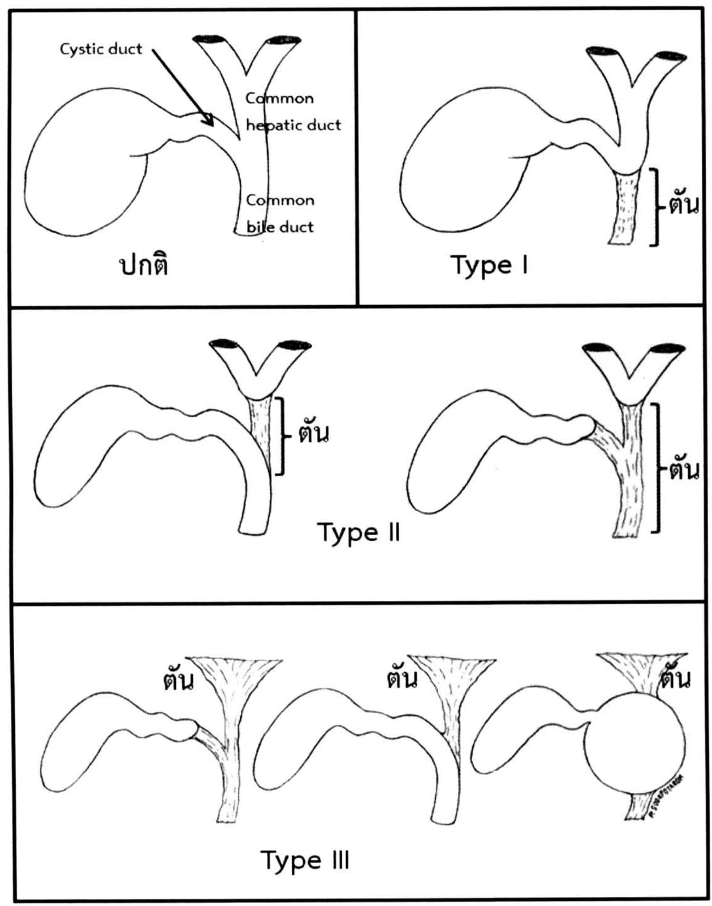

> **Caption (verbatim):** **รูปที่ 1** แสดงชนิดของทางเดินน้ำดีตัน ทั้ง 3 types
> **Text in image (verbatim):** Cystic duct · Common hepatic duct · Common bile duct · ปกติ · ตัน · Type I · ตัน · ตัน · Type II · ตัน · ตัน · ตัน · Type III
> **Description:** Black-and-white line drawing in a framed grid of four panels showing the gallbladder and extrahepatic bile ducts. Top-left panel "ปกติ" (normal): gallbladder on the left with its cystic duct (labelled "Cystic duct", arrow pointing to it) joining the Y-shaped common hepatic duct (the two hepatic duct branches open at the top, labelled "Common hepatic duct") to form the "Common bile duct" running downward. Top-right panel "Type I": the hepatic ducts, common hepatic duct and cystic duct junction are patent, but the distal common bile duct is drawn as a shaded fibrous cord, marked with a bracket labelled "ตัน" (obstructed). Middle panel "Type II" (two drawings): in the left drawing the common hepatic duct segment above the cystic duct junction is a shaded fibrous cord (bracket "ตัน") while the right and left hepatic ducts above and the common bile duct below remain patent; in the right drawing the common hepatic duct, the cystic duct and the common bile duct are all shaded fibrous cords (long bracket "ตัน"), with the hepatic duct branches above still patent. Bottom panel "Type III" (three drawings): the right and left hepatic ducts at the porta are replaced by a fan-shaped fibrous cone, each labelled "ตัน"; in the first drawing the cystic duct and common bile duct are also fibrous; in the second the gallbladder, cystic duct and common bile duct remain patent below the obliterated hepatic ducts; in the third a large round cyst (cystic dilatation of the duct) lies between the fibrous hepatic duct cone above and a fibrous distal duct below, with the gallbladder attached. A small illustrator's signature is written along the cyst in the last drawing.
> **Identifiers in image:** none

### สาเหตุของโรคทางเดินน้ำดีตัน2, 3

ยังไม่เป็นที่ทราบแน่ชัดว่าโรคทางเดินน้ำดีตันมีสาเหตุมาจากอะไรกันแน่  ในอดีตเชื่อกันว่าเกิดจาก congenital malformation ของ biliary ductular system ซึ่งมีหลักฐานสนับสนุนจากการพบ associated anomalies ร่วมด้วย อย่างไรก็ตามในระยะหลังเมื่อมีการศึกษาพยาธิสรีรวิทยาของโรคนี้มากขึ้นก็พบว่า ผู้ป่วยส่วนใหญ่เริ่มมีอาการตัวเหลือง

<!-- p.976 (printed 962) -->
หรืออุจจาระสีซีดเมื่อมีอายุเกิน 2 สัปดาห์ไปแล้ว และมีพยาธิสภาพของการอักเสบอย่างต่อเนื่อง (progressive inflammation) ของระบบทางเดินน้ำดี และผู้ป่วยส่วนใหญ่ไม่มี associated anomalies ร่วม ทำให้เชื่อกันว่าโรคทางเดินน้ำดีตันในผู้ป่วยน่าจะเป็นโรคที่เกิดมาภายหลัง (acquired disease)

มีการศึกษาพบว่าการติดเชื้อบางชนิด (reovirus type 3, rotavirus และ cytomegalovirus) หรือสารพิษบางอย่าง อาจมีความสัมพันธ์กับการเป็นโรคทางเดินน้ำดีตันได้

### อาการทางคลินิกของโรคทางเดินน้ำดีตัน

เด็กทารกมักจะมีอาการตัวเหลืองประมาณ 2 ถึง 3 สัปดาห์หลังคลอด และอาการเหลืองจะมากขึ้นเรื่อยๆ บางรายอาจมีไข้ต่ำๆ และไม่ค่อยดูดนม ลักษณะอุจจาระจะเป็นสีซีดเหมือนปูนขาว อาจพบ steatorrhea ร่วมด้วย ปัสสาวะสีเหลืองเข้ม ตับโต แข็ง ผิวและขอบเรียบ ส่วนม้ามมักจะยังไม่โตยกเว้นมีภาวะ cirrhosis และ portal hypertension ร่วมด้วยแล้ว

ปัจจุบันแบ่งโรคทางเดินน้ำดีตันได้เป็น 2 รูปแบบ ตามอาการทางคลินิก คือ

(1) Acquired หรือ perinatal form พบได้เกินร้อยละ 90 ซึ่งมีลักษณะ ‘Late onset’ jaundice อาจมีช่วง jaundice-free interval หลังจาก physiological jaundice มักพบ bile duct remnants บริเวณ hepatoduodenal ligament และไม่พบ associated anomalies ร่วมด้วย

(2) Syndromic หรือ fetal form พบได้น้อย มีลักษณะ ‘Early onset’ jaundice ไม่พบมี jaundice-free interval หลังคลอด มักไม่พบ bile duct remnants บริเวณ hepatoduodenal ligament และอาจพบ associated anomalies เช่น cardiac anomalies, situs inversus, preduodenal portal vein หรือ polysplenia syndrome ร่วมด้วย

### การตรวจทางห้องปฏิบัติการเพื่อการวินิจฉัย

การตรวจหน้าที่ตับ (Liver Function Test, LFT) จะพบระดับ bilirubin สูงกว่าปกติโดยเป็นแบบ direct hyperbilirubinemia ระดับ AST และ ALT อาจสูงได้เล็กน้อย ส่วนระดับ alkaline phosphatase และ GGT จะพบสูงกว่าปกติ อย่างไรก็ตามการตรวจหน้าที่ตับอาจไม่สามารถแยก biliary atresia จาก severe neonatal hepatitis ได้

<!-- p.977 (printed 963) -->
การตรวจด้วยคลื่นเสียงความถี่สูง (ultrasonography) ของช่องท้อง เป็นการตรวจที่ใช้บ่อยที่สุดในการวินิจฉัยเด็กที่เป็น cholestatic jaundice สามารถพบ cystic structure ในเด็กที่เป็น choledochal cyst หรือ cystic biliary atresia หรือการพบว่าถุงน้ำดีมีขนาดเล็กลงหลังทานนม  บ่งบอกว่าไม่ใช่โรคทางเดินน้ำดีตัน  หรือสามารถพบลักษณะจำเพาะของโรคทางเดินน้ำดีตัน  ซึ่งมีลักษณะเป็นแผ่นหรือก้อนสามเหลี่ยม (triangular cord) บริเวณขั้วตับ (รูปที่ 2) อย่างไรก็ดีมีข้อน่าสังเกตอยู่ว่าจะไม่พบ intrahepatic bile duct dilatation ในเด็กที่เป็นโรคทางเดินน้ำดีตันที่ยังไม่ได้รับการผ่าตัดรักษา

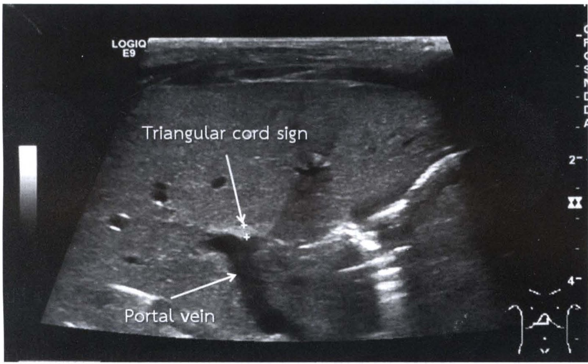

> **Caption (verbatim):** **รูปที่ 2** แสดงภาพคลื่นเสียงความถี่สูง บริเวณตับของผู้ป่วยทางเดินน้ำดีตัน จะเห็นเนื้อเยื่อหนาประมาณ 4-2 มม. เป็นรูปสามเหลี่ยม เรียกว่า triangular cord sign บริเวณ bifurcation ของ portal vein ซึ่งเป็นลักษณะเฉพาะของโรคทางเดินน้ำดีตัน
> **Text in image (verbatim):** LOGIQ E9 · Triangular cord sign · Portal vein · 2 · 4 · (vertical scanner parameter letters at the right edge, cut off)
> **Description:** Grayscale abdominal ultrasound image of the liver (sector/curvilinear field, machine label "LOGIQ E9" at top left, grayscale bar at left, depth scale marks 2 and 4 at right, and a small body-marker pictogram at bottom right). The homogeneous liver parenchyma fills most of the field with a few small anechoic vessels. Near the centre a dark, branching tubular structure is the portal vein, labelled "Portal vein" with an arrow from the lower left. Just above (anterior to) the portal vein bifurcation is a small echogenic triangular area of tissue, marked with two "+" calipers measuring its thickness, and labelled "Triangular cord sign" with an arrow pointing down to it.
> **Identifiers in image:** none

Hepatobiliary scintigraphy ด้วย technetium-labelled isotope ร่วมกับอนุพันธ์ของ iminodiacetic acid (IDA) สารนี้เมื่อเข้าสู่กระแสเลือดจะถูกจับโดยเซลล์ตับ (hepatocyte) และขับถ่ายออกสู่ทางเดินน้ำดีและลำไส้เล็กส่วนดูโอดีนัม  วิธีนี้มีความแม่นยำค่อนข้างสูง สามารถวิเคราะห์ได้ว่า isotope ผ่านลงมาในลำไส้หรือไม่ ถ้าสาร isotope สามารถผ่านลงมาในลำไส้ได้ก็มั่นใจได้ว่าเด็กที่ตัวเหลืองนั้นไม่ได้เป็นโรคทางเดินน้ำดีตัน  แต่ถ้าไม่พบสาร isotope ลงมาในลำไส้ก็ยังไม่สามารถแยกโรค neonatal hepatitis ออกไปได้

<!-- p.978 (printed 964) -->
เนื่องจากบางครั้งในภาวะที่หน้าที่ตับเสียไปมากๆ เช่น ใน severe neonatal hepatitis เซลล์ตับไม่สามารถขับสาร isotope ลงมาในลำไส้ได้มากพอที่จะถูกตรวจวัดได้ ดังรูปที่ 3

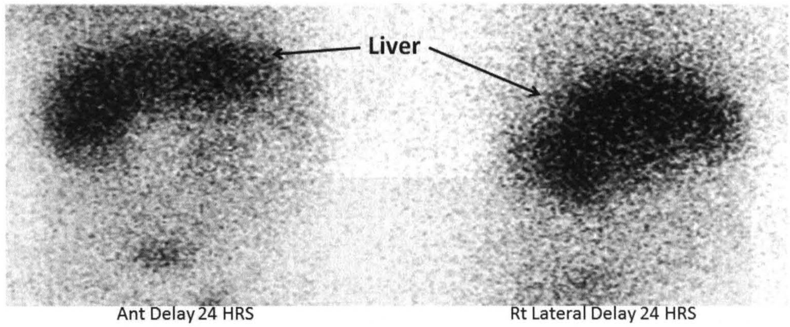

> **Caption (verbatim):** **รูปที่ 3** แสดง hepatobiliary scan ของผู้ป่วยทางเดินน้ำดีตัน ซึ่งเมื่อครบ 24 ชั่วโมงแล้วยังไม่เห็น isotope ในบริเวณที่เป็นลำไส้เล็ก เข้าได้กับโรคทางเดินน้ำดีตัน
> **Text in image (verbatim):** Liver · Ant Delay 24 HRS · Rt Lateral Delay 24 HRS
> **Description:** Two grayscale nuclear medicine (hepatobiliary scintigraphy) images side by side, both delayed images at 24 hours. Left image labelled "Ant Delay 24 HRS" (anterior view) and right image labelled "Rt Lateral Delay 24 HRS" (right lateral view). In each, a large dark area of tracer uptake in the upper part of the image is the liver, indicated by the label "Liver" with two arrows (one to each view). Apart from the liver, only faint, diffuse background activity is seen (with a small faint spot lower in each view); there is no distinct tracer activity in a bowel pattern below the liver.
> **Identifiers in image:** none

Intra-operative cholangiography (IOC) เป็นวิธีมาตรฐาน (gold standard) ในการยืนยันการวินิจฉัยโรคทางเดินน้ำดีตัน (รูปที่ 4) โดยในกรณีที่การตรวจทางห้องปฏิบัติการอื่นข้างต้น ไม่สามารถแยกโรค neonatal hepatitis ออกไปได้ ซึ่ง IOC เป็นการผ่าตัดช่องท้อง เพื่อฉีดสารทึบรังสีเข้าทางถุงน้ำดี สำหรับในโรคทางเดินน้ำดีตัน type III ซึ่งเป็นชนิดที่พบบ่อยที่สุดประมาณร้อยละ 90 นั้น ถุงน้ำดีมักจะมีขนาดเล็กจนอาจไม่สามารถฉีดสารทึบรังสีได้ แต่ในบางรายก็อาจเห็นถุงน้ำดีในภาพเอกซเรย์ ซึ่งไม่มีทางติดต่อกับทางเดินน้ำดีที่ตีบตัน  ถ้าพบว่าเด็กเป็นโรคทางเดินน้ำดีตันจากการทำ IOC ศัลยแพทย์ก็อาจพิจารณาขยายแผลผ่าตัดเพื่อทำการผ่าตัดรักษาโรคทางเดินน้ำดีตันต่อไปได้เลย

<!-- p.979 (printed 965) -->
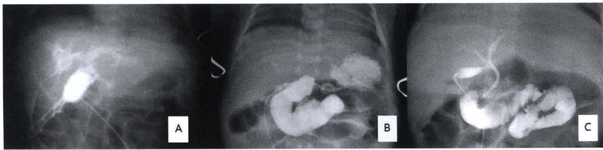

> **Caption (verbatim):** **รูปที่ 4** แสดง Intra-operative cholangiography ของผู้ป่วยโรคทางเดินน้ำดีตัน (A และ B) และผู้ป่วยที่ไม่เป็นโรคทางเดินน้ำดีตัน (C) : ในภาพ A จะไม่เห็นสารทึบแสงลงในลำไส้เล็กแต่เห็นสารทึบแสงขึ้นไปในตับได้ แสดงว่าเป็นโรคทางเดินน้ำดีตัน type I ส่วนในภาพ B จะไม่เห็นสารทึบแสงใน right และ left hepatic duct แสดงว่าเป็นโรคทางเดินน้ำดีตัน type III สำหรับในภาพ C จะเห็นสารทึบแสงทั้งใน common bile duct, common hepatic duct, right & left hepatic duct และในลำไส้เล็ก แสดงว่าไม่ใช่โรคทางเดินน้ำดีตัน
> **Text in image (verbatim):** A · B · C
> **Description:** Three intra-operative cholangiogram radiographs of infants placed side by side, labelled A, B and C (contrast appears white). A: contrast fills an oval gallbladder-shaped collection, with irregular faint contrast extending upward into the liver region above it; no contrast is seen in the bowel. B: an abdominal view including the lower ribs, with dense contrast filling loops of small bowel (duodenum/jejunum) and a patchy collection in the upper abdomen, but no opacified right or left hepatic ducts in the liver region; a curved wire/clip artefact is at the left margin. C: contrast outlines thin tubular bile ducts (the gallbladder, common bile duct, common hepatic duct and branching right and left hepatic ducts) and also fills the small bowel loops below; a curved wire artefact is at the left margin.
> **Identifiers in image:** none

นอกจากนี้ก็ยังมีการตรวจพิเศษอย่างอื่นอีกแต่ยังใช้กันอยู่ในบางสถาบันเท่านั้น ไม่นิยมกันแพร่หลาย เช่น การดูดของเหลวในลำไส้เล็กส่วนต้นมาตรวจหาน้ำดี (duodenal fluid aspiration for bile) การตรวจชิ้นเนื้อตับ (percutaneous liver biopsy) เพื่อหาลักษณะของ bile canaliculi proliferation การทำ ERCP (endoscopic retrograde cholangio-pancreaticography) เพื่อดูลักษณะของทางเดินน้ำดี และ MRCP (magnetic resonance cholangio-pancreaticography) เป็นต้น

### การรักษา

หลักการคือแพทย์ควรจะวินิจฉัยให้ได้ว่า ภาวะตัวเหลืองนั้น มีสาเหตุจากอะไร เกิดจากโรคทางเดินน้ำดีตันหรือไม่  และผ่าตัดแก้ไขในรายที่สามารถทำได้  หากผู้ป่วยเป็นโรคทางเดินน้ำดีตันก็ควรให้การผ่าตัดรักษาก่อนอายุ 60 วัน เพราะพบว่าทารกที่เป็นโรคนี้ที่อายุมากกว่า 60 วัน ทางเดินน้ำดีขนาดเล็กภายในตับและขั้วตับจะถูกทำลายลงอย่างมาก อาจจะมีลักษณะตับแข็งและไม่สามารถแก้ไขให้กลับคืนมาเหมือนปกติได้  ดังนั้นถ้าได้การวินิจฉัยจากการตรวจพิเศษต่างๆ  หรือไม่ได้ข้อสรุปแน่นอนว่าเป็นโรคนี้หรือไม่  แนะนำให้ผ่าตัดเพื่อสำรวจดูท่อทางเดินน้ำดีและถุงน้ำดี  รวมทั้งฉีดสารทึบรังสี (intra-operative cholangiography)  ถ้าไม่ใช่โรคนี้จะพบว่าสารทึบรังสีจะถูกขับลงสู่ลำไส้ได้และแสดงให้เห็นทางเดินน้ำดีทั้งภายในตับและนอกตับได้ชัดเจน พร้อมกับตัดตับบางส่วน (liver biopsy) ออกไปตรวจทางพยาธิวิทยา

<!-- p.980 (printed 966) -->
ในระหว่างผ่าตัดถ้าพบว่าทารกนั้นเป็นโรคทางเดินน้ำดีตัน ก็มักจะพบ (1) ถุงน้ำดีฝ่อเล็ก บางครั้งไม่มี lumen ภายในถุงน้ำดี ทำให้ฉีดสารทึบรังสีเพื่อแสดงทางเดินน้ำดีไม่ได้ หรือ (2) พบเป็นโรคทางเดินน้ำดีตันชนิดที่ถุงน้ำดีและท่อน้ำดีส่วนปลายมีการเจริญตามปกติ สามารถฉีดสารทึบรังสีลงสู่ลำไส้ได้ แต่ไม่พบท่อทางเดินน้ำดีส่วนต้นที่ติดต่อเข้าไปในขั้วตับ

การผ่าตัดรักษาทำได้โดยการทำ hepatic portoenterostomy (Kasai operation) โดยนำเอาลำไส้ไปต่อกับเนื้อเยื่อขั้วตับ เพื่อให้ bile canaliculi ขนาดเล็กๆ บริเวณนั้นสามารถระบายน้ำดีลงสู่ลำไส้ได้ ลำไส้ที่นำไปต่อนิยมใช้ Roux-en Y loop ของลำไส้เล็กส่วนกลาง (jejunum) ยาวประมาณ 40-60 ซม. เพื่อป้องกันมิให้อาหารไหลล้นขึ้นไปถึงท่อทางเดินน้ำดี ซึ่งอาจทำให้เกิดการติดเชื้อในทางเดินน้ำดีได้ ดังรูปที่ 5, 6 และ 7 หลังการผ่าตัด Kasai operation ควรที่จะตัดเนื้อเยื่อตับมาตรวจเพื่อดูว่ามีพังพืดในตับ (liver fibrosis) มากน้อยเพียงใด นอกจากนี้เนื้อตับที่เป็นโรคทางเดินน้ำดีตันที่ตรวจทางจุลพยาธิวิทยาจะพบลักษณะของ bile ductular proliferation บริเวณ portal triad (รูปที่ 8)

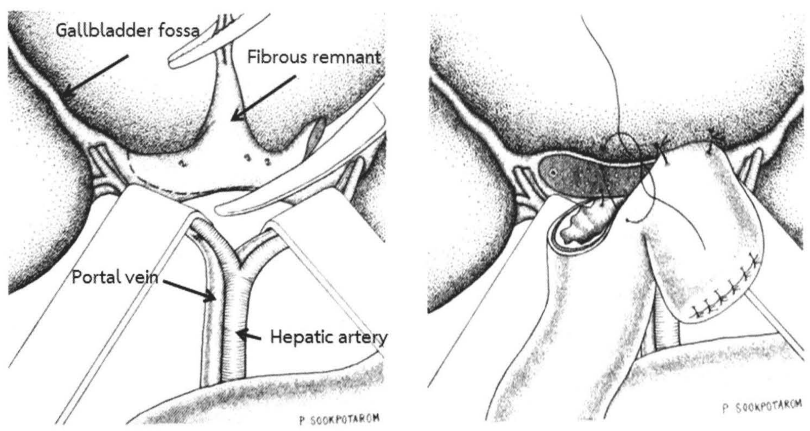

> **Caption (verbatim):** **รูปที่ 5** รูปแสดงแผนภาพ การผ่าตัด Kasai operation : ภาพด้านซ้ายจะเห็น fibrous remnant บริเวณ portal vein bifurcation กำลังถูกตัดฝานออก ส่วนภาพด้านขวา จะเห็น fibrous remnant ถูกตัดฝานออก และนำลำไส้เล็กส่วน jejunum ขึ้นไปครอบแบบ Roux-en-Y
> **Text in image (verbatim):** Gallbladder fossa · Fibrous remnant · Portal vein · Hepatic artery · P SOOKPOTAROM · P SOOKPOTAROM
> **Description:** Two side-by-side stippled pen-and-ink surgical drawings of the porta hepatis viewed from below, with the liver retracted upward. Left panel: an arrow points to the gallbladder fossa on the left upper liver surface; a second arrow points to the cone-shaped fibrous remnant at the hilum, which is being held up by a forceps/instrument at the top; a dashed line outlines the line of transection across the hilar plate. Below, retractors spread the field and expose the portal vein (arrow) and the hepatic artery (arrow) running vertically, with the portal vein dividing at its bifurcation beneath the remnant. Right panel: the fibrous remnant has been excised, leaving a raw oval area at the porta hepatis; the open end of a jejunal limb is being sutured around this area with interrupted stitches (sutures shown passing through the liver edge), and the closed end of the limb shows a row of sutures (Roux-en-Y limb brought up to cover the hilum). Both panels are signed "P SOOKPOTAROM" at the lower right.
> **Identifiers in image:** none

<!-- p.981 (printed 967) -->
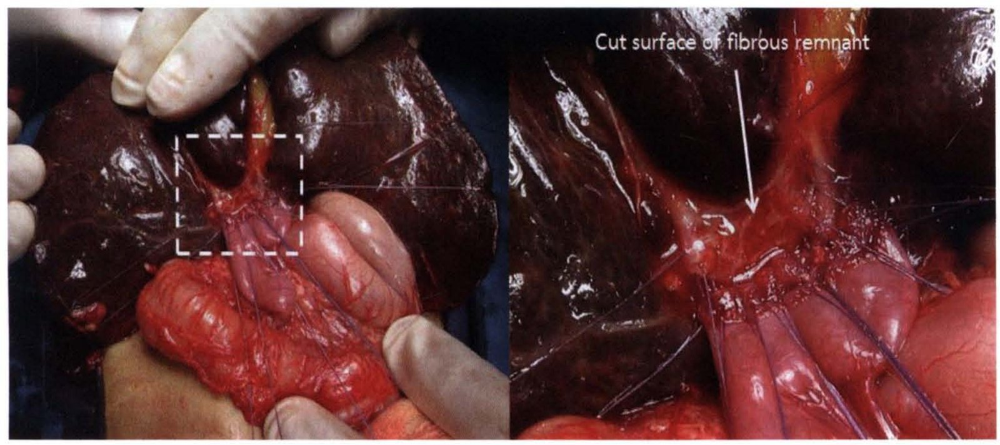

> **Caption (verbatim):** **รูปที่ 6** แสดงการผ่าตัด Kasai operation บริเวณขั้วตับ (porta hepatis) จะเห็นลำไส้เล็กส่วนเจจูนัม ถูกนำขึ้นไปครอบ fibrous remnant ที่ถูกตัดฝานออกแล้ว โดยในภาพเป็นการเย็บครอบเฉพาะด้านหลัง (posterior) ยังไม่ได้เย็บครอบทางด้านหน้า (anterior)
> **Text in image (verbatim):** Cut surface of fibrous remnant
> **Description:** Two intraoperative colour photographs side by side. Left: the infant's dark red-brown liver is lifted upward by gloved fingers, exposing the porta hepatis; a white dashed rectangle marks the hilar area where a pinkish loop of small bowel (jejunal limb) has been brought up beneath the liver, with fine purple sutures running from the hilum to the bowel; more red bowel and a gloved hand are at the bottom. Right: magnified view of the boxed area; a white arrow labelled "Cut surface of fibrous remnant" points to the raw reddish transected surface at the hilum, below which the jejunal limb lies with several long purple sutures placed between the hilar tissue and the bowel wall (posterior row only, per the caption).
> **Identifiers in image:** none

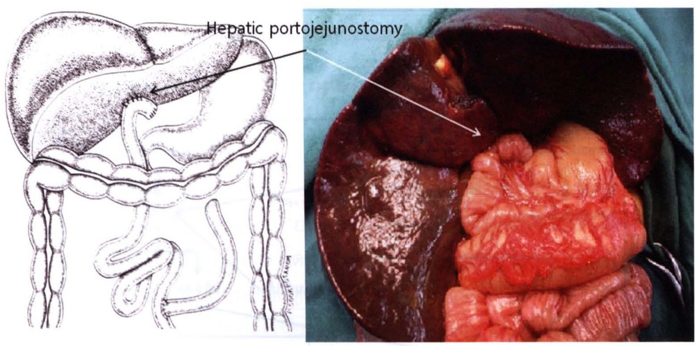

> **Caption (verbatim):** **รูปที่ 7** แสดงการผ่าตัด Kasai operation เมื่อเสร็จสิ้นแล้ว
> **Text in image (verbatim):** Hepatic portojejunostomy · [unclear: P SOOKPOTAROM] (small vertical signature on the drawing)
> **Description:** Composite of a line drawing (left) and an intraoperative colour photograph (right). The drawing shows the liver, stomach and colon from the front with a Roux-en-Y jejunal limb rising behind/through the transverse colon to the underside of the liver, where its end is sutured to the porta hepatis; a black arrow labelled "Hepatic portojejunostomy" points to this anastomosis; the lower part shows the jejunojejunal anastomosis of the Roux limb to the small bowel loops. The photograph shows the completed operation in an infant: large dark red liver lifted up over green drapes, with a white arrow (from the same label) pointing to the anastomosis at the porta hepatis beneath the liver, and red-pink small bowel loops below.
> **Identifiers in image:** none

<!-- p.982 (printed 968) -->
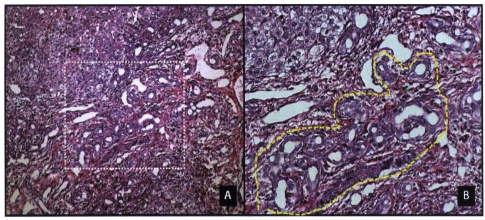

> **Caption (verbatim):** **รูปที่ 8** แสดงลักษณะทางจุลพยาธิวิทยาของตับทารกที่เป็นโรคทางเดินน้ำดีตัน จะเห็นลักษณะของ bile ductular proliferation (บริเวณภายในรอยประ) บริเวณ portal triad ซึ่งเป็นลักษณะเฉพาะของโรคทางเดินน้ำดีตัน
> **Text in image (verbatim):** A · B
> **Description:** Two colour photomicrographs of liver histology (purple-pink stained section). Panel A (lower power): liver parenchyma with fibrous tissue and many small duct-like structures; a white dotted rectangle marks the area enlarged in panel B. Panel B (higher power): a yellow dashed line encloses a cluster of numerous small proliferated bile ductules with lumens, embedded in fibrous stroma of the portal area (bile ductular proliferation at the portal triad, per the caption); hepatocytes are visible in the upper left.
> **Identifiers in image:** none

สำหรับแนวทางการวินิจฉัยและรักษาทารกที่มีภาวะ persistent direct hyperbilirubinemia และมีอุจจาระสีซีดร่วมด้วย มีดังนี้ (รูปที่ 9)

- ทารกที่ตัวเหลืองแบบ conjugated hyperbilirubinemia และ ถ่ายซีด → ตรวจช่องท้องด้วยคลื่นเสียงความถี่สูง
  - → โรคท่อน้ำดีโป่งพอง → Definitive surgery
  - → ไม่พบ Triangular cord
    - อายุ <60 วัน → DISIDA scan
      - → พบสาร isotope ในลำไส้ → Liver Bx → รักษาตามการวินิจฉัย; และ (พบสาร isotope ในลำไส้) → รักษาตามการวินิจฉัย
      - → ไม่พบสาร isotope ในลำไส้ → IOC
    - อายุ >60 วัน → IOC
  - → พบมี Triangular cord sign → IOC
- IOC
  - → ไม่ใช่ BA → Liver Bx → รักษาตามการวินิจฉัย
  - → BA
    - → ตับแข็งชัดเจน → พิจารณาผ่าตัดปลูกถ่ายตับ
    - → ตับยังไม่แข็ง → Kasai operation

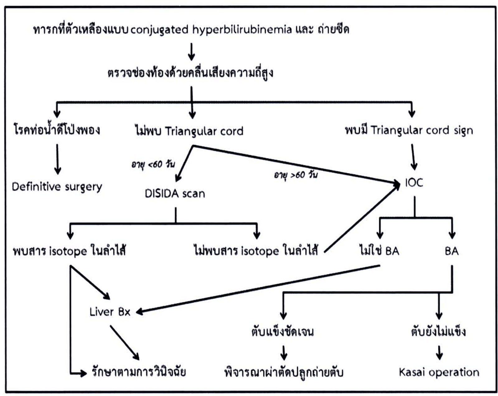

> **Caption (verbatim):** **รูปที่ 9** แสดงแนวทางการวินิจฉัยและรักษาทารกที่มีภาวะตัวเหลือง ถ่ายซีด และปัสสาวะสีเข้ม BA = biliary atresia, Liver Bx = liver biopsy, IOC = intra-operative cholangiography, DISIDA scan = Diisopropyl Iminodiacetic Acid scan ซึ่งเป็น hepatobiliary scan ชนิดหนึ่ง
> **Text in image (verbatim):** ทารกที่ตัวเหลืองแบบ conjugated hyperbilirubinemia และ ถ่ายซีด · ตรวจช่องท้องด้วยคลื่นเสียงความถี่สูง · โรคท่อน้ำดีโป่งพอง · ไม่พบ Triangular cord · พบมี Triangular cord sign · Definitive surgery · อายุ <60 วัน · DISIDA scan · อายุ >60 วัน · IOC · พบสาร isotope ในลำไส้ · ไม่พบสาร isotope ในลำไส้ · ไม่ใช่ BA · BA · Liver Bx · ตับแข็งชัดเจน · ตับยังไม่แข็ง · รักษาตามการวินิจฉัย · พิจารณาผ่าตัดปลูกถ่ายตับ · Kasai operation
> **Description:** Boxed flowchart. Top: infant with conjugated hyperbilirubinemia and pale stools → abdominal ultrasound, which branches three ways: (1) choledochal cyst (โรคท่อน้ำดีโป่งพอง) → definitive surgery; (2) no triangular cord → if age <60 days → DISIDA scan, or if age >60 days → IOC; (3) triangular cord sign present → IOC. DISIDA scan branches to: isotope seen in bowel → arrows both to Liver Bx and (via an elbow arrow) directly to "รักษาตามการวินิจฉัย"; isotope not seen in bowel → IOC. IOC branches to "ไม่ใช่ BA" → Liver Bx (Liver Bx → รักษาตามการวินิจฉัย) and "BA", which splits to obvious cirrhosis (ตับแข็งชัดเจน) → consider liver transplantation, and liver not yet cirrhotic (ตับยังไม่แข็ง) → Kasai operation.
> **Identifiers in image:** none

<!-- p.983 (printed 969) -->
### การดูแลหลังผ่าตัด

ภาวะแทรกซ้อนสำคัญที่พบบ่อย ได้แก่ ภาวะการติดเชื้อของทางเดินน้ำดี (ascending cholangitis) ซึ่งยังคงพบได้ แม้จะได้ป้องกัน โดยการเหลือส่วนของลำไส้ที่เป็น defunctioning limb ที่นำไปต่อกับท่อทางเดินน้ำดีที่ขั้วตับไว้ ขนาดยาวกว่า 40 เซนติเมตร เพื่อมิให้อาหารไหลย้อนขึ้นไปถึงทางเดินน้ำดีแล้วก็ตาม ลักษณะทางคลินิกของ ascending cholangitis ได้แก่ ไข้ ตัวเหลืองเพิ่มขึ้น อุจจาระสีซีดลง รักษาโดยการให้ยาปฏิชีวนะ การติดเชื้อบ่อยๆ มีผลทำให้ตับเสื่อมสภาพไปอีกด้วย นอกจากนี้อาจพิจารณาให้ steroid ขนาดสูง4 เพื่อเพิ่มการสร้างน้ำดีของตับและลดปฏิกิริยาที่ทำให้เกิด fibrosis บริเวณรอยต่อของ portoenterostomy แต่ผลของการให้ steroid หลังผ่าตัด Kasai operation ก็ยังมีการถกเถียงกันอยู่  นอกจากนี้ควรให้ยาปฏิชีวนะในระยะยาวเพื่อป้องกันการติดเชื้อทางเดินน้ำดี ให้ ursodeoxycholic acid เพื่อเพิ่มการสร้างน้ำดี และให้วิตามิน A, D, E, K เพื่อป้องกันการขาดวิตามินด้วย

นอกจากนี้ภาวะแทรกซ้อนในระยะยาวอาจพบภาวะ portal hypertension ภาวะ hypersplenism ภาวะ malnutrition และภาวะ hepatopulmonary hypertension ได้

### ผลการผ่าตัดรักษาโดยวิธี Kasai operation

โดยรวมแล้วผลของการผ่าตัด Kasai operation แบ่งได้เป็น 3 กลุ่มใหญ่ๆ ได้แก่

1. กลุ่มที่ได้ผลดี (good outcome) พบได้ร้อยละ 40-60 เป็นกลุ่มที่ระบายน้ำดีหลังผ่าตัดได้ดี5 เด็กจะหายเหลืองภายในเวลา 3-4 เดือน และจะเจริญเติบโตได้เหมือนปกติ โดยไม่ต้องการการดูแลรักษาใดๆ เพิ่มเติม นอกจากการระวังและรีบรักษาภาวะแทรกซ้อน เช่น ascending cholangitis เด็กในกลุ่มนี้ขณะผ่าตัด ตับมักยังมีสภาพดีและขณะที่ตัดเนื้อเยื่อบริเวณขั้วตับก็จะเห็นน้ำดีไหลออกมาชัดเจน แต่อย่างไรก็ดีแพทย์ผู้รักษาต้องตระหนักไว้เสมอว่า ในระยะยาวแล้วเด็กกลุ่มนี้อาจจะมีอาการของโรคตับเรื้อรังขึ้นมาได้ในที่สุด

<!-- p.984 (printed 970) -->
2. กลุ่มที่ได้ผลปานกลาง (fair outcome) พบได้ร้อยละ 20-40 เป็นกลุ่มที่ระบายน้ำดีได้หลังผ่าตัดแต่ตับเสื่อมสภาพไปแล้ว ในกลุ่มนี้จะพบว่าเด็กถ่ายอุจจาระมีสีเหลืองแต่ยังคงมีตัวเหลืองอยู่ระดับหนึ่ง เด็กจะเจริญเติบโตได้ แต่จะมีสภาพของ chronic liver disease อาจพบว่ามี ascites และอาจมีอาเจียนเป็นเลือด ภายหลังจาก varices เนื่องจากภาวะ portal hypertension เมื่อเด็กโตขึ้นตับก็จะ compensate ได้น้อยลง เกิดภาวะ hepatic encephalopathy ระยะเวลาไม่แน่นอนขึ้นกับพยาธิสภาพ โดยทั่วไปประมาณ 2-5 ปี ในกลุ่มนี้ต้องการการผ่าตัดปลูกถ่ายตับใหม่ เมื่อพบว่าตับเริ่ม compensate ไม่ได้

3. กลุ่มที่ไม่ได้ผล (poor outcome) กลุ่มที่ตับเสื่อมมาก และการผ่าตัดไม่สามารถระบายน้ำดีได้ กลุ่มนี้การพยากรณ์โรคเลว เด็กเสียชีวิตในระยะเวลาอันรวดเร็ว วิธีแก้ไขทำได้ด้วยการผ่าตัดปลูกถ่ายตับ

โดยทั่วไปแล้วผลการผ่าตัดรักษาผู้ป่วยทางเดินน้ำดีตันด้วยการผ่าตัด Kasai operation พอที่จะแสดงได้ดังรูปที่ 10

- ทารกโรคทางเดินน้ำดีตัน → Kasai operation
  - ระยะสั้น 2-3 ปี
    - ร้อยละ 40 → ได้ผลปานกลางหรือไม่ได้ผล (ตัวเหลืองลดลงบ้างหรือไม่ลดลง) → ปลูกถ่ายตับ
    - ร้อยละ 60 → ได้ผลดี (ตัวหายเหลือง)
      - ระยะยาว 5-10 ปี
        - ร้อยละ 50 → เริ่มมีอาการของโรคตับเรื้อรัง → ปลูกถ่ายตับ
        - ร้อยละ 50 → มีคุณภาพชีวิตปกติ

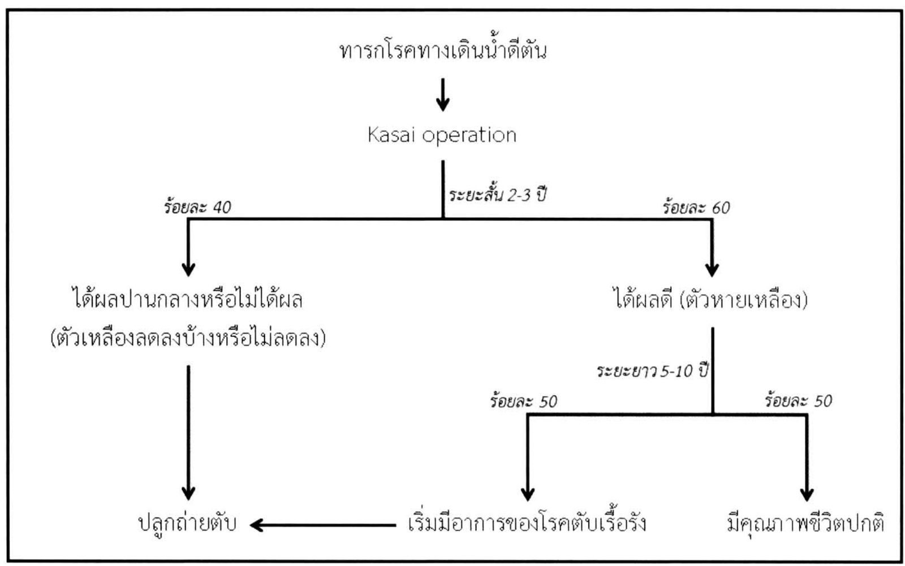

> **Caption (verbatim):** **รูปที่ 10** แสดงผลการผ่าตัด Kasai operation เพื่อรักษาโรคทางเดินน้ำดีตัน
> **Text in image (verbatim):** ทารกโรคทางเดินน้ำดีตัน · Kasai operation · ระยะสั้น 2-3 ปี · ร้อยละ 40 · ร้อยละ 60 · ได้ผลปานกลางหรือไม่ได้ผล (ตัวเหลืองลดลงบ้างหรือไม่ลดลง) · ได้ผลดี (ตัวหายเหลือง) · ระยะยาว 5-10 ปี · ร้อยละ 50 · ร้อยละ 50 · ปลูกถ่ายตับ · เริ่มมีอาการของโรคตับเรื้อรัง · มีคุณภาพชีวิตปกติ
> **Description:** Boxed outcome flowchart. Infant with biliary atresia → Kasai operation. In the short term (2-3 years) it splits: 40% → fair or no result (jaundice decreases somewhat or not at all) → liver transplantation; 60% → good result (jaundice clears). Over the long term (5-10 years) the good-result group splits again: 50% → begin to have chronic liver disease, with a horizontal arrow pointing left to liver transplantation; 50% → normal quality of life.
> **Identifiers in image:** none

จากการรวบรวมข้อมูลการรักษาทารกที่เป็นโรคทางเดินน้ำดีตัน 133 ราย ด้วยการผ่าตัด Kasai operation ณ คณะแพทยศาสตร์ จุฬาลงกรณ์มหาวิทยาลัย โรงพยาบาล

<!-- p.985 (printed 971) -->
จุฬาลงกรณ์ สภากาชาดไทย6 พบว่าผู้ป่วยมีอัตราการรอดชีวิตโดยไม่ได้รับการปลูกถ่ายตับ (survival rate with native liver) ที่ 1 ปี 3 ปี และ 5 ปี เท่ากับ ร้อยละ 85, 70 และ 65 ตามลำดับ นอกจากนี้ยังพบว่าผู้ป่วยที่หายเหลืองหลังผ่าตัด จะมีอัตรารอดชีวิตสูงกว่าผู้ป่วยที่ไม่หายเหลืองหลังผ่าตัด อย่างมีนัยสำคัญทางสถิติ ดังรูปที่ 11 ผู้ป่วยที่เป็นหญิงบางรายมีอายุยืนยาวจนสามารถตั้งครรภ์และมีบุตรได้7

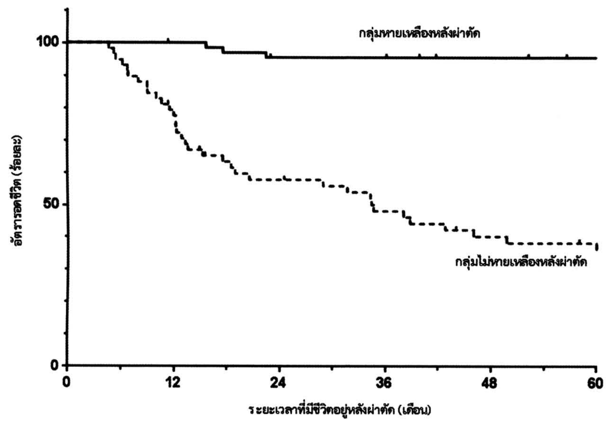

> **Caption (verbatim):** **รูปที่ 11** แสดงกราฟอัตราการรอดชีวิต (survival curve) ของทารกโรคทางเดินน้ำดีตันที่ได้รับการผ่าตัด Kasai operation แยกตามผลการรักษาที่ 6 เดือนหลังผ่าตัดว่าหายเหลือง (good outcome) หรือไม่หายเหลือง (poor outcome) ซึ่งจะพบว่าในผู้ป่วยกลุ่มที่หายเหลืองจะมีอัตรารอดชีวิตที่ 5 ปี โดยไม่ได้รับการปลูกถ่ายตับ (survival with native liver) ดีกว่าในกลุ่มที่ไม่หายเหลืองอย่างชัดเจน และมีนัยสำคัญทางสถิติ
> **Text in image (verbatim):** อัตรารอดชีวิต (ร้อยละ) · 0 · 50 · 100 · ระยะเวลาที่มีชีวิตอยู่หลังผ่าตัด (เดือน) · 0 · 12 · 24 · 36 · 48 · 60 · กลุ่มหายเหลืองหลังผ่าตัด · กลุ่มไม่หายเหลืองหลังผ่าตัด
> **Description:** Kaplan-Meier style step survival chart. Y-axis: survival rate (%) from 0 to 100 (labelled 0, 50, 100). X-axis: time alive after surgery (months) from 0 to 60 (ticks at 12-month intervals, labelled 0, 12, 24, 36, 48, 60). Solid line (group whose jaundice cleared after surgery): stays at 100% until about 15 months, then steps down slightly to about 95% by about 23 months and remains flat at roughly 95% to 60 months, with small censoring ticks. Dashed line (group whose jaundice did not clear): begins falling at about 5 months, drops steeply to about 67% by about 14 months, about 58% by about 20 months, plateaus to about 33 months, then steps down below 50% at about 34-35 months and continues to decline to roughly 37-38% at 60 months. The two curves separate widely.
> **Identifiers in image:** none

สำหรับผลการรักษานั้นขึ้นกับปัจจัยหลายๆ อย่าง ได้แก่

(1) อายุขณะผ่าตัดน้อยกว่า 60 วัน จะมีการพยากรณ์โรคที่ดีกว่าผ่าตัดเมื่ออายุมากกว่า 60 วัน

(2) สภาพของตับขณะที่ทำผ่าตัดว่ามีตับแข็งแล้วหรือไม่ และขึ้นกับว่าการผ่าตัดช่วยระบายน้ำดีจากตับได้หรือไม่

<!-- p.986 (printed 972) -->
(3) โรคทางเดินน้ำดีตันชนิด syndromic form จะมีการพยากรณ์โรคโดยรวมไม่ดีเท่าชนิด isolated form

(4) ผู้ป่วยทางเดินน้ำดีตันที่มีการติดเชื้อไวรัส cytomegalovirus (CMV IgM+ve) มีอัตราการรอดชีวิตที่ 3 ปี ต่ำกว่าเมื่อเทียบกับผู้ป่วยทางเดินน้ำดีตันที่ไม่มีการติดเชื้อ CMV (CMV IgM-ve)8

(5) ขนาดของ bile canaliculi บริเวณขั้วตับ พบว่าถ้ามีขนาดเส้นผ่าศูนย์กลางมากกว่า 150 ไมครอน จะมีการพยากรณ์โรคที่ดี

(6) ระดับของ serum bilirubin ที่ 7 วันหลังผ่าตัด พบว่าหากระดับของ serum bilirubin ที่ 7 วันหลังผ่าตัด Kasai operation ลดลงเกินร้อยละ 20 จะมีการพยากรณ์โรคที่ดี5, 6

(7) ประสบการณ์การผ่าตัดของสถาบันนั้นๆ มีการศึกษาพบว่าในสถาบันที่มีการผ่าตัด Kasai operation น้อยกว่า 5 รายต่อปี จะมีผลการรักษาด้อยกว่าสถาบันที่ทำการผ่าตัดมากกว่า 5 ราย อย่างไรก็ตามข้อสรุปนี้ก็ยังมีข้อถกเถียงกันอยู่

(8) จากการศึกษาพบว่าการพยากรณ์โรคที่ดีมีความสัมพันธ์กับระดับของ serum TGF-beta1 และ epidermal growth factor ที่เพิ่มขึ้น9 ในขณะที่การพยากรณ์โรคที่ไม่ดีมีความสัมพันธ์กับระดับของ serum IL-18 และ E-selectin (ซึ่งเป็น serum marker ที่เกี่ยวข้องกับการอักเสบ) ที่เพิ่มขึ้น10, 11

ภาวะแทรกซ้อนที่สำคัญของการผ่าตัด hepatic portoenterostomy คือ ascending cholangitis ซึ่งพบบ่อยและรุนแรงจนเสียชีวิตได้ นอกจากนี้การเกิด cholangitis ในแต่ละครั้งก็จะทำให้จำนวน bile canaliculi ที่จะระบายน้ำดีถูกทำลายไปด้วย และถ้าการทำ hepatic portoenterostomy ไม่ได้ผลหรือมีภาวะของ portal hypertension เกิดขึ้นแล้วอาจพิจารณาทำการผ่าตัดเปลี่ยนตับ

### บทบาทของการปลูกถ่ายตับในผู้ป่วยทางเดินน้ำดีตีบตัน

จากความก้าวหน้าทางเทคนิคการผ่าตัดและการใช้ยากดปฏิกิริยาอิมมูน ทำให้การปลูกถ่ายตับในเด็กได้ผลเป็นที่น่าพอใจ ในผู้ป่วยเด็กที่ได้รับการผ่าตัดปลูกถ่ายตับทั้งหมดพบว่าจะมีสัดส่วนของผู้ป่วยทางเดินน้ำดีตีบตันมากที่สุดถึงร้อยละ 50-80 อย่างไรก็ดีในประเทศไทยการผ่าตัดปลูกถ่ายตับในเด็กยังมีปัญหาอยู่มาก ทั้งด้านการขาดแคลน

<!-- p.987 (printed 973) -->
ผู้บริจาคอวัยวะ ขนาดของตับที่เหมาะสม ทำให้ปัจจุบันต้องใช้วิธีตัดเอาเฉพาะส่วน left lateral segment จากตับผู้ใหญ่มาปลูกถ่ายให้เด็ก

เป็นที่ยอมรับกันว่าจะพิจารณาทำการผ่าตัดปลูกถ่ายตับผู้ป่วยโรคทางเดินน้ำดีตันในกรณีที่หลังจากผู้ป่วยได้รับการผ่าตัด Kasai operation แล้วอาการเหลืองยังไม่ดีขึ้นและเริ่มมีอาการแทรกซ้อนของภาวะตับวายเรื้อรัง เช่น growth retardation, การติดเชื้อทางเดินน้ำดีที่ต้องควบคุมด้วยยาปฏิชีวนะอยู่ตลอดเวลา เป็นต้น

โดยสรุปแล้ว โรคทางเดินน้ำดีตันเป็นโรคที่ทำให้เกิดอาการตัวเหลืองในเด็กทารกที่จะต้องได้รับการวินิจฉัยที่ถูกต้องรวดเร็ว การผ่าตัดรักษาโดยวิธี hepatic portoenterostomy เป็นวิธีรักษามาตรฐาน ผลการผ่าตัดขึ้นอยู่กับอายุที่ผู้ป่วยได้รับการผ่าตัด และสภาวะของตับว่ามีภาวะตับแข็งแล้วหรือไม่ขณะผ่าตัด โรคทางเดินน้ำดีตันนี้เป็นโรคที่อาจมีการเปลี่ยนแปลงของพยาธิสภาพของตับไปในทางเลวลงเมื่อใดก็ได้ดังนั้นผู้ป่วยจะต้องได้รับการดูแลรักษาไปจนตลอดชีวิต

กุมารศัลยแพทย์เป็นส่วนหนึ่งของทีมในการรักษาผู้ป่วยโรคทางเดินน้ำดีตัน การดูแลรักษาผู้ป่วยแบบบูรณาการร่วมกับกุมารแพทย์โรคตับและทางเดินน้ำดี และศัลยแพทย์ปลูกถ่ายตับ เป็นหัวใจสำคัญที่จะทำให้ผลการรักษาได้ผลดีที่สุด หากการผ่าตัดโดยวิธี hepatic portoenterostomy ไม่ได้ผล การปลูกถ่ายตับจะเป็นทางเลือกสุดท้ายที่จะรักษาผู้ป่วยโรคนี้

## โรคท่อน้ำดีโป่งพอง (Choledochal Cyst)

โรคท่อน้ำดีโป่งพองเป็นความผิดปกติแต่กำเนิดที่มีการพองตัวของท่อน้ำดี โรคนี้พบบ่อยในเด็กผู้หญิงอายุ 2-5 ปี เชื่อว่าเกิดจากการที่ท่อน้ำดีและท่อตับอ่อนมาเชื่อมกันนอกกล้ามเนื้อหูรูดของ ampula of Vater เรียกว่า pancreatico-biliary maljunction ส่งผลให้เกิด long common channel ทำให้น้ำย่อยจากตับอ่อนไหลย้อนขึ้นไปที่ท่อน้ำดีและทำให้ความดันในท่อน้ำดีเพิ่มสูงขึ้น (รูปที่ 12)

<!-- p.988 (printed 974) -->
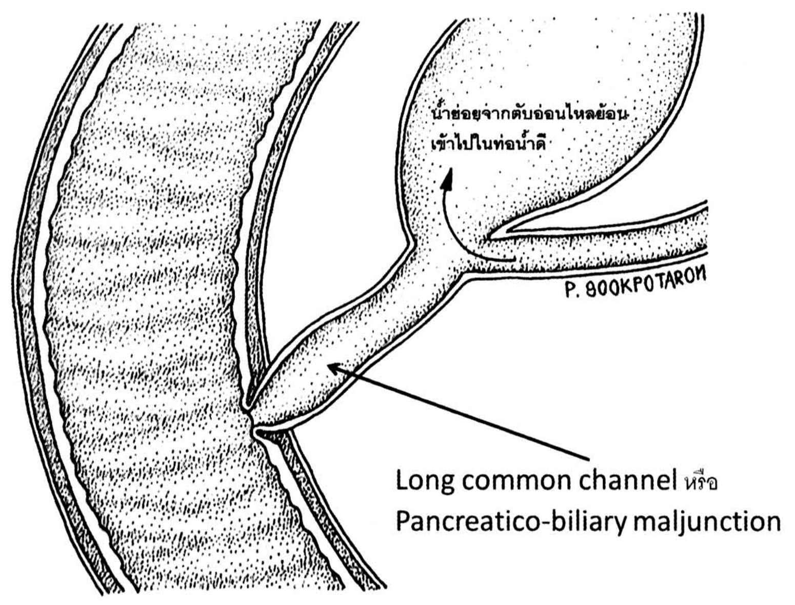

> **Caption (verbatim):** **รูปที่ 12** แสดง pancreatico-biliary maljunction ซึ่งเป็นทฤษฎีการเกิดโรคท่อน้ำดีโป่งพอง
> **Text in image (verbatim):** น้ำย่อยจากตับอ่อนไหลย้อนเข้าไปในท่อน้ำดี · Long common channel หรือ Pancreatico-biliary maljunction · P. SOOKPOTAROM
> **Description:** Stippled pen-and-ink drawing. On the left a curved segment of duodenal wall (layered wall with mucosa) runs vertically. A dilated common bile duct (large saccular structure, upper right) narrows downward and is joined by the pancreatic duct (entering from the right) well outside the duodenal wall, forming a long common channel that then enters the duodenal wall at the ampulla. A long arrow labelled "Long common channel หรือ Pancreatico-biliary maljunction" points to this shared channel. A curved arrow starts at the pancreatic duct junction and points upward into the dilated bile duct, labelled "น้ำย่อยจากตับอ่อนไหลย้อนเข้าไปในท่อน้ำดี" (reflux of pancreatic juice into the bile duct). Artist's signature "P. SOOKPOTAROM" under the pancreatic duct.
> **Identifiers in image:** none

อาการทางคลินิกของเด็กที่เป็นโรคท่อน้ำดีโป่งพองที่ทำให้มาพบแพทย์มักเกิดจากการอุดตันและการอักเสบในท่อน้ำดี ลักษณะอาการคลาสสิก 3 อย่าง (classical triad) คือ ปวดท้องชายโครงด้านขวา ตัวเหลืองเป็นๆ หายๆ และคลำได้ก้อนในท้องบริเวณใต้ชายโครงด้านขวา นอกจากนี้ผู้ป่วยอาจจะมีไข้หนาวสั่นร่วมด้วยจากการติดเชื้อทางเดินน้ำดี แต่เนื่องจากในปัจจุบัน แพทย์ให้การวินิจฉัยได้รวดเร็วขึ้นทำให้พบลักษณะอาการคลาสสิคทั้ง 3 อย่างที่พบในผู้ป่วยคนเดียวกันน้อยลงมากเหลือเพียงร้อยละ 10 เท่านั้น

การยืนยันการวินิจฉัยอาศัยการตรวจช่องท้องด้วยคลื่นเสียงความถี่สูง ซึ่งจะพบถุงน้ำดีมีขนาดใหญ่กว่าปกติ และลักษณะของท่อน้ำดีโป่งพองตามชนิดของโรคอาจพบนิ่วในถุงน้ำดีหรือท่อน้ำดีร่วมด้วย (รูปที่ 13 และ 14) บางครั้งถ้าท่อน้ำดีที่โป่งพองมีขนาดใหญ่มากอาจจำเป็นต้องทำการตรวจเพิ่มเติมด้วย CT scan (รูปที่ 15) หรือ Magnetic Resonance Cholangio-Pancreatico-graphy (MRCP) เพื่อดูลักษณะของระบบทางเดินน้ำดี (biliary system) ทั้งหมด

<!-- p.989 (printed 975) -->
สำหรับชนิดของท่อน้ำดีโป่งพองสามารถแบ่งออกได้เป็น 5 ชนิด ตามลักษณะทางกายวิภาคดังรูปที่ 13

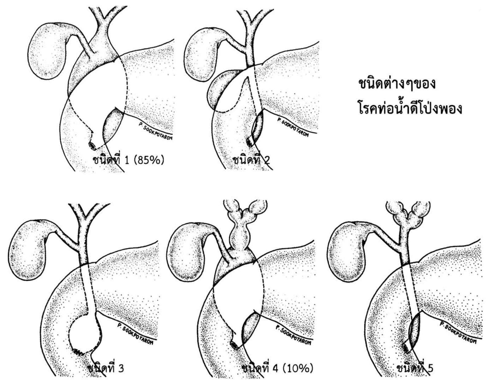

> **Caption (verbatim):** **รูปที่ 13** แสดงชนิดของโรคท่อน้ำดีโป่งพอง : ชนิดที่ 1 fusiform หรือ cystic dilatation ของท่อน้ำดี พบได้ร้อยละ 90 ชนิดที่ 2 diverticulum ของท่อน้ำดี พบได้ร้อยละ 3 ชนิดที่ 3 intraduodenal cystic dilatation ของท่อน้ำดี พบได้ร้อยละ 4 ชนิดที่ 4 multiple fusiform หรือ cystic dilatations ของทางเดินน้ำดีทั้งในตับและนอกตับ พบได้ร้อยละ 2 และชนิดที่ 5 multiple intrahepatic cystic dilatation ของทางเดินน้ำดี พบได้ร้อยละ 1
> **Text in image (verbatim):** ชนิดต่างๆของ โรคท่อน้ำดีโป่งพอง · ชนิดที่ 1 (85%) · ชนิดที่ 2 · ชนิดที่ 3 · ชนิดที่ 4 (10%) · ชนิดที่ 5 · P. SOOKPOTAROM (artist signature, on each panel)
> **Description:** Five stippled line drawings of the gallbladder, hepatic ducts, common bile duct, duodenum (C-loop) and pancreas, each showing one type of choledochal cyst, with the bold title "ชนิดต่างๆของโรคท่อน้ำดีโป่งพอง" at upper right. Top row: ชนิดที่ 1 (85%) - the extrahepatic common bile duct is diffusely dilated into a large fusiform/cystic sac that continues behind the duodenum/pancreas (dashed outline) down to the ampulla; the intrahepatic ducts above are normal. ชนิดที่ 2 - a saccular diverticulum projects from the side of an otherwise normal-calibre common bile duct (dashed portion behind the duodenum). Bottom row: ชนิดที่ 3 - the common bile duct is normal in calibre but its terminal part forms a round cystic dilatation (choledochocele) bulging within the duodenal wall at the ampulla (dashed outline). ชนิดที่ 4 (10%) - multiple cystic dilatations of the intrahepatic ducts (grape-like cysts at the top) together with a large cystic dilatation of the extrahepatic duct extending behind the duodenum. ชนิดที่ 5 - multiple cystic dilatations confined to the intrahepatic ducts, with a normal-calibre extrahepatic common bile duct. Note: the in-figure percentages (type 1 85%, type 4 10%) differ from those in the printed caption (90% and 2%); both transcribed as printed.
> **Identifiers in image:** none

<!-- p.990 (printed 976) -->
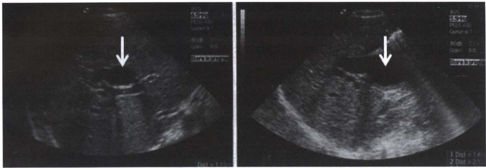

> **Caption (verbatim):** **รูปที่ 14** แสดงภาพคลื่นเสียงความถี่สูงบริเวณขั้วตับของผู้ป่วย ท่อน้ำดีโป่งพอง ชนิดที่ 1 จะเห็น fusiform dilatation ของท่อน้ำดี (ลูกศร)
> **Text in image (verbatim):** small burned-in ultrasound machine settings at the right of each panel and distance readouts at the bottom (beginning "Dist =", "1 Dist = 1.4", "2 Dist = 2."; the rest cut off), too small/blurred to read reliably · white arrows (no text)
> **Description:** Two side-by-side grayscale ultrasound images (sector probe) of the porta hepatis region. In each, a white downward arrow points to a rounded/oval anechoic (black) structure, the fusiform dilatation of the bile duct described in the caption: in the left panel a smaller oval anechoic lumen with an echogenic posterior wall, in the right panel a larger anechoic area within the surrounding liver tissue. No patient name or ID visible.
> **Identifiers in image:** none

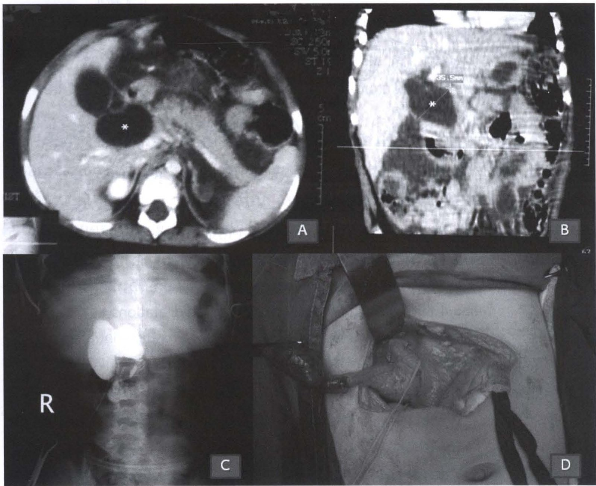

> **Caption (verbatim):** **รูปที่ 15** แสดง CT scan ของเด็กที่เป็นโรคท่อน้ำดีโป่งพอง ชนิดที่ 1 จะเห็น fusiform dilatation ขนาดใหญ่ (\*) ของท่อน้ำดี (A) และ (B), Intra-operative cholangiogram ยืนยันการวินิจฉัย (C) และลักษณะของท่อน้ำดีโป่งพองขณะทำการผ่าตัด (D)
> **Text in image (verbatim):** A · B · C · D · \* (on the cyst in A and B) · 35.5mm (measurement label in B) · R (side marker in C) · 5 cm (scale bar in A) · small burned-in CT parameters at top right of A (partly legible, e.g. "SC 250", "SW 5.0", "ST 1", each cut off) · 67 (small number at the panel-B/D border)
> **Description:** Four-panel composite. (A) Axial contrast-enhanced CT of the upper abdomen in a child: a large round low-density (fluid) mass marked with an asterisk lies at the porta hepatis / right of the pancreas head, with another rounded low-density structure just above it; liver, enhancing vessels, spine and kidneys visible. (B) Coronal CT reconstruction showing the same large low-density cystic structure (asterisk) below the liver, with a diagonal measurement line labelled 35.5mm. (C) Intra-operative cholangiogram (AP radiograph, "R" marker on the patient's right): contrast fills a bulbous, saccular dilated bile duct projected to the right of the spine. (D) Intra-operative colour photograph (shown in grayscale) through an upper abdominal incision with retractors, showing the large dilated choledochal cyst wall exposed with a thin catheter/tube; the child's abdomen and umbilicus are visible, no face.
> **Identifiers in image:** none

<!-- p.991 (printed 977) -->
การรักษาทำได้โดยการผ่าตัดเอาท่อน้ำดีส่วนที่โป่งพองออก (choledochal cyst excision) และต่อทางเดินน้ำดีแบบ Roux-en-Y hepatico-jejunostomy (รูปที่ 16) หรือ hepatico-duodenostomy12 เพราะมีการรายงานของการเกิด liver fibrosis และ cystadenocarcinoma ของท่อน้ำดีที่โป่งพองได้ ถ้าไม่ได้ทำการผ่าตัดเอาท่อน้ำดีที่โป่งพองออก หรือผ่าตัดเพียงแค่ bypass แบบ choledochal cysto-jejunostomy

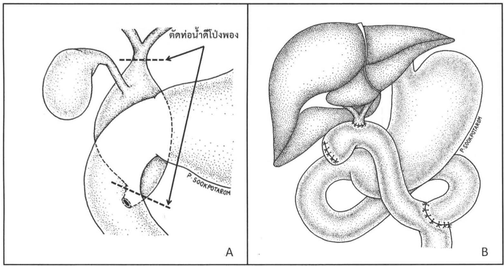

> **Caption (verbatim):** **รูปที่ 16** แสดงการผ่าตัดรักษาโรคท่อน้ำดีโป่งพองด้วยวิธี choledochal cyst excision (A) ร่วมกับ roux-en-Y hepatico-jejunostomy (B)
> **Text in image (verbatim):** ตัดท่อน้ำดีโป่งพอง · A · B · P. SOOKPOTAROM (artist signature)
> **Description:** Two boxed stippled line drawings. (A) Gallbladder, hepatic ducts and a fusiform dilated common bile duct (type 1 choledochal cyst) passing behind the duodenum/pancreas (dashed outline) to the ampulla. Two thick dashed transection lines are drawn: one across the common hepatic duct just below the hepatic duct confluence, and one across the distal end of the cyst near the duodenum/ampulla; arrows from the label "ตัดท่อน้ำดีโป่งพอง" point to both lines, indicating excision of the whole dilated segment. (B) Reconstruction after excision: liver (anterior view) with the hepatic duct stump anastomosed (suture marks) to the side of a Roux-en-Y jejunal limb; the limb's blind end is closed (sutured), it is brought up in a loop, and further down a stapled/sutured jejuno-jejunal anastomosis joins the biliopancreatic limb to the Roux limb; the stomach is seen to the right.
> **Identifiers in image:** none

<!-- p.992 (printed 978) -->
บางครั้งท่อน้ำดีที่โป่งพองมีการอักเสบเรื้อรังและมีการติดแน่นกับอวัยวะทางด้านหลัง คือ portal vein และ hepatic artery อาจเกิดอันตรายต่อเส้นเลือดทั้งสองนี้ได้ หากพยายามที่จะตัดเอาท่อน้ำดีที่โป่งพองออกทั้งหมด ซึ่งสามารถป้องกันได้โดยการตัดผนังของท่อน้ำดีที่โป่งพองทางด้านหน้าออกทั้งหมด และเหลือผนังของท่อน้ำดีส่วนที่ติดกับเส้นเลือดไว้ ร่วมกับการตัดเอาเฉพาะเยื่อบุ (mucosa) ของท่อน้ำดีออกทั้งหมด เรียกว่า Lilly’s method ดังรูปที่ 17

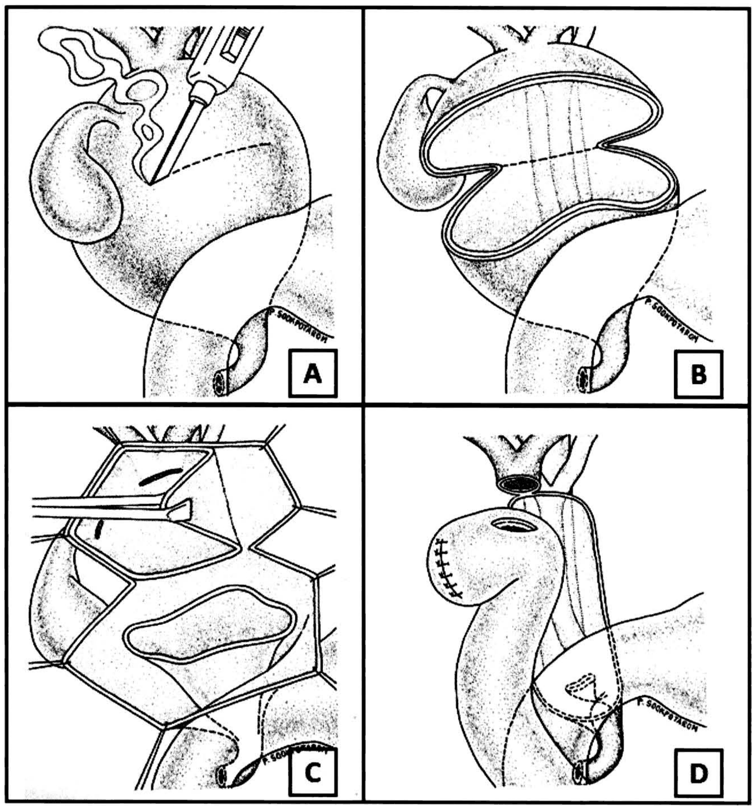

> **Caption (verbatim):** **รูปที่ 17** แสดงการผ่าตัดเอาท่อน้ำดีโป่งพองออกแบบ Lilly’s method: เปิดท่อน้ำดีโป่งพองออกตามขวางทางด้านหน้า (A), ทางด้านหลังเหลือส่วนที่ติดกับ portal vein และ hepatic artery (B), เลาะเฉพาะเยื่อบุของท่อน้ำดีโป่งพองทางด้านหลังที่ติดกับเส้นเลือดออก โดยเหลือผนังที่เป็นกล้ามเนื้อเรียบไว้เพื่อป้องกันการบาดเจ็บต่อเส้นเลือดเหล่านั้น (C) และต่อ hepatico-jejunostomy แบบ Roux-en-Y (D).
> **Text in image (verbatim):** A · B · C · D · P. SOOKPOTAROM (artist signature, on each panel)
> **Description:** Four-panel stippled line drawing (2 × 2, boxed) of the operative steps. (A) A large cystic dilated common bile duct with the gallbladder at left; an electrocautery pencil begins a transverse incision across the anterior wall of the cyst (dashed line marks the planned cut); the smoke plume rises from the tip. (B) The anterior wall has been opened transversely, showing the cut edges (double-line wall layers) and the inner posterior wall of the cyst, with faint longitudinal lines of the underlying vessels behind it. (C) The cyst has been opened widely with edges retracted (polygonal outlined flaps); forceps lift the mucosa off the posterior wall, and an inner island outline shows the posterior wall muscle layer left in place over the vessels. (D) Reconstruction: the hepatic duct stump at the top (shown open) and a Roux-en-Y jejunal loop with a sutured (closed) blind end and an opening on its antimesenteric side for the hepatico-jejunostomy; the remnant posterior cyst wall and the ligated distal duct stump (dashed outline) lie behind the duodenum.
> **Identifiers in image:** none

<!-- p.993 (printed 979) -->
การผ่าตัดรักษาสามารถทำได้ทั้งแบบเปิดช่องท้อง (open surgery), การผ่าตัดแบบใช้กล้องส่องช่วย (laparoscopic-assisted surgery), และการผ่าตัดด้วยกล้องส่องทั้งหมด (total laparoscopic surgery) ปัจจุบันนี้การรักษาโรคท่อน้ำดีโป่งพองโดยการผ่าตัดด้วยกล้องส่องได้รับความนิยมมากขึ้นเรื่อยๆ12, 13 ดังรูปที่ 18

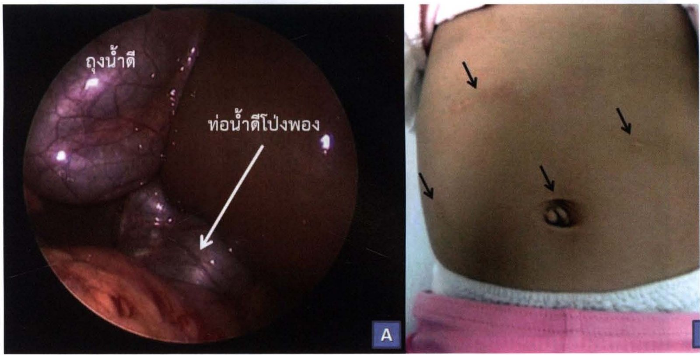

> **Caption (verbatim):** **รูปที่ 18** แสดงการรักษาโรคท่อน้ำดีโป่งพองในเด็กอายุ 2 ปี ด้วยวิธี laparoscopic-assisted surgery จะเห็นถุงน้ำดีและท่อน้ำดีโป่งพองจากกล้องส่อง (A) และแผลจากการผ่าตัดซึ่งมองแทบไม่เห็น (B)
> **Text in image (verbatim):** ถุงน้ำดี · ท่อน้ำดีโป่งพอง · A · (panel B label cut off at the right edge as printed)
> **Description:** Two colour photographs side by side. (A) Laparoscopic view (circular endoscopic field) of the right upper quadrant: the purple-pink gallbladder labelled "ถุงน้ำดี" at upper left, and below it a rounded bluish-purple dilated bile duct labelled "ท่อน้ำดีโป่งพอง" with a white arrow pointing to it; liver surface in the background. (B) Photograph of the child's abdomen after surgery (umbilicus at lower centre, pink garment at the bottom): four black arrows point to the small, barely visible healed port-site scars - one at the umbilicus, one in the right upper abdomen, one in the right flank and one in the left upper abdomen. No face shown.
> **Identifiers in image:** none

## นิ่วในถุงน้ำดี (Gallstones)

นิ่วในถุงน้ำดีพบได้น้อยในเด็ก ส่วนใหญ่พบในเด็กที่มีภาวะ chronic hemolytic anemia เช่น ในโรคทาลัสซีเมีย อุบัติการณ์ของการพบนิ่วในถุงน้ำดีในเด็กกลุ่มนี้เท่ากับร้อยละ 20-40 สำหรับอาการทางคลินิกมีอาการเช่นเดียวกับผู้ใหญ่ ได้แก่ อาการปวดท้องจุกแน่นบริเวณลิ้นปี่หรือใต้ชายโครงด้านขวา โดยเฉพาะเวลาหลังอาหารหรือตอนนอน ถ้าถุงน้ำดีมีอาการอักเสบร่วมด้วยจะมีไข้และอาการของการติดเชื้อในกระแสเลือด

การยืนยันการวินิจฉัยทำได้โดยการตรวจด้วยคลื่นเสียงความถี่สูง ซึ่งถือว่าเป็นการตรวจมาตรฐานสำหรับนิ่วในถุงน้ำดี สำหรับการรักษาสามารถทำได้โดยการผ่าตัด ตัดถุงน้ำดีออก (cholecystectomy) ปัจจุบันการผ่าตัดด้วยกล้องส่อง (laparoscopy) ถือเป็นการผ่าตัดรักษามาตรฐานสำหรับนิ่วในถุงน้ำดีในเด็ก14 (รูปที่ 19)

<!-- p.994 (printed 980) -->
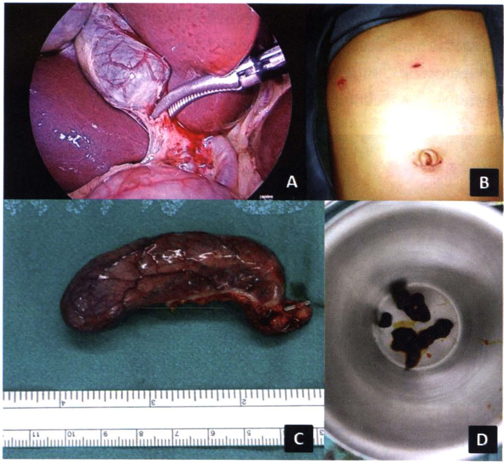

> **Caption (verbatim):** **รูปที่ 19** แสดงผู้ป่วยเด็กที่ได้รับการผ่าตัด ตัดถุงน้ำดีออกด้วยวิธี laparoscopic cholecystectomy จะเห็นภาพการผ่าตัดขณะเลาะบริเวณ cystic duct (A), แผลผ่าตัดมีขนาดเล็ก (B), ถุงน้ำดีที่ถูกตัดออกมา (C) และนิ่วในถุงน้ำดี (D)
> **Text in image (verbatim):** A · B · C · D · ruler scale printed upside down in C: 4 · 3 · 2 (upper scale) and 11 · 10 · 9 · 8 · 7 · 6 · 5 · 3 (lower scale)
> **Description:** Four-panel colour photo composite. (A) Laparoscopic view (circular field) of the liver underside with the gallbladder retracted upward; a curved laparoscopic dissector/grasper is dissecting the tissue at the cystic duct region (Calot's triangle area), with some blood staining. (B) The child's abdomen after surgery with surgical drapes at the sides: small port-site incisions are visible (one in the upper abdomen, one on the right side) plus the umbilicus at the bottom. No face shown. (C) The excised, intact, dark reddish-purple curved gallbladder on a green surgical towel, with a metal clip at the cystic duct end at right, and a ruler (printed upside down) below it for scale. (D) A stainless-steel bowl containing several dark brown-black irregular gallstones with a little yellow bile.
> **Identifiers in image:** none

## สรุป

ทารกที่มีอาการตัวเหลืองชนิดที่เกิดจากการอุดตันของทางเดินน้ำดี ร่วมกับถ่ายอุจจาระสีซีด ต้องได้รับการประเมินและให้การวินิจฉัยที่รวดเร็ว เพื่อที่หากทารกนั้นเป็นโรคทางเดินน้ำดีตันจะได้รับการผ่าตัดรักษาในระยะเวลาที่เหมาะสมและทันท่วงที การรักษาทารกที่เป็นโรคทางเดินน้ำดีตันทำได้ด้วยวิธี Kasai operation และหากการผ่าตัดไม่สามารถทำให้ทารกนั้นมีน้ำดีไหลลงมาในลำไส้ได้อย่างพอเพียง การปลูกถ่ายตับจะเป็นการรักษาในลำดับต่อไป

<!-- p.995 (printed 981) -->
ส่วนโรคท่อน้ำดีโป่งพองมักพบในเด็กเล็ก อาจมีอาการปวดท้องชายโครงขวาหลังอาหาร ตัวเหลืองและอาจคลำได้ก้อนที่หน้าท้องด้านขวาบน การรักษาทำโดยการผ่าตัดเอาท่อน้ำดีที่โป่งพองออกและต่อทางเดินน้ำดีกับลำไส้เล็ก สำหรับโรคนิ่วในถุงน้ำดีมักพบในเด็กโตที่เป็นโรคเลือด เช่น ทาลัสซีเมีย การรักษาทำได้โดยการตัดถุงน้ำดีออก

## เอกสารอ้างอิง

1. Sookpotarom P, Vejchapipat P. Non-correctable biliary atresia with large extrahepatic cyst: a report of two cases. Eur J Pediatr Surg 2007;17:295-7.
2. Lillegard JB, Miller AC, Flake AW. Biliary atresia. In: Mattei P, Nichol PF, Rollins II MD, Muratore CS, eds. Fundamentals of pediatric surgery. 2 ed. New York: Springer International Publishing; 2017:629-36.
3. Yamataka A, Cazares J, Miyano T. Biliary atresia. In: Holcomb III GW, Murphy JP, Ostlie DJ, eds. Ashcraft’s pediatric surgery. 6 ed. London: Elsevier Saunders; 2014:580-92.
4. Vejchapipat P, Passakonnirin R, Sookpotarom P, Chittmittrapap S, Poovorawan Y. High-dose steroids do not improve early outcome in biliary atresia. J Pediatr Surg 2007;42:2102-5.
5. Sookpotarom P, Vejchapipat P, Chittmittrapap S, Chongsrisawat V, Chandrakamol B, Poovorawan Y. Short-term results of Kasai operation for biliary atresia: experience from one institution. Asian J Surg 2006;29:188-92.
6. Chusilp S, Sookpotarom P, Tepmalai K, et al. Prognostic values of serum bilirubin at 7th day post-Kasai for survival with native livers in patients with biliary atresia. Pediatr Surg Int 2016;32:927-31.
7. Chiengthong K, Somboonnithiphol K, Kittipinyovath P, et al. Pregnancy in biliary atresia after kasai operation complicated by portal hypertension. J Med Assoc Thai 2006;89:1961-4.
8. Davenport M. Biliary atresia. In: Davenport M, Heaton N, Superina R, eds. Surgery of the liver, bile ducts and pancreas in children. 3 ed. Boca Raton: CRC Press; 2017:71-86.

<!-- p.996 (printed 982) -->
9. Vejchapipat P, Theamboonlers A, Poomsawat S, Chittmittrapap S, Poovorawan Y. Serum transforming growth factor-beta1 and epidermal growth factor in biliary atresia. Eur J Pediatr Surg 2008;18:415-8.
10. Vejchapipat P, Poomsawat S, Chongsrisawat V, Honsawek S, Poovorawan Y. Elevated serum IL-18 and interferon-gamma in medium-term survivors of biliary atresia. Eur J Pediatr Surg 2012;22:29-33.
11. Vejchapipat P, Sookpotarom P, Theamboonlers A, Chittmittrapap S, Poovorawan Y. Elevated serum soluble E-selectin is associated with poor outcome and correlated with serum ALT in biliary atresia. Eur J Pediatr Surg 2008;18:254-7.
12. Liem NT, Holcomb III GW. Choledochal cyst and gallbladder disease. In: Holcomb III GW, Murphy JP, Ostlie DJ, eds. Ashcraft’s pediatric surgery. 6 ed. London: Elsevier Saunders; 2014:593-606.
13. Schindel DT, Oltmann SC. Cystic disorders of the bile ducts (choledochal cysts). In: Ladd AP, Rescorla FJ, Grosfeld JL, eds. Handbook of pediatric surgical patient care. Singapore: World Scientific; 2014:805-15.
14. Rescorla FJ. Gallbladder disease in children. In: Ladd AP, Rescorla FJ, Grosfeld JL, eds. Handbook of pediatric surgical patient care. 1 ed. Singapore: World Scientific; 2014:825-35.
